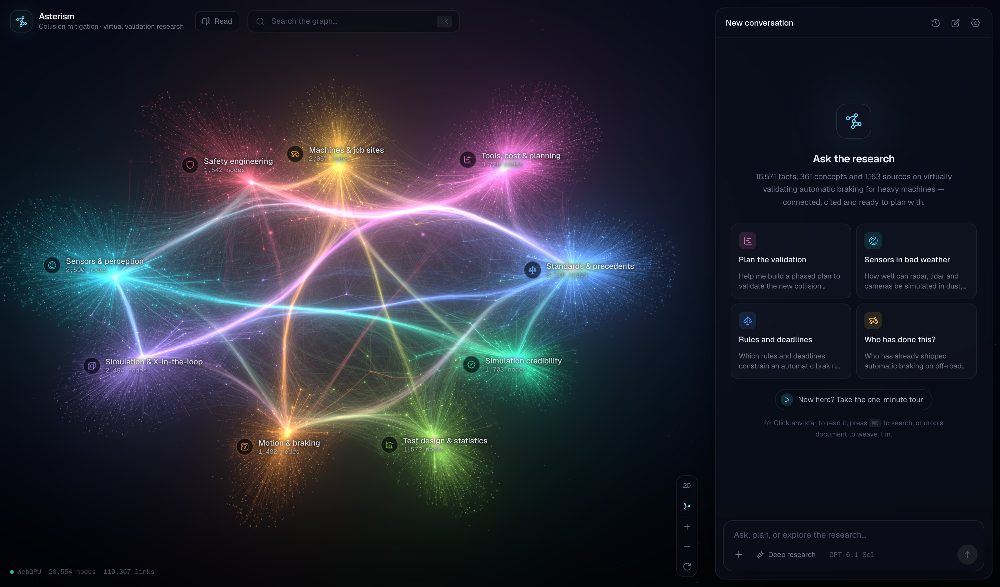
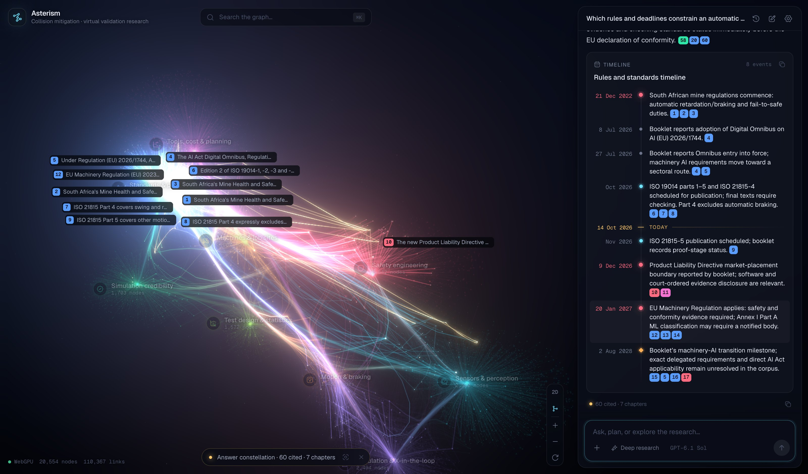

# Asterism

A knowledge and planning agent over the research booklet _Virtual Validation of a Collision
Mitigation System for Heavy Off-Road Machines_ and its _Glossary and Prerequisites_
(`references/`). Every claim, number, gap and citation is a star in a WebGPU constellation; a
Deep Agent searches and walks that graph, stitches findings from different chapters together,
answers with live citations, and helps plan — while the stars it touches light up.





## Run it

```bash
npm install
```

Put an OpenAI key in `.env` (users can also bring their own key in Settings):

```bash
echo "OPENAI_API_KEY=sk-..." > .env
```

```bash
npm run dev
```

Open http://localhost:5173 in a WebGPU browser (Chrome on macOS). For a production server
(http://localhost:3000, reads `.env` if present):

```bash
npm run build && npm start
```

## What you can do

- **Ask** anything about the research. Answers stream with numbered citations; hover a chip to light
  its star, click it to fly there and read the fact, its quote, sources and cross-chapter links.
- **Watch the agent work**: the activity log shows skills, searches, hubs explored and parallel
  researchers; the graph lights every node they touch. Hover a step to see what it found. The
  finished answer is drawn as a gold _answer constellation_ across the chapters it used.
- **Plan**: ask for a validation plan; the agent researches, asks you a few questions in an in-chat
  form, and returns an interactive plan (gantt strip, phases, gates) and other blocks — timelines,
  comparisons, risk matrices, metrics, checklists, flows, source lists.
- **Explore**: click any star, search with ⌘K, or take the one-minute tour through the nine
  constellations (the glossary's learning path).
- **Grow the graph**: drop a Markdown or text file anywhere (or use +). Its facts are extracted,
  linked to the concepts and entities the graph already knows, and fly into the constellation; the
  agent can then reason across your notes and the booklet.
- **Remember**: the agent keeps a short memory of your project (machines, sensors, markets,
  deadlines) across conversations; view or clear it in Settings.

## How it works

| Piece | Where |
|---|---|
| Graph build (parse → extract → resolve → sources → assemble → link) | `scripts/kg/*`, shared code in `src/lib/server/kg/` |
| Graph database (typed property graph, BM25 search with stemming/aliases, paths) | `src/lib/server/kg/store.ts` |
| Agent (`deepagents`, `gpt-6.1-sol`, graph tools, researcher subagent, skills, memory) | `src/lib/server/agent/*`, `agent/skills/*/SKILL.md` |
| Streaming chat (SSE) | `src/routes/api/chat`, `src/lib/server/agent/run.ts` |
| WebGPU constellation (TSL compute layout, bundled edges, bloom) | `src/lib/graph/GraphRenderer.ts` |
| Chat, generative blocks, node card, search, tour | `src/lib/chat`, `src/lib/blocks`, `src/lib/graph`, `src/lib/app` |

The graph (20.6k nodes, 110k edges): 16.6k atomic facts, 1.16k cited sources (duplicates merged), 361 glossary
concepts, 2k resolved entities and the document structure, plus ~10k cross-chapter fact relations
(restates, supports, contradicts, elaborates, depends) and a cited synopsis for every concept or
entity discussed in more than one place. It is one connected component; all but one fact link to a
concept, entity, source or another fact. No embeddings: retrieval is full-text search plus graph
traversal. See `docs/PLAN.md` for the pipeline, `docs/VISION.md` for the intent and
`docs/DEMO.md` for a five-minute demo.

Rebuild the graph from the references (≈1 h of `gpt-6.1-sol` calls, cached per chunk):

```bash
npx tsx scripts/kg/parse.ts && npx tsx scripts/kg/extract.ts && npx tsx scripts/kg/resolve.ts && npx tsx scripts/kg/sources.ts && npx tsx scripts/kg/assemble.ts && npx tsx scripts/kg/link.ts && npx tsx scripts/kg/assemble.ts
```

## Quality

- `npx tsx evals/run.ts --tag name` — 30 cross-chapter questions with gold claims from the booklet's
  synthesis; a judge scores answer recall, retrieval recall, citation precision and an overall grade.
  Reports in `evals/out/`. History in `docs/PLAN.md`.
- `npx tsx evals/probe.ts` — multi-turn conversations ending with the agent's own debrief of what
  confused it.
- `npx vitest run --project server` — unit tests (search, folding, markdown citations, blocks).
- `npx playwright test` — end-to-end UI tests (`E2E_AGENT=1` adds a live agent run).
- `npx tsx scripts/dev/screens.ts --ask` — screenshots of key states into `docs/screens/` (dev server running).
