# Glossary and Prerequisites

**A plain-language companion to the research booklet "Virtual Validation of a Collision Mitigation System for Heavy Off-Road Machines"**

Research orchestrator: Neo Mohsenvand

October 2026

---

## Contents

- [How to use this document](#how-to-use-this-document)
- [Start here: ten ideas that unlock the booklet](#start-here-ten-ideas-that-unlock-the-booklet)
- [How the booklet is organized and how to read it](#how-the-booklet-is-organized-and-how-to-read-it)
- [A learning path](#a-learning-path)
- [Quick glossary](#quick-glossary)
- [Part A: The machines, the job sites and the problem](#part-a-the-machines-the-job-sites-and-the-problem)
- [Part B: Safety engineering fundamentals](#part-b-safety-engineering-fundamentals)
- [Part C: Sensors, perception and machine data](#part-c-sensors-perception-and-machine-data)
- [Part D: Simulation, virtual environments and the X-in-the-loop test methods](#part-d-simulation-virtual-environments-and-the-x-in-the-loop-test-methods)
- [Part E: Machine motion, braking and decision logic](#part-e-machine-motion-braking-and-decision-logic)
- [Part F: Test design, statistics and tuning without over-fitting](#part-f-test-design-statistics-and-tuning-without-over-fitting)
- [Part G: Trusting a simulation: credibility, correlation and uncertainty](#part-g-trusting-a-simulation-credibility-correlation-and-uncertainty)
- [Part H: Standards, regulations, bodies and the programs that came before](#part-h-standards-regulations-bodies-and-the-programs-that-came-before)
- [Part I: Tools, computing, cost and project planning](#part-i-tools-computing-cost-and-project-planning)
- [A to Z index](#a-to-z-index)

---

## How to use this document

The research booklet answers thirteen questions about how to prove that an automatic braking system on a heavy machine is safe, using simulation as much as possible, on a short timeline. It was written for engineers. This companion is for everyone else, and for engineers who are new to one of the fields it touches: mining and construction operations, safety engineering, sensors, simulation, vehicle physics, statistics, standards and regulation, tools, and project planning.

It assumes no background. Every technical term, acronym, standard, tool, method and organization in the booklet is explained from zero, in plain English, with an everyday comparison and an example from a mine, quarry or construction site. Entries say how the booklet uses the term and what the booklet concluded about it, with the chapter number in brackets, so that this document can also be used as a map back into the booklet.

There are three ways to read it.

- **As a course.** Read "Start here" below, then the parts in order (A to I). The parts are arranged as a learning path, from the machines and the problem to the plan. The quick glossary gives a one-sentence version of every term, so you can skim a part before reading it in full.
- **As a dictionary.** Jump to the A to Z index at the end, find the term or acronym, and follow the link to its entry. Every entry ends with related terms, each linked, so you can follow a thread.
- **As a reading aid.** Keep it open next to the booklet. When a chapter uses a term you do not know, look it up, read the entry, and go back.

Each entry has the same four labels. **In one sentence** gives the shortest correct definition. **Explained** builds the idea up from everyday experience to the technical meaning and the booklet's use of it. **Why it matters here** says what the term means for validating an automatic braking system on heavy off-road machines before mid-2027, and what the booklet found. **Related terms** links the entries that belong together.

Diagrams are written in Mermaid. They render in viewers that support it (GitHub, Obsidian, Visual Studio Code with a Mermaid extension, and most documentation generators); in other viewers the diagram source appears as text.

## Start here: ten ideas that unlock the booklet

If you read nothing else, read these ten ideas. Each one is a door into a part of the glossary.

**1. The machine, the site and the person on foot.** A wheel loader or haul truck is many times heavier than a car, has large blind spots, works in reverse much of the time, and shares the site with people on foot and light vehicles. The deadliest documented accident pattern is a large machine moving over a person or a light vehicle that the operator cannot see. Most machines already carry a warning system that beeps at the operator. The system studied in the booklet goes one step further: it brakes on its own. In the mining industry's language, warning is "Level 8" and automatic intervention is "Level 9" of a nine-level control model. See [Heavy off-road machine](#heavy-off-road-machine), [Collision](#collision), [Collision Mitigation System (CMS)](#collision-mitigation-system-cms) and [Nine levels of control](#nine-levels-of-control).

**2. Safety is something you prove, not something you feel.** Engineers do not ask "does it seem safe?" They ask "what could go wrong, how bad would it be, how likely is it, and what evidence shows we have reduced it enough?" The answers are organized into a safety case: a claim, the arguments that support it, and the evidence behind each argument. Standards such as ISO 21815 and ISO 19014 say what the arguments must cover, and laws such as the EU Machinery Regulation, which applies from January 2027, say when the evidence must exist. See [Hazard, harm and risk](#hazard-harm-and-risk), [Safety case and safety argument](#safety-case-and-safety-argument), [Functional safety](#functional-safety) and [Standard](#standard).

**3. Seeing is the hard part.** A braking system can only brake for what its sensors detect. Cameras, lidar, radar and ultrasonic sensors each see the world differently, and each fails differently in dust, fog, snow, rain, darkness and glare. Every detection system makes two kinds of mistake: it misses a real person (a false negative) or it reacts to something harmless (a false positive). Tuning it to make fewer misses makes more false alarms, and on a heavy machine a false alarm is a brake slam. Operators switch off systems that brake for nothing. See [Sensor](#sensor), [Perception](#perception), [True positive, false positive, false negative, miss (the four outcomes)](#true-positive-false-positive-false-negative-miss-the-four-outcomes) and [Nuisance braking](#nuisance-braking).

**4. A simulation is a set of models, and a model is only as good as its check against reality.** Simulation lets the team run millions of situations that nobody would stage with a real worker, long before the prototype exists. But a simulation is made of models: of the machine, the ground, the sensors, the weather and the people. Each model must be compared with measurements before its answers can be trusted. The booklet's central finding is that simulation does not replace physical tests; it decides which physical tests are worth the scarce prototype time and multiplies the evidence around them. See [Model and model fidelity](#model-and-model-fidelity), [Simulation and simulator](#simulation-and-simulator), [Virtual validation (virtual testing)](#virtual-validation-virtual-testing) and [Credibility of a simulation](#credibility-of-a-simulation).

**5. The ladder from computer to job site.** Testing moves up a ladder. Model-in-the-loop and software-in-the-loop run the braking logic entirely in a computer. Hardware-in-the-loop connects the real control unit to a simulated machine. Vehicle-in-the-loop puts a real machine on a test track and feeds it simulated obstacles. Proving-ground tests use real machines and soft targets. Shadow mode runs the system on real sites with the brakes disconnected, counting what it would have done. Staged release switches braking on for a narrow set of machines and situations first. Each rung replaces one more piece of simulation with reality. See [The X-in-the-loop family (MIL, SIL, HIL, PIL, VIL, DIL)](#the-x-in-the-loop-family-mil-sil-hil-pil-vil-dil), [Shadow mode (silent testing)](#shadow-mode-silent-testing) and [Staged release and limited operating domain](#staged-release-and-limited-operating-domain).

**6. Recorded data can test seeing, but not stopping.** Machines with the existing warning system can record what their sensors saw. Playing those recordings into the new software, called replay, shows whether it would have detected the person. This is open loop: the recording does not change when the software decides to brake. Once the system brakes, the future changes (the machine stops earlier, the person is somewhere else), and only a closed-loop simulation can follow that. See [Open loop versus closed loop](#open-loop-versus-closed-loop) and [Replay and re-simulation of recorded data (open-loop replay)](#replay-and-re-simulation-of-recorded-data-open-loop-replay).

**7. Trust has a shape: a validity envelope.** A model that has been checked against measurements at 10 and 20 kilometers per hour on dry gravel is trusted between those points, on that surface. Outside that envelope, on ice, at 30 kilometers per hour, with a different sensor height, its answers are guesses. The booklet collects the frameworks that aerospace, medicine, nuclear power and car regulation use to say when a simulation can be trusted. All of them demand physical anchors, a stated envelope, and honesty about uncertainty. The space shuttle Columbia was lost in 2003 partly because a model was used far outside its envelope. See [Validity envelope (domain of validity) and extrapolation](#validity-envelope-domain-of-validity-and-extrapolation), [Correlation](#correlation), [Verification, validation and uncertainty quantification (VVUQ)](#verification-validation-and-uncertainty-quantification-vvuq) and [False confidence from simulation](#false-confidence-from-simulation).

**8. Stopping a heavy machine is physics, and physics sets the sensor range.** A loaded machine on a downhill gravel road needs a long distance to stop, and the brakes take time to respond after the command. Work backwards: the distance needed to stop, plus the distance covered during the delays, is how far the sensor must see a person, reliably, in the worst conditions. If the sensor cannot see that far in dust, the machine must drive slower or the system cannot promise to stop. See [Stopping distance](#stopping-distance), [Brake dead time and brake build-up time](#brake-dead-time-and-brake-build-up-time), [End-to-end latency budget](#end-to-end-latency-budget) and [Required detection range](#required-detection-range).

**9. You cannot test everything, so you must choose cleverly and count honestly.** One hundred site types, many machine models, every season, every speed, every kind of object: the combinations run into the millions. Test design chooses which ones to run, and statistics says what a set of results can prove. Three streams must be kept apart: coverage (spread the tests across the space), discovery (hunt for failures on purpose) and estimation (a frozen random sample that gives an honest number). Mixing them gives a flattering but false number. False alarms are counted per hour of real operation, not per staged test. See [Test space and the combinatorial explosion](#test-space-and-the-combinatorial-explosion), [Scenario (functional, logical, concrete)](#scenario-functional-logical-concrete), [Keeping failure-seeking tests separate from performance estimates](#keeping-failure-seeking-tests-separate-from-performance-estimates), [Binomial claims and the rule of three](#binomial-claims-and-the-rule-of-three) and [Base rate and exposure-based rates (events per 1,000 hours)](#base-rate-and-exposure-based-rates-events-per-1000-hours).

**10. The timeline only works if the prototype is the end of the work, not the start.** The prototype arrives in mid-2027 and the validation window after it is under four months. The documented programs that did this kind of work took years. The booklet's answer is to build everything before the prototype arrives: the scenario catalog, the recorded fleet data, the virtual sites, the sensor and brake models, the test benches and the operator studies. The four months are then used to correlate the models against the real machine, re-run the now-trusted scenario set, confirm the worst cases on a track, and run shadow mode. Release is widened only as evidence arrives. Planning under this much uncertainty needs honest estimates (P50 and P80), gates tied to evidence, and a plan that survives a hostile review. See [Validation window](#validation-window), [Correlation test](#correlation-test), [Evidence gate and decision gate](#evidence-gate-and-decision-gate), [Planning fallacy, reference class forecasting and P50 / P80 estimates](#planning-fallacy-reference-class-forecasting-and-p50--p80-estimates) and [Red team and hostile review](#red-team-and-hostile-review).

The diagram below shows how the nine parts of this glossary fit together.

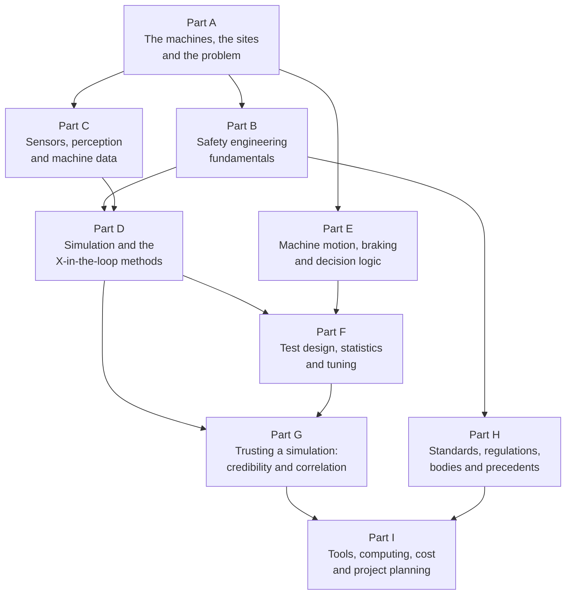

*How the parts build on each other: the problem and the machines first, then safety and sensing, then simulation and physics, then test design and trust, then the rules and the plan.*

## How the booklet is organized and how to read it

**The chapters.** The booklet has an introduction, a research map, a cross-chapter synthesis and thirteen chapters in three parts. Part I (Chapters 1 to 4) frames the problem: the full range of options for shortening validation, the precedents and their real timelines, the rules and acceptance criteria, and the accident record and operator behavior. Part II (Chapters 5 to 11) covers the technical building blocks: virtual job sites, sensor and weather simulation, baseline and comparison testing, machine motion and brake timing, test-space coverage and tuning, simulation credibility, and the tool market. Part III (Chapters 12 and 13) turns on the plan itself: planning and presentation methods, and a skeptic's review of the proposal.

**Inside each chapter.** Every chapter has the same skeleton, so you always know where you are.

| Section | What it contains |
|---|---|
| The research question | The question the chapter answers, as it was set, and what was asked for. |
| About the evidence | How many sources the chapter draws on and how they split between the evidence types. |
| Key findings | The answer in ten to fifteen bullet points. Read these first. |
| Detailed findings | Numbered sections that work through the question, with every important claim labeled and cited. |
| Comparison tables | Side-by-side tables of methods, tools, standards or options. |
| Where the evidence stands | Three lists: what is well established, what is uncertain, and where experts disagree. |
| Blind spots | What the chapter could not find or could not verify, so nobody mistakes silence for a negative result. |
| Sources | The chapter's numbered source list. Citations such as [12] or [3, 7] point here. |

**The evidence labels.** Every important claim carries a label that says what kind of evidence stands behind it. Reading the labels is as important as reading the claims.

| Label | Meaning |
|---|---|
| **Independent** | A peer-reviewed study, the text of a standard or regulation, official statistics, a third-party test, or a government or agency report. The strongest kind. |
| **Vendor** | A supplier's own claim, product page, press release or white paper. Useful, but the supplier has something to sell. |
| **Expert opinion** | A practitioner, consultant or industry-group view without data behind it. Worth hearing, not yet proven. |
| **(on-road evidence)** | Proven only for cars, trucks or buses on roads. Whether it transfers to a loaded haul truck on gravel is one of the central open questions of the whole program. |
| **(draft)**, **(under publication)**, **(under revision)** | A standard that had not been issued in final form by October 2026, or is being replaced. Quote it with care. |
| "not found" | The question was searched and nothing public was found. This is a finding in itself: it means the number, price or timeline cannot be taken from the literature and must come from the manufacturer's own work. |

Across the thirteen chapters there are 1,437 source entries: 974 Independent, 282 Vendor and 181 Expert opinion. Citations are numbered within each chapter and refer to that chapter's own source list, so [12] in Chapter 6 and [12] in Chapter 9 are different documents.

**Codes in the comparison tables.** Some tables, especially in Chapter 6 on sensor realism, use short codes. For how well a condition is reproduced: **G** means good agreement with measurements shown, **P** partial or limited agreement, **W** weak, heuristic or modelable in principle but unvalidated, **NF** no simulation or validation found, and **n/a** means the condition does not affect that sensor physically. For the evidence behind a cell: **I** means an independent peer-reviewed comparison of simulated and real output, **I-** independent but small, qualitative, preprint or industry-authored, **V** the vendor's own claim, and **E** expert inference from related evidence. **ON** means on-road evidence only and **OFF** means some off-road evidence exists.

**Dates.** The booklet is dated October 2026. Several of the standards it discusses change in late 2026 and early 2027, and the EU Machinery Regulation applies from 20 January 2027. Where this glossary says a standard is "under revision" or "under publication", it repeats the booklet's status as of October 2026.

## A learning path

The nine parts are in learning order. A reader with no background can work through them in about a week of evenings. A reader who already knows one field can skip its part and still follow the rest.

| Part | What you will be able to do afterwards | Read with |
|---|---|---|
| A. The machines, the sites and the problem | Picture the machines, the sites, the accidents and the people, and say what a collision mitigation system is and is not. | Chapters 4 and 1 |
| B. Safety engineering fundamentals | Follow a safety argument: hazard, risk, requirement, evidence, acceptance, release. | Chapters 3 and 13 |
| C. Sensors, perception and machine data | Explain what each sensor measures, why it fails in bad conditions, and what the four detection outcomes are. | Chapters 6 and 7 |
| D. Simulation, virtual environments and the X-in-the-loop methods | Describe every test method from a computer run to a shadow-mode fleet, and what each can prove. | Chapters 5, 7 and 1 |
| E. Machine motion, braking and decision logic | Work out a stopping distance, a latency budget and a required detection range, and read a decision-logic diagram. | Chapter 8 |
| F. Test design, statistics and tuning | Judge whether a test campaign can prove what it claims, and spot over-fitting and mixed-up streams. | Chapter 9 |
| G. Trusting a simulation: credibility and correlation | Ask an assessor's questions: validated against what, inside which envelope, with what uncertainty. | Chapter 10 |
| H. Standards, regulations, bodies and precedents | Place any standard, rule, body or precedent program the booklet names, and know its status in October 2026. | Chapters 3 and 2 |
| I. Tools, computing, cost and project planning | Read the tool market neutrally, size the computing, and read or write the plan. | Chapters 11 and 12 |

## Quick glossary

One sentence per term, in the order of the parts. Each term links to its full entry.

### Part A in one sentence each

- [Heavy off-road machine](#heavy-off-road-machine): A heavy off-road machine is a very large, very heavy vehicle built to move earth, rock or materials on a job site rather than to travel on public roads.
- [Wheel loader](#wheel-loader): A wheel loader is a four-wheeled machine with a large bucket at the front that scoops up loose material and tips it into a truck or onto a pile.
- [Haul truck](#haul-truck): A haul truck is a very large off-road dump truck that carries rock or ore from where it is dug to where it is dumped or processed.
- [Articulated hauler (ADT)](#articulated-hauler-adt): An articulated hauler, also called an articulated dump truck (ADT), is an off-road dump truck whose front and rear halves are joined by a hinge so it bends in the middle to steer.
- [Excavator](#excavator): An excavator is a digging machine with a long jointed arm and a bucket, mounted on a body that can rotate a full circle on top of its tracks or wheels.
- [Dozer and grader](#dozer-and-grader): A dozer pushes earth and rock with a wide blade at the front, and a grader levels and shapes road surfaces with a long angled blade under its body.
- [Load-haul-dump machine (LHD)](#load-haul-dump-machine-lhd): A load-haul-dump machine (LHD) is a low, long loader built for underground mines, where it scoops broken rock, carries it along narrow tunnels and dumps it into a truck or a chute.
- [Trackless mobile machinery (TMM)](#trackless-mobile-machinery-tmm): Trackless mobile machinery (TMM) is the South African legal term for any self-propelled mining machine that does not run on rails, from haul trucks and loaders to light vehicles.
- [Light vehicle](#light-vehicle): On a mine site, a light vehicle is an ordinary pickup, four-wheel-drive or van used by supervisors, maintenance crews and visitors to move among the heavy machines.
- [Operator and cab](#operator-and-cab): The operator is the person who drives and controls a machine, and the cab is the enclosed compartment where that person sits.
- [Job site](#job-site): A job site is any place where heavy machines work, and the booklet is concerned with four main kinds: surface mines, underground mines, quarries and construction sites.
- [Haul road, berm, bench and pit wall](#haul-road-berm-bench-and-pit-wall): These are the built features of a surface mine or quarry: the haul road is the internal road the trucks use, a berm is a ridge of material piled along an edge as a barrier, a bench is one horizontal step of the pit, and the pit wall is the steep face between benches.
- [Stockpile, dump point and tip point](#stockpile-dump-point-and-tip-point): A stockpile is a pile of loose material waiting to be used, a dump point is where a truck tips its load, and a tip point or tip head is the active edge of a dump where trucks and a dozer work together.
- [Spotter and pedestrian](#spotter-and-pedestrian): A pedestrian is any person on foot near a working machine, and a spotter is a person whose job is to stand where the operator can see them and guide a reversing or maneuvering machine by hand signals or radio.
- [Blind spot and operator visibility](#blind-spot-and-operator-visibility): A blind spot is any area around a machine that the operator cannot see from the seat, and operator visibility is the overall picture of what the operator can and cannot see with eyes, mirrors and cameras.
- [Reversing and reverse alarm](#reversing-and-reverse-alarm): Reversing (backing up) is driving a machine backward, and a reverse alarm is the loud beeping a machine makes automatically while it does so.
- [Vehicle interaction](#vehicle-interaction): Vehicle interaction is the mining industry's term for any situation in which a moving machine comes close to another machine, a person or a fixed feature of the site, whether or not contact happens.
- [Collision](#collision): A collision is a machine striking a person, a vehicle, another machine or a fixed object, and on job sites a small number of collision types cause most of the deaths.
- [Fatality, serious injury and property damage](#fatality-serious-injury-and-property-damage): Accidents are counted in three bands of severity, deaths, serious injuries and damage to equipment or structures, and the records get thinner and less reliable as severity goes down.
- [Exposure](#exposure): Exposure is the amount of opportunity for something to happen, measured in units such as hours of machine operation, kilometers driven, loading cycles or number of close approaches, and it is the denominator that turns a count of events into a rate.
- [Near miss](#near-miss): A near miss is an event that could have caused a collision or injury but did not, usually because someone stopped, swerved or was lucky.
- [Collision Mitigation System (CMS)](#collision-mitigation-system-cms): A Collision Mitigation System (CMS) detects an object close to a machine, warns the operator, and if the operator does not react, applies the brakes automatically to avoid the collision or make it less severe.
- [Collision Warning System (CWS) and Collision Avoidance System (CAS)](#collision-warning-system-cws-and-collision-avoidance-system-cas): A Collision Warning System (CWS) only alerts the operator to a nearby object, while a Collision Avoidance System (CAS) also acts on the machine, slowing or stopping it.
- [Proximity Detection System (PDS)](#proximity-detection-system-pds): A Proximity Detection System (PDS) senses when a person or machine comes within a set distance of a machine and warns or stops it; the term is used mainly in US underground coal mining and in South Africa.
- [Automatic Emergency Braking (AEB) and Advanced Emergency Braking System (AEBS)](#automatic-emergency-braking-aeb-and-advanced-emergency-braking-system-aebs): Automatic Emergency Braking (AEB), called an Advanced Emergency Braking System (AEBS) in United Nations vehicle regulations, is the function on modern cars and trucks that brakes by itself when a crash with the vehicle or person ahead is about to happen.
- [Forward Collision Warning (FCW)](#forward-collision-warning-fcw): Forward Collision Warning (FCW) is the car and truck function that warns the driver of an imminent crash ahead but leaves the braking to the driver.
- [Pedestrian AEB (PAEB)](#pedestrian-aeb-paeb): Pedestrian Automatic Emergency Braking (PAEB) is the version of car AEB that detects people on foot and brakes for them.
- [Intervention](#intervention): An intervention is what a collision system does to the machine itself when the operator has not acted: it reduces speed, stops the machine, or prevents it from starting to move.
- [Staged intervention](#staged-intervention): Staged intervention means that a collision system acts in steps of increasing force, from a quiet information signal through warnings and gentle slowing to hard braking and a locked stop, rather than jumping straight to an emergency stop.
- [Nine levels of control](#nine-levels-of-control): The nine levels of control are the mining industry's ladder of defenses against vehicle interactions, running from how a site is designed (Level 1) to a machine that brakes by itself (Level 9), with warning technology at Levels 7 and 8.
- [Nuisance braking](#nuisance-braking): Nuisance braking is an automatic brake application that was not needed, either because there was no real object (a false intervention) or because the object was real but posed no danger (an unnecessary intervention).
- [False alarm and alarm accuracy](#false-alarm-and-alarm-accuracy): A false alarm is a warning given when nothing dangerous is there, a nuisance alarm is a warning about something real that is not dangerous in the situation, and alarm accuracy is the share of all alarms that deserved a response.
- [Alarm fatigue](#alarm-fatigue): Alarm fatigue is the state in which a person has heard so many alarms that did not matter that they stop reacting to alarms at all, including the one that does matter.
- [Switching off and bypassing](#switching-off-and-bypassing): Switching off and bypassing means defeating a safety system on purpose, by turning it off, overriding it, removing the tag it tracks, or redesigning its zones so it no longer protects what it should.
- [Operator reaction time](#operator-reaction-time): Operator reaction time is the time between a warning (or the appearance of a hazard) and the moment the operator begins to act, for example by pressing the brake.
- [Human factors](#human-factors): Human factors is the field that studies how people perceive, decide and act when working with machines, and designs the machine so that real people, tired or busy or distracted, can use it safely.
- [Human-machine interface (HMI)](#human-machine-interface-hmi): The human-machine interface (HMI) is everything through which the system and the operator communicate: the screens, lights, sounds, vibrations and buttons in the cab.
- [Operator behavior change](#operator-behavior-change): Operator behavior change is the way people start to work differently once a protective system exists, including risk compensation (taking more risk because they feel protected) and over-reliance (letting the system do the watching).
- [Tasks that look like a collision risk to a sensor](#tasks-that-look-like-a-collision-risk-to-a-sensor): Many normal, intended parts of the job, such as loading a truck, bumping a dump berm or working beside ground crew, put a large object close to the machine in exactly the way a sensor is designed to flag.
- [New risks created by automatic braking](#new-risks-created-by-automatic-braking): An automatic stop can itself cause harm, through the jolt to the operator, a shifting or spilled load, loss of stability on a slope, a following machine running into the stopped one, or the machine rolling back once the brake is released.
- [Warning-system fleet](#warning-system-fleet): The warning-system fleet is the set of machines the manufacturer has already sold with the proximity warning system, and its field history is the record of what those machines have detected, warned about and got wrong in real use.
- [Sensor and prototype freeze](#sensor-and-prototype-freeze): The sensor freeze is the project milestone at which the sensor types, numbers and mounting positions are fixed, and the prototype freeze is the milestone at which the first representative hardware and software are fixed; the booklet uses "before freeze" and "after freeze" to divide the work.
- [Validation window](#validation-window): The validation window is the period of less than four months after the prototype arrives in mid-2027 in which the Collision Mitigation System must be validated.
- [Site type and the "100+ site types" claim](#site-type-and-the-100-site-types-claim): A site type is a class of job site with a characteristic layout, surface and traffic (an open pit, a quarry face, a stockpile yard, a road works), and the "100+ site types" claim is the challenge statement that one machine may work across 100 or more job sites and applications.
- [Season and weather coverage](#season-and-weather-coverage): Season and weather coverage means making sure the system has been tested in all the conditions it will meet, including rain, snow, fog, dust, mud, glare, dusk and darkness, and the problem is that the validation window falls in a season that contains few of them.

### Part B in one sentence each

- [Hazard, harm and risk](#hazard-harm-and-risk): A hazard is something that could hurt someone, harm is the injury or damage that actually happens, and risk is how likely the harm is, combined with how bad it would be.
- [Hazard analysis and risk assessment](#hazard-analysis-and-risk-assessment): Hazard analysis is the organized search for everything about a machine and its use that could cause harm, and risk assessment is the judgment of how likely and how severe each of those harms would be.
- [Safety function and safety-related control system](#safety-function-and-safety-related-control-system): A safety function is one specific job that a machine's control system must do to keep people safe, and the safety-related control system is the chain of parts (sensor, computer, actuator) that performs that job.
- [Functional safety](#functional-safety): Functional safety is the part of safety that depends on a control system doing the right thing at the right time, including when its own parts fail.
- [Safety of the Intended Functionality (SOTIF)](#safety-of-the-intended-functionality-sotif): SOTIF is the part of safety concerned with a system that has no broken parts yet still behaves unsafely, because its sensing or decision-making is not good enough for the situation it meets.
- [Performance Level (PL) and Category](#performance-level-pl-and-category): A Performance Level is a five-step grade, written a to e, that says how reliably a safety function on a machine must work, and the Category describes the circuit architecture used to reach that grade.
- [Machine Performance Level (MPL)](#machine-performance-level-mpl): The Machine Performance Level is the earth-moving-machinery version of the Performance Level, defined in the ISO 19014 series, with a required level (MPLr) set by hazard analysis and an achieved level (MPLa) demonstrated by the design.
- [Safety Integrity Level (SIL)](#safety-integrity-level-sil): A Safety Integrity Level is a grade from 1 to 4 used in the IEC 61508 family of standards to say how much risk reduction a safety function must deliver, and the same three letters are used in this booklet for software-in-the-loop, a completely different thing.
- [Automotive Safety Integrity Level (ASIL)](#automotive-safety-integrity-level-asil): ASIL is the road-vehicle grading of how demanding a safety requirement is, from A (lowest) to D (highest), defined in ISO 26262, and it does not apply by scope to off-road machines.
- [Fail-safe, safe state, controlled stop and emergency stop](#fail-safe-safe-state-controlled-stop-and-emergency-stop): A fail-safe system moves itself to a safe state when something goes wrong, and for a moving machine that safe state is usually reached by a controlled stop or, when time is short, an emergency stop.
- [Fault, failure, failure mode and fault injection](#fault-failure-failure-mode-and-fault-injection): A fault is a defect inside a system, a failure is the moment the system stops doing its job because of a fault, a failure mode is the particular way it fails, and fault injection is deliberately introducing faults to see how the system responds.
- [FMEA, FMECA and FMEDA](#fmea-fmeca-and-fmeda): These are three related table-based methods that go through a system part by part and ask, for each part, how it could fail, what would happen, how serious that would be and, in the FMEDA, whether the system would notice.
- [Fault tree analysis (FTA)](#fault-tree-analysis-fta): A fault tree starts from one unwanted top event and works downward, drawing the combinations of smaller failures that could cause it, joined by AND and OR logic.
- [Common-cause failure and independence of channels](#common-cause-failure-and-independence-of-channels): A common-cause failure is one event that knocks out two or more parts that were supposed to back each other up, so redundancy only counts when the channels are truly independent.
- [Diagnostic coverage and dead time of a safety function](#diagnostic-coverage-and-dead-time-of-a-safety-function): Diagnostic coverage is the share of dangerous faults that the system can detect by itself, and dead time is any period during which the safety function is not actually protecting anyone, because a fault has not yet been noticed or because the function is degraded or switched off.
- [Residual risk and as low as reasonably practicable (ALARP)](#residual-risk-and-as-low-as-reasonably-practicable-alarp): Residual risk is the risk that remains after all the protective measures are in place, and ALARP is the principle that risk must be reduced until the cost of reducing it further would be grossly out of proportion to the benefit gained.
- [Acceptance criteria and pass or fail criteria](#acceptance-criteria-and-pass-or-fail-criteria): Acceptance criteria are the measurable conditions, agreed before testing starts, that decide whether a result is good enough, and pass or fail criteria are the same idea applied to one test.
- [Requirements and requirements-based testing](#requirements-and-requirements-based-testing): A requirement is a written statement of what the system must do, precise enough to be tested, and requirements-based testing means that every test exists to check a named requirement and every requirement has at least one test.
- [Traceability](#traceability): Traceability is an unbroken written chain of links from each safety claim to the requirement it rests on, to the scenarios and tests that check that requirement, to the recorded evidence, so that anyone can follow the chain in either direction.
- [Verification versus validation (V&V)](#verification-versus-validation-vv): Verification asks "did we build the thing correctly, according to its specification?", validation asks "did we build the right thing, one that works in the real world for its intended use?", and V&V is the pair.
- [The V-model of development](#the-v-model-of-development): The V-model is a picture of a development process shaped like the letter V: the left arm breaks the need down into requirements and designs, the bottom is where the parts are built, and the right arm climbs back up through tests that check each level against the level opposite it.
- [Safety case and safety argument](#safety-case-and-safety-argument): A safety case is a structured written argument, supported by evidence, that a system is acceptably safe for a stated use in a stated environment, and the safety argument is the reasoning that connects the evidence to the claim.
- [Goal Structuring Notation (GSN) and Structured Assurance Case Metamodel (SACM)](#goal-structuring-notation-gsn-and-structured-assurance-case-metamodel-sacm): GSN is a standard set of diagram shapes for drawing a safety argument, and SACM is a formal data model that lets software tools store and exchange such arguments.
- [Assurance case for autonomous products (UL 4600)](#assurance-case-for-autonomous-products-ul-4600): UL 4600 is a standard that explains how to build and judge a safety case for a product that makes decisions on its own, by setting out a long list of topics and questions the case must answer.
- [Evidence](#evidence): Evidence is any recorded fact (a test result, a measurement, a field record, an analysis, a document) that supports or weakens a claim, and its strength depends on who produced it, how independently, and how directly it bears on the claim.
- [Independent assessment, independent test body and safety board](#independent-assessment-independent-test-body-and-safety-board): Independent assessment is a review of the safety evidence by people who did not produce it; an independent test body is an outside organization that runs or witnesses tests; and a safety board is the internal group with the authority to accept or reject the safety case.
- [Evidence gate and decision gate](#evidence-gate-and-decision-gate): A decision gate is a planned point at which management must decide whether a program continues, changes course or stops, and an evidence gate is a decision gate whose pass criterion is a piece of evidence obtained, not a date reached.
- [Staged release and limited operating domain](#staged-release-and-limited-operating-domain): Staged release means switching the automatic brake on first only for a narrow, well-understood set of machines, movements, speeds and conditions (the limited operating domain), and widening that set step by step as evidence from the field arrives.
- [Field monitoring and operational monitoring](#field-monitoring-and-operational-monitoring): Field monitoring, also called operational or in-service monitoring, is the planned collection and review of data from machines in real use after release, to check that the system behaves as the safety case predicted and to catch the problems the tests missed.
- [Proven in use and reuse of evidence](#proven-in-use-and-reuse-of-evidence): "Proven in use" is a formal route in the functional-safety standards for trusting a component because it has already worked reliably for a long time in the same conditions, and reuse of evidence is the broader idea of carrying test results and analyses from one machine model or product to another instead of repeating them.
- [Equivalence argument between machine variants](#equivalence-argument-between-machine-variants): An equivalence argument, also called a similarity argument, is the reasoned and evidenced claim that evidence gathered on one machine variant also holds for another, because the differences between them do not affect the safety-relevant behavior.
- [Safety of machinery (ISO 12100)](#safety-of-machinery-iso-12100): ISO 12100 is the foundation standard for machine safety: it defines the basic words (hazard, risk, protective measure) and sets out the general method for reducing machine risk in a fixed order.
- [Electro-sensitive protective equipment (ESPE) and safety-related sensors](#electro-sensitive-protective-equipment-espe-and-safety-related-sensors): ESPE is the family of certified safety sensors (light curtains, laser scanners and, recently, radar) that detect a person without touching them and trigger a protective stop, and IEC 61496 and IEC TS 62998 are the standards that define how such sensors are shown to be reliable.
- [Machine learning in safety functions](#machine-learning-in-safety-functions): Machine learning (ML) is software whose behavior is learned from examples rather than written as explicit rules, and when such software helps decide whether to brake, safety engineers treat it differently because its rules cannot be read, its failures are hard to predict, and the standards for it are still being written.
- [Product liability and the EU Product Liability Directive (PLD)](#product-liability-and-the-eu-product-liability-directive-pld): Product liability is the legal duty of a manufacturer to compensate people harmed by a defective product, and the European Union's new Product Liability Directive extends that duty explicitly to software and makes it easier for claimants to obtain the manufacturer's internal evidence.
- [Red team and hostile review](#red-team-and-hostile-review): A red team is a group given the explicit job of attacking a plan to find its weaknesses before real reviewers, customers or accidents do, and a hostile review is the same stance applied to a document.
- [Failure mode of a project and early warning sign](#failure-mode-of-a-project-and-early-warning-sign): Borrowing the engineering word, a failure mode of a project is one specific way the project could fail to deliver what it promised, and an early warning sign is an observable symptom that appears while there is still time to act.
- [Fallback option](#fallback-option): A fallback option is a pre-planned, less ambitious but still responsible outcome that the program switches to when the main plan cannot be delivered on time, chosen so that safety is preserved rather than the headline schedule.

### Part C in one sentence each

- [Sensor](#sensor): A sensor is a device that measures something about the world, such as distance, light or speed, and turns the measurement into an electrical signal a computer can read.
- [Perception](#perception): Perception is the chain of steps by which a machine turns raw sensor signals into a short list of the things around it, with positions and speeds, that the braking logic can act on.
- [Detection, classification and tracking](#detection-classification-and-tracking): Detection says "something is there", classification says "it is a person" or "it is a truck", and tracking follows the object over time so the system knows where it is going; the result is written down as an object list.
- [Field of view (FOV), range, resolution and frame rate (FPS)](#field-of-view-fov-range-resolution-and-frame-rate-fps): These four numbers describe how much a sensor can see: how wide (field of view), how far (range), in how much detail (resolution) and how often (frame rate).
- [Latency](#latency): Latency is the delay between the moment something happens in front of the machine and the moment the machine reacts, measured in a braking system from sensing to the brake command and on to actual deceleration.
- [Camera (RGB camera, CMOS sensor, lens, image signal processor ISP, HDR, rolling shutter)](#camera-rgb-camera-cmos-sensor-lens-image-signal-processor-isp-hdr-rolling-shutter): A camera collects visible light through a lens onto a grid of light-sensitive cells and produces a color image that a computer can search for people and objects.
- [Image quality terms: modulation transfer function (MTF), point spread function (PSF), noise, signal-to-noise ratio (SNR)](#image-quality-terms-modulation-transfer-function-mtf-point-spread-function-psf-noise-signal-to-noise-ratio-snr): These measures say how sharp and how clean a sensor's picture is, so that a simulated camera can be checked against a real one.
- [Stereo camera and depth camera (RGB-D)](#stereo-camera-and-depth-camera-rgb-d): A stereo camera uses two cameras a known distance apart to work out how far away things are, and a depth camera (RGB-D) delivers a color image plus a distance for every pixel.
- [Lidar (light detection and ranging)](#lidar-light-detection-and-ranging): A lidar sends out very short laser pulses, times how long each takes to bounce back, and so builds a precise three-dimensional map of distances around the machine.
- [Point cloud](#point-cloud): A point cloud is a large set of measured points in three-dimensional space, each with an x, y and z position and often a brightness value, that together outline the shapes around a sensor.
- [Radar (radio detection and ranging)](#radar-radio-detection-and-ranging): A radar sends out radio waves and listens for their echoes, measuring both the distance to objects and, from a shift in the returned frequency, how fast they approach or recede.
- [Ultrasonic sensor](#ultrasonic-sensor): An ultrasonic sensor sends out a short burst of sound too high for people to hear and measures the echo to find the distance to the nearest object within a few meters.
- [Thermal camera (long-wave infrared, LWIR, NETD)](#thermal-camera-long-wave-infrared-lwir-netd): A thermal camera makes an image from the heat that objects give off, so it can show a warm person against cold ground in complete darkness.
- [Tag-based proximity systems (UWB, RFID, magnetic field)](#tag-based-proximity-systems-uwb-rfid-magnetic-field): A tag-based proximity system does not look for people and objects; it listens for a small electronic tag that each person or vehicle carries, and warns or stops when a tag comes too close.
- [Satellite positioning (GNSS, GPS, RTK) and inertial sensing (IMU, INS)](#satellite-positioning-gnss-gps-rtk-and-inertial-sensing-imu-ins): Satellite positioning tells a machine where it is on the earth, inertial sensing tells it how it is moving and turning from moment to moment, and together they give the position and motion to which every other measurement is referred.
- [Sensor fusion](#sensor-fusion): Sensor fusion is the combining of measurements from several different sensors into one picture of the surroundings that is more reliable than any single sensor could give.
- [Calibration (intrinsic and extrinsic) and sensor mounting](#calibration-intrinsic-and-extrinsic-and-sensor-mounting): Calibration is the measurement of how a sensor sees (its internal, intrinsic properties) and where it sits on the machine (its external, extrinsic position and angle), so that its readings can be placed correctly in the real world.
- [Time synchronization and time stamps](#time-synchronization-and-time-stamps): A time stamp is the exact time written next to each measurement, and time synchronization is making sure every sensor and computer on the machine writes those times from the same clock.
- [Sensor degradation: dust, mud, rain, snow, fog, spray, glare, darkness, artificial lighting, vibration](#sensor-degradation-dust-mud-rain-snow-fog-spray-glare-darkness-artificial-lighting-vibration): Sensor degradation is the loss of a sensor's performance when the environment interferes with it, by blocking its view, dirtying its window, flooding it with light or shaking it.
- [Occlusion (hidden objects) and sensor obstruction (blocked sensor)](#occlusion-hidden-objects-and-sensor-obstruction-blocked-sensor): Occlusion is when an object is hidden behind something else so the sensor cannot see it, and obstruction is when the sensor itself is blocked, for example by mud on its window.
- [Cluttered and reflective surroundings](#cluttered-and-reflective-surroundings): Cluttered and reflective surroundings are environments full of metal, water, walls and piles that bounce sensor signals in confusing ways, producing echoes from nowhere and hiding real objects.
- [Ground truth](#ground-truth): Ground truth is the trusted, independent record of what was really in front of the machine, where and when, against which the system's detections and warnings are scored.
- [Labeling and annotation (human labels, auto-labeling, offboard detectors)](#labeling-and-annotation-human-labels-auto-labeling-offboard-detectors): Labeling, or annotation, is the work of marking what is in recorded sensor data, such as drawing a box around each person and naming it, so that detectors can be trained and their results scored.
- [Datasets and benchmarks (what MOCS, SODA, RELLIS-3D, RUGD and similar names are)](#datasets-and-benchmarks-what-mocs-soda-rellis-3d-rugd-and-similar-names-are): A dataset is a large collection of recorded and labeled sensor data that researchers share, and a benchmark is a dataset plus an agreed scoring rule, so that different methods can be compared on the same test.
- [True positive, false positive, false negative, miss (the four outcomes)](#true-positive-false-positive-false-negative-miss-the-four-outcomes): Every time a detector looks for something, one of four things happens: it finds something real (true positive), it reports something that is not there (false positive), it misses something real (false negative, or miss), or it correctly stays quiet (true negative).
- [True positive rate, precision, recall, F1 score](#true-positive-rate-precision-recall-f1-score): These single numbers summarize the four outcomes: recall (the true positive rate) is the share of real objects that were found, precision is the share of reports that were real, and the F1 score blends the two.
- [ROC curve and DET curve](#roc-curve-and-det-curve): A ROC curve and a DET curve are graphs that show how a detector's misses and false alarms trade against each other as its sensitivity setting is turned up or down.
- [Time to collision (TTC) and trigger distance (as perception outputs that matter for braking)](#time-to-collision-ttc-and-trigger-distance-as-perception-outputs-that-matter-for-braking): Time to collision is how many seconds remain before the machine and an object meet if neither changes speed, and trigger distance is how far away an object must be when the system decides to warn or brake; both are only as good as the distance and speed that perception delivers.
- [Machine learning detector (neural network, convolutional neural network CNN, training data, inference)](#machine-learning-detector-neural-network-convolutional-neural-network-cnn-training-data-inference): A machine learning detector is software that has learned to find people and objects in sensor data by being shown many labeled examples, instead of being programmed with hand-written rules.
- [Training data, validation data, test data, and the independence rule (data lineage)](#training-data-validation-data-test-data-and-the-independence-rule-data-lineage): Machine-learning data are split into three parts, one to teach the detector, one to choose its settings and one to score it honestly, and the independence rule says the scoring data must never have touched the teaching.
- [Synthetic and generated training data (domain gap, data augmentation)](#synthetic-and-generated-training-data-domain-gap-data-augmentation): Synthetic training data are sensor data made by a simulator or a generative model rather than recorded in the field, and the domain gap is the difference between that artificial data and real data that makes a detector trained on one do worse on the other.
- [Generative models (GAN, diffusion models) and what "generated weather" means](#generative-models-gan-diffusion-models-and-what-generated-weather-means): Generative models are machine-learning systems that create new, realistic-looking images or sensor data, and "generated weather" means using them to add rain, fog, snow, dust or night to a recording made in clear weather.
- [Neural rendering: NeRF and Gaussian splatting (3DGS) as ways to rebuild a scene from photos](#neural-rendering-nerf-and-gaussian-splatting-3dgs-as-ways-to-rebuild-a-scene-from-photos): Neural rendering takes many photographs or scans of a real place and learns a model of it that can then produce new views from positions where no camera ever stood.
- [Physically based rendering (PBR), BRDF and BSDF (how materials reflect light and radar)](#physically-based-rendering-pbr-brdf-and-bsdf-how-materials-reflect-light-and-radar): Physically based rendering computes what a sensor sees from the real physics of light and materials, and a BRDF or BSDF is the mathematical description of how a given surface sends incoming energy back out in each direction.
- [Ray tracing and shooting-and-bouncing rays (SBR) for sensor simulation](#ray-tracing-and-shooting-and-bouncing-rays-sbr-for-sensor-simulation): Ray tracing simulates a sensor by following imaginary rays of light, radio or sound from the sensor into the virtual scene, bouncing them off surfaces and recording what comes back; shooting-and-bouncing rays is the radar version that launches very many rays and adds up their reflections.
- [Electronic control unit (ECU)](#electronic-control-unit-ecu): An electronic control unit is one of the small, rugged computers built into a machine, each running one job such as controlling the engine, the brakes or, here, the collision system.
- [Vehicle network: CAN bus, SAE J1939, DBC file](#vehicle-network-can-bus-sae-j1939-dbc-file): The vehicle network is the wiring and message system through which a machine's computers talk to one another, and J1939 is the standard dialect heavy machines use on it, including for the message that asks the machine to slow or stop.
- [Data logging (what to record on the machine, raw versus processed data, common mistakes)](#data-logging-what-to-record-on-the-machine-raw-versus-processed-data-common-mistakes): Data logging is recording what the machine's sensors saw, what the machine did and what the system decided, in enough detail that the whole event can be replayed and judged later.
- [Data formats and versioning (MDF, CSV, YAML, XML, JSON, Robot Operating System ROS bags)](#data-formats-and-versioning-mdf-csv-yaml-xml-json-robot-operating-system-ros-bags): A data format is the agreed way a file is laid out so that software can read it, and versioning is the practice of giving every file, setting and program a unique identifier so that any result can be traced back to exactly what produced it.
- [Electromagnetic compatibility (EMC)](#electromagnetic-compatibility-emc): Electromagnetic compatibility is the ability of a piece of electronics to work correctly amid electrical noise from other equipment and to avoid producing noise that disturbs others.
- [Over-the-air (OTA) sensor stimulation (as a sensor concept)](#over-the-air-ota-sensor-stimulation-as-a-sensor-concept): Over-the-air sensor stimulation means presenting an artificial signal, a radio echo, a projected image, a laser return or a sound, to a real sensor's own antenna or lens so that the sensor believes it is seeing a real scene.

### Part D in one sentence each

- [Model and model fidelity](#model-and-model-fidelity): A model is a simplified description of a real thing, written in mathematics or computer code, that behaves like the real thing closely enough to answer one particular question, and its fidelity is how closely it does so.
- [Simulation and simulator](#simulation-and-simulator): A simulation is a computer run in which models of the machine, the site, the sensors and the people act together over time, and a simulator is the software that runs it.
- [Virtual validation (virtual testing)](#virtual-validation-virtual-testing): Virtual validation means collecting evidence that a system meets its safety requirements by testing it in simulation and on laboratory benches instead of, or before, testing the complete real machine.
- [Physics-based versus data-driven models](#physics-based-versus-data-driven-models): A physics-based model computes what happens from the laws of nature, while a data-driven model learns what usually happens from recorded examples.
- [Digital twin](#digital-twin): A digital twin is a detailed computer model of one specific real machine or site, kept matched to the real thing by measurements.
- [Virtual job site (virtual environment, scene, 3D asset)](#virtual-job-site-virtual-environment-scene-3d-asset): A virtual job site is a three-dimensional computer model of a mine, quarry or construction site in which simulated machines, sensors and people can be tested.
- [Terrain model, digital elevation model (DEM), mesh and collision proxy](#terrain-model-digital-elevation-model-dem-mesh-and-collision-proxy): A terrain model describes the shape of the ground, a digital elevation model (DEM) is its simplest form, a mesh is the surface of small triangles that a computer draws, and a collision proxy is the invisible simplified shape used to detect contact.
- [Photogrammetry, laser scanning and SLAM](#photogrammetry-laser-scanning-and-slam): These are three ways of measuring a real site in three dimensions: from overlapping photographs, from laser distance measurements, or from a moving machine's own sensors as it drives.
- [Structure from motion (COLMAP) and scene reconstruction](#structure-from-motion-colmap-and-scene-reconstruction): Structure from motion is the mathematical method that recovers camera positions and a three-dimensional point cloud from ordinary photographs, COLMAP is a widely used free program that does it, and scene reconstruction is the whole process of turning recordings into a usable virtual site.
- [Procedural generation](#procedural-generation): Procedural generation builds many different virtual sites automatically from rules and parameter ranges instead of modeling each site by hand.
- [Game engine (Unreal Engine, Unity)](#game-engine-unreal-engine-unity): A game engine is the software core of a video game, which draws three-dimensional worlds, moves objects with simple physics and runs in real time, and many sensor simulators are built on one.
- [Material and sensor material (ASAM OpenMATERIAL)](#material-and-sensor-material-asam-openmaterial): In simulation, a material is the description of how a surface responds to light, radio waves or sound, and ASAM OpenMATERIAL 3D is a standard format for storing those properties for camera, lidar and radar.
- [Scene description standards: OpenUSD, OpenDRIVE, OpenCRG, OpenSCENARIO, OpenLABEL, OpenODD, OpenXOntology](#scene-description-standards-openusd-opendrive-opencrg-openscenario-openlabel-openodd-openxontology): These are agreed file formats that let different simulation tools exchange the same description of a world, a road, a road surface, a sequence of events, a set of labels, an operating domain or a shared vocabulary.
- [Open Simulation Interface (ASAM OSI) and the ASAM organization](#open-simulation-interface-asam-osi-and-the-asam-organization): ASAM OSI is a standard set of messages that lets an environment model, a sensor model and the function under test talk to each other during a simulation, and ASAM is the industry association that publishes it.
- [Co-simulation, Functional Mock-up Interface (FMI), Functional Mock-up Unit (FMU) and SSP](#co-simulation-functional-mock-up-interface-fmi-functional-mock-up-unit-fmu-and-ssp): Co-simulation runs several separate simulation programs together in step, FMI is the standard that lets them plug into each other, an FMU is one model packaged to that standard, and SSP describes how a set of FMUs is wired together.
- [Operational design domain (ODD) and operating-domain taxonomy](#operational-design-domain-odd-and-operating-domain-taxonomy): The operational design domain is the written description of the conditions under which a system is designed to work, and an operating-domain taxonomy is the organized list of attributes used to write it.
- [Scenario (functional, logical, concrete)](#scenario-functional-logical-concrete): A scenario is a description of a situation that unfolds over time, written at one of three levels of detail: in words (functional), with parameter ranges (logical), or with every value fixed (concrete).
- [Scenario catalog, scenario family and scenario parameter](#scenario-catalog-scenario-family-and-scenario-parameter): A scenario catalog is the complete, traceable list of situations a system must be tested against, a scenario family is one logical scenario with its parameter ranges and probability distribution, and a scenario parameter is one of the variables in that family.
- [Test case, test matrix and scenario grid](#test-case-test-matrix-and-scenario-grid): A test case is one fully specified test with an expected result, a test matrix is a table of test cases arranged by the factors they vary, and a scenario grid is a matrix whose cells are concrete scenarios.
- [Corner case, edge case and rare event](#corner-case-edge-case-and-rare-event): An edge case sits at the limit of one parameter, a corner case sits at the limits of several at once, and a rare event is a situation that happens so seldom in normal operation that waiting for it is not a practical way to test it.
- [The X-in-the-loop family (MIL, SIL, HIL, PIL, VIL, DIL)](#the-x-in-the-loop-family-mil-sil-hil-pil-vil-dil): "X-in-the-loop" names a family of test setups in which one real part of the system (the X) is connected to a simulation of everything else, and the family forms a ladder from all-virtual to all-real.
- [Model-in-the-loop (MIL)](#model-in-the-loop-mil): Model-in-the-loop testing runs a model of the control logic against a model of the machine and its surroundings, with no real software or hardware yet.
- [Software-in-the-loop (SIL)](#software-in-the-loop-sil): Software-in-the-loop testing runs the real braking software, compiled for an ordinary computer, inside a simulated machine on a simulated site, so that thousands of scenarios can be tried without any hardware.
- [Hardware-in-the-loop (HIL) with data injection](#hardware-in-the-loop-hil-with-data-injection): Hardware-in-the-loop testing connects the real electronic control unit, with its real wiring and network messages, to a simulator that runs in real time and feeds it the data a real machine would produce.
- [Direct digital or raw signal injection](#direct-digital-or-raw-signal-injection): Raw signal injection feeds simulated or recorded sensor data into the sensor's electronics at a defined electrical point, so that everything downstream of that point is tested and everything upstream is not.
- [Over-the-air sensor stimulation (sensor-in-the-loop)](#over-the-air-sensor-stimulation-sensor-in-the-loop): Over-the-air stimulation presents a real, complete sensor with artificial light, radio waves or sound generated from the virtual scene, so that the whole sensor, including its optics or antenna and its firmware, is in the loop.
- [Vehicle-in-the-loop (VIL) and mixed reality](#vehicle-in-the-loop-vil-and-mixed-reality): Vehicle-in-the-loop testing drives the complete real machine on a safe, empty test area while virtual hazards are fed to its sensors or controller, so that it brakes for a worker who exists only in the simulation.
- [Driver-in-the-loop (DIL), operator-in-the-loop and the machine simulator](#driver-in-the-loop-dil-operator-in-the-loop-and-the-machine-simulator): Driver-in-the-loop or operator-in-the-loop testing puts a real person in a simulator cab, with screens, controls and sometimes motion, to study how operators react when the machine warns, waits and then brakes.
- [Real time (hard real time)](#real-time-hard-real-time): A simulation runs in real time when one simulated second takes exactly one real second, and in hard real time when every computing step is guaranteed to finish within its deadline, every time.
- [Open loop versus closed loop](#open-loop-versus-closed-loop): In an open-loop test the system's output does not change what happens next, while in a closed-loop test the system's actions feed back and alter the situation it then sees.
- [Replay and re-simulation of recorded data (open-loop replay)](#replay-and-re-simulation-of-recorded-data-open-loop-replay): Replay feeds sensor data recorded on real machines back into the software, exactly as recorded, to see what the software would have detected and decided.
- [Semantic or object-list replay](#semantic-or-object-list-replay): Semantic replay feeds the decision software not with raw sensor data but with a list of objects (type, position, speed), either recorded or taken from ground truth, so that only the warning and braking logic is tested.
- [Shadow mode (silent testing)](#shadow-mode-silent-testing): In shadow mode the new braking software runs live on working machines, sees everything the sensors see and decides when it would brake, but its brake commands are disconnected, so it only records what it would have done.
- [Proving ground, track test and whole-machine test](#proving-ground-track-test-and-whole-machine-test): A proving ground is a closed, controlled area where the complete real machine, with its real sensors, is tested against physical targets; a track test is one such test, and a whole-machine test is any test in which nothing is simulated.
- [Soft target, robotic target and target platform (ISO 19206)](#soft-target-robotic-target-and-target-platform-iso-19206): A soft target is a dummy of a person or vehicle that a machine can hit without damage, a robotic target or target platform is a low, self-driving carrier that moves the dummy along a programmed path, and ISO 19206 is the standard series that specifies such targets for road-vehicle testing.
- [Correlation test](#correlation-test): A correlation test is a physical test run specifically to check whether the models predicted what the real machine did, and by how much they were wrong.
- [Regression testing and continuous integration (CI/CD) for simulation](#regression-testing-and-continuous-integration-cicd-for-simulation): Regression testing re-runs old tests after every software change to make sure that nothing which used to work now fails, and continuous integration is the automated factory that does this on every change.
- [Test management, versioning and the traceability chain](#test-management-versioning-and-the-traceability-chain): Test management is the record-keeping that lets thousands of runs be planned, reproduced and traced from the hazard they address to the evidence they produce, and versioning gives every ingredient of a run a fixed identifier.
- [Cloud execution and compute budget](#cloud-execution-and-compute-budget): Cloud execution means renting computers by the hour from a data-center provider to run many simulations in parallel, and the compute budget is the money and machine-hours set aside for that.
- [Headless simulation versus rendered simulation](#headless-simulation-versus-rendered-simulation): A headless simulation runs without drawing any picture, computing only the numbers a test needs, while a rendered simulation produces images or sensor views, which costs far more computing.
- [Sim-to-real gap](#sim-to-real-gap): The sim-to-real gap is the difference between what a system does in simulation and what it does in reality, caused by everything the models leave out or get wrong.
- [Domain randomization](#domain-randomization): Domain randomization deliberately varies the appearance and conditions of simulated scenes at random (lighting, colors, textures, object positions) so that software trained or tested on them does not depend on details that will differ in reality.
- ["Do not make one simulator carry every test" (multi-simulator architecture)](#do-not-make-one-simulator-carry-every-test-multi-simulator-architecture): This is the booklet's recommendation to spread the test program across several levels of simulation fidelity and several tools, each used for the questions it answers well, instead of running every case in one maximum-fidelity simulator.

### Part E in one sentence each

- [Mass, payload and gross vehicle weight (GVWR)](#mass-payload-and-gross-vehicle-weight-gvwr): Mass is how much matter a machine contains, payload is the load it carries, and the gross vehicle weight rating (GVWR) is the maximum total of machine plus load that the manufacturer allows.
- [Speed, acceleration and deceleration](#speed-acceleration-and-deceleration): Speed is how fast something moves, acceleration is how quickly its speed increases, and deceleration is how quickly its speed decreases.
- [Stopping distance](#stopping-distance): Stopping distance is how far a machine travels from the moment a stop becomes necessary until it stands still.
- [Brake dead time and brake build-up time](#brake-dead-time-and-brake-build-up-time): Brake dead time is the pause between the brake command and the first braking effect, and build-up time is the further period until the brakes reach their full force.
- [End-to-end latency budget](#end-to-end-latency-budget): The end-to-end latency budget is the list of every delay between an object appearing and the machine standing still, with a time allowance for each.
- [Grade (slope) and its effect on braking](#grade-slope-and-its-effect-on-braking): Grade is the steepness of the ground; going downhill reduces how hard a machine can slow down, and going uphill helps it.
- [Surface and traction](#surface-and-traction): Traction is the grip between a tire or track and the ground, and on loose, wet or soft surfaces there is less of it, so braking is limited by the ground rather than by the brakes.
- [Wheels versus tracks](#wheels-versus-tracks): Wheeled machines roll on rubber tires, tracked or crawler machines run on steel or rubber belts, and the two grip, steer and stop differently.
- [Articulated steering](#articulated-steering): Articulated steering turns a machine by bending it at a hinge between its front and rear halves, which suits rough ground but makes the machine swing and pitch when it brakes.
- [Hydrostatic drive, retarder and service brake](#hydrostatic-drive-retarder-and-service-brake): Heavy machines slow down in three ways: with friction brakes (the service brake), with a retarder that uses the drivetrain to hold speed on long descents, and on many machines with a hydrostatic drive that brakes by itself when the operator eases off.
- [Load shift and stability](#load-shift-and-stability): Stability is a machine's resistance to tipping, sliding or losing control, and hard braking is itself a hazard because it throws the load forward and can push the machine past its limits.
- [Vehicle dynamics model](#vehicle-dynamics-model): A vehicle dynamics model is a set of equations that predicts how a machine moves, slows, turns, leans and pitches in response to brake, drive and steering inputs.
- [Tire model and tire-soil interaction](#tire-model-and-tire-soil-interaction): A tire model is a formula or table that gives the forward, braking and sideways force a tire produces for a given load, slip and surface; tire-soil interaction is the harder case where the ground deforms under the tire.
- [Terramechanics (SCM, DEM, SPH, CRM, FEM)](#terramechanics-scm-dem-sph-crm-fem): Terramechanics is the science of how wheels and tracks interact with soil, and SCM, DEM, SPH, CRM and FEM are five ways of computing that interaction, from a fast approximate formula to very slow grain-by-grain simulation.
- [Brake model and powertrain model](#brake-model-and-powertrain-model): A brake model predicts how much braking force arrives, and how quickly, after a command; a powertrain model predicts how the engine, transmission and drive add to or fight that braking.
- [Model fidelity levels for braking](#model-fidelity-levels-for-braking): Model fidelity is how much physical detail a model includes; for braking, the levels run from a lookup table or single formula, through a point-mass model with measured delays, to a full multibody simulation with soil.
- [Physical tests needed to build and check a braking model](#physical-tests-needed-to-build-and-check-a-braking-model): These are the measurements on a real machine that give a braking model its numbers (calibration) and then show whether its predictions hold on cases it has not seen (validation).
- [Decision logic (when to warn, when to brake)](#decision-logic-when-to-warn-when-to-brake): Decision logic is the set of rules inside the system that turns "there is an object over there" into "do nothing", "warn the operator" or "apply the brakes".
- [Time to collision (TTC), time headway and trigger distance](#time-to-collision-ttc-time-headway-and-trigger-distance): Time to collision is how many seconds remain before two things meet if nothing changes, time headway is how many seconds the machine needs to reach the spot an object occupies now, and trigger distance is the range at which the system must act.
- [Zones (warning zone, braking zone, detection zone)](#zones-warning-zone-braking-zone-detection-zone): Zones are areas drawn around the machine in which the system reacts in a particular way: it must see objects anywhere in the detection zone, it warns when one enters the warning zone, and it brakes when one enters the braking zone.
- [Thresholds and filters](#thresholds-and-filters): Thresholds are the numbers at which the system changes its behavior, and filters are the rules that stop it from reacting to a single noisy measurement.
- [Staged interventions in the decision logic](#staged-interventions-in-the-decision-logic): Staged intervention means the system escalates step by step, from information to warning to slowing to partial braking to maximum safe braking and, for a stationary machine, to refusing to move, rather than jumping straight to a full stop.
- [Deceleration limits and how regulators specify them](#deceleration-limits-and-how-regulators-specify-them): A deceleration limit is a rule about how hard a machine must, or may, slow down, and regulators write such rules in several different and not directly comparable ways.
- [Operator-already-reacting detection](#operator-already-reacting-detection): This is the part of the logic that notices the operator is already braking or steering away, so the machine does not brake on top of a person who is handling the situation.
- [Nuisance braking from the decision side](#nuisance-braking-from-the-decision-side): Nuisance braking is an automatic brake application that was not needed, and "from the decision side" means the cases where the sensors saw something real but the logic should have known not to brake.
- [Required detection range](#required-detection-range): The required detection range is how far the sensors must reliably see, worked out backwards from how far the machine needs to stop plus a safety margin.
- [Residual safe distance](#residual-safe-distance): Residual safe distance is the gap deliberately left between the stopped machine and the object, so that a stop is a near miss and not a light touch.
- [Secondary hazards of an automatic stop](#secondary-hazards-of-an-automatic-stop): Secondary hazards are the new dangers an automatic stop creates by itself: being struck from behind, blocking an escape route, stalling or rolling back on a grade, spilling the load, or hurting the operator.
- [Mixed motion and prediction of movement](#mixed-motion-and-prediction-of-movement): Mixed motion is the case where both the machine and the person or vehicle are moving, so the system must predict where each will be, not just where they are now.
- [Tuning thresholds in simulation before field tests](#tuning-thresholds-in-simulation-before-field-tests): Tuning in simulation means adjusting the decision thresholds, zone sizes and filters on a computer model of machine, sensors and site, so that field tests confirm settings rather than discover them.

### Part F in one sentence each

- [Test space and the combinatorial explosion](#test-space-and-the-combinatorial-explosion): The test space is the set of every situation the braking system could meet, and the combinatorial explosion is the way that set grows so fast, when conditions are multiplied together, that nobody can test it all.
- [Parameter, parameter range and parameterized scenario family](#parameter-parameter-range-and-parameterized-scenario-family): A parameter is one adjustable quantity in a test (such as machine speed), its range is the span of values it may take, and a parameterized scenario family is one scenario description with those quantities left open so that thousands of concrete tests can be generated from it.
- [Test selection method](#test-selection-method): A test selection method is a rule for choosing which of the countless possible tests to actually run, and each rule can honestly answer only certain kinds of question.
- [Design of experiments (DOE)](#design-of-experiments-doe): Design of experiments (DOE) is the branch of statistics that plans which combinations of settings to test so that the effect of each factor, and of factors acting together, can be measured with the fewest runs.
- [Combinatorial testing (t-way testing, pairwise testing, covering arrays)](#combinatorial-testing-t-way-testing-pairwise-testing-covering-arrays): Combinatorial testing chooses a small set of tests that still guarantees every combination of values of any t factors (for pairwise testing, any two) appears at least once.
- [Random sampling, stratified sampling and probability-weighted sampling](#random-sampling-stratified-sampling-and-probability-weighted-sampling): Random sampling picks tests by chance according to how often each situation occurs in real operation, stratified sampling first divides the situations into groups (strata) and samples each group deliberately, and probability-weighted sampling keeps track of each test's real-world frequency so that results can be scaled back to the field.
- [Space-filling designs (Latin hypercube)](#space-filling-designs-latin-hypercube): A space-filling design spreads test points as evenly as possible across the ranges of several continuous parameters at once, so that no region of the space is left unexplored.
- [Falsification (failure-seeking search)](#falsification-failure-seeking-search): Falsification is a test method that treats "find a case where the system fails" as a search problem and uses optimization to steer the simulator toward the most dangerous combinations of conditions.
- [Rare-event methods (importance sampling)](#rare-event-methods-importance-sampling): Rare-event methods deliberately make dangerous situations happen more often in simulation, then mathematically correct the results so that the estimated rate still refers to normal operation.
- [Adaptive and Bayesian test selection](#adaptive-and-bayesian-test-selection): Adaptive test selection chooses each new test based on the results of the tests so far, often using a Bayesian model that keeps track of what is still uncertain.
- [Monte Carlo methods](#monte-carlo-methods): A Monte Carlo method answers a question by running the same experiment many times with randomly chosen inputs and counting what happens.
- [Sample size, confidence level and confidence interval](#sample-size-confidence-level-and-confidence-interval): The sample size is how many independent trials you run, the confidence level is how sure you want to be, and the confidence interval is the range of values for the true rate that the data support at that level of sureness.
- [Binomial claims and the rule of three](#binomial-claims-and-the-rule-of-three): A binomial claim is a statement about the probability of a yes-or-no outcome (detected or missed) based on a count of trials, and the rule of three is the shortcut that says: with zero failures in n trials, you can be about 95 percent confident that the true failure probability is below 3 divided by n.
- [Bayesian methods and sequential testing](#bayesian-methods-and-sequential-testing): Bayesian methods combine what you believed before the test (the prior) with the test results to produce an updated belief, and sequential testing lets you stop testing early once the evidence is clearly good or clearly bad.
- [Hypothesis testing basics (null hypothesis, significance, McNemar test)](#hypothesis-testing-basics-null-hypothesis-significance-mcnemar-test): A hypothesis test asks whether an observed difference is too large to be a coincidence, by assuming at first that there is no real difference (the null hypothesis) and computing how surprising the data would then be.
- [Base rate and exposure-based rates (events per 1,000 hours)](#base-rate-and-exposure-based-rates-events-per-1000-hours): A base rate is how often something happens in normal operation, and an exposure-based rate expresses it per unit of exposure, such as false alarms per 1,000 operating hours, rather than per staged test.
- [Weighting strata to a field rate](#weighting-strata-to-a-field-rate): Weighting strata means combining the measured rate in each group of conditions (each stratum) into one overall rate by multiplying each by the share of real operating time that group represents.
- [The RAND argument](#the-rand-argument): The RAND argument is the finding, from a 2016 report by the RAND Corporation (a research organization), that proving a self-driving car is as safe as a human driver by simply driving it would take hundreds of millions to billions of miles, far more than any fleet can drive.
- [Combining simulation and physical evidence](#combining-simulation-and-physical-evidence): Combining simulation and physical evidence means using a large number of virtual runs to supply the statistical volume and a smaller number of physical tests to prove that the simulation can be trusted, so that the two together support a claim neither could support alone.
- [Keeping failure-seeking tests separate from performance estimates](#keeping-failure-seeking-tests-separate-from-performance-estimates): Tests designed to find failures and tests designed to measure how often failures happen must be kept in separate pools with separate data and separate rules, because mixing them makes the measured rate wrong in one direction or the other.
- [Pre-registration](#pre-registration): Pre-registration means writing down, before the data exist, exactly what will be claimed, how it will be measured, which samples will be used and when testing will stop, so that the analysis cannot be bent to fit the results.
- [Over-fitting](#over-fitting): Over-fitting is what happens when a system's settings are adjusted so closely to the particular tests it was tuned on that it performs well on those tests and worse on anything new.
- [Hold-out set, tuning split and cross-validation](#hold-out-set-tuning-split-and-cross-validation): A hold-out set is a portion of the test data kept back and never used for tuning, a tuning split is the division of data into parts for tuning, confirming and auditing, and cross-validation is the practice of rotating which part is held out so that every part is used for checking once.
- [Performance baseline](#performance-baseline): A performance baseline is a careful measurement of how well the existing warning-only system performs, made before the new braking system is judged, so that "better" has something to be better than.
- [Fair comparison of old and new systems](#fair-comparison-of-old-and-new-systems): A fair comparison judges the old warning system and the new braking system on the same hazards, in the same conditions, using the same yardstick, so that any difference is due to the systems and not to the circumstances.
- [Regression (a new version performing worse)](#regression-a-new-version-performing-worse): A regression is a case that used to pass and now fails after a change to the software or the settings, and regression testing is the habit of rerunning a fixed set of cases after every change to catch exactly that.
- [Key performance indicator (KPI) and metric](#key-performance-indicator-kpi-and-metric): A metric is any quantity you measure, and a key performance indicator (KPI) is a metric that has been chosen, with a target value, to judge whether the system or the project is succeeding.
- [Constrained multi-objective optimization](#constrained-multi-objective-optimization): Constrained multi-objective optimization is the task of choosing settings that do well on several goals at once (few misses, few false alarms, few unnecessary brakes, little lost production) while never violating certain hard limits.
- [Pareto front and trade-off](#pareto-front-and-trade-off): A trade-off is a situation where improving one goal worsens another, and the Pareto front is the set of settings where no goal can be improved any further without making some other goal worse.
- [Optimization methods named in the booklet (genetic algorithms, NSGA-II, Bayesian optimization, gradient-free search)](#optimization-methods-named-in-the-booklet-genetic-algorithms-nsga-ii-bayesian-optimization-gradient-free-search): These are the search procedures the booklet names for finding good settings when the only way to judge a setting is to run it through a slow simulation and see what happens.
- [Human factors as a tuning objective](#human-factors-as-a-tuning-objective): Treating human factors as a tuning objective means counting the rate of unnecessary warnings and brakes as a safety goal in its own right, because operators who are interrupted too often stop trusting the system and start disabling it.
- [Transferring settings across machine models (physics-based parameterization, archetypes, partial pooling, transfer optimization)](#transferring-settings-across-machine-models-physics-based-parameterization-archetypes-partial-pooling-transfer-optimization): Transferring settings means getting a braking system tuned on one machine model to work on another, with a different size, mass and sensor layout, by expressing the settings in physical terms that can be measured on each machine instead of re-tuning each one by hand.
- [Variant management](#variant-management): Variant management is the discipline of keeping track of every version of the machine, its sensors and its settings, so that the right evidence is attached to the right variant and a change to one does not silently invalidate another.
- [Data lineage and the independence rule](#data-lineage-and-the-independence-rule): Data lineage is the recorded history of where every piece of data came from and what was done to it, and the independence rule says that the data used to judge a system must have had no part in building or tuning it.
- [Scenario description languages (OpenSCENARIO, DSL)](#scenario-description-languages-openscenario-dsl): A scenario description language is a formal written format for describing a test situation (who is where, moving how, under what conditions) so that a computer can generate and run it, and a domain-specific language (DSL) is a small programming language built for one subject area.
- [Campaign (test campaign) and campaign architecture](#campaign-test-campaign-and-campaign-architecture): A test campaign is a planned set of test runs executed together for one purpose, and the campaign architecture is the overall arrangement of campaigns, in time and by purpose, that turns a limited window into a defensible safety claim.

### Part G in one sentence each

- [Credibility of a simulation](#credibility-of-a-simulation): The credibility of a simulation is the degree to which a decision maker can trust its results enough to act on them, and it is earned with evidence, not with realistic-looking pictures.
- [Verification, validation and uncertainty quantification (VVUQ)](#verification-validation-and-uncertainty-quantification-vvuq): VVUQ is the three-part discipline of checking that a simulation program is built correctly (verification), that it matches the real world (validation), and how much its answers could still be wrong (uncertainty quantification).
- [Code verification versus solution verification](#code-verification-versus-solution-verification): Code verification checks that the simulation software has no errors in how it solves its equations; solution verification estimates how much numerical error remains in one particular run.
- [Model validation versus model calibration](#model-validation-versus-model-calibration): Calibration adjusts a model's parameters until it matches a set of measurements; validation tests whether the adjusted model then predicts measurements it has never seen, and doing both on the same data is cheating.
- [Context of use and question of interest](#context-of-use-and-question-of-interest): The question of interest is the exact decision a simulation is meant to inform, and the context of use is the precise role the simulation's output plays in making that decision.
- [Model risk: influence times consequence](#model-risk-influence-times-consequence): Model risk is how much a simulation's output drives a decision (its influence) combined with how severe a wrong decision would be (the consequence), and it sets how much credibility evidence the simulation must have.
- [Credibility factors and credibility levels](#credibility-factors-and-credibility-levels): Credibility factors are the separate aspects of a simulation that are each rated, and credibility levels are the 0 to 4 scale on which the NASA standard scores each factor, without adding the scores into one total.
- [Credible Simulation Process and simulation quality (ASAM QSQ)](#credible-simulation-process-and-simulation-quality-asam-qsq): The Credible Simulation Process is a German industry method for building credibility evidence into every step of a simulation project, and ASAM QSQ is a standardization project trying to define measurable simulation-quality metrics, still unfinished in 2026.
- [NASA-STD-7009 and NASA-HDBK-7009](#nasa-std-7009-and-nasa-hdbk-7009): NASA-STD-7009 is the US space agency's standard for models and simulations, written after the Columbia accident, and NASA-HDBK-7009 is its implementation handbook.
- [ASME V&V 10, V&V 20 and V&V 40](#asme-vv-10-vv-20-and-vv-40): These are three standards from the American Society of Mechanical Engineers (ASME) on verification and validation: V&V 10 for structural models, V&V 20 for fluid-flow and heat-transfer models, and V&V 40 for judging model credibility by risk, written for medical devices.
- [FDA guidance on computational modeling for medical devices](#fda-guidance-on-computational-modeling-for-medical-devices): The US Food and Drug Administration (FDA) published final guidance in November 2023 on assessing the credibility of computer models in medical-device submissions, and the booklet cites it as the clearest regulator-level statement of how to start from the decision rather than from the simulator.
- [Nuclear practice: EMDAP, PIRT and BEPU](#nuclear-practice-emdap-pirt-and-bepu): EMDAP is the US nuclear regulator's 20-step process for building and judging a safety-analysis model, PIRT is its ranked list of the physical phenomena that matter most, and BEPU is the nuclear practice of reporting a best-estimate result with its uncertainty rather than a single worst-case number.
- [Aerospace practice: FAA similarity rules, DO-178C, DO-330 and MIL-STD-3022](#aerospace-practice-faa-similarity-rules-do-178c-do-330-and-mil-std-3022): Aviation accepts simulation and prior evidence under strict rules: the Federal Aviation Administration (FAA) lets a validated model cover similar designs and accepts service history for similar systems, DO-178C and DO-330 govern software and the tools that produce evidence, and MIL-STD-3022 is the US defense template for documenting model verification, validation and accreditation.
- [Rail practice: EN 14363 and DynoTRAIN](#rail-practice-en-14363-and-dynotrain): EN 14363 is the European rail standard for approving how a vehicle runs on track, and it is the one standard in the booklet that formally lets a validated simulation extend acceptance to new conditions and modified vehicles; DynoTRAIN is the research project that built its validation method.
- [Technology readiness level (TRL)](#technology-readiness-level-trl): A technology readiness level is a 1 to 9 score of how mature a technology is, from a basic idea (TRL 1) to a system proven in real operation (TRL 9), defined for space systems in ISO 16290:2013.
- [Sim-to-real gap, measured](#sim-to-real-gap-measured): The measured sim-to-real gap is the difference between what a simulation produces and what the real sensor, machine or function produces in the same situation, expressed as a number with a stated metric and condition rather than as a general worry.
- [Correlation](#correlation): In this field, correlation means the demonstrated agreement between a simulation and a physical test of the same situation, measured with agreed metrics; it is the act of anchoring the virtual world to the real one.
- [Scalar-output agreement](#scalar-output-agreement): Scalar-output agreement compares one number from the simulation with the same number from the physical test, for example stopping distance or the time at which braking was triggered, usually as a percentage error with an agreed error band.
- [Time-history agreement](#time-history-agreement): Time-history agreement compares a whole curve over time from the simulation with the same curve from the physical test, so that differences in timing and shape are caught, not only differences in the peak value.
- [Distributional agreement](#distributional-agreement): Distributional agreement compares the whole spread of many simulated results with the whole spread of many measured results, which is needed when repeated runs of the same situation legitimately differ.
- [Image and field similarity metrics (SSIM, PSNR, LPIPS, FID, mutual information)](#image-and-field-similarity-metrics-ssim-psnr-lpips-fid-mutual-information): These metrics score how much a simulated image, radar map or other field of values resembles a real one; they are useful for rendering quality but can disagree with whether a detector behaves the same on both.
- [Error metrics (MAE, MAPE, RMSE)](#error-metrics-mae-mape-rmse): MAE, MAPE and RMSE are three standard ways to turn many individual simulation-versus-measurement differences into one average error figure.
- [Task-level gap versus pixel-level similarity](#task-level-gap-versus-pixel-level-similarity): Pixel-level similarity asks whether a simulated sensor output looks like the real one; task-level gap asks whether the software that uses it (detector, tracker, braking logic) behaves the same on both, and a pretty image can still fail the second test.
- [Closed-loop agreement](#closed-loop-agreement): Closed-loop agreement checks that, when the simulated braking system is allowed to act and the simulated machine responds, the outcome (when the brake fired, where the machine stopped, and whether it braked when it should not have) matches the real machine doing the same.
- [Tolerance and acceptance band](#tolerance-and-acceptance-band): A tolerance, or acceptance band, is the amount of disagreement between simulation and physical test that is allowed before the model is judged not good enough for the decision it supports.
- [Uncertainty: aleatory versus epistemic](#uncertainty-aleatory-versus-epistemic): Aleatory uncertainty is natural randomness that no amount of study removes; epistemic uncertainty is lack of knowledge that more data or a better model could reduce, and the two must be tracked separately.
- [Sensitivity analysis](#sensitivity-analysis): Sensitivity analysis changes a model's inputs, one or several at a time, to learn which of them most affect the output, so that effort, physical tests and worry go where they matter.
- [Validity envelope (domain of validity) and extrapolation](#validity-envelope-domain-of-validity-and-extrapolation): The validity envelope is the documented range of machines, sensors, conditions and scenarios within which a simulation has been validated against physical data; extrapolation is using the simulation outside that range, and it is where credibility fails fastest.
- [Validated parameter ranges and known model limits](#validated-parameter-ranges-and-known-model-limits): Validated parameter ranges are the specific values of each input (speed, mass, mount height, visibility) between which a model has been checked against physical data, and known model limits are the documented places where it is known to be wrong, approximate or silent.
- [Held-out measurements and independent physical data](#held-out-measurements-and-independent-physical-data): Held-out measurements are physical test results deliberately kept away from the people and processes that build and tune the model, so that they can later prove, rather than suggest, that the model predicts reality.
- [Deciding which physical tests to keep and which to replace](#deciding-which-physical-tests-to-keep-and-which-to-replace): The decision follows information value and extrapolation risk, not a fixed percentage: physical tests stay where they anchor new physics, boundaries and high-consequence outcomes, and simulation fills the repetitive interior between those anchors.
- [Extending a validated model to another machine model or sensor position](#extending-a-validated-model-to-another-machine-model-or-sensor-position): A model validated on one machine is extended to another by showing what changed, whether the change can affect a validated phenomenon, and what targeted bridging tests close the gap; it is never inherited automatically.
- [Using the existing warning system's field history as a reference](#using-the-existing-warning-systems-field-history-as-a-reference): The years of recorded operation of the current warning system can validate the simulation's inputs and some of its submodels, but not the new closed-loop braking chain, and only if three traps are respected.
- [False confidence from simulation](#false-confidence-from-simulation): False confidence is trusting a result more than its evidence justifies, and the booklet documents three ways it happens: using a model outside its data, choosing a metric that hides the error, and relying on a test protocol that never sampled the dangerous condition.
- [Simulation specialist's objections](#simulation-specialists-objections): In the booklet's hostile review, the simulation specialist's objections reduce to three: the model is unvalidated, the simulator architecture is being frozen against assumed hardware, and metrics risk being chosen for convenience after the fact.
- [The credibility package (what a safety board or outside assessor expects to see)](#the-credibility-package-what-a-safety-board-or-outside-assessor-expects-to-see): The credibility package is the full set of documents an internal safety board or external assessor needs before relying on simulation evidence, and it contains far more than simulator results.
- [Independent review of the test plan](#independent-review-of-the-test-plan): Independent review of the test plan is having people who did not write the plan, and who do not need it to succeed, examine what will be tested, how, with which metrics and thresholds, before the tests begin.

### Part H in one sentence each

- [Standard](#standard): A standard is a written agreement, produced by a committee of experts, that says how something should be made, tested or described so that everyone means the same thing.
- [Standards bodies (ISO, IEC, CEN, CENELEC, ASAM, SAE, IEEE, UL and national bodies)](#standards-bodies-iso-iec-cen-cenelec-asam-sae-ieee-ul-and-national-bodies): Standards bodies are the organizations that run the committees, hold the votes and publish the standards.
- [Technical committee ISO/TC 127 and how a standard is numbered](#technical-committee-isotc-127-and-how-a-standard-is-numbered): ISO/TC 127 is the ISO committee for earth-moving machinery, and the numbers, parts and years in a standard's name tell you exactly which document and which edition is meant.
- [Stage codes (TS, PAS, TR, DIS, FDIS, PRF, under revision, under publication)](#stage-codes-ts-pas-tr-dis-fdis-prf-under-revision-under-publication): Stage codes are the labels that tell you how far a standard has traveled from first draft to published text, and whether the published text is about to change.
- [Regulation, directive, law and guidance note](#regulation-directive-law-and-guidance-note): A law is a rule the state can enforce, a regulation and a directive are two forms that European Union law takes, and a guidance note is official advice that explains how to comply without itself being law.
- [Harmonized standard, presumption of conformity and state of the art](#harmonized-standard-presumption-of-conformity-and-state-of-the-art): A harmonized standard is one that European law officially lists, so that a product built to it is presumed to meet the law, and "state of the art" is the legal phrase for the level of safety that current good practice makes possible.
- [Type approval, self-certification and conformity assessment](#type-approval-self-certification-and-conformity-assessment): Conformity assessment is the process of checking that a product meets the rules; type approval and self-certification are two ways of doing it, an authority checking a sample and issuing an approval, or the manufacturer checking and declaring for itself.
- [CE marking and notified body](#ce-marking-and-notified-body): CE marking is the label a manufacturer puts on a product to declare that it meets European Union law, and a notified body is an independent organization appointed by the authorities to check high-risk products before that label may be applied.
- [Test method (test object, distance, speed, condition, pass criterion)](#test-method-test-object-distance-speed-condition-pass-criterion): A test method, as a standard or regulation defines it, is the exact recipe for one test: what object to use, where to place it, how fast to drive, under what conditions, and what result counts as a pass.
- [ISO 21815 series (collision warning and avoidance)](#iso-21815-series-collision-warning-and-avoidance): ISO 21815 is the family of international standards that says what a collision warning or collision avoidance system on an earth-moving machine must do, how it talks to the machine, and how to work out the distance at which it must act.
- [ISO 19014 series (functional safety for earth-moving machinery)](#iso-19014-series-functional-safety-for-earth-moving-machinery): ISO 19014 is the family of standards that tells a maker of earth-moving machines how to make sure the electronic control system behind a safety function, such as an automatic brake, is designed, built, tested and programmed so that its faults do not cause harm.
- [ISO 3450 and ISO 10265 (brake performance)](#iso-3450-and-iso-10265-brake-performance): ISO 3450 and ISO 10265 are the standards that say how well the brakes of an earth-moving machine must work and how to test them, ISO 3450 for wheeled and fast rubber-tracked machines and ISO 10265 for slow crawler machines.
- [ISO 16001 and ISO 5006 (object detection, visibility aids and operator visibility)](#iso-16001-and-iso-5006-object-detection-visibility-aids-and-operator-visibility): ISO 16001 sets performance requirements and tests for the systems that detect objects and help the operator see around an earth-moving machine, and ISO 5006 defines how the operator's own field of view is measured.
- [ISO 17757 and ISO 19296 (autonomous machine safety and underground mining machines)](#iso-17757-and-iso-19296-autonomous-machine-safety-and-underground-mining-machines): ISO 17757 is the safety standard for autonomous and semi-autonomous earth-moving and mining machine systems, and ISO 19296 is the general safety standard for mobile machines that work underground.
- [ISO 6165 and ISO 20474 / EN 474 (classification and general safety of earth-moving machinery)](#iso-6165-and-iso-20474--en-474-classification-and-general-safety-of-earth-moving-machinery): ISO 6165 defines which machines count as earth-moving machinery, and ISO 20474 and its European twin EN 474 set the general safety requirements that every such machine must meet.
- [ISO 15998 and ISO 13766 (withdrawn control-system standard and EMC)](#iso-15998-and-iso-13766-withdrawn-control-system-standard-and-emc): ISO 15998 was the former functional-safety standard for electronic machine-control systems on earth-moving machinery, withdrawn in 2022 and replaced by ISO 19014, and ISO 13766 is the standard for electromagnetic compatibility of such machines.
- [ISO 12100, ISO 13849, IEC 62061 and IEC 61508 (the machinery and functional-safety family)](#iso-12100-iso-13849-iec-62061-and-iec-61508-the-machinery-and-functional-safety-family): These four standards form the general toolkit for making any machine safe: ISO 12100 for assessing and reducing risk, ISO 13849 and IEC 62061 for the safety of control systems on machinery, and IEC 61508 as the parent standard for electronic safety systems in every industry.
- [IEC 61496, IEC TS 62998, ISO 3691-4 and ISO 18497 (safety sensors, driverless industrial trucks and agricultural automation)](#iec-61496-iec-ts-62998-iso-3691-4-and-iso-18497-safety-sensors-driverless-industrial-trucks-and-agricultural-automation): These are neighboring standards from other sectors: IEC 61496 and IEC TS 62998 certify safety sensors in factories, ISO 3691-4 covers driverless warehouse trucks, and ISO 18497 covers automated farm machines, including how to test their obstacle detection.
- [ISO 21448, ISO 26262 and the AI safety standards (ISO/PAS 8800, ISO/IEC TR 5469, ISO/IEC 42001, 23894, 24029)](#iso-21448-iso-26262-and-the-ai-safety-standards-isopas-8800-isoiec-tr-5469-isoiec-42001-23894-24029): ISO 26262 and ISO 21448 are the road-vehicle standards for functional safety and for safety when sensors and software misjudge a situation without failing, and the ISO/PAS 8800 and ISO/IEC documents are the first, mostly unfinished, attempts to write standards for machine learning in safety functions.
- [ISO 34501 to 34505, ISO/PAS 34506, ISO/TS 5083 and ISO 19206 (scenario-based evaluation and test targets)](#iso-34501-to-34505-isopas-34506-isots-5083-and-iso-19206-scenario-based-evaluation-and-test-targets): The ISO 3450x series and ISO/TS 5083 are road-vehicle standards for describing, sorting and choosing the test scenarios of an automated driving system, and ISO 19206 defines the dummies and foam cars that stand in for people and vehicles in crash-avoidance tests.
- [ISO 18571, ISO 16290 and ISO 25119](#iso-18571-iso-16290-and-iso-25119): ISO 18571 defines a score for how closely two curves agree, ISO 16290 defines the technology readiness levels, and ISO 25119 is the functional-safety standard for control systems on farm machines.
- [Systems and software engineering standards (ISO/IEC/IEEE 15288, 29119, 42010, 15026-2, IEEE 1012, ISO 31000, IEC 31010)](#systems-and-software-engineering-standards-isoiecieee-15288-29119-42010-15026-2-ieee-1012-iso-31000-iec-31010): These are the general standards for how to run an engineering project: how to organize a system's life cycle, document tests, describe an architecture, write an assurance case, verify and validate, and manage risk.
- [Rail and aviation standards (EN 50126 to EN 50129, EN 50716, EN 14363, DO-178C, DO-330, DO-385, ED-256)](#rail-and-aviation-standards-en-50126-to-en-50129-en-50716-en-14363-do-178c-do-330-do-385-ed-256): These are the safety and simulation standards of two industries, railways and aviation, that have accepted simulation as evidence for longer than road or off-road vehicles have.
- [UL 4600 (autonomous products safety case)](#ul-4600-autonomous-products-safety-case): UL 4600 is a standard that tells a developer what a complete safety case for an autonomous product must cover, in the form of long lists of questions and claims to be answered with evidence.
- [UN regulations (UN R152, R131, R159, R171) and UNECE WP.29, GRVA, VMAD and NATM](#un-regulations-un-r152-r131-r159-r171-and-unece-wp29-grva-vmad-and-natm): The UN regulations are the shared road-vehicle approval rules written at the United Nations in Geneva, R131 and R152 for emergency braking on trucks and cars, R159 for moving-off information and R171 for driver assistance, and WP.29, GRVA, VMAD and NATM are the forum, working party, expert group and method that produce them.
- [FMVSS 127, NHTSA, NTSB and IIHS](#fmvss-127-nhtsa-ntsb-and-iihs): FMVSS 127 is the United States rule requiring automatic emergency braking on new cars, NHTSA is the agency that writes such rules and investigates defects, NTSB is the independent board that investigates accidents, and IIHS is the insurer-funded institute that tests and rates vehicles.
- [Euro NCAP and its virtual-testing protocol](#euro-ncap-and-its-virtual-testing-protocol): Euro NCAP is the European consumer program that crash-tests cars and awards star ratings, and its virtual-testing protocol is the first published procedure under which an outside assessor accepts a manufacturer's simulation results for crash avoidance, subject to correlation and random physical checks.
- [EU Machinery Regulation (EU) 2023/1230, the AI Act, the Product Liability Directive and the Data Act](#eu-machinery-regulation-eu-20231230-the-ai-act-the-product-liability-directive-and-the-data-act): These four European Union laws set the legal ground for a machine sold in Europe from 2027: the Machinery Regulation governs its safety and conformity, the AI Act and its 2026 amendment govern artificial intelligence in it, the Product Liability Directive governs who pays when it causes harm, and the Data Act governs access to the data it produces.
- [United Kingdom rules (HSE, Supply of Machinery Regulations, UKCA)](#united-kingdom-rules-hse-supply-of-machinery-regulations-ukca): In Great Britain the Health and Safety Executive (HSE) enforces workplace safety, the Supply of Machinery (Safety) Regulations 2008 govern what machines may be sold, and UKCA is the British conformity mark that replaced CE marking after the United Kingdom left the European Union.
- [United States rules (OSHA 29 CFR 1926.601, MSHA 30 CFR, NIOSH)](#united-states-rules-osha-29-cfr-1926601-msha-30-cfr-niosh): In the United States, OSHA writes and enforces construction safety rules, MSHA does the same for mines, and NIOSH is the research institute whose studies and tests inform both; none of their rules requires automatic braking.
- [Canada and Australia rules (CSA M424, WHS laws, NSW Resources Regulator, RSHQ QGN 27 and QGN 33, DMIRS)](#canada-and-australia-rules-csa-m424-whs-laws-nsw-resources-regulator-rshq-qgn-27-and-qgn-33-dmirs): Canada regulates mining province by province with CSA M424 as the relevant national standard, and Australia uses model Work Health and Safety laws plus state mining regulators in New South Wales, Queensland and Western Australia, none of which mandates automatic braking.
- [South Africa rules (MHSA, DMRE, Chapter 8 regulations, MOSH, CPS verification specifications)](#south-africa-rules-mhsa-dmre-chapter-8-regulations-mosh-cps-verification-specifications): South Africa is the only country the booklet found that legally requires automatic slow-down and braking on mining machines, through regulations under the Mine Health and Safety Act, with the industry's MOSH specifications and independent test regime filling in the numbers the law leaves out.
- [South America and Asia rules (NR-22, NR-12, DS 132, SERNAGEOMIN, DS 024-2016-EM, DGMS, GB standards, JARI)](#south-america-and-asia-rules-nr-22-nr-12-ds-132-sernageomin-ds-024-2016-em-dgms-gb-standards-jari): Brazil, Chile, Peru, India, China and Japan each have general mining or machinery safety rules, and in none of them did the booklet find a dedicated rule with numeric tests for automatic braking on off-road machines.
- [EMESRT and PR-5A (Earth Moving Equipment Safety Round Table, vehicle interaction performance requirement)](#emesrt-and-pr-5a-earth-moving-equipment-safety-round-table-vehicle-interaction-performance-requirement): EMESRT is a group of mining companies that writes shared safety requirements for the makers of mining machines, and PR-5A is its requirement for controlling collisions between vehicles and people, which gives the industry its nine-layer model of controls and its catalog of collision scenarios.
- [ICMM, the nine-layer control model and the ICSV program (International Council on Mining and Metals, Innovation for Cleaner Safer Vehicles)](#icmm-the-nine-layer-control-model-and-the-icsv-program-international-council-on-mining-and-metals-innovation-for-cleaner-safer-vehicles): ICMM is the international association of the largest mining companies, and its Innovation for Cleaner, Safer Vehicles program set the industry goal of making collision avoidance technology available by 2025, using EMESRT's nine-layer model of controls.
- [ACARP and its two-tier test approach (Australian Coal Association Research Program)](#acarp-and-its-two-tier-test-approach-australian-coal-association-research-program): ACARP is the research fund of the Australian coal industry, and its project C26028 proposed a two-tier framework for testing proximity detection systems: first prove that the system detects objects, then prove that its advisory or intervention action works.
- [MOSH and its TRL stage gates (Mining Industry Occupational Safety and Health learning hub)](#mosh-and-its-trl-stage-gates-mining-industry-occupational-safety-and-health-learning-hub): MOSH is the learning hub of the Minerals Council South Africa that turned the country's automatic-braking law into engineering specifications and a staged, independently verified test regime organized by technology readiness level.
- [NIOSH, MSHA, BLS and CPWR (US bodies that publish accident data)](#niosh-msha-bls-and-cpwr-us-bodies-that-publish-accident-data): These four United States bodies produce the accident statistics the booklet relies on: NIOSH researches workplace safety, MSHA regulates mines and records their accidents, BLS counts all workplace deaths and injuries, and CPWR analyzes the construction figures.
- [WorkSafe New Zealand, WorkSafe Western Australia (SIR 286), HSE and EU-OSHA](#worksafe-new-zealand-worksafe-western-australia-sir-286-hse-and-eu-osha): These are workplace-safety regulators and agencies whose incident reports and statistics the booklet uses: WorkSafe New Zealand for mines and quarries, WorkSafe Western Australia for the Significant Incident Reports on autonomous haul trucks, Britain's HSE for national figures, and EU-OSHA, the European agency, mainly as a source of legislation summaries.
- [PEGASUS, VVM, SET Level, VaViM and EVIDENT (German and European research programs on scenario-based validation)](#pegasus-vvm-set-level-vavim-and-evident-german-and-european-research-programs-on-scenario-based-validation): These are the publicly funded research programs, mostly German and Swedish, that worked out how to validate automated driving with scenarios and simulation, and whose durations show how long building such a capability takes.
- [Waymo and Motional collision-avoidance validation methods (on-road precedents)](#waymo-and-motional-collision-avoidance-validation-methods-on-road-precedents): Waymo and Motional are developers of self-driving road vehicles whose published safety methods show how simulation, replay, closed-course tests, public roads and shadow mode are layered, and whose material the booklet treats as vendor evidence from on-road.
- [Auto-GCAS (Automatic Ground Collision Avoidance System for fighter aircraft)](#auto-gcas-automatic-ground-collision-avoidance-system-for-fighter-aircraft): Auto-GCAS is the system on F-16 and F-35 fighter aircraft that takes control and pulls the aircraft up when it is about to fly into the ground, a precedent for an automatic intervention that had to be proven both effective and free of nuisance activations.
- [ACAS X and TCAS (aircraft collision avoidance, encounter models)](#acas-x-and-tcas-aircraft-collision-avoidance-encounter-models): TCAS is the long-standing system that warns airline pilots of a possible mid-air collision and tells them to climb or descend, ACAS X is its successor, and the encounter model is the statistical description of near-collisions that let ACAS X be validated largely by simulation.
- [Honda CMBS investigations (NHTSA PE22-003, EA24-002, EA25-002) as a precedent for unnecessary braking](#honda-cmbs-investigations-nhtsa-pe22-003-ea24-002-ea25-002-as-a-precedent-for-unnecessary-braking): The Honda investigations are the United States regulator's inquiries into cars whose Collision Mitigation Braking System braked hard with nothing in the way, the largest documented case of unnecessary automatic braking reaching a production fleet.
- [Rail, port, forklift and agriculture precedents (Wabtec and others)](#rail-port-forklift-and-agriculture-precedents-wabtec-and-others): These are the neighboring industries the booklet searched for cases of automatic braking validated with less physical testing, and in each it found products on the market but no published validation method, duration or share of physical testing.
- [The Pretoria process and MineSim (mining research precedents)](#the-pretoria-process-and-minesim-mining-research-precedents): The Pretoria process is the University of Pretoria's step-by-step method for independently verifying mining collision-avoidance systems, and MineSim is an open-source simulation test system for autonomous trucks in open-pit mines.
- [RAND Corporation and GAO (the Driving to Safety report and the US Government Accountability Office cost and schedule guides)](#rand-corporation-and-gao-the-driving-to-safety-report-and-the-us-government-accountability-office-cost-and-schedule-guides): RAND is an independent American research institute whose 2016 report showed that road miles alone cannot prove a self-driving car is safe, and GAO is the audit arm of the United States Congress whose guides and program reviews show what makes cost and schedule estimates credible.
- [DARPA RACER program (off-road autonomy research)](#darpa-racer-program-off-road-autonomy-research): RACER is a program of the United States defense research agency DARPA to make military ground vehicles drive themselves fast across rough off-road terrain, and its simulation arm built a very large virtual off-road environment.
- [Columbia Accident Investigation Board (why a space shuttle accident appears in a mining booklet)](#columbia-accident-investigation-board-why-a-space-shuttle-accident-appears-in-a-mining-booklet): The Columbia Accident Investigation Board was the body that investigated the loss of the space shuttle Columbia in 2003, and its findings about a computer model used far outside the range it had been tested on are the textbook case of false confidence from simulation.

### Part I in one sentence each

- [Tool chain](#tool-chain): A tool chain is the set of separate software programs and hardware boxes that are connected together so that one virtual test can run from start to finish.
- [Complete and near-complete simulation platforms](#complete-and-near-complete-simulation-platforms): A complete simulation platform is a commercial or open-source product that tries to cover several layers of the tool chain at once: scenarios, environments, sensors, vehicle motion and test execution.
- [Open-source simulators](#open-source-simulators): An open-source simulator is a simulation program whose source code anyone may read, change and use without paying a license fee, under conditions set by its license.
- [Sensor simulation tools](#sensor-simulation-tools): A sensor simulation tool produces artificial camera images, radar returns, lidar point clouds or ultrasonic echoes from a virtual scene, so the braking software can be tested without a real sensor.
- [Vehicle and machine dynamics tools](#vehicle-and-machine-dynamics-tools): A vehicle and machine dynamics tool calculates how a machine moves: how it accelerates, steers, tips, sinks into soft ground and stops when the brakes act.
- [Terrain and soil tools](#terrain-and-soil-tools): Terrain and soil tools calculate how the ground deforms under a machine, how a bucket digs into a pile and how loose material flows, because soft ground changes how a machine stops.
- [Environment creation and reconstruction tools](#environment-creation-and-reconstruction-tools): Environment creation and reconstruction tools build the three-dimensional virtual job site, either by designing it by hand and by rules or by rebuilding a real site from photographs, laser scans and machine recordings.
- [Scenario generation and test management tools](#scenario-generation-and-test-management-tools): Scenario generation tools describe and vary the test situations; test management tools decide which runs to execute, run them, and keep track of the results.
- [Data replay and HIL hardware](#data-replay-and-hil-hardware): Data replay feeds recorded real sensor data back into the braking software, and hardware-in-the-loop (HIL) hardware is the real-time computer and signal equipment that lets the real control unit run against a simulated machine.
- [Operator-in-the-loop simulators](#operator-in-the-loop-simulators): An operator-in-the-loop simulator is a cab, screens and controls where a real person drives a simulated machine, so that human reactions to warnings and automatic braking can be measured.
- [Cloud execution services](#cloud-execution-services): Cloud execution means renting computers, including graphics processors, by the hour over the internet instead of buying them, so that thousands of simulations can run in parallel.
- [Mining, construction, agriculture and forestry specific tools](#mining-construction-agriculture-and-forestry-specific-tools): These are the few simulation tools, datasets and frameworks that were built for, or deliberately adapted to, off-road working machines rather than road cars.
- [Engineering service companies and research institutes](#engineering-service-companies-and-research-institutes): Engineering service companies sell engineering work by the hour or by the project, and research institutes sell applied research, test facilities and independent assessment; both can do parts of virtual validation for a manufacturer.
- [Build, buy or partner](#build-buy-or-partner): Build, buy or partner is the decision between writing the simulation capability in-house on open-source parts, buying commercial products, or paying an outside company to deliver it.
- [License types and pricing models](#license-types-and-pricing-models): A software license is the permission to use a program under stated conditions, and the pricing model is how the vendor charges for it: per computer, per shared pool, per year, per person, or not at all.
- [The three example tool chains at different cost levels](#the-three-example-tool-chains-at-different-cost-levels): The booklet sketches three ways to assemble a tool chain, from an open-source core to a fully commercial chain with a partner, and labels them lowest, middle and highest by relative cost and integration posture, not by dollar figures.
- [CPU, GPU, FPGA, VRAM and real-time computers](#cpu-gpu-fpga-vram-and-real-time-computers): These are the kinds of computing hardware a simulation program needs: the central processor for general work, the graphics processor for massively parallel work, the programmable chip for exact timing, the graphics memory that holds the scene, and computers built to answer on a fixed schedule.
- [Graphics cards named in the booklet](#graphics-cards-named-in-the-booklet): A graphics card is a circuit board carrying a graphics processing unit (GPU) and its memory, and the booklet names specific models because the speed of sensor simulation depends heavily on which one is used.
- [High-performance computing (HPC) and cluster, versus workstation](#high-performance-computing-hpc-and-cluster-versus-workstation): A workstation is one powerful desktop computer; a cluster is many computers wired together and managed as one; high-performance computing (HPC) is the largest class of cluster, built for scientific calculation.
- [Compute cost and run time](#compute-cost-and-run-time): Compute cost is what it costs to run the simulations, and it is set by three numbers: the price per hour of the computer, how many hours it runs, and how much simulated time each hour produces.
- [Software terms a planner meets](#software-terms-a-planner-meets): These are the everyday words of software work that appear throughout the booklet: how programs talk to each other, which programming tools the simulators use, and how teams package, track and automatically test their code.
- [Data storage, data lineage and record keeping for thousands of runs](#data-storage-data-lineage-and-record-keeping-for-thousands-of-runs): Record keeping for simulation means storing, for every one of thousands of runs, exactly what was run, with which versions and inputs, and where every input came from, so that any result can be reproduced and defended later.
- [Project plan, work package and deliverable](#project-plan-work-package-and-deliverable): A project plan says what will be done, by whom and by when; a work package is one bounded chunk of that work; a deliverable is the concrete thing a work package hands over.
- [Gantt chart, milestone and dependency](#gantt-chart-milestone-and-dependency): A Gantt chart is a calendar drawing in which each task is a horizontal bar from its start to its finish, a milestone is a single dated event with no duration, and a dependency is the rule that one task cannot start until another has finished.
- [Critical path and buffer](#critical-path-and-buffer): The critical path is the longest chain of dependent tasks in a plan, so any delay on it delays the end date; a buffer is spare time deliberately placed in the plan to absorb such delays.
- [Planning fallacy, reference class forecasting and P50 / P80 estimates](#planning-fallacy-reference-class-forecasting-and-p50--p80-estimates): The planning fallacy is the proven human habit of underestimating how long one's own work will take; reference class forecasting corrects it by looking at how long similar past projects actually took; and P50 and P80 dates state the finish date with a 50% and an 80% chance of being met.
- [Schedule risk analysis and Monte Carlo schedule simulation](#schedule-risk-analysis-and-monte-carlo-schedule-simulation): Schedule risk analysis gives every task a range of possible durations instead of one number, and a Monte Carlo schedule simulation runs the whole plan thousands of times with random draws from those ranges to find how likely each finish date is.
- [Risk register, assumption log and unknowns (known unknowns)](#risk-register-assumption-log-and-unknowns-known-unknowns): A risk register lists the uncertain events that could hurt the plan, an assumption log lists the propositions the plan currently depends on, and the unknowns list records the questions the team knows it cannot yet answer.
- [Pre-mortem, red team and expert review (Delphi method, expert elicitation)](#pre-mortem-red-team-and-expert-review-delphi-method-expert-elicitation): A pre-mortem imagines the project has already failed and asks why; a red team is a group charged with attacking the plan; expert review, including the Delphi method and structured elicitation, is a disciplined way of collecting and weighing what specialists believe.
- [Stage gate, evidence gate and go or no-go decision](#stage-gate-evidence-gate-and-go-or-no-go-decision): A stage gate is a formal decision point between phases of a project, an evidence gate is one whose pass criterion is demonstrated knowledge rather than a date, and a go or no-go decision is the choice made there to continue, restrict, change course or stop.
- [Pilot, proof of concept and minimum viable product (MVP)](#pilot-proof-of-concept-and-minimum-viable-product-mvp): A proof of concept shows that something can work at all, a pilot tests whether the approach is feasible on a small but real slice, and a minimum viable product (MVP) is the smallest deliverable that is still useful.
- [Test and Evaluation Master Plan (TEMP) and integrated test planning](#test-and-evaluation-master-plan-temp-and-integrated-test-planning): A Test and Evaluation Master Plan (TEMP) is the single overarching document that ties every planned test, virtual or physical, to the decision it informs, the data it needs, its resources, its schedule and its pass criteria.
- [PMBOK, PMI, PRINCE2 and agile](#pmbok-pmi-prince2-and-agile): PMBOK, PRINCE2 and agile are general frameworks for how to run projects: two are published bodies of project-management method, and agile is a family of practices that delivers work in short, repeated cycles.
- [Cost estimating and schedule guides (GAO guides, AACE)](#cost-estimating-and-schedule-guides-gao-guides-aace): These are published handbooks on how to build a cost estimate and a project schedule that can withstand audit, written by the United States Government Accountability Office (GAO) and by AACE International, a professional association for cost engineering.
- [Bottom line up front (BLUF) and the one-page summary](#bottom-line-up-front-bluf-and-the-one-page-summary): Bottom line up front (BLUF) is the writing rule that the conclusion and the decision requested come first, and the one-page summary is the document that applies it so an executive can grasp the decision, the confidence and the risks in a page or two.
- [PR/FAQ (working backwards) and other presentation formats](#prfaq-working-backwards-and-other-presentation-formats): PR/FAQ is a planning document written as the press release and the questions-and-answers that would accompany a finished product, and it is one of several named formats for presenting a plan to decision makers and expert reviewers.
- [Visuals that work](#visuals-that-work): Visuals that work are the drawings in a plan that expose dependencies and gaps, rather than decorate; the booklet found no format proven to increase reviewer trust and recommends a division of labor among six kinds.
- [Request for proposal (RFP), non-disclosure agreement (NDA), statement of work, and supplier information](#request-for-proposal-rfp-non-disclosure-agreement-nda-statement-of-work-and-supplier-information): A request for proposal (RFP) asks vendors to propose a solution and a price, a non-disclosure agreement (NDA) lets two companies share secrets safely, a statement of work spells out exactly what a supplier will deliver, and supplier information is the technical data a sensor or tool vendor must hand over for a simulation to represent its product.
- [Total cost of ownership, capital versus operating cost, full-time equivalent (FTE)](#total-cost-of-ownership-capital-versus-operating-cost-full-time-equivalent-fte): Total cost of ownership is everything a capability costs over its life, not just the purchase price; capital cost is money spent once on things that last, operating cost is money spent every month to keep running; and a full-time equivalent (FTE) is the work of one person for one full year.
- [Team and skills needed](#team-and-skills-needed): The team and skills needed are the distinct specialist disciplines a manufacturer must have in place at the same time to build and defend a virtual validation capability.
- [Cheapest early experiments](#cheapest-early-experiments): The cheapest early experiments are small tests that can start immediately, with existing data and one machine, and are designed to prove the proposal wrong before expensive infrastructure is built.
- [Executive reviewer, finance reviewer, product liability reviewer](#executive-reviewer-finance-reviewer-product-liability-reviewer): These are three of the skeptical readers the plan must satisfy, each needing a different view of the same evidence: the executive decides, the finance reviewer checks the money, and the product liability reviewer checks what would survive in court.

---

## Part A: The machines, the job sites and the problem

This part gives the vocabulary of the workplace: the machines, the places they work, the people around them, the accidents that happen, and the systems that warn or brake. It ends with the project words that the booklet uses on almost every page, such as the validation window and the sensor freeze. Everything else in the glossary builds on this part.

### Heavy off-road machine

**In one sentence.** A heavy off-road machine is a very large, very heavy vehicle built to move earth, rock or materials on a job site rather than to travel on public roads.

**Explained.** Think of the biggest vehicles on a building site or in a mine: loaders with a bucket at the front, trucks with a tipping body, excavators with a long arm, bulldozers with a blade. Engineers group them under names such as earth-moving machinery (the term in the international standards), mobile plant (Britain and Australia) or heavy mobile equipment (United States). The booklet says heavy off-road machines.

Three things set them apart from cars and road trucks. First, weight. A family car weighs about 1.5 metric tons. The booklet quotes manufacturer figures for a Volvo A60 articulated hauler at about 44 t empty and 99 t loaded, a Caterpillar D11 dozer at about 107 t, and a Caterpillar 797F mining truck at about 624 t fully loaded [Chapter 8]. Second, the ground. These machines work on gravel, mud, snow, loose rock and steep slopes, where stopping depends on the ground as much as on the brakes. Third, the work. A road car is supposed to stay away from everything; a loader is supposed to drive right up to a pile, and a truck is supposed to back up to the edge of a dump. Closeness is part of the job.

The machines also vary enormously. One manufacturer's machines may work across 100 or more job sites and applications, most platforms have 10 or more critical operating scenarios, and sensor types, numbers and mounting positions differ by platform [Introduction]. Wheeled, tracked and articulated machines stop differently, and the brake standards treat them in separate documents [Chapter 8].

**Why it matters here.** Everything about validating an automatic brake on these machines follows from their mass, their ground and their close-contact work: stopping distances are long, brakes are limited by heat and torque, loads shift, and many real tasks look like a collision to a sensor. The booklet marks evidence proven only for road vehicles as "on-road evidence" because the step from a highway to a quarry is one of the central uncertainties of the program [Introduction].

**Related terms.** [Wheel loader](#wheel-loader), [Haul truck](#haul-truck), [Articulated hauler (ADT)](#articulated-hauler-adt), [Excavator](#excavator), [Dozer and grader](#dozer-and-grader), [Trackless mobile machinery (TMM)](#trackless-mobile-machinery-tmm), [Job site](#job-site), [Mass, payload and gross vehicle weight (GVWR)](#mass-payload-and-gross-vehicle-weight-gvwr), [Wheels versus tracks](#wheels-versus-tracks), [Collision Mitigation System (CMS)](#collision-mitigation-system-cms).

### Wheel loader

**In one sentence.** A wheel loader is a four-wheeled machine with a large bucket at the front that scoops up loose material and tips it into a truck or onto a pile.

**Explained.** Picture a very large shovel on wheels. The operator drives forward into a pile of gravel or broken rock, fills the bucket, backs away, turns, and lifts the bucket to empty it into a waiting truck. In the United States the same machine is called a front-end loader. Its day is spent in short forward and reverse moves with people, trucks and piles close by.

That pattern shows in the accident record: in US surface-mine fatality reports from 2000 to mid-2006, front-end loaders were involved in 33% of 22 blind-area deaths, second only to dump trucks [Chapter 4].

The first commercial automatic braking on earth-moving machines was fitted to wheel loaders, and all of it is narrow. Volvo CE's system (January 2023) brakes only in reverse, between 3 and 15 km/h, for 2 to 3 seconds, and remembers the last slope climbed so that reversing down a stockpile does not trigger it. Caterpillar's and Liebherr's loader systems also act in reverse only. None publishes weather limits, false-intervention rates or validation methods [Chapter 2].

**Why it matters here.** The wheel loader is the clearest case of a machine whose normal job is also what a sensor sees as a collision risk, so it is the hardest place to avoid nuisance braking. Every fielded off-road braking product launched on loaders in reverse only at low speed, the narrow operating domain the booklet expects this program to follow [Chapters 1, 2].

**Related terms.** [Heavy off-road machine](#heavy-off-road-machine), [Stockpile, dump point and tip point](#stockpile-dump-point-and-tip-point), [Tasks that look like a collision risk to a sensor](#tasks-that-look-like-a-collision-risk-to-a-sensor), [Reversing and reverse alarm](#reversing-and-reverse-alarm), [Nuisance braking](#nuisance-braking), [Staged release and limited operating domain](#staged-release-and-limited-operating-domain).

### Haul truck

**In one sentence.** A haul truck is a very large off-road dump truck that carries rock or ore from where it is dug to where it is dumped or processed.

**Explained.** A haul truck is a road dump truck scaled up many times. Most have a single stiff frame, so they are also called rigid dump trucks. The largest, often called ultra-class trucks, carry roughly 300 t or more; the booklet quotes a Caterpillar 797F with a 363 t payload and about 624 t gross weight [Chapter 8]. The operator sits high up in a cab on one side.

Because the truck is so tall and long, its blind areas are huge: the front-right blind area of a 50 t haul truck extends 18 m or more and grows with size [Chapter 4]. In 54 US haul-truck deaths from 2005 to mid-2021, 21 involved berms, 13 were collisions with people or vehicles, 12 happened at dump points and 8 had other causes. Of the 13 collisions, 12 involved a truck moving forward, and four began with a truck starting to move while people were within about 15 m [Chapter 4].

Haul trucks also stop differently. On long downhill roads they slow mainly with a retarder, a braking effect from the drivetrain, whose power is limited, so available deceleration falls as speed and mass rise [Chapter 8].

**Why it matters here.** The haul truck has the clearest fatality evidence, and its deadliest pattern is forward motion or starting from rest, not reversing. The plan therefore needs separate forward, reverse, start-from-rest, turning and swing scenarios rather than one generic proximity zone [Chapter 4].

**Related terms.** [Heavy off-road machine](#heavy-off-road-machine), [Light vehicle](#light-vehicle), [Blind spot and operator visibility](#blind-spot-and-operator-visibility), [Haul road, berm, bench and pit wall](#haul-road-berm-bench-and-pit-wall), [Stockpile, dump point and tip point](#stockpile-dump-point-and-tip-point), [Collision](#collision), [Hydrostatic drive, retarder and service brake](#hydrostatic-drive-retarder-and-service-brake).

### Articulated hauler (ADT)

**In one sentence.** An articulated hauler, also called an articulated dump truck (ADT), is an off-road dump truck whose front and rear halves are joined by a hinge so it bends in the middle to steer.

**Explained.** Imagine a dump truck cut in two behind the cab and reconnected with a large pivot. The front half carries engine and cab; the rear half carries the load. To turn, the two halves swing toward each other. This lets the truck work on rough, soft, twisting ground, which is why ADTs are common on construction sites and in quarries.

The hinge changes braking. In a straight stop on level ground an articulated hauler behaves like a simple mass, but braking while turning, on a side slope or at a large articulation angle can make the two halves push on each other, roll or swing [Chapter 8]. The booklet quotes a Volvo A60 at about 44 t empty and 99 t loaded, and a New South Wales brake example in which a 25 t ADT at 50 km/h needs 3.13 m/s² of deceleration to stop in about 31 m [Chapter 8]. The forthcoming ISO/PRF 21815-5 treats articulation as its own form of collision-relevant motion [Chapter 8].

**Why it matters here.** Construction-site ADTs have only aggregate accident statistics behind them, and published data on jackknife or roll events during automatic braking of articulated off-road machines were not found [Chapters 4, 8]. The hinge is one place where a simple braking model is not enough.

**Related terms.** [Haul truck](#haul-truck), [Articulated steering](#articulated-steering), [Load shift and stability](#load-shift-and-stability), [Model fidelity levels for braking](#model-fidelity-levels-for-braking), [ISO 21815 series](#iso-21815-series-collision-warning-and-avoidance).

### Excavator

**In one sentence.** An excavator is a digging machine with a long jointed arm and a bucket, mounted on a body that can rotate a full circle on top of its tracks or wheels.

**Explained.** An excavator usually works from one spot. It digs with the arm, then swings its upper body round to drop the material into a truck. The swing is the dangerous movement: the counterweight at the back and the arm at the front sweep a wide circle, and a person or truck inside it can be struck without the machine moving forward or backward at all.

The standards treat rotation separately. ISO 21815-4, under publication in October 2026, covers swing and rotation and relies mainly on preventing the rotation from starting when something is in the way, rather than braking during the swing [Chapter 4]. No agency statistics were found that separate out how often swing strikes cause serious collisions [Chapter 4].

One product shows the shape of the problem. Komatsu's KomVision on hydraulic excavators detects people with cameras and stops the machine when travel or swing starts, but not during an ongoing swing, and it must be switched off during trailer loading because a rapid stop "can make the machine unstable" [Chapter 2].

**Why it matters here.** The excavator shows that a job-site collision is not only driving into something; rotating motions need their own detection zones and their own kind of intervention, and an automatic stop can itself create a stability hazard.

**Related terms.** [Heavy off-road machine](#heavy-off-road-machine), [Intervention](#intervention), [Staged intervention](#staged-intervention), [Zones (warning zone, braking zone, detection zone) and their geometry](#zones-warning-zone-braking-zone-detection-zone), [ISO 21815 series](#iso-21815-series-collision-warning-and-avoidance), [New risks created by automatic braking](#new-risks-created-by-automatic-braking).

### Dozer and grader

**In one sentence.** A dozer pushes earth and rock with a wide blade at the front, and a grader levels and shapes road surfaces with a long angled blade under its body.

**Explained.** A dozer (bulldozer) usually runs on tracks and pushes material into place, builds and repairs dump areas and clears ground; the booklet quotes a Caterpillar D11 at about 107 t [Chapter 8]. A grader is a long wheeled machine with a blade between its front and rear wheels; on a mine it keeps haul roads smooth and sloped. Both move slowly, work close to other machines and reverse often.

They appear in the record where machines share tight spaces. At a tip head a dozer pushes material while loaded trucks drive up, turn and back in. New Zealand's regulator described a D10 dozer reversing into the wheel of a loaded 777 truck at a tip head, and a reversing truck clipping a dozer at night [Chapter 4]. In New South Wales a light vehicle entering a tip-head area was struck by a reversing dozer, and the driver died [Chapter 4]. A grader and a haul truck collided with "major damage to both machines" [Chapter 4]. Tracked machines also brake differently: tracks keep more grip in soft soil than tires, and slow crawlers have their own brake standard, ISO 10265 [Chapter 8].

**Why it matters here.** Dozers and graders are typical of heavy-machine-to-heavy-machine contacts, which the booklet ranks as the most frequently reported collision type even though it is usually property damage [Chapter 4]. A braking system must handle a tracked machine's stopping behavior and must not treat every nearby truck at a tip head as an emergency.

**Related terms.** [Heavy off-road machine](#heavy-off-road-machine), [Stockpile, dump point and tip point](#stockpile-dump-point-and-tip-point), [Wheels versus tracks](#wheels-versus-tracks), [Haul truck](#haul-truck), [Vehicle interaction](#vehicle-interaction), [ISO 3450 (brake performance of earth-moving machinery) and ISO 10265 (crawler machines)](#iso-3450-and-iso-10265-brake-performance).

### Load-haul-dump machine (LHD)

**In one sentence.** A load-haul-dump machine (LHD) is a low, long loader built for underground mines, where it scoops broken rock, carries it along narrow tunnels and dumps it into a truck or a chute.

**Explained.** Underground tunnels are low and narrow, so the machines in them are flat and long. An LHD, also called a scoop or underground loader, is a wheel loader stretched out and squashed down. The operator sits sideways in a low cab, and the load in the bucket can block the view ahead.

New South Wales recorded 30 collisions involving LHDs and personnel transports in underground coal mines in the 12 months to mid-2025, often with the LHD carrying bulky loads such as concrete kibbles that block the operator's view [Chapter 4]. In New Zealand an underground loader loading from a stockpile caught the body of a reversing truck with its bucket and tipped onto its side [Chapter 4]. Collision systems sold for underground machines slow and stop the machine but depend on every person and machine carrying a tag [Chapter 2].

**Why it matters here.** Underground speeds and tunnel geometry differ from surface haul roads, so evidence from one does not transfer automatically to the other [Chapter 4]. The LHD is also the clearest case of a machine whose own load creates the blind spot.

**Related terms.** [Wheel loader](#wheel-loader), [Job site](#job-site), [Blind spot and operator visibility](#blind-spot-and-operator-visibility), [Tag-based proximity systems (UWB, RFID, magnetic field)](#tag-based-proximity-systems-uwb-rfid-magnetic-field), [Proximity Detection System (PDS)](#proximity-detection-system-pds), [Trackless mobile machinery (TMM)](#trackless-mobile-machinery-tmm).

### Trackless mobile machinery (TMM)

**In one sentence.** Trackless mobile machinery (TMM) is the South African legal term for any self-propelled mining machine that does not run on rails, from haul trucks and loaders to light vehicles.

**Explained.** "Trackless" does not mean without crawler tracks; it means not on railway tracks, unlike the rail-bound locomotives still used in some mines. So a TMM is any free-moving machine on a mine. The term matters because South Africa wrote it into law.

Regulations under the Mine Health and Safety Act (published 2015, in force from 21 December 2022 with no transitional period) require that where a diesel-powered TMM is heading for a collision and the operator takes no action, the machine is slowed to a safe speed and then braked automatically, and that the system fails to safe without human intervention [Chapters 2, 3]. This is the only legal mandate for automatic braking on heavy mining machines the booklet found, and it came before any validation standard; industry then wrote performance requirements and, in 2025 and 2026, independent verification test specifications for surface TMM collision prevention systems [Chapters 1, 2]. South Africa recorded nine TMM-related deaths in 2024, up from six [Chapter 4].

**Why it matters here.** South Africa is the booklet's main real case of a market forced to deploy intervention first and refine afterward, and its verification documents are among the few off-road test specifications that exist [Chapters 1, 2].

**Related terms.** [Heavy off-road machine](#heavy-off-road-machine), [Nine levels of control](#nine-levels-of-control), [Intervention](#intervention), [South Africa: MHSA](#south-africa-rules-mhsa-dmre-chapter-8-regulations-mosh-cps-verification-specifications), [DMRE](#south-africa-rules-mhsa-dmre-chapter-8-regulations-mosh-cps-verification-specifications), [the 2015 Chapter 8 regulations for TMM collision management](#south-africa-rules-mhsa-dmre-chapter-8-regulations-mosh-cps-verification-specifications), [MOSH](#south-africa-rules-mhsa-dmre-chapter-8-regulations-mosh-cps-verification-specifications), [MCSSA](#south-africa-rules-mhsa-dmre-chapter-8-regulations-mosh-cps-verification-specifications), [the Surface TMM CPS Independent Verification Test Specification](#south-africa-rules-mhsa-dmre-chapter-8-regulations-mosh-cps-verification-specifications), [Fail-safe, safe state, controlled stop and emergency stop](#fail-safe-safe-state-controlled-stop-and-emergency-stop).

### Light vehicle

**In one sentence.** On a mine site, a light vehicle is an ordinary pickup, four-wheel-drive or van used by supervisors, maintenance crews and visitors to move among the heavy machines.

**Explained.** A light vehicle is anything roughly car-sized. It shares haul roads with trucks that weigh a hundred times more, so sites fit it with tall flags, flashing strobe lights and radios, and set rules for where it may park and how it may approach a machine.

The size mismatch makes light vehicles the most common victims in the deadliest surface-mine collisions. Five of the 13 US haul-truck collision deaths from 2005 to 2021 involved light vehicles, and an earlier analysis found victims were "primarily light vehicle occupants." Two cases involved a truck driving over a parked pickup whose strobe light was switched off; in one, the pickup was momentarily hidden by the truck's cab pillar [Chapter 4]. In New South Wales a light vehicle entering a tip-head area was struck by a reversing dozer [Chapter 4].

**Why it matters here.** The booklet ranks a haul truck crushing a light vehicle in front of it as the number-one harm scenario [Chapter 4]. The system must see a car-sized object in front of a tall truck, often while the truck is stationary and about to move, which is the situation where a time-to-collision calculation gives no answer [Chapter 8].

**Related terms.** [Haul truck](#haul-truck), [Blind spot and operator visibility](#blind-spot-and-operator-visibility), [Collision](#collision), [Vehicle interaction](#vehicle-interaction), [Spotter and pedestrian](#spotter-and-pedestrian), [Time to collision (TTC)](#time-to-collision-ttc-and-trigger-distance-as-perception-outputs-that-matter-for-braking), [time headway and trigger distance as decision quantities](#time-to-collision-ttc-time-headway-and-trigger-distance).

### Operator and cab

**In one sentence.** The operator is the person who drives and controls a machine, and the cab is the enclosed compartment where that person sits.

**Explained.** On a heavy machine the operator steers, works the bucket or blade, watches mirrors and camera screens, listens to the radio and decides when to move and when to wait. The cab is a glass and steel box high above the ground, often on one side, with pillars that can hide a pickup [Chapter 4]. Vibration, dust, radio traffic and production pressure are normal.

Two facts about the operator run through the booklet. The standards keep responsibility with the operator, because ISO 21815-1 states that the technology cannot cover every situation [Chapter 4]. And the operator is the least understood part of the system: no field-measured distribution of how fast heavy-machine operators react to proximity warnings was found [Chapter 4]. The cab also matters during an automatic stop. MSHA (the US Mine Safety and Health Administration) estimates that three to four miners' lives a year could be saved by adequate seat belts, and seven of 12 drivers killed at dump points were unbelted [Chapter 4].

**Why it matters here.** An automatic brake acts when the operator has not, so validating it means assuming something about what the operator does and when. The booklet advises treating operator response as an uncertain quantity and testing how sensitive results are to it [Chapter 4].

**Related terms.** [Operator reaction time](#operator-reaction-time), [Human factors](#human-factors), [Human-machine interface (HMI)](#human-machine-interface-hmi), [Blind spot and operator visibility](#blind-spot-and-operator-visibility), [Operator behavior change](#operator-behavior-change).

### Job site

**In one sentence.** A job site is any place where heavy machines work, and the booklet is concerned with four main kinds: surface mines, underground mines, quarries and construction sites.

**Explained.** Each kind has its own shape, traffic and dangers.

A *surface mine* (open pit) is a huge stepped hole. Material is dug at the bottom, carried up ramps by haul trucks along haul roads, and dumped on waste piles or taken to a plant. Loaded trucks can reach 40 to 50 km/h, and the worst accidents are trucks running over light vehicles, trucks going through edge barriers, and trucks reversing over dump edges [Chapters 4, 8].

An *underground mine* is a network of tunnels. Machines are low and long, speeds are lower, roadways are confined, and workers are often on foot close to machines. The booklet's underground evidence concerns continuous mining machines, shuttle cars and LHDs striking or pinning people [Chapter 4].

A *quarry* produces stone, sand and gravel, with a rock face, crushers, stockpiles and loading areas, usually with smaller trucks and loaders. British guidance says transport accounts for 40% of quarry accidents and 60% of quarry deaths, and reversing over people is the classic quarry accident [Chapter 4].

A *construction site* mixes machines with public traffic, delivery trucks and many workers on foot in confined space. At US road construction sites, being struck by a vehicle or machine was the most common cause of death from 2005 to 2016 [Chapter 4].

The challenge statement says one machine type may work across 100 or more job sites and applications [Introduction]. For simulation, the booklet turns this into operating-domain parameters: site type (pit, quarry face, stockpile yard, road works, building site, forest, field), surface (gravel, mud, snow, ice, paved), slope, object classes, weather and light, machine model and sensor pose [Chapter 5].

**Why it matters here.** The same braking algorithm gives different safety results at sites with different traffic separation, intersection rules and pedestrian controls, so site type is a main dimension the virtual program must cover [Chapter 1]. The booklet concludes that no single method can produce valid virtual environments for all site types in the time available, and that a library of parameterized representative site types anchored to a few surveyed real sites is the realistic route [Chapter 5].

**Related terms.** [Heavy off-road machine](#heavy-off-road-machine), [Haul road, berm, bench and pit wall](#haul-road-berm-bench-and-pit-wall), [Stockpile, dump point and tip point](#stockpile-dump-point-and-tip-point), [Site type and the "100+ site types" claim](#site-type-and-the-100-site-types-claim), [Virtual job site (virtual environment, scene, 3D asset)](#virtual-job-site-virtual-environment-scene-3d-asset), [Operational design domain (ODD) and operating-domain taxonomy](#operational-design-domain-odd-and-operating-domain-taxonomy), [Procedural generation (building many site variants from rules)](#procedural-generation).

### Haul road, berm, bench and pit wall

**In one sentence.** These are the built features of a surface mine or quarry: the haul road is the internal road the trucks use, a berm is a ridge of material piled along an edge as a barrier, a bench is one horizontal step of the pit, and the pit wall is the steep face between benches.

**Explained.** A surface mine is dug as giant steps. Each flat step is a bench; the steep face to the next step is the pit wall. Haul roads run along benches and up ramps, with grades that can exceed 9% [Chapter 4]. Along road and dump edges, crews pile up a ridge of earth or rock called a berm (in Australia a windrow or bund). It is meant to stop a drifting truck going over the edge, and drivers also use the dump berm as a bump stop [Chapter 4].

These features cause many deaths that are not collisions with people or vehicles: of 54 US haul-truck deaths from 2005 to mid-2021, 21 were berm-related and 12 were at dump points, where 10 involved an absent or inadequate berm [Chapter 4]. For a sensor, berms and walls are large, solid, legitimate objects. The NIOSH radar study deliberately did not count berm detections as nuisance, because driving over a dump edge is deadly [Chapter 4]. Regulators propose false-activation tests for berms and windrows [Chapter 3].

**Why it matters here.** A system that only sees people and vehicles addresses an incomplete part of the fatal-risk picture, and one that brakes for every berm would be unusable [Chapter 4]. Virtual sites must place berms accurately: an edge modeled tens of centimeters out of place can corrupt a stopping-distance test [Chapter 5].

**Related terms.** [Job site](#job-site), [Stockpile, dump point and tip point](#stockpile-dump-point-and-tip-point), [Haul truck](#haul-truck), [Grade (slope) and its effect on braking](#grade-slope-and-its-effect-on-braking), [Nuisance braking](#nuisance-braking), [Terrain model, digital elevation model (DEM), mesh and collision proxy](#terrain-model-digital-elevation-model-dem-mesh-and-collision-proxy).

### Stockpile, dump point and tip point

**In one sentence.** A stockpile is a pile of loose material waiting to be used, a dump point is where a truck tips its load, and a tip point or tip head is the active edge of a dump where trucks and a dozer work together.

**Explained.** A loader drives into a stockpile to fill its bucket. A truck backs up to a dump point, often at the edge of a slope, and raises its body. At a tip head a dozer pushes the dumped material over the edge while the next loaded trucks drive up, turn and reverse in. All of this means machines deliberately driving close to large objects and to each other.

These places concentrate both deaths and nuisance alarms. Of 12 US dump-point deaths, six were trucks reversing over the edge and six were ground failures [Chapter 4]. At the same time, backing toward a rock pile for loading is the textbook nuisance detection: a real object, a slow intended approach, a driver who knows it is there [Chapter 4]. South African guidance says that with a fixed stop distance, machines being loaded could not come close enough and the system would have to be switched off [Chapter 4]. Volvo's loader system remembers the last slope climbed precisely to avoid braking when reversing down a stockpile [Chapter 2].

**Why it matters here.** The system must tell an intended approach to a pile from an intrusion into the same space by a second truck or a person, and must not "learn away" repeated berm alarms at a dump edge, where the object really is dangerous [Chapter 4]. Loading and dumping are separate validation scenarios.

**Related terms.** [Haul road, berm, bench and pit wall](#haul-road-berm-bench-and-pit-wall), [Wheel loader](#wheel-loader), [Dozer and grader](#dozer-and-grader), [Tasks that look like a collision risk to a sensor](#tasks-that-look-like-a-collision-risk-to-a-sensor), [Nuisance braking](#nuisance-braking), [Scenario (functional, logical, concrete)](#scenario-functional-logical-concrete).

### Spotter and pedestrian

**In one sentence.** A pedestrian is any person on foot near a working machine, and a spotter is a person whose job is to stand where the operator can see them and guide a reversing or maneuvering machine by hand signals or radio.

**Explained.** On a job site "pedestrian" means ground crew, surveyors, mechanics, blast crews, supervisors and visitors. They are the most vulnerable things a machine can hit, and they are often close on purpose. A spotter is a formal role: US rules accept an observer as an alternative to a reverse alarm [Chapter 3], and Queensland requires an authorized pedestrian approaching a machine to communicate with the operator and have that communication confirmed [Chapter 4].

People on foot dominate the clearly addressable deaths: 67% of 22 US surface-mine blind-area deaths were people behind reversing machines, and underground, 39 miners were struck or pinned by continuous mining machines from 1984 to 2015 [Chapter 4]. The same closeness creates the design problem. Mechanics remove wearable tags to work inside the danger zone, and an untagged contractor is invisible to a tag-based system [Chapter 4]. A system that applies the same exclusion zone to a walking worker, an authorized spotter and an intruder will either stop work constantly or need a controlled task-and-mode concept [Chapter 4]. On the road, pedestrian detection remains weak at night, and in a 2025 test high-visibility clothing caused a complete loss of detection in some systems [Chapter 10].

**Why it matters here.** Protecting people on foot is the main purpose of the system, and legitimate close work by ground crew is what makes the detection zones so hard to design [Chapter 4].

**Related terms.** [Light vehicle](#light-vehicle), [Reversing and reverse alarm](#reversing-and-reverse-alarm), [Blind spot and operator visibility](#blind-spot-and-operator-visibility), [Tasks that look like a collision risk to a sensor](#tasks-that-look-like-a-collision-risk-to-a-sensor), [Pedestrian AEB (PAEB)](#pedestrian-aeb-paeb), [Tag-based proximity systems (UWB, RFID, magnetic field)](#tag-based-proximity-systems-uwb-rfid-magnetic-field).

### Blind spot and operator visibility

**In one sentence.** A blind spot is any area around a machine that the operator cannot see from the seat, and operator visibility is the overall picture of what the operator can and cannot see with eyes, mirrors and cameras.

**Explained.** Sit in a haul-truck cab, high on the left, with a huge engine hood in front and a load body behind, and most of the ground around you disappears. The front-right blind area of a 50 t haul truck extends 18 m or more and grows with truck size [Chapter 4]. A pickup or a person there does not exist for the operator. Cab pillars, raised buckets and bulky loads add more hidden zones.

Blind areas are the single most important factor in the deadliest collisions. NIOSH counted 22 blind-area deaths in US surface mines from 2000 to mid-2006; dump trucks were involved in 38% and front-end loaders in 33%, and 67% of victims were in the rear blind area of reversing equipment [Chapter 4]. Standards approach visibility from two sides: ISO 5006 defines how to measure what an operator can see, and ISO 16001 covers detection systems and visibility aids such as cameras and mirrors; the booklet notes that these visibility-type methods let blind zones be computed per machine model from its geometry before hardware arrives [Chapter 7]. Both the existing warning system and the new braking system exist to cover the ground the operator cannot see.

**Why it matters here.** Scenarios should be built around where each machine model's blind areas are, because that is where the victims are. Blind-area geometry changes with every model and sensor position, one reason evidence does not transfer freely between models [Chapter 1].

**Related terms.** [Haul truck](#haul-truck), [Light vehicle](#light-vehicle), [Spotter and pedestrian](#spotter-and-pedestrian), [Reversing and reverse alarm](#reversing-and-reverse-alarm), [Occlusion (hidden objects) and sensor obstruction (blocked sensor)](#occlusion-hidden-objects-and-sensor-obstruction-blocked-sensor), [ISO 16001 (object detection systems and visibility aids) and ISO 5006 (operator visibility)](#iso-16001-and-iso-5006-object-detection-visibility-aids-and-operator-visibility).

### Reversing and reverse alarm

**In one sentence.** Reversing (backing up) is driving a machine backward, and a reverse alarm is the loud beeping a machine makes automatically while it does so.

**Explained.** Heavy machines reverse constantly: a loader backs away from a pile, a truck backs up to a dump edge, a dozer backs off the material it has pushed. The view to the rear is usually the worst, so for decades the standard protection has been a reverse alarm. US mine rules require horns and backup alarms or an observer, and US surface-coal rules accept instead a detection device using infrared, ultrasonic, radar or "another effective device" whose sensing area gives a person enough time to escape. None requires automatic braking [Chapter 3].

Reversing is the classic fatal pattern for smaller machines. British guidance says nearly a quarter of workplace-transport deaths happen during reversing, and 67% of US surface-mine blind-area deaths were behind reversing equipment [Chapter 4]. But the booklet warns that "reversing is the main fatal mode" is true for some machine populations and not others: very large haul trucks kill mostly while moving forward [Chapter 4]. All the off-road automatic braking products the booklet found work in reverse only or mainly in reverse, at low speed [Chapter 2].

**Why it matters here.** Low-speed reversing is where automatic braking already exists off-road and where a first release is most likely [Chapters 1, 2]. A plan that covers only reversing misses the deadliest haul-truck scenario, so forward, reverse, start-from-rest, turning and swing each need their own scenarios [Chapter 4].

**Related terms.** [Blind spot and operator visibility](#blind-spot-and-operator-visibility), [Spotter and pedestrian](#spotter-and-pedestrian), [Alarm fatigue](#alarm-fatigue), [Staged release and limited operating domain](#staged-release-and-limited-operating-domain), [United States: OSHA 29 CFR 1926.601](#united-states-rules-osha-29-cfr-1926601-msha-30-cfr-niosh), [MSHA 30 CFR and the proximity detection rules](#united-states-rules-osha-29-cfr-1926601-msha-30-cfr-niosh), [NIOSH research](#united-states-rules-osha-29-cfr-1926601-msha-30-cfr-niosh).

### Vehicle interaction

**In one sentence.** Vehicle interaction is the mining industry's term for any situation in which a moving machine comes close to another machine, a person or a fixed feature of the site, whether or not contact happens.

**Explained.** The phrase is deliberately wider than "collision." It covers near misses and everyday close approaches as well as crashes, because the industry wants to manage the whole situation. The booklet uses the three classes that regulators and the industry group EMESRT (Earth Moving Equipment Safety Round Table) use: vehicle to vehicle, vehicle to person, and vehicle to environment (berms, edges, walls, structures) [Chapter 4].

Two findings shape the booklet. Regulators say the problem is not going away: New South Wales reported "no meaningful reduction" in reported vehicle interactions year on year (2023), and Queensland reports mobile plant collisions at the top of its high-potential incident list (2024) [Chapter 4]. And research and reality are mismatched: a NIOSH review found most published work targets vehicle-to-vehicle interactions, while accident records contain many vehicle-to-environment events such as berm deaths [Chapter 1]. EMESRT's performance requirement PR-5A turns vehicle interactions into a catalog of standard scenarios and a nine-level model of controls [Chapters 1, 5].

**Why it matters here.** The vehicle-interaction scenarios are the closest thing the off-road world has to a ready-made test catalog, and the booklet recommends building the operating-domain definition on ISO 21815 and the EMESRT scenarios [Introduction, Chapter 1]. The three classes also remind the planner that a system detecting only vehicles and people leaves the environment class unaddressed.

**Related terms.** [Collision](#collision), [Near miss](#near-miss), [Nine levels of control](#nine-levels-of-control), [EMESRT (Earth Moving Equipment Safety Round Table) and PR-5A](#emesrt-and-pr-5a-earth-moving-equipment-safety-round-table-vehicle-interaction-performance-requirement), [Scenario catalog, scenario family and scenario parameter](#scenario-catalog-scenario-family-and-scenario-parameter).

### Collision

**In one sentence.** A collision is a machine striking a person, a vehicle, another machine or a fixed object, and on job sites a small number of collision types cause most of the deaths.

**Explained.** In this booklet the word is used precisely and separated from two neighbors: a near miss (no contact) and a non-collision accident such as a truck going through a berm or rolling over. The separation matters because an object-detecting system can only address the first group.

The booklet ranks collision situations by harm, using fatality data from several countries [Chapter 4]:

1. A large haul truck crushes a light vehicle in front of it, often when starting from rest (5 of 13 US haul-truck collision deaths, 2005 to 2021).
2. A smaller dump truck or loader reverses over a worker on foot or a small vehicle (67% of 22 US blind-area deaths, 2000 to 2006).
3. A person on foot is struck or pinned in other movements, above all underground (39 continuous-miner deaths, 1984 to 2015).
4. and 5. Loss of control through a berm, and reverse-overs or ground failure at a dump point: the largest group of haul-truck deaths (33 of 54), but not object collisions.
6. A worker on foot struck at a road construction site (131 backing deaths, 1992 to 2010).
7. Heavy machine against heavy machine at tip heads, loading areas and haul roads: mostly property damage, and the most frequently reported collision type in regulator data.

Lower come underground LHD collisions, collisions during an intentional loading approach, contact with fixed structures, and swing strikes, for which frequency data were not found [Chapter 4].

Two warnings accompany the ranking. Databases record deaths far better than damage-only collisions, and agencies use different categories, so numbers from different countries must not be added into one international rate [Chapter 4]. And the scale is real but partly outside the system's reach: in 2025 powered haulage caused 13 of 33 US mining deaths (39%), a category wider than object collisions [Chapter 4].

**Why it matters here.** The ranking tells the program which scenarios to prioritize: a truck starting forward with a light vehicle in front, a loader or truck reversing over a person, and close machine-to-machine work. It also warns that a system detecting only vehicles and people "addresses an important but incomplete part of the fatal-risk picture" [Chapter 4].

**Related terms.** [Vehicle interaction](#vehicle-interaction), [Near miss](#near-miss), [Fatality, serious injury and property damage](#fatality-serious-injury-and-property-damage), [Haul truck](#haul-truck), [Light vehicle](#light-vehicle), [Spotter and pedestrian](#spotter-and-pedestrian), [Haul road, berm, bench and pit wall](#haul-road-berm-bench-and-pit-wall), [Hazard, harm and risk](#hazard-harm-and-risk).

### Fatality, serious injury and property damage

**In one sentence.** Accidents are counted in three bands of severity, deaths, serious injuries and damage to equipment or structures, and the records get thinner and less reliable as severity goes down.

**Explained.** A fatality is a death. A serious injury causes lost working time or permanent harm, and agencies define it differently (lost-time injury, reportable injury, high-potential incident). Property damage is harm to machines, vehicles or structures with no one hurt. Only deaths are investigated and published case by case.

The result is a lopsided evidence base. Accident databases record fatalities far better than property-only collisions, near misses, nuisance alarms or events the operator prevented [Chapter 4]. Some figures show the scale: in US mining in 2025, powered haulage caused 13 of 33 deaths and 426 of 4,792 nonfatal injuries; in US construction in 2020, struck-by incidents caused 150 deaths and 14,000 nonfatal injuries with 1.4 billion dollars in direct compensation costs [Chapter 4]. For damage, regulators describe frequent collisions such as a grader and haul truck with "major damage to both machines," but no source quantified property-damage cost or ranked damage by collision type [Chapter 4]. Agencies also use categories such as "powered haulage" or "struck by moving vehicle" that do not line up, and none publishes operating hours alongside counts [Chapter 4].

**Why it matters here.** The system is meant to prevent all three bands, but the evidence for what to test is strongest for deaths. The booklet advises using fatality patterns for scenario priorities and treating frequency and damage estimates as much weaker [Chapter 4].

**Related terms.** [Collision](#collision), [Near miss](#near-miss), [Exposure](#exposure), [Hazard, harm and risk](#hazard-harm-and-risk), [NIOSH, MSHA, BLS](#niosh-msha-bls-and-cpwr-us-bodies-that-publish-accident-data), [CPWR (US bodies that publish accident data)](#niosh-msha-bls-and-cpwr-us-bodies-that-publish-accident-data).

### Exposure

**In one sentence.** Exposure is the amount of opportunity for something to happen, measured in units such as hours of machine operation, kilometers driven, loading cycles or number of close approaches, and it is the denominator that turns a count of events into a rate.

**Explained.** Saying "there were 30 collisions" means little until you know whether they happened in 30 hours or 30 million hours. A rate is a count divided by exposure:

`rate = number of events / amount of exposure`

For example, 3 unnecessary automatic stops in 600 operating hours is 0.5 per 100 hours. The choice of unit matters. The booklet argues that for operator acceptance the useful measures are unnecessary warnings or interventions per operating hour, per loading cycle, per reverse maneuver and per legitimate close approach, broken down by task, rather than false positives per detection [Chapter 4]. A system can have an excellent overall false-positive rate and still be unusable if nearly every loading cycle contains one unwanted intervention [Chapter 4].

Exposure data are scarce off-road. None of the accident sources gives operating hours, kilometers or cycles alongside collision counts, so no rate can be computed and no country or machine type compared like for like [Chapter 4]. The one field study with a clean denominator is small: a radar warning system on a haul truck alarmed in 94% of 618 reverse movements over seven days [Chapter 4].

Exposure also decides how much testing proves anything. A RAND study found that showing the safety of self-driving cars by driving alone would take hundreds of millions, sometimes hundreds of billions, of miles; off-road machines accumulate far less exposure per unit than cars, so the problem is worse on a job site [Chapter 1]. Statistical shortcuts that concentrate tests on rare dangerous situations need a known exposure distribution, which does not exist for 100 or more site types [Chapter 1]. An exposure model is therefore one of the first things the booklet asks the program to build, by recording from the existing warning fleet how often each task, approach and environment actually occurs [Chapters 1, 9].

**Why it matters here.** Without exposure the program cannot say how often the new system will brake unnecessarily, cannot weight test results to the real world, and cannot claim a rate of anything. The booklet names exposure denominators as a gap in all the accident data [Chapter 4].

**Related terms.** [Fatality, serious injury and property damage](#fatality-serious-injury-and-property-damage), [Near miss](#near-miss), [Nuisance braking](#nuisance-braking), [Warning-system fleet](#warning-system-fleet), [Base rate](#base-rate-and-exposure-based-rates-events-per-1000-hours), [exposure-based rates (events per 1,000 hours) and why false alarms are measured by exposure](#base-rate-and-exposure-based-rates-events-per-1000-hours), [not by staged targets](#base-rate-and-exposure-based-rates-events-per-1000-hours), [The RAND argument (why road miles alone cannot prove safety) and what transfers to off-road](#the-rand-argument), [Rare-event methods (importance sampling, rare-event probes)](#rare-event-methods-importance-sampling).

### Near miss

**In one sentence.** A near miss is an event that could have caused a collision or injury but did not, usually because someone stopped, swerved or was lucky.

**Explained.** Two haul trucks meeting on the wrong side of a dark haul road and making emergency stops 15 m apart is a near miss [Chapter 4]. Nobody is hurt, so such events often go unrecorded. Queensland's regulator warns that collision near misses in surface mines are under-reported, and New Zealand's said its incident data were incomplete because few quarries reported [Chapter 4]. Where counted, they are many: Queensland recorded 48 mobile-equipment collisions and near misses at open-cut coal mines in five months of 2017 [Chapter 4].

Near misses are precious for an automatic-braking program because fatal accidents are far too rare to tune a system on. The booklet recommends logging every warning and intervention with machine state, load, grade, speed, target class, weather, light, operator response, whether braking was necessary, and task phase [Chapter 4]. It also warns of a bias in existing logs: an existing warning may make the operator brake, so the data contain few natural examples of what would have happened without it, and the near misses where the warning was ignored, the most valuable records, are often not logged with ground truth [Chapter 10].

**Why it matters here.** Near-miss and intervention logs are the main source of realistic test scenarios and of the exposure model, and the four-month campaign should be seen as the start of a living evidence base fed by field near misses, not a one-time dataset [Chapter 9].

**Related terms.** [Collision](#collision), [Vehicle interaction](#vehicle-interaction), [Exposure](#exposure), [Data logging (what to record on the machine, raw versus processed data, common mistakes)](#data-logging-what-to-record-on-the-machine-raw-versus-processed-data-common-mistakes), [Field monitoring and operational monitoring](#field-monitoring-and-operational-monitoring), [Warning-system fleet](#warning-system-fleet).

### Collision Mitigation System (CMS)

**In one sentence.** A Collision Mitigation System (CMS) detects an object close to a machine, warns the operator, and if the operator does not react, applies the brakes automatically to avoid the collision or make it less severe.

**Explained.** "Mitigation" is chosen carefully. To mitigate is to reduce the harm, not necessarily to prevent it: a system that brakes late may still make contact, but at lower speed. Volvo CE and Caterpillar both use the name for their wheel-loader functions [Chapter 2]. In this booklet, "the CMS" means the manufacturer's next-generation system that is the subject of the whole program.

The manufacturer already sells a proximity awareness system that warns the operator when the machine gets too close to an object, much like parking sensors on a car. Getting it to an acceptable balance between detecting hazards and crying wolf took years of calibration, and each platform needed its own tuning [Introduction]. The CMS keeps the warnings and adds the automatic brake. Prototype hardware and software are expected in mid-2027, and validation must then finish in under four months, where the last comparable function took three to four years [Introduction].

Technically the CMS is a chain, and validation must cover all of it: the environment, the sensor, the perception software that recognizes objects, the threat logic, the warning and the operator's chance to act, the decision to intervene, the interface to the machine's controls, the brake or retarder, the machine's real motion, and the resulting distance or collision [Chapter 1]. The governing standard, ISO 21815, limits intervention to reducing speed, stopping or preventing motion from standstill, never automatic steering [Chapters 1, 8].

The booklet also says what the CMS is not. It is not a replacement for site design, traffic rules or operator skill: in the industry's nine-level model it is the top level, intervention, which works only on a sound baseline of the lower levels [Chapters 1, 4]. And it is not proven anywhere to be validatable in four months: the research found no case in any industry of a new automatic braking function going from first representative hardware to accepted validation in about that time [Introduction, Chapters 1, 2, 13].

**Why it matters here.** The CMS is the product the plan must validate. The booklet's central conclusion is that the four months cannot be compressed but most of the work can be moved in front of them: build the scenario catalog, the data pipeline on the existing fleet, the simulation and bench tools and the credibility evidence before the prototype arrives, so the four months become a confirmation and calibration campaign [Introduction, Chapters 1, 10, 13].

**Related terms.** [Collision Warning System (CWS) and Collision Avoidance System (CAS)](#collision-warning-system-cws-and-collision-avoidance-system-cas), [Intervention](#intervention), [Staged intervention](#staged-intervention), [Nine levels of control](#nine-levels-of-control), [Automatic Emergency Braking (AEB) and Advanced Emergency Braking System (AEBS)](#automatic-emergency-braking-aeb-and-advanced-emergency-braking-system-aebs), [Validation window](#validation-window), [Warning-system fleet](#warning-system-fleet), [ISO 21815 series](#iso-21815-series-collision-warning-and-avoidance), [Virtual validation (virtual testing)](#virtual-validation-virtual-testing), [Safety case and safety argument](#safety-case-and-safety-argument).

### Collision Warning System (CWS) and Collision Avoidance System (CAS)

**In one sentence.** A Collision Warning System (CWS) only alerts the operator to a nearby object, while a Collision Avoidance System (CAS) also acts on the machine, slowing or stopping it.

**Explained.** The difference is who acts. With a CWS a light flashes or a buzzer sounds and the operator decides. With a CAS the machine itself slows, stops or refuses to move. The booklet's Collision Mitigation System is a CAS in this vocabulary. Standards and researchers write CWS/CAS, or use the umbrella term CXS for both [Chapters 1, 3]. ISO 21815-1 covers detection, operator warning, automatic intervention and test procedures for both kinds [Chapter 3].

The manufacturer's current product is a warning system; the new one is an avoidance system, and the industry is in the same transition. A NIOSH review of 97 haul-truck collision-system cases from 2000 to 2020 found 37% were warning systems and only 10% avoidance systems, most at low technology-readiness levels [Chapter 8]. The step changes the safety problem: a wrong warning costs annoyance, while a wrong intervention is a command that stops a machine weighing tens or hundreds of tons [Chapter 4].

**Why it matters here.** The plan can reuse much of what the warning system taught (sensors, scenarios, false-alarm history) but must add new evidence for everything after the brake command, which the warning system never exercised [Chapters 1, 7].

**Related terms.** [Collision Mitigation System (CMS)](#collision-mitigation-system-cms), [Proximity Detection System (PDS)](#proximity-detection-system-pds), [Intervention](#intervention), [Nine levels of control](#nine-levels-of-control), [ISO 21815 series](#iso-21815-series-collision-warning-and-avoidance), [Performance baseline (how to measure the old system before comparing the new one)](#performance-baseline).

### Proximity Detection System (PDS)

**In one sentence.** A Proximity Detection System (PDS) senses when a person or machine comes within a set distance of a machine and warns or stops it; the term is used mainly in US underground coal mining and in South Africa.

**Explained.** The idea is a protective bubble around the machine. Many PDS designs are tag-based: workers wear a small transmitter and the machine measures how close each tag is. A 2015 US rule requires proximity detection on continuous mining machines to stop the machine before it contacts a miner [Chapter 3].

The underground PDS record is the richest field evidence of what happens when a system can stop a machine. Workers at seven coal mines said mobile PDS "unnecessarily shut down vehicles anywhere from once a day up to 15 times during a single cut of coal," and nearly 70% worried about "how and when the mobile PDS takes control" [Chapter 4]. At one mine the emergency-stop override had become routine and had been used 87 times by a worker before his fatal accident in 2017 [Chapter 4]. On the positive side, NIOSH judged that 82% of 39 continuous-miner deaths might have been prevented by proximity systems [Chapter 4], and developed "intelligent" PDS that blocks only the motions that could pin a worker [Chapter 8].

**Why it matters here.** PDS is where the industry has already lived through nuisance stops, overrides and bypasses, so its record is the booklet's main warning about what an automatic brake must avoid [Chapter 4]. Its tag dependence also shows the limit of cooperative systems: an untagged person is invisible.

**Related terms.** [Collision Warning System (CWS) and Collision Avoidance System (CAS)](#collision-warning-system-cws-and-collision-avoidance-system-cas), [Tag-based proximity systems (UWB, RFID, magnetic field)](#tag-based-proximity-systems-uwb-rfid-magnetic-field), [Nuisance braking](#nuisance-braking), [Switching off and bypassing](#switching-off-and-bypassing), [Load-haul-dump machine (LHD)](#load-haul-dump-machine-lhd).

### Automatic Emergency Braking (AEB) and Advanced Emergency Braking System (AEBS)

**In one sentence.** Automatic Emergency Braking (AEB), called an Advanced Emergency Braking System (AEBS) in United Nations vehicle regulations, is the function on modern cars and trucks that brakes by itself when a crash with the vehicle or person ahead is about to happen.

**Explained.** Sensors watch the road ahead; if the gap closes too fast and the driver does nothing, the car warns, then brakes hard. The road rules are precise. UN Regulation No. 152 for cars and vans requires a braking demand of at least 5.0 m/s², far above what heavy machines reach; UN Regulation No. 131 covers heavy road vehicles; and the US rule FMVSS 127 requires AEB on all new light vehicles by 1 September 2029, with tests for unwanted braking [Chapters 2, 3, 8].

Road AEB is the booklet's richest source of measured effects, always marked as on-road evidence. Front warning plus AEB cut rear-end striking crashes by 50%; rear AEB cut backing crashes by 78%; but it also raised the rate of being struck from behind by 20% [Chapter 4]. What does not transfer is equally clear: road AEB assumes a hard, known surface, a vehicle that should stay away from everything, and speeds where time to collision works, and heavy machines break all three [Chapter 8]. Regulators accepted virtual testing for car AEB only after years of correlation work, with physical tests retained [Chapter 10].

**Why it matters here.** Road AEB is the closest precedent for both the function and the use of simulation as evidence, so the booklet mines it for methods while refusing to copy its numbers [Chapters 2, 8, 10].

**Related terms.** [Collision Mitigation System (CMS)](#collision-mitigation-system-cms), [Forward Collision Warning (FCW)](#forward-collision-warning-fcw), [Pedestrian AEB (PAEB)](#pedestrian-aeb-paeb), [Staged intervention](#staged-intervention), [UN regulations: UN R152 (AEB for cars)](#un-regulations-un-r152-r131-r159-r171-and-unece-wp29-grva-vmad-and-natm), [UN R131 (AEB for heavy vehicles)](#un-regulations-un-r152-r131-r159-r171-and-unece-wp29-grva-vmad-and-natm), [FMVSS 127 (United States AEB rule) and NHTSA](#fmvss-127-nhtsa-ntsb-and-iihs), [NTSB](#fmvss-127-nhtsa-ntsb-and-iihs), [IIHS](#fmvss-127-nhtsa-ntsb-and-iihs).

### Forward Collision Warning (FCW)

**In one sentence.** Forward Collision Warning (FCW) is the car and truck function that warns the driver of an imminent crash ahead but leaves the braking to the driver.

**Explained.** FCW is the warning-only half of road collision safety: a sound, light or vibration when the vehicle ahead is too close for the speed. It is the road cousin of the manufacturer's existing proximity warning, and the booklet uses FCW research for what it shows about how people respond to imperfect warnings.

The findings are mixed, and all are on-road evidence. An 18% false alarm rate was linked to truck drivers ignoring FCW (12%) or giving up on it (11%) [Chapter 4]. Yet in simulators, warnings with 20 to 33% false alarms still shortened brake reactions, and a 2025 study found no "cry wolf" effect at 33% false alarms, though it caused unnecessary braking [Chapter 4]. In real driving, false alerts were 12% when turning against 2% in lane keeping, and drivers turned sensitivity down over time [Chapter 4]. Unnecessary alarms with a visible cause hurt trust less than alarms with no visible cause [Chapter 4].

**Why it matters here.** FCW research is the best available evidence on how false alarm rates affect whether warnings are heeded, but it comes from drivers on highways. An accepted false alarm rate for off-road machines was not found [Chapter 4].

**Related terms.** [Automatic Emergency Braking (AEB) and Advanced Emergency Braking System (AEBS)](#automatic-emergency-braking-aeb-and-advanced-emergency-braking-system-aebs), [Collision Warning System (CWS) and Collision Avoidance System (CAS)](#collision-warning-system-cws-and-collision-avoidance-system-cas), [False alarm and alarm accuracy](#false-alarm-and-alarm-accuracy), [Alarm fatigue](#alarm-fatigue), [Operator reaction time](#operator-reaction-time).

### Pedestrian AEB (PAEB)

**In one sentence.** Pedestrian Automatic Emergency Braking (PAEB) is the version of car AEB that detects people on foot and brakes for them.

**Explained.** Detecting a person is harder than detecting a car. People are small, come in all shapes and clothing, stand, crouch or lie down, and are hard to see at night. PAEB uses cameras, often with radar, and machine-learning software trained to recognize human shapes. The US rule FMVSS 127 requires pedestrian AEB to work between 10 and 73 km/h, in daylight and darkness [Chapter 2].

Independent testing shows how far it has to go. In an October 2025 test of four recent cars at 40 km/h, nighttime impact avoidance had improved from 0% in 2019 to 60% in 2025, still roughly 40% failures under ideal conditions, and high-visibility clothing caused a complete loss of detection in some systems [Chapter 10]. Caterpillar's own literature says its camera-based people detection "may not detect people... lying down or crouching, or when cameras are impaired by low light conditions (dusk, dawn, overcast), inclement weather (snow, rain, fog)" [Chapter 2].

**Why it matters here.** People on foot are the main victims the CMS must protect, they wear high-visibility clothing on every site, and much work happens at night. The road record warns that pedestrian detection is the weakest and most condition-dependent part of the function, which argues for keeping physical night and weather tests where simulation is weakest [Chapters 6, 10].

**Related terms.** [Automatic Emergency Braking (AEB) and Advanced Emergency Braking System (AEBS)](#automatic-emergency-braking-aeb-and-advanced-emergency-braking-system-aebs), [Spotter and pedestrian](#spotter-and-pedestrian), [Machine learning detector](#machine-learning-detector-neural-network-convolutional-neural-network-cnn-training-data-inference), [Sensor degradation](#sensor-degradation-dust-mud-rain-snow-fog-spray-glare-darkness-artificial-lighting-vibration), [Season and weather coverage](#season-and-weather-coverage).

### Intervention

**In one sentence.** An intervention is what a collision system does to the machine itself when the operator has not acted: it reduces speed, stops the machine, or prevents it from starting to move.

**Explained.** A warning talks to the operator; an intervention talks to the machine. ISO 21815-1 allows exactly three kinds for earth-moving machinery: speed reduction, stopping, and motion inhibit (refusing a command to move from standstill). Automatic steering is never allowed [Chapters 1, 8]. ISO/TS 21815-2 defines the digital messages a collision system sends to the machine to "slow down, stop or prevent motion" [Chapter 8]. South African law describes the same sequence: detect, warn, then if no operator action, slow to a safe speed, then apply the brakes [Chapter 2].

Intervention changes the nature of a mistake. With a warning-only system an unnecessary detection costs annoyance and distraction. Once the system can intervene, a false or nuisance classification becomes a machine-motion command, so the same error turns from a human-factors problem into a human-factors and vehicle-dynamics hazard [Chapter 4]. Underground workers describe "jarring and jolting" stops, and mine leaders preferred systems that slow the machine to a crawl before setting the brake [Chapter 4].

**Why it matters here.** Intervention is the new element in the CMS. Everything the warning system proved stops at the first brake command; after that the recorded past no longer tells you what the machine would do, and new evidence from closed-loop simulation, bench tests and proving-ground tests is needed [Chapters 1, 7].

**Related terms.** [Staged intervention](#staged-intervention), [Collision Mitigation System (CMS)](#collision-mitigation-system-cms), [Nine levels of control](#nine-levels-of-control), [New risks created by automatic braking](#new-risks-created-by-automatic-braking), [Open loop versus closed loop](#open-loop-versus-closed-loop), [ISO 21815 series](#iso-21815-series-collision-warning-and-avoidance), [Fail-safe, safe state, controlled stop and emergency stop](#fail-safe-safe-state-controlled-stop-and-emergency-stop).

### Staged intervention

**In one sentence.** Staged intervention means that a collision system acts in steps of increasing force, from a quiet information signal through warnings and gentle slowing to hard braking and a locked stop, rather than jumping straight to an emergency stop.

**Explained.** Think of a driving instructor watching a learner head toward a parked car: first a word, then a sharper warning, then a hand toward the brake, then the brake itself. A staged system gives the operator every chance to act and, when it does act, begins gently and escalates only if the situation keeps getting worse.

The booklet assembles the ladder for earth-moving machines from the standards and the field evidence [Chapter 8]:

- *Information signal.* An object is present but the stopping margin is healthy; a visual indication only.
- *Urgent warning.* Risk is rising while the operator still has time; a distinct sound, light or vibration.
- *Automatic slowing.* The operator does not react and margin remains; the drive request is reduced or the retarder slows the machine smoothly.
- *Partial braking.* The safe margin is approaching its minimum; controlled braking below the limits of stability and traction.
- *Maximum safe braking.* A collision is otherwise unavoidable; the hardest braking the current stability and control limits allow. No universal maximum deceleration for off-road machines was found.
- *Stopped-state hold.* The machine is at zero speed and the hazard remains; the brake is held and released only after an operator action where rolling away is possible.
- *Motion inhibit from standstill.* Something is already in the path before the machine moves; the move command is rejected. This covers the start-up hazard that time to collision cannot see.

Road AEB uses a shorter version: warning, brief brake jerk, partial braking, full braking [Chapter 8]. ISO 21815-3 requires distinguishable warning levels and places automatic action at collision-risk level 4 or above [Chapter 8]. The step from partial to maximum braking should depend on the remaining stopping margin and its uncertainty, not on distance alone: a well-seen wall on dry ground is not the same as a half-hidden person on a downhill mud slope at the same distance [Chapter 8].

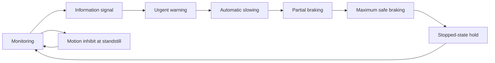

*The intervention ladder: each step is taken only if the operator has not reduced the risk and the stopping margin keeps shrinking.*

Each stage has a cost. Frequent signals overload the operator; slowing may be too weak downhill; partial braking may keep the machine in the hazard zone longer and conflict with following machines; maximum braking risks rollover, articulation instability, load shift and sliding; motion inhibit disrupts close work [Chapter 8].

**Why it matters here.** Staging is how the system can be both safe and tolerable: mine leaders preferred a system that slowed to a crawl before braking, and underground workers rejected abrupt stops [Chapter 4]. Each stage needs its own thresholds, tests and evidence, which multiplies the validation work but also lets a first release use the gentler stages while the harder ones are still being proven [Chapters 1, 8].

**Related terms.** [Intervention](#intervention), [Staged interventions in the decision logic](#staged-interventions-in-the-decision-logic), [Decision logic (when to warn, when to brake)](#decision-logic-when-to-warn-when-to-brake), [Thresholds and filters (confirmation logic, persistence, hysteresis, risk determination)](#thresholds-and-filters), [Deceleration limits and how regulators specify them](#deceleration-limits-and-how-regulators-specify-them), [New risks created by automatic braking](#new-risks-created-by-automatic-braking), [Nine levels of control](#nine-levels-of-control).

### Nine levels of control

**In one sentence.** The nine levels of control are the mining industry's ladder of defenses against vehicle interactions, running from how a site is designed (Level 1) to a machine that brakes by itself (Level 9), with warning technology at Levels 7 and 8.

**Explained.** The model comes from EMESRT (the Earth Moving Equipment Safety Round Table), a group of mining companies, in its performance requirement PR-5A, and it is used by the ICMM (International Council on Mining and Metals), regulators and suppliers worldwide [Chapters 1, 3, 5]. The levels are [Chapter 5]:

1. Site requirements: the layout and rules of the site itself.
2. Segregation controls: keeping people, light vehicles and heavy machines apart.
3. Operating procedures: the written rules for how work is done.
4. Authority to operate: who may drive what.
5. Fitness to operate: fatigue, health, impairment.
6. Operating compliance: whether the rules are actually followed.
7. Operator awareness: technology that helps the operator see and know, such as cameras and proximity displays.
8. Advisory controls: technology that advises the operator to act.
9. Intervention controls: technology that acts on the machine, slowing and stopping it.

Levels 1 to 6 are about people, places and procedures. Levels 7 to 9 are technology and form a ladder of their own: awareness, advice, action. The manufacturer's existing proximity warning sits at Levels 7 and 8; the Collision Mitigation System is a Level 9 control.

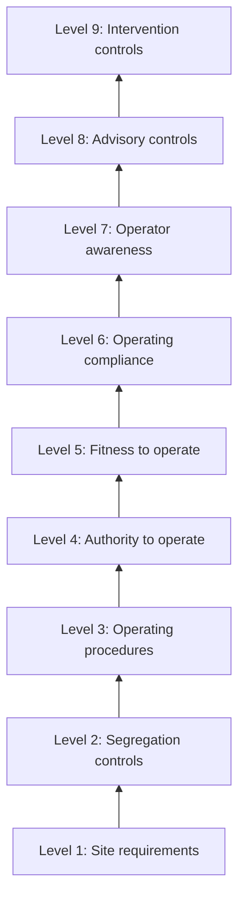

*The EMESRT ladder: Levels 1 to 6 are design, people and procedures; Levels 7 to 9 are technology, ending with the machine acting on its own.*

The industry is firm that the top rung does not replace the others. ICMM and EMESRT state that implementing Level 8 and 9 controls well requires first understanding the effectiveness of the Level 1 to 7 baseline for normal operations, and that "there are no silver bullets" [Chapter 1]. Regulators differ in emphasis: New South Wales and NIOSH favor the lower levels with Levels 7 to 9 as backup, while South Africa has made Level 9 intervention a legal requirement since December 2022 [Chapter 4]. The Australian ACARP test framework follows the same logic in two tiers: prove object detection first, then Level 8 or 9 intervention [Chapter 1].

**Why it matters here.** The nine levels explain why the same braking algorithm can be safe at one site and troublesome at another: the site's own Level 1 to 6 controls decide how often people and machines legitimately get close [Chapter 1]. They also give the plan its vocabulary for staged release, which is how Epiroc describes running its system on site "without immediately enforcing level-9 intervention" [Chapter 1].

**Related terms.** [EMESRT (Earth Moving Equipment Safety Round Table) and PR-5A](#emesrt-and-pr-5a-earth-moving-equipment-safety-round-table-vehicle-interaction-performance-requirement), [ICMM (International Council on Mining and Metals) and the ICMM/EMESRT nine-layer control effectiveness model](#icmm-the-nine-layer-control-model-and-the-icsv-program-international-council-on-mining-and-metals-innovation-for-cleaner-safer-vehicles), [Vehicle interaction](#vehicle-interaction), [Intervention](#intervention), [Staged intervention](#staged-intervention), [Collision Mitigation System (CMS)](#collision-mitigation-system-cms), [ACARP (Australian Coal Association Research Program) and its two-tier test approach](#acarp-and-its-two-tier-test-approach-australian-coal-association-research-program), [Staged release and limited operating domain](#staged-release-and-limited-operating-domain).

### Nuisance braking

**In one sentence.** Nuisance braking is an automatic brake application that was not needed, either because there was no real object (a false intervention) or because the object was real but posed no danger (an unnecessary intervention).

**Explained.** The vocabulary comes from a NIOSH field study of a radar warning system on a haul truck, and the booklet carries its definitions over to braking [Chapter 4]. A *false* alarm occurs when the sensor reports an object that is not significant: a rut, a rock, a bush, or the truck's own tires. A *nuisance* alarm is technically correct, the object is there, but there is no urgent danger because the operator knows about it and the task requires the approach, for example backing toward a rock pile to be loaded. In that study 18% of alarms were false, 42% were nuisance and 40% warranted action [Chapter 4]. Nuisance braking is what happens when the first two categories drive the brakes instead of a buzzer.

The field record shows how destructive that is. Underground, stop-capable proximity systems "unnecessarily shut down vehicles anywhere from once a day up to 15 times during a single cut of coal"; workers reported jarring and jolting stops; a manufacturer reported 5 to 10% production loss while proximity detection was active, although two mine operators said production recovered [Chapter 4]. The chain the booklet draws runs from unnecessary interventions to annoyance, lost production and new hazards, then to bypass, override, tag removal and widened zones, and finally to protection being lost when it is needed [Chapter 4]. Chapter 8 calls nuisance interventions the main documented field failure of deployed proximity systems [Chapter 8].

A better sensor alone does not fix it. In the haul-truck study most unwanted alarms were nuisance, not false, so the task, the intention and the kind of object had to be understood [Chapter 4]. Nor can it be measured on a test track with staged targets; it needs real operations, measured as unnecessary interventions per operating hour, per loading cycle and per reverse maneuver, by task [Chapter 4]. The booklet's planning advice is to run the new software in shadow mode (computing but not executing brake commands) on fielded machines so the nuisance-brake rate is measured before braking is enabled [Chapter 1], and to make the nuisance-intervention rate an acceptance metric equal in weight to missed interventions [Chapter 8]. How much a nuisance brake should "cost" relative to a miss when tuning is a safety-policy decision to be written down, not hidden in a formula [Chapter 9].

**Why it matters here.** Nuisance braking is the most likely way for the CMS to fail in service: not by missing a hazard, but by stopping machines so often that people switch it off [Chapters 4, 8]. The manufacturer's own experience that balancing detection against false positives took years is the reason the program exists [Introduction].

**Related terms.** [False alarm and alarm accuracy](#false-alarm-and-alarm-accuracy), [Nuisance braking from the decision side](#nuisance-braking-from-the-decision-side), [Tasks that look like a collision risk to a sensor](#tasks-that-look-like-a-collision-risk-to-a-sensor), [Switching off and bypassing](#switching-off-and-bypassing), [Alarm fatigue](#alarm-fatigue), [Exposure](#exposure), [Shadow mode (silent testing)](#shadow-mode-silent-testing), [Human factors as a tuning objective](#human-factors-as-a-tuning-objective), [True positive, false positive, false negative, miss](#true-positive-false-positive-false-negative-miss-the-four-outcomes).

### False alarm and alarm accuracy

**In one sentence.** A false alarm is a warning given when nothing dangerous is there, a nuisance alarm is a warning about something real that is not dangerous in the situation, and alarm accuracy is the share of all alarms that deserved a response.

**Explained.** Imagine a smoke detector. One that goes off with no smoke gives a false alarm. One that goes off every time you make toast gives a nuisance alarm: there is smoke, but you know why. One that never catches a real fire has a miss. Alarm accuracy asks: of all the times it sounded, how often was it right to?

The best off-road numbers are still from a 2004 field test, published in 2006, of a radar warning system on a Caterpillar 793B haul truck over seven days at a US copper mine [Chapters 4, 7]. Of 580 alarms, 102 (18%) were false, 243 (42%) were nuisance, and 235 (40%) warranted action. There were no missed detections. False alarms came from ruts, rocks, foliage and the truck's own rear tires, and the audible alarm was found switched off after shifts [Chapter 4]. No study defines a false alarm rate that off-road operators will accept; an 18% rate caused problems, but it does not follow that 17% is acceptable or that 5% would be [Chapter 4].

**Why it matters here.** The old system's false and nuisance rates are the baseline the new system must beat, and they can only be measured fairly against an independent record of what was really there [Chapter 7]. That the 2006 figure is still the best hard number shows how thin the independent off-road data are [Chapter 7].

**Related terms.** [Nuisance braking](#nuisance-braking), [Alarm fatigue](#alarm-fatigue), [True positive, false positive, false negative, miss](#true-positive-false-positive-false-negative-miss-the-four-outcomes), [True positive rate, precision, recall, F1 score](#true-positive-rate-precision-recall-f1-score), [Ground truth](#ground-truth), [Performance baseline (how to measure the old system before comparing the new one)](#performance-baseline).

### Alarm fatigue

**In one sentence.** Alarm fatigue is the state in which a person has heard so many alarms that did not matter that they stop reacting to alarms at all, including the one that does matter.

**Explained.** This is the "cry wolf" effect. In hospitals, nurses exposed to constant monitor alarms learn to ignore them; on a job site, operators warned on every loading cycle do the same. The warning still sounds, but it no longer changes behavior. ISO 21815-3 notes that false positives "could create alarm fatigue" [Chapter 3].

The booklet looked for direct measurements in mining, such as the probability of ignoring the nth warning, and found none [Chapter 4]. It found the precursors and the outcomes: very high exposure to unnecessary alarms, annoyance, degraded trust, disabling and overriding [Chapter 4]. NIOSH warned that operators may "lose confidence in the system and start to ignore alarms altogether" [Chapter 4]. Road and aviation evidence is mixed: a cry-wolf effect was strong in some truck warning data, absent in air-traffic-control alerts with 45% false alarms, and absent in some driving-simulator studies [Chapter 4].

**Why it matters here.** Operators of the existing warning fleet may already have learned to ignore frequent warnings, and will meet the first automatic stops with that habit [Chapter 1]. A warning stage in the intervention ladder only buys time if the warning is still believed.

**Related terms.** [False alarm and alarm accuracy](#false-alarm-and-alarm-accuracy), [Nuisance braking](#nuisance-braking), [Switching off and bypassing](#switching-off-and-bypassing), [Operator behavior change](#operator-behavior-change), [Human-machine interface (HMI)](#human-machine-interface-hmi).

### Switching off and bypassing

**In one sentence.** Switching off and bypassing means defeating a safety system on purpose, by turning it off, overriding it, removing the tag it tracks, or redesigning its zones so it no longer protects what it should.

**Explained.** When a protective system gets in the way of the job, people find ways around it. Researchers found the audible alarm of a haul-truck warning system switched off after shifts [Chapter 4]. Mechanics removed wearable tags to diagnose leaks inside the danger zone; mines asked for a "temporary bypass" feature; zone redesigns removed coverage at a hauler's rear corners [Chapter 4]. At one underground mine the emergency-stop override had become common practice, and the investigation of a fatal accident in June 2017 recorded 87 prior activations of the dead worker's own override [Chapter 4]. South African guidance warns that false slow-downs and stops can "disrupt production to a point where the systems must be switched off" [Chapter 4].

Rules try to make this harder. ISO 16001 forbids disabling a detection system with a single action, and South African industry guidance limits emergency and maintenance overrides by time and speed and forbids routine use [Chapter 3]. Regulators in the United States, Australia and South Africa agree that alarm burden leads people to ignore, bypass or switch off systems [Chapter 4].

**Why it matters here.** A system that is switched off protects no one, so bypass resistance and task compatibility belong in the safety case, and the real rate of bypassing is something only field monitoring can reveal [Chapter 4]. The design target the booklet names is calibrated trust, not maximum trust.

**Related terms.** [Nuisance braking](#nuisance-braking), [Alarm fatigue](#alarm-fatigue), [Operator behavior change](#operator-behavior-change), [Proximity Detection System (PDS)](#proximity-detection-system-pds), [Field monitoring and operational monitoring](#field-monitoring-and-operational-monitoring), [Safety case and safety argument](#safety-case-and-safety-argument).

### Operator reaction time

**In one sentence.** Operator reaction time is the time between a warning (or the appearance of a hazard) and the moment the operator begins to act, for example by pressing the brake.

**Explained.** During the reaction time the machine keeps moving at full speed, so the distance it covers is speed multiplied by time:

`d_reaction = v * t`

where `d_reaction` is the distance traveled before anything happens, `v` is the speed and `t` is the reaction time. At 40 km/h (about 11.1 m/s) a reaction time of 2 s means 22.2 m before braking even begins. Queensland guidance uses this example as a combined operator-plus-mechanical delay for illustration, not as a measured human value [Chapter 4].

The booklet's main finding is a gap: no representative, field-measured distribution of heavy-machine operators' reaction times to proximity warnings was found [Chapter 4]. The values in use are borrowed or illustrative: 0.5 to 1 s from road research, about 1 s in a US regulatory brake-test table, 1 to 3 s as a margin in a mining-truck patent, 2.5 s in road-design manuals [Chapters 4, 8]. Road research adds that brake responses depend on how fast the gap is closing, and that the estimated benefit of a warning system ranged from 53% to 96% depending on which driver model was chosen [Chapter 4].

**Why it matters here.** A Collision Mitigation System acts when the operator has not, so the time the system waits is a bet on the operator's reaction time. The booklet advises treating that time as an uncertain parameter and running sensitivity analyses, not presenting one average as validated [Chapter 4].

**Related terms.** [Operator and cab](#operator-and-cab), [Stopping distance](#stopping-distance), [Brake dead time and brake build-up time](#brake-dead-time-and-brake-build-up-time), [End-to-end latency budget](#end-to-end-latency-budget), [Human factors](#human-factors), [Decision logic (when to warn, when to brake)](#decision-logic-when-to-warn-when-to-brake).

### Human factors

**In one sentence.** Human factors is the field that studies how people perceive, decide and act when working with machines, and designs the machine so that real people, tired or busy or distracted, can use it safely.

**Explained.** A sensor can be perfect and the system can still fail if the operator does not notice the warning, does not understand it, does not trust it, or has learned to work around it. Human factors covers attention, workload, trust, habit, fatigue, how information is presented, and how behavior changes over months of use.

The booklet's human-factors evidence is thin where it most needs to be thick. The strongest off-road study placed drivers in a haul-truck simulator and showed that a richer proximity display reduced collision risk and braking force; the effect was smaller with less experienced drivers, a warning against assuming one generic operator [Chapter 4]. Industry guidance notes that "Human Performance can change both positively and negatively after technology is introduced" [Chapter 1]. No validated model of an off-road operator exists [Chapter 4]. The booklet therefore asks the plan to keep three uncertainties separate: sensor uncertainty, operator-response uncertainty and machine-response uncertainty [Chapter 4]. It also gives human factors its own question in the allocation of evidence: does the complete intervention improve rather than degrade real operations, answered by operator simulation, nuisance-intervention testing, shadow operation and staged deployment [Chapter 1].

**Why it matters here.** A vehicle-and-environment simulator does not represent adaptation, over-reliance, override behavior or mode confusion, so human-in-the-loop evidence may be required for any safety claim that depends on what the operator does [Chapter 10].

**Related terms.** [Human-machine interface (HMI)](#human-machine-interface-hmi), [Operator reaction time](#operator-reaction-time), [Operator behavior change](#operator-behavior-change), [Alarm fatigue](#alarm-fatigue), [Human factors as a tuning objective](#human-factors-as-a-tuning-objective), [Driver-in-the-loop (DIL), operator-in-the-loop and the machine simulator (operator studies)](#driver-in-the-loop-dil-operator-in-the-loop-and-the-machine-simulator).

### Human-machine interface (HMI)

**In one sentence.** The human-machine interface (HMI) is everything through which the system and the operator communicate: the screens, lights, sounds, vibrations and buttons in the cab.

**Explained.** When the system detects something, the HMI is how the operator finds out. A good HMI makes the urgent warning unmistakable, shows where the object is, and lets the operator acknowledge or override without fumbling. A poor one is a buzzer that sounds the same for a rock pile and a person.

ISO 21815-3 requires warning levels that can be told apart [Chapter 8]. The Australian ACARP project tested visual and auditory proximity interfaces in a haul-truck simulator and found that a schematic display helped drivers reduce collision risk [Chapters 1, 4]. People on foot responded fastest to vibration, then visual signals, then sound [Chapter 4]. Workers rated underground proximity systems well on training, ease of use and feedback, and poorly on reliability and fit with the task [Chapter 4]. The continuous audible warning in the haul-truck radar study was annoying enough to be switched off [Chapter 4]. For testing, every warning should be logged with its level, time stamp, audio, visual or haptic state and acknowledgement; otherwise it is impossible to tell afterward whether a warning was given, seen and ignored [Chapter 7].

**Why it matters here.** The HMI decides whether the warning stage of a staged intervention buys the operator real time, and whether an automatic stop surprises the operator. The booklet recommends sorting out basic HMI problems in a simulator before expensive prototype tests [Chapter 1].

**Related terms.** [Human factors](#human-factors), [Staged intervention](#staged-intervention), [Alarm fatigue](#alarm-fatigue), [Operator and cab](#operator-and-cab), [Data logging (what to record on the machine, raw versus processed data, common mistakes)](#data-logging-what-to-record-on-the-machine-raw-versus-processed-data-common-mistakes).

### Operator behavior change

**In one sentence.** Operator behavior change is the way people start to work differently once a protective system exists, including risk compensation (taking more risk because they feel protected) and over-reliance (letting the system do the watching).

**Explained.** Give a person a safety net and some will climb higher: that is risk compensation. Give a person a machine that brakes by itself and some will stop checking the mirrors: that is over-reliance. The opposite also happens: a system that is wrong too often is distrusted and disabled. The goal the booklet names is calibrated trust, trusting the system exactly as much as it deserves [Chapter 4].

Off-road, the evidence is qualitative only. Underground workers changed where they stood, removed tags and asked for bypasses; regulators worry about a "silver bullet" mindset; an MSHA commenter said miners "have taken higher risks because of a false sense of security" [Chapter 4]. The booklet rates four adaptations: learning the zones and changing close-proximity tasks (moderate evidence), overriding or disabling (strong that it occurs, frequency unknown), relying too much (reported, not quantified), and driving faster or following closer because the machine will brake (not found in surface-mining data) [Chapter 4]. On the road, drivers who trusted other vehicles' automatic braking braked later themselves, a possible parallel for ground crew who assume a machine will stop for them [Chapter 4].

**Why it matters here.** Behavior change cannot be seen in a four-month window or in a simulator; it needs months of field time, so the booklet lists it as uncompressible and assigns it to staged release with field monitoring [Chapter 1]. The missing numbers should be collected during pilot deployment rather than assumed [Chapter 4].

**Related terms.** [Human factors](#human-factors), [Switching off and bypassing](#switching-off-and-bypassing), [Alarm fatigue](#alarm-fatigue), [Staged release and limited operating domain](#staged-release-and-limited-operating-domain), [Field monitoring and operational monitoring](#field-monitoring-and-operational-monitoring), [Spotter and pedestrian](#spotter-and-pedestrian).

### Tasks that look like a collision risk to a sensor

**In one sentence.** Many normal, intended parts of the job, such as loading a truck, bumping a dump berm or working beside ground crew, put a large object close to the machine in exactly the way a sensor is designed to flag.

**Explained.** A sensor measures distance and closing speed; it does not know what the operator intends. The booklet collects the documented cases where ordinary production looks dangerous to a simple sensor [Chapter 4]:

- *Loading a truck.* Backing toward a rock pile is the textbook nuisance detection. Yet the loading zone cannot be ignored, because a second truck or a person can enter it.
- *Dump berms as bump stops.* Safe practice, but the berm is also the edge reference that keeps the truck from going over, so berm detections should not be treated as nuisance.
- *Tip heads shared by dozers and trucks.* Machines must work close together.
- *Walls, ribs and stockpiles.* Small clearances; underground, some tasks need miners closer than 3 ft (about 0.9 m) to the machine.
- *Ground crew and maintenance.* Mechanics inside the danger zone, spotters, authorized pedestrians.
- *Parking and workshops.* Small clearances and many fixed objects.
- *The machine itself.* The truck's own rear tires triggered false alarms.
- *Swing and rotation.* Excavators strike without any travel.

Komatsu's excavator system must be off during trailer loading, and Volvo's loader system remembers the last slope so it does not brake when reversing down a stockpile: product-level fixes for single tasks [Chapter 2].

**Why it matters here.** These tasks are where nuisance braking will come from, and each should be a separate validation scenario rather than a slower version of haul-road driving [Chapter 4]. Neither "always alarm when close" nor aggressive suppression works across all tasks; the system needs context and the plan needs per-task metrics [Chapter 4].

**Related terms.** [Nuisance braking](#nuisance-braking), [Stockpile, dump point and tip point](#stockpile-dump-point-and-tip-point), [Haul road, berm, bench and pit wall](#haul-road-berm-bench-and-pit-wall), [Spotter and pedestrian](#spotter-and-pedestrian), [Scenario (functional, logical, concrete)](#scenario-functional-logical-concrete), [Nuisance braking from the decision side](#nuisance-braking-from-the-decision-side), [Electromagnetic compatibility (EMC)](#electromagnetic-compatibility-emc).

### New risks created by automatic braking

**In one sentence.** An automatic stop can itself cause harm, through the jolt to the operator, a shifting or spilled load, loss of stability on a slope, a following machine running into the stopped one, or the machine rolling back once the brake is released.

**Explained.** Stopping a car hard is uncomfortable. Stopping a loaded 100 t truck hard on a wet downhill ramp is a different matter. The booklet lists the secondary hazards found in the sources and notes that most are reported but not measured [Chapters 4, 8]:

- *Operator injury from a sudden stop.* Underground workers report "jarring and jolting" stops; MSHA says it knows of no injuries from them. No safe jerk limit was found.
- *Spilled or shifted loads.* Mechanically credible; no quantified data found.
- *Loss of stability on slopes.* Braking hard uses up the grip needed for steering; a rollover caused by automatic braking: not found.
- *Being struck from behind.* On the road, automatic braking raised the rate of being hit from behind by 20%; off-road, not found.
- *Rollaway after the stop.* ISO 21815-3 recommends an operator action, such as setting the parking brake, before the brake is released.

To keep the stop safe, the booklet reports the published position that the commanded deceleration should be the smallest of several limits:

`a_command = min(a_need, a_traction, a_stability, a_machine, a_load)`

where `a_need` is the deceleration needed to avoid the collision, `a_traction` is what the ground can provide, `a_stability` comes from the roll, pitch and articulation state with the payload, `a_machine` is what the brakes can deliver, and `a_load` is the limit set by payload or attachment. The deceleration should ramp up gradually and end in a held state [Chapter 8].

**Why it matters here.** The program must test not only whether the machine stops short of the object but also deceleration and jerk, stability on grades, laden and unladen states, and behavior after the stop [Chapters 4, 8]. The booklet places this in the hazard analysis rather than assuming a machine is safe because it "stops sooner" [Chapter 1].

**Related terms.** [Intervention](#intervention), [Staged intervention](#staged-intervention), [Load shift and stability](#load-shift-and-stability), [Secondary hazards of an automatic stop](#secondary-hazards-of-an-automatic-stop), [Grade (slope) and its effect on braking](#grade-slope-and-its-effect-on-braking), [Deceleration limits and how regulators specify them](#deceleration-limits-and-how-regulators-specify-them), [Hazard analysis and risk assessment](#hazard-analysis-and-risk-assessment).

### Warning-system fleet

**In one sentence.** The warning-system fleet is the set of machines the manufacturer has already sold with the proximity warning system, and its field history is the record of what those machines have detected, warned about and got wrong in real use.

**Explained.** Before any prototype of the new system exists, the manufacturer already has machines in the field with sensors watching their surroundings. The booklet treats this fleet as the program's most valuable early asset, with conditions.

The opportunity: the existing machines can start recording now, in October 2026, including through the winter that the later validation window will never see [Introduction, Chapter 1]. Replaying those recordings through new software measures detection and false-alarm behavior on real data, and the recorded false-alarm history is the best available data for setting intervention thresholds [Chapters 1, 7]. The fleet is also the natural source for an exposure model, and the booklet says estimating that distribution from it should start now [Chapter 9].

The conditions: what is established is that a warning system exists, not that it keeps raw sensor data, machine signals, accurate time stamps or labels. A record worth replaying needs all of these plus an independent record of what was really there; labeling dominates the cost [Chapter 1].

The limits: field history can validate inputs and parts of the simulation, not the new closed-loop braking chain. The logs are open-loop (the world did not react to the new software), censored by the operator (a warning that made the operator brake hides what would have happened otherwise) and biased toward normal operation [Chapter 10].

**Why it matters here.** "Start recording now" is one of the few unconditional recommendations in the booklet, because the fleet's winter data cannot be collected later and because the baseline the new system must beat can only be measured from it [Introduction, Chapters 1, 7].

**Related terms.** [Exposure](#exposure), [Near miss](#near-miss), [Data logging (what to record on the machine, raw versus processed data, common mistakes)](#data-logging-what-to-record-on-the-machine-raw-versus-processed-data-common-mistakes), [Replay and re-simulation of recorded data (open-loop replay)](#replay-and-re-simulation-of-recorded-data-open-loop-replay), [Using the existing warning system's field history as a reference](#using-the-existing-warning-systems-field-history-as-a-reference), [Performance baseline (how to measure the old system before comparing the new one)](#performance-baseline), [Season and weather coverage](#season-and-weather-coverage).

### Sensor and prototype freeze

**In one sentence.** The sensor freeze is the project milestone at which the sensor types, numbers and mounting positions are fixed, and the prototype freeze is the milestone at which the first representative hardware and software are fixed; the booklet uses "before freeze" and "after freeze" to divide the work.

**Explained.** In engineering a "freeze" is a decision that will not be reopened. Until the sensors are frozen, nobody knows whether the system will use cameras, radar, lidar, ultrasonic sensors or a mix, or where on each machine they will sit; the booklet had to cover all options for that reason [Chapter 1]. The prototype, due in mid-2027, is the first hardware and software built the way the product will be built.

The freeze divides what can be done early from what cannot. Before it, a program can build everything that does not depend on sensor physics: hazard analysis, scenario catalog, acceptance metrics, safety-case structure, simulation architecture and the data pipeline on the existing fleet [Chapters 1, 2]. After it, the sensor-specific work starts: matching simulated sensors to real ones, bench testing with the real controller, choosing test targets that look right to the chosen sensor [Chapters 1, 6].

A late change is costly. A sensor change in 2027 invalidates the sensor-model correlation, the bench stimulation assumptions, the detection-range evidence, the mounting analysis and parts of the case for reusing evidence across models [Chapter 1]. Standards are moving too: several ISO parts were due to change in late 2026, so the plan should re-baseline on the editions actually published [Chapter 3].

**Why it matters here.** The freeze dates set the critical path. The booklet's advice is to build the architecture sensor-interface-neutral but not sensor-physics-neutral, so final sensor models drop in as replaceable modules, and never to claim a validated sensor digital twin before hardware and mounting are frozen and correlated [Chapters 1, 2].

**Related terms.** [Validation window](#validation-window), [Sensor](#sensor), [Calibration (intrinsic and extrinsic) and sensor mounting](#calibration-intrinsic-and-extrinsic-and-sensor-mounting), [Correlation test (first tests on the prototype that anchor the models)](#correlation-test), [Gantt chart, milestone and dependency](#gantt-chart-milestone-and-dependency), [Critical path and buffer](#critical-path-and-buffer).

### Validation window

**In one sentence.** The validation window is the period of less than four months after the prototype arrives in mid-2027 in which the Collision Mitigation System must be validated.

**Explained.** Validation means showing, with evidence, that the system does what it is supposed to do safely in the conditions it will meet. The last comparable function at this manufacturer took three to four years, mostly through physical testing and tuning on each machine model [Introduction]. The new target is under four months, in the second half of 2027 [Chapter 2].

The booklet's answer is consistent across chapters. No case was found, in any industry, of a new automatic braking function going from first representative hardware to accepted validation in about four months; every documented reduction in physical testing rested on years of earlier investment, a narrow operating domain, or both [Introduction, Chapters 1, 2, 13]. So the four months cannot be compressed, but most of the work can be moved in front of them: the scenario catalog, the data pipeline on the existing fleet, the simulation and bench tools and the credibility evidence can all exist before the prototype arrives [Chapter 1].

The window then has a fixed shape: correlate (measure latency, detection range and stopping on the real prototype), multiply (re-run the correlated scenarios virtually), confirm (whole-machine tests of the worst cases), then shadow mode (live operation with braking disabled) [Chapter 1]. It is a final validation window, not a capability-construction window [Chapter 2]. Two things sit awkwardly inside it: it contains no northern winter [Chapter 13], and the EU Machinery Regulation applies from 20 January 2027, so if the perception uses machine learning, the lead time for a notified body alone could exceed the window [Chapter 1].

**Why it matters here.** The window is the constraint the whole plan is built around. The booklet's reframing, that it should be a confirmation and calibration campaign for a method already proven before the prototype arrives, is its most repeated conclusion [Introduction, Chapters 1, 6, 10, 13].

**Related terms.** [Sensor and prototype freeze](#sensor-and-prototype-freeze), [Collision Mitigation System (CMS)](#collision-mitigation-system-cms), [Verification versus validation (V&V)](#verification-versus-validation-vv), [Campaign (test campaign) and campaign architecture for the four-month window](#campaign-test-campaign-and-campaign-architecture), [Correlation test (first tests on the prototype that anchor the models)](#correlation-test), [Shadow mode (silent testing)](#shadow-mode-silent-testing), [Season and weather coverage](#season-and-weather-coverage), [EU Machinery Regulation (EU) 2023/1230](#eu-machinery-regulation-eu-20231230-the-ai-act-the-product-liability-directive-and-the-data-act).

### Site type and the "100+ site types" claim

**In one sentence.** A site type is a class of job site with a characteristic layout, surface and traffic (an open pit, a quarry face, a stockpile yard, a road works), and the "100+ site types" claim is the challenge statement that one machine may work across 100 or more job sites and applications.

**Explained.** The challenge statement lists job sites and applications as the first variable that makes validation hard [Introduction]. Taken literally, that would mean validating on 100 different places. The booklet argues that the number is not meaningful until the organization defines what it counts: individually validated sites, parameterized classes of environment, or customer configurations inside a validated envelope [Chapter 13].

The booklet replaces counting with coverage. No standard sets a required number of virtual job sites; teams argue sufficiency through coverage of a defined operating domain and its parameters, because two hundred nearly identical dry pit roads give less coverage than a small set that spans different geometry, materials and conditions [Chapter 5]. Site type becomes one parameter among many, alongside surface, slope, object classes, weather and light, machine model and sensor position [Chapter 5]. As planning assumptions rather than evidence, the booklet mentions 15 to 30 parameterized site archetypes anchored by 3 to 5 surveyed real sites as one possible starting point [Chapter 5]. Every off-road product the booklet found launched much narrower than its full market [Chapters 2, 13].

**Why it matters here.** How the organization defines "site type" decides the size of the test space and what can honestly be claimed at release. The booklet's advice is a library of parameterized representative site types anchored to a few surveyed real sites, with release in a narrow domain that widens by evidence gate [Introduction, Chapters 1, 5].

**Related terms.** [Job site](#job-site), [Operational design domain (ODD) and operating-domain taxonomy](#operational-design-domain-odd-and-operating-domain-taxonomy), [Virtual job site (virtual environment, scene, 3D asset)](#virtual-job-site-virtual-environment-scene-3d-asset), [Procedural generation (building many site variants from rules)](#procedural-generation), [Test space and the combinatorial explosion](#test-space-and-the-combinatorial-explosion), [Exposure](#exposure), [Staged release and limited operating domain](#staged-release-and-limited-operating-domain).

### Season and weather coverage

**In one sentence.** Season and weather coverage means making sure the system has been tested in all the conditions it will meet, including rain, snow, fog, dust, mud, glare, dusk and darkness, and the problem is that the validation window falls in a season that contains few of them.

**Explained.** A window of mid-2027 plus four months sits in the northern summer and autumn. It contains no northern cold season, so no natural snow, freezing fog or low winter sun [Chapters 1, 13]. The booklet calls the winter of 2026 to 2027 the last chance to collect snow and cold data from the existing warning fleet before validation [Chapter 13].

Weather hurts each sensor differently. Cameras lose contrast in rain and are blinded by glare and darkness; lidar scatters in fog and dust; radar behaves differently again; and the ground becomes slippery, which changes stopping distance [Chapter 5]. Dust is named as the biggest off-road gap in sensor simulation, and there is no accepted score for how real a simulated weather effect is [Introduction, Chapter 6]. Systematic breakdowns of collisions by light or weather were not found [Chapter 4].

Partial substitutes exist: weather chambers for components (no specific off-road facility was found), dust, fog and rain generated on a test track, southern-hemisphere sites in their winter, and fleet recordings from the winter of 2026 to 2027 [Chapter 1].

**Why it matters here.** Natural seasonal weather is on the booklet's list of things no method can compress. The conclusion is to keep physical testing where simulation is weak, to log the existing fleet through the winter starting now, and to release first in a domain that excludes the conditions not yet tested [Chapters 1, 10, 13].

**Related terms.** [Validation window](#validation-window), [Warning-system fleet](#warning-system-fleet), [Sensor degradation](#sensor-degradation-dust-mud-rain-snow-fog-spray-glare-darkness-artificial-lighting-vibration), [Lidar](#lidar-light-detection-and-ranging), [Radar](#radar-radio-detection-and-ranging), [Sim-to-real gap (as a concept; metrics are in Part G)](#sim-to-real-gap), [Staged release and limited operating domain](#staged-release-and-limited-operating-domain).

## Part B: Safety engineering fundamentals

Safety engineering has its own grammar: hazard, risk, requirement, safety function, evidence, acceptance, release. This part explains that grammar and the two families of safety thinking that the booklet relies on, functional safety (what if a component fails) and safety of the intended functionality (what if nothing fails but the system still gets it wrong). It also covers the safety case, the document in which everything is argued, and the way a project is reviewed and released in stages.

### Hazard, harm and risk

**In one sentence.** A hazard is something that could hurt someone, harm is the injury or damage that actually happens, and risk is how likely the harm is, combined with how bad it would be.

**Explained.** Think of a wet floor in a shop. The wet floor is the hazard: it could hurt someone. A broken wrist from slipping is the harm: the injury that actually happens. The risk depends on two things together: how many people walk across that floor, and how badly they could be hurt. A wet floor in a locked storeroom is a low risk. The same floor at a busy entrance is a high risk.

Safety engineering uses the three words in exactly this way, and the machinery standard ISO 12100 defines them. A hazard is a potential source of harm. Harm is physical injury or damage to health; many standards add damage to property or the environment. Risk is the combination of the probability that harm occurs and its severity. As a simple formula, `risk = probability x severity`, where probability is how often the harm is expected and severity is how serious it would be. A frequent small bruise and a rare death can represent similar risk, but they call for very different measures.

On a job site the picture is concrete. A haul truck reverses toward a dump point and a worker on foot is behind it. The hazard is the moving truck near a person the operator cannot see. The harm is being run over. The risk depends on how often people are behind reversing trucks (the exposure) and on the severity, which for a 100 ton truck is almost always fatal. The booklet quotes a United States figure of about 13 mine workers killed each year by being run over or pinned by mobile mining equipment [Chapter 10].

Two points from the booklet shape everything that follows. First, a measure that lowers one risk can create new hazards: an automatic brake that stops a loaded machine hard on a slope, under a suspended load, beside a trailer or in front of a following machine is itself a hazard [Chapters 1, 9]. Second, the booklet therefore says two hazards must be analyzed separately: the system fails to brake when it should, and the system brakes when it should not or when braking is itself dangerous [Chapter 3]. Risk is never zero; the aim is to bring it down to a level that someone with authority accepts.

**Why it matters here.** Every requirement, test and acceptance criterion in the plan should trace back to a named hazard. The booklet warns that the hazard analysis for the braking intervention must be approved before the prototype arrives, or the four months will be spent debating what is dangerous instead of gathering evidence [Chapter 13].

**Related terms.** [Hazard analysis and risk assessment](#hazard-analysis-and-risk-assessment), [Residual risk and as low as reasonably practicable (ALARP)](#residual-risk-and-as-low-as-reasonably-practicable-alarp), [Safety function and safety-related control system](#safety-function-and-safety-related-control-system), [Collision](#collision), [Exposure](#exposure), [New risks created by automatic braking](#new-risks-created-by-automatic-braking), [Nuisance braking](#nuisance-braking).

### Hazard analysis and risk assessment

**In one sentence.** Hazard analysis is the organized search for everything about a machine and its use that could cause harm, and risk assessment is the judgment of how likely and how severe each of those harms would be.

**Explained.** A home inspector walks through a house room by room with a checklist. Hazard analysis does the same for a machine function: engineers go through each operating mode (driving forward, reversing, swinging, starting from rest, loading a trailer, working on a grade) and each kind of fault, and write down what could go wrong and who could be hurt.

Risk assessment then rates each hazard. The most common tool is a risk matrix: severity across the top (minor injury to death), likelihood down the side (rare to frequent), each hazard placed in a cell. The machinery standards use fixed versions. ISO 13849 asks whether the injury is slight or serious, whether exposure is seldom or frequent, and whether the person could avoid it; the answers give the required Performance Level. ISO 19014-1 has its own version for earth-moving machinery, the Machine Control System Safety Analysis (MCSSA), which produces the required Machine Performance Level [Chapter 3].

For this program the booklet insists that the analysis cover the hazards of the intervention itself, with false-activation hazards rated separately from missed-detection hazards [Chapter 13], and that post-brake behavior (a locked brake, a machine rolling when released, a restart causing a second collision) be included [Chapters 4, 8]. It also cautions that 5 by 5 colored matrices have documented mathematical weaknesses, so for project risks it prefers ranked tables with numeric ranges [Chapter 12].

**Why it matters here.** The hazard analysis is the root of the scenario catalog, the requirements and the acceptance criteria. "Hazard analysis still to be decided in 2027" is listed as an early warning sign of a failing program [Chapter 13].

**Related terms.** [Hazard, harm and risk](#hazard-harm-and-risk), [Machine Performance Level (MPL)](#machine-performance-level-mpl), [Performance Level (PL) and Category](#performance-level-pl-and-category), [Scenario](#scenario-functional-logical-concrete), [Scenario catalog](#scenario-catalog-scenario-family-and-scenario-parameter), [Risk register, assumption log and unknowns](#risk-register-assumption-log-and-unknowns-known-unknowns), [New risks created by automatic braking](#new-risks-created-by-automatic-braking), [Safety of machinery (ISO 12100)](#safety-of-machinery-iso-12100).

### Safety function and safety-related control system

**In one sentence.** A safety function is one specific job that a machine's control system must do to keep people safe, and the safety-related control system is the chain of parts (sensor, computer, actuator) that performs that job.

**Explained.** A smoke alarm has one safety function: detect smoke and sound a horn. The parts that do it (the sensor, the circuit, the horn, the battery) are its safety-related system. If any part fails, the function fails.

In the machinery standards a safety function is a function whose failure can lead to an immediate increase in risk (ISO 13849). It is written as a precise sentence, for example: "When an object is detected within distance X while reversing, the machine shall be brought to a stop before contact." The safety-related parts of the control system are everything that carries out that sentence, from the input (a radar or camera) through the logic (a controller running software) to the output (the valve that applies the brake).

The booklet draws one sharp line. The existing product only warns the operator. ISO 19014-2 excludes "awareness systems that do not impact machine motion (e.g. cameras and radar detectors)". Once the system can issue a brake command it affects motion and moves inside the functional-safety standard [Chapters 3, 13]. The booklet also says there are two safety functions, each needing its own analysis and acceptance thresholds: failure to intervene when required, and intervention when it is unsafe or unnecessary [Chapter 3]. The South African mining specification MOSH treats collision prevention products as safety systems with integrity, robustness and reliability requirements [Chapter 3].

**Why it matters here.** The warning system and the braking system sit on opposite sides of this line, so "match the old warning system" is the wrong target; the target must come from the hazard analysis of the new function [Chapter 13].

**Related terms.** [Functional safety](#functional-safety), [Machine Performance Level (MPL)](#machine-performance-level-mpl), [Performance Level (PL) and Category](#performance-level-pl-and-category), [Electronic control unit (ECU)](#electronic-control-unit-ecu), [Decision logic](#decision-logic-when-to-warn-when-to-brake), [Collision Mitigation System (CMS)](#collision-mitigation-system-cms), [Staged intervention](#staged-intervention), [Fail-safe, safe state, controlled stop and emergency stop](#fail-safe-safe-state-controlled-stop-and-emergency-stop).

### Functional safety

**In one sentence.** Functional safety is the part of safety that depends on a control system doing the right thing at the right time, including when its own parts fail.

**Explained.** An elevator has a brake that grips the rails if the cable breaks. The safety comes from a function that must work correctly, and must keep working when something else goes wrong. That is functional safety, as opposed to the passive safety of, say, thick walls.

The basic standard, IEC 61508, defines it as the part of overall safety that depends on a system operating correctly in response to its inputs, including safe handling of operator errors, hardware failures, software faults and environmental changes. The subject is faults: a sensor dies, a wire breaks, software freezes, a message arrives late, a valve sticks. It is not about whether a healthy camera can see a person in a dust cloud; that belongs to the safety of the intended functionality, the next entry.

The method follows a fixed path. A hazard analysis sets a required reliability level for each safety function (PL, MPL, SIL or ASIL, depending on the industry). Designers choose an architecture (two channels, self-tests, a safe state to fall back to). Engineers show the hardware is reliable enough and the software was developed carefully enough. The system is verified and validated, and the whole story is written in a safety case.

For this program the booklet is specific. The framework for a brake-commanding function on earth-moving machines is ISO 19014, not ISO 26262; the earlier ISO 15998 was withdrawn in 2022 [Chapter 3]. The lifecycle runs: hazard and risk analysis and the required Machine Performance Level (Part 1, or the Part 5 tables); architecture and fault behavior giving the achieved level (Part 2); environmental qualification of the electronics (Part 3); software and data transmission (Part 4); brake capability under ISO 3450 [Chapter 3]. All five parts were due to be reissued in October 2026, a few months before design verification is frozen, so the plan should baseline the editions actually published [Chapter 3]. ISO 19014 does not assume that every brake demand is safe, which is why the unsafe-intervention function gets its own analysis [Chapter 3]. Much functional-safety evidence is analytical (hazard analysis, architecture assessment, software verification, fault reasoning), so analysis and simulation sit naturally inside it, although no off-road rule lets simulation replace a prescribed physical test [Chapter 3].

**Why it matters here.** The functional safety engineer in the booklet's hostile review objects that the program treats a new safety-control function as an incremental feature. The answer is an approved Machine Control System Safety Analysis before the prototype arrives, with requirements for both failure to intervene and incorrect intervention, allocated performance levels, and traceability from each requirement to its test [Chapter 13].

**Related terms.** [Safety function and safety-related control system](#safety-function-and-safety-related-control-system), [Machine Performance Level (MPL)](#machine-performance-level-mpl), [Performance Level (PL) and Category](#performance-level-pl-and-category), [Safety Integrity Level (SIL)](#safety-integrity-level-sil), [Automotive Safety Integrity Level (ASIL)](#automotive-safety-integrity-level-asil), [Safety of the Intended Functionality (SOTIF)](#safety-of-the-intended-functionality-sotif), [Fault, failure, failure mode and fault injection](#fault-failure-failure-mode-and-fault-injection), [ISO 19014 series](#iso-19014-series-functional-safety-for-earth-moving-machinery), [Safety case and safety argument](#safety-case-and-safety-argument).

### Safety of the Intended Functionality (SOTIF)

**In one sentence.** SOTIF is the part of safety concerned with a system that has no broken parts yet still behaves unsafely, because its sensing or decision-making is not good enough for the situation it meets.

**Explained.** A person with perfect eyesight still cannot see through fog. Nothing is broken; the ability is insufficient for the condition. Functional safety deals with broken parts. SOTIF deals with the limits of a healthy system. The term comes from the road-vehicle standard ISO 21448:2022.

Three words from that standard matter. A functional insufficiency is a limitation in what the system was specified to do or how well it performs: a camera that cannot tell a worker in a reflective vest from a reflective sign, or a radar that cannot separate a person from the steel structure beside them. A triggering condition is a specific situation that activates the insufficiency and leads to dangerous behavior: low sun into the lens, a dust cloud, a berm shaped like a person. And the standard divides all situations into four areas: known safe, known unsafe, unknown unsafe and unknown safe. The work of SOTIF is to move situations out of the unknown areas by analysis and testing, and to shrink the unsafe areas by design changes, operating limits and better sensing. It covers both missing a real person (a hazard) and reacting to something harmless (nuisance braking).

The booklet notes that ISO 21448 is written for road vehicles and does not apply by scope to off-road machines [Chapter 3], yet it borrows the triggering-condition logic for scenario and requirements engineering and names the standard for perception limits [Chapters 1, 8, 12]. The perception weaknesses it catalogs are functional insufficiencies: lidar reacting to the leading edge of a dust cloud, cameras degraded by snow and grime, radar changing in heavy rain, glare [Chapters 6, 13]. A mining company's field trial that had never been run in snow is an unknown unsafe area: it stays invisible until the condition is sampled [Chapter 13]. The booklet pairs the frameworks: ISO 19014 for the intervention chain, ISO 21448 and ISO/PAS 8800 concepts for perception [Chapter 1].

**Why it matters here.** For an automatic brake the SOTIF question (can the sensors see in dust, snow, fog, glare and darkness?) is the hardest uncertainty and the one least suited to simulation. The booklet concludes that perception robustness in those conditions must rest on physical and recorded-sensor evidence [Chapter 3]. Proving functional safety alone shows that the system fails safely, not that it sees.

**Related terms.** [Functional safety](#functional-safety), [Hazard analysis and risk assessment](#hazard-analysis-and-risk-assessment), [Perception](#perception), [Sensor degradation](#sensor-degradation-dust-mud-rain-snow-fog-spray-glare-darkness-artificial-lighting-vibration), [Scenario](#scenario-functional-logical-concrete), [Operational design domain (ODD)](#operational-design-domain-odd-and-operating-domain-taxonomy), [Corner case, edge case and rare event](#corner-case-edge-case-and-rare-event), [Machine learning in safety functions](#machine-learning-in-safety-functions), [Nuisance braking](#nuisance-braking), [ISO 21448 (SOTIF), ISO 26262](#iso-21448-iso-26262-and-the-ai-safety-standards-isopas-8800-isoiec-tr-5469-isoiec-42001-23894-24029), [ISO/PAS 8800](#iso-21448-iso-26262-and-the-ai-safety-standards-isopas-8800-isoiec-tr-5469-isoiec-42001-23894-24029).

### Performance Level (PL) and Category

**In one sentence.** A Performance Level is a five-step grade, written a to e, that says how reliably a safety function on a machine must work, and the Category describes the circuit architecture used to reach that grade.

**Explained.** Padlocks carry security grades. The Performance Level of ISO 13849-1 does the same for safety functions on machines: PL a is the lowest, PL e the highest.

The required level (PLr) comes from the risk assessment. The achieved level comes from four things. The Category (B, 1, 2, 3 or 4) is the architecture, from a single well-built channel to two channels that monitor each other so one fault cannot remove the function. The mean time to dangerous failure of the parts (MTTFd) is their reliability. Diagnostic coverage (DC) is the share of dangerous faults the system detects itself. Protection against common-cause failure is a scored checklist. Each PL is a band of average probability of a dangerous failure per hour: PL a allows between one in 10,000 hours and one in 100,000; PL e demands fewer than one in 10 million hours (between 10^-8 and 10^-7 per hour). A machine working 2,000 hours a year would need 5,000 years to reach 10 million hours.

The booklet says ISO 13849-1:2023 is the generic machinery method, including software, but does not itself assign the level this collision function needs; for earth-moving machines the sector framework is ISO 19014 [Chapter 3]. The validation part, ISO 13849-2:2012, lists simulation among its validation methods, including software simulation of faults [Chapter 12]. The booklet suggests ISO 13849 or IEC 62061 for the intervention chain in a safety-case skeleton [Chapter 1] and expects the internal safety board to work under ISO 19014 and ISO 13849 [Chapter 2].

**Why it matters here.** The required level drives architecture and validation effort as much as threshold tuning does [Chapter 8]; a higher level means more redundancy, more diagnostics and more evidence.

**Related terms.** [Machine Performance Level (MPL)](#machine-performance-level-mpl), [Safety Integrity Level (SIL)](#safety-integrity-level-sil), [Diagnostic coverage and dead time of a safety function](#diagnostic-coverage-and-dead-time-of-a-safety-function), [Common-cause failure and independence of channels](#common-cause-failure-and-independence-of-channels), [Functional safety](#functional-safety), [ISO 12100](#safety-of-machinery-iso-12100), [ISO 13849-1 and -2](#iso-12100-iso-13849-iec-62061-and-iec-61508-the-machinery-and-functional-safety-family), [IEC 62061](#iso-12100-iso-13849-iec-62061-and-iec-61508-the-machinery-and-functional-safety-family), [IEC 61508](#iso-12100-iso-13849-iec-62061-and-iec-61508-the-machinery-and-functional-safety-family).

### Machine Performance Level (MPL)

**In one sentence.** The Machine Performance Level is the earth-moving-machinery version of the Performance Level, defined in the ISO 19014 series, with a required level (MPLr) set by hazard analysis and an achieved level (MPLa) demonstrated by the design.

**Explained.** The idea is the same as the Performance Level of ISO 13849, tailored to loaders, haul trucks and excavators, and the levels use the same lettering, a to e.

The series divides the work. ISO 19014-1 gives the method, the Machine Control System Safety Analysis (MCSSA), which finds the safety-related parts of the control system and sets the required level. ISO 19014-2 covers hardware and architecture and gives the achieved level. Part 3 sets environmental tests for the electronics, Part 4 covers software and data transmission, and Part 5 is a set of tables of required levels for common machine functions, so a manufacturer can apply a tabulated value "without performing a full MCSSA for each new model" when the assumptions behind the table hold [Chapter 3].

The booklet reports the whole series changing at once: second editions of Parts 1 to 4 and a first full edition of Part 5 were all under publication for October 2026 [Chapters 3, 13]. A published required level for collision avoidance or automatic braking was not found, and whether the Part 5 tables contain one was not reviewed [Chapter 3]. The MPL scale is not the ASIL scale of road vehicles [Chapter 3]. The functional safety engineer in the hostile review wants allocated levels for both failure to intervene and incorrect intervention, mapped to the October 2026 editions [Chapter 13].

**Why it matters here.** The required MPL decides how much redundancy, diagnostics and evidence the braking chain needs. Leaving "performance-level allocation" undecided in 2027 is an early warning sign of a failing program [Chapter 13].

**Related terms.** [Performance Level (PL) and Category](#performance-level-pl-and-category), [Functional safety](#functional-safety), [Hazard analysis and risk assessment](#hazard-analysis-and-risk-assessment), [ISO 19014 series](#iso-19014-series-functional-safety-for-earth-moving-machinery), [Automotive Safety Integrity Level (ASIL)](#automotive-safety-integrity-level-asil), [Safety function and safety-related control system](#safety-function-and-safety-related-control-system).

### Safety Integrity Level (SIL)

**In one sentence.** A Safety Integrity Level is a grade from 1 to 4 used in the IEC 61508 family of standards to say how much risk reduction a safety function must deliver, and the same three letters are used in this booklet for software-in-the-loop, a completely different thing.

**Explained.** IEC 61508 is the general standard for electrical, electronic and programmable safety systems, used in process plants, railways and, through IEC 62061, in machinery. It grades safety functions from SIL 1 (lowest) to SIL 4 (highest). For a function that acts often, each grade is a band of probability of dangerous failure per hour: SIL 1 allows between one dangerous failure in 100,000 hours and one in a million; each higher grade is ten times stricter, so SIL 3 (between 10^-8 and 10^-7 per hour) is roughly as demanding as PL e. The grade also sets how rigorously hardware is analyzed and software developed.

The booklet names IEC 61508, IEC 62061 and ISO 25119 as general alternatives to ISO 19014 whose fit was not verified [Chapter 3], uses the IEC 61508-3 tool classes T1 to T3 as a reference for qualifying tools, such as simulators, whose output becomes safety evidence [Chapters 12, 13], and notes that IEC 61508 practice uses a higher confidence level than ISO 26262 for proven-in-use claims [Chapter 10].

Now the name clash. In test engineering, SIL means software-in-the-loop: running the control software on an ordinary computer connected to a simulated machine and environment, with no real hardware. The booklet uses SIL in this sense almost everywhere, as in "SIL for volume, HIL for timing, interfaces and faults" [Chapter 1]. A reading rule: if the sentence is about test methods or benches, SIL is software-in-the-loop; if it is about required reliability, it is the safety grade.

**Why it matters here.** Readers of the plan will meet both meanings, sometimes on one page, and mining customers write "safety integrity" into their specifications [Chapter 3].

**Related terms.** [Software-in-the-loop (SIL)](#software-in-the-loop-sil), [Performance Level (PL) and Category](#performance-level-pl-and-category), [Machine Performance Level (MPL)](#machine-performance-level-mpl), [Functional safety](#functional-safety), [Proven in use and reuse of evidence](#proven-in-use-and-reuse-of-evidence), [ISO 12100](#safety-of-machinery-iso-12100), [ISO 13849-1 and -2](#iso-12100-iso-13849-iec-62061-and-iec-61508-the-machinery-and-functional-safety-family), [IEC 62061](#iso-12100-iso-13849-iec-62061-and-iec-61508-the-machinery-and-functional-safety-family), [IEC 61508](#iso-12100-iso-13849-iec-62061-and-iec-61508-the-machinery-and-functional-safety-family).

### Automotive Safety Integrity Level (ASIL)

**In one sentence.** ASIL is the road-vehicle grading of how demanding a safety requirement is, from A (lowest) to D (highest), defined in ISO 26262, and it does not apply by scope to off-road machines.

**Explained.** ISO 26262 is the functional-safety standard for cars and trucks on public roads. Its grade comes from three ratings of each hazard: how severe the injury would be (S0 to S3), how often the vehicle is in that situation (E0 to E4), and how easily the driver could control the outcome (C0 to C3). The combination gives ASIL A, B, C or D, or QM, meaning ordinary quality management with no safety requirement. Unintended hard braking at highway speed is typically rated high.

The booklet is clear that ISO 26262 and ISO 21448 do not apply by scope to this system and that the MPL scale of ISO 19014 is not the ASIL scale [Chapter 3]. Parts of ISO 26262 still appear as reference material, always marked as on-road evidence: Part 8 on confidence in software tools and on proven in use, Part 2 which requires a safety case, and ISO/PAS 8800 which tailors ISO 26262 for artificial intelligence in road vehicles [Chapters 3, 10, 12].

**Why it matters here.** Many suppliers and engineers come from the car industry and speak in ASIL. The plan must translate to MPL and must not import ASIL targets, car deceleration values or passenger-car test scenarios as if they applied to a loaded haul truck on gravel [Chapter 3].

**Related terms.** [Machine Performance Level (MPL)](#machine-performance-level-mpl), [Safety Integrity Level (SIL)](#safety-integrity-level-sil), [Functional safety](#functional-safety), [ISO 21448 (SOTIF), ISO 26262](#iso-21448-iso-26262-and-the-ai-safety-standards-isopas-8800-isoiec-tr-5469-isoiec-42001-23894-24029), [ISO/PAS 8800](#iso-21448-iso-26262-and-the-ai-safety-standards-isopas-8800-isoiec-tr-5469-isoiec-42001-23894-24029), [Automatic Emergency Braking (AEB) and AEBS (on-road)](#automatic-emergency-braking-aeb-and-advanced-emergency-braking-system-aebs).

### Fail-safe, safe state, controlled stop and emergency stop

**In one sentence.** A fail-safe system moves itself to a safe state when something goes wrong, and for a moving machine that safe state is usually reached by a controlled stop or, when time is short, an emergency stop.

**Explained.** Old railway signals were weighted so that if the cable broke, the arm fell to "stop". That is the fail-safe idea: a failure leads to the safer outcome without anyone acting. A safe state is a condition with no unreasonable risk; for a machine it is usually stopped or slowed, brakes applied, motion prevented. A controlled stop slows the machine at a planned rate. An emergency stop brings it to rest as fast as it can.

The interface standard ISO/TS 21815-2 makes these concrete. It defines the messages a collision-avoidance device sends to the machine: SLOW_DOWN, CONTROLLED-STOP, EMERGENCY-STOP (to "stop the machine motion as rapidly as possible" when a collision is imminent) and motion inhibit [Chapters 3, 4]. South Africa's mining regulation requires that the system "fail to safe without human intervention", and the industry specification MOSH requires fail-to-safe within 500 milliseconds of detecting a critical failure, with a lost connection detected within 500 milliseconds and a machine reply within 50 [Chapters 3, 7].

The hard part is that for a heavy machine "stopped" is not always safe. A stop on a slope, under a suspended load, while loading a trailer or ahead of a following machine can cause harm. The booklet notes that how a machine fails safe without causing a stop on a slope is not addressed in the sources it found [Chapter 4], and that treating degraded sensing in dust or snow as a fault trades directly against availability [Chapter 3]. What happens after the brake (whether it stays latched, whether the machine can roll when released) needs its own hazard analysis [Chapters 4, 8].

**Why it matters here.** The "unsafe or unnecessary intervention" safety function exists because the brake is the fail-safe action and may itself be the hazard [Chapter 3]; defining the right safe state for each situation is design work that testing cannot replace.

**Related terms.** [Safety function and safety-related control system](#safety-function-and-safety-related-control-system), [Staged intervention](#staged-intervention), [Hazard analysis and risk assessment](#hazard-analysis-and-risk-assessment), [Diagnostic coverage and dead time of a safety function](#diagnostic-coverage-and-dead-time-of-a-safety-function), [Secondary hazards of an automatic stop](#secondary-hazards-of-an-automatic-stop), [Vehicle network: CAN bus, SAE J1939, DBC file](#vehicle-network-can-bus-sae-j1939-dbc-file), [Grade (slope) and its effect on braking](#grade-slope-and-its-effect-on-braking).

### Fault, failure, failure mode and fault injection

**In one sentence.** A fault is a defect inside a system, a failure is the moment the system stops doing its job because of a fault, a failure mode is the particular way it fails, and fault injection is deliberately introducing faults to see how the system responds.

**Explained.** A frayed wire inside a lamp is a fault. The lamp going dark is the failure. "Goes dark", "flickers" and "overheats" are three failure modes of the same lamp. A fault can sit unnoticed for years until conditions make it cause a failure. Engineers separate random hardware faults (parts wear out) from systematic faults (design or software errors present in every copy).

Fault injection is the test method for both. On a bench or in simulation, the tester cuts a sensor feed, delays or freezes messages, corrupts data, disconnects the brake valve or feeds two sensors contradictory information, and checks that the system notices and reaches its safe state within the time limit.

The booklet lists fault injection and robustness testing as one of its approaches: it exercises sensor dropouts, stale messages, bus faults, disagreement between sensors, bad calibration, actuator faults and degraded modes "far faster and more safely than waiting for natural faults", and the functional-safety standards make these behaviors central. Its limits: it cannot show how well a healthy sensor perceives, and the fault model may omit real failures [Chapter 1]. Hardware-in-the-loop benches are established for it, and the MOSH 500 millisecond limit is a natural target [Chapters 1, 7]. A high-fidelity simulation of normal operation says nothing about corrupted messages or timing faults; those need explicit fault testing [Chapter 10]. Fault-injection results are part of the evidence the functional safety engineer expects [Chapter 13].

**Why it matters here.** The braking chain must handle sensor, computation, communication and actuator faults, and fault injection can start in software before the prototype exists, so it is one of the few safety activities that does not wait for mid-2027 [Chapter 1].

**Related terms.** [FMEA, FMECA and FMEDA](#fmea-fmeca-and-fmeda), [Fault tree analysis (FTA)](#fault-tree-analysis-fta), [Fail-safe, safe state, controlled stop and emergency stop](#fail-safe-safe-state-controlled-stop-and-emergency-stop), [Hardware-in-the-loop (HIL)](#hardware-in-the-loop-hil-with-data-injection), [Software-in-the-loop (SIL)](#software-in-the-loop-sil), [Diagnostic coverage and dead time of a safety function](#diagnostic-coverage-and-dead-time-of-a-safety-function), [Functional safety](#functional-safety).

### FMEA, FMECA and FMEDA

**In one sentence.** These are three related table-based methods that go through a system part by part and ask, for each part, how it could fail, what would happen, how serious that would be and, in the FMEDA, whether the system would notice.

**Explained.** Imagine a spreadsheet with one row per component. FMEA, Failure Mode and Effects Analysis, records each part's failure modes, their local and system-level effects, likely causes and existing controls. FMECA, Failure Mode, Effects and Criticality Analysis, adds a ranking of how critical each failure is. FMEDA, Failure Modes, Effects and Diagnostic Analysis, adds failure rates and whether each failure is detected by the system's own diagnostics; its output, the split into safe and dangerous, detected and undetected failures, feeds the diagnostic coverage figure and the probability calculations behind PL, MPL and SIL.

One row might read: "Radar power connector: open circuit. Effect: no detections. System effect: brake never commanded. Dangerous. Detected by loss of heartbeat within 500 milliseconds; machine fails to safe."

The booklet reports that the South African mining specification requires a supplier FMECA to define the critical faults, with fail-to-safe within 500 milliseconds of detecting one [Chapter 3], and lists FMEA or FMEDA among the inputs to fault injection and diagnostic requirements [Chapter 1].

**Why it matters here.** The FMEDA tells the test team which faults to inject and which the diagnostics must catch, and it can be completed on paper before the prototype arrives.

**Related terms.** [Fault, failure, failure mode and fault injection](#fault-failure-failure-mode-and-fault-injection), [Fault tree analysis (FTA)](#fault-tree-analysis-fta), [Diagnostic coverage and dead time of a safety function](#diagnostic-coverage-and-dead-time-of-a-safety-function), [Machine Performance Level (MPL)](#machine-performance-level-mpl), [Fail-safe, safe state, controlled stop and emergency stop](#fail-safe-safe-state-controlled-stop-and-emergency-stop).

### Fault tree analysis (FTA)

**In one sentence.** A fault tree starts from one unwanted top event and works downward, drawing the combinations of smaller failures that could cause it, joined by AND and OR logic.

**Explained.** Where FMEA works bottom-up from parts, fault tree analysis works top-down from a result nobody wants. The top event might be "the machine fails to brake for a person in its path". Beneath it an OR gate lists the ways: the person is not detected, or is detected but not judged a threat, or the brake command is not sent, or the brake does not apply. Each branch splits until it reaches basic events such as a sensor failure. An AND gate means two things must both fail, which is how redundancy appears. Probabilities are roughly added at OR gates and multiplied at AND gates when the events are independent.

The booklet does not use fault trees by name. The closest match is its two separate safety functions, failure to intervene and unsafe or unnecessary intervention, which are exactly the kind of top events a fault tree starts from [Chapter 3], and its warnings about common-cause errors, which break the independence an AND gate assumes [Chapter 13].

**Why it matters here.** A fault tree makes visible where one shared part, such as a single power supply or one software module, quietly undermines the redundancy the design claims.

**Related terms.** [FMEA, FMECA and FMEDA](#fmea-fmeca-and-fmeda), [Fault, failure, failure mode and fault injection](#fault-failure-failure-mode-and-fault-injection), [Common-cause failure and independence of channels](#common-cause-failure-and-independence-of-channels), [Safety function and safety-related control system](#safety-function-and-safety-related-control-system).

### Common-cause failure and independence of channels

**In one sentence.** A common-cause failure is one event that knocks out two or more parts that were supposed to back each other up, so redundancy only counts when the channels are truly independent.

**Explained.** Two smoke alarms give no extra protection if both run from the same dead battery. A redundant design (two sensors, two processors, two brake circuits) earns credit only when a single cause cannot fail both channels. Common causes include a shared power supply, the same software bug in both channels, the same environmental stress (dust on both lenses), the same wrong design assumption or the same calibration error. ISO 13849 scores the defenses (separation, diverse technologies, environmental protection) with a checklist. Diversity is the strongest: a radar and a camera use different physics and fail in different conditions.

The booklet applies the idea twice. For sensor fusion, the safety argument must include common-cause degradation and disagreement between sensing technologies, since one storm can degrade several sensors [Chapter 1]. More unusually, it applies it to testing: if the virtual sensor, the collision logic and the test oracle (the rule deciding pass or fail) embed the same simplifying assumption, a large virtual campaign produces very consistent and very misleading results; if product and test environment share the same map, target model or physics simplification, a virtual test reproduces the same error twice. Independent real-world referents are the defense [Chapters 12, 13]. The aviation rule that a model cannot be validated by comparison with another validated model is the same principle [Chapter 10].

**Why it matters here.** A deterministic radar channel can bound what a machine-learning channel must prove, but only if the two fail differently [Chapter 1], and validation evidence for the simulator must come from a source that does not share its assumptions.

**Related terms.** [Sensor fusion](#sensor-fusion), [Fault tree analysis (FTA)](#fault-tree-analysis-fta), [Performance Level (PL) and Category](#performance-level-pl-and-category), [Machine learning in safety functions](#machine-learning-in-safety-functions), [Evidence](#evidence), [Held-out measurements and independent physical data](#held-out-measurements-and-independent-physical-data), [Verification versus validation (V&V)](#verification-versus-validation-vv).

### Diagnostic coverage and dead time of a safety function

**In one sentence.** Diagnostic coverage is the share of dangerous faults that the system can detect by itself, and dead time is any period during which the safety function is not actually protecting anyone, because a fault has not yet been noticed or because the function is degraded or switched off.

**Explained.** A car's warning lights cover some faults (low oil pressure) and not others (a slowly failing brake hose). Diagnostic coverage puts a number on that: the rate of detected dangerous failures divided by the rate of all dangerous failures, as a percentage. ISO 13849 uses four bands: none (below 60 percent), low (60 to 90), medium (90 to 99) and high (99 and above). The self-tests that earn the figure include a heartbeat message that must arrive on time, plausibility checks on sensor values, comparison of two sensors, and confirming that brake pressure rose after a brake command.

Dead time is the gap in protection: the interval between a fault occurring and the safe state being reached, start-up before self-tests complete, periods when a sensor is blinded by dust or snow, and time in a degraded mode. The booklet's recommended metrics include availability, time in degraded mode and fault-detection coverage [Chapter 3].

The booklet reports that ISO 16001 requires continuous self-checking and forbids disabling the system with a single action [Chapter 3], and that MOSH requires a critical failure to be detected and the system to fail to safe within 500 milliseconds [Chapters 3, 7]. No published off-road value for availability or diagnostic coverage was found [Chapter 3]. It also records the tension: treating degraded sensing as a fault stops the machine more often, and systems that stop or alarm too often get switched off by operators [Chapters 3, 13].

**Why it matters here.** A function in dead time for a tenth of every shift protects nobody during that time, and the operator may not know; diagnostic and degraded-state requirements are on the functional safety engineer's list of required evidence [Chapter 13].

**Related terms.** [Fault, failure, failure mode and fault injection](#fault-failure-failure-mode-and-fault-injection), [FMEA, FMECA and FMEDA](#fmea-fmeca-and-fmeda), [Fail-safe, safe state, controlled stop and emergency stop](#fail-safe-safe-state-controlled-stop-and-emergency-stop), [Performance Level (PL) and Category](#performance-level-pl-and-category), [Sensor degradation](#sensor-degradation-dust-mud-rain-snow-fog-spray-glare-darkness-artificial-lighting-vibration), [Switching off and bypassing](#switching-off-and-bypassing), [Occlusion and sensor obstruction](#occlusion-hidden-objects-and-sensor-obstruction-blocked-sensor).

### Residual risk and as low as reasonably practicable (ALARP)

**In one sentence.** Residual risk is the risk that remains after all the protective measures are in place, and ALARP is the principle that risk must be reduced until the cost of reducing it further would be grossly out of proportion to the benefit gained.

**Explained.** Seat belts and airbags reduce the risk of driving; they do not remove it. What is left is residual risk, and every safety case ends with a statement of it and a named person or board accepting it. ISO 12100 defines it as the risk remaining after protective measures have been taken.

ALARP comes from British health and safety law, where the duty is to reduce risk "so far as is reasonably practicable", and the same wording appears in Australian workplace law; Australia's model regulation on powered mobile plant requires collision risk to be controlled so far as reasonably practicable [Chapter 3]. The test is proportion: a measure is required unless its cost in money, time or trouble is grossly disproportionate to the risk reduction it brings. It is a judgment, not a formula, which is why the record of the reasoning matters.

The booklet frames the evidence chain as ending in a "residual risk decision" [Chapter 13]. The package an assessor expects ends with a residual-risk statement and limitations: what the simulation evidence does not establish [Chapter 10]. Every reviewer should see who has authority to accept the remaining uncertainty [Chapter 13], and the proposed top-level claim speaks of "explicitly bounded residual uncertainty" [Chapter 12]. For this program the residual risk has two unusual parts: the risk the function adds through unnecessary stops, and the uncertainty left by relying on simulation. Absence of failures in testing is not proof of zero risk [Chapter 1].

**Why it matters here.** As a deadline approaches, pressure grows to declare the residual risk acceptable. The booklet says the launch decision should be tied to unresolved safety evidence rather than to calendar pressure [Chapter 13].

**Related terms.** [Hazard, harm and risk](#hazard-harm-and-risk), [Safety case and safety argument](#safety-case-and-safety-argument), [Acceptance criteria and pass or fail criteria](#acceptance-criteria-and-pass-or-fail-criteria), [Independent assessment, independent test body and safety board](#independent-assessment-independent-test-body-and-safety-board), [Validity envelope](#validity-envelope-domain-of-validity-and-extrapolation), [Regulation, directive, law and guidance note](#regulation-directive-law-and-guidance-note).

### Acceptance criteria and pass or fail criteria

**In one sentence.** Acceptance criteria are the measurable conditions, agreed before testing starts, that decide whether a result is good enough, and pass or fail criteria are the same idea applied to one test.

**Explained.** An exam has a pass mark set before anyone sits it; a mark chosen after seeing the scores would convince nobody. A good acceptance criterion names a quantity, a threshold and the conditions: "in reverse at 10 km/h or less on dry gravel, the machine stops with at least 1.0 meter remaining, in all 20 runs". There are three families. Scenario-level criteria judge one maneuver (stop gap, impact speed, warning lead time). Statistical criteria judge rates over time (false interventions per 1,000 operating hours). Model-credibility criteria judge the simulation itself (predicted stopping distance within a stated margin of the measured value on every anchor run) [Chapter 8].

The booklet gathers the published values. ISO 16001 requires detection within 300 milliseconds. The South African mining specification MOSH requires a 200 meter detection range, a 2.5 to 3.0 second warning before intervention, stop gaps of 1.0 to 4.0 meters at 10 km/h or less and 15 meters plus or minus 5 meters above that, fail-to-safe within 500 milliseconds, and "no false interventions and false warnings" at its laboratory gate [Chapter 3]. But no off-road standard or regulation gives a value for false alarms or unnecessary brake events per operating hour. These must be set as program-level criteria, with separate tolerances for advisory warnings, urgent warnings, speed reduction and full braking, because an unnecessary advisory is not the same as an unnecessary emergency stop of a loaded machine [Chapter 3]. The booklet's metric list runs from true-positive detection and dangerous misses to stopping margin, brake-command latency, availability and time in degraded mode [Chapter 3].

Several rules follow. Criteria are set before results are seen; NASA's simulation standard requires program-defined acceptance criteria approved by technical authority [Chapters 10, 12]. They are derived from the safety requirements and agreed before the main campaign [Chapter 13]. Safety and productivity criteria are set jointly, because a "no false brakes" target pushes toward late or missed braking while a detection-only target produces a machine that keeps stopping production [Chapter 9]. When hundreds of machine, weather and scenario cells are each checked at 95 percent confidence, some pass or fail by chance, so the primary claims are named in advance [Chapter 9]. A pass by a margin no larger than the model's uncertainty is not robust, so results carry their tolerance [Chapter 5]. Skeptical reviewers ask directly: "What acceptance criteria were chosen before seeing results?" [Chapter 12].

**Why it matters here.** The four-month window fails if pass or fail metrics are still "to be decided" in 2027 [Chapter 13], and since no off-road authority has committed to accept virtual evidence, the criteria must also say how simulation results may be used [Chapter 3].

**Related terms.** [Requirements and requirements-based testing](#requirements-and-requirements-based-testing), [Key performance indicator (KPI) and metric](#key-performance-indicator-kpi-and-metric), [Base rate](#base-rate-and-exposure-based-rates-events-per-1000-hours), [exposure-based rates (events per 1,000 hours)](#base-rate-and-exposure-based-rates-events-per-1000-hours), [Sample size, confidence level and confidence interval](#sample-size-confidence-level-and-confidence-interval), [Pre-registration](#pre-registration), [Tolerance and acceptance band](#tolerance-and-acceptance-band), [Evidence gate and decision gate](#evidence-gate-and-decision-gate), [Nuisance braking](#nuisance-braking), [Test method](#test-method-test-object-distance-speed-condition-pass-criterion).

### Requirements and requirements-based testing

**In one sentence.** A requirement is a written statement of what the system must do, precise enough to be tested, and requirements-based testing means that every test exists to check a named requirement and every requirement has at least one test.

**Explained.** "Buy food" is a wish; "buy two liters of milk" is a requirement. A good engineering requirement states one thing, under stated conditions, with a measurable quantity, and carries an identifier. Requirements form a ladder: safety goals come from the hazards, system requirements say what the whole system does, software and hardware requirements say what each part does. Tests are written against the identifiers, and coverage is the share of requirements with a passing test.

The off-road software standard ISO 19014-4 requires systematic development, and its 2020 edition has an annex on software validation test environments: simulation, hardware-in-the-loop and the machine [Chapter 13]. The booklet counts requirements-based software assurance, with formal and static verification, among its approaches: it finds logic errors, interface violations and traceability gaps without field exposure, but cannot prove that a learned perception model recognizes real scenes [Chapter 1]. What would satisfy the functional safety engineer includes requirements-to-test traceability and a map showing which test environment is used for which requirement [Chapter 13]. The booklet recommends freezing a machine-readable hierarchy of requirements, hazards and scenarios early [Chapter 9], suspects that requirements definition rather than test count was the real bottleneck in past programs, and lists a requirements debate consuming the four months as a failure mode [Chapter 13]. The braking requirements must come from the new hazard analysis, not from "equal to or better than the old warning system" [Chapter 13].

**Why it matters here.** Requirements decide what the simulator must prove. Without them, "number of scenarios run" is activity, not evidence.

**Related terms.** [Traceability](#traceability), [Acceptance criteria and pass or fail criteria](#acceptance-criteria-and-pass-or-fail-criteria), [Hazard analysis and risk assessment](#hazard-analysis-and-risk-assessment), [Verification versus validation (V&V)](#verification-versus-validation-vv), [The V-model of development](#the-v-model-of-development), [Scenario catalog](#scenario-catalog-scenario-family-and-scenario-parameter), [Machine learning in safety functions](#machine-learning-in-safety-functions).

### Traceability

**In one sentence.** Traceability is an unbroken written chain of links from each safety claim to the requirement it rests on, to the scenarios and tests that check that requirement, to the recorded evidence, so that anyone can follow the chain in either direction.

**Explained.** In accounting, every figure in the annual report traces to invoices and every invoice appears in some figure; auditors follow the trail both ways. Safety traceability is the same discipline. The chain runs: hazard, safety claim, requirement, scenario, test case, test run (with the exact software build, model version, scenario identifier and random seed), result, verdict, and closure of the claim. Forward, it answers "does every claim have evidence?". Backward, it answers "why does this test exist?". The working tools are requirement identifiers, a verification cross-reference matrix, and an evidence ledger with columns for claim, evidence required, method, acceptance criterion, owner, due date, status and limitation [Chapter 12].

The booklet makes traceability the first deliverable: the evidence leaving the pre-prototype phase is "a traceable claim to requirement to scenario to test mapping" [Chapter 1]. Traceability must run both ways, and anything that cannot be connected deserves challenge: either it is unnecessary work or a claim lacks evidence [Chapter 12]. The cheapest decisive experiment is the "golden thread": carry one safety requirement from a real test, through the model, to a virtual result and a residual-risk decision; and the program-level early warning is that by the first half of 2027 the team still cannot show that chain for a single requirement [Chapter 13].

For simulation the chain reaches into the tools. Every virtual test needs versioned machine parameters, coordinate definitions, initial conditions, time step, solver assumptions and trigger definitions; a 2026 round-robin exercise produced divergent outcomes from one shared scenario specification [Chapter 8]. Tool versions, simulator binaries or containers, drivers, graphics hardware, assets, sensor parameters, scenario identifiers and random seeds must be archived for the safety case [Chapter 11]. Assessors expect every claimed simulation output to trace to the requirement or hazard it supports and to the final pass or fail argument [Chapter 10]. Under the new EU product liability rules these records may be disclosed in court [Chapters 12, 13].

**Why it matters here.** Thousands of virtual runs are worthless as evidence if nobody can say which requirement each run checks and which exact software and model produced it. In the booklet's words, ten million executions of the wrong model are not stronger evidence than a small number of well-correlated tests [Chapter 13].

**Related terms.** [Requirements and requirements-based testing](#requirements-and-requirements-based-testing), [Safety case and safety argument](#safety-case-and-safety-argument), [Evidence](#evidence), [Acceptance criteria and pass or fail criteria](#acceptance-criteria-and-pass-or-fail-criteria), [Test management](#test-management-versioning-and-the-traceability-chain), [versioning and the traceability chain for thousands of runs](#test-management-versioning-and-the-traceability-chain), [Data lineage and the independence rule](#data-lineage-and-the-independence-rule), [Scenario catalog](#scenario-catalog-scenario-family-and-scenario-parameter), [Verification versus validation (V&V)](#verification-versus-validation-vv), [Product liability and the EU Product Liability Directive (PLD)](#product-liability-and-the-eu-product-liability-directive-pld).

### Verification versus validation (V&V)

**In one sentence.** Verification asks "did we build the thing correctly, according to its specification?", validation asks "did we build the right thing, one that works in the real world for its intended use?", and V&V is the pair.

**Explained.** Consider a translated contract. Verification checks that every clause was rendered faithfully. Validation checks that a native reader understands it to mean what the parties intended. Either can fail alone.

For a product, verification shows that each requirement is met, by test, analysis, inspection or demonstration; validation shows that the whole system meets the real need in its real environment. For a simulation model the words have a parallel meaning that the booklet uses often. Verification asks whether the equations are implemented and solved correctly: does the software match the mathematics, and is the numerical error small? Validation asks whether the model represents the real machine, sensor or environment closely enough for its purpose, judged by comparing predictions with physical measurements [Chapters 10, 12]. Adding uncertainty quantification gives the trio VVUQ.

One warning for readers: "validation" appears in both senses. The under-four-month validation window refers to the product. Validating a brake model refers to the simulation. "Virtual validation" means using simulation to help validate the product, which is only possible once the models have themselves been validated.

The booklet's rules for model validation are strict. Calibration is not validation: tuning a model to match a test and then showing it matches that test proves nothing [Chapter 10]. A model cannot be validated by agreement with another model [Chapter 10]. Calibration data, validation data and withheld confirmation data stay separate, and failed validation cases stay in the record [Chapter 10]. Among heavy-machinery standards, ISO 13849-2 lists simulation among validation methods and ISO 18497-4 among verification methods, but none sets rules for virtual-only validation [Chapter 12]. Systems-engineering V&V planning is named the strongest backbone for the program [Chapter 12]. Most bluntly: a model never compared with the production-intent sensor, mounting, dynamics and environment "is a hypothesis, not evidence" [Chapter 1].

**Why it matters here.** The booklet's central question is whether validated models can carry part of the product's validation. Its answer: physical tests anchor, simulation multiplies coverage inside the validated range, and the fraction of physical testing that can be replaced is an output of the credibility work, not an input assumption [Chapters 1, 13].

**Related terms.** [Credibility of a simulation](#credibility-of-a-simulation), [Verification, validation and uncertainty quantification (VVUQ)](#verification-validation-and-uncertainty-quantification-vvuq), [Code verification versus solution verification](#code-verification-versus-solution-verification), [Model validation versus model calibration](#model-validation-versus-model-calibration), [Correlation](#correlation), [Virtual validation (virtual testing)](#virtual-validation-virtual-testing), [The V-model of development](#the-v-model-of-development), [Requirements and requirements-based testing](#requirements-and-requirements-based-testing), [Validity envelope](#validity-envelope-domain-of-validity-and-extrapolation).

### The V-model of development

**In one sentence.** The V-model is a picture of a development process shaped like the letter V: the left arm breaks the need down into requirements and designs, the bottom is where the parts are built, and the right arm climbs back up through tests that check each level against the level opposite it.

**Explained.** Building a house follows a V. The owner's brief becomes a plan, then detailed drawings, then construction. Afterward each room is inspected against its drawing, the whole building against the plan, and finally the owner checks it meets the brief.

In engineering the left arm runs from safety goals, to system requirements, to the architecture, to the detailed design of software and hardware. The bottom is implementation. The right arm runs from unit tests of each component, to integration tests, to system verification against the requirements, to validation in real use. The rule that gives the model its value is that each right-arm test is planned when its left-arm counterpart is written; that is where requirements-based testing and traceability come from. IEC 61508 and ISO 26262 draw the V explicitly, and machinery software standards such as ISO 19014-4 follow the same shape. Extensions exist for machine-learning software, in which training data is treated as a development artifact [Chapter 1].

The booklet's test methods line up with the right arm: software-in-the-loop for logic, hardware-in-the-loop for timing and interfaces, the whole machine for stopping, then shadow mode and staged release [Chapter 1]. Its documented program structure has the same shape: define the operating domain and scenarios, verify the logic virtually at scale, confirm with a smaller set of physical tests, release in stages with field monitoring [Chapter 1]. The warning is about timing: the toolchain can be built generically before hardware exists, but correlation needs the real sensor and machine, so "integrated product validation begins at prototype arrival; the validation program cannot" [Chapter 13].

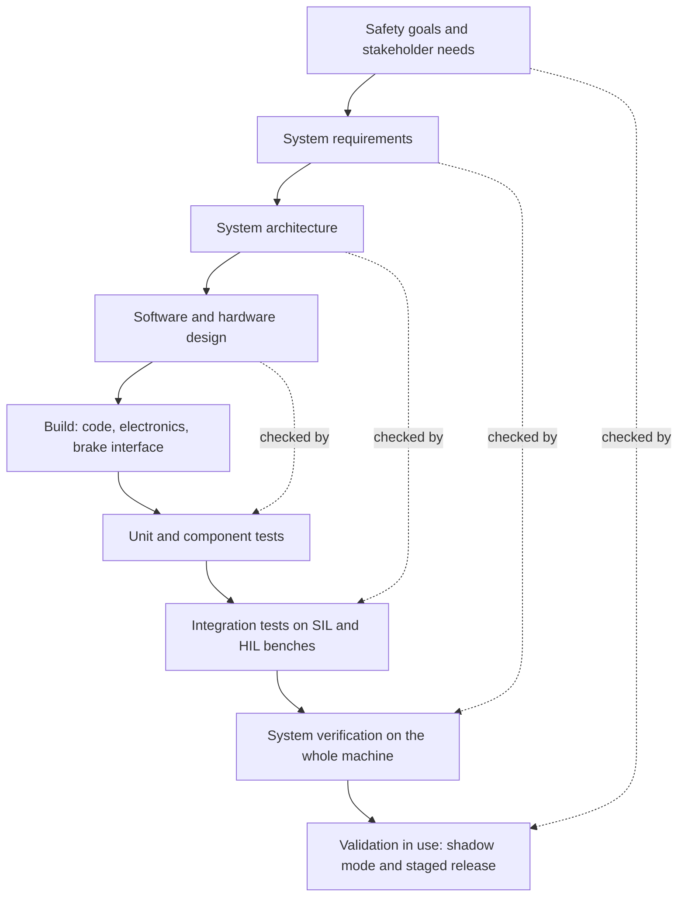

*The V-model: each level on the way down is checked by the matching test level on the way up.*

**Why it matters here.** The V shows why four months can only be the top of the right arm. The whole left arm and most test preparation must be finished before mid-2027.

**Related terms.** [Verification versus validation (V&V)](#verification-versus-validation-vv), [Requirements and requirements-based testing](#requirements-and-requirements-based-testing), [Traceability](#traceability), [The X-in-the-loop family](#the-x-in-the-loop-family-mil-sil-hil-pil-vil-dil), [Software-in-the-loop (SIL)](#software-in-the-loop-sil), [Hardware-in-the-loop (HIL)](#hardware-in-the-loop-hil-with-data-injection), [Sensor and prototype freeze](#sensor-and-prototype-freeze), [Validation window](#validation-window).

### Safety case and safety argument

**In one sentence.** A safety case is a structured written argument, supported by evidence, that a system is acceptably safe for a stated use in a stated environment, and the safety argument is the reasoning that connects the evidence to the claim.

**Explained.** A safety case is like a court case. There is a claim ("this machine, used this way, is acceptably safe"), there are arguments that break the claim into parts a reasonable person could check, and there is evidence supporting each argument. It must persuade a skeptical judge. The booklet puts it plainly: a safety case is claims plus reasoning plus evidence within a stated context and set of assumptions, "not a pile of test reports" [Chapter 12].

The structure is a tree. At the top sits the claim. Below it, sub-claims: all hazards are identified; each is controlled; the control chain meets its required reliability level; perception is adequate across the operating envelope; the residual risk has been accepted by the right authority. At the bottom sits the evidence: hazard analysis, failure tables, test results, correlation reports, field data. The context (which machines, sites, speeds) and the assumptions are written down, because a case true for a dry quarry may be false for a snowy mine. Mature cases also record defeaters, the reasons the argument could be wrong, and how each was answered [Chapter 12].

The booklet proposes a top-level claim for this program: "Within machine configuration M, operating envelope E and safety-function scope F, the defined virtual-test process produces evidence credible enough to support engineering decision D with explicitly bounded residual uncertainty." It breaks this into ten sub-claims, each paired with the evidence the roadmap must create, from "the intended use is valid" and "the simulation represents the real system" to "evidence stays inside the validated domain" and "conclusions follow from the evidence" [Chapter 12]. The strongest shape of argument, in the booklet's view: physical testing established the anchors and boundaries; independent validation showed the simulation predicts the safety-relevant quantities with known uncertainty inside them; the model then covered the interior; targeted physical confirmation stayed at the high-risk boundaries and after influential changes [Chapter 10].

The booklet also carries the critique. The Nimrod Review (2009) showed that a safety case can become paperwork nobody challenges; a diagram "can become an impressive-looking justification for an unsupported premise"; and no evidence was found that any notation improves heavy-machinery outcomes. Its value here is structuring what the evidence must show [Chapter 12]. The lawyer reviewer adds: write it as if an opposing expert will read it, state the validity limits of the simulation, and preserve all raw data and model versions [Chapter 13].

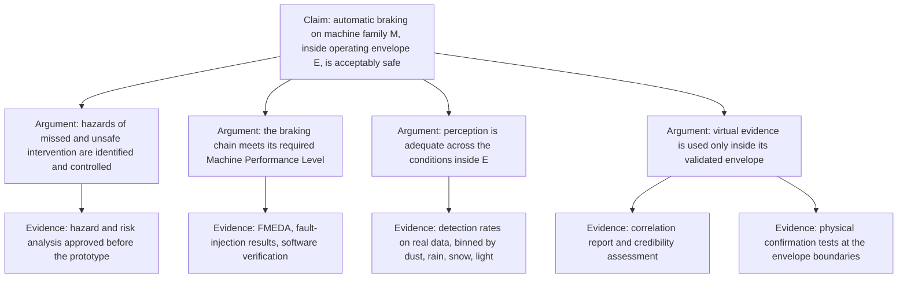

*A safety case as a tree: one claim, the arguments that break it down, and the evidence under each argument.*

**Why it matters here.** The booklet concludes that the defensible route for a four-month validation is an analytical safety case plus targeted physical tests, with simulation presented under a credibility framework [Chapter 3]. The safety case is what the safety board, a notified body, mining customers and, if something goes wrong, a court will read.

**Related terms.** [Goal Structuring Notation (GSN) and Structured Assurance Case Metamodel (SACM)](#goal-structuring-notation-gsn-and-structured-assurance-case-metamodel-sacm), [Assurance case for autonomous products (UL 4600)](#assurance-case-for-autonomous-products-ul-4600), [Evidence](#evidence), [Traceability](#traceability), [Residual risk and as low as reasonably practicable (ALARP)](#residual-risk-and-as-low-as-reasonably-practicable-alarp), [Independent assessment, independent test body and safety board](#independent-assessment-independent-test-body-and-safety-board), [Credibility of a simulation](#credibility-of-a-simulation), [Validity envelope](#validity-envelope-domain-of-validity-and-extrapolation), [Product liability and the EU Product Liability Directive (PLD)](#product-liability-and-the-eu-product-liability-directive-pld), [Hazard analysis and risk assessment](#hazard-analysis-and-risk-assessment).

### Goal Structuring Notation (GSN) and Structured Assurance Case Metamodel (SACM)

**In one sentence.** GSN is a standard set of diagram shapes for drawing a safety argument, and SACM is a formal data model that lets software tools store and exchange such arguments.

**Explained.** A safety argument written as pages of prose is hard to check. Goal Structuring Notation turns it into a diagram with a small fixed vocabulary: a goal (a claim) is a rectangle; a strategy (how the goal is broken into sub-goals) is a parallelogram; context (the scope within which the claim holds) is a rounded box; assumptions and justifications are ovals; a solution (an item of evidence) is a circle at the bottom. The notation was developed by Tim Kelly in the 1990s; the GSN Community Standard version 3 (SCSC-141C, 2021) is the current definition. The main alternative, Claims-Arguments-Evidence (CAE), uses the same three ideas with different shapes [Chapter 12].

SACM, the Structured Assurance Case Metamodel from the Object Management Group, is not a drawing style but a definition of the data behind one, so an argument built in one tool can be read by another and linked to requirement and test databases. ISO/IEC/IEEE 15026-2:2022 standardizes what an assurance case must contain [Chapter 12].

The booklet recommends a GSN or CAE sketch of the top-level claim in the plan's safety-scope section and a preliminary argument as an appendix [Chapter 12], and suggests the simulation's credibility argument be represented in structured form [Chapter 10]. It notes that controlled studies of how well readers understand GSN diagrams were not found, and repeats that the drawing is not the safety case [Chapter 12].

**Why it matters here.** A shared notation lets a safety board, a mining customer and a lawyer read the same argument; the caution is that drawing it does not make the evidence underneath any stronger.

**Related terms.** [Safety case and safety argument](#safety-case-and-safety-argument), [Assurance case for autonomous products (UL 4600)](#assurance-case-for-autonomous-products-ul-4600), [Evidence](#evidence), [Traceability](#traceability), [Visuals that work](#visuals-that-work).

### Assurance case for autonomous products (UL 4600)

**In one sentence.** UL 4600 is a standard that explains how to build and judge a safety case for a product that makes decisions on its own, by setting out a long list of topics and questions the case must answer.

**Explained.** An assurance case is a safety case widened to any property one wants to assure, such as security or reliability. UL 4600, Standard for Safety for the Evaluation of Autonomous Products, third edition of 17 March 2023, was written for self-driving vehicles and robots [Chapters 10, 12]. It prescribes no design or test. For each topic (hazards, operating domain, perception, machine learning, metrics, field feedback and more) it gives prompts the safety case must address or explicitly argue away, and conformance is judged on how completely that is done.

The booklet names UL 4600, with ISO 21448 and ISO/PAS 8800, as a source of assurance structures for machine-learning-based and autonomous safety functions [Chapter 1], and uses its question lists as one template for the final plan [Chapter 12]. It also records limits: the standard's content on simulation credibility was not examined [Chapter 10]. An automatic brake on an operator-driven machine is not an autonomous product, so UL 4600 is a way to make the case complete, not a route to conformity.

**Why it matters here.** Its questions about perception, operating domain and field feedback map onto the hardest problems of this program; no off-road body has adopted it, so the plan should borrow its thoroughness without claiming compliance.

**Related terms.** [Safety case and safety argument](#safety-case-and-safety-argument), [Goal Structuring Notation (GSN) and Structured Assurance Case Metamodel (SACM)](#goal-structuring-notation-gsn-and-structured-assurance-case-metamodel-sacm), [Operational design domain (ODD)](#operational-design-domain-odd-and-operating-domain-taxonomy), [Machine learning in safety functions](#machine-learning-in-safety-functions), [UL 4600](#ul-4600-autonomous-products-safety-case), [Field monitoring and operational monitoring](#field-monitoring-and-operational-monitoring).

### Evidence

**In one sentence.** Evidence is any recorded fact (a test result, a measurement, a field record, an analysis, a document) that supports or weakens a claim, and its strength depends on who produced it, how independently, and how directly it bears on the claim.

**Explained.** In a dispute, a video recording counts for more than an eyewitness, and an eyewitness for more than hearsay. Engineering evidence has a similar ladder. An independent measurement of the real thing is strongest. A supplier's claim about its own product is weaker, because the supplier has a stake. An expert's opinion without data is weaker still. Evidence from a similar but different setting (road cars standing in for haul trucks) is weaker than direct evidence. A blind prediction that proved right is stronger than a model tuned after the fact. Independent means two things: produced by people with no stake in the outcome, and based on data not used to build or tune the thing being judged.

The booklet applies this ladder to itself. Every claim is labeled Independent (peer-reviewed study, standard or regulation text, official statistics, third-party test, government report), Vendor (a supplier's own claim) or Expert opinion (a view without data); findings proven only for road vehicles carry an on-road marker; where nothing was found it says "not found" rather than guessing [Chapter 3]. It recommends the same discipline for the plan: keep verified fact, expert judgment and management assumption in three categories that are never mixed; build an evidence ledger mapping each sub-claim to its evidence item, method, credibility level and acceptance criterion [Chapter 12]; give every reviewer a one-page map showing, for each claim, whether its evidence is virtual, physical or mixed, what real data validated the model behind it, and who accepts the remaining uncertainty [Chapter 13]. A mining company's history of systems installed on supplier claims that then failed in the field is the warning about vendor evidence [Chapter 13]. Simulation is evidence of coverage and design correctness; correlated physical tests are evidence that the simulation represents the real machine; prescribed physical tests remain physical [Chapter 3].

**Why it matters here.** The booklet's whole question is whether virtual results count as evidence. Its answer: yes, inside a validated envelope, anchored by independent physical tests, and approved as specific substitutions rather than as "virtual testing" in general [Chapters 3, 10, 13].

**Related terms.** [Safety case and safety argument](#safety-case-and-safety-argument), [Traceability](#traceability), [Independent assessment, independent test body and safety board](#independent-assessment-independent-test-body-and-safety-board), [Credibility of a simulation](#credibility-of-a-simulation), [Held-out measurements and independent physical data](#held-out-measurements-and-independent-physical-data), [Common-cause failure and independence of channels](#common-cause-failure-and-independence-of-channels), [Verification versus validation (V&V)](#verification-versus-validation-vv).

### Independent assessment, independent test body and safety board

**In one sentence.** Independent assessment is a review of the safety evidence by people who did not produce it; an independent test body is an outside organization that runs or witnesses tests; and a safety board is the internal group with the authority to accept or reject the safety case.

**Explained.** Companies do not audit their own accounts, because the people who made the numbers are least able to see their errors. Independence comes in degrees: a different engineer, a different team, an outside company, or a body appointed under law such as a notified body in the European Union. The higher the required integrity level, the more independence is expected [Chapter 12].

The booklet asks early: who accepts the evidence? For most markets it is the manufacturer's internal safety board, working under ISO 19014 and ISO 13849, plus the customers; in South Africa the mines check against Regulation 8.10 and the MOSH requirements, which include independent verification at two readiness gates [Chapters 2, 3]. A simulation campaign optimized for internal engineering confidence "is not necessarily the dossier an independent safety board, mine customer or regulator will accept" [Chapter 2]. What such a board expects is listed in full: among other items, the decision and context of use, traceability, criteria declared in advance, independent physical data, a validity envelope, confirmatory tests some of which the assessor chooses, failed tests and their disposition, and a residual-risk statement [Chapter 10]. Model developers should not be the only people deciding whether discrepancies are acceptable, and an external assessor should be budgeted early [Chapter 12]. The booklet did not find who would assess a simulation-based argument under the EU Machinery Regulation or what competence a notified body would need; agreeing who that counterpart is, and on their criteria, is itself a prerequisite for the schedule [Chapter 10]. Independent review can become the critical path, and it cannot rescue incomplete engineering late [Chapter 1].

**Why it matters here.** The booklet's second gate requires assessor feedback to have been received, and it advises engaging the assessor before the first gate [Chapter 12].

**Related terms.** [CE marking and notified body](#ce-marking-and-notified-body), [Safety case and safety argument](#safety-case-and-safety-argument), [Evidence](#evidence), [Evidence gate and decision gate](#evidence-gate-and-decision-gate), [MOSH](#south-africa-rules-mhsa-dmre-chapter-8-regulations-mosh-cps-verification-specifications), [Red team and hostile review](#red-team-and-hostile-review), [What an internal safety board or outside assessor expects to see](#the-credibility-package-what-a-safety-board-or-outside-assessor-expects-to-see).

### Evidence gate and decision gate

**In one sentence.** A decision gate is a planned point at which management must decide whether a program continues, changes course or stops, and an evidence gate is a decision gate whose pass criterion is a piece of evidence obtained, not a date reached.

**Explained.** A learner cannot drive alone until a test is passed, and the examiner's criteria are written down beforehand. Program gates copy this. The pass criteria are written and signed by the sponsor in advance, a named person decides, and each gate allows at least four outcomes: go, go with restrictions, pivot to a fallback, and stop. The booklet is blunt: "A gate that permits only go is a review meeting, not a decision gate" [Chapter 12]. Criteria are fixed in advance because, once people have committed effort, they tend to keep bad projects alive [Chapter 12].

The difference between a calendar gate and an evidence gate is the criterion. "Phase 2 complete by February" is a date. "Model correlation meets criterion X and scenario coverage reaches Y" is evidence. The booklet recommends four or five evidence gates rather than many administrative phases [Chapter 12].

The booklet proposes a dated set. G0, scope and evidence plan (end of November 2026): claims and evidence plan agreed, long-lead orders placed, criteria signed, decider named. G1, feasibility (end of January 2027): one scenario runs end to end, reproducibly, under configuration control. G2, credibility and delivery readiness (March to April 2027): a blind pilot meets pre-set metrics inside its envelope, assessor feedback received, the 80 percent confidence date inside the deadline. G3, coverage (end of June 2027): planned coverage reached with no open credibility defeaters on high-integrity claims. G4, evidence release (August to September 2027): the package states envelope, limitations and residual uncertainty, and results support only the claims made; outcomes are release, release with restrictions, or withhold [Chapter 12]. The release domain is widened "only by evidence gate" [Chapter 1], and the cheapest early experiments are meant to feed stage-gated funding [Chapter 13].

**Why it matters here.** With a fixed deadline, gates are the mechanism that stops optimism from running ahead of evidence and makes "restrict" or "stop" legitimate answers.

**Related terms.** [Stage gate, evidence gate and go or no-go decision](#stage-gate-evidence-gate-and-go-or-no-go-decision), [Acceptance criteria and pass or fail criteria](#acceptance-criteria-and-pass-or-fail-criteria), [Fallback option](#fallback-option), [Staged release and limited operating domain](#staged-release-and-limited-operating-domain), [Pilot, proof of concept and minimum viable product (MVP)](#pilot-proof-of-concept-and-minimum-viable-product-mvp), [Planning fallacy, reference class forecasting and P50 / P80 estimates](#planning-fallacy-reference-class-forecasting-and-p50--p80-estimates), [Independent assessment, independent test body and safety board](#independent-assessment-independent-test-body-and-safety-board).

### Staged release and limited operating domain

**In one sentence.** Staged release means switching the automatic brake on first only for a narrow, well-understood set of machines, movements, speeds and conditions (the limited operating domain), and widening that set step by step as evidence from the field arrives.

**Explained.** A new medicine is approved first for one condition and one group of patients, and its approved use grows with experience. Staged release applies the same caution to a safety function. The operating domain is the set of conditions in which the function may act: which machine families, which motions (for example reverse only), which speed band, which object classes, which visibility, weather and site types. Outside it the machine falls back to warning only. For this to be safe, the machine must know at every moment whether it is inside the domain (from speed, gear, site mode and sensor health) and must log it. Each widening step is an evidence gate.

The booklet found that every documented off-road launch of an intervention function was deliberately narrow. One manufacturer's wheel-loader system (January 2023) works only in reverse between 3 and 15 km/h, brakes for 2 to 3 seconds, needs a separately fitted radar system and was offered on named models. Another's excavator stop function (2019 to 2020) acts only at slow travel speed or at the start of motion. A third's loader system targets the rear only and inhibits reverse engagement from standstill [Chapters 1, 13]. A domain can be constrained by machine family, site type, speed, route, grade, object class, visibility or weather [Chapter 1].

The booklet is equally clear about the limits. Passing on one dry, level quarry with two machine models "says nothing automatically about a snowy mine, an underground environment, an articulated loader, a steep decline or a different sensor mounting"; staged release shortens the time to a bounded release, it does not validate excluded conditions, and it needs runtime domain monitoring, a field-data loop and regulatory acceptance [Chapter 1]. The first of the booklet's responsible fallbacks is a restricted operating envelope for the first release, with release split by machine family [Chapter 13]. The lawyer reviewer adds: enforce the domain technically and log it, citing a United States jury verdict (on-road) that punished a design for not being restricted to its intended domain [Chapter 13]. There is a genuine disagreement: a small envelope gives faster real evidence, but customers may regard a heavily constrained function as insufficient, and no technical principle settles that trade-off [Chapter 1]. "Validated across 100+ site types" has no meaning until the organization says whether that means individual sites, parameterized environment classes or configurations inside a validated envelope [Chapter 13].

**Why it matters here.** This is the booklet's central reframing of the timeline: build a measured, independently reviewed credibility envelope before the prototype arrives, substitute virtual for physical evidence only inside it, launch a restricted scope as the precedents did, and keep physical testing where the models are weak. The four months then validate a bounded first release, not the whole product range [Chapters 1, 13].

**Related terms.** [Operational design domain (ODD)](#operational-design-domain-odd-and-operating-domain-taxonomy), [Evidence gate and decision gate](#evidence-gate-and-decision-gate), [Field monitoring and operational monitoring](#field-monitoring-and-operational-monitoring), [Fallback option](#fallback-option), [Shadow mode](#shadow-mode-silent-testing), [Wheel loader](#wheel-loader), [Validity envelope](#validity-envelope-domain-of-validity-and-extrapolation), [Site type and the "100+ site types" claim](#site-type-and-the-100-site-types-claim), [Nine levels of control](#nine-levels-of-control).

### Field monitoring and operational monitoring

**In one sentence.** Field monitoring, also called operational or in-service monitoring, is the planned collection and review of data from machines in real use after release, to check that the system behaves as the safety case predicted and to catch the problems the tests missed.

**Explained.** A new bridge is fitted with strain gauges and inspected on a schedule after it opens, because no test program reproduces decades of traffic and weather. Field monitoring does this for a safety function. The plan says what is recorded on every machine: each intervention and whether it was correct, unnecessary or ambiguous; near misses and known misses; sensor health; time in degraded mode; operator overrides and switch-offs; and the conditions (weather, light, site, task). Rates are reported per operating hour, reviewed on a fixed cadence, fed back into the models and the scenario catalog, and tied to triggers for widening or narrowing the operating domain. It differs from shadow mode: there the brake is disabled and only the decisions are logged; here the function is live.

The booklet makes it the fourth step of the documented program structure, "release in stages with field monitoring", with misses and nuisance brakes monitored and new field scenarios flowing back to the start of the process [Chapter 1]. Durability, sensor aging and contamination rely on monitoring after release [Chapter 1]. The South African specification's final readiness level calls for statistical monitoring in production over "an extended period (e.g., 3 months or 2000 hours)" and requires logging at 10 hertz during interventions, kept 7 days on board and 3 months on a server [Chapters 3, 7]. In-service monitoring is the fifth pillar of the United Nations assessment method for automated driving and, in the booklet's judgment, "the only route to close the dust and glare model gaps over time" [Chapter 10]. Operator behavior changes after a technology is introduced, and only field time reveals it [Chapter 1].

**Why it matters here.** A four-month window cannot sample all seasons, rare events or operator adaptation. Monitoring is how the evidence keeps growing after release, and it is what makes staged release a legitimate safety strategy rather than a way to ship early.

**Related terms.** [Staged release and limited operating domain](#staged-release-and-limited-operating-domain), [Shadow mode](#shadow-mode-silent-testing), [Data logging](#data-logging-what-to-record-on-the-machine-raw-versus-processed-data-common-mistakes), [Nuisance braking](#nuisance-braking), [Operator behavior change](#operator-behavior-change), [Warning-system fleet](#warning-system-fleet), [Proven in use and reuse of evidence](#proven-in-use-and-reuse-of-evidence).

### Proven in use and reuse of evidence

**In one sentence.** "Proven in use" is a formal route in the functional-safety standards for trusting a component because it has already worked reliably for a long time in the same conditions, and reuse of evidence is the broader idea of carrying test results and analyses from one machine model or product to another instead of repeating them.

**Explained.** A bridge design that has stood in fifty places for thirty years needs less proof than a new one. The standards make this precise. Under ISO 26262-8 clause 14 and IEC 61508, a component may be accepted as proven in use if it is identical, or highly similar, to the one already in the field, if its conditions of use are the same, and if the service period is long enough with few enough failures to support a statistical claim. ISO 26262 bases the calculation on a 70 percent confidence level; IEC 61508 practice uses higher [Chapter 10]. Change the component or its use and the claim is void.

The booklet applies this to the obvious question: can the warning system's years of field history count for the new braking system? Yes for parts, no for the whole. The history can anchor how often objects are encountered, real detections and misses where reliably captured, weather and site distributions, nuisance-warning patterns, operator response times and approach speeds, and it supports the claim that the scenario catalog is representative [Chapter 10]. It does not validate the braking function or the simulator, for three reasons: the exposure (how many relevant encounters happened) is usually unknown; the records are censored, because a warning makes the operator brake, so the data rarely show what would have happened otherwise; and the system boundary changes, since the chain from detection to brake command to stopping has never been exercised in the field [Chapter 10].

Reuse across machine models is a separate lever. Reusable evidence can include unchanged safety software, common controller hardware, interfaces, sensor qualification, diagnostic logic and scenario definitions; the defensible model is common-core evidence plus explicit delta evidence for each variant, not blanket family qualification [Chapter 1].

**Why it matters here.** Reuse may be "the single most important lever" for a product family, but only if designed in from the start, and no case was found in which such inheritance cut the validation of a large heavy-machine family from years to months [Chapter 1].

**Related terms.** [Warning-system fleet](#warning-system-fleet), [Equivalence argument between machine variants](#equivalence-argument-between-machine-variants), [Using the existing warning system's field history as a reference](#using-the-existing-warning-systems-field-history-as-a-reference), [Replay and re-simulation of recorded data](#replay-and-re-simulation-of-recorded-data-open-loop-replay), [Evidence](#evidence), [Functional safety](#functional-safety), [Variant management](#variant-management).

### Equivalence argument between machine variants

**In one sentence.** An equivalence argument, also called a similarity argument, is the reasoned and evidenced claim that evidence gathered on one machine variant also holds for another, because the differences between them do not affect the safety-relevant behavior.

**Explained.** A shoe tested in size 9 is sold in size 10 without a new test, because the maker can explain why the change does not matter. A machine family is harder. The booklet's recommended form is a parameterized family model rather than twenty unrelated models, with parameters for geometry and articulation, mass and payload, braking dynamics, grade capability, sensor type and firmware, mounting height, angle and occlusion, vibration, sensor-to-brake latency and the environment [Chapter 10].

For every transition from machine A to machine B the safety case answers three questions. What changed, recorded as a configuration-controlled delta? Can that change affect a validated phenomenon or safety output, shown by sensitivity analysis? What bridging evidence closes the gap: none for irrelevant differences, targeted tests for influential ones, new full-system anchors where new physics appears? The model is validated at the corners of the envelope (smallest and largest machine, lowest and highest mount, lightest and heaviest mass, least and most favorable brake response); a new variant is shown to lie inside that hull and then gets a reduced "delta" physical set, typically a brake calibration plus a sensor field-of-view and detection check at the new mount. Because geometry, articulation and brake dynamics can act non-monotonically, the claim that the extremes bound the middle must itself be demonstrated [Chapter 10].

The booklet's cautions: moving a sensor can invalidate the validated simulation envelope even with the software unchanged [Chapter 3]; the machine with the worst stopping distance is not necessarily the one with the worst sensor occlusion, so several representatives may be needed [Chapter 1]; and no published off-road example of variant transfer was found [Chapter 10].

**Why it matters here.** Whether the product range collapses into a few validated parameterized families is "a key experiment, not a fact", and both the schedule and the business case depend on the answer [Chapter 13].

**Related terms.** [Proven in use and reuse of evidence](#proven-in-use-and-reuse-of-evidence), [Variant management](#variant-management), [Extending a validated model to another machine model or sensor position](#extending-a-validated-model-to-another-machine-model-or-sensor-position), [Validity envelope](#validity-envelope-domain-of-validity-and-extrapolation), [Sensitivity analysis](#sensitivity-analysis), [Calibration (intrinsic and extrinsic) and sensor mounting](#calibration-intrinsic-and-extrinsic-and-sensor-mounting), [Staged release and limited operating domain](#staged-release-and-limited-operating-domain).

### Safety of machinery (ISO 12100)

**In one sentence.** ISO 12100 is the foundation standard for machine safety: it defines the basic words (hazard, risk, protective measure) and sets out the general method for reducing machine risk in a fixed order.

**Explained.** Machinery standards come in three layers. Type-A standards give basic concepts and the general method; ISO 12100 is the type-A standard. Type-B standards cover one safety aspect or safeguard for many machines, such as ISO 13849 for control systems. Type-C standards cover one machine type in detail and take precedence; ISO 21815-3 for collision systems on earth-moving machines is a type-C standard under ISO 12100 [Chapter 3].

The method has two halves. First, a risk assessment: set the limits of the machine and its use, identify hazards, estimate and evaluate the risk. Second, risk reduction in three steps in strict order. Inherently safe design comes first: remove or reduce the hazard by design, for example lower speeds or better operator visibility. Safeguarding and complementary protective measures come second: guards, sensors, and functions such as automatic braking. Information for use comes third: warnings, instructions and training. Residual risk is what remains.

The booklet reports that the EU Machinery Regulation requires risk reduction, safe and reliable control systems and technical evidence of conformity [Chapter 3], and that ISO 20474 and EN 474 give baseline safety requirements for earth-moving machinery, with the EN 474:2022 family designated in Great Britain in August 2026 [Chapter 3]. The mining industry's nine-layer model follows the same logic: site design and operating controls (Levels 1 to 7) are to be understood before advisory (Level 8) and intervention (Level 9) technology is added [Chapter 1].

**Why it matters here.** Automatic braking is a step-two protective measure. In ISO 12100 logic it comes after inherently safe design and sits inside the site's other controls, which is why the same braking algorithm gives different safety results at sites with different traffic rules and pedestrian controls [Chapter 1].

**Related terms.** [Hazard, harm and risk](#hazard-harm-and-risk), [Hazard analysis and risk assessment](#hazard-analysis-and-risk-assessment), [Residual risk and as low as reasonably practicable (ALARP)](#residual-risk-and-as-low-as-reasonably-practicable-alarp), [Nine levels of control](#nine-levels-of-control), [ISO 21815 series](#iso-21815-series-collision-warning-and-avoidance), [ISO 12100](#safety-of-machinery-iso-12100), [ISO 13849-1 and -2](#iso-12100-iso-13849-iec-62061-and-iec-61508-the-machinery-and-functional-safety-family), [IEC 62061](#iso-12100-iso-13849-iec-62061-and-iec-61508-the-machinery-and-functional-safety-family), [IEC 61508](#iso-12100-iso-13849-iec-62061-and-iec-61508-the-machinery-and-functional-safety-family), [Standard](#standard).

### Electro-sensitive protective equipment (ESPE) and safety-related sensors

**In one sentence.** ESPE is the family of certified safety sensors (light curtains, laser scanners and, recently, radar) that detect a person without touching them and trigger a protective stop, and IEC 61496 and IEC TS 62998 are the standards that define how such sensors are shown to be reliable.

**Explained.** The invisible beam that stops a garage door from closing on a child is a simple electro-sensitive protective device. In factories, light curtains across a press and laser scanners around a robot do the same job, certified to the IEC 61496 series: Part 1 general requirements, Part 2 light curtains, Part 3 laser scanners, and the technical specification IEC TS 61496-5:2023 for radar protective devices. Certification covers detection capability, response time and behavior under faults, and it assumes a stationary machine in a controlled space. IEC TS 62998-1 is a newer specification for safety-related sensors that protect people but do not fit the classic ESPE molds, including use on mobile machines and outdoors.

The booklet lists safety-rated sensors as one approach to shortening the proof. IEC TS 61496-5:2023 gives radar an established certification basis but, in its own words, "does not consider the aspects of a moving RPD application". One sensor maker states that it used IEC TS 62998-1 to analyze its radar for mobile outdoor use; the booklet marks that as a vendor claim. Its conclusion: component certification does not deliver system-level performance on a moving outdoor machine [Chapter 1]. The off-road standard ISO 16001 covers object detection systems with a 300 millisecond detection time, continuous self-checking and technology annexes for several sensor types but none for lidar [Chapter 3]. One school of thought keeps machine learning out of the safety function and relies on certified deterministic sensors [Chapter 1].

**Why it matters here.** A certified sensor can shorten the component-level argument and bound what a learned perception channel must prove, but it does not replace validation of the whole system on a moving machine in dust, rain and glare.

**Related terms.** [Sensor](#sensor), [Radar](#radar-radio-detection-and-ranging), [Machine learning in safety functions](#machine-learning-in-safety-functions), [Common-cause failure and independence of channels](#common-cause-failure-and-independence-of-channels), [IEC 61496 and IEC TS 62998 (safety sensors)](#iec-61496-iec-ts-62998-iso-3691-4-and-iso-18497-safety-sensors-driverless-industrial-trucks-and-agricultural-automation), [ISO 16001](#iso-16001-and-iso-5006-object-detection-visibility-aids-and-operator-visibility), [Performance Level (PL) and Category](#performance-level-pl-and-category).

### Machine learning in safety functions

**In one sentence.** Machine learning (ML) is software whose behavior is learned from examples rather than written as explicit rules, and when such software helps decide whether to brake, safety engineers treat it differently because its rules cannot be read, its failures are hard to predict, and the standards for it are still being written.

**Explained.** A burglar alarm follows a rulebook its designer wrote; a guard dog learned from experience and nobody can read its rules. A neural network that detects people in camera images is like the dog. No requirement can fully specify what it has learned; it may fail on inputs unlike its training data (a new site, season or clothing); its confidence scores may not match its real accuracy; retraining changes its behavior in ways that are hard to bound; and ordinary code review and requirements-based coverage do not apply to it directly.

The booklet's legal findings are specific. The EU Machinery Regulation, applying from 20 January 2027, lists "safety components with fully or partially self-evolving behaviour using machine learning approaches ensuring safety functions" among products that need a notified body; whether a frozen, non-learning model counts is disputed and unsettled [Chapter 3]. The amended AI Act moves obligations for high-risk AI embedded in machinery to 2 August 2028 [Chapters 3, 12]. On standards: ISO/IEC TR 5469:2024 is guidance, not requirements; ISO/PAS 8800:2024 tailors ISO 26262 for AI in road vehicles only; no off-road standard with machine-learning clauses was found, so training-set coverage, distribution shift, retraining, non-determinism, confidence calibration and change control must be treated as additional safety-case subjects [Chapter 3]. Validation data must be real or physically independent of whatever generated the training data [Chapter 9]; synthetic images augment real ones, they do not replace them [Chapter 13].

Experts disagree: one view keeps ML out of the safety function and uses certified deterministic sensors; the other accepts ML under ISO/PAS 8800-style assurance [Chapter 1]. A non-ML safety channel, for example radar-only braking with ML used only for warnings, could change the regulatory route [Chapter 13].

**Why it matters here.** If machine learning performs the safety function in a product sold in the EU after 20 January 2027, the booklet advises planning for notified-body involvement unless legal advice concludes otherwise [Chapter 3]. The architecture choice shapes the whole evidence plan and should be made early.

**Related terms.** [Machine learning detector](#machine-learning-detector-neural-network-convolutional-neural-network-cnn-training-data-inference), [Training data, validation data, test data, and the independence rule](#training-data-validation-data-test-data-and-the-independence-rule-data-lineage), [Safety of the Intended Functionality (SOTIF)](#safety-of-the-intended-functionality-sotif), [Electro-sensitive protective equipment (ESPE) and safety-related sensors](#electro-sensitive-protective-equipment-espe-and-safety-related-sensors), [Common-cause failure and independence of channels](#common-cause-failure-and-independence-of-channels), [EU Machinery Regulation (EU) 2023/1230](#eu-machinery-regulation-eu-20231230-the-ai-act-the-product-liability-directive-and-the-data-act), [ISO 21448 (SOTIF), ISO 26262](#iso-21448-iso-26262-and-the-ai-safety-standards-isopas-8800-isoiec-tr-5469-isoiec-42001-23894-24029), [ISO/PAS 8800](#iso-21448-iso-26262-and-the-ai-safety-standards-isopas-8800-isoiec-tr-5469-isoiec-42001-23894-24029), [CE marking and notified body](#ce-marking-and-notified-body).

### Product liability and the EU Product Liability Directive (PLD)

**In one sentence.** Product liability is the legal duty of a manufacturer to compensate people harmed by a defective product, and the European Union's new Product Liability Directive extends that duty explicitly to software and makes it easier for claimants to obtain the manufacturer's internal evidence.

**Explained.** If a kettle catches fire because of a design flaw, the maker pays, whether or not anyone was careless. A product is defective if it does not provide the safety a person is entitled to expect, and liability does not depend on proving negligence. Directive (EU) 2024/2853 applies to products placed on the market after 9 December 2026. Software, including updates, is a product. Courts may order the manufacturer to disclose evidence, and a defect is presumed if the manufacturer fails to disclose, or where technical complexity makes proof excessively difficult for the claimant [Chapters 12, 13]. Updates within the manufacturer's control stay within its liability [Chapter 13].

The booklet's product liability reviewer draws the consequences. There is no legal safe harbor for simulation; what will matter is whether the contemporaneous record shows that physical testing was reduced because virtual evidence had been demonstrated credible, or because the schedule required it. The advice: write the safety case as if an opposing expert will read it; include the validity limits of the simulation; preserve all raw data and model versions; enforce the operating domain technically and log it; retain event data; obtain written approvals for brake interfaces from the machine manufacturer, since integrating without them was flagged as a liability risk by a mining company in 2015 [Chapter 13]. The reviewer cites a United States jury verdict of 1 August 2025 (on-road) that found a carmaker one-third responsible and awarded about 243 million dollars, including 200 million in punitive damages, on theories that included failing to restrict the system to its intended domain [Chapter 13]. Legal sign-off at the end is too late, because the evidence architecture itself has legal implications; and if the main markets are outside the EU, the United States, Australian and South African rules take the foreground [Chapter 13].

**Why it matters here.** The assumptions and gaps of a disclosed simulation safety case become the claimant's exhibit, and a liability review that rejects the safety case is one of the booklet's named failure modes [Chapter 13].

**Related terms.** [Safety case and safety argument](#safety-case-and-safety-argument), [Traceability](#traceability), [Evidence](#evidence), [Staged release and limited operating domain](#staged-release-and-limited-operating-domain), [Data logging](#data-logging-what-to-record-on-the-machine-raw-versus-processed-data-common-mistakes), [EU Machinery Regulation (EU) 2023/1230](#eu-machinery-regulation-eu-20231230-the-ai-act-the-product-liability-directive-and-the-data-act), [Regulation, directive, law and guidance note](#regulation-directive-law-and-guidance-note), [Executive reviewer, finance reviewer, product liability reviewer](#executive-reviewer-finance-reviewer-product-liability-reviewer).

### Red team and hostile review

**In one sentence.** A red team is a group given the explicit job of attacking a plan to find its weaknesses before real reviewers, customers or accidents do, and a hostile review is the same stance applied to a document.

**Explained.** Before an important speech, a wise speaker asks a friend to play the harshest critic in the audience. A red team does this for a program. The practice comes from the military and from security testing; the booklet cites the United Kingdom Ministry of Defence Red Teaming Handbook (third edition, 2021) and the United States Army Red Team Handbook [Chapter 12].

The booklet's rules are practical. Give the team an adversarial charter: "Demonstrate that this plan cannot support its stated safety claim by the deadline." Ask it to attack scope, hidden assumptions, architecture, reference data, acceptance thresholds, schedule logic, resources, integration dependencies, standards interpretation, evidence independence, scenario coverage, model extrapolation, fallback feasibility and the executive claims. It should not edit grammar. Recruit real skeptics rather than appointing a devil's advocate, because research shows authentic dissent works better than assigned dissent. Keep a dissent log. No controlled evidence shows that red teams improve engineering outcomes; their use rests on documented practice [Chapter 12]. Reviewers are influenced more by weaknesses than by strengths, so a deliberate skeptic pass ("what single weakness would allow a competent reviewer to reject this plan?") is worth more than adding upside [Chapter 12]. The recommended sequence places an independent red team in the fourth month of preparation [Chapter 12].

The booklet's own Chapter 13 is a hostile but fair review. It takes seven reviewers in turn (a functional safety engineer, a perception engineer, a simulation specialist, a veteran field test engineer, a product liability lawyer, a site operations manager and a finance executive), gives each their strongest objections grounded in documented cases, states what evidence would answer each, and ranks the ten strongest objections [Chapter 13].

**Why it matters here.** The booklet's central finding, that the plan's weakness is credibility rather than test volume, came from this stance; a plan that has survived a red team is more likely to survive the safety board.

**Related terms.** [Pre-mortem, red team and expert review](#pre-mortem-red-team-and-expert-review-delphi-method-expert-elicitation), [Independent assessment, independent test body and safety board](#independent-assessment-independent-test-body-and-safety-board), [Failure mode of a project and early warning sign](#failure-mode-of-a-project-and-early-warning-sign), [Evidence](#evidence), [Executive reviewer, finance reviewer, product liability reviewer](#executive-reviewer-finance-reviewer-product-liability-reviewer).

### Failure mode of a project and early warning sign

**In one sentence.** Borrowing the engineering word, a failure mode of a project is one specific way the project could fail to deliver what it promised, and an early warning sign is an observable symptom that appears while there is still time to act.

**Explained.** A brown stain on a ceiling is an early warning sign of a leak; waiting for the ceiling to fall is not a strategy. Project failure modes are listed the way an engineer lists component failures: cause, first visible sign, the action that reduces it, and seriousness. The booklet's table rates seriousness as Critical (would by itself defeat the central claim or create a new hazard), High (would force a major scope or schedule change) or Medium (recoverable with cost) [Chapter 13].

The Critical failure modes and their signs are concrete. The toolchain never becomes credible: huge virtual test counts without simulator-to-real residuals, no agreed correlation metrics by the first quarter of 2027. Synthetic sensors reproduce appearance but not physics: good virtual metrics but field failures clustered by rain, dust, night or glare. False braking on grades, with loads and at trailers: nuisance events in shadow mode, operators asking for an off-switch. Machine dynamics that do not generalize: models retuned after every physical test. Requirements debate consuming the four months: hazard analysis, performance levels or pass or fail metrics still "to be decided" in 2027. Supplier data late or legally unusable: brake maps or licensing still under negotiation near prototype delivery. The function overfitted to the simulator: virtual metrics improving while held-out real performance stalls. Late rejection of virtual evidence: reviewers seeing the credibility argument for the first time near launch [Chapter 13].

Above all of these sits one program-level warning: by the first half of 2027 the team still cannot produce one short, auditable chain of evidence for a single representative requirement [Chapter 13]. The planning chapter asks that every risk in the register carry an early warning or signpost [Chapter 12].

**Why it matters here.** The signs are specific and dated, so a manager without engineering training can check them in a meeting and act before the deadline makes action impossible.

**Related terms.** [Red team and hostile review](#red-team-and-hostile-review), [Risk register, assumption log and unknowns](#risk-register-assumption-log-and-unknowns-known-unknowns), [Fallback option](#fallback-option), [Traceability](#traceability), [Evidence gate and decision gate](#evidence-gate-and-decision-gate), [Over-fitting](#over-fitting), [Sim-to-real gap](#sim-to-real-gap).

### Fallback option

**In one sentence.** A fallback option is a pre-planned, less ambitious but still responsible outcome that the program switches to when the main plan cannot be delivered on time, chosen so that safety is preserved rather than the headline schedule.

**Explained.** A wedding planner books a hall in case it rains, in advance and with a cool head, not on the morning of the storm. The booklet makes the same point: design fallbacks before optimism pressure peaks [Chapter 12]. It describes a descoping ladder (fewer scenario classes, then a narrower operating envelope, then "decision-support evidence" instead of "safety-case evidence"), a pre-defined minimum viable deliverable, and off-ramps such as reverting to physical tests for the highest-integrity claims, using simulation only for scenario screening, or producing an engineering-learning result instead of a safety-credit result [Chapter 12]. The fallback should be costed and funded in parallel, so that slippage does not become a launch stop [Chapter 13].

The hostile review lists the responsible fallbacks for this program. Release with a restricted operating envelope (reverse only, a speed band, named models), keeping warning-only behavior outside it. Inhibit motion at start-up before offering full dynamic braking, as one manufacturer does when a loader has stood still for 15 seconds with an object in the critical zone. Offer a warning plus a brief brake pulse, as another manufacturer's 2 to 3 second braking does. Ship with shadow-mode logging enabled and widen the envelope by software update as evidence accrues. Use virtual testing mainly for regression and for choosing the most informative physical tests. Retain physical testing where models are weak. Split the release by machine family. Use the southern-hemisphere winter of mid-2027 for cold-weather tests. And delay the full scope rather than claim a virtual equivalence that cannot be defended: "the four-month target should be a business objective, not a pass criterion" [Chapter 13]. Every gate must allow pivot or fallback, and the executive brief must state the fallback up front [Chapter 12].

**Why it matters here.** A plan with no fallback forces a choice between missing the date and shipping unresolved uncertainty. The booklet's position is that delaying the brake-control feature while keeping the validated warning function is more responsible than "converting unresolved uncertainty into operator exposure" [Chapter 13].

**Related terms.** [Staged release and limited operating domain](#staged-release-and-limited-operating-domain), [Evidence gate and decision gate](#evidence-gate-and-decision-gate), [Shadow mode](#shadow-mode-silent-testing), [Failure mode of a project and early warning sign](#failure-mode-of-a-project-and-early-warning-sign), [Staged intervention](#staged-intervention), [Pilot, proof of concept and minimum viable product (MVP)](#pilot-proof-of-concept-and-minimum-viable-product-mvp), [Season and weather coverage](#season-and-weather-coverage).

## Part C: Sensors, perception and machine data

A braking system can only act on what it detects. This part explains each sensor type, what it measures, how it fails in dust, fog, snow, darkness and glare, and how detections are judged (the four outcomes, precision and recall). It then covers the data side: ground truth, labels, machine-learning detectors, synthetic data, and what must be recorded on a machine so that the recordings can be replayed later.

### Sensor

**In one sentence.** A sensor is a device that measures something about the world, such as distance, light or speed, and turns the measurement into an electrical signal a computer can read.

**Explained.** Your body has sensors: eyes measure light, ears measure sound, skin measures pressure and heat. A machine's sensors do the same job, but each measures one kind of thing and reports it as numbers. The sensors that matter for a collision system answer one question: is there something near the machine, where is it, and how fast is it moving?

Each sensor type works on a different physical principle, so each is good in some conditions and blind in others. A camera sees color and shape but needs light. A lidar (light detection and ranging) times the return of laser pulses, so it measures distance precisely but is scattered by fog and dust. A radar (radio detection and ranging) uses radio waves that pass through dust almost untouched, but it sees shapes coarsely and is confused by metal. An ultrasonic sensor uses sound echoes over a few meters. A thermal camera sees heat and needs no light. The booklet covers all five, plus "cooperative" systems that need a tag on every person or vehicle [Chapter 6].

The table compares the five main types. The dust, fog and darkness columns describe how the sensor itself behaves, which the booklet treats separately from how well that behavior can be simulated [Chapter 6].

| Sensor | What it measures | Strengths | In dust | In fog | In darkness |
|---|---|---|---|---|---|
| Camera | Visible light as a flat color image | Rich detail; can tell a person from a post; cheap | Weak: dust hides objects and coats the lens; simulated only as haze overlays | Weak to partial: contrast falls with density; the best-reproduced camera condition in simulation | Weak: needs light; noise rises in the dark; night is the hardest condition for generated images |
| Lidar | Distance to many points from laser time of flight, plus return strength (intensity) | Precise 3D geometry at long range; works day and night | Partial: dust scatters the beam, adding false and lost returns; four distinct behaviors seen in field dust; the biggest off-road gap | Partial to good: attenuation and backscatter well studied; dense fog still hard | Good: largely unaffected apart from background light |
| Radar | Distance and closing speed from radio echoes (77 GHz band) | Largely unaffected by airborne dust, fog and darkness; measures speed directly | Good: measurements show little effect from airborne dust; dust caking the cover is a separate open question | Good: ordinary fog has minor effect | Not affected |
| Ultrasonic | Distance to the nearest surface over a few meters, from sound echoes | Cheap; good at very close range; ignores light | Unknown: no validation found; contamination and rough surfaces are weak points | Weak: depends on temperature and humidity; weakly evidenced | Not affected |
| Thermal camera | Heat radiation (long-wave infrared) as an image | Sees warm people and engines without light | Weak: particle size and temperature matter; no validation found | Weak: moisture absorbs infrared; no off-road validation | Partial: works without light, but contrast depends on temperature differences |

Two numbers show how much the environment matters. Lidar has ranged to a target through dust with only 2% light transmission (a retroreflective target) or 6% (a dark one) [Chapter 6]. A tractor-mounted lidar's position error rose by up to 27% with speed, and a stabilizer cut the average error by 57%, from 382 mm to 161 mm [Chapter 6].

**Why it matters here.** The sensor types for the new system were not confirmed when the booklet was written, and every later step depends on that choice; the booklet calls this a schedule risk and recommends writing sensor-model and data requirements into the sourcing contract now [Chapter 6]. No sensor is good in every condition, so the combination of sensors, and the disagreement between them, is itself part of what must be validated [Chapters 1, 6].

**Related terms.** [Perception](#perception), [Camera](#camera-rgb-camera-cmos-sensor-lens-image-signal-processor-isp-hdr-rolling-shutter), [Lidar](#lidar-light-detection-and-ranging), [Radar](#radar-radio-detection-and-ranging), [Ultrasonic sensor](#ultrasonic-sensor), [Thermal camera](#thermal-camera-long-wave-infrared-lwir-netd), [Tag-based proximity systems](#tag-based-proximity-systems-uwb-rfid-magnetic-field), [Sensor fusion](#sensor-fusion), [Sensor degradation](#sensor-degradation-dust-mud-rain-snow-fog-spray-glare-darkness-artificial-lighting-vibration), [Sensor and prototype freeze](#sensor-and-prototype-freeze).

### Perception

**In one sentence.** Perception is the chain of steps by which a machine turns raw sensor signals into a short list of the things around it, with positions and speeds, that the braking logic can act on.

**Explained.** Seeing is not understanding. Your eye delivers a pattern of light; your brain decides that the pattern is a person three meters away, walking toward you. Perception is the machine's version of that brain work. Raw data go in: an image, a cloud of lidar points, a set of radar echoes. An object list comes out: object 1 is a person, 4.2 meters behind the machine, closing at 1 meter per second; object 2 is a berm, stationary, 9 meters away.

The usual steps are detection (something is there), classification (what it is), tracking (where it is going) and fusion (combining several sensors). The decision logic then judges whether any object is a collision risk and whether to warn, slow or brake. The booklet draws the same chain as a distance budget: detection, confirmation and risk determination, intervention command, brake response, physical stopping, residual safe distance [Chapter 8].

```mermaid
flowchart LR
    A["Sensors: camera, lidar, radar, ultrasonic, thermal"] --> B["Raw data: images, point clouds, echoes"]
    B --> C["Detection: something is there"]
    C --> D["Classification: what it is"]
    D --> E["Tracking: where it is going"]
    E --> F["Fusion: one object list from several sensors"]
    F --> G["Risk determination: is it in the stopping path"]
    G --> H["Decision: warn, slow or brake"]
    H --> I["Brake command on the machine network"]
```

*From sensing to braking: each step adds delay, and each can be wrong in its own way.*

Perception fails in two directions: it can miss a real person (a false negative) or report a threat that is not there, such as a harmless rock pile (a false positive). On a job site the second is common, because loading a truck, backing to a berm and working beside a spotter all look like collisions to a sensor [Chapter 4]. Perception also takes time: the international standard ISO 16001 allows at most 300 milliseconds for detection [Chapter 3].

The booklet's central point is that sensor realism in simulation matters only as far as it changes what the detection, tracking and braking logic decides, so validation should be judged at the function level, in false brakes and missed brakes [Chapter 6]. Testing the logic with perfect, hand-made object lists is cheap but cannot prove perception [Chapter 7]; conversely, an "ideal" sensor model can look realistic at the tracking output while hiding the largest errors in the raw data [Chapter 6]. If dust, glare or mud cut the reliable detection range below the stopping distance, no brake model can recover the lost margin [Chapter 8].

**Why it matters here.** Perception in dust, rain, mud and occlusion is named as the hardest gap in the program [Chapter 12], and no public demonstration was found that covers heavy machines, severe weather and closed-loop braking together [Chapter 6].

**Related terms.** [Sensor](#sensor), [Detection, classification and tracking](#detection-classification-and-tracking), [Sensor fusion](#sensor-fusion), [Latency](#latency), [Machine learning detector](#machine-learning-detector-neural-network-convolutional-neural-network-cnn-training-data-inference), [True positive, false positive, false negative, miss](#true-positive-false-positive-false-negative-miss-the-four-outcomes), [Decision logic (when to warn, when to brake)](#decision-logic-when-to-warn-when-to-brake), [Required detection range](#required-detection-range), [Tasks that look like a collision risk to a sensor](#tasks-that-look-like-a-collision-risk-to-a-sensor).

### Detection, classification and tracking

**In one sentence.** Detection says "something is there", classification says "it is a person" or "it is a truck", and tracking follows the object over time so the system knows where it is going; the result is written down as an object list.

**Explained.** Watching a dark yard, you first notice a shape move (detection), then recognize a person in a high-visibility vest (classification), then keep your eye on them and see they are heading for the gate (tracking). A perception system does this many times per second. Detection draws a box around each object with a confidence score, for example "person, 0.87". Tracking links boxes from frame to frame into a track, estimates speed and direction and smooths out single-frame errors; a track that persists over several frames is trusted more than one detection. The object list is a table with one row per object: position relative to the machine, speed, class, confidence. The braking logic reads this list, not the raw image.

The booklet uses the object list in three ways. It is a test interface: decision logic can be tested with hand-made object lists, the cheapest way to sweep many scenarios, but this says nothing about whether perception works [Chapter 7]. Recording only object lists on the current fleet is a common mistake, because the raw data are gone and no new perception algorithm can ever be tested on them [Chapter 7]. And the object categories should be risk-based: braking depends on how vulnerable the object is and whether it is in the swept path, not on whether a network says "person", "vehicle" or "object" [Chapter 9]. One mining specification asks that six or more machines be tracked at once [Chapter 3].

**Why it matters here.** The baseline for the existing warning system is measured as detections per encounter by object class, distance and condition, with track persistence as one measure [Chapter 7], and a simulator checked only at the tracking output can hide large raw-data errors [Chapter 6].

**Related terms.** [Perception](#perception), [Machine learning detector](#machine-learning-detector-neural-network-convolutional-neural-network-cnn-training-data-inference), [Semantic or object-list replay](#semantic-or-object-list-replay), [True positive, false positive, false negative, miss](#true-positive-false-positive-false-negative-miss-the-four-outcomes), [Data logging](#data-logging-what-to-record-on-the-machine-raw-versus-processed-data-common-mistakes).

### Field of view (FOV), range, resolution and frame rate (FPS)

**In one sentence.** These four numbers describe how much a sensor can see: how wide (field of view), how far (range), in how much detail (resolution) and how often (frame rate).

**Explained.** Field of view (FOV) is the angle a sensor covers, like the width of a window; anything outside it is invisible. Range is the farthest distance at which the sensor still gives a usable measurement. Resolution is detail: pixels for a camera, points per scan for a lidar, and for a radar how well it separates two objects at nearly the same distance (one product page in the booklet claims 6 cm) [Chapter 7]. Frame rate, in frames per second (FPS) or hertz (Hz), is how many complete measurements arrive each second. At 15 km/h a machine moves 4.2 meters per second, so at 10 frames per second it moves 42 centimeters between frames.

Each number has a safety meaning. The booklet's required detection range works backwards from stopping distance to how far a sensor must see, and projects the field of view from the mounting pose onto the ground to find what is covered [Chapter 9]. Booms, buckets and dump bodies enter the field of view [Chapter 6]; a single rear radar on a haul truck missed people near the rear tires until two antennas about 1.8 m apart were angled inward [Chapter 9]. A European consumer-test protocol requires virtual sensors to match the physical sensor's position, field of view and range, so moving a sensor can invalidate a validated simulation even if the software is unchanged [Chapter 3]. The edge of the field of view is a place where failure-seeking tests concentrate [Chapter 9].

**Why it matters here.** Field of view and range change from machine model to machine model, and the booklet treats sensor placement as a primary source of model-to-model difference [Chapter 9]; one mining specification asks for a 200 m minimum detection range between surface machines [Chapter 3].

**Related terms.** [Sensor](#sensor), [Required detection range](#required-detection-range), [Calibration (intrinsic and extrinsic) and sensor mounting](#calibration-intrinsic-and-extrinsic-and-sensor-mounting), [Occlusion (hidden objects) and sensor obstruction (blocked sensor)](#occlusion-hidden-objects-and-sensor-obstruction-blocked-sensor), [Blind spot and operator visibility](#blind-spot-and-operator-visibility), [Variant management](#variant-management).

### Latency

**In one sentence.** Latency is the delay between the moment something happens in front of the machine and the moment the machine reacts, measured in a braking system from sensing to the brake command and on to actual deceleration.

**Explained.** When you touch a hot pan there is a short delay before your hand pulls back. A machine's delay is made of many pieces: the sensor captures a frame, the computer detects and tracks, the logic waits a few frames to confirm the risk, the command crosses the network, the brake valves fill and the brake force builds. Only then does the machine slow. End-to-end latency is the sum.

The machine keeps moving while it waits. The lost distance is speed times delay, `d = v * t`, with `v` in meters per second and `t` in seconds. At 15 km/h (about 4.2 m/s) a one-second latency costs 4.2 meters before braking begins. The booklet finds that at 5 to 15 km/h the latency term can be half or more of the whole stopping distance, a first-order term at work-site speeds [Chapter 8]. Published brake-response figures range from under 0.3 s for a tracked vehicle and 0.41 s for a mining electric vehicle's brake-by-wire to about 0.5 s for road air brakes and 0.5 to 2.5 s by weight class in a United States mining regulation; historic haul-truck retarders lagged 1 to 2 s. Modern figures for production loaders, haulers and haul trucks were not found and must be measured [Chapter 8].

Standards split the delay into parts. ISO 16001, the international standard for object detection on earth-moving machines, caps detection time at 300 ms [Chapter 3]. ISO 21815-3 treats detection, determination, action and machine stopping as separate portions of the collision-system distance [Chapters 8, 9]. One South African regime requires a lost connection to be detected within 500 ms and the machine to reply within 50 ms [Chapter 7]. The booklet's formula writes the required detection distance as speed times the sum of detection, decision and actuation times, plus the physical stopping distance and a margin [Chapter 9].

Latency is easy to measure wrongly: if two recorders' clocks disagree, an apparent "algorithm latency" of 100 to 300 ms can be nothing but a timestamp offset [Chapter 7]. The booklet asks for end-to-end tests that inject a known object event and timestamp every stage from detection to measurable deceleration [Chapter 8].

**Why it matters here.** The first tests on the prototype should measure end-to-end latency, detection range and brake timing before any large scenario sweep, because if these numbers are wrong, millions of virtual runs produce false confidence [Chapter 1].

**Related terms.** [End-to-end latency budget](#end-to-end-latency-budget), [Brake dead time and brake build-up time](#brake-dead-time-and-brake-build-up-time), [Stopping distance and the formula d = v^2 / (2a)](#stopping-distance), [Time synchronization and time stamps](#time-synchronization-and-time-stamps), [Electronic control unit (ECU)](#electronic-control-unit-ecu), [Hardware-in-the-loop (HIL) with data injection](#hardware-in-the-loop-hil-with-data-injection), [Correlation test](#correlation-test).

### Camera (RGB camera, CMOS sensor, lens, image signal processor ISP, HDR, rolling shutter)

**In one sentence.** A camera collects visible light through a lens onto a grid of light-sensitive cells and produces a color image that a computer can search for people and objects.

**Explained.** The lens focuses light onto an image sensor, today almost always a CMOS chip (complementary metal-oxide-semiconductor, the manufacturing technology): a grid of millions of cells, each counting the light that falls on it. Colored filters separate red, green and blue, hence RGB image. A small computer inside the camera, the image signal processor (ISP), cleans the raw numbers: it removes noise, sharpens, balances colors and squeezes the brightness range to fit a screen.

Three details matter for safety. High dynamic range (HDR) is the ability to see the sunlit sky and the shadow under a truck in one frame; a site at dawn with floodlights is a hard case. Rolling shutter means the sensor reads its rows one after another, so a fast object or a vibrating camera gives a skewed image; a global shutter reads all rows at once. Exposure and gain trade brightness against noise in the dark.

The booklet's main warning is that a picture that looks right can still be physically wrong at the detector. Glare depends on the lens, cover window, ghost paths, coatings, saturation and ISP; darkness depends on gain, noise and HDR; LED work lights can flicker in ways a normal renderer does not represent [Chapter 6]. A good camera model needs the lens distortion, spectral response, shutter timing, noise versus gain, HDR behavior, ISP functions and compression from the supplier [Chapter 6]. Recordings should keep frames at native or lossless quality with exposure, gain and HDR state logged, because lossy video changes what a detector outputs [Chapter 7].

**Why it matters here.** Cameras are the only sensor that easily tells a person from a post, but they are weak in dust, darkness and glare; a fog chamber study showed simulated image trends following real ones, while no independent comparison was found for glare or site lighting [Chapter 6].

**Related terms.** [Sensor](#sensor), [Image quality terms](#image-quality-terms-modulation-transfer-function-mtf-point-spread-function-psf-noise-signal-to-noise-ratio-snr), [Stereo camera and depth camera (RGB-D)](#stereo-camera-and-depth-camera-rgb-d), [Sensor degradation](#sensor-degradation-dust-mud-rain-snow-fog-spray-glare-darkness-artificial-lighting-vibration), [Physically based rendering (PBR), BRDF and BSDF](#physically-based-rendering-pbr-brdf-and-bsdf-how-materials-reflect-light-and-radar), [Machine learning detector](#machine-learning-detector-neural-network-convolutional-neural-network-cnn-training-data-inference).

### Image quality terms: modulation transfer function (MTF), point spread function (PSF), noise, signal-to-noise ratio (SNR)

**In one sentence.** These measures say how sharp and how clean a sensor's picture is, so that a simulated camera can be checked against a real one.

**Explained.** Point a phone at a distant streetlight. A perfect camera would show one bright dot; a real one shows a small blurred blob. The shape of that blob is the point spread function (PSF): how a single point of light spreads over neighboring pixels. The modulation transfer function (MTF) describes the same blur another way: for a pattern of fine stripes, how much of the contrast between light and dark survives. Coarse stripes keep their contrast; very fine ones blur into gray.

Noise is the random speckle in dark or short-exposure images, from the random arrival of light (shot noise) and from the electronics (read noise). The signal-to-noise ratio (SNR) is the strength of the real signal divided by the noise. As light falls or fog thickens, SNR drops and small objects vanish into speckle. The same words apply to lidar and radar signals.

The booklet puts these at the first layer of its validation ladder: before any scene is simulated, the virtual instrument should match the real one in MTF or PSF, vignetting, radiometric response, noise and HDR for a camera, and MTF and noise equivalent temperature difference for a thermal camera [Chapter 6]. SNR against rain rate or visibility is a signal-level check, and PSF or MTF is on the list of supplier information a camera model needs [Chapter 6].

**Why it matters here.** A detector trained on sharp, clean images can fail on blurred, noisy ones; matching MTF, PSF and SNR is how a program shows the virtual camera is as sharp and as noisy as the real one before trusting detections from it [Chapter 6].

**Related terms.** [Camera](#camera-rgb-camera-cmos-sensor-lens-image-signal-processor-isp-hdr-rolling-shutter), [Thermal camera](#thermal-camera-long-wave-infrared-lwir-netd), [Sensor degradation](#sensor-degradation-dust-mud-rain-snow-fog-spray-glare-darkness-artificial-lighting-vibration), [Error metrics (MAE, MAPE, RMSE) in plain words](#error-metrics-mae-mape-rmse), [Image and field similarity metrics (SSIM, PSNR, LPIPS, FID, mutual information)](#image-and-field-similarity-metrics-ssim-psnr-lpips-fid-mutual-information).

### Stereo camera and depth camera (RGB-D)

**In one sentence.** A stereo camera uses two cameras a known distance apart to work out how far away things are, and a depth camera (RGB-D) delivers a color image plus a distance for every pixel.

**Explained.** Hold a finger in front of your face and close one eye, then the other: the finger seems to jump sideways while a distant tree barely moves. A stereo camera does the same with two lenses. The sideways shift of an object between the two images is the disparity; the farther the object, the smaller the shift. Depth is `Z = f * B / d`, where `f` is the lens focal length, `B` is the baseline (distance between the cameras) and `d` is the disparity. A wider baseline gives better accuracy at long range.

A depth camera, written RGB-D (red, green, blue plus depth), can be a stereo pair or an active device that sends out infrared light and times its return. Both give an image where every pixel has a distance, so perception can say a person is 3.1 meters away rather than only "somewhere in the picture". Weaknesses are those of cameras in general, plus textureless surfaces with nothing to match, and short range for active types.

The booklet records stereo cameras in two fielded systems: a forklift system whose rear stereo camera tells people from objects and slows by cutting power rather than braking, and a utility-loader system combining cameras, a stereo camera and radar [Chapter 2]. Time-of-flight depth cameras need multipath and sensor-specific depth-noise models in simulation [Chapter 6].

**Why it matters here.** Camera depth is cheap and gives perception a distance per object, but no validation of such sensors for heavy-machine braking in dust or darkness was found [Chapter 6].

**Related terms.** [Camera](#camera-rgb-camera-cmos-sensor-lens-image-signal-processor-isp-hdr-rolling-shutter), [Lidar](#lidar-light-detection-and-ranging), [Point cloud](#point-cloud), [Perception](#perception), [Structure from motion (COLMAP) and scene reconstruction](#structure-from-motion-colmap-and-scene-reconstruction).

### Lidar (light detection and ranging)

**In one sentence.** A lidar sends out very short laser pulses, times how long each takes to bounce back, and so builds a precise three-dimensional map of distances around the machine.

**Explained.** Shout at a cliff and count the seconds until the echo returns: the longer the wait, the farther the cliff. Lidar does this with light. The distance is `d = c * t / 2`, where `c` is the speed of light and `t` is the round-trip time; a pulse returning after 100 nanoseconds has come from about 15 meters. The sensor also records how strong the return is, the intensity, which depends on the surface: a reflective vest returns a lot, wet black mud very little.

A lidar fires thousands to millions of pulses per second in a scan pattern. Mechanical lidars spin a mirror or the whole head; solid-state lidars steer the beam electronically with no moving parts. The detector may be a conventional photodiode or a SPAD (single-photon avalanche diode), sensitive enough to register single photons. One pulse can produce several echoes, part of it reflecting off a dust particle or a fence wire while the rest reaches the wall behind, so sensors report multiple returns and apply logic to choose among them.

Lidar simulation is the best validated of all sensor types. A ray-traced model with the real scan pattern and full signal chain matched measurements with a 1.7% mean absolute percentage error on amplitude and 8.5% and 9.3% on point count and mean intensity, but only when the full processing chain and the sensor's imperfections were modeled; with rain and fog physics added, it matched weather-chamber data well at low rain rates, with the mismatch growing in heavy rain [Chapter 6]. Fog is the best-reproduced condition. Dust is the biggest off-road gap: lidar shows four distinct behaviors in dust that simple models miss, although it could still range through dust with only 2% to 6% light transmission [Chapter 6]. A mining dataset of 30,000 lidar frames, over 80% dusty, shows state-of-the-art detectors degrading in dust [Chapter 9]. Wet ground causes lost returns and mirror points, and vibration drifts position and intensity, with no validated vibration-to-output model found [Chapter 6].

Lidar is also the booklet's preferred reference sensor for ground truth, with precise satellite positioning, though it shares the camera's blindness in dust and so needs a "truth unavailable" state [Chapter 7]. ISO 16001, the international standard for object detection on earth-moving machines, has no dedicated lidar annex in its 2017 edition [Chapter 3], and physical stimulation of a real lidar on a test bench, especially a solid-state one, is a remaining gap [Chapter 7].

**Why it matters here.** Lidar offers the geometry a braking system needs and the best-validated models, yet its weaknesses, dust, wet ground, soiling and vibration, are exactly quarry and mine conditions, which the booklet lists among the effects still needing physical tests [Chapter 6].

**Related terms.** [Sensor](#sensor), [Point cloud](#point-cloud), [Radar](#radar-radio-detection-and-ranging), [Sensor degradation](#sensor-degradation-dust-mud-rain-snow-fog-spray-glare-darkness-artificial-lighting-vibration), [Cluttered and reflective surroundings](#cluttered-and-reflective-surroundings), [Ground truth](#ground-truth), [Ray tracing and shooting-and-bouncing rays (SBR)](#ray-tracing-and-shooting-and-bouncing-rays-sbr-for-sensor-simulation), [Over-the-air (OTA) sensor stimulation](#over-the-air-sensor-stimulation-sensor-in-the-loop), [Datasets and benchmarks](#datasets-and-benchmarks-what-mocs-soda-rellis-3d-rugd-and-similar-names-are).

### Point cloud

**In one sentence.** A point cloud is a large set of measured points in three-dimensional space, each with an x, y and z position and often a brightness value, that together outline the shapes around a sensor.

**Explained.** Imagine throwing a handful of glitter so that each speck sticks where it lands on the surfaces of a room. From the specks alone you could still make out the walls, the table and a person in the corner. A point cloud is that picture made of specks. Every point is a place where a laser pulse, a radar echo or a stereo match found a surface; a lidar on a machine produces tens of thousands of points, ten or more times per second, each with position, intensity, return number and time stamp.

Point clouds are the raw language of lidar and some radars and depth cameras. Perception groups the points into objects and tracks them. They are also how a real site becomes a virtual one: lidar plus an inertial unit or satellite positioning gives a directly mapped cloud, which is then cleaned and turned into terrain and objects [Chapter 5].

Because individual points are partly random, two scans of the same scene never match point for point, so simulated and real clouds are compared with distribution measures. The booklet lists Chamfer distance and others, and reports a November 2025 study in which the density-aware Chamfer distance (DCD) correlated best with perception results, while real and simulated scans averaged a DCD of 0.63 with only 21% segmentation agreement [Chapter 6]. Point density is a telltale: one radar simulation produced about 12% of the real density (251 against 2,057 points per frame) because real radar includes diffuse scattering and multiple bounces the model lacked [Chapter 5]. Dust, rain and snow add false points in the air and remove points from real surfaces; off-road "de-dusting" filters scored 97.55% on their own data, while a construction fusion model fell to 65.58% in one dense-dust case against 94.85% to 96.73% elsewhere [Chapter 13]. For recordings, the booklet asks for the rawest useful form, timestamps, positions, return and intensity, rather than a thinned visualization cloud [Chapter 5].

**Why it matters here.** A point cloud is both what lidar perception consumes and what a lidar simulator must reproduce, so "is this simulated cloud realistic enough" sits at the heart of the sensor-model credibility argument, and the booklet finds no single accepted realism score [Chapter 6].

**Related terms.** [Lidar](#lidar-light-detection-and-ranging), [Radar](#radar-radio-detection-and-ranging), [Stereo camera and depth camera (RGB-D)](#stereo-camera-and-depth-camera-rgb-d), [Distributional agreement](#distributional-agreement), [Terrain model, digital elevation model (DEM), mesh and collision proxy](#terrain-model-digital-elevation-model-dem-mesh-and-collision-proxy), [Photogrammetry, laser scanning and SLAM](#photogrammetry-laser-scanning-and-slam), [Data logging](#data-logging-what-to-record-on-the-machine-raw-versus-processed-data-common-mistakes).

### Radar (radio detection and ranging)

**In one sentence.** A radar sends out radio waves and listens for their echoes, measuring both the distance to objects and, from a shift in the returned frequency, how fast they approach or recede.

**Explained.** Vehicle radars work in the 77 gigahertz (GHz) band, radio waves about 4 millimeters long. Distance comes from the timing or frequency pattern of the echo. Speed comes from the Doppler effect, the same thing that makes a passing siren drop in pitch: an approaching object returns the wave at a slightly higher frequency, so closing speed is measured directly, without waiting for several frames.

Some radar words recur in the booklet. Radar cross-section (RCS) is how big an object looks to the radar, in square meters; a metal plate has a huge RCS and a person a small one, so a dummy with the right camera appearance may have the wrong RCS [Chapter 3]. Multipath is a wave bouncing off two or more surfaces before returning, which creates ghost objects at wrong positions. Clutter is the mass of unwanted echoes from ground, rain, the machine's own body and nearby structures. MIMO (multiple input, multiple output) means several transmitting and receiving antennas working together to measure angle more finely. CFAR (constant false alarm rate) is the detection rule that sets the threshold relative to the local clutter so that noise produces false detections at a fixed, low rate.

Radar is largely unaffected by airborne dust, only mildly by fog, and not at all by darkness [Chapter 6]. But it sees shapes coarsely and is confused by metal and water. The most relevant heavy-machine experiment put a radar on a wheel loader in a hall: thin metal pillars were highly reflective, the simulation matched only after hand-built geometry and tuned materials, some real double reflections were still missing, and a detector trained on real radar data failed on most simulated images [Chapter 6]. Material properties at 77 GHz often have to be estimated from measurements, and heavy rain produces clutter detections at very short range, exactly where slow braking happens [Chapter 6].

Field data are old but concrete. In a 2006 study of a radar system on a 260-ton haul truck, 580 alarms over 618 reversals split into 102 false (18%), 243 nuisance (42%) and 235 (41%) requiring action; the truck's own rear tires and protruding structures triggered false alarms [Chapters 4, 7]. A single rear radar missed people near the rear tires; two antennas about 1.8 m apart with beams crossed inward improved detection [Chapter 9]. Radar is also the most mature case for bench testing with a target emulator that returns artificial echoes to the real sensor [Chapter 6].

**Why it matters here.** Radar is the sensor most likely to keep working in dust and at night, but the booklet treats radar simulation of off-road clutter (spoil piles, tires, rock faces) as low credibility until validated against the company's own measurements [Chapter 9].

**Related terms.** [Sensor](#sensor), [Lidar](#lidar-light-detection-and-ranging), [Cluttered and reflective surroundings](#cluttered-and-reflective-surroundings), [Sensor degradation](#sensor-degradation-dust-mud-rain-snow-fog-spray-glare-darkness-artificial-lighting-vibration), [Ray tracing and shooting-and-bouncing rays (SBR)](#ray-tracing-and-shooting-and-bouncing-rays-sbr-for-sensor-simulation), [Over-the-air (OTA) sensor stimulation](#over-the-air-sensor-stimulation-sensor-in-the-loop), [False alarm (nuisance alarm) and alarm accuracy](#false-alarm-and-alarm-accuracy), [Soft target, robotic target and target platform](#soft-target-robotic-target-and-target-platform-iso-19206).

### Ultrasonic sensor

**In one sentence.** An ultrasonic sensor sends out a short burst of sound too high for people to hear and measures the echo to find the distance to the nearest object within a few meters.

**Explained.** This is the parking sensor in a car bumper that beeps faster as you approach a wall. The transducer emits a click at around 40 to 50 kilohertz, then listens. Sound travels about 343 meters per second in air, so an echo after 20 milliseconds means a surface about 3.4 meters away (`d = c * t / 2`). Because sound is slow and spreads out, ultrasonic sensors are short-range and coarse in direction.

The physics has quirks that matter on a job site. The speed of sound changes with temperature, so range drifts unless compensated. The transducer keeps ringing after it transmits, creating a dead zone close to the sensor. Neighboring sensors hear each other's echoes. Soft, rough or angled surfaces scatter sound away. The booklet lists the simulation weak points as diffuse scattering from crushed rock or soil, contamination on the sensor face, water films, wind and temperature gradients, and vibration coupling into the housing, and found no published comparison of simulation with reality in rain, snow, wind, dust or mud; the only model validation found was industry-authored, on a road sensor [Chapter 6]. Bench stimulation of real ultrasonic sensors exists only for automotive parking [Chapter 7]. ISO 16001, the international standard for object detection on earth-moving machines, has annexes for ultrasonic sensors and transponders [Chapter 3].

**Why it matters here.** Ultrasonic sensors are cheap and cover the very close zone behind a machine where a person on foot is most at risk, but the booklet rates their simulation evidence the weakest of all sensor types, so any role for them must rest on physical tests [Chapters 6, 9].

**Related terms.** [Sensor](#sensor), [Radar](#radar-radio-detection-and-ranging), [Sensor degradation](#sensor-degradation-dust-mud-rain-snow-fog-spray-glare-darkness-artificial-lighting-vibration), [Cluttered and reflective surroundings](#cluttered-and-reflective-surroundings), [Over-the-air (OTA) sensor stimulation](#over-the-air-sensor-stimulation-sensor-in-the-loop).

### Thermal camera (long-wave infrared, LWIR, NETD)

**In one sentence.** A thermal camera makes an image from the heat that objects give off, so it can show a warm person against cold ground in complete darkness.

**Explained.** Everything warmer than absolute zero glows, but at everyday temperatures the glow is in the long-wave infrared (LWIR), roughly 8 to 14 micrometers in wavelength, far beyond what eyes or ordinary cameras see. A thermal camera's lens and detector are built for that band. Its picture is a map of apparent temperature: a worker's face is bright, a running engine very bright, wet gravel dark. No visible light is needed.

Two ideas shape its performance. Emissivity is how well a surface radiates heat compared with a perfect radiator; bare metal has low emissivity and acts like a mirror, showing the heat of its surroundings rather than its own temperature [Chapter 6]. NETD (noise equivalent temperature difference) is the smallest temperature difference the camera can distinguish above its own noise; with poor NETD a person blends into ground of nearly the same temperature on a hot afternoon.

The booklet finds that simulating a thermal camera is two problems: predicting the scene's heat radiation, which needs emissivity, temperatures, sunlight loading, wind cooling and often the recent history of the day, and predicting the camera's response, which needs spectral band, optics, NETD and processing [Chapter 6]. One 2026 model could be compared with a real camera only qualitatively because the camera's spectral response was unknown; the only quantitative validation was indoors; nothing was found for rain, snow, fog, dust, mud or reflective machinery, and no job-site emissivity dataset exists [Chapters 5, 6]. The booklet calls this an evidence gap, not proof that the physics cannot be modeled [Chapter 6].

**Why it matters here.** Thermal cameras are attractive for finding people at night, but they add a whole new simulation and validation problem, and each added sensor type needs its own credibility argument [Chapters 2, 6].

**Related terms.** [Sensor](#sensor), [Camera](#camera-rgb-camera-cmos-sensor-lens-image-signal-processor-isp-hdr-rolling-shutter), [Image quality terms](#image-quality-terms-modulation-transfer-function-mtf-point-spread-function-psf-noise-signal-to-noise-ratio-snr), [Sensor degradation](#sensor-degradation-dust-mud-rain-snow-fog-spray-glare-darkness-artificial-lighting-vibration), [Material and sensor material](#material-and-sensor-material-asam-openmaterial).

### Tag-based proximity systems (UWB, RFID, magnetic field)

**In one sentence.** A tag-based proximity system does not look for people and objects; it listens for a small electronic tag that each person or vehicle carries, and warns or stops when a tag comes too close.

**Explained.** Instead of trying to recognize a person in a dust cloud, give every person a badge that announces "I am here". UWB (ultra-wideband) tags exchange very short radio pulses with the machine and measure distance from the travel time, often to a few tens of centimeters. RFID (radio-frequency identification) tags are simpler badges that answer when a reader is in range. Magnetic-field systems, common on underground mining machines, generate a shaped magnetic field around the machine; a worker-worn receiver measures its strength and so how close the worker is. ISO 16001, the international standard for object detection on earth-moving machines, has an annex for such electromagnetic transceivers [Chapter 3].

These systems are widespread in mining, and the technical specification ISO/TS 21815-2 defines the on-board interface through which such a device asks the machine to slow or stop [Chapter 6]. The United States requires proximity detection on continuous mining machines underground, with a rule that the machine must stop before contacting a miner [Chapter 3]. Detection does not depend on weather or light, and position and message paths are comparatively easy to simulate and fault-inject [Chapter 1]. The weaknesses: an untagged contractor or visitor is invisible; tags can snag or be removed; radio propagation around large metal machines is not validated in simulation; and devices from different suppliers did not interoperate [Chapters 1, 4, 6, 7]. Underground workers reported systems shutting down vehicles from once a day up to 15 times per cut of coal [Chapter 4].

**Why it matters here.** Tags can bound what perception has to prove, since a tagged person is covered by a more certain mechanism, but they answer a different sensing problem from general obstacle detection, and no simulation-fidelity study of them was found [Chapters 1, 6].

**Related terms.** [Proximity Detection System (PDS)](#proximity-detection-system-pds), [Sensor](#sensor), [Satellite positioning (GNSS, GPS, RTK) and inertial sensing (IMU, INS)](#satellite-positioning-gnss-gps-rtk-and-inertial-sensing-imu-ins), [Nine levels of control](#nine-levels-of-control), [ISO 21815 series](#iso-21815-series-collision-warning-and-avoidance).

### Satellite positioning (GNSS, GPS, RTK) and inertial sensing (IMU, INS)

**In one sentence.** Satellite positioning tells a machine where it is on the earth, inertial sensing tells it how it is moving and turning from moment to moment, and together they give the position and motion to which every other measurement is referred.

**Explained.** GNSS (global navigation satellite system) is the general name for satellite positioning; GPS (Global Positioning System) is the American system, and there are European, Russian and Chinese equivalents. A receiver listens to several satellites and finds its position from tiny differences in arrival time, to a few meters. RTK (real-time kinematic) positioning adds a nearby base station at a known position that broadcasts corrections; the machine then knows its position to a few centimeters, which turns satellite positioning into a measuring instrument.

An IMU (inertial measurement unit) is a small package of accelerometers and gyroscopes that measures acceleration and turning rate hundreds of times per second without any outside signal. An INS (inertial navigation system) adds those measurements up to estimate position and orientation. Alone it drifts within minutes; combined with GNSS, the two cover each other's gaps. Yaw rate from the IMU is part of the machine state the booklet asks to record [Chapter 7].

The booklet uses these mostly as measuring tools, not collision sensors. A reference lidar plus RTK-GNSS and INS on the machine is its recommended continuous source of ground truth for distance and timing [Chapter 7]. Accurate poses are needed to turn recordings into virtual sites, and one study found RTK and INS trajectories alone insufficient to align camera frames without lidar mapping [Chapter 5]. Underground mines have no satellite signal, so the booklet asks that the state-estimation inputs be kept instead [Chapters 1, 5].

**Why it matters here.** Nearly every metric in the program, from warning distance to stopping distance, is measured against machine position and speed, so the accuracy of the positioning reference sets the floor on how well anything else can be measured [Chapters 1, 7].

**Related terms.** [Ground truth](#ground-truth), [Tag-based proximity systems](#tag-based-proximity-systems-uwb-rfid-magnetic-field), [Calibration (intrinsic and extrinsic) and sensor mounting](#calibration-intrinsic-and-extrinsic-and-sensor-mounting), [Time synchronization and time stamps](#time-synchronization-and-time-stamps), [Photogrammetry, laser scanning and SLAM](#photogrammetry-laser-scanning-and-slam).

### Sensor fusion

**In one sentence.** Sensor fusion is the combining of measurements from several different sensors into one picture of the surroundings that is more reliable than any single sensor could give.

**Explained.** Two witnesses are better than one, especially if they stand in different places. A camera is good at saying what an object is; a radar is good at saying how fast it moves and keeps working in dust; a lidar is good at saying exactly where it is. Fusion software aligns their outputs in space and time and decides which objects are real, where they are and how confident to be. When sensors agree, confidence rises; when they disagree, the system must decide whom to believe. Fusion can merge raw data before detection or merge each sensor's object list afterwards; either way it needs accurate calibration and a shared clock.

The booklet notes that multi-technology systems are the norm in mining collision avoidance [Chapter 1], and warns that adding a sensor turns validation into a fusion problem: the safety argument must cover common-cause degradation, where one dust cloud blinds camera and lidar together, and disagreement between modalities [Chapter 1]. A synthetic scene must give all sensors mutually consistent geometry and timing, and validating each sensor separately does not prove the fused stack is correct [Chapter 6]. The reference system used for ground truth should itself combine complementary sensors, with an explicit "truth unavailable" state when all degrade [Chapter 7]. One construction study fused camera and lidar to remove dust from point clouds and scored 65.58% in a far, dense dust case against 94.85% to 96.73% elsewhere [Chapter 13].

**Why it matters here.** Fusion is how a system can brake in dust and still tell a person from a berm, but it multiplies the combinations to be tested, and the booklet lists cross-sensor consistency as a blind spot that single-sensor validation does not cover [Chapter 6].

**Related terms.** [Perception](#perception), [Sensor](#sensor), [Calibration (intrinsic and extrinsic) and sensor mounting](#calibration-intrinsic-and-extrinsic-and-sensor-mounting), [Time synchronization and time stamps](#time-synchronization-and-time-stamps), [Common-cause failure and independence of channels](#common-cause-failure-and-independence-of-channels), [Ground truth](#ground-truth).

### Calibration (intrinsic and extrinsic) and sensor mounting

**In one sentence.** Calibration is the measurement of how a sensor sees (its internal, intrinsic properties) and where it sits on the machine (its external, extrinsic position and angle), so that its readings can be placed correctly in the real world.

**Explained.** A stretched tape measure gives wrong lengths; a tape held at an angle gives wrong positions. Sensors have both problems. Intrinsic calibration measures the sensor's own behavior: a camera's focal length and lens distortion, a lidar's beam angles and range offset. Extrinsic calibration measures the sensor's pose on the machine, in meters and degrees from a fixed point on the body. Together they form coordinate transforms that let software say "this pixel, this lidar point and this radar echo all come from the spot 4.3 meters behind the left rear tire". The booklet also uses "calibration" for tuning a simulation model to measurements; that is a different sense, covered with the credibility terms.

Calibration is part of the data, not background. It should be logged per run with drift checks, mounting revision and frame conventions; without the transforms, sensors cannot later be projected into a common frame [Chapter 7]. Vibration on rough terrain is documented to shift sensor calibration, and several accurate sensors build an inaccurate scene if their transforms or timestamps are wrong [Chapter 5].

Mounting is where calibration meets product variety. Mounting differs across 100 or more machine models, so a virtual campaign using one nominal position tests an ideal machine that does not exist [Chapter 13]. Moving a sensor changes occlusion, angle of incidence, ground returns, vibration and contamination patterns, so sensor pose should be a model input with an explicit validated range [Chapter 10]. The booklet also asks who calibrates at the factory, what happens after a bumper or bracket is changed, and how an out-of-tolerance installation is detected [Chapter 13].

**Why it matters here.** A braking system that misplaces an object by half a meter through a calibration error brakes too late or for nothing, and no evidence was found on how a model validated at one sensor height transfers to other machine models [Chapters 6, 10].

**Related terms.** [Sensor fusion](#sensor-fusion), [Time synchronization and time stamps](#time-synchronization-and-time-stamps), [Field of view (FOV), range, resolution and frame rate (FPS)](#field-of-view-fov-range-resolution-and-frame-rate-fps), [Variant management](#variant-management), [Equivalence argument (similarity argument) between machine variants](#equivalence-argument-between-machine-variants), [Model validation versus model calibration](#model-validation-versus-model-calibration), [Data logging](#data-logging-what-to-record-on-the-machine-raw-versus-processed-data-common-mistakes).

### Time synchronization and time stamps

**In one sentence.** A time stamp is the exact time written next to each measurement, and time synchronization is making sure every sensor and computer on the machine writes those times from the same clock.

**Explained.** Two witnesses to a crash will disagree about who moved first if their watches differ. Sensors have the same problem at a much finer scale. If the lidar's clock is 200 milliseconds ahead of the camera's, software will think the person in the camera image has already moved from where the lidar put them, and will estimate a speed that does not exist. A shared clock, distributed over the network by a protocol such as PTP (Precision Time Protocol), keeps all stamps consistent to well under a millisecond.

The booklet gives three concrete reasons to care. An apparent "algorithm latency" of 100 to 300 ms can be nothing but a timestamp offset, and smaller errors reorder fast approach events and corrupt warning-timing metrics [Chapter 7]. A spinning lidar takes time to complete a scan, so if the machine moves during the scan, one time stamp per frame is not enough [Chapter 5]. And in radar test equipment every 6.67 nanoseconds of delay adds one meter of apparent range, because that is how long radio waves take to travel a meter and back [Chapter 7].

Recording guidance therefore asks for hardware time stamps on a common clock, logged clock offsets, sequence counters, dropped-frame counters and records of every resynchronization [Chapter 7]. Simulation has the same need: a braking function can fail even when every sensor value looks realistic if time stamping, scanning acquisition, network delays or controller scheduling are wrong [Chapter 6].

**Why it matters here.** At 15 km/h a 100 ms timing error moves a measured object by 42 centimeters, enough to turn a safe stop into a late one in the record; the booklet calls unsynchronized clocks one of the recording failures that destroys a specific use of the data [Chapter 7].

**Related terms.** [Latency](#latency), [Data logging](#data-logging-what-to-record-on-the-machine-raw-versus-processed-data-common-mistakes), [Calibration (intrinsic and extrinsic) and sensor mounting](#calibration-intrinsic-and-extrinsic-and-sensor-mounting), [Sensor fusion](#sensor-fusion), [Real time (hard real time) and why HIL needs it](#real-time-hard-real-time), [Replay and re-simulation of recorded data](#replay-and-re-simulation-of-recorded-data-open-loop-replay).

### Sensor degradation: dust, mud, rain, snow, fog, spray, glare, darkness, artificial lighting, vibration

**In one sentence.** Sensor degradation is the loss of a sensor's performance when the environment interferes with it, by blocking its view, dirtying its window, flooding it with light or shaking it.

**Explained.** A windshield in a snowstorm, a lens with a thumbprint, eyes dazzled by low sun: these are everyday degradations. On a quarry or mine the list is longer. Dust clouds hide objects and coat lenses. Mud and water films cover windows. Rain, snow and fog scatter light and sound and add false echoes. Spray from tires lands on sensors. Low sun saturates cameras; darkness starves them. Floodlights and LED work lights add flicker and odd spectra. Vibration shakes every sensor and blurs images and scans.

The booklet reviews, sensor by sensor and condition by condition, how well each effect can be simulated and how well that has been checked against reality [Chapter 6]. Lidar in rain and fog is the best-validated case, good at low rain rates and worse as rain increases. Radar is largely unaffected by airborne dust and only mildly by fog, while heavy rain produces radar clutter at very short range. Dust is the biggest off-road gap: lidar shows four distinct behaviors in dust that simple models miss. Soiling, vibration, glare and artificial lighting are simulated with rough overlays or not at all and rarely checked against measurements; thermal and ultrasonic degradation have the weakest evidence; night is the hardest condition for generated images. Combinations such as dense dust plus a muddy cover are reproduced poorly.

The machine makes its own degradation: dust, spray and vibration are tied to its speed, the ground and the wind, so treating dust as a static fog volume may miss these links, and how mud accumulates and is cleaned matters more than a fixed "20% obscured" state [Chapter 6]. Degradation must also be detected: the booklet asks that time in degraded, inhibited and fault states be measured, since a detection rate measured only while "available" can hide unavailability [Chapter 7].

**Why it matters here.** The function must work in many weather and light conditions, yet these are exactly the effects the booklet lists as not convincingly modeled and still needing physical tests in the four-month window: dust, soiling, vibration, metal clutter and heavy rain [Chapter 6].

**Related terms.** [Sensor](#sensor), [Occlusion (hidden objects) and sensor obstruction (blocked sensor)](#occlusion-hidden-objects-and-sensor-obstruction-blocked-sensor), [Cluttered and reflective surroundings](#cluttered-and-reflective-surroundings), [Season and weather coverage](#season-and-weather-coverage), [Generative models (GAN, diffusion models)](#generative-models-gan-diffusion-models-and-what-generated-weather-means), [Validity envelope (domain of validity) and extrapolation](#validity-envelope-domain-of-validity-and-extrapolation).

### Occlusion (hidden objects) and sensor obstruction (blocked sensor)

**In one sentence.** Occlusion is when an object is hidden behind something else so the sensor cannot see it, and obstruction is when the sensor itself is blocked, for example by mud on its window.

**Explained.** The two sound alike but are different failures. Occlusion is about the scene: a worker crouching behind a stockpile, a light vehicle behind a parked truck, a person in the shadow of the machine's own bucket. The sensor works perfectly; the object is not in its line of sight. Obstruction is about the sensor: a lens covered in mud, a radar cover caked in frozen slurry. The object may be in plain view, but the sensor cannot see anything.

Heavy machines occlude themselves: booms, buckets and dump bodies swing into the field of view, and ISO 21815-3, the international standard for this function, notes that machine heights beyond the travel position are out of its scope [Chapter 6]. Occlusion complicates ground truth: the label rules must say whether a partially hidden person counts as a detection opportunity, and the reference system needs a "truth unavailable or ambiguous" state so that occlusion and dust are not forced into wrong labels [Chapter 7]. In virtual sites, a sensor cannot recover surfaces it never saw, and gaps filled visually by neural methods should not silently become geometric truth [Chapter 5].

Obstruction is treated under soiling. Mud on a lidar cover has been tested physically but no validated simulation model was found; camera soiling is simulated with overlays whose realism is judged by eye, not by measured light transmission [Chapter 6]. Contamination should be an independent state variable, not a texture on the scene [Chapter 5], and blockage detection should be measured as part of availability [Chapter 7].

**Why it matters here.** Both cases leave a person unseen, but the remedies differ: occlusion needs sensor placement, prediction and cautious logic, while obstruction needs self-diagnosis, cleaning and a safe degraded mode; the booklet lists partial visibility and sensor degradation among the places to concentrate failure-seeking tests [Chapter 9].

**Related terms.** [Sensor degradation](#sensor-degradation-dust-mud-rain-snow-fog-spray-glare-darkness-artificial-lighting-vibration), [Field of view (FOV), range, resolution and frame rate (FPS)](#field-of-view-fov-range-resolution-and-frame-rate-fps), [Blind spot and operator visibility](#blind-spot-and-operator-visibility), [Ground truth](#ground-truth), [Labeling and annotation](#labeling-and-annotation-human-labels-auto-labeling-offboard-detectors), [Fail-safe, safe state, controlled stop and emergency stop](#fail-safe-safe-state-controlled-stop-and-emergency-stop), [Falsification](#falsification-failure-seeking-search).

### Cluttered and reflective surroundings

**In one sentence.** Cluttered and reflective surroundings are environments full of metal, water, walls and piles that bounce sensor signals in confusing ways, producing echoes from nowhere and hiding real objects.

**Explained.** Shout in an empty field and you hear nothing back; shout in a tiled hall and echoes come from every direction. Radar, lidar and ultrasonic sensors live in that hall on a job site. Steel structures, other machines, the machine's own body, wet ground, rock faces and material piles all reflect signals. Clutter is the mass of unwanted returns from these surfaces. Multipath is a signal that bounces off two or more surfaces before coming back, which the sensor interprets as a ghost object at a false position. Mirror-like surfaces such as wet ground send a lidar beam away so nothing returns, or reflect the scene so that mirror points appear below the surface [Chapter 6].

The booklet's strongest evidence is a radar on a wheel loader in a hall: thin metal pillars were highly reflective while walls behaved differently, the synthetic image matched reality only after hand-built geometry and tuned materials, and some real double reflections were still missing [Chapter 6]. Material piles, highwalls, large steel structures and the machine's own body were not found validated in simulation for any sensor [Chapter 6]. A simple "ray hits mesh equals detection" model will not reproduce behavior around large metal bodies [Chapter 5]. Clutter is also the source of real nuisance alarms: a haul truck's own rear tires and protruding structures triggered false alarms, and field reports name rock piles, berms and vegetation; a berm the driver uses as a bump stop is a real object with no collision risk, which is why the booklet separates false from nuisance alarms [Chapters 4, 7].

**Why it matters here.** The booklet treats radar and ultrasonic simulation of off-road clutter as low credibility until validated against the company's own measurements, and multipath from metal structures is among the effects that bench stimulation equipment cannot reproduce either [Chapters 7, 9].

**Related terms.** [Radar](#radar-radio-detection-and-ranging), [Lidar](#lidar-light-detection-and-ranging), [Ultrasonic sensor](#ultrasonic-sensor), [Thermal camera](#thermal-camera-long-wave-infrared-lwir-netd), [Material and sensor material](#material-and-sensor-material-asam-openmaterial), [Ray tracing and shooting-and-bouncing rays (SBR)](#ray-tracing-and-shooting-and-bouncing-rays-sbr-for-sensor-simulation), [False alarm (nuisance alarm) and alarm accuracy](#false-alarm-and-alarm-accuracy), [Tasks that look like a collision risk to a sensor](#tasks-that-look-like-a-collision-risk-to-a-sensor).

### Ground truth

**In one sentence.** Ground truth is the trusted, independent record of what was really in front of the machine, where and when, against which the system's detections and warnings are scored.

**Explained.** To grade an exam you need the answer key. To judge whether a collision system saw the worker who stepped behind the truck, you need to know, from a source other than the system itself, that the worker was there, where they stood and when. That record is the ground truth. The booklet defines it as an estimate of the external scene that is independent of the system being evaluated: object identity and class, three-dimensional position and trajectory in a common frame, machine pose and velocity, and the time stamps needed to work out distances, risk-area transitions and warning timing [Chapter 7].

The word independent carries the weight. If the production detector's own output is used as truth, every object it missed disappears from both the prediction and the "truth", and the baseline looks deceptively good; the booklet calls this circular validation [Chapter 7]. Ground truth is also only as good as its instruments: measuring latency to tens of milliseconds and stopping distance to centimeters makes target position, time synchronization and machine-state instrumentation part of the measurement system, and a bad reference can make a good system look bad or a bad one look good [Chapter 1].

The booklet compares four sources and recommends a hybrid [Chapter 7]. Reference sensors, a high-resolution lidar plus centimeter-level satellite positioning and an inertial unit on the machine, give continuous distance and timing truth over natural encounters; one agricultural benchmark reached a position error below 0.03 m with more than 80% coverage in dusty conditions. Manual labeling handles any object class and ambiguous cases but is slow, costly and less consistent than expected. Automatic labeling with large offline models scales to volume but inherits the biases of its training data and can silently contaminate thousands of labels, so it needs human audit and must never become an unaudited safety oracle. Surveyed targets, positioned by survey instruments, anchor accuracy and calibrate the whole chain but cover only staged scenes. The reference system needs its own uncertainty budget and an explicit "truth unavailable or ambiguous" state, and label precision and recall from the audited subset should be reported next to every metric [Chapter 7].

Ground truth has a second meaning in sensor simulation: the real measurements a sensor model is checked against. Weather chambers are the main ground truth for weather models, and no public mining or construction adverse-weather dataset suited to model validation was found [Chapter 6]. Having no ground-truth plan at recording time is one of the common logging mistakes [Chapter 7].

**Why it matters here.** Every detection rate, false-alarm rate and warning-time figure in the program is a comparison against ground truth, so its independence and accuracy decide whether the evidence means anything; the proposal may need more ground truth than management expects, and labeling cost figures were not found [Chapters 7, 13].

**Related terms.** [Labeling and annotation](#labeling-and-annotation-human-labels-auto-labeling-offboard-detectors), [Satellite positioning (GNSS, GPS, RTK) and inertial sensing (IMU, INS)](#satellite-positioning-gnss-gps-rtk-and-inertial-sensing-imu-ins), [Lidar](#lidar-light-detection-and-ranging), [True positive, false positive, false negative, miss](#true-positive-false-positive-false-negative-miss-the-four-outcomes), [Performance baseline](#performance-baseline), [Soft target, robotic target and target platform](#soft-target-robotic-target-and-target-platform-iso-19206), [Held-out measurements and independent physical data](#held-out-measurements-and-independent-physical-data).

### Labeling and annotation (human labels, auto-labeling, offboard detectors)

**In one sentence.** Labeling, or annotation, is the work of marking what is in recorded sensor data, such as drawing a box around each person and naming it, so that detectors can be trained and their results scored.

**Explained.** A recording is just pixels and points until someone says what they show. A labeler, human or software, adds marks: a three-dimensional box around each worker, vehicle and machine, a class name, a note on whether the object is partly hidden, and a link from frame to frame so the same worker keeps the same identity. Those labels become training data for detectors and ground truth for scoring.

The booklet describes three sources [Chapter 7]. Human labeling handles any class, including workers in protective clothing and partially hidden people, but is slow and costly, and a major on-road study found human labels less consistent than expected. Automatic or offboard labeling uses large models that can look at the whole recording, past and future frames together; on-road studies report such labels matching or beating average human labels for lidar boxes on vehicles, but they need human-labeled data to begin with, inherit the conditions they were trained on, and one 2026 general-purpose labeler reached recall of 0.88 to 0.98 but precision of only 0.52 in crowded scenes. None has been validated for workers and machines near heavy equipment.

Labeling should not mean drawing boxes on a video. A label specification should define the object taxonomy, the reference point on each object, visibility and occlusion state, whether a partially hidden person counts as a detection opportunity, rules for continuity over time, and how disagreements are settled; where distance matters, labels should rest on calibrated three-dimensional reference data [Chapter 7]. Labeling cost figures for off-road work were not found; a small annotation trial is the right way to estimate them [Chapters 7, 13].

**Why it matters here.** Label errors flow straight into the metrics: a labeler who misses distant workers inflates the apparent false-alarm rate, and position errors shift the measured warning distance, which is why the booklet wants label precision and recall measured on an audited subset and reported with every result [Chapter 7].

**Related terms.** [Ground truth](#ground-truth), [Datasets and benchmarks](#datasets-and-benchmarks-what-mocs-soda-rellis-3d-rugd-and-similar-names-are), [Machine learning detector](#machine-learning-detector-neural-network-convolutional-neural-network-cnn-training-data-inference), [Training data, validation data, test data, and the independence rule](#training-data-validation-data-test-data-and-the-independence-rule-data-lineage), [True positive rate, precision, recall, F1 score](#true-positive-rate-precision-recall-f1-score).

### Datasets and benchmarks (what MOCS, SODA, RELLIS-3D, RUGD and similar names are)

**In one sentence.** A dataset is a large collection of recorded and labeled sensor data that researchers share, and a benchmark is a dataset plus an agreed scoring rule, so that different methods can be compared on the same test.

**Explained.** The names that pepper research papers are usually datasets: packages of thousands of images or lidar scans with labels, published so that anyone can train or test a detector on the same material. A benchmark adds a fixed test split and a metric, so that "our detector scores 85%" means the same thing for everyone. Each dataset comes from a particular place, sensor and viewpoint, and a detector trained on one often does worse on another; that drop is the domain shift.

The booklet names several. MOCS (2021) has 41,668 images from 174 construction sites with 13 object classes; SODA (2022) has 19,846 images with 15 classes; both are image-only, shot from fixed or aerial viewpoints rather than a machine-mounted multi-sensor rig, and AIDCON (2024) is aerial [Chapter 7]. RELLIS-3D and RUGD are machine-mounted off-road datasets, with GOOSE and TartanDrive, not verified in the research, and none was found validated for off-road collision warning [Chapter 7]. Simulated data compared against RELLIS-3D showed large domain-shift effects [Chapter 6]. In mining, a 2025 set of 30,000 lidar frames from a haul truck, more than 80% dusty, shows state-of-the-art detectors degrading in dust; SimMining-3D is a synthetic lidar set built because sensor height on mine benches degrades detection; and one open-pit radar dataset exists [Chapters 6, 9]. The Waymo Open Dataset, an on-road example, illustrates what a reproducible reference needs: synchronized lidar and camera, calibration, vehicle poses and tracked labels [Chapter 7].

**Why it matters here.** No public mining or construction adverse-weather dataset suited to sensor-model validation exists, so the manufacturer must collect its own, and the existing warning fleet is the one large source of off-road sensor recordings it already owns [Chapters 6, 7].

**Related terms.** [Ground truth](#ground-truth), [Labeling and annotation](#labeling-and-annotation-human-labels-auto-labeling-offboard-detectors), [Machine learning detector](#machine-learning-detector-neural-network-convolutional-neural-network-cnn-training-data-inference), [Synthetic and generated training data](#synthetic-and-generated-training-data-domain-gap-data-augmentation), [Sim-to-real gap](#sim-to-real-gap), [Warning-system fleet](#warning-system-fleet).

### True positive, false positive, false negative, miss (the four outcomes)

**In one sentence.** Every time a detector looks for something, one of four things happens: it finds something real (true positive), it reports something that is not there (false positive), it misses something real (false negative, or miss), or it correctly stays quiet (true negative).

**Explained.** Think of a smoke alarm. Fire and the alarm sounds: true positive. Burnt toast and the alarm sounds: false positive. Fire and silence: false negative, a miss. No fire and silence: true negative.

| | Object really there | Nothing there |
|---|---|---|
| System reports an object | True positive (TP) | False positive (FP) |
| System reports nothing | False negative (FN), a miss | True negative (TN) |

For a braking system the two errors have different costs. A false negative means the machine does not brake for a person. A false positive means it brakes for nothing, which stops production, shakes the operator and can itself cause an accident; nuisance interventions are the main documented reason deployed systems were rejected or switched off [Chapters 4, 8]. ISO 21815-3, the international standard for this function, acknowledges both kinds [Chapter 9].

The booklet splits the false-positive box in two. A false alarm is a warning with no object at all. A nuisance alarm is a warning for a real object that poses no risk, such as the machine's own tires, a berm or a stockpile; these are different engineering problems and should be counted separately [Chapter 7]. In the one hard field study, 580 alarms over 618 reversals of a haul truck split into 102 false (18%), 243 nuisance (42%) and 235 (41%) that required action [Chapter 7].

Counting needs the right unit. For detection it is the independent encounter, "machine A approached object B under scenario C", not the sensor frame, because a ten-second encounter yields hundreds of correlated frames and treating them as trials makes confidence intervals artificially narrow [Chapter 7]. Showing at least 95% detection at 95% confidence with no misses needs 59 consecutive successful encounters per condition; 99% needs 299 [Chapter 7]. For false positives the denominator is exposure, hours or maneuvers, not staged targets; showing fewer than 0.1 false alarms per hour needs at least 30 failure-free hours per condition, and event-triggered recording destroys that denominator [Chapter 7]. The nuisance-intervention rate should be an acceptance metric equal in weight to missed interventions [Chapter 8].

**Why it matters here.** The four outcomes are the raw material of every detection and false-alarm claim in the safety case, and the booklet's sample sizes and exposure hours follow directly from which box is being counted [Chapters 7, 9].

**Related terms.** [True positive rate, precision, recall, F1 score](#true-positive-rate-precision-recall-f1-score), [ROC curve and DET curve](#roc-curve-and-det-curve), [False alarm (nuisance alarm) and alarm accuracy](#false-alarm-and-alarm-accuracy), [Nuisance braking](#nuisance-braking), [Binomial claims and the rule of three](#binomial-claims-and-the-rule-of-three), [Base rate](#base-rate-and-exposure-based-rates-events-per-1000-hours), [exposure-based rates (events per 1,000 hours)](#base-rate-and-exposure-based-rates-events-per-1000-hours), [Ground truth](#ground-truth).

### True positive rate, precision, recall, F1 score

**In one sentence.** These single numbers summarize the four outcomes: recall (the true positive rate) is the share of real objects that were found, precision is the share of reports that were real, and the F1 score blends the two.

**Explained.** Suppose 100 workers walked behind a machine during a shift, the system detected 90, and it also gave 30 alerts when nobody was there. Recall, also called the true positive rate, is found divided by real: `recall = TP / (TP + FN)` = 90 / 100 = 0.90. Precision is real divided by reported: `precision = TP / (TP + FP)` = 90 / 120 = 0.75. Here TP, FP and FN are true positives, false positives and false negatives. The two pull against each other: a more cautious detector raises recall but lowers precision. The F1 score is their harmonic mean, `F1 = 2 * precision * recall / (precision + recall)`, here about 0.82; it is high only when both are high.

Research papers often report mAP (mean average precision), which averages precision over all recall levels and object classes; the booklet warns that mAP can mislead, because broader synthetic coverage can raise it even when real and simulated data differ, and notes that pre-training on synthetic fog gained at most 0.0117 mAP over a real-only baseline [Chapter 6].

The booklet's recommended baseline reports probability of detection per encounter, that is recall, by object class, distance band and condition, as curves or bins rather than one fleet average that hides weak conditions [Chapter 7]. An automatic labeler that reached recall of 0.88 to 0.98 with precision of only 0.52 shows why both numbers are needed [Chapter 7]. Per-frame precision and recall from systems with different sensors are not comparable; old and new systems should be compared on encounters and warnings in world coordinates [Chapter 7].

**Why it matters here.** A detection claim without its precision partner is half a claim: a system reaches 100% recall by alarming constantly, and that is exactly the failure that makes operators switch systems off [Chapters 4, 7].

**Related terms.** [True positive, false positive, false negative, miss](#true-positive-false-positive-false-negative-miss-the-four-outcomes), [ROC curve and DET curve](#roc-curve-and-det-curve), [Key performance indicator (KPI) and metric](#key-performance-indicator-kpi-and-metric), [Performance baseline](#performance-baseline), [Fair comparison of old and new systems](#fair-comparison-of-old-and-new-systems).

### ROC curve and DET curve

**In one sentence.** A ROC curve and a DET curve are graphs that show how a detector's misses and false alarms trade against each other as its sensitivity setting is turned up or down.

**Explained.** Every detector has a threshold: a confidence level above which it says "object". Lower it and the detector catches more real objects but raises more false alarms; raise it and the reverse happens. A ROC (receiver operating characteristic) curve plots, for every threshold, the true positive rate against the false positive rate; a perfect detector hugs the top left corner. A DET (detection error trade-off) curve shows the same information as miss rate against false alarm rate on axes that spread out the small values, which makes two good detectors easier to tell apart. A precision-recall curve is a third view.

Choosing a point on the curve is choosing an operating point for the product. The booklet lists "ROC, DET or precision-recall operating point" as one tuning method: simple, transparent and standard for detectors, but it tunes the threshold alone, ignores closed-loop timing and braking, and serves a single objective; the point should be chosen on a validation split and followed by closed-loop evaluation [Chapter 9]. The same trade-off is why false alarms should be measured by exposure, per hour or per maneuver, and why a detector tuned never to miss will be rejected by operators if it alarms constantly [Chapters 4, 7].

**Why it matters here.** For an automatic brake the two axes carry very different costs, and the right operating point depends on speed, zone and task; the booklet frames the real tuning problem as several goals at once under hard safety constraints, with the detector curve as one input [Chapter 9].

**Related terms.** [True positive rate, precision, recall, F1 score](#true-positive-rate-precision-recall-f1-score), [True positive, false positive, false negative, miss](#true-positive-false-positive-false-negative-miss-the-four-outcomes), [Thresholds and filters (confirmation logic, persistence, hysteresis, risk determination)](#thresholds-and-filters), [Constrained multi-objective optimization](#constrained-multi-objective-optimization), [Hold-out set, tuning split](#hold-out-set-tuning-split-and-cross-validation), [cross-validation](#hold-out-set-tuning-split-and-cross-validation).

### Time to collision (TTC) and trigger distance (as perception outputs that matter for braking)

**In one sentence.** Time to collision is how many seconds remain before the machine and an object meet if neither changes speed, and trigger distance is how far away an object must be when the system decides to warn or brake; both are only as good as the distance and speed that perception delivers.

**Explained.** If a person is 8 meters behind a reversing machine and the gap closes at 2 meters per second, the time to collision (TTC) is 8 divided by 2, that is 4 seconds: `TTC = distance / closing speed` [Chapter 8]. The trigger distance is where the system acts; the booklet builds it from the distance covered during detection and decision, the distance covered while the brakes respond, the physical stopping distance and a residual safe distance [Chapter 8].

Both are computed from perception outputs, the object's range and relative speed. A range error of one meter or a speed estimate that lags by a few tenths of a second changes TTC and shifts the trigger point directly. This is why the booklet places TTC estimates and trigger distance at the task level of its sensor-model validation ladder: a simulator is useful only if it reproduces the quantities the braking logic actually uses [Chapter 6]. TTC at first warning is a baseline measure for the existing system [Chapter 7], and one mining specification asks for a warning 2.5 to 3.0 seconds before intervention [Chapter 3].

TTC alone is a weak trigger at work-site speeds: near zero closing speed it becomes very large even with a person centimeters away, and a stationary machine about to move has no TTC at all, so the standard and the published consensus favor stopping-distance and risk-zone logic with TTC as one input [Chapter 8]. The decision-side treatment is in the braking part of this glossary.

**Why it matters here.** Perception errors become braking errors through TTC and trigger distance, so a sensor model that biases range or speed gives wrong brake timing in every virtual run; the booklet asks for matched real and simulated runs to be compared on exactly these quantities [Chapter 6].

**Related terms.** [Time to collision (TTC)](#time-to-collision-ttc-and-trigger-distance-as-perception-outputs-that-matter-for-braking), [time headway and trigger distance as decision quantities](#time-to-collision-ttc-time-headway-and-trigger-distance), [Required detection range](#required-detection-range), [Stopping distance and the formula d = v^2 / (2a)](#stopping-distance), [Latency](#latency), [Perception](#perception), [Task-level gap versus pixel-level similarity](#task-level-gap-versus-pixel-level-similarity), [Closed-loop agreement](#closed-loop-agreement).

### Machine learning detector (neural network, convolutional neural network CNN, training data, inference)

**In one sentence.** A machine learning detector is software that has learned to find people and objects in sensor data by being shown many labeled examples, instead of being programmed with hand-written rules.

**Explained.** Nobody can write a rule for what a person looks like from every angle, in every outfit, in rain, dust and shadow. Machine learning takes another route. A neural network is a large mathematical function with millions of adjustable numbers, called weights. During training it is shown labeled examples, an image with a box around each worker, and its weights are nudged each time it answers wrong. After millions of examples it has learned, in effect, what a worker looks like. Using the trained network on new data is inference; that is what runs on the machine, many times per second. A convolutional neural network (CNN) is the type built for images and similar grid data: it slides small filters across the image to find edges, then textures, then parts, then whole objects. Most vehicle detectors, including those in the booklet's studies, are of this kind or its newer relatives.

Three properties shape how the booklet treats them. First, a detector is only as good as its training data: a detector trained on real radar images failed to detect most vehicles in simulated ones [Chapter 6]; detectors degrade in real mine dust [Chapter 9]; and viewpoint changes on mine benches degrade detection, so new mounting heights need retraining or adaptation, not only new thresholds [Chapter 9]. Second, synthetic data help but do not replace real data: in one construction study synthetic images cut the need for real images by 50% while improving the detector by 16%, in another the best result came from 1,500 real plus 1,500 synthetic images with synthetic-only models showing a gap, and the value depended on the detector family [Chapter 9]. Third, a network can learn the wrong thing: renderer artifacts, unrealistically clean geometry, correlations that do not exist in the field [Chapter 9].

Because a learned detector cannot be proven like a hand-written rule, safety practice treats it differently. The booklet notes architectures that pair a deterministic safety channel with a machine-learning channel so the learned part does not carry the whole proof [Chapter 1]; it refers to the data-centric lifecycle of ISO/PAS 8800, a publicly available specification for machine learning in road vehicles [Chapter 9]; and it argues that object categories should be risk-based, since braking depends on vulnerability and swept path rather than on whether the network says "person" or "object" [Chapter 9].

**Why it matters here.** Learned detectors are probably the only way to recognize people across the variety of real job sites, but they fail silently outside their training distribution, which is why the booklet insists on untouched real test data and watches for the warning sign that virtual metrics keep improving while real performance stalls [Chapters 9, 13].

**Related terms.** [Perception](#perception), [Detection, classification and tracking](#detection-classification-and-tracking), [Training data, validation data, test data, and the independence rule](#training-data-validation-data-test-data-and-the-independence-rule-data-lineage), [Synthetic and generated training data](#synthetic-and-generated-training-data-domain-gap-data-augmentation), [Datasets and benchmarks](#datasets-and-benchmarks-what-mocs-soda-rellis-3d-rugd-and-similar-names-are), [Labeling and annotation](#labeling-and-annotation-human-labels-auto-labeling-offboard-detectors), [Machine learning in safety functions](#machine-learning-in-safety-functions), [Over-fitting](#over-fitting).

### Training data, validation data, test data, and the independence rule (data lineage)

**In one sentence.** Machine-learning data are split into three parts, one to teach the detector, one to choose its settings and one to score it honestly, and the independence rule says the scoring data must never have touched the teaching.

**Explained.** A teacher who hands out the exam questions in advance learns nothing from the exam. Training data are the labeled examples the network learns from. Validation data, in the machine-learning sense, are a separate set used during development to choose settings such as the detection threshold and to decide when to stop training. Test data are locked away and used once, at the end, to measure how the detector does on data it has never seen. If any test example leaks into training, even indirectly, the test score becomes flattering and meaningless. Note the name clash: in this booklet "validation" usually means proving that a system or model is fit for purpose; the machine-learning "validation set" is a narrower use of the same word.

The booklet states the rule for this program: validation and estimation data must be real or physically independent of the training-data generator, with different assets, sites, people and generator, documented in a data-lineage record [Chapter 9]. Data lineage is the recorded history of where each piece of data came from and what it has been used for, so independence can be shown rather than assumed. The same principle applies to physical tests: calibration, validation and final confirmation datasets should be preallocated before prototype testing begins, because if every physical case is used to tune parameters, no untouched evidence remains [Chapter 10]. The frozen estimation set should be run only at release candidates and never optimized against [Chapter 9]. The recommended loop keeps real data as the anchor: real logs feed the statistics, targeted gaps are synthesized, the detector is trained, it is tested on untouched real data, and targeted real data are collected for the gaps found [Chapter 9].

**Why it matters here.** The skeptic's review names "the function is overfitted to the simulator" as a critical failure mode whose early sign is virtual metrics improving while held-out real performance stalls, and whose remedy is independent withheld physical datasets and no tuning on final validation sets [Chapter 13].

**Related terms.** [Machine learning detector](#machine-learning-detector-neural-network-convolutional-neural-network-cnn-training-data-inference), [Data lineage and the independence rule](#data-lineage-and-the-independence-rule), [Hold-out set, tuning split](#hold-out-set-tuning-split-and-cross-validation), [cross-validation](#hold-out-set-tuning-split-and-cross-validation), [Over-fitting](#over-fitting), [Keeping failure-seeking tests separate from performance estimates](#keeping-failure-seeking-tests-separate-from-performance-estimates), [Held-out measurements and independent physical data](#held-out-measurements-and-independent-physical-data).

### Synthetic and generated training data (domain gap, data augmentation)

**In one sentence.** Synthetic training data are sensor data made by a simulator or a generative model rather than recorded in the field, and the domain gap is the difference between that artificial data and real data that makes a detector trained on one do worse on the other.

**Explained.** Recording a worker in every pose, at every distance, in dust, snow and night is slow and sometimes dangerous. A simulator can render ten thousand such images overnight, each perfectly labeled. Data augmentation is the milder version: altering real images, flipping, darkening, adding rendered rain, to stretch a small real dataset further.

The catch is the domain gap. Rendered dust does not scatter light exactly as real dust does; rendered steel does not return radar as real steel does; rendered scenes are too clean. A detector trained on synthetic data learns those differences and stumbles on reality. The booklet's evidence is consistent across construction, mining and road studies: mixing synthetic with real data generally beats real-only training in data-poor settings, while synthetic-only training leaves a gap [Chapter 9]. A simulated off-road lidar dataset compared against a real one showed large domain-shift effects [Chapter 6], and image-quality scores did not reliably predict system behavior [Chapter 9].

The booklet separates three claims that must not be confused [Chapter 6]. Using generated data for training augmentation is the strongest case, because the data need only improve generalization. Using it for robustness tests ("does the detector stay stable as visibility degrades?") is useful now, if the claim is explicitly about that transformation. Using it as physical-equivalence evidence ("this synthetic fog frame proves the real camera meets the requirement at 40 m visibility") is not established and needs separate calibration against the real sensor. Risks include renderer artifacts, wrong particle physics, missing contamination and vibration, and validation contaminated by sharing a generator between training and test [Chapter 9].

**Why it matters here.** Synthetic data can widen coverage of rare and dangerous cases before the prototype exists, but no study shows that synthetic-only training or validation gives field-level collision-avoidance reliability for heavy machines, so synthetic data supplement real recordings and never replace them [Chapter 9].

**Related terms.** [Machine learning detector](#machine-learning-detector-neural-network-convolutional-neural-network-cnn-training-data-inference), [Generative models (GAN, diffusion models)](#generative-models-gan-diffusion-models-and-what-generated-weather-means), [Sim-to-real gap](#sim-to-real-gap), [Domain randomization](#domain-randomization), [Datasets and benchmarks](#datasets-and-benchmarks-what-mocs-soda-rellis-3d-rugd-and-similar-names-are), [Training data, validation data, test data, and the independence rule](#training-data-validation-data-test-data-and-the-independence-rule-data-lineage).

### Generative models (GAN, diffusion models) and what "generated weather" means

**In one sentence.** Generative models are machine-learning systems that create new, realistic-looking images or sensor data, and "generated weather" means using them to add rain, fog, snow, dust or night to a recording made in clear weather.

**Explained.** A generative model has learned what real data look like well enough to produce new examples. A GAN (generative adversarial network) trains two networks against each other, one making fakes and one trying to spot them, until the fakes are hard to tell from real. A diffusion model learns to turn random noise into a clean image step by step. Both can take a photograph of a clear quarry and return the same scene in fog or at night, so thousands of hours of clear-weather recordings could become "bad weather" data without waiting for winter.

The booklet asks whether such edits are valid as test evidence and answers: yes for some testing, not yet as a substitute for physically traceable sensor simulation [Chapter 6]. In favor, a 2026 benchmark found the best generative editor's weather and lighting edits accepted as realistic 94.8% of the time by a panel of vision-language models, against 26.3% for the best rule-based library, and physics-informed generators that build in range, material reflectance and scattering are stronger than aesthetic filters. Against, that benchmark used 40 images and machine judges and found night edits accepted only 12.5% to 17.6% of the time; detectors pre-trained on synthetic fog gained at most 0.0117 mAP over a real-only baseline; a survey of 91 studies calls the field early-stage; and no standard or regulator treats generated weather as physically equivalent to real sensor measurements. A photorealistic image can be wrong in exactly the quantities that matter: absolute brightness, depth, glare energy, raindrop paths, and consistency between the camera and the lidar or radar looking at the same scene [Chapter 6].

The practical rule: generated rain, fog or dust should carry a physical label such as "20 mm/h rain" or "50 m visibility" only when that label has been calibrated against real sensor data; otherwise it is a domain perturbation, a deliberate disturbance whose exact physical meaning is unknown [Chapter 6].

**Why it matters here.** Generated weather is credible for training, for finding failures and for widening coverage, but not yet as stand-alone pass or fail evidence, especially for lidar and radar, at night and in dust; the recommended hybrid uses it to propose tests while anchoring the physics with models and real measurements [Chapter 6].

**Related terms.** [Synthetic and generated training data](#synthetic-and-generated-training-data-domain-gap-data-augmentation), [Neural rendering: NeRF and Gaussian splatting (3DGS)](#neural-rendering-nerf-and-gaussian-splatting-3dgs-as-ways-to-rebuild-a-scene-from-photos), [Physics-based versus data-driven models](#physics-based-versus-data-driven-models), [Sensor degradation](#sensor-degradation-dust-mud-rain-snow-fog-spray-glare-darkness-artificial-lighting-vibration), [Season and weather coverage](#season-and-weather-coverage), [Task-level gap versus pixel-level similarity](#task-level-gap-versus-pixel-level-similarity).

### Neural rendering: NeRF and Gaussian splatting (3DGS) as ways to rebuild a scene from photos

**In one sentence.** Neural rendering takes many photographs or scans of a real place and learns a model of it that can then produce new views from positions where no camera ever stood.

**Explained.** Take a few hundred photographs while driving slowly through a loading area. A NeRF (neural radiance field) is a neural network that learns from them what color and density to expect at every point in that space from every direction; asking it for a new viewpoint gives a photorealistic image. 3D Gaussian splatting (3DGS) represents the scene instead as millions of tiny translucent colored blobs (Gaussians) that can be drawn very quickly. Both can be extended to reproduce lidar scans [Chapter 5]. The attraction is that real sites could become virtual ones without an artist modeling every rock, and a recorded drive could be "re-simulated" with the machine taking a different path.

The evidence shows where this works and where it breaks. Near the recorded path quality is high, and one on-road study reported a minimal real-to-simulated gap for perception [Chapter 6]. As the virtual camera moves away, quality drops steeply: in one benchmark 3DGS image quality fell from 30.87 to 23.26, 22.01 and 19.17 dB PSNR (a standard image-fidelity score, higher is better) at 0, 1, 2 and 4 meters of sideways shift [Chapter 5]. Neural re-simulation degrades once the viewpoint moves 1 to 4 meters from the recorded path [Chapter 7], and large height changes are the relevant case for machines whose sensors sit well above car height [Chapter 5]. Neural scenes have no native collision surface, so braking simulation needs hidden geometry beneath them; they do not support harsh weather; moving workers and booms must be separated from the static background; and recordings must be made for reconstruction, with synchronized, calibrated sensors, multiple passes and clear weather [Chapters 5, 6].

**Why it matters here.** Neural rendering can turn recordings from the current fleet into editable virtual sites, which is why reconstruction-quality logs should be collected now, but it cannot by itself serve new sensor positions, new sensor types such as radar, or added weather, so it is one layer in the toolchain rather than the simulator [Chapters 5, 7].

**Related terms.** [Virtual job site (virtual environment, scene, 3D asset)](#virtual-job-site-virtual-environment-scene-3d-asset), [Structure from motion (COLMAP) and scene reconstruction](#structure-from-motion-colmap-and-scene-reconstruction), [Photogrammetry, laser scanning and SLAM](#photogrammetry-laser-scanning-and-slam), [Terrain model, digital elevation model (DEM), mesh and collision proxy](#terrain-model-digital-elevation-model-dem-mesh-and-collision-proxy), [Replay and re-simulation of recorded data](#replay-and-re-simulation-of-recorded-data-open-loop-replay), [Image and field similarity metrics (SSIM, PSNR, LPIPS, FID, mutual information)](#image-and-field-similarity-metrics-ssim-psnr-lpips-fid-mutual-information).

### Physically based rendering (PBR), BRDF and BSDF (how materials reflect light and radar)

**In one sentence.** Physically based rendering computes what a sensor sees from the real physics of light and materials, and a BRDF or BSDF is the mathematical description of how a given surface sends incoming energy back out in each direction.

**Explained.** A wet road glares in headlights while a gravel path does not, because the two surfaces scatter light differently. Physically based rendering (PBR) simulates images by following that physics: light sources with real power and spectrum, surfaces with measured properties, a camera with real optics. The property at the center is the BRDF (bidirectional reflectance distribution function): for light arriving from one direction, how much leaves in every other direction. A mirror sends it all one way; chalk spreads it evenly; a wet rock does something in between that also depends on wavelength. The BSDF (bidirectional scattering distribution function) extends this to light passing through a surface, as in glass or a dusty window. The same idea applies to radar and sound: a steel bucket, wet clay and a worker's vest each have their own reflection behavior at 77 GHz or at ultrasonic frequencies.

The booklet makes this concrete. A lidar model needs wavelength-specific reflectance and BRDF; a radar model needs permittivity, conductivity, roughness and multipath; a thermal model needs emissivity; a camera model needs physically based materials, spectral response and a physical sky [Chapter 5]. Non-visual material behavior cannot be guessed from how a surface looks [Chapter 5]. The standard ASAM OpenMATERIAL 3D, version 1.0.0 (April 2025), exists so one asset can carry sensor-relevant properties for camera, lidar and radar; weather and lighting are outside its scope for now [Chapters 5, 6]. The cost of wrong materials is documented: a radar study matched a reflective hall only after hand-tuning materials, and a detector failed partly because material properties had to be guessed [Chapter 6]. Acquiring physically meaningful site and material assets may cost more effort than rendering them [Chapter 6].

**Why it matters here.** No published material datasets exist for job-site materials such as rock, wet clay, gravel, steel buckets and high-visibility clothing, so the program must measure or estimate them itself, a larger schedule item than computing power [Chapters 5, 6].

**Related terms.** [Material and sensor material](#material-and-sensor-material-asam-openmaterial), [Ray tracing and shooting-and-bouncing rays (SBR)](#ray-tracing-and-shooting-and-bouncing-rays-sbr-for-sensor-simulation), [Camera](#camera-rgb-camera-cmos-sensor-lens-image-signal-processor-isp-hdr-rolling-shutter), [Lidar](#lidar-light-detection-and-ranging), [Radar](#radar-radio-detection-and-ranging), [Thermal camera](#thermal-camera-long-wave-infrared-lwir-netd), [Cluttered and reflective surroundings](#cluttered-and-reflective-surroundings), [Open Simulation Interface (ASAM OSI) and the ASAM organization](#open-simulation-interface-asam-osi-and-the-asam-organization).

### Ray tracing and shooting-and-bouncing rays (SBR) for sensor simulation

**In one sentence.** Ray tracing simulates a sensor by following imaginary rays of light, radio or sound from the sensor into the virtual scene, bouncing them off surfaces and recording what comes back; shooting-and-bouncing rays is the radar version that launches very many rays and adds up their reflections.

**Explained.** Picture a lidar as a flashlight firing thin beams. In a ray-traced simulation the computer draws each beam as a straight line, finds the first surface it hits, consults that surface's material for how much energy returns and how much scatters, and if needed follows the scattered part to the next surface. For a camera the same method traces light from the sun and lamps to the surfaces and into the lens. For radar, shooting-and-bouncing rays (SBR) launches a dense fan of rays, lets each bounce several times between the machine body, the ground and nearby structures, and sums the results, so multipath ghosts and Doppler shifts appear naturally. Full-wave solvers compute the electromagnetic physics exactly but are far too slow for a whole quarry [Chapter 6].

Ray tracing is the core of the physics-based sensor-model family, and ray-traced lidar with the real scan pattern and signal chain is the best-validated model type [Chapter 6]. For radar, a one-hit model that treats each ray strike as a detection misses multipath and material behavior, whereas a ray-traced material model produced far closer real and synthetic images [Chapter 6]. Ray tracing responds causally to changed geometry, materials, weather and sensor position, so it can extrapolate to new machines and mounting positions, which learned models cannot do well, but it needs supplier internals and material data and its errors grow in heavy precipitation [Chapter 6]. Cost spans orders of magnitude: a CPU radar solver took 14 hours for a 12-second scenario while a GPU real-time version takes about 12 ms per frame (a vendor figure), and an independent radar ray tracer measured 7.8 to 18.8 ms per image on a consumer graphics card [Chapter 6]. These are examples, not planning constants [Chapter 6].

**Why it matters here.** Ray tracing is the method most likely to give a sensor model that can be trusted on a machine or mounting position never physically tested, which is the core of the program's transfer problem, but only if the materials and the sensor's signal chain are known [Chapter 6].

**Related terms.** [Physically based rendering (PBR), BRDF and BSDF](#physically-based-rendering-pbr-brdf-and-bsdf-how-materials-reflect-light-and-radar), [Lidar](#lidar-light-detection-and-ranging), [Radar](#radar-radio-detection-and-ranging), [Physics-based versus data-driven models](#physics-based-versus-data-driven-models), [Model (in the engineering sense) and model fidelity](#model-and-model-fidelity), [CPU, GPU, FPGA, VRAM and real-time computers](#cpu-gpu-fpga-vram-and-real-time-computers), [Compute cost and run time](#compute-cost-and-run-time).

### Electronic control unit (ECU)

**In one sentence.** An electronic control unit is one of the small, rugged computers built into a machine, each running one job such as controlling the engine, the brakes or, here, the collision system.

**Explained.** A modern machine contains dozens of computers, each in a sealed box bolted to the chassis and wired to the machine's network. Each box is an ECU (electronic control unit). One reads the pedals and controls the engine; one controls the transmission; one runs the brakes. The collision system has its own ECU, or shares one, which receives sensor data, runs the perception and decision software, and sends a brake request to the brake controller. ECUs run fixed software (firmware) on a strict schedule and must respond within guaranteed times.

The ECU is where software meets hardware, and the booklet tests it as a distinct thing. Hardware-in-the-loop (HIL) benches put the real ECU with its real inputs, outputs and production software in front of a real-time simulator; they prove its timing, communications, diagnostics and fail-to-safe behavior, for example that a disconnection is detected within 500 ms and the machine replies within 50 ms under one mining regime [Chapter 7]. What they cannot prove is the sensor front end, because data are injected downstream of the lens or antenna [Chapter 7]. ECU scheduling is one of the timing effects that can make a braking function fail even when every sensor value looks realistic [Chapter 6]; a renderer accurate offline may not meet the ECU's timing deterministically [Chapter 11]. ECU and sensor firmware versions belong in every log, and controller timing and interfaces still changing in 2027 without impact analysis is an early warning sign [Chapters 7, 13].

**Why it matters here.** The brake request from the collision ECU to the machine is where a perception decision becomes a safety action, so its timing and fault behavior need their own evidence, separate from sensor realism [Chapter 7].

**Related terms.** [Hardware-in-the-loop (HIL) with data injection](#hardware-in-the-loop-hil-with-data-injection), [Vehicle network: CAN bus, SAE J1939, DBC file](#vehicle-network-can-bus-sae-j1939-dbc-file), [Latency](#latency), [Real time (hard real time) and why HIL needs it](#real-time-hard-real-time), [Fail-safe, safe state, controlled stop and emergency stop](#fail-safe-safe-state-controlled-stop-and-emergency-stop).

### Vehicle network: CAN bus, SAE J1939, DBC file

**In one sentence.** The vehicle network is the wiring and message system through which a machine's computers talk to one another, and J1939 is the standard dialect heavy machines use on it, including for the message that asks the machine to slow or stop.

**Explained.** The computers on a machine share a few pairs of wires called a bus, most commonly a CAN bus (controller area network), on which short messages are broadcast many times per second: engine speed, wheel speed, brake pressure, gear, steering angle. SAE J1939, from SAE International, defines how heavy-duty vehicles format those messages so that a brake controller from one supplier understands a speed message from another. A DBC file is the dictionary for a bus: which message carries which signal, which bits mean what, and how to scale them into physical units. Without the right DBC file a recorded bus log is unreadable numbers.

The collision system meets the network at one critical point. The technical specification ISO/TS 21815-2:2021 defines the on-board J1939 interface between a collision-avoidance device and the machine, with commands to slow down, perform a controlled stop or an emergency stop, plus capability discovery and a keep-alive signal; it is not plug-and-play [Chapters 3, 11]. Because the brake request travels on this bus, it is a safety and security interface: spoofed or stale messages, bus faults and incompatible implementations must not create unsafe brake commands [Chapter 3]. Machine state from CAN or J1939 is on the minimum recording list: speed, gear, steering or articulation angle, yaw rate, brake command and measured brake pressure, payload and attachment positions, with DBC and message-schema versions recorded alongside [Chapter 7]. Hardware-in-the-loop benches emulate the rest of the network traffic and the brake-request interface [Chapters 7, 11].

**Why it matters here.** If the system acts through the J1939 interface, validation must include end-to-end integration latency, and the recorded bus data are what let engineers reconstruct time to collision, zone entry and braking afterwards [Chapters 7, 10].

**Related terms.** [Electronic control unit (ECU)](#electronic-control-unit-ecu), [ISO 21815 series](#iso-21815-series-collision-warning-and-avoidance), [Data logging](#data-logging-what-to-record-on-the-machine-raw-versus-processed-data-common-mistakes), [Data formats and versioning](#data-formats-and-versioning-mdf-csv-yaml-xml-json-robot-operating-system-ros-bags), [Hardware-in-the-loop (HIL) with data injection](#hardware-in-the-loop-hil-with-data-injection), [Latency](#latency).

### Data logging (what to record on the machine, raw versus processed data, common mistakes)

**In one sentence.** Data logging is recording what the machine's sensors saw, what the machine did and what the system decided, in enough detail that the whole event can be replayed and judged later.

**Explained.** A flight recorder exists so an event can be reconstructed afterwards. Logging for validation must do more: capture the sensor input well enough that new software can be run on it, and capture enough independent information to score the result. The booklet's principle is: record enough to reproduce the input at the boundary you intend to test, plus enough external information to score the result independently [Chapter 7].

Raw versus processed is the central distinction. Raw data are what the sensor produced: camera frames before lossy compression, lidar packets with timing and intensity, the lowest-level radar data the supplier exposes. Processed data are what the software made of them: detections, tracks, object lists, warnings. Processed data are small and convenient, but they can only test the software downstream of them. If only object lists are recorded, a new perception algorithm, sensor model or mounting position can never be tested on the recording [Chapter 7].

The booklet's minimum recording set [Chapter 7]: sensor input at the earliest replayable interface, for every existing and candidate sensor; a common time base with evidence of synchronization quality; all geometry and calibration; machine state from the network; operator inputs and every warning shown; every system output needed to reconstruct behavior, including brake request and measured brake response; machine pose and independent reference streams for ground truth; measurable environment context, since a human tag of "rain" cannot substitute for measurement once weather sensitivity is a safety claim; exact software and hardware provenance, including firmware and configuration versions; and data-loss counters, so a damaged log is not mistaken for field behavior.

Each common mistake destroys a specific later use [Chapter 7]: recording only object lists; missing or stale calibration; unsynchronized clocks; lossy compression, so the data are no longer what the controller saw; unrecorded packet loss; event-triggered recording only, or almost exclusively staged hazards, which destroys the denominator for false alarms per hour and biases detection toward events the old system noticed; selection toward good weather and day shifts; missing operator and display data, so nobody can tell whether a warning was useful; missing machine and actuator state, so time to collision and braking cannot be reconstructed; missing software provenance; no ground-truth plan, or using the production detector to label itself; not logging attachment and body position; treating frames as trials; no "unknown truth" state; and discovering at prototype arrival that the recorded format cannot be injected at the target interface. One mining regime already demands 10 Hz intervention logs with operator identity, firmware version and tamper resistance [Chapter 3].

**Why it matters here.** Recording on the existing warning fleet must start now, in October 2026, not when the prototype arrives, because replay of raw logs against independent ground truth is the established way to baseline the old system and those logs are the one large source of off-road sensor recordings the manufacturer already owns [Chapters 6, 7]. A log missing one element on the list cannot answer one question later.

**Related terms.** [Replay and re-simulation of recorded data](#replay-and-re-simulation-of-recorded-data-open-loop-replay), [Ground truth](#ground-truth), [Time synchronization and time stamps](#time-synchronization-and-time-stamps), [Calibration (intrinsic and extrinsic) and sensor mounting](#calibration-intrinsic-and-extrinsic-and-sensor-mounting), [Data formats and versioning](#data-formats-and-versioning-mdf-csv-yaml-xml-json-robot-operating-system-ros-bags), [Vehicle network: CAN bus, SAE J1939, DBC file](#vehicle-network-can-bus-sae-j1939-dbc-file), [Warning-system fleet](#warning-system-fleet), [Performance baseline](#performance-baseline).

### Data formats and versioning (MDF, CSV, YAML, XML, JSON, Robot Operating System ROS bags)

**In one sentence.** A data format is the agreed way a file is laid out so that software can read it, and versioning is the practice of giving every file, setting and program a unique identifier so that any result can be traced back to exactly what produced it.

**Explained.** The same measurement can be stored in many shapes. CSV (comma-separated values) is a plain text table, one line per row, readable by any spreadsheet but with no room for units or synchronization. JSON (JavaScript Object Notation), YAML (a human-friendly cousin) and XML (extensible markup language) are text formats for structured data such as configuration files and scenario descriptions; the ASAM OpenSCENARIO standard has an XML form [Chapter 11]. These suit settings and small tables, not gigabytes of sensor data. For that, binary measurement formats exist: ASAM MDF (measurement data format), version 4.3.0 of September 2025, is a standardized binary format for measured signals, bus traffic and sensor data with metadata and synchronization, which the booklet names as one neutral option provided provenance and long-term readability are controlled [Chapter 9]. In software built on ROS (Robot Operating System), recordings are stored as "bags", files holding every message with its time stamp; ROS 2 is common for robotics software and several simulators connect to it [Chapter 11].

Versioning is the other half. Everything that can change a result should receive an immutable identifier recorded with each run: software build, calibration set, model weights, simulator and sensor-model version, terrain assets, scenario file, random seed, using content hashes (a fingerprint computed from the file's contents) as common versioning tools do [Chapter 9]. On the machine, the recording guidance asks for interface, DBC and message-schema versions and checksums [Chapter 7]. Two format mistakes appear among the common logging errors: lossy compression, which changes what a detector outputs, and discovering too late that the recorded format cannot be injected at the test interface [Chapter 7].

**Why it matters here.** A result that cannot be tied to an exact product state is worthless as safety evidence, and configuration control is more than a convenience once braking affects motion; interface versioning is also a project risk while the sensor-interface standards are still being extended [Chapters 7, 11].

**Related terms.** [Data logging](#data-logging-what-to-record-on-the-machine-raw-versus-processed-data-common-mistakes), [Test management](#test-management-versioning-and-the-traceability-chain), [versioning and the traceability chain for thousands of runs](#test-management-versioning-and-the-traceability-chain), [Data storage, data lineage and record keeping for thousands of runs](#data-storage-data-lineage-and-record-keeping-for-thousands-of-runs), [Scene description standards](#scene-description-standards-openusd-opendrive-opencrg-openscenario-openlabel-openodd-openxontology), [Software terms a planner meets](#software-terms-a-planner-meets), [Traceability](#traceability).

### Electromagnetic compatibility (EMC)

**In one sentence.** Electromagnetic compatibility is the ability of a piece of electronics to work correctly amid electrical noise from other equipment and to avoid producing noise that disturbs others.

**Explained.** A phone held near a cheap speaker makes it buzz: the phone's radio signal has leaked into the speaker's wiring. Every electrical device both emits such interference and is vulnerable to it. EMC (electromagnetic compatibility) is the discipline of keeping both within limits through shielding, filtering, grounding and testing. A machine is a harsh electrical environment, where large motors, inverters, radios and lights share a small space with a collision sensor's tiny signals.

The booklet records EMC as both a requirement and a field problem. ISO 16001, the international standard for object detection systems on earth-moving machines, requires EMC to ISO 13766 [Chapter 3]. In the field, variable-frequency drives caused nuisance shutdowns of proximity systems, interference between the zones of different machines was reported, and mine leaders reported interference involving personal dust monitors, computers, survey lasers and steel-braided water lines [Chapter 4]. Queensland guidance asks whether a collision system will interfere with other electronics and whether it resists deliberate operator interference [Chapter 4]. The booklet lists electromagnetic compatibility and interference between multiple radars or lidars on one machine or site as a blind spot of sensor simulation [Chapter 6].

**Why it matters here.** Interference does not appear in any simulator and shows up in the field as unexplained nuisance stops or missed detections, so EMC remains a physical-test item and a source of false triggers that the acceptance criteria must account for [Chapters 4, 6].

**Related terms.** [ISO 15998 (machine control systems using electronic components) and ISO 13766 (EMC)](#iso-15998-and-iso-13766-withdrawn-control-system-standard-and-emc), [Radar](#radar-radio-detection-and-ranging), [Nuisance braking](#nuisance-braking), [Fault, failure, failure mode, and fault injection](#fault-failure-failure-mode-and-fault-injection).

### Over-the-air (OTA) sensor stimulation (as a sensor concept)

**In one sentence.** Over-the-air sensor stimulation means presenting an artificial signal, a radio echo, a projected image, a laser return or a sound, to a real sensor's own antenna or lens so that the sensor believes it is seeing a real scene.

**Explained.** There are two ways to test a sensor without a real worker behind a real machine. One bypasses the sensor and feeds recorded or simulated data into the computer behind it. The other fools the sensor itself: a radar target simulator receives the radar's transmitted wave and sends back a delayed, shifted echo so the radar "sees" a vehicle at 20 meters approaching at 2 meters per second; a screen or projector shows a camera a rendered scene; a lidar target emulator fires delayed light pulses back; an acoustic device returns echoes to an ultrasonic sensor. Because the signal goes through the air to the real front end, the real antenna, lens, receiver and firmware are all exercised, which data injection cannot do, and this suits proprietary sensors whose internals the supplier will not share [Chapters 6, 7].

The physics of the equipment sets hard limits [Chapters 6, 7]. Radar: a digital target simulator cannot show a target closer than its processing delay allows, since every 6.67 nanoseconds adds one meter of apparent range; a peer-reviewed review gives about 20 to 30 meters minimum and single-digit target counts for digital systems, while vendors claim 0.6 to 1.5 m minimums and from five to 512 objects. Camera: the display is not synchronized with the camera, and wide-angle cameras are hard to cover. Lidar: physical signal generation, especially for solid-state lidar, is a remaining gap. Ultrasonic: commercial stimulation exists only for automotive parking. None reproduces terrain clutter, dust plumes, soiling or multipath from steel structures, and vendor statements that such systems are "realistic" are claims, not proof of equivalence to a mine [Chapter 6].

**Why it matters here.** Workers at 0.5 to 5 meters behind a machine are exactly where digital radar simulators are weakest, so this method suits final sensor and controller regression and timing tests rather than proof of close-range detection, and it does not remove the need to test weather and soiling separately [Chapters 6, 7]. The test method itself is described in the simulation and testing part of this glossary.

**Related terms.** [Over-the-air sensor stimulation (sensor-in-the-loop)](#over-the-air-sensor-stimulation-sensor-in-the-loop), [Hardware-in-the-loop (HIL) with data injection](#hardware-in-the-loop-hil-with-data-injection), [Direct digital or raw signal injection](#direct-digital-or-raw-signal-injection), [Radar](#radar-radio-detection-and-ranging), [Lidar](#lidar-light-detection-and-ranging), [Camera](#camera-rgb-camera-cmos-sensor-lens-image-signal-processor-isp-hdr-rolling-shutter), [Vehicle-in-the-loop (VIL) and mixed reality](#vehicle-in-the-loop-vil-and-mixed-reality).

## Part D: Simulation, virtual environments and the X-in-the-loop test methods

This part is the heart of the glossary. It starts with what a model and a simulation are, how a virtual job site is built, and the file standards that describe scenes and scenarios. It then walks up the ladder of test methods from model-in-the-loop to shadow mode and the proving ground, and explains the two ideas that decide what each method can prove: open loop versus closed loop, and the sim-to-real gap.

### Model and model fidelity

**In one sentence.** A model is a simplified description of a real thing, written in mathematics or computer code, that behaves like the real thing closely enough to answer one particular question, and its fidelity is how closely it does so.

**Explained.** A map is a model of a city. It leaves out almost everything, the color of the houses, the traffic, the smell of the bakery, but it keeps what you need to find your way. A toy car is a model of a car. Engineers use the word in the same way: a model keeps the parts of reality that matter for one question and drops the rest.

In engineering, a model is a set of equations or a computer program with inputs, outputs and parameters. A braking model takes the machine's speed, mass, the slope and the ground surface and gives back how far the machine travels before it stops. A sensor model takes a virtual scene and gives back what a camera, radar or lidar would have measured. A terrain model describes the shape and softness of the ground. The parameters are numbers set once, such as the mass of a haul truck or how fast its brakes build up pressure.

Fidelity means faithfulness. A high-fidelity model reproduces many details of the real system; a low-fidelity model keeps only the main effect. Higher fidelity costs more: more measurements to build it, more computer time to run it, more expertise to check it. The booklet shows the trade with the ground. A simple ground model is a friction number painted onto a surface. A high-fidelity one simulates sand or clay grain by grain, and the booklet reports such a model running 50 to 200 times slower than real time [Chapter 11]. For sensors, the booklet describes four families, from a few lines of noise added to a perfect detection up to the full physics of light or radio waves [Chapter 6].

The key lesson is that fidelity is not one number for a whole simulator. A model can be faithful for one question and useless for another. A simulator that predicts well whether a worker is detected may be valid for perception tests and still wrong about how far the machine slides on wet gravel [Chapter 5]. The right question is always "faithful enough for which test?". The booklet therefore recommends layered models per machine family: a fast threshold model for very large parameter sweeps, a stability model to derive deceleration limits, and a high-fidelity multibody model only for the selected cases that could prove the simpler models wrong [Chapter 8].

**Why it matters here.** The whole virtual-validation plan rests on models standing in for a prototype that does not yet exist. If a model is less faithful than the test demands, millions of virtual runs give false confidence; if it is more faithful than needed, the four-month window is spent on computing instead of on evidence [Chapters 1, 8, 11].

**Related terms.** [Simulation and simulator](#simulation-and-simulator), [Physics-based versus data-driven models](#physics-based-versus-data-driven-models), [Digital twin](#digital-twin), [Model fidelity levels for braking (lookup table, simple physics, full multibody) and when each is enough](#model-fidelity-levels-for-braking), [Sim-to-real gap](#sim-to-real-gap), [Credibility of a simulation](#credibility-of-a-simulation), [Model validation versus model calibration](#model-validation-versus-model-calibration), [Validity envelope (domain of validity) and extrapolation](#validity-envelope-domain-of-validity-and-extrapolation).

### Simulation and simulator

**In one sentence.** A simulation is a computer run in which models of the machine, the site, the sensors and the people act together over time, and a simulator is the software that runs it.

**Explained.** A flight simulator lets a pilot practice landing without an airplane. The screen shows a runway, the controls respond, and the "airplane" obeys the laws of physics inside a computer. Engineering simulation does the same for a wheel loader: a virtual loader reverses across a virtual quarry toward a virtual worker, virtual sensors "see" the worker, the software under test decides whether to brake, and the virtual loader slows according to its braking model. Nobody is at risk, the run can be repeated exactly, and the weather, the speed or the position of the worker can be changed in seconds.

The booklet warns that the word "simulation" hides three different things, and that mixing them up is a common source of overclaiming [Chapter 1]. Behavioral or scenario simulation models objects, roads, grades, machine motions, speeds and control responses, often with perfect "ideal" sensing; it answers questions about logic and timing. Sensor simulation produces synthetic camera images, radar returns or lidar point clouds so that rain, fog, dust, darkness and glare can be swept cheaply; it adds a new model that must itself be validated. Closed-loop simulation lets the virtual world react to the machine: once the software brakes, every later position and the collision geometry change, which no recording can show.

A simulator is normally a stack of tools rather than one program: a dynamics engine for machine motion, a terrain and soil model, a renderer or ray tracer for sensors, a scenario engine that places and moves the actors, and a test manager that launches runs and scores the results. The booklet's market survey found that no single tool, commercial or open-source, has public evidence of validating automatic braking for earth-moving machines across many site types and all-weather sensing; the market is modular [Chapter 11].

Two off-road examples from the booklet: MineSim (April 2025) is an open-source, peer-reviewed scenario-based simulation system for autonomous trucks in open-pit mines, built with scenarios from two real mines and with mining-specific features such as unstructured roads and heavy-truck response lag [Chapter 1]. Another study ran vision-guided automatic braking across 128 simulated off-road test cases on a computing cluster [Chapter 1].

**Why it matters here.** Simulation is the only way to exercise more than 100 site types, 10 or more scenarios per machine, many weather conditions and many machine models before and during a four-month window. The booklet's conclusion is firm: simulation does not replace physical tests; it decides which physical tests deserve scarce prototype time and supplies broad regression around a limited number of physical anchor points [Chapter 1].

**Related terms.** [Model and model fidelity](#model-and-model-fidelity), [Virtual validation (virtual testing)](#virtual-validation-virtual-testing), [Virtual job site (virtual environment, scene, 3D asset)](#virtual-job-site-virtual-environment-scene-3d-asset), [Open loop versus closed loop](#open-loop-versus-closed-loop), [Software-in-the-loop (SIL)](#software-in-the-loop-sil), [Tool chain](#tool-chain), [Complete and near-complete simulation platforms](#complete-and-near-complete-simulation-platforms), [Sensor simulation tools](#sensor-simulation-tools), [Credibility of a simulation](#credibility-of-a-simulation).

### Virtual validation (virtual testing)

**In one sentence.** Virtual validation means collecting evidence that a system meets its safety requirements by testing it in simulation and on laboratory benches instead of, or before, testing the complete real machine.

**Explained.** Validation asks a plain question: does the finished product do what it was supposed to do, in the real conditions it will meet? For a braking system, validation used to mean years of driving real machines on real sites and fixing what went wrong. "Virtual" means that part of this evidence now comes from computer runs and laboratory rigs in which some or all of the real world is replaced by models.

The booklet's title uses the phrase, and its central finding is about what virtual validation can and cannot do. It can run very large numbers of situations, repeat them exactly, include dangerous cases that nobody would stage with a real worker, and start long before the prototype exists. It cannot, by itself, prove that a camera will see a worker through real dust, because the dust model and the camera model are themselves unproven; and it cannot prove that a loaded hauler stops in the predicted distance on wet gravel, because no validated braking-distance model for heavy machines on loose surfaces was found [Chapters 1, 5].

The documented programs therefore use virtual methods as filters, not substitutes: define the operating domain and scenarios first; verify the logic virtually at scale; confirm with a smaller set of physical tests; release in stages with field monitoring [Chapter 1]. Every credibility framework the booklet checked, from aviation to nuclear power to road-vehicle regulation, requires physical anchoring: baseline physical tests validate the model, simulation fills the interior of the validated domain, and physical confirmation stays at the boundaries and after influential changes [Chapter 10].

Acceptance of virtual evidence by regulators is on-road only. Euro NCAP's virtual-testing protocol (March 2025) accepts a manufacturer's predictions for a scenario grid if randomly selected cells pass physical verification. No off-road standard or regulator was found that accepts simulation in place of physical tests for collision avoidance or automatic braking [Chapters 3, 10].

**Why it matters here.** Compressing validation from three or four years to under four months is credible only if the virtual pipeline (scenario library, replay adapters, software-in-the-loop (SIL) and hardware-in-the-loop (HIL) test suites, correlated models) is finished before the prototype arrives, so that the four months become a confirmation campaign rather than the first iteration of a method [Chapters 7, 10]. No case was found of an off-road manufacturer validating a new perception-based braking function in under four months [Chapter 1].

**Related terms.** [Verification versus validation (V&V)](#verification-versus-validation-vv), [Simulation and simulator](#simulation-and-simulator), [The X-in-the-loop family (MIL, SIL, HIL, PIL, VIL, DIL)](#the-x-in-the-loop-family-mil-sil-hil-pil-vil-dil), [Proving ground, track test and whole-machine test](#proving-ground-track-test-and-whole-machine-test), [Correlation test](#correlation-test), [Credibility of a simulation](#credibility-of-a-simulation), [Euro NCAP](#euro-ncap-and-its-virtual-testing-protocol), [Validation window](#validation-window), [Staged release and limited operating domain](#staged-release-and-limited-operating-domain).

### Physics-based versus data-driven models

**In one sentence.** A physics-based model computes what happens from the laws of nature, while a data-driven model learns what usually happens from recorded examples.

**Explained.** Imagine predicting how far a ball rolls on a slope. One way is to write down gravity, friction and the angle and calculate the answer; that is physics-based. Another is to roll the ball a thousand times, record the results and fit a curve to them; that is data-driven. The first works in situations you have never seen, as long as the physics is right. The second is fast and accurate near the examples but unreliable outside them.

The booklet describes four families of sensor model along this line [Chapter 6]. Physics-based, signal-level models trace rays of light or radio energy through the scene and model materials, attenuation and electronics; they respond causally to a new machine or sensor position, so they can extrapolate, but they need supplier internals and measured material data and are costly. Simplified or phenomenological models start from perfect geometry and add noise, missed detections and attenuation laws; they are very fast and suit massive sweeps once their validity domain is known, but they cannot produce effects nobody encoded. Models learned from data (neural rendering, generative networks) reproduce real recordings well but are tied to their training data and weak at new viewpoints.

One cited study compared an ideal model, a data-driven model and a ray-tracing radar model; the ideal model gave a deceptively realistic tracking output but "the highest overall gap" once its raw output was compared [Chapter 6]. Experts disagree on which side wins, and the booklet's reading is that neither has an unconditional advantage [Chapter 5].

**Why it matters here.** The program must test many machine models with different sensor heights, which is exactly where learned models fail and physics-based models can extrapolate; but physics-based models need job-site material data that, the booklet found, nobody has measured yet [Chapters 5, 6].

**Related terms.** [Model and model fidelity](#model-and-model-fidelity), [Neural rendering: NeRF and Gaussian splatting (3DGS)](#neural-rendering-nerf-and-gaussian-splatting-3dgs-as-ways-to-rebuild-a-scene-from-photos), [Ray tracing and shooting-and-bouncing rays (SBR) for sensor simulation](#ray-tracing-and-shooting-and-bouncing-rays-sbr-for-sensor-simulation), [Physically based rendering (PBR), BRDF and BSDF](#physically-based-rendering-pbr-brdf-and-bsdf-how-materials-reflect-light-and-radar), [Material and sensor material (ASAM OpenMATERIAL)](#material-and-sensor-material-asam-openmaterial), [Machine learning detector](#machine-learning-detector-neural-network-convolutional-neural-network-cnn-training-data-inference), [Sim-to-real gap](#sim-to-real-gap).

### Digital twin

**In one sentence.** A digital twin is a detailed computer model of one specific real machine or site, kept matched to the real thing by measurements.

**Explained.** An ordinary model describes a type of thing, "a wheel loader". A digital twin describes this wheel loader, with its measured dimensions, its actual sensor positions and its measured brake behavior, or this quarry, with its surveyed benches and roads. The word "twin" promises that model and object agree, and that the agreement is checked with data from the real object.

The booklet uses the term for several things. For machines, it means geometry, self-occlusion by bucket, boom or body, sensor mounting and a braking model, which let coverage and blind zones per machine be computed before hardware arrives [Chapter 7]. One cited peer-reviewed study (2025) calibrated a wheel-loader twin, including soil parameters, against a physical machine [Chapter 11]. For sites, it means surveyed virtual job sites that serve as reality anchors. One vendor's claim of 30% faster validation cycles from a mining twin concerned fleet behavior, not perception, and was not independently verified [Chapter 1].

The booklet is careful with the word. Site twins in operating mines update "at operational timescales rather than perception timescales", and a design model says what was intended while the brake meets what is physically there now [Chapter 5]. Forestry researchers argue that relying only on exact twins is insufficient and propose "digital cousins", synthetic sites that match the statistics of real ones without copying them [Chapter 5]. No credibility framework treats a twin as validated by name; credibility belongs to a model, a configuration, a use and its evidence [Chapter 10].

**Why it matters here.** Twins of representative machines can be built now from existing machines and re-correlated when the prototype arrives, but the booklet advises against one "ultimate" digital twin and for layered models of different fidelity per machine family [Chapter 8].

**Related terms.** [Model and model fidelity](#model-and-model-fidelity), [Virtual job site (virtual environment, scene, 3D asset)](#virtual-job-site-virtual-environment-scene-3d-asset), [Correlation test](#correlation-test), [Vehicle dynamics model: single-track (bicycle) model](#vehicle-dynamics-model), [multibody model](#vehicle-dynamics-model), [Calibration (intrinsic and extrinsic) and sensor mounting](#calibration-intrinsic-and-extrinsic-and-sensor-mounting), [Blind spot and operator visibility](#blind-spot-and-operator-visibility).

### Virtual job site (virtual environment, scene, 3D asset)

**In one sentence.** A virtual job site is a three-dimensional computer model of a mine, quarry or construction site in which simulated machines, sensors and people can be tested.

**Explained.** Think of the world inside a video game: hills, roads, buildings, vehicles and people you can move through. A virtual job site is built with the same technology, but it must be true to a real workplace: the height of a berm, the slope of a ramp, the color and roughness of a rock face, the position of a stockpile. In simulation language the whole model is a scene or environment, and each object in it (a rock, a cone, a truck, a worker) is an asset.

The booklet stresses that a useful site is "a stack of connected models, not a 3D picture" [Chapter 5]. Beyond appearance it needs geometry in correct coordinates, collision surfaces so that the virtual machine cannot drive through a wall, material properties for each sensor type, ground mechanics that change stopping distance, moving actors with controllable behavior, weather and airborne dust, and labels that say what every pixel or point is. A photorealistic scene that lacks these is not a valid sensor simulation [Chapter 5].

Chapter 5 found eleven ways to build sites, from hand-built models and rule-based generation to drone photogrammetry, laser survey, reconstruction from the machine's own recordings, neural and generative methods, reuse of mine plans and ready-made asset libraries. No single method serves camera, radar, lidar and ultrasonic testing across 100 or more site types; the evidence points to a hybrid "environment factory" of parameterized representative site types anchored to a few surveyed real sites [Chapter 5]. No published method or standard sets a number of sites; the booklet offers 15 to 30 archetypes and 3 to 5 surveyed anchor sites as a planning assumption only, and prefers a stop criterion based on coverage of the operating domain [Chapter 5].

**Why it matters here.** Sites can be built from October 2026, before the sensors are chosen, and reused later with whichever sensor models are selected; the booklet recommends collecting reconstruction-quality machine logs now for that reason [Chapter 5].

**Related terms.** [Job site](#job-site), [Terrain model, digital elevation model (DEM), mesh and collision proxy](#terrain-model-digital-elevation-model-dem-mesh-and-collision-proxy), [Procedural generation](#procedural-generation), [Photogrammetry, laser scanning and SLAM](#photogrammetry-laser-scanning-and-slam), [Material and sensor material (ASAM OpenMATERIAL)](#material-and-sensor-material-asam-openmaterial), [Game engine (Unreal Engine, Unity)](#game-engine-unreal-engine-unity), [Site type and the "100+ site types" claim](#site-type-and-the-100-site-types-claim), [Environment creation and reconstruction tools](#environment-creation-and-reconstruction-tools).

### Terrain model, digital elevation model (DEM), mesh and collision proxy

**In one sentence.** A terrain model describes the shape of the ground, a digital elevation model (DEM) is its simplest form, a mesh is the surface of small triangles that a computer draws, and a collision proxy is the invisible simplified shape used to detect contact.

**Explained.** A digital elevation model is a grid of heights, like a spreadsheet in which every cell says how high the ground is at that point. A mesh turns that grid, or any scanned object, into a surface of connected triangles that a graphics card can render; one quarry pit model in the booklet was "optimized to 50,000 polygons", that is, 50,000 triangles [Chapter 5]. A warning about letters: the booklet also uses DEM for the discrete element method, a soil-physics technique that has nothing to do with elevation grids; context tells them apart.

Drawing a surface and colliding with it are different jobs. Detailed meshes are slow to test for contact, so simulators attach a collision proxy: a simpler invisible shape (a box, a smoothed surface) that the physics engine uses to decide whether the machine touched the berm or the worker. Scenes built from photographs by neural methods have no native collision surface; one cited pipeline needed "invisible collision substrates beneath the Gaussian Splatting" [Chapter 5]. A mesh that places a berm edge tens of centimeters from its true position can corrupt a stopping-distance test [Chapter 5].

For a braking function the ground is also a mechanical system. Friction, sinkage, cohesion and moisture change how the machine stops and how it pitches, which moves the sensors. That is the terrain model in the physics sense, covered under terramechanics.

**Why it matters here.** The booklet found no validation of simulated braking distance on gravel, mud, ice or slopes for heavy machines, so the ground layer of every virtual site is a known gap, not a solved problem [Chapter 5].

**Related terms.** [Virtual job site (virtual environment, scene, 3D asset)](#virtual-job-site-virtual-environment-scene-3d-asset), [Terramechanics: Bekker-Wong (soil contact model SCM)](#terramechanics-scm-dem-sph-crm-fem), [discrete element method (DEM for soil)](#terramechanics-scm-dem-sph-crm-fem), [smoothed particle hydrodynamics (SPH)](#terramechanics-scm-dem-sph-crm-fem), [continuum (CRM)](#terramechanics-scm-dem-sph-crm-fem), [finite element method (FEM, FEA)](#terramechanics-scm-dem-sph-crm-fem), [Surface and traction: loose](#surface-and-traction), [wet and deformable ground](#surface-and-traction), [friction coefficient](#surface-and-traction), [Photogrammetry, laser scanning and SLAM](#photogrammetry-laser-scanning-and-slam), [Neural rendering: NeRF and Gaussian splatting (3DGS)](#neural-rendering-nerf-and-gaussian-splatting-3dgs-as-ways-to-rebuild-a-scene-from-photos).

### Photogrammetry, laser scanning and SLAM

**In one sentence.** These are three ways of measuring a real site in three dimensions: from overlapping photographs, from laser distance measurements, or from a moving machine's own sensors as it drives.

**Explained.** Photogrammetry takes many overlapping photographs, often from a drone, and works out where every point lies by comparing how it shifts from one image to the next, the way two eyes judge depth. It gives very realistic textured surfaces, but it fails predictably on bare, textureless soil, on reflections and glare, on moving objects, and when the camera only rotates without moving; the lighting is baked into the texture, so a new sun position looks wrong [Chapter 5].

Laser scanning (lidar survey) sends out laser pulses from a tripod, a vehicle or an aircraft and times their return. It measures geometry directly, independent of image texture, and is the only family whose accuracy can be checked against a published standard: the booklet cites the positional accuracy standards of the American Society for Photogrammetry and Remote Sensing (ASPRS, 2024) and a road-scene result of 1.3 cm mean absolute error [Chapter 5]. Alone it gives no color, and surfaces it never saw are missing.

SLAM stands for simultaneous localization and mapping: software on a moving vehicle builds a map while working out where the vehicle is on that map, using cameras, lidar and motion sensors. It is how a machine's own recordings become a site model. The booklet treats this as a method in its own right, because a large installed fleet can become an acquisition system, but it warns of visibility bias: a forward-facing route log never sees the back of a stockpile or the upper surfaces that a taller future sensor would see [Chapter 5].

**Why it matters here.** Survey capture gives the real geometry and clutter that generated sites cannot invent, so it supplies the anchor sites. The booklet recommends recording reconstruction-quality logs now, with synchronized clocks, retained calibration, multiple passes and clear weather [Chapter 5].

**Related terms.** [Structure from motion (COLMAP) and scene reconstruction](#structure-from-motion-colmap-and-scene-reconstruction), [Virtual job site (virtual environment, scene, 3D asset)](#virtual-job-site-virtual-environment-scene-3d-asset), [Lidar](#lidar-light-detection-and-ranging), [Satellite positioning (GNSS, GPS, RTK) and inertial sensing (IMU, INS)](#satellite-positioning-gnss-gps-rtk-and-inertial-sensing-imu-ins), [Calibration (intrinsic and extrinsic) and sensor mounting](#calibration-intrinsic-and-extrinsic-and-sensor-mounting), [Time synchronization and time stamps](#time-synchronization-and-time-stamps).

### Structure from motion (COLMAP) and scene reconstruction

**In one sentence.** Structure from motion is the mathematical method that recovers camera positions and a three-dimensional point cloud from ordinary photographs, COLMAP is a widely used free program that does it, and scene reconstruction is the whole process of turning recordings into a usable virtual site.

**Explained.** When you walk past a tree, nearby objects seem to move faster than distant ones. Structure from motion uses that effect in reverse: given many photographs of the same place from different positions, it finds matching points between images and solves for both the camera positions (the "motion") and the three-dimensional position of each point (the "structure").

COLMAP is the open-source tool most often cited for this. Its official guidance, quoted in the booklet, lists the preconditions: good texture, similar illumination, substantial overlap, every object visible in at least three images, and genuinely different camera positions rather than pure rotation; it warns against textureless, high-dynamic-range and reflective scenes and notes that many near-identical video frames do not replace viewpoints [Chapter 5]. Processing is not free: one benchmark took "800+ hours" of COLMAP compute and "300+ hours" of manual selection [Chapter 5].

Scene reconstruction is the full pipeline the booklet lays out: calibrate and synchronize the logs, reconstruct static geometry, register it to site coordinates, remove moving and transient objects, classify terrain and objects, repair unseen areas with explicit geometry, add collision proxies and sensor materials, replace recorded people with controllable agents, and qualify the result against held-out measurements [Chapter 5]. Pose quality is the usual point of failure: in one dataset only 50 of 200 recorded sequences passed the pose check [Chapter 5].

**Why it matters here.** Reconstruction from existing machine recordings is the cheapest route to real site geometry, but the booklet concludes that recordings become replay-ready or near-path simulation-ready in one step, not braking-validation-ready, and not for radar or ultrasonic sensors [Chapter 5].

**Related terms.** [Photogrammetry, laser scanning and SLAM](#photogrammetry-laser-scanning-and-slam), [Neural rendering: NeRF and Gaussian splatting (3DGS)](#neural-rendering-nerf-and-gaussian-splatting-3dgs-as-ways-to-rebuild-a-scene-from-photos), [Point cloud](#point-cloud), [Virtual job site (virtual environment, scene, 3D asset)](#virtual-job-site-virtual-environment-scene-3d-asset), [Replay and re-simulation of recorded data (open-loop replay)](#replay-and-re-simulation-of-recorded-data-open-loop-replay), [Data logging](#data-logging-what-to-record-on-the-machine-raw-versus-processed-data-common-mistakes).

### Procedural generation

**In one sentence.** Procedural generation builds many different virtual sites automatically from rules and parameter ranges instead of modeling each site by hand.

**Explained.** Instead of an artist placing every rock, a script is told: a pit 200 to 400 m wide, benches 10 to 15 m high, a ramp with this curvature, gravel roughness in this range, 3 to 8 parked machines, 2 to 10 workers in high-visibility clothing. Each time the script runs with a new random seed it produces a new, plausible site. Hundreds of variants cost almost nothing once the rules exist, every object comes with a perfect label, and a new sensor height or a deliberate edge case (a child-sized object half hidden behind a dump body) can be placed exactly where the test needs it [Chapter 5].

The booklet found that this family has the strongest off-road track record: agricultural fields (one tool reported a 9.9% average gap between synthetic and real images on a segmentation task), 1,000 synthetic forest plots for laser scanning, procedural construction scenes, and an open off-road simulator that generates terrain with controllable roughness, vegetation, haze and moonlight [Chapter 5]. Its weakness is "model risk": parameter ranges that look broad are worthless if the rules omit the real structure that causes failures, and a generator cannot create a category nobody encoded. Real captured sites expose unexpected clutter and correlations; procedural ones only reproduce what was written down [Chapter 5].

Reproducibility is a practical rule: freeze random seeds, generator versions, assets and material libraries, or a failure found today may not be replayable in three months [Chapter 5].

**Why it matters here.** Procedural families are how 100 or more site types become a manageable set of parameterized archetypes, which is the booklet's recommended portfolio when anchored by a few surveyed real sites [Chapter 5].

**Related terms.** [Virtual job site (virtual environment, scene, 3D asset)](#virtual-job-site-virtual-environment-scene-3d-asset), [Domain randomization](#domain-randomization), [Parameter, parameter range and parameterized scenario family](#parameter-parameter-range-and-parameterized-scenario-family), [Scenario catalog, scenario family and scenario parameter](#scenario-catalog-scenario-family-and-scenario-parameter), [Synthetic and generated training data (domain gap, data augmentation)](#synthetic-and-generated-training-data-domain-gap-data-augmentation), [Labeling and annotation](#labeling-and-annotation-human-labels-auto-labeling-offboard-detectors).

### Game engine (Unreal Engine, Unity)

**In one sentence.** A game engine is the software core of a video game, which draws three-dimensional worlds, moves objects with simple physics and runs in real time, and many sensor simulators are built on one.

**Explained.** Writing a program that renders a realistic world at 30 or 60 frames per second is enormously expensive, so the games industry created reusable engines. Unreal Engine and Unity are the two best known. A simulator vendor or research team can take an engine, add machine models, sensor models and a scenario interface, and have a visual world without writing a renderer. The booklet's tool survey shows how common this is: an open-source driving simulator moved to Unreal Engine 5.5 in December 2024 and added a mining earth-mover asset; an off-road autonomy library ships Unreal scenes; a 2026 off-road digital-twin simulator and a construction excavator simulator are built on Unity; and a heavy-machine physics engine offers plugins for both [Chapters 5, 11].

Two cautions follow. First, an engine's built-in physics is designed to look right, not to be measured against a real machine; deformable soil, hydraulics and tire or track behavior come from separate physics tools coupled to the engine [Chapter 11]. Second, game-quality visuals are not sensor physics: radar, lidar and ultrasonic responses need wavelength-specific materials that an engine's visual textures do not carry [Chapter 5]. Engines also set hardware demands; one simulator's current build requires a recent graphics card with at least 16 GB of video memory and 130 GB of disk space [Chapter 11].

**Why it matters here.** Game engines make virtual job sites affordable and fast, which the four-month window needs, but their realism must never be mistaken for validated sensor or braking physics [Chapters 5, 11].

**Related terms.** [Simulation and simulator](#simulation-and-simulator), [Virtual job site (virtual environment, scene, 3D asset)](#virtual-job-site-virtual-environment-scene-3d-asset), [Material and sensor material (ASAM OpenMATERIAL)](#material-and-sensor-material-asam-openmaterial), [Physically based rendering (PBR), BRDF and BSDF](#physically-based-rendering-pbr-brdf-and-bsdf-how-materials-reflect-light-and-radar), [Graphics cards named in the booklet](#graphics-cards-named-in-the-booklet), [Complete and near-complete simulation platforms](#complete-and-near-complete-simulation-platforms), [Open-source simulators](#open-source-simulators).

### Material and sensor material (ASAM OpenMATERIAL)

**In one sentence.** In simulation, a material is the description of how a surface responds to light, radio waves or sound, and ASAM OpenMATERIAL 3D is a standard format for storing those properties for camera, lidar and radar.

**Explained.** To our eyes, wet clay and dry clay differ in color. To a lidar, they differ in how much laser light they return. To a radar, a steel bucket is a mirror and a worker's jacket is almost transparent. A "material" in a simulator must therefore say more than what a surface looks like: for lidar, its reflectance at the laser's wavelength and at each angle; for radar, its electrical properties (permittivity and conductivity) and roughness; for a camera, its color, roughness and shininess; for ultrasonic sensors, how it absorbs and scatters sound [Chapter 5].

The booklet's key finding is that non-visual response cannot be derived from a visual texture. ASAM OpenMATERIAL 3D version 1.0.0, released 3 April 2025 by the standards association ASAM, therefore stores wavelength-dependent lookup tables for lidar, radar and camera properties, with license information per material; weather, lighting and dirt on the sensor housing are outside its scope, and a version 1.1.0 was planned for October 2026 [Chapters 5, 11]. Different lidar wavelengths need separate definitions.

How much the material layer matters is shown by radar: a ray-traced radar simulation using standard material values produced about 12% of the real point density (251 against 2,057 points per frame), because real radar includes diffuse scattering and multiple bounces [Chapter 5]. No published material datasets for job-site materials (rock, wet clay, gravel, steel buckets, high-visibility clothing) at lidar wavelengths or radar bands were found, and no ultrasonic or thermal datasets either [Chapter 5].

**Why it matters here.** The material layer that both the standards and the vendors require does not exist for mines and quarries, so the program would have to measure it itself; until then, sensor simulation of dust, wet rock and metal clutter remains unvalidated [Chapter 5].

**Related terms.** [Physically based rendering (PBR), BRDF and BSDF](#physically-based-rendering-pbr-brdf-and-bsdf-how-materials-reflect-light-and-radar), [Radar](#radar-radio-detection-and-ranging), [Lidar](#lidar-light-detection-and-ranging), [Ultrasonic sensor](#ultrasonic-sensor), [Cluttered and reflective surroundings](#cluttered-and-reflective-surroundings), [Virtual job site (virtual environment, scene, 3D asset)](#virtual-job-site-virtual-environment-scene-3d-asset), [Open Simulation Interface (ASAM OSI) and the ASAM organization](#open-simulation-interface-asam-osi-and-the-asam-organization).

### Scene description standards: OpenUSD, OpenDRIVE, OpenCRG, OpenSCENARIO, OpenLABEL, OpenODD, OpenXOntology

**In one sentence.** These are agreed file formats that let different simulation tools exchange the same description of a world, a road, a road surface, a sequence of events, a set of labels, an operating domain or a shared vocabulary.

**Explained.** If one team builds the virtual quarry in one program and another team runs the braking tests in a different program, they need a common language for "here is the ground, here are the objects, here is what happens". Most of these formats are published by ASAM (Association for Standardization of Automation and Measuring Systems), a German-based industry association, and are collectively called the OpenX family. The booklet reviews them for fit with sites that have no lanes [Chapters 9, 11]. In learning order:

- OpenUSD (Universal Scene Description) is an open format from the film industry, now widely used in simulation, for complete three-dimensional scenes and assets: geometry, materials, hierarchy. It is domain-neutral, so a mine fits as well as a city. The booklet calls it "at least as strategically important as OpenDRIVE" for this program [Chapter 11].
- OpenDRIVE (version 1.9.0, May 2026) describes road networks: lanes, lane geometry, road marks, junctions. It assumes roads. Haul roads can be modeled; dig faces, stockpiles and free terrain cannot without additional representations [Chapter 9].
- OpenCRG describes the fine height profile of a road surface, useful for haul-road roughness but not for open terrain [Chapter 9].
- OpenSCENARIO describes what happens over time: which actors move where and when. Two forms exist: an XML text format (version 1.4.0, 2026) for precise synchronized maneuvers, and a domain-specific language, DSL (version 2.2.0, March 2026), in which abstract scenarios, parameter ranges and performance indicators are first-class concepts. Both carry a road-traffic domain model [Chapter 9].
- OpenLABEL defines how to annotate recorded data (which object is where in which frame); the booklet notes it as useful for dataset labeling but did not verify it [Chapter 9].
- OpenODD (version 1.0.0, 3 April 2025) is a machine-readable way to write an operating-domain taxonomy, with restrictive and permissive definitions, in formats such as YAML and CSV; its default attributes are on-road, so an off-road taxonomy must be written and governed by the manufacturer [Chapter 9].
- OpenXOntology is the shared dictionary that gives the other formats consistent meanings for terms such as "pedestrian" or "lane"; the booklet did not verify it [Chapter 9].

The booklet's verdict: ASAM describes the OpenX standards as in maintenance mode (2026); an "OpenX in Off-Road Applications" concept project is active, but no off-road extension is likely before mid-2027; and ASAM's own off-road workshop named missing concepts for deformable and particle terrain, vegetation, heavy-machine manipulation and sensor degradation [Chapter 9]. Compatibility with these formats proves that data can be exchanged, not that the physics is right [Chapter 11].

**Why it matters here.** The booklet recommends encoding the scenario catalog in a domain-neutral, version-controlled form owned by the manufacturer (for example the open-source language Scenic, or an in-house YAML schema with an OpenODD-style taxonomy), using OpenDRIVE only for structured haul roads, OpenUSD and OpenMATERIAL for scenes, and exporting to OpenSCENARIO where tools need it [Chapter 9]. Requiring open-format export is also one of its defenses against vendor lock-in and supplier consolidation [Chapter 11].

**Related terms.** [Open Simulation Interface (ASAM OSI) and the ASAM organization](#open-simulation-interface-asam-osi-and-the-asam-organization), [Material and sensor material (ASAM OpenMATERIAL)](#material-and-sensor-material-asam-openmaterial), [Scenario description languages (OpenSCENARIO 1 and 2, domain-specific language DSL) and their fit for off-road work](#scenario-description-languages-openscenario-dsl), [Operational design domain (ODD) and operating-domain taxonomy](#operational-design-domain-odd-and-operating-domain-taxonomy), [Virtual job site (virtual environment, scene, 3D asset)](#virtual-job-site-virtual-environment-scene-3d-asset), [Labeling and annotation](#labeling-and-annotation-human-labels-auto-labeling-offboard-detectors), [Data formats and versioning](#data-formats-and-versioning-mdf-csv-yaml-xml-json-robot-operating-system-ros-bags).

### Open Simulation Interface (ASAM OSI) and the ASAM organization

**In one sentence.** ASAM OSI is a standard set of messages that lets an environment model, a sensor model and the function under test talk to each other during a simulation, and ASAM is the industry association that publishes it.

**Explained.** A simulation is a conversation between parts: the environment says "there is a worker 12 m behind you", the sensor model turns that into what a radar would report, and the braking function decides what to do. OSI (Open Simulation Interface) standardizes the shape of those messages: ground truth (the true positions of everything), sensor views, sensor data and detected objects, each with time stamps. A sensor model written to OSI can move from one simulator to another, and a supplier can deliver its model as a sealed package that hides its intellectual property [Chapters 6, 7].

ASAM (Association for Standardization of Automation and Measuring Systems) is a nonprofit association, based in Germany, of vehicle manufacturers, suppliers and tool vendors. Besides OSI it publishes the OpenX scene and scenario formats and OpenMATERIAL 3D [Chapters 5, 9, 11]. Its ecosystem grew up around road vehicles, but the booklet rates OSI, like the model-coupling standard FMI (Functional Mock-up Interface), as domain-neutral and transferring well to off-road work [Chapter 9]. The booklet also cites ASAM's own statement that "no standardized metrics exist" to judge sensor-simulation quality; the project to define them was still at proposal stage in September 2025, and a project to extend OSI for high-fidelity sensor simulation runs from April 2025 to March 2027 [Chapters 7, 11].

**Why it matters here.** Fixing the semantic contract early (what a "detected object", a warning state and a brake request mean, independent of any sensor supplier) is one of the booklet's pre-hardware steps, and OSI shows the pattern; the brake request itself is anchored by the J1939 interface of ISO/TS 21815-2 [Chapter 7].

**Related terms.** [Scene description standards: OpenUSD, OpenDRIVE, OpenCRG, OpenSCENARIO, OpenLABEL, OpenODD, OpenXOntology](#scene-description-standards-openusd-opendrive-opencrg-openscenario-openlabel-openodd-openxontology), [Co-simulation, Functional Mock-up Interface (FMI), Functional Mock-up Unit (FMU) and SSP](#co-simulation-functional-mock-up-interface-fmi-functional-mock-up-unit-fmu-and-ssp), [Semantic or object-list replay](#semantic-or-object-list-replay), [Ground truth](#ground-truth), [Standards bodies: ISO](#standards-bodies-iso-iec-cen-cenelec-asam-sae-ieee-ul-and-national-bodies), [IEC](#standards-bodies-iso-iec-cen-cenelec-asam-sae-ieee-ul-and-national-bodies), [CEN and CENELEC](#standards-bodies-iso-iec-cen-cenelec-asam-sae-ieee-ul-and-national-bodies), [ASAM](#open-simulation-interface-asam-osi-and-the-asam-organization), [SAE](#standards-bodies-iso-iec-cen-cenelec-asam-sae-ieee-ul-and-national-bodies), [IEEE](#standards-bodies-iso-iec-cen-cenelec-asam-sae-ieee-ul-and-national-bodies), [UL](#standards-bodies-iso-iec-cen-cenelec-asam-sae-ieee-ul-and-national-bodies), [Standards Australia (AS)](#standards-bodies-iso-iec-cen-cenelec-asam-sae-ieee-ul-and-national-bodies), [CSA](#standards-bodies-iso-iec-cen-cenelec-asam-sae-ieee-ul-and-national-bodies), [BSI](#standards-bodies-iso-iec-cen-cenelec-asam-sae-ieee-ul-and-national-bodies), [DIN](#standards-bodies-iso-iec-cen-cenelec-asam-sae-ieee-ul-and-national-bodies), [Credible Simulation Process (the German SET Level and prostep ivip approach) and simulation quality (ASAM QSQ)](#credible-simulation-process-and-simulation-quality-asam-qsq).

### Co-simulation, Functional Mock-up Interface (FMI), Functional Mock-up Unit (FMU) and SSP

**In one sentence.** Co-simulation runs several separate simulation programs together in step, FMI is the standard that lets them plug into each other, an FMU is one model packaged to that standard, and SSP describes how a set of FMUs is wired together.

**Explained.** No one tool is best at everything. A machine-dynamics tool knows how an articulated hauler rolls and brakes; a terrain tool knows how its tires sink into mud; a renderer knows what a camera sees. Co-simulation means these programs each advance time by a small step, exchange results (the hauler's new position goes to the renderer, the sinkage goes to the dynamics), and step again. It is like an orchestra: separate instruments, one conductor, one beat.

FMI (Functional Mock-up Interface) is the open standard that defines the plug. A model exported to it becomes an FMU (Functional Mock-up Unit), a single file containing the model's equations or compiled code plus a description of its inputs and outputs. By mid-2025 around 250 tools supported FMI [Chapter 11]. SSP (System Structure and Parameterization) is the companion standard that records which FMUs are connected to which, with what parameters, so the whole arrangement can be shared and reproduced. The booklet notes that sensor models are delivered as FMUs that speak the OSI (Open Simulation Interface) message standard, and that a heavy-machine physics tool couples to a controls environment over FMI [Chapters 6, 11].

The booklet warns that the standard is the easy part. The hard parts are aligning coordinate systems and clocks, feeding the sensor renderer the machine's pose at exactly the same time step, matching materials across renderers, and proving that an upgrade of one tool did not change the result. The developers of one open physics engine report that common tire models silently do not work on deformable terrain, an example of "plugging together" breaking the physics [Chapter 11].

**Why it matters here.** The booklet's middle-cost example tool chain depends on coupling a machine-physics tool to a controls stack over FMI, and it ranks a chain of separate renderer, dynamics, soil and hardware-in-the-loop (HIL) tools as high integration effort [Chapter 11].

**Related terms.** [Tool chain](#tool-chain), [Open Simulation Interface (ASAM OSI) and the ASAM organization](#open-simulation-interface-asam-osi-and-the-asam-organization), [Vehicle and machine dynamics tools](#vehicle-and-machine-dynamics-tools), [Terrain and soil tools](#terrain-and-soil-tools), [Time synchronization and time stamps](#time-synchronization-and-time-stamps), [Build, buy or partner](#build-buy-or-partner).

### Operational design domain (ODD) and operating-domain taxonomy

**In one sentence.** The operational design domain is the written description of the conditions under which a system is designed to work, and an operating-domain taxonomy is the organized list of attributes used to write it.

**Explained.** A medicine label says who may take it and when. An ODD does the same for an automated function. It answers "under what environmental and operating conditions is the safety claim intended to hold?", with explicit in-domain and out-of-domain boundaries [Chapter 9]. For the braking system, the ODD might say: reverse motion only, 3 to 15 km/h, surface mines and quarries, daylight and site lighting, no snow. Anything outside is not claimed, and the system should know when it has left the domain.

On the road, this idea is formalized in ISO 34503:2023 and in ASAM OpenODD 1.0.0 (3 April 2025), which gives a machine-readable, technology-independent data model with restrictive definitions (what is allowed) and permissive ones (what is excluded) [Chapter 9]. Both are scoped to automated road vehicles, and their default attributes are lanes and junctions. Off-road taxonomies exist only as academic proposals: one adapts the concepts to underground mining (2022), another to unstructured environments (2024), and an agricultural framework (2025) names the mining industry's EMESRT (Earth Moving Equipment Safety Round Table) performance requirement PR-5A as a replicable model [Chapter 9]. The off-road standard ISO 17757:2019 uses the related notion of a "defined functional environment" [Chapter 1].

A taxonomy is the skeleton of the ODD. The booklet proposes branches for a job-site program: site and scenery (pit, quarry face, stockpile, haul route, workshop; berms, drop-offs, ruts); machine operating state (forward, reverse, articulating, swinging, loaded or unloaded); machine geometry (footprint, sensor height and pitch, occluding structures); objects (worker posture and clothing, light vehicle, machine, rock, low or buried object); relative interaction (crossing, emerging from occlusion, backing toward an object); weather and air, including dust; illumination; surface and braking (grade, gravel, mud, ice); sensor state; and human and system state [Chapter 9].

The decisive design choice is to treat these as attributes rather than as 100 or more unrelated site names. Two quarries with different names may share the same safety-relevant attributes (rough terrain, dust, bright sun, metal clutter, an 8% grade, frequent crossings), so testing covers equivalence classes and interactions instead of repeating sites [Chapter 9].

**Why it matters here.** The ODD defines what "coverage" means, so it must be written first, in October 2026, before scenarios, sites or sample sizes can be planned [Chapters 1, 9]. It also defines the narrow first release and the gates by which it widens: every fielded off-road braking product launched with a narrow domain, such as reverse only at 3 to 15 km/h [Chapter 1].

**Related terms.** [Scenario (functional, logical, concrete)](#scenario-functional-logical-concrete), [Scenario catalog, scenario family and scenario parameter](#scenario-catalog-scenario-family-and-scenario-parameter), [Staged release and limited operating domain](#staged-release-and-limited-operating-domain), [Site type and the "100+ site types" claim](#site-type-and-the-100-site-types-claim), [Scene description standards: OpenUSD, OpenDRIVE, OpenCRG, OpenSCENARIO, OpenLABEL, OpenODD, OpenXOntology](#scene-description-standards-openusd-opendrive-opencrg-openscenario-openlabel-openodd-openxontology), [ISO 34501 to 34505, ISO/PAS 34506, ISO/TS 5083 and ISO 19206](#iso-34501-to-34505-isopas-34506-isots-5083-and-iso-19206-scenario-based-evaluation-and-test-targets), [EMESRT (Earth Moving Equipment Safety Round Table) and PR-5A](#emesrt-and-pr-5a-earth-moving-equipment-safety-round-table-vehicle-interaction-performance-requirement), [ISO 17757 and ISO 19296](#iso-17757-and-iso-19296-autonomous-machine-safety-and-underground-mining-machines), [Test space and the combinatorial explosion](#test-space-and-the-combinatorial-explosion).

### Scenario (functional, logical, concrete)

**In one sentence.** A scenario is a description of a situation that unfolds over time, written at one of three levels of detail: in words (functional), with parameter ranges (logical), or with every value fixed (concrete).

**Explained.** A scenario is a short story: "a loader reverses from a stockpile while a worker walks behind it". Testing against scenarios, rather than against hours of random driving, is the backbone of every documented validation program the booklet found, on-road and off-road [Chapter 1].

The three levels come from the German PEGASUS research project and were adopted into the ISO 34501 to 34505 standards [Chapter 9]. A functional scenario is the story in plain language, such as the mining industry's EMESRT (Earth Moving Equipment Safety Round Table) storyboard "vehicle reversing towards a person". A logical scenario keeps the story but replaces the details with ranges: person distance 0 to 30 m, approach angle, machine speed 0 to 15 km/h, dust density from clear to heavy. A concrete scenario picks one value for every parameter: 12 m, 30 degrees, 9 km/h, moderate dust. A concrete scenario is what a simulator or a test track actually runs; a logical scenario is what statisticians sample from; a functional scenario is what a regulator or a mine manager understands [Chapter 9].

For the content of the stories, the booklet anchors on the off-road standards: ISO 21815-1:2022 and ISO 21815-3:2023 define detection, warning and intervention for forward and reverse motion, with swing and other motions in Parts 4 and 5, and the EMESRT PR-5A storyboards supply the mining hazard patterns that are traceable to known fatal accidents [Chapter 9]. Their weaknesses are that they cover only what experts thought of, say nothing about how often each situation occurs, and are not machine-readable [Chapter 9].

Two off-road details change the stories. There are no lanes, so positions must be expressed in world or machine coordinates. And many normal tasks look like collisions: driving into a pile, backing to a dump edge, working beside a spotter [Chapter 9].

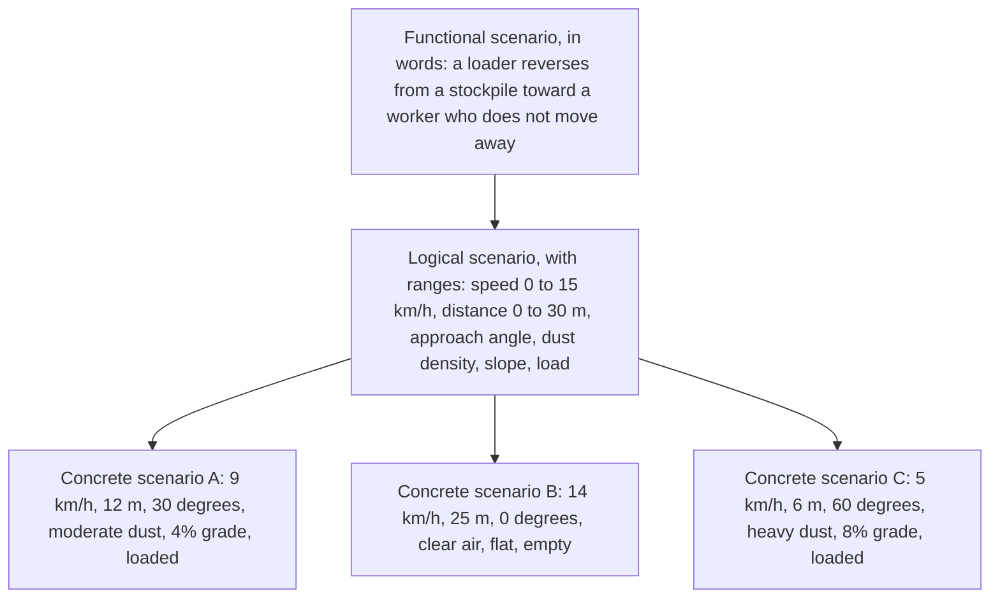

*Figure: one functional story becomes one logical family with ranges, which yields as many concrete test runs as the campaign needs.*

**Why it matters here.** The scenario catalog guarantees that known fatal-accident patterns are always tested, and the logical level is what makes thousands of virtual runs and a statistical claim possible; the booklet puts scenario definition in the first phase, before the sensor is chosen [Chapters 1, 9].

**Related terms.** [Scenario catalog, scenario family and scenario parameter](#scenario-catalog-scenario-family-and-scenario-parameter), [Operational design domain (ODD) and operating-domain taxonomy](#operational-design-domain-odd-and-operating-domain-taxonomy), [Test case, test matrix and scenario grid](#test-case-test-matrix-and-scenario-grid), [Parameter, parameter range and parameterized scenario family](#parameter-parameter-range-and-parameterized-scenario-family), [EMESRT (Earth Moving Equipment Safety Round Table) and PR-5A](#emesrt-and-pr-5a-earth-moving-equipment-safety-round-table-vehicle-interaction-performance-requirement), [ISO 21815 series](#iso-21815-series-collision-warning-and-avoidance), [PEGASUS, VVM (Verification and Validation Methods), SET Level, VaViM and EVIDENT](#pegasus-vvm-set-level-vavim-and-evident-german-and-european-research-programs-on-scenario-based-validation), [Scenario description languages (OpenSCENARIO 1 and 2, domain-specific language DSL) and their fit for off-road work](#scenario-description-languages-openscenario-dsl).

### Scenario catalog, scenario family and scenario parameter

**In one sentence.** A scenario catalog is the complete, traceable list of situations a system must be tested against, a scenario family is one logical scenario with its parameter ranges and probability distribution, and a scenario parameter is one of the variables in that family.

**Explained.** The catalog is an inventory. Each entry names the hazardous interaction, the requirement or hazard it comes from, the operating-domain tags that apply, the expected behavior and the family it belongs to. ISO 34504:2024 formalizes such tagging and ISO 34505:2025 defines the attributes that a resulting test case carries [Chapter 9].

A family is the economical form of a logical scenario. Instead of storing 10,000 copies of "reverse toward worker", the catalog stores one family: "Machine reverses toward an initially visible or occluded human-shaped object while the operator does not brake." Its parameters include speed, initial distance, lateral offset, the person's path, machine articulation, slope, load, sensor installation, illumination, visibility, system latency, braking friction and a random seed. Each family carries a probability distribution over those parameters, taken from field data or expert estimates; that distribution is what later allows a statement about how often the system would succeed in the field [Chapter 9].

Three rules follow. Encode constraints, because many combinations are impossible (there is no direct sun glare underground). Separate the common physical layer (object geometry, material, motion, visibility) from sensor-specific nuisance variables, because camera, lidar, radar and ultrasonic sensors fail differently. Express the ISO 21815 risk areas as geometric parameters, so that families scale from one machine model to another [Chapter 9]. Parameter dependencies are easy to get wrong: dust correlates with dry, windy, high-traffic conditions, and a distribution that ignores this misweights the results [Chapter 9].

**Why it matters here.** The three layers (domain taxonomy, catalog, families) are the booklet's answer to the combinatorial explosion of 100 or more site types times 10 or more scenarios times weather times machine models [Chapter 9].

**Related terms.** [Scenario (functional, logical, concrete)](#scenario-functional-logical-concrete), [Parameter, parameter range and parameterized scenario family](#parameter-parameter-range-and-parameterized-scenario-family), [Operational design domain (ODD) and operating-domain taxonomy](#operational-design-domain-odd-and-operating-domain-taxonomy), [Test space and the combinatorial explosion](#test-space-and-the-combinatorial-explosion), [Random sampling, stratified sampling and probability-weighted sampling](#random-sampling-stratified-sampling-and-probability-weighted-sampling), [Traceability (claim to requirement to scenario to test to evidence)](#traceability).

### Test case, test matrix and scenario grid

**In one sentence.** A test case is one fully specified test with an expected result, a test matrix is a table of test cases arranged by the factors they vary, and a scenario grid is a matrix whose cells are concrete scenarios.

**Explained.** A test case says exactly what to do and what counts as a pass. ISO 34505:2025 lists its attributes: an identifier, an objective, inputs, steps, the test platform (simulator, bench or track) and expected results [Chapter 9]. "Loader reverses at 9 km/h toward a standing worker 12 m away on a 4% grade; expected: brake request before 6 m and a stop with at least 1 m of clearance" is a test case.

A test matrix lines up test cases by their factors: rows for speed, columns for distance, one sheet per surface, so that gaps become visible. Chapter 8 uses one to plan the physical anchor campaign for the first six weeks after hardware delivery, measuring latency and stops on grades [Chapter 8]. A scenario grid is the same idea for virtual testing: the Euro NCAP virtual-testing protocol has the manufacturer predict results for the full grid, then runs randomly selected cells physically and accepts the virtual results if at least 75% of the verification tests in each cluster meet the criteria [Chapter 3]. It is an on-road consumer protocol; no off-road body has adopted an equivalent.

The booklet warns against treating the whole program as one giant matrix: every site times every scenario, weather, model and sensor cannot be run, so the matrix is filled by the selection methods described in Part F [Chapter 9].

**Why it matters here.** Test cases are the units that carry traceability from hazard to evidence, and the grid with physical spot checks is the only sourced model of how a regulator accepts virtual results [Chapters 3, 9].

**Related terms.** [Scenario (functional, logical, concrete)](#scenario-functional-logical-concrete), [Test space and the combinatorial explosion](#test-space-and-the-combinatorial-explosion), [Combinatorial testing (t-way testing, pairwise testing, covering arrays; tools ACTS and PICT)](#combinatorial-testing-t-way-testing-pairwise-testing-covering-arrays), [Design of experiments (DOE)](#design-of-experiments-doe), [Euro NCAP](#euro-ncap-and-its-virtual-testing-protocol), [Acceptance criteria and pass or fail criteria](#acceptance-criteria-and-pass-or-fail-criteria), [Traceability (claim to requirement to scenario to test to evidence)](#traceability), [Physical tests needed to build and check a braking model (how many, which)](#physical-tests-needed-to-build-and-check-a-braking-model).

### Corner case, edge case and rare event

**In one sentence.** An edge case sits at the limit of one parameter, a corner case sits at the limits of several at once, and a rare event is a situation that happens so seldom in normal operation that waiting for it is not a practical way to test it.

**Explained.** Picture a table of speed against distance. Normal operation is in the middle. An edge case is at one edge: the highest speed, or the shortest distance. A corner case is in a corner: highest speed and shortest distance and heaviest dust together. Systems that work well in the middle often fail in the corners, which is why test engineers hunt there.

A rare event is different: it may not be extreme at all, just uncommon. A worker who steps out from behind a parked truck exactly as a loader starts to reverse is rare, and it is also the accident pattern that kills. The booklet's statistics show why rarity is the binding constraint: showing a miss rate of at most 1% with zero misses needs 299 independent trials; 0.01% needs 29,956 [Chapter 9]. On roads, the research organization RAND calculated hundreds of millions of miles for the same job, and the "curse of rarity" (2024) explains why the tail gets harder as the number of variables grows [Chapter 1].

Simulation can produce rare and corner cases on demand, which is its greatest strength, but only for hazard classes somebody has conceived and parameterized; generators cannot invent a category nobody encoded, and real captured sites expose unknown clutter that rules miss [Chapters 1, 5].

**Why it matters here.** The booklet keeps failure-seeking tests ("can we break it?") in a separate campaign from the frozen sample that estimates how often the system succeeds, because the failure fraction of a corner-case hunt is not a field failure rate [Chapter 9].

**Related terms.** [Rare-event methods (importance sampling, rare-event probes)](#rare-event-methods-importance-sampling), [Falsification (failure-seeking search, adaptive search; tools S-TaLiRo and VerifAI)](#falsification-failure-seeking-search), [Keeping failure-seeking tests separate from performance estimates](#keeping-failure-seeking-tests-separate-from-performance-estimates), [Binomial claims and the rule of three](#binomial-claims-and-the-rule-of-three), [The RAND argument](#the-rand-argument), [Exposure (hours of operation, number of interactions)](#exposure), [Near miss](#near-miss).

### The X-in-the-loop family (MIL, SIL, HIL, PIL, VIL, DIL)

**In one sentence.** "X-in-the-loop" names a family of test setups in which one real part of the system (the X) is connected to a simulation of everything else, and the family forms a ladder from all-virtual to all-real.

**Explained.** "The loop" is the cycle sense, decide, act, move, sense again. In a working machine the whole loop is physical. In testing, engineers close the loop around one real component and simulate the rest, so that the component receives realistic inputs and its outputs change what happens next. The letter before "in-the-loop" says what is real:

- MIL, model-in-the-loop: the control logic exists only as a model; everything is simulated.
- SIL, software-in-the-loop: the real software, compiled for an ordinary computer, runs against a simulated machine and world.
- PIL, processor-in-the-loop: the real software runs on the real type of processor, still with a simulated world; the booklet does not treat this step separately.
- HIL, hardware-in-the-loop: the real electronic control unit (ECU) with its real wiring and network messages is connected to a real-time simulator.
- VIL, vehicle-in-the-loop: the complete real machine moves on a safe test area while hazards are injected virtually.
- DIL, driver-in-the-loop: a real operator sits in a simulator cab.

The booklet organizes these by "the boundary of the real system under test": the farther outward that boundary moves, from software to ECU to sensor to complete machine, the more real failure modes are included, at the cost of complexity, speed, scalability and controllability [Chapter 7].

The documented hierarchy is SIL for volume, HIL for timing, interfaces and faults, VIL only where its extra physical fidelity justifies the investment, and the real machine for actual stopping, terrain and environment [Chapter 1]. In the recommended pipeline, MIL and SIL run thousands of cases per night, HIL checks the real controller, machine-in-the-loop or VIL with augmented reality covers closed-loop braking, and the proving ground supplies anchors, all under continuous integration with automatic pass criteria [Chapter 9].

Maturity differs by rung. SIL and HIL are established across industries; VIL with sensor stimulation is documented for road vehicles only, a 2024 survey calls it costly with varying accuracy, and no end-to-end VIL case for heavy off-road automatic braking was found [Chapter 1].

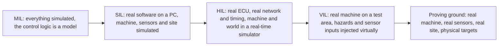

*Figure: the ladder from fully virtual to fully real; each step adds real components and real failure modes, costs more per test, and gives up repeatability and volume.*

**Why it matters here.** The ladder lets most defects be found before a prototype exists and keeps scarce prototype hours for what only a real machine can show. The booklet's allocation principle assigns "did the software decide correctly?" to SIL, "did the machine execute safely?" to HIL and whole-machine tests, and "did the sensor perceive correctly?" to replay, sensor simulation and physical tests [Chapter 1].

**Related terms.** [Model-in-the-loop (MIL)](#model-in-the-loop-mil), [Software-in-the-loop (SIL)](#software-in-the-loop-sil), [Hardware-in-the-loop (HIL) with data injection](#hardware-in-the-loop-hil-with-data-injection), [Vehicle-in-the-loop (VIL) and mixed reality](#vehicle-in-the-loop-vil-and-mixed-reality), [Driver-in-the-loop (DIL), operator-in-the-loop and the machine simulator](#driver-in-the-loop-dil-operator-in-the-loop-and-the-machine-simulator), [Proving ground, track test and whole-machine test](#proving-ground-track-test-and-whole-machine-test), [Open loop versus closed loop](#open-loop-versus-closed-loop), [Electronic control unit (ECU)](#electronic-control-unit-ecu), [The V-model of development](#the-v-model-of-development).

### Model-in-the-loop (MIL)

**In one sentence.** Model-in-the-loop testing runs a model of the control logic against a model of the machine and its surroundings, with no real software or hardware yet.

**Explained.** Before any code is written for the real controller, engineers draw the decision logic as a block diagram in a modeling tool: if the object is closer than this and the speed is above that, warn; if there is no reaction after so many milliseconds, brake. Model-in-the-loop (MIL) runs that diagram in the same tool against a simple machine model, so the designers can see whether the rules behave sensibly long before anything is built. It is the cheapest and earliest rung of the ladder.

The booklet mentions MIL as part of the volume end of the pipeline, "model-in-the-loop and software-in-the-loop for volume (thousands of runs per night on cloud or on-premise compute)" [Chapter 9], and the model-based tool chain it describes at the middle cost level supports MIL, SIL and HIL from the same models [Chapter 11]. Nothing about sensors or real timing can be learned here; the value is in catching logical mistakes, such as a warning zone that never triggers when the machine is articulated, while a fix costs minutes.

**Why it matters here.** The decision logic of a warn-then-brake function is far simpler than an automated-driving planner [Chapter 7], so much of it can be designed and checked at MIL level in late 2026, before the sensor is chosen.

**Related terms.** [The X-in-the-loop family (MIL, SIL, HIL, PIL, VIL, DIL)](#the-x-in-the-loop-family-mil-sil-hil-pil-vil-dil), [Software-in-the-loop (SIL)](#software-in-the-loop-sil), [Decision logic (when to warn, when to brake)](#decision-logic-when-to-warn-when-to-brake), [The V-model of development](#the-v-model-of-development), [Software terms a planner meets: API](#software-terms-a-planner-meets), [Python](#software-terms-a-planner-meets), [MATLAB and Simulink](#software-terms-a-planner-meets), [Robot Operating System (ROS)](#software-terms-a-planner-meets), [container](#software-terms-a-planner-meets), [version control (GitHub)](#software-terms-a-planner-meets), [DevOps](#software-terms-a-planner-meets), [CI/CD](#software-terms-a-planner-meets).

### Software-in-the-loop (SIL)

**In one sentence.** Software-in-the-loop testing runs the real braking software, compiled for an ordinary computer, inside a simulated machine on a simulated site, so that thousands of scenarios can be tried without any hardware.

**Explained.** The software that will one day run inside the machine's controller is built instead for a desktop or cloud computer. It receives inputs from a simulator (object positions, or synthetic sensor data, plus machine speed and state), makes its decisions and sends brake requests back to the simulated machine, which slows down according to its model. The scene evolves, the software sees the new situation, and the loop continues. Because the real world is absent, time can run faster than real time and hundreds of copies can run in parallel.

Chapter 7 lists what SIL needs: a scenario or world model, an environment simulation with sensor models (ideal, phenomenological or physics-based) or semantic object inputs, a machine-dynamics model that includes braking, articulation and load, and a test oracle that scores each run [Chapter 7]. It proves logic correctness, timing in simulated time, boundary exploration, requirements tests, very high-volume regression and closed-loop coverage of large scenario sets; the booklet calls it "the right tool for sweeping the 100+ site types and 10+ scenarios parametrically" [Chapter 7]. It cannot prove real sensor physics in dust, snow or glare unless the sensor models are validated, nor the timing, processor and input-output faults of the final controller, nor the real brake hardware. "It is only as credible as its models" [Chapter 7].

A name clash: in functional-safety standards, SIL also means Safety Integrity Level, a grade of how reliable a safety function must be. The two have nothing in common; context tells them apart.

Standard support is thin. ISO 18497-4:2024 for agricultural machines explicitly lists simulation beside measurement, test and analysis as a verification method, the closest off-road support found [Chapter 7]. ASAM states that no standardized metrics exist to assess sensor-simulation quality [Chapter 7]. The booklet's pre-hardware advice is to run SIL first with ideal or semantic sensors to debug threat assessment and braking logic, then add realistic sensor error models for each candidate sensor type, validated against recordings from existing machines [Chapter 7].

**Why it matters here.** SIL is where the statistics become feasible: a 1% miss-rate claim in each of 20 critical strata needs about 6,000 zero-miss trials, "which is only feasible in simulation or hardware-in-the-loop" [Chapter 9]. But SIL results are trusted only after replay and sensor-model correlation, the first of the booklet's three ordering rules [Chapter 1].

**Related terms.** [The X-in-the-loop family (MIL, SIL, HIL, PIL, VIL, DIL)](#the-x-in-the-loop-family-mil-sil-hil-pil-vil-dil), [Hardware-in-the-loop (HIL) with data injection](#hardware-in-the-loop-hil-with-data-injection), [Open loop versus closed loop](#open-loop-versus-closed-loop), [Safety Integrity Level (SIL) in IEC 61508](#safety-integrity-level-sil), [and why "SIL" also means software-in-the-loop (name clash)](#software-in-the-loop-sil), [Semantic or object-list replay](#semantic-or-object-list-replay), [Correlation test](#correlation-test), [Sample size, confidence level and confidence interval](#sample-size-confidence-level-and-confidence-interval), [Regression testing and continuous integration (CI/CD) for simulation](#regression-testing-and-continuous-integration-cicd-for-simulation).

### Hardware-in-the-loop (HIL) with data injection

**In one sentence.** Hardware-in-the-loop testing connects the real electronic control unit, with its real wiring and network messages, to a simulator that runs in real time and feeds it the data a real machine would produce.

**Explained.** Imagine taking the brain of the machine, the electronic control unit (ECU), out of the machine and placing it on a laboratory bench. Instead of real sensors and a real engine, it is wired to a powerful computer that pretends to be the rest of the machine: it sends the messages a camera, radar or speed sensor would send, listens for the brake request the ECU sends back, and moves the virtual machine accordingly. Because the ECU cannot tell the difference, it must respond within the same milliseconds as on a real machine, which is why the simulator must keep hard real time.

"Data injection" means that the simulated sensor data are fed in electrically, behind the sensor's own optics or antenna: raw camera data behind the imager, radar detections at the detection level, or recorded machine-network traffic (CAN, the controller area network bus, and the SAE J1939 message set used on heavy vehicles) [Chapter 7]. Chapter 7 lists what HIL needs: a real-time simulator with deterministic timing, a machine-dynamics model, electrical input-output and sensor-interface emulation, "restbus" models that imitate the rest of the machine network, and the ISO/TS 21815-2 brake-request interface [Chapter 7].

HIL proves the real-time behavior of the production ECU and its software, communication and interface timing, diagnostics and fault behavior, fail-to-safe behavior, and decision logic under repeatable scenarios. South Africa's MOSH regime (Mining Industry Occupational Safety and Health learning hub), for example, requires that a disconnection between the detection device and the machine be detected within 500 ms and that the machine reply within 50 ms; such limits are tested on a bench [Chapter 7]. HIL cannot prove sensor front-end behavior, because injection bypasses the lens, imager or antenna, nor true machine and brake behavior when these are only modeled [Chapter 7]. Fault injection (stale messages, dropped frames, corrupted data, disagreement between sensors) is far faster and safer here than waiting for faults in the field [Chapter 1].

The rig can be commissioned before the final processor exists, using a virtual or development ECU, and only that surrogate is swapped when production controllers arrive [Chapter 7]. Integration effort is real: the booklet ranks raw-signal sensor HIL as the highest-effort integration type and warns that a renderer accurate offline may not meet ECU timing deterministically [Chapter 11].

**Why it matters here.** HIL is the natural home for the J1939 intervention interface of ISO/TS 21815-2 and for the laboratory stage of the South African verification regime; it finds timing, bus and integration faults without occupying a machine, which the four-month window cannot spare [Chapters 1, 7].

**Related terms.** [The X-in-the-loop family (MIL, SIL, HIL, PIL, VIL, DIL)](#the-x-in-the-loop-family-mil-sil-hil-pil-vil-dil), [Real time (hard real time)](#real-time-hard-real-time), [Direct digital or raw signal injection](#direct-digital-or-raw-signal-injection), [Over-the-air sensor stimulation (sensor-in-the-loop)](#over-the-air-sensor-stimulation-sensor-in-the-loop), [Electronic control unit (ECU)](#electronic-control-unit-ecu), [Vehicle network: CAN bus, SAE J1939, DBC file](#vehicle-network-can-bus-sae-j1939-dbc-file), [Fault, failure, failure mode, and fault injection](#fault-failure-failure-mode-and-fault-injection), [Data replay and HIL hardware](#data-replay-and-hil-hardware), [ISO 21815 series](#iso-21815-series-collision-warning-and-avoidance), [MOSH (Mining Industry Occupational Safety and Health learning hub) and its TRL stage gates](#mosh-and-its-trl-stage-gates-mining-industry-occupational-safety-and-health-learning-hub).

### Direct digital or raw signal injection

**In one sentence.** Raw signal injection feeds simulated or recorded sensor data into the sensor's electronics at a defined electrical point, so that everything downstream of that point is tested and everything upstream is not.

**Explained.** A camera is a chain: lens, imager chip, serial link, image-processing unit, detection software. Instead of showing the camera a picture, an injection device plugs into the link and sends the frames directly. The booklet treats this as a method in its own right because "its value depends entirely on the insertion point" [Chapter 7]. Inject after the imager and you test the processing chain, bandwidth, timing, the handling of corrupted frames and interface faults; you do not test the lens, exposure control, dirt on the glass, vibration or sun glare. Inject a radar object list onto the vehicle network and you test only the decision software.

The same principle governs replay: re-injecting recorded frames into the image electronic control unit (ECU) "tests everything downstream of that point, but it does not retest the old lens, exposure control, imager, lens contamination, vibration or sun-glare response" [Chapter 7]. Camera raw-image injection is commercially implemented, and one vendor argues that it avoids the screen-synchronization and field-of-view problems of showing a camera a monitor [Chapter 7].

**Why it matters here.** Injection makes high-volume HIL and replay possible, but the booklet insists that the injection boundary be stated with every result, so that evidence about the processing chain is never mistaken for evidence about the sensor in dust or glare [Chapter 7].

**Related terms.** [Hardware-in-the-loop (HIL) with data injection](#hardware-in-the-loop-hil-with-data-injection), [Over-the-air sensor stimulation (sensor-in-the-loop)](#over-the-air-sensor-stimulation-sensor-in-the-loop), [Replay and re-simulation of recorded data (open-loop replay)](#replay-and-re-simulation-of-recorded-data-open-loop-replay), [Camera (RGB camera, CMOS sensor, lens, image signal processor ISP, HDR, rolling shutter)](#camera-rgb-camera-cmos-sensor-lens-image-signal-processor-isp-hdr-rolling-shutter), [Data replay and HIL hardware](#data-replay-and-hil-hardware).

### Over-the-air sensor stimulation (sensor-in-the-loop)

**In one sentence.** Over-the-air stimulation presents a real, complete sensor with artificial light, radio waves or sound generated from the virtual scene, so that the whole sensor, including its optics or antenna and its firmware, is in the loop.

**Explained.** Instead of injecting data behind the sensor, the test rig makes the sensor "see" something. For radar, a target simulator receives the radar's transmitted signal and sends back echoes with a chosen delay, speed shift and strength, so the radar believes a worker is 8 m away and approaching. For a camera, a screen or projector shows the rendered scene. For lidar, an emulator returns delayed light pulses. For ultrasonic sensors, an echo generator does the same with sound [Chapters 6, 7]. The rig needs a shielded or echo-free room, calibrated signal losses and real-time synchronization with the scene, and it usually runs closed-loop [Chapter 7].

The physical limits bite at close range. Digital radar target simulators have a minimum simulated range set by their processing delay: each 6.67 nanoseconds of delay adds 1 m of apparent distance. A 2021 peer-reviewed review gives about 20 to 30 m as a typical minimum for digital systems, with a single-digit number of targets, at a cost of "hundreds of thousands of dollars"; vendors claim minimums of 0.6 m or 1.5 m and from five to several hundred objects [Chapters 6, 7]. Camera stimulation suffers from screen frame-rate mismatch and wide fields of view; lidar stimulation, especially for solid-state lidar, is identified as a remaining gap; ultrasonic stimulation exists only for automotive parking functions [Chapter 7]. None of these devices reproduces terrain clutter, berms, dust plumes or radio reflections from steel structures.

**Why it matters here.** Workers at 0.5 to 5 m behind a machine are exactly where digital radar simulators are weakest, so the booklet rates over-the-air stimulation low for close-range off-road use and reserves it for sensor and ECU (electronic control unit) regression, timing tests and supplier-independent characterization [Chapters 6, 7].

**Related terms.** [Over-the-air (OTA) sensor stimulation (as a sensor concept)](#over-the-air-sensor-stimulation-sensor-in-the-loop), [Hardware-in-the-loop (HIL) with data injection](#hardware-in-the-loop-hil-with-data-injection), [Direct digital or raw signal injection](#direct-digital-or-raw-signal-injection), [Radar](#radar-radio-detection-and-ranging), [Lidar](#lidar-light-detection-and-ranging), [Ultrasonic sensor](#ultrasonic-sensor), [Vehicle-in-the-loop (VIL) and mixed reality](#vehicle-in-the-loop-vil-and-mixed-reality), [Data replay and HIL hardware](#data-replay-and-hil-hardware).

### Vehicle-in-the-loop (VIL) and mixed reality

**In one sentence.** Vehicle-in-the-loop testing drives the complete real machine on a safe, empty test area while virtual hazards are fed to its sensors or controller, so that it brakes for a worker who exists only in the simulation.

**Explained.** The machine is real: real brakes, real hydraulics, real controller delays, real operator seat. The danger is virtual: a simulated worker steps behind the machine, the simulated detection reaches the braking system by injection or over-the-air stimulation, the machine really brakes, and its real position and speed are fed back into the simulation so that the next stimuli match. Because the machine moves through an empty area while reacting to virtual objects, this is also called mixed reality or augmented-reality testing; one cited approach injects virtual hazards into a real vehicle's controller on a test track, and an augmented-reality proving-ground platform was published in 2024 [Chapter 1].

VIL proves real braking dynamics, real actuator and controller delays, real end-to-end latency and the real operator interface without endangering people or targets; "it is the bridge between simulation and field" [Chapter 7]. It cannot prove perception of the injected objects unless they are stimulated over the air, and a bench cannot reproduce soft soil, grades, sinkage, articulated dynamics, payload behavior, vibration, dust or weather; the size of heavy machines makes facilities difficult [Chapter 7].

The evidence is on-road only. A 2024 survey reports limitations in testbench fidelity, multi-target radar simulation, multi-camera systems and especially lidar stimulation, and did not identify a full-scale VIL platform ready for comprehensive industrial testing; off-road VIL on production-scale haul trucks, loaders, dozers or excavators was not found [Chapters 1, 7].

**Why it matters here.** The booklet's hierarchy uses VIL "only where its extra physical fidelity justifies the investment" and treats it as emerging and capital-intensive rather than a proven shortcut for heavy machines [Chapter 1].

**Related terms.** [The X-in-the-loop family (MIL, SIL, HIL, PIL, VIL, DIL)](#the-x-in-the-loop-family-mil-sil-hil-pil-vil-dil), [Over-the-air sensor stimulation (sensor-in-the-loop)](#over-the-air-sensor-stimulation-sensor-in-the-loop), [Proving ground, track test and whole-machine test](#proving-ground-track-test-and-whole-machine-test), [Open loop versus closed loop](#open-loop-versus-closed-loop), [Latency (end-to-end latency, from sensing to brake command)](#latency), [Brake dead time and brake build-up time (brake-system delays)](#brake-dead-time-and-brake-build-up-time).

### Driver-in-the-loop (DIL), operator-in-the-loop and the machine simulator

**In one sentence.** Driver-in-the-loop or operator-in-the-loop testing puts a real person in a simulator cab, with screens, controls and sometimes motion, to study how operators react when the machine warns, waits and then brakes.

**Explained.** Everything in the ladder so far asks whether the machine detects and stops. This rung asks a different question: what does the human do? Machine simulators used for operator training (a realistic cab in front of large screens, often on a motion platform) can present a warning, a delay and then an automatic stop, while recording the operator's hands and feet, eye movements and comments. The booklet lists the questions such studies can answer: warning timing, whether automatic intervention surprises the operator, nuisance-warning workload, simultaneous manual braking, override behavior, trust and understanding of the interface [Chapter 1].

Evidence is thin. A University of Queensland and ACARP (Australian Coal Association Research Program) project used a haul-truck simulator (about 2017) to evaluate visual and sound proximity interfaces, but for advisory warnings, not automatic braking; no off-road study of operators experiencing automatic braking in a simulator was found [Chapter 1]. Road-vehicle simulator studies found that warnings with 20 to 33% false alarms still shortened brake reaction times, and that drivers who trusted other vehicles' automatic braking braked later [Chapter 4]. No validated operator model for off-road machines exists; mining studies use fixed reaction delays [Chapter 4]. The booklet names human-in-the-loop simulators at research institutes and machine manufacturers as possible resources [Chapter 11].

Simulators cannot validate real sensors or brakes, reproduce motion cues perfectly, or reveal long-term complacency and risk compensation after months of nuisance interventions [Chapter 1].

**Why it matters here.** The booklet schedules operator studies before prototype safety testing, so that basic interface problems are not discovered during expensive machine tests, and reminds that human performance "can change both positively and negatively after technology is introduced" [Chapter 1].

**Related terms.** [Operator (of a machine) and cab](#operator-and-cab), [Human factors](#human-factors), [Human-machine interface (HMI)](#human-machine-interface-hmi), [Operator reaction time](#operator-reaction-time), [Operator behavior change (risk compensation, over-reliance)](#operator-behavior-change), [Alarm fatigue](#alarm-fatigue), [Operator-in-the-loop simulators](#operator-in-the-loop-simulators), [The X-in-the-loop family (MIL, SIL, HIL, PIL, VIL, DIL)](#the-x-in-the-loop-family-mil-sil-hil-pil-vil-dil).

### Real time (hard real time)

**In one sentence.** A simulation runs in real time when one simulated second takes exactly one real second, and in hard real time when every computing step is guaranteed to finish within its deadline, every time.

**Explained.** A weather forecast may take an hour to compute tomorrow's weather; nobody minds. A flight simulator must draw the next frame before the pilot notices a lag. That is real time: the computer keeps pace with the clock on the wall. Hard real time is stricter: not on average but at every single step, because a late result is a wrong result. A controller that expects a radar message every 50 ms and receives one 80 ms late behaves differently from the real machine.

Hardware-in-the-loop (HIL) needs hard real time because the real electronic control unit on the bench runs at its own pace and cannot wait for a slow simulator [Chapter 7]. That is why HIL uses dedicated real-time computers with deterministic operating systems and input-output hardware, and why the booklet's compute table says that for HIL "deterministic real time matters more than throughput" [Chapter 11]. The conflict with fidelity is direct: a neural scene of 23 million elements rendered at 17 frames per second, or a soil model running 50 to 200 times slower than real time, cannot drive a HIL bench; the booklet advises keeping separate offline high-fidelity models and real-time models where needed [Chapters 5, 11].

The real-time factor (simulated time divided by wall-clock time) also decides cost: a simulator at 10 times real time costs one tenth per simulated hour of one at real time, and no generic factor should be assumed without benchmarking on the actual machine geometry and sensor set [Chapter 11].

**Why it matters here.** Milliseconds in sensing, networking, decision and actuation move the stopping point; timing can only be tested where the simulator keeps real time, and real-time limits cap the sensor fidelity available on the bench [Chapters 5, 7].

**Related terms.** [Hardware-in-the-loop (HIL) with data injection](#hardware-in-the-loop-hil-with-data-injection), [Latency (end-to-end latency, from sensing to brake command)](#latency), [Time synchronization and time stamps](#time-synchronization-and-time-stamps), [CPU, GPU, FPGA, VRAM and real-time computers](#cpu-gpu-fpga-vram-and-real-time-computers), [Cloud execution and compute budget](#cloud-execution-and-compute-budget), [Headless simulation versus rendered simulation](#headless-simulation-versus-rendered-simulation).

### Open loop versus closed loop

**In one sentence.** In an open-loop test the system's output does not change what happens next, while in a closed-loop test the system's actions feed back and alter the situation it then sees.

**Explained.** Watching a recording of a reversing loader and asking "would the new software have braked here?" is open loop: the recording continues as it was, whatever the software decides. Putting the software in a simulation where its brake request actually slows the virtual loader, so that the worker is now farther away and the next camera frame looks different, is closed loop. Open loop is cheap and uses real data; closed loop is the only way to see consequences.

Chapter 7 defines "the first-divergence point" precisely. Before the new system commands braking, the recorded machine pose, object poses and sensor measurements are valid historical evidence. At the first brake command that did not occur in the original run, the counterfactual machine begins to differ from the recorded one. After that instant, feeding the original sensor record while pretending the machine has slowed is physically inconsistent [Chapter 7]. Recorded data can therefore answer "would the new system have detected the object and requested intervention before time t?"; they cannot answer "would the machine actually have stopped safely, what would the next measurements have been, or would the worker have reacted?" [Chapter 7].

The danger of ignoring this is documented. On-road research (2024) showed that open-loop planning scores could be matched using the vehicle's own state alone, giving "a misleading impression" [Chapter 7]. Teams therefore split the metrics: perception and trigger timing open loop on logs; braking consequences in closed-loop simulation, hardware-in-the-loop (HIL) and vehicle-in-the-loop (VIL); selected stopping outcomes on a proving ground. A "log-to-simulation switch" branches from the recorded prefix into simulation at the intervention point, with a machine model consuming the brake command and a sensor model regenerating the observations [Chapter 7]. After the branch, the evidence is only as good as the machine, terrain, actor and sensor models, a warning the booklet calls more serious off-road, where soil, grade, payload and dust are more variable than paved-road dynamics [Chapter 7].

Shadow mode and replay are open loop; software-in-the-loop (SIL), HIL and VIL are normally closed loop; semantic replay can be either [Chapters 1, 7].

**Why it matters here.** The existing warning fleet can supply enormous open-loop evidence from today, but the new function changes machine motion, so three evidence classes must be kept apart: the recorded prefix (measured), post-intervention simulation (model-dependent), and selected real stops (measured, few cases) [Chapter 7].

**Related terms.** [Replay and re-simulation of recorded data (open-loop replay)](#replay-and-re-simulation-of-recorded-data-open-loop-replay), [Shadow mode (silent testing)](#shadow-mode-silent-testing), [Software-in-the-loop (SIL)](#software-in-the-loop-sil), [Hardware-in-the-loop (HIL) with data injection](#hardware-in-the-loop-hil-with-data-injection), [Vehicle-in-the-loop (VIL) and mixed reality](#vehicle-in-the-loop-vil-and-mixed-reality), [Closed-loop agreement (brake timing, stopping path, false and missed interventions)](#closed-loop-agreement), [Warning-system fleet](#warning-system-fleet).

### Replay and re-simulation of recorded data (open-loop replay)

**In one sentence.** Replay feeds sensor data recorded on real machines back into the software, exactly as recorded, to see what the software would have detected and decided.

**Explained.** A machine with the existing warning system drives a shift with cameras, radar, machine speed and gear all recorded with precise time stamps. Months later, a new version of the perception software is run against that recording, frame by frame, and its detections are compared with an independent ground truth of where the workers and vehicles really were. Re-simulation is the same idea with more processing: the recording may be re-rendered or partly modified before it is fed in.

Replay proves detection rate, false-alarm rate and warning timing for the sensor set, mounting positions and situations that were actually recorded; it gives repeatability, regression across software versions, the baseline of the old system, and a fair old-versus-new comparison when both accept the same inputs [Chapter 7]. It can reproduce a rare recorded event indefinitely [Chapter 1]. It cannot show the effect of any action that differs from the recording (braking, steering, an operator reaction), anything about sensor types or positions that were not recorded, conditions not in the logs, or physical sensor effects upstream of the injection point [Chapter 7]. Its fidelity "is defined by the point at which data are re-injected" [Chapter 7]. Neural re-simulation of camera and lidar logs from nearby new viewpoints exists but degrades once the viewpoint moves 1 to 4 m from the recorded path, which matters for new mounting positions [Chapter 7].

A useful replay record needs synchronized raw sensor streams, machine speed, gear, steering and articulation, brake state, calibration, weather and site metadata and a defensible ground-truth channel; without that, large volumes of logs have little validation value [Chapter 1]. The common mistakes (recording only object lists, missing calibration, unsynchronized clocks, lossy compression, event-triggered recording only) fill a page of Chapter 7. Labeling capacity dominates the cost [Chapter 1].

**Why it matters here.** Replay and shadow mode are the cheapest large-volume methods, and the company already owns the right fleet; recording must start in October 2026, through the winter, not when the prototype arrives [Chapters 1, 7]. The booklet's first ordering rule is that replay and sensor-model correlation come before simulation results can be trusted [Chapter 1].

**Related terms.** [Open loop versus closed loop](#open-loop-versus-closed-loop), [Semantic or object-list replay](#semantic-or-object-list-replay), [Shadow mode (silent testing)](#shadow-mode-silent-testing), [Data logging (what to record on the machine, raw versus processed data, common mistakes)](#data-logging-what-to-record-on-the-machine-raw-versus-processed-data-common-mistakes), [Ground truth](#ground-truth), [Performance baseline (how to measure the old system before comparing the new one)](#performance-baseline), [Fair comparison of old and new systems (same data, same scenarios, paired tests)](#fair-comparison-of-old-and-new-systems), [Direct digital or raw signal injection](#direct-digital-or-raw-signal-injection), [Warning-system fleet](#warning-system-fleet), [Time synchronization and time stamps](#time-synchronization-and-time-stamps).

### Semantic or object-list replay

**In one sentence.** Semantic replay feeds the decision software not with raw sensor data but with a list of objects (type, position, speed), either recorded or taken from ground truth, so that only the warning and braking logic is tested.

**Explained.** Perception turns pixels and radar echoes into an object list: "person, 11 m behind, moving left at 1 m/s". Semantic replay skips perception and supplies that list directly, in common coordinates together with machine state. The decision logic, warning stages and brake-request rules are then exercised independent of any sensor type. It can run open loop (lists as recorded) or closed loop (lists regenerated as the virtual machine slows) [Chapter 7].

It is the cheapest way to sweep very large scenario sets, because no rendering or ray tracing is involved; the booklet's compute table rates "logic and object-list braking tests" as processor-dominant with very high parallelism, suited to commodity servers [Chapters 7, 11]. It proves thresholds, warning logic, threat assessment and brake-request logic. It cannot prove perception, and it can hide sensor latency, occlusion, false detections and range or classification errors, because it assumes perception has already succeeded [Chapter 7]. ASAM OSI (Open Simulation Interface) provides standard interfaces between environment, sensor, fusion and function models, including ground-truth interfaces, for exactly this kind of test [Chapter 7].

**Why it matters here.** The first level of the booklet's multi-fidelity architecture is "deterministic functional and object-list tests for millions of braking-logic combinations" [Chapter 11], and semantic inputs are where the booklet says software-in-the-loop (SIL) testing should start, before realistic sensor error models are added [Chapter 7].

**Related terms.** [Replay and re-simulation of recorded data (open-loop replay)](#replay-and-re-simulation-of-recorded-data-open-loop-replay), [Detection, classification and tracking (object detection, object list)](#detection-classification-and-tracking), [Decision logic (when to warn, when to brake)](#decision-logic-when-to-warn-when-to-brake), [Open Simulation Interface (ASAM OSI) and the ASAM organization](#open-simulation-interface-asam-osi-and-the-asam-organization), [Software-in-the-loop (SIL)](#software-in-the-loop-sil), ["Do not make one simulator carry every test" (multi-simulator architecture)](#do-not-make-one-simulator-carry-every-test-multi-simulator-architecture).

### Shadow mode (silent testing)

**In one sentence.** In shadow mode the new braking software runs live on working machines, sees everything the sensors see and decides when it would brake, but its brake commands are disconnected, so it only records what it would have done.

**Explained.** It is like a trainee sitting beside an experienced operator and saying quietly "I would brake now", while the operator keeps control. Every such moment is logged together with the sensor data, and later compared with what really happened: was there a person, did the operator brake anyway, was it a pile of gravel? Automotive literature calls this silent testing and treats it as open loop, because the candidate software produces setpoints "which are not executed by the actuator system" [Chapter 1].

Shadow mode produces evidence that nothing else can at this scale: the rate of false hypothetical interventions, that is, the nuisance-brake rate measured over real operating hours; missed threats; detection range in real dust, light and weather; the effect of mounting differences; previously unknown scenario classes; and how often each situation occurs on each site type [Chapter 1]. It cannot establish whether a real automatic stop stays stable on a wet decline with a full load, whether a false stop causes the following truck to collide, whether the load shifts, whether the operator fights the brake, or whether the actuator has an integration fault; and operator behavior changes once braking becomes real [Chapter 1]. Evaluating many software candidates at once becomes inefficient [Chapter 1].

The precedents are thin for mining. Road programs describe daily shadow-mode deployment before roll-out, and the nearest off-road analogue is a supplier's statement that its system can run on site "without immediately enforcing level-9 intervention"; a publicly documented heavy-off-road shadow-mode program was not found [Chapter 1]. Recording the old and the new system in parallel on the same machine is the fairest basis for comparing them [Chapter 7].

**Why it matters here.** The booklet's third ordering rule is that shadow mode should run before braking is enabled, so that the nuisance-brake rate is measured while braking is still disabled; false alarms need exposure hours, not staged targets, and 300 hours with no unnecessary brake supports a claim of fewer than one per 100 hours [Chapters 1, 9]. The nuisance rate is also the number that decides whether operators accept the system or switch it off [Chapter 4].

**Related terms.** [Open loop versus closed loop](#open-loop-versus-closed-loop), [Replay and re-simulation of recorded data (open-loop replay)](#replay-and-re-simulation-of-recorded-data-open-loop-replay), [Nuisance braking (unnecessary intervention, false intervention)](#nuisance-braking), [Base rate](#base-rate-and-exposure-based-rates-events-per-1000-hours), [exposure-based rates (events per 1,000 hours) and why false alarms are measured by exposure](#base-rate-and-exposure-based-rates-events-per-1000-hours), [not by staged targets](#base-rate-and-exposure-based-rates-events-per-1000-hours), [Field monitoring and operational monitoring](#field-monitoring-and-operational-monitoring), [Staged release and limited operating domain](#staged-release-and-limited-operating-domain), [Warning-system fleet](#warning-system-fleet), [Nine levels of control (Levels 1 to 9, Level 7 situational awareness, Level 8 advisory, Level 9 intervention)](#nine-levels-of-control).

### Proving ground, track test and whole-machine test

**In one sentence.** A proving ground is a closed, controlled area where the complete real machine, with its real sensors, is tested against physical targets; a track test is one such test, and a whole-machine test is any test in which nothing is simulated.

**Explained.** This is the top rung of the ladder: a real loader, a real operator or a robot driver, a real test body standing where a worker would be, and measuring equipment that records exactly when the machine warned, when it braked and where it stopped. ISO 21815-1 includes test procedures for collision warning and avoidance systems, and ISO 16001 defines a test body, a detection zone and a detection time [Chapter 7]. The South African MOSH regime (Mining Industry Occupational Safety and Health learning hub) moves from laboratory tests to a proving ground and then to a cordoned-off area of a working mine [Chapter 7].

Whole-machine tests are the end-to-end reality anchor for actual stopping behavior and for sensor behavior in a real environment, but they are expensive, have low coverage, cannot control the weather, and hazardous edge cases are hard to execute [Chapter 7]. The one published independent verification regime for mining shows the price: first-pass rates of 62% for detection devices and 42% for machine-side systems across 189 tests, at 1.6 tests per week with an 18-week lead time; every machine type, model and serial number with different braking characteristics must be verified separately; and the published stopping tests cover gradients of 1% or less, unloaded [Chapter 7].

The booklet's rule for the role of the track is that track tests should confirm predictions from simulation rather than explore [Chapter 1]. The first six weeks after hardware delivery are a physical anchor campaign that answers three questions: are this machine's parameters inside the family model, are the predicted bounds conservative, and where does the model fail [Chapter 8].

**Why it matters here.** No framework in any industry lets simulation remove physical testing; the question for the four-month window is which physical tests give the most information for correlating the models and confirming the worst cases [Chapters 2, 10].

**Related terms.** [The X-in-the-loop family (MIL, SIL, HIL, PIL, VIL, DIL)](#the-x-in-the-loop-family-mil-sil-hil-pil-vil-dil), [Soft target, robotic target and target platform (ISO 19206)](#soft-target-robotic-target-and-target-platform-iso-19206), [Correlation test](#correlation-test), [Test method (test object, distance, speed, condition, pass criterion) as rules define it](#test-method-test-object-distance-speed-condition-pass-criterion), [ISO 16001 (object detection systems and visibility aids) and ISO 5006 (operator visibility)](#iso-16001-and-iso-5006-object-detection-visibility-aids-and-operator-visibility), [ISO 21815 series](#iso-21815-series-collision-warning-and-avoidance), [MOSH (Mining Industry Occupational Safety and Health learning hub) and its TRL stage gates](#mosh-and-its-trl-stage-gates-mining-industry-occupational-safety-and-health-learning-hub), [Deceleration limits and how regulators specify them](#deceleration-limits-and-how-regulators-specify-them), [Physical tests needed to build and check a braking model (how many, which)](#physical-tests-needed-to-build-and-check-a-braking-model).

### Soft target, robotic target and target platform (ISO 19206)

**In one sentence.** A soft target is a dummy of a person or vehicle that a machine can hit without damage, a robotic target or target platform is a low, self-driving carrier that moves the dummy along a programmed path, and ISO 19206 is the standard series that specifies such targets for road-vehicle testing.

**Explained.** To test whether a system brakes for a worker, somebody must stand behind the machine. Nobody will. So road-vehicle testing developed foam and fabric dummies that look like a pedestrian to a camera, reflect radar like a human body and return laser light like clothing, mounted on flat robotic platforms that drive repeatable paths at set speeds. The ISO 19206 series specifies these pedestrian, bicycle and vehicle targets, and the Euro NCAP protocols reference Parts 2 and 4 [Chapter 3]. Robots and soft targets automate approach speeds, crossing paths and repeated near-collision runs, as a 2021 report by the United States road-safety regulator describes [Chapter 1].

The off-road picture is different. These platforms are built for passenger-car speeds and shapes; no off-road equivalent of a Euro NCAP protocol and no publicly documented high-throughput robotic-target system for heavy machines were found, so the booklet treats robotic automation as a candidate investment, not a proven shortcut [Chapter 1]. Off-road surrogates must represent people in protective clothing, light vehicles under the nose of a haul truck, machines and fixed obstacles, with camera appearance, radar cross-section, lidar reflectivity and ultrasonic response matched to each sensor: an optically realistic dummy may have the wrong radar signature [Chapter 3]. The South African test specification uses light vehicles for the controller test on a proving ground [Chapter 7].

**Why it matters here.** Targets must be realistic to the chosen sensors, which is one more reason the booklet says the sensor decision cannot wait [Chapter 1].

**Related terms.** [Proving ground, track test and whole-machine test](#proving-ground-track-test-and-whole-machine-test), [ISO 34501 to 34505, ISO/PAS 34506, ISO/TS 5083 and ISO 19206](#iso-34501-to-34505-isopas-34506-isots-5083-and-iso-19206-scenario-based-evaluation-and-test-targets), [Euro NCAP](#euro-ncap-and-its-virtual-testing-protocol), [Radar](#radar-radio-detection-and-ranging), [Lidar](#lidar-light-detection-and-ranging), [Ground truth](#ground-truth), [Test method (test object, distance, speed, condition, pass criterion) as rules define it](#test-method-test-object-distance-speed-condition-pass-criterion), [Automatic Emergency Braking (AEB) and AEBS (on-road)](#automatic-emergency-braking-aeb-and-advanced-emergency-braking-system-aebs).

### Correlation test

**In one sentence.** A correlation test is a physical test run specifically to check whether the models predicted what the real machine did, and by how much they were wrong.

**Explained.** Correlation here means agreement between simulation and reality. Before the prototype arrives, every model (braking, sensor, terrain) is a prediction. The first tests on the real machine should therefore not be the full scenario matrix but a small set of carefully chosen measurements that the models have already predicted: end-to-end latency, detection range, brake-command timing, stopping dynamics and repeatability on each representative machine variant. The differences become the models' error bounds, and the error bounds define the envelope within which virtual results may be trusted [Chapter 1]. "If the virtual and bench models are wrong, millions of virtual scenarios produce false confidence" [Chapter 1].

The booklet repeats the idea at every level. Sensor models are correlated against measurements on existing machines in dust, rain and darkness in 2026 and 2027, before the prototype [Chapter 11]. Every high-value simulator phenomenon (dust, fog, glare, wet surfaces, reflective objects, occlusion) gets a smaller physical reference set, and simulation is credible only in the dimensions where these paired tests agree [Chapter 9]. The physical anchor campaign in the first six weeks after hardware delivery asks whether the machine's parameters are inside the family model, whether the predicted bounds are conservative, and where the model fails [Chapter 8]. Reviewers demand blind correlation, with withheld physical data never used for tuning [Chapter 13].

Agreement is never one number; Part G covers the metrics.

**Why it matters here.** Correlation is the booklet's first ordering rule and the step that turns the prototype from the only place to run scenarios into a model-correlation asset; the four-month window is a confirmation and discrepancy-resolution campaign only if the correlation plan exists beforehand [Chapters 1, 10].

**Related terms.** [Correlation (agreement between simulation and physical test)](#correlation), [Sim-to-real gap](#sim-to-real-gap), [Proving ground, track test and whole-machine test](#proving-ground-track-test-and-whole-machine-test), [Model validation versus model calibration (and why calibrating on the test data is cheating)](#model-validation-versus-model-calibration), [Validity envelope (domain of validity) and extrapolation](#validity-envelope-domain-of-validity-and-extrapolation), [Held-out measurements and independent physical data](#held-out-measurements-and-independent-physical-data), [Physical tests needed to build and check a braking model (how many, which)](#physical-tests-needed-to-build-and-check-a-braking-model).

### Regression testing and continuous integration (CI/CD) for simulation

**In one sentence.** Regression testing re-runs old tests after every software change to make sure that nothing which used to work now fails, and continuous integration is the automated factory that does this on every change.

**Explained.** Software changes constantly: a threshold is tuned, a filter is improved, a bug is fixed. Each change can quietly break something else. A regression is exactly that: a case that used to pass now fails. Regression testing keeps every important case and re-runs it automatically. Continuous integration and continuous delivery (CI/CD) is the software-industry practice of building and testing automatically whenever a developer submits a change, so that a problem is found within hours rather than at the end of the project.

The booklet maps this onto the validation program [Chapter 9]. Build a change-impact graph: a change to sensor mounting selects the scenarios that cover that sensor's field boundaries and occlusions; a brake-model change selects stopping-margin scenarios; a perception change selects all downstream braking scenarios. Run a fast "smoke" subset of software-in-the-loop (SIL) runs on every submitted change, a small mandatory safety regression set on every eligible build, larger virtual campaigns overnight or at release gates, and hardware-in-the-loop (HIL) and physical confirmation selected by risk. Keep every past failure as a permanent regression test. And never continuously rerun the frozen estimation set and optimize to its failures; it is reserved for release candidates [Chapter 9].

Road-autonomy programs turn every captured or synthesized scenario into a permanent test. The booklet's caution: running millions of tests does not show that the test set represents the real operating domain [Chapter 1]. Simulator upgrades themselves need regression tests before adoption [Chapter 11].

**Why it matters here.** In a four-month window, the only affordable way to prove that a tuning change late in the campaign did not break an earlier result is an automated pipeline that already exists [Chapter 9].

**Related terms.** [Regression (a new version performing worse on a case that used to pass)](#regression-a-new-version-performing-worse), [Test management, versioning and the traceability chain](#test-management-versioning-and-the-traceability-chain), [Software-in-the-loop (SIL)](#software-in-the-loop-sil), [Over-fitting](#over-fitting), [Keeping failure-seeking tests separate from performance estimates](#keeping-failure-seeking-tests-separate-from-performance-estimates), [Software terms a planner meets: API](#software-terms-a-planner-meets), [Python](#software-terms-a-planner-meets), [MATLAB and Simulink](#software-terms-a-planner-meets), [Robot Operating System (ROS)](#software-terms-a-planner-meets), [container](#software-terms-a-planner-meets), [version control (GitHub)](#software-terms-a-planner-meets), [DevOps](#software-terms-a-planner-meets), [CI/CD](#software-terms-a-planner-meets).

### Test management, versioning and the traceability chain

**In one sentence.** Test management is the record-keeping that lets thousands of runs be planned, reproduced and traced from the hazard they address to the evidence they produce, and versioning gives every ingredient of a run a fixed identifier.

**Explained.** With thousands of virtual runs per night, "we tested that" is meaningless unless each run can be found again and repeated exactly. The booklet's rule is to treat every executed run as a reproducible experiment with an unchangeable manifest [Chapter 9]. The chain runs: hazard, then safety requirement, then functional performance requirement (for example an objective from the mining industry's EMESRT PR-5A requirement or an ISO 21815 risk level), then logical scenario, then test case, then run, then result, then evidence item in the safety case [Chapter 9].

The minimum manifest stored with each run lists the requirement and hazard identifiers, the scenario family and its version, the concrete parameter values, operating-domain tags, machine and sensor configuration, calibration, software build, simulator or rig version, random seed, raw-data identifiers with checksums, verdict and deviations [Chapter 9]. Versioning means that everything that can change a result gets an identifier recorded with the run, including machine-learning model weights, terrain assets and hardware-in-the-loop (HIL) rig configuration, typically as content hashes (fingerprints computed from the file itself) [Chapter 9].

Neutral standards exist: ISO/IEC/IEEE 29119 for test documentation, ASAM MDF for measured signals, ASAM ATX for test specifications and results. The implementation can be commercial, open-source or in-house; "the important property is a stable machine-readable data model with immutable IDs, not the brand" [Chapter 9]. Site models need the same discipline, with a capture date, a coordinate reference and a revision history [Chapter 5].

**Why it matters here.** Once braking affects motion, reproducible configuration control is a safety obligation rather than a convenience; a result that cannot be tied to an exact product state is not evidence [Chapter 7].

**Related terms.** [Traceability (claim to requirement to scenario to test to evidence)](#traceability), [Regression testing and continuous integration (CI/CD) for simulation](#regression-testing-and-continuous-integration-cicd-for-simulation), [Data formats and versioning (MDF, CSV, YAML, XML, JSON, Robot Operating System ROS bags)](#data-formats-and-versioning-mdf-csv-yaml-xml-json-robot-operating-system-ros-bags), [Data storage, data lineage and record keeping for thousands of runs](#data-storage-data-lineage-and-record-keeping-for-thousands-of-runs), [Safety case and safety argument (claims, arguments, evidence)](#safety-case-and-safety-argument), [Evidence (what counts as evidence, strength of evidence, independent versus vendor evidence)](#evidence), [Scenario generation and test management tools](#scenario-generation-and-test-management-tools).

### Cloud execution and compute budget

**In one sentence.** Cloud execution means renting computers by the hour from a data-center provider to run many simulations in parallel, and the compute budget is the money and machine-hours set aside for that.

**Explained.** A campaign of thousands of runs per night needs far more computers than an office owns. Cloud providers rent them. In the prices the booklet found, a machine with one graphics processing unit (GPU) suitable for sensor rendering cost about USD 1.73 to 1.86 per hour on demand; a one-year commitment lowers that, and "spot" capacity sold at discounts of up to 90% suits work that can be interrupted and restarted, such as statistical regression, but not deterministic hardware-in-the-loop (HIL) tests or long irreplaceable jobs [Chapter 11].

The arithmetic matters more than the price. Ten such GPU machines running 24 hours a day for 122 days cost about USD 54,490 and deliver at most about 29,000 GPU-hours. Sensor-realistic runs typically go at about real time per GPU, so a four-month window caps how many of the 100-plus sites times 10-plus scenarios times weather times machine variants can run at full sensor fidelity, which forces a tiered strategy [Chapter 11]. Cost per simulated hour equals the cloud price per wall-clock hour divided by the real-time factor; no generic factor should be assumed [Chapter 11].

Compute is cheap relative to engineering labor: the booklet's labor floor is roughly USD 150,000 to 260,000 per specialist per year, which is why "free" software can still mean a seven-figure annual program [Chapter 11]. High-resolution site scans and machine data are commercially sensitive, and cloud terms were not reviewed [Chapter 11].

**Why it matters here.** The GPU-hour ceiling is what makes "do not make one simulator carry every test" a necessity rather than a preference [Chapter 11].

**Related terms.** [Cloud execution services (AWS EC2 and others named) and what "cloud" means](#cloud-execution-services), [Compute cost and run time](#compute-cost-and-run-time), [CPU, GPU, FPGA, VRAM and real-time computers](#cpu-gpu-fpga-vram-and-real-time-computers), [High-performance computing (HPC) and cluster, versus workstation](#high-performance-computing-hpc-and-cluster-versus-workstation), [Real time (hard real time)](#real-time-hard-real-time), [Headless simulation versus rendered simulation](#headless-simulation-versus-rendered-simulation), [Total cost of ownership, capital versus operating cost, full-time equivalent (FTE)](#total-cost-of-ownership-capital-versus-operating-cost-full-time-equivalent-fte).

### Headless simulation versus rendered simulation

**In one sentence.** A headless simulation runs without drawing any picture, computing only the numbers a test needs, while a rendered simulation produces images or sensor views, which costs far more computing.

**Explained.** "Headless" is software jargon for running without a screen. A braking-logic test with an object list does not need to see anything: the machine is a point with a speed, the worker is a point with a position, and the result is a stopping distance. Such runs use ordinary processors, run far faster than real time and spread across thousands of cheap processor cores [Chapter 11]. Rendering is needed only when a camera, lidar or radar model must be fed with a view of the scene; then a graphics processing unit (GPU) traces rays through geometry and materials, and the run slows toward real time or below [Chapters 5, 11].

The booklet's compute discussion makes the choice explicit: in a four-month window, tests per wall-clock hour matter more than real-time rendering, lower-fidelity models can screen the broad space, and high-fidelity rendering is reserved for perception-sensitive subsets [Chapters 5, 11]. The word "headless" itself does not appear in the booklet; the distinction does.

**Why it matters here.** Most of the millions of braking-logic combinations should run headless; rendered runs are the scarce, expensive resource to be spent on the cases that correlation and sensitivity work identify [Chapter 11].

**Related terms.** [Cloud execution and compute budget](#cloud-execution-and-compute-budget), [Semantic or object-list replay](#semantic-or-object-list-replay), ["Do not make one simulator carry every test" (multi-simulator architecture)](#do-not-make-one-simulator-carry-every-test-multi-simulator-architecture), [Real time (hard real time)](#real-time-hard-real-time), [CPU, GPU, FPGA, VRAM and real-time computers](#cpu-gpu-fpga-vram-and-real-time-computers), [Sensor simulation tools](#sensor-simulation-tools).

### Sim-to-real gap

**In one sentence.** The sim-to-real gap is the difference between what a system does in simulation and what it does in reality, caused by everything the models leave out or get wrong.

**Explained.** A photograph of a meal is not the meal. A simulated quarry, however convincing on screen, differs from a real one in ways that matter to sensors and brakes: the exact way wet rock returns laser light, the radar echoes bouncing between steel structures, the real dust plume, the real sinkage of a loaded tire. A detector trained or tested in simulation can therefore score well there and fail in the field, and a stopping distance predicted in simulation can be shorter than the real one. That difference is the gap. In machine learning it is also called the domain gap.

The booklet documents the gap for every sensor type, almost all on road data: radar simulation that narrows but does not close detection gaps, lidar detection accuracy shifting between simulated and real point clouds, camera benchmarks motivated precisely by the mismatch under extreme weather, and a 2025 study still developing the metrics to measure the gap, "which means there is no consensus yet on how to quantify it" [Chapter 1]. Specific numbers show its size. Ray-traced radar reproduced about 12% of the real point density. A neural scene scored 22.99 on an image-similarity scale (PSNR, in decibels, where higher means closer to the real image) from the recorded lane and 17.05 from the next lane, and a scene built from drone images fell from 29.13 to 10.36 when viewed from a car [Chapter 5]. An agricultural procedural generator achieved a 9.9% gap on a segmentation task, which counts as a good result [Chapter 5]. No accepted method was found for qualifying sensor models in dust, snow or fog on off-road sites, and no validation of simulated braking distance on gravel, mud, ice or slopes for heavy machines was found [Chapters 1, 5].

The gap is managed, not removed: physical anchor sites and correlation tests measure it; validity envelopes record where it is small enough; mixing even a few real images with synthetic data improves transfer; and the Columbia shuttle accident is the booklet's warning about trusting a model outside the range where its gap was measured [Chapters 5, 10]. A pretty image is not a small gap: fidelity should be judged per tested requirement, since photorealism is nearly irrelevant to radar, ultrasonic and braking physics [Chapter 5].

**Why it matters here.** The booklet's largest single risk is "model-confidence risk": a simulation can produce millions of repeatable but systematically wrong tests, and without correlation data the results may not be accepted by the safety case, by customers or by regulators [Chapter 11]. Measuring the gap is covered in Part G.

**Related terms.** [Sim-to-real gap, measured (as opposed to the concept in Part D)](#sim-to-real-gap-measured), [Correlation test](#correlation-test), [Correlation (agreement between simulation and physical test)](#correlation), [Task-level gap versus pixel-level similarity (why a pretty image can still be wrong)](#task-level-gap-versus-pixel-level-similarity), [Validity envelope (domain of validity) and extrapolation](#validity-envelope-domain-of-validity-and-extrapolation), [Domain randomization](#domain-randomization), [Synthetic and generated training data (domain gap, data augmentation)](#synthetic-and-generated-training-data-domain-gap-data-augmentation), [False confidence from simulation: the Columbia STS-107 case](#false-confidence-from-simulation), [Material and sensor material (ASAM OpenMATERIAL)](#material-and-sensor-material-asam-openmaterial).

### Domain randomization

**In one sentence.** Domain randomization deliberately varies the appearance and conditions of simulated scenes at random (lighting, colors, textures, object positions) so that software trained or tested on them does not depend on details that will differ in reality.

**Explained.** If every simulated quarry has the same gray gravel and the same noon sun, a detector may learn "gravel and noon sun" instead of "a person". Randomizing the sun angle, the rock color, the ground texture, the camera noise and the pose and scale of objects from run to run forces the software to rely on what stays constant, the shape and motion of a human, and makes the real world look like just one more random variation. It is a way of shrinking the sim-to-real gap for machine-learning perception without having to model reality exactly.

The booklet mentions it twice. One simulator's data-generation tool provides programmable domain randomization of pose, scale, lighting and material appearance (a vendor statement), and a 2022 construction study estimated excavator poses from synthetic images generated with domain randomization [Chapter 5]. Chapter 9's finding about synthetic training data applies: mixing synthetic and real images helps, training on synthetic data alone leaves a persistent gap, and no peer-reviewed demonstration was found that synthetic-only training or validation establishes collision-avoidance reliability for heavy off-road machines [Chapter 9].

Randomization is not validation: random appearance says nothing about whether radar physics or braking distance is right, and randomized runs must still freeze their random seeds to be reproducible [Chapter 5].

**Why it matters here.** It is a training-side tool for a machine-learning detector, useful for robustness, not a source of safety evidence about the function.

**Related terms.** [Procedural generation](#procedural-generation), [Sim-to-real gap](#sim-to-real-gap), [Synthetic and generated training data (domain gap, data augmentation)](#synthetic-and-generated-training-data-domain-gap-data-augmentation), [Machine learning detector (neural network, convolutional neural network CNN, training data, inference)](#machine-learning-detector-neural-network-convolutional-neural-network-cnn-training-data-inference), [Training data, validation data, test data, and the independence rule (data lineage)](#training-data-validation-data-test-data-and-the-independence-rule-data-lineage), [Virtual job site (virtual environment, scene, 3D asset)](#virtual-job-site-virtual-environment-scene-3d-asset).

### "Do not make one simulator carry every test" (multi-simulator architecture)

**In one sentence.** This is the booklet's recommendation to spread the test program across several levels of simulation fidelity and several tools, each used for the questions it answers well, instead of running every case in one maximum-fidelity simulator.

**Explained.** It is tempting to buy or build one simulator that does everything: photorealistic cameras, physics-based radar, grain-by-grain soil, every weather, all 100 sites, every machine model. The booklet calls the alternative a "fourth architecture", valid at any cost level [Chapter 11]:

1. Deterministic functional and object-list tests for millions of braking-logic combinations.
2. Medium-fidelity closed-loop dynamics with ideal or noisy sensors for broad regression.
3. High-fidelity rendering, radar and lidar for perception-sensitive subsets.
4. High-fidelity soil simulation for braking- and traction-sensitive subsets.
5. Hardware-in-the-loop for timing, controller and interface behavior.
6. Targeted physical tests for correlation and final evidence.

"The allocation of cases to each level must come from sensitivity and correlation work, not from assumption" [Chapter 11]. The reasons are practical. The market itself is modular, with road-vehicle tools strong in sensors and scenarios and heavy-machine tools strong in terrain and hydraulics, and nobody has both [Chapter 11]. High-fidelity soil runs 50 to 200 times slower than real time and cannot be used for every regression case [Chapter 11]. The GPU-hour ceiling of a four-month window caps full-fidelity runs [Chapter 11]. And fidelity should be decomposed by the tested requirement rather than ranked by how convincing the screenshots look [Chapter 5]. Chapter 8 gives the same advice for machine models: layered models per machine family rather than one "ultimate" digital twin [Chapter 8]. The price is integration work, which open standards reduce but do not remove [Chapter 11].

**Why it matters here.** This architecture is how a program starting from zero can cover the combinatorial space inside the window while spending its scarce high-fidelity and physical resources only where correlation shows they are needed [Chapter 11].

**Related terms.** [Model and model fidelity](#model-and-model-fidelity), [Tool chain](#tool-chain), [The three example tool chains at different cost levels (lowest, middle, highest) from Chapter 11](#the-three-example-tool-chains-at-different-cost-levels), [Headless simulation versus rendered simulation](#headless-simulation-versus-rendered-simulation), [Semantic or object-list replay](#semantic-or-object-list-replay), [Hardware-in-the-loop (HIL) with data injection](#hardware-in-the-loop-hil-with-data-injection), [Cloud execution and compute budget](#cloud-execution-and-compute-budget), [Model fidelity levels for braking (lookup table, simple physics, full multibody) and when each is enough](#model-fidelity-levels-for-braking), [Sensitivity analysis](#sensitivity-analysis), [Build, buy or partner](#build-buy-or-partner).

## Part E: Machine motion, braking and decision logic

Stopping a loaded machine is physics. This part works through mass, speed, grade, surface and brake delays to the stopping distance, then turns the result around to find how far a sensor must see. It also explains how the decision to warn or brake is made, how interventions are staged, and why hard automatic braking is itself a hazard that has to be designed for.

### Mass, payload and gross vehicle weight (GVWR)

**In one sentence.** Mass is how much matter a machine contains, payload is the load it carries, and the gross vehicle weight rating (GVWR) is the maximum total of machine plus load that the manufacturer allows.

**Explained.** In everyday speech "weight" and "mass" mean the same thing. In engineering, mass is measured in kilograms (kg) or metric tons (t, 1,000 kg), and weight is the force gravity exerts on it. For this glossary the difference does not matter: a heavier machine is harder to get moving and harder to stop.

Whatever the machine carries, rock in a truck body or gravel in a loader bucket, is the payload. Machine plus payload is the gross mass, and the GVWR is the manufacturer's upper limit for it. On heavy machines the payload can exceed the empty machine: the booklet quotes a Volvo A60 articulated hauler at about 44 t empty and 99 t gross, and a Caterpillar 797F mining truck at about 624 t gross with a 363 t payload [Chapter 8]. A loaded machine can be twice as heavy as an empty one, and its center of gravity (the point where its mass balances) sits higher and further back.

In a simple textbook model, mass cancels out: a heavy object and a light one with the same tire grip stop in the same distance. Real machines break that rule. Brakes produce only a limited force and absorb only so much heat, so a heavier machine with the same brakes decelerates less. Payload also shifts load between the axles, changes how much braking force each wheel or track can transmit, and brings the machine closer to tipping [Chapter 8]. The brake standard ISO 3450 therefore tests a machine in the configuration "having the most adverse effect on braking", with dumpers at maximum payload [Chapter 8].

**Why it matters here.** The automatic brake must know, or assume the worst about, how heavily the machine is loaded, because payload changes both how far the machine travels before it stops and whether hard braking is safe. The booklet concludes that "one vehicle mass" is an inadequate description, that payload must be a variable in the stopping model, and that machines whose mass changes a lot belong in a different model family from machines of nearly fixed mass [Chapter 8].

**Related terms.** [Heavy off-road machine](#heavy-off-road-machine), [Haul truck](#haul-truck), [Articulated hauler (ADT)](#articulated-hauler-adt), [Speed, acceleration and deceleration](#speed-acceleration-and-deceleration), [Stopping distance](#stopping-distance), [Load shift and stability](#load-shift-and-stability), [Model fidelity levels for braking](#model-fidelity-levels-for-braking), [ISO 3450 (brake performance of earth-moving machinery) and ISO 10265 (crawler machines)](#iso-3450-and-iso-10265-brake-performance).

### Speed, acceleration and deceleration

**In one sentence.** Speed is how fast something moves, acceleration is how quickly its speed increases, and deceleration is how quickly its speed decreases.

**Explained.** Speed is distance per unit of time. Road signs use kilometers per hour (km/h); engineers prefer meters per second (m/s) because the formulas then work out simply. To convert, divide km/h by 3.6: 15 km/h is about 4.2 m/s, 30 km/h about 8.3 m/s, 50 km/h about 13.9 m/s. A brisk walk is about 5 km/h, or 1.4 m/s. The machines in the booklet mostly work between 3 and 15 km/h, and haul trucks reach 30 to 50 km/h on haul roads.

Acceleration is the rate at which speed changes, so its unit is meters per second, per second, written m/s². A deceleration of 2 m/s² means the machine loses 2 m/s of speed every second: from 4.2 m/s it would stand still after about 2.1 seconds. Deceleration is simply negative acceleration; the booklet uses both words.

A second unit appears constantly: g, the acceleration of a freely falling object, about 9.81 m/s². A car braking at "0.8 g" decelerates at about 7.8 m/s². The road-car automatic braking regulation UN Regulation No. 152 demands at least 5.0 m/s², about 0.5 g [Chapter 8]. Heavy off-road machines are far below that. New South Wales guidance proposes a minimum in-service deceleration of 0.60 m/s² (about 0.06 g); the US mining rule in MSHA Table M-1 (MSHA is the US Mine Safety and Health Administration) assumes a constant 9.66 ft/s², about 2.94 m/s² or 0.3 g; and a South African industry specification sets an emergency-stop deceleration of 1.9 m/s² for machines faster than 20 km/h and 1.0 m/s² for slower ones [Chapters 7, 8]. A loaded haul truck may decelerate at less than a third of the rate of a car.

Two more ideas help. Force equals mass times acceleration, `F = m x a`, with F in newtons (N), m in kg and a in m/s². To decelerate a 40 t machine at 3 m/s² the brakes must supply 40,000 x 3 = 120,000 N, or 120 kN, roughly the weight of a 12 t object; that is why brake torque and brake heat limit heavy machines. And jerk is the rate of change of acceleration: how suddenly the braking comes on. The booklet recommends ramping deceleration up gradually, with a jerk limit, because sudden stops jolt operators and shift loads [Chapters 4, 8].

**Why it matters here.** Every stopping-distance calculation in the booklet is built from speed, deceleration and time, so misreading a unit (km/h for m/s, or g for m/s²) produces errors of a factor of three or ten. The booklet also warns that the regulatory sources mix definitions of deceleration: a commanded braking demand (UN R152), a mean deceleration computed from stopping distance (ISO 3450), a constant deceleration with separate response times (MSHA) and a net deceleration on grade (New South Wales). A program that pools them must first convert them to one definition [Chapter 8].

**Related terms.** [Mass, payload and gross vehicle weight (GVWR)](#mass-payload-and-gross-vehicle-weight-gvwr), [Stopping distance](#stopping-distance), [Deceleration limits and how regulators specify them](#deceleration-limits-and-how-regulators-specify-them), [Grade (slope) and its effect on braking](#grade-slope-and-its-effect-on-braking), [Load shift and stability](#load-shift-and-stability).

### Stopping distance

**In one sentence.** Stopping distance is how far a machine travels from the moment a stop becomes necessary until it stands still.

**Explained.** A driver sees a child step onto the road. The car keeps rolling while the driver notices and moves a foot to the pedal, keeps rolling while the brakes take hold, and still covers ground while slowing. Stopping distance is the sum of those parts.

The slowing part has a simple formula: `d = v^2 / (2a)`. Here d is the braking distance in meters, v the speed in meters per second and a the deceleration in m/s². Speed is squared, so doubling the speed quadruples the braking distance; halving the deceleration doubles it. ISO 3450, the US mining rule (MSHA Table M-1) and the New South Wales guidance all write stopping performance with this formula, and ISO 3450 uses it backwards, `a = v^2 / (2d)`, to turn a measured stopping distance into a "mean deceleration" [Chapter 8].

Before the slowing starts, the machine travels at full speed for every second of delay: `d_delay = v x t`. For a human driver t is reaction time; for an automatic brake it is sensing, deciding, sending the command and the brake system's own dead time. The full picture is `d_total = v x t_delay + v^2 / (2a) + d_safe`, where d_safe is the clearance left when the machine stops.

A worked example: a loaded 40 t machine at 15 km/h on a 10 percent downgrade (the road drops 1 m for every 10 m forward).

1. Convert the speed: 15 / 3.6 = 4.2 m/s.
2. Choose the level-ground deceleration the brakes can give. Suppose 3.0 m/s², close to the 2.94 m/s² the US rule assumes. That takes 40,000 kg x 3.0 m/s² = 120 kN of braking force.
3. Correct for the slope. Gravity pulls the machine downhill with an acceleration of about g x 0.1 = 9.81 x 0.1, roughly 1.0 m/s². (Strictly it is g x sin θ, with θ the slope angle; for job-site grades this is almost the grade fraction.) Net deceleration: 3.0 - 1.0 = 2.0 m/s². In force terms, 39 kN of the 120 kN is spent holding the machine against gravity.
4. Braking distance: 4.2² / (2 x 2.0) = 17.4 / 4 = about 4.3 m. On level ground it would be 17.4 / 6 = 2.9 m. The slope adds about half again.
5. Add the delay. Suppose the chain from object appearing to brakes biting takes 1.0 s. Distance at full speed: 4.2 x 1.0 = 4.2 m.
6. Total: 4.2 + 4.3 = about 8.5 m before the machine stands still. With 1 m of clearance wanted, the object must be detected at least 9.5 m away, before any sensor error is added.

The delay term (4.2 m) is as large as the braking term (4.3 m). With 2.0 s of total delay, which the US rule assumes for very heavy equipment, the delay term alone would be 8.3 m. The booklet's finding is exactly this: at 5 to 15 km/h "the latency term can be half or more of the stopping distance" [Chapter 8]. Mass does not appear in the formula, but it decides whether the brakes can deliver the 3.0 m/s² assumed in step 2. The booklet's regulatory examples use the same arithmetic, for instance a 25 t articulated dump truck at 50 km/h needing 3.13 m/s² to stop in 30.82 m on level ground, which is the pure v²/(2a) value [Chapter 8].

**Why it matters here.** Stopping distance is the quantity the whole system is built around: the sensor must see at least that far, the warning must come earlier, and the brake must be commanded no later. The booklet concludes that a calibrated point-mass model, this formula with measured delays, a brake build-up lag and a worst-case deceleration that depends on grade, payload and surface, is the right core model for stopping distance, and that higher fidelity is needed only in specific places [Chapter 8].

**Related terms.** [Speed, acceleration and deceleration](#speed-acceleration-and-deceleration), [Brake dead time and brake build-up time](#brake-dead-time-and-brake-build-up-time), [End-to-end latency budget](#end-to-end-latency-budget), [Grade (slope) and its effect on braking](#grade-slope-and-its-effect-on-braking), [Surface and traction](#surface-and-traction), [Required detection range](#required-detection-range), [Residual safe distance](#residual-safe-distance), [Operator reaction time](#operator-reaction-time), [Model fidelity levels for braking](#model-fidelity-levels-for-braking).

### Brake dead time and brake build-up time

**In one sentence.** Brake dead time is the pause between the brake command and the first braking effect, and build-up time is the further period until the brakes reach their full force.

**Explained.** Open a garden hose: water does not arrive at once. The hose must fill, and then the flow grows to full strength. Brakes on heavy machines behave the same way. Most are hydraulic (oil under pressure) or pneumatic (compressed air). When a command arrives, valves open, fluid flows into cylinders and pressure rises. Until the pressure is high enough for the brake pads to grip, nothing happens: that is the dead time, also called brake-fill time or response time. Then the force rises over a fraction of a second to its full value: the build-up time. Engineers model the build-up as a ramp or as a "first-order lag", a curve that rises quickly at first and then flattens.

The booklet collects published figures, each specific to one architecture: pressure response under 0.3 s for a tracked vehicle's electro-hydraulic brake (2026); 0.41 s to reach the design value for a mining electric vehicle's brake-by-wire (2025); about 0.5 s inherent delay for road-truck air brakes (1989); and the US mining rule's assumed system response time of 0.5 s for equipment up to 36,000 lb, rising in steps to 2.5 s above 400,000 lb (about 181 t). A historic US mining study reported 1 to 2 s of additional lag for retarders on large haul trucks, and a road simulation round robin prescribed 0.2 s of actuator delay and 0.4 s of build-up [Chapter 8].

Test conventions matter. ISO 3450 measures stopping distance from the moment the brake control is actuated to standstill, so it includes dead time and build-up but excludes the operator's reaction. South African guidance measures brake response time from brake application to the moment deceleration reaches 10 percent of g, about 1 m/s² [Chapter 8]. A validation program should state which convention it uses.

Dead time is not a fixed number. It changes with oil temperature, with how much the accumulators (pressure reservoirs) are charged, with wear, and on the automatic path with the electronics between the collision system and the brake valve. The booklet stresses that measurements "must be done for the automated brake path, not just the pedal path", that tests should identify dead time, rise time, gain, saturation, hysteresis and release time, and that the spread of the delay matters as much as its average [Chapter 8].

**Why it matters here.** At work-site speeds the delay term can equal or exceed the braking term, so an error of half a second in the assumed dead time is an error of about 2 m at 15 km/h. The booklet found no published delay distributions for production wheel loaders, articulated haulers or haul trucks across hydraulic, pneumatic, hydrostatic, wet-disc and blended brake systems: "they must be measured". It recommends a latency sweep with at least 10 repetitions across oil temperatures per machine family among the first physical tests after the prototype arrives [Chapter 8].

**Related terms.** [Stopping distance](#stopping-distance), [End-to-end latency budget](#end-to-end-latency-budget), [Latency (end-to-end latency, from sensing to brake command)](#latency), [Hydrostatic drive, retarder and service brake](#hydrostatic-drive-retarder-and-service-brake), [Brake model and powertrain model](#brake-model-and-powertrain-model), [Physical tests needed to build and check a braking model](#physical-tests-needed-to-build-and-check-a-braking-model), [ISO 3450 (brake performance of earth-moving machinery) and ISO 10265 (crawler machines)](#iso-3450-and-iso-10265-brake-performance).

### End-to-end latency budget

**In one sentence.** The end-to-end latency budget is the list of every delay between an object appearing and the machine standing still, with a time allowance for each.

**Explained.** A household budget divides income into rent, food and so on, and the total must not exceed what is available. A latency budget does the same with time. The "income" is the time between an object becoming visible and the moment a collision would occur, and each stage of the system spends part of it.

The stages, in order: the sensor captures the object (sensing); the software decides it is real, usually after seeing it in several consecutive frames (detection and confirmation); the decision logic computes the risk and chooses an action (determination); the command travels over the machine network to the brake controller; the brake system fills and begins to grip (dead time); the force rises to full (build-up); and the machine decelerates to a stop. The international standard ISO 21815-3 describes the same chain as the parts of its "collision-system distance", detection, determination, action, machine stopping and a safe distance, and requires the system manufacturer to communicate the typical delays in the system [Chapters 3, 8].

The booklet's reference figures come from different sources. The object-detection standard ISO 16001 allows at most 300 ms for detection [Chapter 3]. A road study reported about 170 ms of sensing plus 50 ms of detection error for an automated brake, against about 700 ms for a human driver [Chapter 8]. Brake response figures run from under 0.3 s to 2.5 s depending on the machine [Chapter 8]. A realistic chain therefore spends roughly one second before full deceleration, and at 15 km/h each second is 4.2 m of travel.

```mermaid
flowchart LR
    A["Object appears"] --> B["Sensing and detection (ISO 16001 allows up to 0.3 s)"]
    B --> C["Confirmation over several frames, then risk determination"]
    C --> D["Brake command sent on the machine network"]
    D --> E["Brake dead time (published values 0.3 s to 2.5 s by machine)"]
    E --> F["Build-up to full force (0.4 s in one road round robin)"]
    F --> G["Physical stopping: v squared over 2a, corrected for grade and surface"]
    G --> H["Machine stopped, residual safe distance left"]
```

*The chain from object to standstill; the time figures are those the booklet quotes, and the real values must be measured on each machine [Chapter 8].*

**Why it matters here.** The budget connects the sensor team, the software team and the brake team: each owns one segment, and the sum sets the required detection range. The booklet lists an end-to-end latency test, injecting a known object event and time-stamping every stage from detection to measurable deceleration, among the physical tests the program needs, and notes that if perception delays eat the budget, no brake model can recover the lost margin [Chapter 8].

**Related terms.** [Latency (end-to-end latency, from sensing to brake command)](#latency), [Brake dead time and brake build-up time](#brake-dead-time-and-brake-build-up-time), [Stopping distance](#stopping-distance), [Required detection range](#required-detection-range), [Time synchronization and time stamps (why a shared clock matters)](#time-synchronization-and-time-stamps), [Vehicle network: CAN bus, SAE J1939, DBC file](#vehicle-network-can-bus-sae-j1939-dbc-file), [Thresholds and filters](#thresholds-and-filters).

### Grade (slope) and its effect on braking

**In one sentence.** Grade is the steepness of the ground; going downhill reduces how hard a machine can slow down, and going uphill helps it.

**Explained.** Grade is usually given as a percentage: a 10 percent grade rises or falls 1 m for every 10 m traveled, and 20 percent, common on haul roads and ramps, is 1 in 5. Pushing a loaded wheelbarrow downhill shows the effect: gravity pulls it forward, and you must hold back harder to stop it.

In numbers, gravity adds or removes an acceleration of g x sin θ along the slope, where g is 9.81 m/s² and θ is the slope angle. For job-site grades sin θ is almost the grade fraction, so a 10 percent downgrade costs about 1.0 m/s² and a 20 percent downgrade about 1.9 m/s². Compare that with the 0.6 to 3 m/s² heavy machines can deliver at all: grade and payload "shift available deceleration by the same order as the deceleration itself" [Chapter 8]. In the New South Wales 100 t truck example the grade correction alone is about 1.04 m/s², larger than the 0.75 m/s² net safe deceleration being tested [Chapter 8].

The booklet quotes two warnings. A NIOSH stopping model (NIOSH is the US National Institute for Occupational Safety and Health) found combinations where the downhill pull exceeded brake capacity and the simulated machine did not stop at all. A road simulation from 2015 compared a braking trigger that ignored grade with one that included it: the grade-blind trigger avoided the collision on level ground and collided at 11 and 17 percent [Chapter 8]. Slopes also bring rollback: a machine stopped on a grade can move again when the automatic brake releases, so ISO 21815-3 recommends an operator action, such as applying the parking brake, before release [Chapter 8]. Side slopes add a tipping risk during braking.

**Why it matters here.** Grade must be an input to the braking decision, not a correction applied afterwards: "grade belongs in the trigger model" [Chapter 8]. The published South African closed-loop test specification is run on gradients of 1 percent or less and unloaded, so slope and loaded cases are not covered by any published specification [Chapter 7].

**Related terms.** [Stopping distance](#stopping-distance), [Speed, acceleration and deceleration](#speed-acceleration-and-deceleration), [Secondary hazards of an automatic stop](#secondary-hazards-of-an-automatic-stop), [Load shift and stability](#load-shift-and-stability), [Haul road, berm (windrow), bench and pit wall](#haul-road-berm-bench-and-pit-wall), [Deceleration limits and how regulators specify them](#deceleration-limits-and-how-regulators-specify-them).

### Surface and traction

**In one sentence.** Traction is the grip between a tire or track and the ground, and on loose, wet or soft surfaces there is less of it, so braking is limited by the ground rather than by the brakes.

**Explained.** Walk on dry pavement, then on wet ice: your shoes are the same, the ground is different. Engineers describe grip with the friction coefficient, written µ (the Greek letter mu): the ratio between the braking or sideways force a surface can transmit and the weight pressing on it. Dry asphalt under a car tire gives about 0.8 to 0.9; wet ice can be below 0.1. The largest deceleration friction allows on level ground is about µ x g, so µ = 0.3 limits a machine to about 3 m/s² however strong its brakes. On a slope the booklet writes the traction limit as `a_traction = µ_min x g x cos θ - g x sin θ`, where µ_min is the lowest friction expected and θ the slope angle [Chapter 8].

Job sites make this harder than roads. Loose aggregate, mud, soft soil, snow and wet clay do not just lower µ; the ground itself deforms. Tires sink in, material piles up in front of the wheel, and the force depends on how much the wheel slips and on soil type, contact area and load. The booklet reports that tracks keep more shear force than tires in soft soil, that a 2023 soil model predicted forces well in sand but its tuning parameters changed with slip angle, and that all of this was tested on single-wheel rigs and sand, not full machines [Chapter 8]. Two things were searched for and not found: a reliable table of friction values for wet dirt, gravel or mud good enough to set braking thresholds, and any published full-machine braking distance on wet clay or loose gravel [Chapter 8].

**Why it matters here.** Available braking has to be treated as a distribution over machine, terrain and state, measured or estimated conservatively, rather than read from a handbook coefficient [Chapter 8]. The booklet recommends a low-speed surface matrix (hard, loose and wet) per machine family, with detailed soil modeling only where such simple envelopes fail to transfer [Chapter 8].

**Related terms.** [Grade (slope) and its effect on braking](#grade-slope-and-its-effect-on-braking), [Tire model and tire-soil interaction](#tire-model-and-tire-soil-interaction), [Terramechanics (SCM, DEM, SPH, CRM, FEM)](#terramechanics-scm-dem-sph-crm-fem), [Wheels versus tracks](#wheels-versus-tracks), [Stopping distance](#stopping-distance), [Season and weather coverage (why winter matters for the timeline)](#season-and-weather-coverage).

### Wheels versus tracks

**In one sentence.** Wheeled machines roll on rubber tires, tracked or crawler machines run on steel or rubber belts, and the two grip, steer and stop differently.

**Explained.** A wheel loader, haul truck or articulated hauler runs on large tires; a dozer, most excavators and some loaders run on tracks, long belts of linked plates that spread the machine's weight over a big footprint. Tracks sink less in soft ground and keep more grip in mud, which is why crawlers do the heavy pushing, but they are slow. The brake standards draw the line at 20 km/h: ISO 3450 covers wheeled and fast rubber-tracked machines, ISO 10265 covers crawlers at 20 km/h or less [Chapter 8].

For a wheeled machine the booklet says the essential quantities are wheel slip, the load on each wheel and the forward and sideways tire forces. For a crawler the force is spread along a long contact patch, and sinkage, the shearing of soil by the grousers (the ridges on the track plates), differential track speed, skid steering (one track faster than the other) and counter-rotation (tracks turning in opposite directions to spin the machine in place) all matter [Chapter 8]. A crawler can therefore collide while turning on the spot with no forward speed at all; the forthcoming standard ISO/PRF 21815-5 names differential speed, skid turning and counter rotation as collision-relevant motions [Chapter 8].

**Why it matters here.** Wheeled versus crawler is the first discriminator the booklet uses to divide the product range into machine families with separate braking models, because the physics, the brake standard and the test methods all differ [Chapter 8]. The fastest brake-response figure the booklet quotes, under 0.3 s, is for a tracked vehicle's electro-hydraulic brake, measured on one machine [Chapter 8].

**Related terms.** [Dozer and grader](#dozer-and-grader), [Excavator](#excavator), [Surface and traction](#surface-and-traction), [Terramechanics (SCM, DEM, SPH, CRM, FEM)](#terramechanics-scm-dem-sph-crm-fem), [Articulated steering](#articulated-steering), [Model fidelity levels for braking](#model-fidelity-levels-for-braking), [ISO 3450 (brake performance of earth-moving machinery) and ISO 10265 (crawler machines)](#iso-3450-and-iso-10265-brake-performance).

### Articulated steering

**In one sentence.** Articulated steering turns a machine by bending it at a hinge between its front and rear halves, which suits rough ground but makes the machine swing and pitch when it brakes.

**Explained.** A car steers by turning its front wheels. An articulated hauler or wheel loader is built in two parts joined by a large vertical pivot behind the cab; hydraulic cylinders push the halves to an angle, and the machine goes round the corner like a bending caterpillar. The angle between the halves is the articulation angle.

Braking in a straight line on flat ground, such a machine behaves much like a single block. Braking while turning, on a side slope or at a large articulation angle, the two halves push on each other through the hinge: the front may be pushed sideways (yaw), the body may lean (roll), load moves between the axles, and the hinge angle itself can change. A loaded rear half pushing a lighter front half is the off-road cousin of a truck and trailer jackknifing. The booklet reports that academic models of articulated wheel loaders with 7 and 8 degrees of freedom treat roll instability as the critical mode and were validated on scaled models, and that published data on jackknife or roll events during automatic braking of articulated off-road machines were not found [Chapter 8]. ISO/PRF 21815-5 treats articulation as its own collision-relevant motion and distinguishes articulation of a stationary machine, where the rear swings although the machine is not traveling, from ordinary steering during travel [Chapter 8].

**Why it matters here.** Articulated and high-center-of-gravity stability during hard braking is one of the four places where the booklet says a point-mass model is not enough and a multibody model is needed; the deceleration the automatic brake may command has to be capped by the articulation and roll state [Chapter 8]. The test matrix therefore includes stops at the articulation limit and on a side slope for articulated machines [Chapter 8].

**Related terms.** [Articulated hauler (ADT)](#articulated-hauler-adt), [Wheel loader](#wheel-loader), [Load shift and stability](#load-shift-and-stability), [Vehicle dynamics model](#vehicle-dynamics-model), [Model fidelity levels for braking](#model-fidelity-levels-for-braking), [Deceleration limits and how regulators specify them](#deceleration-limits-and-how-regulators-specify-them).

### Hydrostatic drive, retarder and service brake

**In one sentence.** Heavy machines slow down in three ways: with friction brakes (the service brake), with a retarder that uses the drivetrain to hold speed on long descents, and on many machines with a hydrostatic drive that brakes by itself when the operator eases off.

**Explained.** The service brake is what the pedal operates: friction pads pressed against discs, usually by hydraulic pressure, often running in oil ("wet disc") to carry heat away. It is the brake the collision system commands. The secondary brake is a backup and the parking brake holds the machine still; ISO 3450 treats the three functions separately [Chapter 8].

A retarder slows the machine without friction pads by making the engine, the transmission or an electric motor work against the wheels; large haul trucks descend long haul roads on the retarder so the service brakes do not overheat. Its power is limited, so the deceleration it gives falls as speed and mass rise. The booklet quotes a patent formula for this case, `a = P / (v x m) - g x sin θ`, where P is retarding power in watts, v speed in m/s, m mass in kg and the last term the downhill pull; historic mining studies reported 1 to 2 s of extra lag for retarders [Chapter 8].

A hydrostatic drive, common on wheel loaders and tracked machines, uses an engine-driven pump to push oil through motors at the wheels or tracks. When the operator lets go of the drive pedal the motors turn into pumps and the machine slows: dynamic braking. Some compact machines list this as their auxiliary brake, and ISO 3450 allows the service-brake function to involve the propel control, but continuous "back throttling" is not a substitute for a parking brake [Chapter 8]. How much braking it gives depends on oil viscosity, pressure, pump speed and displacement and engine braking torque, so it changes with temperature and operating state [Chapter 8].

**Why it matters here.** On these machines the step from brake command to deceleration is a blend of hydrostatic slowing, driveline effects, friction braking and anti-lock behavior that changes with state. The booklet concludes that a service-brake model which ignores hydrostatic slowing can trigger too early or too late, that hydrostatic braking capacity must be modeled as a function and not a constant, and that friction-brake-dominant machines and hydrostatic or retarder-blended machines belong in different model families [Chapter 8].

**Related terms.** [Brake dead time and brake build-up time](#brake-dead-time-and-brake-build-up-time), [Brake model and powertrain model](#brake-model-and-powertrain-model), [Model fidelity levels for braking](#model-fidelity-levels-for-braking), [Haul truck](#haul-truck), [Wheel loader](#wheel-loader), [Grade (slope) and its effect on braking](#grade-slope-and-its-effect-on-braking).

### Load shift and stability

**In one sentence.** Stability is a machine's resistance to tipping, sliding or losing control, and hard braking is itself a hazard because it throws the load forward and can push the machine past its limits.

**Explained.** Stand on a bus that brakes hard: you lurch forward. A loaded haul truck or a loader with a raised bucket feels the same lurch, with bigger consequences. During braking the load on the front axle rises and the load on the rear falls (longitudinal load transfer); on a side slope or in a turn, load also moves to the outer wheels. The higher and heavier the load and the rougher the ground, the closer the machine comes to tipping. Rock can spill from a body, a suspended load can swing, and a bucket held high raises the center of gravity exactly when the machine pitches forward.

There is a second effect. The ground can transmit only so much force in total. If all of it is used to brake, nothing is left to steer, so "brake as hard as physically possible" can mean sliding straight on in a corner. The New South Wales brake formulas assume no skidding, ISO 3450 includes controllability requirements during braking, and near a dump edge braking loads ground that is already marginal [Chapter 8].

The booklet's list of hazards from an automatic stop: rollover or unloading instability, articulation and yaw instability, loss of directional control or runaway on grade or loose ground, payload movement or spill, sliding or ground failure near edges, operator injury from sudden stops, secondary collisions, and rollaway after the intervention [Chapter 8]. Underground workers describe "jarring and jolting" stops, and mine leaders preferred systems that first slow to a crawl and only then set the brake [Chapter 4]. One wheel loader manufacturer's documentation warns that the machine "may stop abruptly and become unstable" and tells users to switch its stop function off on steep slopes, on slippery or soft ground and with suspended loads [Chapter 13].

**Why it matters here.** The automatic brake must command the smallest deceleration that avoids the collision, limited by traction, stability, brake capability and the load. No published universal safe maximum deceleration for earth-moving machines was found, so these limits must be derived per machine family, with stability tests (braking with steering or articulation, on cross-slope, at relevant payloads) in the physical campaign [Chapter 8].

**Related terms.** [Mass, payload and gross vehicle weight (GVWR)](#mass-payload-and-gross-vehicle-weight-gvwr), [Articulated steering](#articulated-steering), [Grade (slope) and its effect on braking](#grade-slope-and-its-effect-on-braking), [Deceleration limits and how regulators specify them](#deceleration-limits-and-how-regulators-specify-them), [Secondary hazards of an automatic stop](#secondary-hazards-of-an-automatic-stop), [New risks created by automatic braking (secondary hazards: load shift, rollback on slopes, being hit from behind)](#new-risks-created-by-automatic-braking), [Vehicle dynamics model](#vehicle-dynamics-model).

### Vehicle dynamics model

**In one sentence.** A vehicle dynamics model is a set of equations that predicts how a machine moves, slows, turns, leans and pitches in response to brake, drive and steering inputs.

**Explained.** The simplest model treats the whole machine as a single dot with mass: a point-mass model. It knows speed, deceleration and grade, and it predicts stopping distance well in a straight line. It cannot say anything about tipping or swinging, because a dot has no shape.

The next step is the single-track or "bicycle" model. Imagine the machine squashed sideways so that each axle becomes one wheel, like a bicycle; the model then has a front wheel that steers, a rear wheel, a length between them and a center of gravity somewhere along it. With three to eight degrees of freedom (the independent movements it can represent, such as forward motion, sideways motion, yaw, roll and pitch) it predicts how the machine turns and how load moves between the axles. The booklet reports rigid models of 3 to 8 degrees of freedom for articulated loaders that "reasonably agree" with scaled-model tests [Chapter 8].

A multibody model goes further: every major part, front frame, rear frame, axles, wheels, boom and bucket, is a separate body connected by joints, and the software computes the forces between them, including contact with the ground. It shows roll, articulation and load transfer in detail, but it needs many parameters. The booklet notes a wheel-loader digging model that had to use a tire-ground friction coefficient of 2.0, a physically implausible value, to match measurements [Chapter 8].

**Why it matters here.** The booklet separates a small, conservative model used at runtime to decide when to brake from a richer offline model used to challenge it. Multibody models are needed where lateral stability, articulation, individual axle or track loading or deformable terrain matters; elsewhere a calibrated point-mass model is enough, and a simulation round robin showed that complex vehicle models can disagree more than simple ones [Chapter 8].

**Related terms.** [Model (in the engineering sense) and model fidelity](#model-and-model-fidelity), [Model fidelity levels for braking](#model-fidelity-levels-for-braking), [Tire model and tire-soil interaction](#tire-model-and-tire-soil-interaction), [Articulated steering](#articulated-steering), [Load shift and stability](#load-shift-and-stability), [Vehicle and machine dynamics tools (CarSim and TruckSim, Mevea, Algoryx AGX Dynamics, CM Labs Vortex Studio, Project Chrono, RecurDyn, MotionSolve, Simcenter, and others named)](#vehicle-and-machine-dynamics-tools).

### Tire model and tire-soil interaction

**In one sentence.** A tire model is a formula or table that gives the forward, braking and sideways force a tire produces for a given load, slip and surface; tire-soil interaction is the harder case where the ground deforms under the tire.

**Explained.** A tire does not grip like glue. It grips by slipping a little: braking force rises as the tire turns slightly slower than the ground passing beneath it (slip), reaches a peak, and falls off if the wheel locks. Tire models capture this curve. Several named families appear in the booklet: Fiala, a simple physical model; the Magic Formula, also called Pacejka, an empirical curve fitted to test data and widely used for road vehicles; and TMeasy [Chapters 8, 11]. The articulated-loader studies the booklet cites used Fiala tires [Chapter 8].

These models assume a firm surface. On soft ground the tire sinks, pushes soil ahead of it, and the force depends on soil type, contact area, load, slip ratio and slip angle. A 2023 soil-wheel model covering all slip and skid states predicted forces well in sand, but some of its tuning parameters changed with slip angle, and a 2026 model shows soil building up in front of the wheel during braking [Chapter 8]. In at least one open-source tool, the developers report that the handling tire models do not work with deformable terrain at all; only rigid or finite-element tires and tracked vehicles do [Chapter 11].

**Why it matters here.** Tire parameters on unpaved ground must be fitted from tests on the real machine; they cannot be copied from road-car values [Chapter 8]. The booklet counts the tire-ground interface among the places where simple models fail, and recommends a low-speed friction matrix (hard, loose, wet) per machine family rather than a site-by-site soil survey [Chapter 8].

**Related terms.** [Surface and traction](#surface-and-traction), [Vehicle dynamics model](#vehicle-dynamics-model), [Terramechanics (SCM, DEM, SPH, CRM, FEM)](#terramechanics-scm-dem-sph-crm-fem), [Wheels versus tracks](#wheels-versus-tracks), [Model fidelity levels for braking](#model-fidelity-levels-for-braking).

### Terramechanics (SCM, DEM, SPH, CRM, FEM)

**In one sentence.** Terramechanics is the science of how wheels and tracks interact with soil, and SCM, DEM, SPH, CRM and FEM are five ways of computing that interaction, from a fast approximate formula to very slow grain-by-grain simulation.

**Explained.** Pavement is solid; soil is not. Under a heavy machine, soil compresses, shears and flows, and terramechanics supplies the rules. The classic approach, developed by Bekker and Wong in the middle of the twentieth century, uses a few measured soil parameters to relate pressure to sinkage and shear stress to slip. From these one can estimate how far a wheel sinks, how much rolling resistance holds it back, and how much braking or pulling force it can transmit. The booklet's qualitative result: tractive and braking force depend on soil type, contact area, load and slip, and tracks keep more shear force than tires in soft soil [Chapter 8].

Five computational methods appear in the booklet. Note that DEM here means discrete element method; elsewhere in the glossary DEM also means digital elevation model, a map of ground heights, which is unrelated.

| Method | What it does | Speed and cost | Where the booklet places it |
|---|---|---|---|
| Soil Contact Model (SCM) | Applies Bekker-Wong rules over a deformable surface | Fast, close to real time | The practical soft-ground option; its authors claim fidelity "comparable" to DEM; under 10 percent force error in some single-wheel studies, tuning varies with slip angle [Chapter 8] |
| Discrete element method (DEM) | Simulates soil as millions of grains that collide | Very slow; high-performance computing | Selected limit cases such as berms, deep aggregate and severe track-soil interaction; "unusable for scenario sweeps" [Chapter 8] |
| Smoothed particle hydrodynamics (SPH) | Treats soil as a fluid-like cloud of particles | Very slow | Same class as DEM for this program [Chapter 8] |
| Continuum model (CRM) | Soil as a continuous deformable material, solved with SPH-type numerics | 50 to 200 times slower than real time in one open-source tool, which also needs a graphics processor from one specific vendor | Best used selectively to derive and calibrate simpler terrain models [Chapter 11] |
| Finite element method (FEM, or FEA for the analysis) | Divides soil or a tire into a mesh of small elements and solves stress and strain | Slow, parameter-heavy | Research-level terrain and flexible-tire modeling [Chapters 8, 11] |

The booklet's verdict is blunt. Evidence that DEM, SPH or FEM terrain is required to predict automatic-braking thresholds across production machines was not found; these methods are "far too costly for exhaustive scenario sweeps, and uncertain soil inputs can overwhelm the fidelity" [Chapter 8]. All published accuracy figures come from single-wheel rigs and sand, and soil parameters vary across and within a site and over time with water and traffic [Chapter 8]. The recommended approach is multi-fidelity: use detailed soil simulation to learn how stopping distance responds to soil, slope, payload and tire or track interaction, fit simpler parameterized models for the large scenario runs, and confirm the parameter envelopes with targeted physical tests [Chapter 11].

**Why it matters here.** Soft or deformable ground is one of the four places where the booklet says simple stopping models are not enough. But site-wide soil modeling is unnecessary if crawler and soft-ground tests identify a conservative "available deceleration versus state" envelope; detailed terramechanics is needed only where such envelopes fail to transfer [Chapter 8]. In a four-month window the terramechanics budget should go to a few deliberately chosen limit cases, not to modeling 100 sites [Chapters 8, 11].

**Related terms.** [Surface and traction](#surface-and-traction), [Tire model and tire-soil interaction](#tire-model-and-tire-soil-interaction), [Wheels versus tracks](#wheels-versus-tracks), [Model fidelity levels for braking](#model-fidelity-levels-for-braking), [Terrain and soil tools (Altair EDEM, Fraunhofer Demify, Chrono terrain models, SCM, DEM, SPH as tool options)](#terrain-and-soil-tools), [Terrain model, digital elevation model (DEM), mesh and collision proxy](#terrain-model-digital-elevation-model-dem-mesh-and-collision-proxy), [Physics-based versus data-driven models](#physics-based-versus-data-driven-models).

### Brake model and powertrain model

**In one sentence.** A brake model predicts how much braking force arrives, and how quickly, after a command; a powertrain model predicts how the engine, transmission and drive add to or fight that braking.

**Explained.** The brake model sits between the decision ("brake now") and the vehicle dynamics ("the machine slows at 2 m/s²"). At its simplest it is a dead time, a build-up ramp and a maximum force. A fuller "lumped hydraulic" model represents the valve, the accumulator (pressure reservoir), the lines and the cylinder volume, and computes pressure over time. The booklet quotes a 2026 digital model of a tracked vehicle's hydraulic brakes that matched brake pressure to more than 96 percent and response time to more than 95 percent, on one machine, with temperature and wear effects not shown [Chapter 8]. Brake torque also depends on temperature: repeated downhill stops heat the discs and reduce the force, called fade, which constant-braking calculations cannot capture [Chapter 8].

The powertrain model covers everything that drives the wheels or tracks. It matters for braking because the drive can slow the machine (retarder, hydrostatic dynamic braking, engine braking) or keep pushing it (a transmission still in gear, or a downhill machine that accelerates after the throttle is released). For a hydrostatic machine the booklet says the model needs pump and motor displacement, pressure limits, engine and pump speed and controller transitions, not a single pedal-to-torque gain [Chapter 8].

**Why it matters here.** The brake-actuation hydraulics set the latency and its spread, which is one of the four places where the booklet says extra model fidelity pays off; the models should be built from component tests (bench pressure traces) and checked on the full machine, for the automated brake path specifically [Chapter 8]. The booklet also warns that the automatic system should not assume nominal brake performance after heat, wear or a detected degradation [Chapter 8].

**Related terms.** [Brake dead time and brake build-up time](#brake-dead-time-and-brake-build-up-time), [Hydrostatic drive, retarder and service brake](#hydrostatic-drive-retarder-and-service-brake), [Vehicle dynamics model](#vehicle-dynamics-model), [Model fidelity levels for braking](#model-fidelity-levels-for-braking), [Physical tests needed to build and check a braking model](#physical-tests-needed-to-build-and-check-a-braking-model), [Co-simulation, Functional Mock-up Interface (FMI), Functional Mock-up Unit (FMU) and SSP](#co-simulation-functional-mock-up-interface-fmi-functional-mock-up-unit-fmu-and-ssp).

### Model fidelity levels for braking

**In one sentence.** Model fidelity is how much physical detail a model includes; for braking, the levels run from a lookup table or single formula, through a point-mass model with measured delays, to a full multibody simulation with soil.

**Explained.** A map can be a sketch on a napkin, a road atlas or a satellite survey. Each is right for a purpose, and the survey is not better for finding the nearest cafe. Model fidelity works the same way: more detail costs more time, more data and more chances to be wrong, and it pays off only when the extra detail changes the answer.

The booklet's ladder for stopping distance, from simplest to richest [Chapter 8]:

1. Constant-deceleration equation, `d = v^2 / (2a)` plus grade and mass terms. Hours of effort. The basis of ISO 3450, the US mining rule and the New South Wales formulas. Good for sanity checks and conservative envelopes; misses delay, build-up, variable traction and stability.
2. Point-mass transient model with measured latency, a brake build-up lag and deceleration maps (lookup tables of available deceleration by grade, payload, surface and drive state). Low to moderate effort. The booklet's choice for the runtime trigger and for large Monte Carlo sweeps.
3. Point-mass plus lumped brake hydraulics: adds the pressure build-up and its spread. Days to weeks.
4. Hydrostatic drivetrain model: braking capacity as a function of operating state. Weeks.
5. Rigid multibody, 3 to 8 degrees of freedom, with tire models: roll, yaw, jackknife and pitch under braking; used to derive deceleration caps for turning and cross-slope. Weeks.
6. Full multibody with contact and detailed hydraulics or hydrostatics: design exploration and difficult transitions. Months; parameter-heavy.
7. Semi-empirical terramechanics (Soil Contact Model): soft-ground braking force and sinkage.
8. DEM, SPH or FEM terrain: selected limit cases only.
9. Reduced-order or surrogate models fitted to the richer ones: millions of evaluations, but unsafe outside the range they were trained on.

Two findings shape the choice. First, the right fidelity is "the lowest model that predicts every safety-relevant output within a validated uncertainty envelope" [Chapter 8]. Second, complexity is not accuracy: in a 2026 simulation round robin on a road braking case, the point-mass implementations reproduced the prescribed deceleration exactly, while the more complex vehicle models formed the extremes of a 0.033 s and 0.314 m spread [Chapter 8]. Higher fidelity pays off in four places: brake-actuation hydraulics (latency and its spread), articulated and high-center-of-gravity stability during hard braking, hydrostatic drives whose capacity varies with state, and soft or deformable ground [Chapter 8].

**Why it matters here.** The booklet recommends layered models per machine family rather than one "ultimate" digital twin: a fast threshold model for very large parameter sweeps, a stability challenge model to derive deceleration caps, and a high-fidelity model for the selected edge cases that could invalidate the simpler ones, with sensor simulation feeding detection delay and error into the braking simulation [Chapter 8]. No published source gives a universal off-road prediction error for any level, so each must be calibrated and checked against the program's own physical tests [Chapter 8].

**Related terms.** [Model (in the engineering sense) and model fidelity](#model-and-model-fidelity), [Stopping distance](#stopping-distance), [Vehicle dynamics model](#vehicle-dynamics-model), [Brake model and powertrain model](#brake-model-and-powertrain-model), [Terramechanics (SCM, DEM, SPH, CRM, FEM)](#terramechanics-scm-dem-sph-crm-fem), [Physical tests needed to build and check a braking model](#physical-tests-needed-to-build-and-check-a-braking-model), [Model validation versus model calibration (and why calibrating on the test data is cheating)](#model-validation-versus-model-calibration), [Validity envelope (domain of validity) and extrapolation](#validity-envelope-domain-of-validity-and-extrapolation), [Digital twin](#digital-twin).

### Physical tests needed to build and check a braking model

**In one sentence.** These are the measurements on a real machine that give a braking model its numbers (calibration) and then show whether its predictions hold on cases it has not seen (validation).

**Explained.** A model is only as good as the numbers inside it. Two kinds of test supply them. Calibration tests measure parameters: how heavy the machine is, how long the brakes take to bite, how hard they can decelerate it on gravel. Validation tests then run situations the model was not tuned on and compare prediction with measurement. The booklet's rule: "never use the same stop to both tune and claim validation" [Chapter 8].

The test types the booklet lists [Chapter 8]: mass, geometry and load-state characterization at several payloads; brake-actuator identification (time-stamped command, pressure and deceleration to find dead time, rise time and release time, on the automated path); propulsion and retarder identification; straight-line stops at several speeds, payloads, brake temperatures, grades and surfaces, measuring distance both from the collision-system command and from brake-force onset; stability tests braking while steering or articulating and on cross-slopes; crawler and soft-ground identification; hot-brake, downhill and repeated-stop tests; hold and restart tests on grade; and end-to-end latency tests.

How many? No standard or study gives a number [Chapter 8]. The booklet offers an indicative matrix per machine family and brake architecture: a latency sweep with at least 10 repetitions across oil temperatures; stops at three speeds, two payloads, level and maximum design grade, three repetitions each; one surface matrix (hard, loose, wet) at low speed; and for articulated machines stops at the articulation limit and on a side slope. That is roughly 60 to 100 instrumented runs per family, "achievable in the window only if families share instrumentation" [Chapter 8]. Its stopping rule: add tests only where prediction intervals are too wide, residuals are systematically biased, or the case lies outside the validated domain.

**Why it matters here.** The purpose of the prototype tests is parameter identification and independent falsification, not replaying every virtual scenario on the machine [Chapter 8]. The booklet recommends pre-booking this campaign for the first six weeks after hardware delivery and using existing machines before 2027 to learn the distributions of brake delay, grade response and load effects in advance [Chapter 8].

**Related terms.** [Correlation test (first tests on the prototype that anchor the models)](#correlation-test), [Model validation versus model calibration (and why calibrating on the test data is cheating)](#model-validation-versus-model-calibration), [Brake dead time and brake build-up time](#brake-dead-time-and-brake-build-up-time), [Model fidelity levels for braking](#model-fidelity-levels-for-braking), [Proving ground, track test and whole-machine test](#proving-ground-track-test-and-whole-machine-test), [Design of experiments (DOE)](#design-of-experiments-doe), [Held-out measurements and independent physical data](#held-out-measurements-and-independent-physical-data).

### Decision logic (when to warn, when to brake)

**In one sentence.** Decision logic is the set of rules inside the system that turns "there is an object over there" into "do nothing", "warn the operator" or "apply the brakes".

**Explained.** A lifeguard applies decision logic without naming it: a swimmer near the deep end is noted, a swimmer struggling gets a shout, a swimmer going under gets a rescue. The system does the same with distances, speeds and time. Its inputs are the object's position and movement from the sensors; the machine's speed, direction, steering or articulation and load; and the predicted stopping distance. Its outputs are the stages of intervention.

Road systems mostly use time-based rules: brake when the time to collision (distance divided by closing speed) falls below a threshold, staged by phase, or when the distance to the object equals the required stopping distance ("time to brake"), with extra conditions to suppress false alarms [Chapter 8]. These transfer poorly to job sites: near zero closing speed, time to collision becomes huge or unstable even when a person is centimeters away; two machines with the same time to collision need very different distances on grade or mud; articulation and track counter-rotation can collide with no forward closing speed; and a stationary machine about to start has no time to collision at all [Chapter 8].

Off-road, the international standard ISO 21815-3 sizes a collision-risk area from the machine's kinematics: the collision-system distance must cover detection, confirmation and determination, action, machine stopping and a safe distance, and intervention happens at collision-risk level 4 or above, with a warning permitted before it [Chapters 3, 8]. The booklet's practical version is a margin, `M = R - (D_perception + D_decision + D_action + D_stop + D_safe)`, where R is the distance along the predicted path to the collision point and the bracket is everything the machine needs. Positive M means margin remains; a falling or negative M raises the risk level. D_stop should be a conservative prediction that includes grade, speed, load, surface, brake state and articulation [Chapter 8].

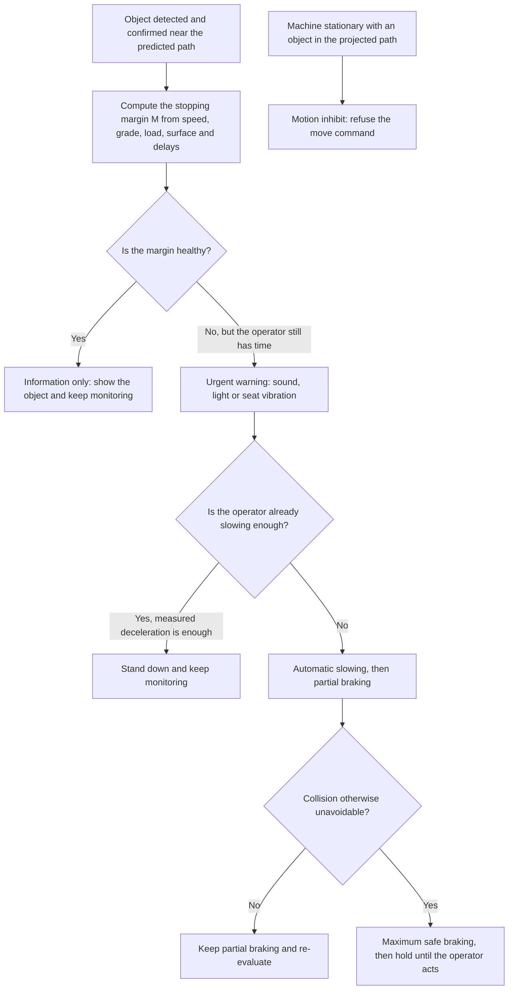

*The warn-or-brake flow the booklet describes, built on a stopping margin rather than on time to collision alone [Chapter 8].*

**Why it matters here.** The booklet's clearest recommendation is to freeze the decision architecture before the hardware arrives: a primary trigger based on the predicted swept volume against a stopping-distance envelope, `s = v x (t_sense + t_actuate) + v^2 / (2 x a_worst)`, with time to collision as a secondary layer for haul-speed traffic and operator-reaction suppression as a third [Chapter 8]. No standard or peer-reviewed study gives tuned time-to-collision or deceleration values for off-road machines, so the numbers inside the logic must come from the program's own models and tests [Chapter 8].

**Related terms.** [Time to collision (TTC), time headway and trigger distance](#time-to-collision-ttc-time-headway-and-trigger-distance), [Zones (warning zone, braking zone, detection zone)](#zones-warning-zone-braking-zone-detection-zone), [Thresholds and filters](#thresholds-and-filters), [Staged interventions in the decision logic](#staged-interventions-in-the-decision-logic), [Operator-already-reacting detection](#operator-already-reacting-detection), [Stopping distance](#stopping-distance), [Required detection range](#required-detection-range), [ISO 21815 series](#iso-21815-series-collision-warning-and-avoidance).

### Time to collision (TTC), time headway and trigger distance

**In one sentence.** Time to collision is how many seconds remain before two things meet if nothing changes, time headway is how many seconds the machine needs to reach the spot an object occupies now, and trigger distance is the range at which the system must act.

**Explained.** Time to collision (TTC) is the distance to the object divided by the closing speed: 10 m away, closing at 2 m/s, gives 5 s. It is the most common quantity in road-car automatic braking, where a 1.0 s trigger was used as a research convention and systems stage warning, partial and full braking at falling TTC values [Chapter 8]. Time headway divides the gap by the machine's own speed instead: 10 m at 4.2 m/s is 2.4 s, whether or not the object moves. It describes following distance. The booklet meets headway only as a distance in on-road test setups, 12 to 40 m between vehicles; its nearest off-road relative is a 50 m following distance in a Chinese underground regulation [Chapter 3].

Trigger distance turns time back into meters. The booklet writes it as `D_trigger = D_detect + v x T_action + D_stop + D_safety`: the distance spent detecting and confirming, the distance traveled while the command takes effect, the physical stopping distance, and a safety clearance, which is the ISO 21815-3 structure [Chapter 8]. Off-road examples: an early haul-truck study derived detection ranges of 15 m to the sides, 50 m to the rear and 100 m to the front from a 0.5 s reaction time plus braking, and a mining-truck patent uses two TTC limits with 1 to 3 s added for operator reaction [Chapter 8].

**Why it matters here.** The booklet rates a fixed TTC threshold "a weak primary trigger at work-site speeds" and favors the distance-and-zone formulation, with TTC retained for faster haul traffic and as a diagnostic input [Chapter 8]. Assumed reaction times in the sources range from 0.5 s to 2.5 s, so the same TTC rule can mean very different trigger distances [Chapter 8].

**Related terms.** [Time to collision (TTC) and trigger distance (as perception outputs that matter for braking)](#time-to-collision-ttc-and-trigger-distance-as-perception-outputs-that-matter-for-braking), [Decision logic (when to warn, when to brake)](#decision-logic-when-to-warn-when-to-brake), [Stopping distance](#stopping-distance), [Required detection range](#required-detection-range), [Operator reaction time](#operator-reaction-time), [Zones (warning zone, braking zone, detection zone)](#zones-warning-zone-braking-zone-detection-zone).

### Zones (warning zone, braking zone, detection zone)

**In one sentence.** Zones are areas drawn around the machine in which the system reacts in a particular way: it must see objects anywhere in the detection zone, it warns when one enters the warning zone, and it brakes when one enters the braking zone.

**Explained.** Picture the machine from above with bands around it like ripples: an outer band where the sensors must see everything, a middle band where an object produces a warning, and an inner band where it produces a brake command. The bands are longer in the direction of travel and grow with speed, because a faster machine needs more room to stop. ISO 21815-3 calls the inner area the collision-risk area, requires the detection zone to be "the same or larger than the collision risk area", and allows the area to be reduced using current speed, turning angle, physical or virtual barriers and the expected path [Chapters 3, 8].

The geometry comes from the stopping distance: the braking zone must reach at least the trigger distance, and the warning zone must reach further by the distance covered during the operator's reaction time, 2.5 to 3.0 s before intervention in the South African MOSH specification (MOSH is the Mining Industry Occupational Safety and Health learning hub) [Chapter 3]. Machine length, width, articulation center and attachments change the zones, and very low-speed work can need a zone that is large when measured in stopping distances yet small in meters, especially at blind corners and when reversing [Chapter 8].

Installed zones vary a great deal. In nine NIOSH underground tests the stop zones of continuous miners differed between sites by 1.4 m on average and up to 3.6 m, while repeat measurements at one site agreed within about 13 cm [Chapter 8]. The MOSH specification sets stop gaps of 1.0 to 4.0 m at 10 km/h or less and 15 m plus or minus 5 m above 10 km/h [Chapter 3]. One supplier reported adjusting its detection zones for braking distance, speed, real-time payload and haul-road grade after field tests [Chapters 1, 2].

**Why it matters here.** Zones expressed as functions of speed, latency, deceleration (mass, slope, surface), sensor position and machine envelope turn per-model tuning into per-model measurement, which is how settings can be carried across machine models without copying constants [Chapter 9]. The booklet also warns of a "false sense of protection" from idealized clover-leaf detection zones that real sensors do not deliver [Chapter 7].

**Related terms.** [Decision logic (when to warn, when to brake)](#decision-logic-when-to-warn-when-to-brake), [Required detection range](#required-detection-range), [Stopping distance](#stopping-distance), [Field of view (FOV), range, resolution and frame rate (FPS)](#field-of-view-fov-range-resolution-and-frame-rate-fps), [Blind spot and operator visibility](#blind-spot-and-operator-visibility), [Transferring settings across machine models: physics-based parameterization](#transferring-settings-across-machine-models-physics-based-parameterization-archetypes-partial-pooling-transfer-optimization), [archetypes](#transferring-settings-across-machine-models-physics-based-parameterization-archetypes-partial-pooling-transfer-optimization), [partial pooling](#transferring-settings-across-machine-models-physics-based-parameterization-archetypes-partial-pooling-transfer-optimization), [transfer optimization](#transferring-settings-across-machine-models-physics-based-parameterization-archetypes-partial-pooling-transfer-optimization), [ISO 21815 series](#iso-21815-series-collision-warning-and-avoidance).

### Thresholds and filters

**In one sentence.** Thresholds are the numbers at which the system changes its behavior, and filters are the rules that stop it from reacting to a single noisy measurement.

**Explained.** A smoke alarm has a threshold (how much smoke) and, in better models, a filter (the smoke must persist for a few seconds, so burnt toast does not wake the house). Collision systems have the same two kinds of setting [Chapter 9]:

- Detection confidence threshold: how sure the perception software must be before an object counts.
- Confirmation, or N-of-M frames: the object must appear in, say, 3 of the last 4 sensor frames before it is accepted. ISO 16001 asks for detection "unambiguously with an uninterrupted sequence of the signal" and allows at most 300 ms of detection time [Chapter 3].
- Persistence and debounce times: how long a condition must hold before the system acts, and how long before it stands down.
- Risk determination: the step that combines the confirmed object, its position and movement, and the machine's own motion into a collision-risk level. ISO 21815-3 places intervention at level 4 or above [Chapter 8].
- Hysteresis: the system switches on at one value and off at a different, safer value, so it does not flicker between states. The booklet applies this after an automatic stop: use hysteresis and an explicit release condition, and on slopes never release the brake because the object disappeared for one sensor frame [Chapter 8].

Every filter trades speed for reliability. More confirmation frames mean fewer false alarms but a later brake; at 15 km/h and 10 frames per second, each extra frame costs about 0.4 m.

**Why it matters here.** These settings are what gets tuned. The booklet lists them as the decision variables of the tuning problem (confidence thresholds, zone dimensions per speed, N-of-M filters, persistence and debounce times, time-to-collision triggers, filter constants) and the outcomes they trade against each other: missed or late interventions, false warnings per hour, unnecessary brake events per hour, intervention timing and time stopped [Chapter 9]. The transition from partial to full braking should depend on the remaining stopping margin and its uncertainty, not on range alone [Chapter 8].

**Related terms.** [Decision logic (when to warn, when to brake)](#decision-logic-when-to-warn-when-to-brake), [Detection, classification and tracking (object detection, object list)](#detection-classification-and-tracking), [True positive, false positive, false negative, miss (the four outcomes)](#true-positive-false-positive-false-negative-miss-the-four-outcomes), [Nuisance braking from the decision side](#nuisance-braking-from-the-decision-side), [Tuning thresholds in simulation before field tests](#tuning-thresholds-in-simulation-before-field-tests), [Constrained multi-objective optimization (several goals at once, with limits)](#constrained-multi-objective-optimization), [Over-fitting](#over-fitting).

### Staged interventions in the decision logic

**In one sentence.** Staged intervention means the system escalates step by step, from information to warning to slowing to partial braking to maximum safe braking and, for a stationary machine, to refusing to move, rather than jumping straight to a full stop.

**Explained.** A good teacher does not shout first: a look, then a word, then a consequence. Staging gives the operator a chance to act before the machine acts, and it saves the harsh actions for the moments that need them. The booklet's ladder for earth-moving machines [Chapter 8]:

1. Information: an object is present and the stopping margin is healthy; a visual or spatial indication.
2. Urgent warning: risk is rising while the operator still has adequate margin; a distinct sound, light or haptic cue.
3. Automatic slowing: the operator has not reduced the risk; reduce propel, use the retarder or hydrostatic slowing, or apply light braking.
4. Partial service braking: margin approaching its minimum; controlled deceleration below stability and traction limits.
5. Maximum safe collision-mitigation braking: collision otherwise unavoidable; the hardest braking the current stability and control limits allow.
6. Stopped-state hold: speed zero while the hazard remains; keep the brake on.
7. Motion inhibit from standstill: an object is already in the projected path before the machine moves; reject or limit the propel or articulation command.

The booklet's state diagram writes these as compact names, UrgentWarning, Slowing, PartialBraking, MaximumSafeBraking, Hold and MotionInhibit, in the style of the ISO 21815 standards. The standards themselves speak of speed reduction, stopping and motion inhibit; ISO 21815-1 rules out automatic steering, and ISO/TS 21815-2 defines the network commands to "slow down, stop or prevent motion of the machine" [Chapter 8]. The industry body EMESRT (Earth Moving Equipment Safety Round Table) places awareness at Level 7, advisory controls at Level 8 and intervention controls that slow and stop the vehicle at Level 9 [Chapter 8]. South African law prescribes the sequence detect, warn, retard to a safe speed, then brake [Chapter 3]. Road systems stage warning, a brief haptic brake jerk, partial braking and full braking [Chapter 8].

**Why it matters here.** Staging is what makes an automatic brake acceptable to the people who work around it: mine leaders preferred an integration that slowed to a crawl before setting the brake, "not an abrupt stop" [Chapter 4]. Each stage needs its own acceptance tolerance, because an unnecessary advisory is not the same as an unnecessary emergency stop of a loaded machine [Chapter 3].

**Related terms.** [Staged intervention](#staged-intervention), [Intervention](#intervention), [Nine levels of control](#nine-levels-of-control), [Decision logic (when to warn, when to brake)](#decision-logic-when-to-warn-when-to-brake), [Deceleration limits and how regulators specify them](#deceleration-limits-and-how-regulators-specify-them), [Secondary hazards of an automatic stop](#secondary-hazards-of-an-automatic-stop), [ISO 21815 series](#iso-21815-series-collision-warning-and-avoidance), [Vehicle network: CAN bus, SAE J1939, DBC file](#vehicle-network-can-bus-sae-j1939-dbc-file).

### Deceleration limits and how regulators specify them

**In one sentence.** A deceleration limit is a rule about how hard a machine must, or may, slow down, and regulators write such rules in several different and not directly comparable ways.

**Explained.** Brake regulations set floors: the machine must be able to slow at least this hard, or stop within this distance. The booklet's main off-road examples [Chapter 8]:

- ISO 3450:2011, for wheeled and fast rubber-tracked machines with top speeds of 20 km/h or more, prescribes maximum stopping distances by machine type, measured from brake-control actuation to standstill in the worst-case load configuration, and summarizes performance as a mean deceleration from `a = v^2 / (2d)`.
- The New South Wales guidance proposes a minimum mean net deceleration of 0.60 m/s² for service brakes in service (0.30 for secondary brakes), raised to 0.75 and 0.40 for type testing, with grade and mass corrections. It is a proposal, not an adopted rule.
- The US mining rule (30 CFR 56.14101, Table M-1) assumes a constant deceleration of 9.66 ft/s², about 2.94 m/s², plus a system response time of 0.5 to 2.5 s by weight class and 1 s of operator time, and requires brakes that can stop and hold the loaded machine on the steepest grade it travels.
- The South African MOSH specification sets emergency-stop decelerations of 1.9 m/s² for machines faster than 20 km/h and 1.0 m/s² for others, controlled-stop decelerations of 1.0 or 0.5 m/s², no wheel lock and limited veer, tested unloaded on gradients of 1 percent or less [Chapter 7].
- UN Regulation No. 152 for road cars requires a braking demand of at least 5.0 m/s²: a floor, and a demand rather than a measured deceleration [Chapter 8].

Ceilings are another matter. No published maximum automatic-braking deceleration for earth-moving machines was found, and ISO 21815 leaves the intervention profile to the machine manufacturer [Chapter 8]. The one on-road ceiling the booklet quotes is in the US rule FMVSS No. 127, where a false activation fails if peak deceleration exceeds manual braking by 0.25 g or more [Chapter 3]. The booklet's recommended rule is to command the minimum of several limits, `a_command = min(a_need, a_traction, a_stability, a_machine, a_load)`, ramped with a jerk limit, held after the stop, and released only on operator action where rollaway is possible [Chapter 8].

**Why it matters here.** The floors tell the program how little deceleration it may assume; the missing ceiling means the safe maximum must be derived per machine family from stability and traction analysis and tests [Chapter 8]. Because the sources mix definitions, the program must convert them to one definition of stopping distance and one time origin before pooling them [Chapter 8].

**Related terms.** [Speed, acceleration and deceleration](#speed-acceleration-and-deceleration), [Stopping distance](#stopping-distance), [Load shift and stability](#load-shift-and-stability), [ISO 3450 (brake performance of earth-moving machinery) and ISO 10265 (crawler machines)](#iso-3450-and-iso-10265-brake-performance), [United States: OSHA 29 CFR 1926.601](#united-states-rules-osha-29-cfr-1926601-msha-30-cfr-niosh), [MSHA 30 CFR and the proximity detection rules](#united-states-rules-osha-29-cfr-1926601-msha-30-cfr-niosh), [NIOSH research](#united-states-rules-osha-29-cfr-1926601-msha-30-cfr-niosh), [MOSH (Mining Industry Occupational Safety and Health learning hub) and its TRL stage gates](#mosh-and-its-trl-stage-gates-mining-industry-occupational-safety-and-health-learning-hub), [UN regulations](#un-regulations-un-r152-r131-r159-r171-and-unece-wp29-grva-vmad-and-natm), [FMVSS 127 (United States AEB rule) and NHTSA](#fmvss-127-nhtsa-ntsb-and-iihs), [NTSB](#fmvss-127-nhtsa-ntsb-and-iihs), [IIHS](#fmvss-127-nhtsa-ntsb-and-iihs).

### Operator-already-reacting detection

**In one sentence.** This is the part of the logic that notices the operator is already braking or steering away, so the machine does not brake on top of a person who is handling the situation.

**Explained.** If a passenger grabbed the wheel every time you slowed for a corner, you would stop driving with them. An automatic brake that fires while the operator is already stopping is just as unwelcome, and it can be dangerous: on a loaded machine the extra jolt shifts the load. A system that stands down too easily is worse still.

Road rules handle this with override: UN Regulations R131 and R152 let a conscious action such as an accelerator kick-down or a swerve interrupt the automatic braking, and test protocols watch pedal force to confirm whether the driver braked [Chapter 8]. Off-road, ISO 21815-3 says the system must not override operator braking that is stronger than the system's own demand, and may allow intentional operator control to override an intervention where appropriate. A mining-truck patent checks brake-pedal stroke after the second alarm to decide that avoidance has begun [Chapter 8].

The booklet lists the signals a production system should combine: brake pedal or lever demand and brake pressure; the hydrostatic or propel lever returning toward neutral; retarder request; steering or articulation command and rate; accelerator released; a direction-change request; measured deceleration; and the predicted path moving away from the object. The core rule is to credit the operator for the deceleration actually achieved, not for a control that moved: suppress the intervention when measured deceleration already exceeds what is required to stop short, plus a margin [Chapter 8].

**Why it matters here.** The failure the booklet warns about is a startled operator who briefly releases the accelerator or touches the brake, the system standing down, and the margin collapsing; a downhill machine can even accelerate after the throttle is released [Chapter 8]. No off-road validation of such logic was found, so it belongs in the operator-reaction state machine the program must define before the hardware arrives and test in operator-in-the-loop and physical trials [Chapter 8].

**Related terms.** [Decision logic (when to warn, when to brake)](#decision-logic-when-to-warn-when-to-brake), [Operator reaction time](#operator-reaction-time), [Thresholds and filters](#thresholds-and-filters), [Nuisance braking from the decision side](#nuisance-braking-from-the-decision-side), [Hydrostatic drive, retarder and service brake](#hydrostatic-drive-retarder-and-service-brake), [Driver-in-the-loop (DIL), operator-in-the-loop and the machine simulator (operator studies)](#driver-in-the-loop-dil-operator-in-the-loop-and-the-machine-simulator), [UN regulations](#un-regulations-un-r152-r131-r159-r171-and-unece-wp29-grva-vmad-and-natm).

### Nuisance braking from the decision side

**In one sentence.** Nuisance braking is an automatic brake application that was not needed, and "from the decision side" means the cases where the sensors saw something real but the logic should have known not to brake.

**Explained.** Not every false stop is a sensor error. The sensor correctly sees a berm, a wall, a rock pile or a spotter standing where spotters stand; the mistake is deciding that the object is a collision. The booklet lists the everyday tasks that look like collisions: backing toward a rock pile to load, using a dump berm as a bump stop, dozers and trucks sharing a tip head, working close to walls and stockpiles, ground crew and spotters near the machine, parking and workshop maneuvers with small clearances, and the machine detecting its own tires [Chapter 4]. A South African guideline notes that with a fixed stop gap, machines being loaded "will not be able to come close enough to be loaded or the CPS will have to be switched off" (CPS is a collision prevention system) [Chapter 4].

The decision side has tools for this. Risk areas can be reduced using speed, turning angle, barriers and the expected path [Chapter 8]. Road regulations include false-activation tests, such as driving between two stationary vehicles or over a steel plate without braking [Chapters 3, 8]. One wheel-loader system on the market remembers the last slope the machine climbed so that reversing down a stockpile does not trigger it, a targeted fix for one false-activation case [Chapter 2]. But there are limits: a system cannot suppress the whole loading zone, because a second truck or a person can enter the same space, and it should not "learn away" repeated berm alarms, because berm contact is also how fatal dump-edge accidents begin [Chapter 4].

**Why it matters here.** The booklet calls nuisance interventions "the main documented field failure" of deployed proximity systems and the main reason operators switch them off, and it says the nuisance-intervention rate should be an acceptance metric equal in weight to missed interventions [Chapter 8]. No off-road false-activation rate per operating hour was found anywhere, so the acceptance threshold has to come from the program's own shadow-mode data [Chapters 3, 13].

**Related terms.** [Nuisance braking (unnecessary intervention, false intervention)](#nuisance-braking), [False alarm (nuisance alarm) and alarm accuracy](#false-alarm-and-alarm-accuracy), [Tasks that look like a collision risk to a sensor (loading, dumping, close work with people)](#tasks-that-look-like-a-collision-risk-to-a-sensor), [Spotter and pedestrian (person on foot)](#spotter-and-pedestrian), [Haul road, berm (windrow), bench and pit wall](#haul-road-berm-bench-and-pit-wall), [Thresholds and filters](#thresholds-and-filters), [Zones (warning zone, braking zone, detection zone)](#zones-warning-zone-braking-zone-detection-zone), [Shadow mode (silent testing)](#shadow-mode-silent-testing), [Switching off and bypassing (defeating a safety system)](#switching-off-and-bypassing).

### Required detection range

**In one sentence.** The required detection range is how far the sensors must reliably see, worked out backwards from how far the machine needs to stop plus a safety margin.

**Explained.** You cannot stop for what you cannot see. On a foggy road you slow down until your stopping distance fits inside the distance you can see; a collision system does the same sum in reverse. Start from the speed the machine will be allowed to travel, work out the full stopping distance including every delay, add the clearance you want left, add the sensor's own measurement error, and that is how far the sensor must detect objects in every condition the system is approved for. ISO 21815-3 puts it as a requirement: the detection distance "shall be large enough to allow a machine to stop" [Chapter 8].

Continuing the glossary's example of a 40 t machine at 15 km/h (4.2 m/s) on a 10 percent downgrade: the delay chain is 1.0 s, so 4.2 m at full speed; braking at a net 2.0 m/s² takes 4.3 m; the residual safe distance is 1.0 m; and suppose the sensor places objects within 0.5 m. The required detection range is 4.2 + 4.3 + 1.0 + 0.5 = 10 m. Now change one input at a time. At 30 km/h (8.3 m/s) the delay distance doubles to 8.3 m and the braking distance quadruples to 17.4 m, so about 27 m is needed. A slower brake system with 2.0 s of delay at 15 km/h needs 8.3 + 4.3 + 1.5 = about 14 m. A machine on mud with only 1.0 m/s² of net deceleration needs 4.2 + 8.7 + 1.5 = about 14 m at 15 km/h. The required range is therefore not one number but a surface over speed, grade, load, surface and delay, and the system must either see that far or limit the speed.

The booklet's figures show the spread: an early haul-truck study derived 15 m to the sides for people, 50 m to the rear and 100 m to the front from a 0.5 s reaction time plus braking; the South African MOSH specification requires 200 m machine-to-machine detection on surface mines; and the US rule for rear sensing on surface coal equipment says only that the area must give an endangered person adequate time to leave [Chapters 3, 8]. Two cautions follow. Range must be reliable range, not best-case range: on-road field measurements in heavy rain and in fog with visibility under 50 m showed metal targets not observed at 20 to 30 m [Chapter 8]. And the detection zone has to cover the collision-risk area in shape as well as reach; if it is smaller, ISO 21815-3 requires the limitation to be stated in the operator's manual [Chapter 3].

**Why it matters here.** The booklet's list of blind spots begins here: "ISO's distance budget starts at detection. If dust, fog, darkness, glare, mud on a sensor, self-occlusion, vibration or poor mounting cut reliable detection range below the required stopping distance, no brake model can recover the lost margin" [Chapter 8]. The required range is also the link between perception validation and braking validation: sensor simulation must deliver detection delay, range and error distributions into the braking simulation [Chapter 8].

**Related terms.** [Stopping distance](#stopping-distance), [End-to-end latency budget](#end-to-end-latency-budget), [Residual safe distance](#residual-safe-distance), [Zones (warning zone, braking zone, detection zone)](#zones-warning-zone-braking-zone-detection-zone), [Field of view (FOV), range, resolution and frame rate (FPS)](#field-of-view-fov-range-resolution-and-frame-rate-fps), [Sensor degradation: dust, mud, rain, snow, fog, spray, glare, darkness, artificial lighting, vibration](#sensor-degradation-dust-mud-rain-snow-fog-spray-glare-darkness-artificial-lighting-vibration), [Decision logic (when to warn, when to brake)](#decision-logic-when-to-warn-when-to-brake), [Operational design domain (ODD) and operating-domain taxonomy](#operational-design-domain-odd-and-operating-domain-taxonomy).

### Residual safe distance

**In one sentence.** Residual safe distance is the gap deliberately left between the stopped machine and the object, so that a stop is a near miss and not a light touch.

**Explained.** When you park behind another car you leave a meter, because your judgment of distance is not perfect and the other car may roll. The collision system needs the same allowance. ISO 21815-3 defines a "safe distance" as a safe offset set by an authorized person plus the measurement error, and makes it the final term in the collision-system distance after detection, determination, action and machine stopping [Chapter 3]. In the booklet's formulas it appears as D_safe or D_safety, the last item in the trigger distance [Chapter 8].

How big should it be? The standard leaves the value to the site. The South African MOSH specification uses stop gaps of 1.0 to 4.0 m at 10 km/h or less and 15 m plus or minus 5 m above 10 km/h, with a position accuracy of 1.5 m or 10 percent [Chapter 3]. Field measurements show why a margin is needed: installed stop zones varied between sites by up to 3.6 m, while repeat measurements at one site agreed within about 13 cm [Chapter 8]. The residual distance must absorb sensor position error, the uncertainty in the predicted stopping distance, and small movements of the object. The booklet's acceptance list includes "minimum stopping margin" and "residual impact speed" as quantities every test should report [Chapter 3].

**Why it matters here.** The residual safe distance is the tolerance the simulation must be more accurate than: if the risk area leaves X meters of margin, the model-form, numerical and input uncertainty must be demonstrably smaller than X [Chapter 10]. A larger margin protects against error but brings more nuisance stops in close-proximity work, so it is a tuning decision, not a fixed constant.

**Related terms.** [Required detection range](#required-detection-range), [Stopping distance](#stopping-distance), [Zones (warning zone, braking zone, detection zone)](#zones-warning-zone-braking-zone-detection-zone), [Tolerance and acceptance band (how much disagreement is allowed)](#tolerance-and-acceptance-band), [Uncertainty: aleatory versus epistemic](#uncertainty-aleatory-versus-epistemic), [Nuisance braking from the decision side](#nuisance-braking-from-the-decision-side).

### Secondary hazards of an automatic stop

**In one sentence.** Secondary hazards are the new dangers an automatic stop creates by itself: being struck from behind, blocking an escape route, stalling or rolling back on a grade, spilling the load, or hurting the operator.

**Explained.** Stopping is not automatically safe. A machine that halts without warning in a line of haul trucks can be hit by the one behind; in US insurance data, forward collision warning with automatic braking raised the rate of being struck from behind by 20 percent, a road result the booklet quotes as a caution [Chapter 4]. A machine that stops in a narrow underground roadway can block the escape route of the workers it was protecting, and workers reported "walking backwards into the tailgate" of stopped haulage [Chapter 4]. A machine stopped on a ramp may be unable to restart smoothly, and when the automatic brake releases it can roll back or roll forward: ISO 21815-3 warns that discontinuing an intervention must not create rollaway and recommends an operator action, such as applying the parking brake, before release [Chapter 8]. Hard braking can spill rock, swing a suspended load or tip a high-loaded machine, and sudden stops jar the operator; MSHA engineers estimate that three to four miners' lives a year could be saved by seat belts, one reason restraint matters for an automatic stop [Chapter 8].

The booklet also names immobilization in an unsafe location, loss of traction or control, operator counteraction, production loss, and the long-run hazard that operators disable a system that stops them too often [Chapters 1, 4, 8]. Off-road, none of these has been measured: spilled loads, slope instability and rear-end strikes caused by automatic braking were not found in the mining sources, and no injury or jerk threshold exists for haul trucks, loaders or dozers [Chapter 4].

**Why it matters here.** The safety goal cannot be "stop before the object". The transition from warning to intervention needs its own hazard analysis, and the simulation matrix needs hazardous-unintended-intervention cases as well as failure-to-intervene cases [Chapters 1, 10]. Hold-and-restart tests on grade and stability tests belong in the physical campaign for this reason [Chapter 8].

**Related terms.** [New risks created by automatic braking (secondary hazards: load shift, rollback on slopes, being hit from behind)](#new-risks-created-by-automatic-braking), [Load shift and stability](#load-shift-and-stability), [Grade (slope) and its effect on braking](#grade-slope-and-its-effect-on-braking), [Staged interventions in the decision logic](#staged-interventions-in-the-decision-logic), [Hazard analysis and risk assessment (including the risk matrix)](#hazard-analysis-and-risk-assessment), [Nuisance braking from the decision side](#nuisance-braking-from-the-decision-side).

### Mixed motion and prediction of movement

**In one sentence.** Mixed motion is the case where both the machine and the person or vehicle are moving, so the system must predict where each will be, not just where they are now.

**Explained.** Catching a ball means running to where it will land, not where it is. Most collision tests use a stationary target or a target on a fixed path; real sites have people who step out from behind a stockpile, trucks that reverse into a loading position while a loader swings, and dozers that change direction at a tip head [Chapter 4]. The logic must therefore work with a predicted path. ISO 21815-3 allows the risk area to be shaped by the machine's "projected or expected path", and the booklet's margin formula uses the predicted path distance R to the collision point [Chapter 8]. The machine's own path is predictable from speed, steering and articulation; the other party's is not, and a worker or another machine may also react to the braking machine [Chapter 7].

Three further points from the booklet. Time to collision assumes straight-line closing and fails when motion is sideways, rotating or starting from rest [Chapter 8]. Research at the University of Pretoria samples plausible steering-rate trajectories to predict collisions and cut false interventions, with simulation-only initial results [Chapter 8]. And validated off-road behavioral models of workers and equipment operators were not found, so a simulation that moves a virtual pedestrian is making an assumption that needs its own validation [Chapters 7, 12].

**Why it matters here.** Mixed motion is listed among the controlled whole-machine tests that cannot be delegated to an unvalidated model [Chapter 1], and replay of recorded data cannot answer it, because after the brake acts the recorded movements of other actors are no longer valid [Chapter 7]. Low-speed work needs comparatively large zones at blind corners and where people enter the path from the side [Chapter 8].

**Related terms.** [Decision logic (when to warn, when to brake)](#decision-logic-when-to-warn-when-to-brake), [Time to collision (TTC), time headway and trigger distance](#time-to-collision-ttc-time-headway-and-trigger-distance), [Zones (warning zone, braking zone, detection zone)](#zones-warning-zone-braking-zone-detection-zone), [Detection, classification and tracking (object detection, object list)](#detection-classification-and-tracking), [Open loop versus closed loop](#open-loop-versus-closed-loop), [Spotter and pedestrian (person on foot)](#spotter-and-pedestrian), [Excavator](#excavator).

### Tuning thresholds in simulation before field tests

**In one sentence.** Tuning in simulation means adjusting the decision thresholds, zone sizes and filters on a computer model of machine, sensors and site, so that field tests confirm settings rather than discover them.

**Explained.** A piano is tuned before the concert. For a braking system the "pitch" is the balance between stopping in time and not stopping needlessly, and simulation is where that balance is first set. The booklet is careful about what the evidence supports and what it does not [Chapter 8].

What has been done, on roads: a 2019 study swept time-to-collision triggers and latencies against US pedestrian crash data and estimated how many crashes each combination would avoid; the 2015 grade study showed a trigger that worked on level ground and collided at 11 and 17 percent; and the 2026 round robin showed that tools disagreed by 0.033 s and 0.314 m even with a prescribed trigger and brake profile, so the simulator itself needs verification [Chapter 8]. Off-road: NIOSH built a stopping-distance model to check whether detection zones covered the stopping distance of faster underground vehicles, varied six inputs at five values each, and said validation was still needed; ISO 21815-3 includes examples of configuring parameters from stopping performance; excavator and collision-prediction studies report simulation-only results. "No published off-road case compares simulation-tuned thresholds with field results quantitatively" [Chapter 8].

What can be tuned virtually, in the booklet's view: the structure of the trigger (stopping margin plus zones), the sensitivity of the outcome to each input, the grade and payload dependence, the staging logic, and first estimates of zone sizes per speed and machine family, using measured brake delays and deceleration maps as inputs [Chapter 8]. What cannot: the actual brake delays and deceleration limits of the production machine, the friction of real site surfaces, sensor behavior in snow, glare and darkness, and the nuisance rate in real work, which must come from measurements and shadow-mode logs [Chapter 8].

**Why it matters here.** The booklet's plan is to freeze the decision architecture and run the scenario sweeps before the hardware arrives, pre-book the physical anchor campaign for the first six weeks after delivery, re-run the sweeps with calibrated parameters, and spend the remaining weeks in shadow mode measuring nuisance rates before braking is enabled [Chapter 8]. It also says to treat the model "as a test-selection and uncertainty-propagation machine, not as proof by itself", and to set explicit pass criteria for calibration and stop to recalibrate if they fail [Chapter 8].

**Related terms.** [Thresholds and filters](#thresholds-and-filters), [Decision logic (when to warn, when to brake)](#decision-logic-when-to-warn-when-to-brake), [Shadow mode (silent testing)](#shadow-mode-silent-testing), [Correlation test (first tests on the prototype that anchor the models)](#correlation-test), [Constrained multi-objective optimization (several goals at once, with limits)](#constrained-multi-objective-optimization), [Over-fitting](#over-fitting), [Sim-to-real gap, measured (as opposed to the concept in Part D)](#sim-to-real-gap-measured), [Monte Carlo methods](#monte-carlo-methods), [Campaign (test campaign) and campaign architecture for the four-month window](#campaign-test-campaign-and-campaign-architecture).

## Part F: Test design, statistics and tuning without over-fitting

No campaign can test every combination of site, machine, weather, speed and object. This part explains how tests are chosen, what a set of results can prove, and how to keep the honest numbers separate from the failure hunting. It also covers tuning: adjusting thresholds and zones for several goals at once without fitting them to the test set, and carrying settings across machine models.

### Test space and the combinatorial explosion

**In one sentence.** The test space is the set of every situation the braking system could meet, and the combinatorial explosion is the way that set grows so fast, when conditions are multiplied together, that nobody can test it all.

**Explained.** Think of ordering a meal from a menu with five courses and ten choices for each course. There are 10 × 10 × 10 × 10 × 10 = 100,000 possible meals. Nobody could taste them all. Each new course multiplies the total; it does not add to it. Engineers call this the combinatorial explosion.

For the automatic braking system, the "courses" are the conditions that can change from one situation to the next: the type of job site, the task the machine is doing, the weather, the light, the machine model, where the sensors sit, the speed, and what kind of object is in the way. The booklet's program must cover more than 100 site types, more than ten operating scenarios per machine, seven or so weather and light conditions (rain, snow, fog, dust, dusk, darkness, glare) and many machine models. Multiplying only the first three gives 100 × 10 × 7 = 7,000 cells before any machine model, speed or object type is counted. Chapter 7 makes the same count and notes that no program can fill each cell with the 59 to 299 physical trials a statistical claim would need [Chapter 7].

A plain grid of every combination (a "full Cartesian product") is therefore not a plan. Chapter 9 recommends structuring the space in three layers instead: an operating-domain taxonomy that sets the boundaries, a scenario catalog that guarantees known fatal-accident patterns are always tested, and parameterized scenario families with a probability distribution over their variables. The decisive choice is to describe sites by their safety-relevant attributes (rough terrain, dusty air, bright sun, an 8 percent grade, frequent crossings) rather than as 100 unrelated site names. Two quarries with different names may be the same test case. Many combinations are also impossible and can be removed: there is no direct sun glare underground, and an ultrasonic-only sensor set has no camera exposure settings [Chapter 9].

**Why it matters here.** The size of the space is the reason the validation has to move largely into simulation, and the reason the choice of which combinations to test becomes a safety decision. Chapter 13 lists "compute and scenario explosion" as a standing objection to the plan and notes that published compute costs for virtual validation of off-road safety functions were not found [Chapter 13].

**Related terms.** [Parameter, parameter range and parameterized scenario family](#parameter-parameter-range-and-parameterized-scenario-family), [Test selection method](#test-selection-method), [Combinatorial testing](#combinatorial-testing-t-way-testing-pairwise-testing-covering-arrays), [Operational design domain (ODD) and operating-domain taxonomy](#operational-design-domain-odd-and-operating-domain-taxonomy), [Scenario catalog, scenario family and scenario parameter](#scenario-catalog-scenario-family-and-scenario-parameter), [Site type and the "100+ site types" claim](#site-type-and-the-100-site-types-claim), [Test case, test matrix and scenario grid](#test-case-test-matrix-and-scenario-grid), [Sample size, confidence level and confidence interval](#sample-size-confidence-level-and-confidence-interval).

### Parameter, parameter range and parameterized scenario family

**In one sentence.** A parameter is one adjustable quantity in a test (such as machine speed), its range is the span of values it may take, and a parameterized scenario family is one scenario description with those quantities left open so that thousands of concrete tests can be generated from it.

**Explained.** A recipe that says "bake for 20 to 30 minutes at 160 to 180 degrees" is parameterized: time and temperature are the parameters, the numbers are the ranges, and each bake picks one value for each.

The booklet follows a three-level ladder from automated-driving research. A functional scenario is in words: "machine reversing toward a person." A logical scenario adds ranges: person distance 0 to 30 meters, machine speed 0 to 15 kilometers per hour, approach angle, dust density. A concrete scenario fixes every value. Chapter 9's example family, "machine reverses toward an initially visible or occluded human-shaped object while the operator does not brake", has variables such as speed, initial distance, the person's path, slope, load, sensor installation, illumination, visibility, system latency and braking friction. A concrete test is one chosen vector of these values [Chapter 9].

Two features make a family more than a list of ranges. Each family carries a probability distribution over its parameters, taken from field data or expert estimates: how often is the person 5 meters away rather than 25? That distribution is what later makes rate estimation possible. And constraints and dependencies are written down: dust correlates with dry, windy, high-traffic conditions, and a distribution that ignores this misweights the strata [Chapter 9].

**Why it matters here.** Instead of storing 10,000 copies of "reverse toward worker", the catalog stores one family, and every sampling, search and estimation method in this part operates on such families. The booklet warns that defensible distributions are the weak point, and that the only off-road scenario library found was built for intelligent off-road vehicles, not collision avoidance [Chapter 9].

**Related terms.** [Scenario (functional, logical, concrete)](#scenario-functional-logical-concrete), [Scenario catalog, scenario family and scenario parameter](#scenario-catalog-scenario-family-and-scenario-parameter), [Test space and the combinatorial explosion](#test-space-and-the-combinatorial-explosion), [Random sampling, stratified sampling and probability-weighted sampling](#random-sampling-stratified-sampling-and-probability-weighted-sampling), [Weighting strata to a field rate](#weighting-strata-to-a-field-rate), [Scenario description languages](#scenario-description-languages-openscenario-dsl).

### Test selection method

**In one sentence.** A test selection method is a rule for choosing which of the countless possible tests to actually run, and each rule can honestly answer only certain kinds of question.

**Explained.** A doctor who can order only ten blood tests chooses them to answer a specific question. The right ten for "is anything wrong at all?" differ from the right ten for "how severe is this known condition?" Test selection for a braking system works the same way: the method follows the question.

Chapter 9 explains that "coverage" has four incompatible meanings, and that no single method delivers all four: coverage of discrete configurations (has every site type been tried with every weather type?), coverage of a continuous parameter space (have speeds and distances been spread across their ranges?), discovery of failures (where does the system break?), and estimation of field rates (how often will it miss or brake unnecessarily in real operation?).

The booklet maps methods to these questions. Combinatorial designs guarantee discrete coverage. Space-filling designs cover continuous parameters and train surrogate models. Falsification and adaptive search find failures. Importance sampling estimates small probabilities, but only when the real-world distribution is known. A frozen stratified random sample is the only basis for a release rate claim. Each method also has things it cannot claim: a search that hunts for failures cannot report a failure rate, and a design that spreads points evenly says nothing about how often each point happens in a real quarry [Chapter 9].

**Why it matters here.** The booklet's position is blunt: "Do not try to make one design perform all three jobs." The program should use a portfolio: coverage designs for understanding, search for discovery, and a separate frozen sample for the statistical claim [Chapter 9].

**Related terms.** [Design of experiments (DOE)](#design-of-experiments-doe), [Combinatorial testing](#combinatorial-testing-t-way-testing-pairwise-testing-covering-arrays), [Random sampling, stratified sampling and probability-weighted sampling](#random-sampling-stratified-sampling-and-probability-weighted-sampling), [Space-filling designs](#space-filling-designs-latin-hypercube), [Falsification](#falsification-failure-seeking-search), [Rare-event methods](#rare-event-methods-importance-sampling), [Adaptive and Bayesian test selection](#adaptive-and-bayesian-test-selection), [Keeping failure-seeking tests separate from performance estimates](#keeping-failure-seeking-tests-separate-from-performance-estimates).

### Design of experiments (DOE)

**In one sentence.** Design of experiments (DOE) is the branch of statistics that plans which combinations of settings to test so that the effect of each factor, and of factors acting together, can be measured with the fewest runs.

**Explained.** Suppose a baker wants to know whether oven temperature, baking time or flour type matters most. Changing one thing at a time is slow and misses interactions, such as a high temperature that only matters with a long time. DOE varies several factors in a planned pattern so that one set of runs answers several questions.

The booklet names the classic designs from the statistical handbook of the National Institute of Standards and Technology (NIST). A full factorial tests every combination of a few factors at a few levels; its run count grows exponentially. A fractional factorial tests a chosen fraction and cuts the run count sharply, at the price of "aliasing": some higher-order effects become indistinguishable from others. Screening designs identify the influential factors. Response-surface designs then map curvature in the smaller space of influential factors, which suits fine tuning of thresholds and zones. D-optimal designs help when constraints make a regular grid impossible [Chapter 9].

DOE can claim main effects and low-order interactions on a continuous response, for example how detection range changes with dust density and illumination. It cannot claim a failure probability in the field, because its points are not weighted by how often each condition occurs, and it cannot find a narrow failure region hidden between design points: a fractional factorial showing no main effect for fog cannot rule out a localized failure at one combination of fog density, glare and sensor contamination [Chapter 9].

**Why it matters here.** The booklet places DOE in the coverage stream and in the calibration step after prototype arrival, where modest DOE or D-optimal tests estimate sensor, latency and braking residuals. No off-road collision-avoidance study using DOE was found [Chapter 9].

**Related terms.** [Test selection method](#test-selection-method), [Space-filling designs](#space-filling-designs-latin-hypercube), [Combinatorial testing](#combinatorial-testing-t-way-testing-pairwise-testing-covering-arrays), [Constrained multi-objective optimization](#constrained-multi-objective-optimization), [Sensitivity analysis](#sensitivity-analysis), [Transferring settings across machine models](#transferring-settings-across-machine-models-physics-based-parameterization-archetypes-partial-pooling-transfer-optimization).

### Combinatorial testing (t-way testing, pairwise testing, covering arrays)

**In one sentence.** Combinatorial testing chooses a small set of tests that still guarantees every combination of values of any t factors (for pairwise testing, any two) appears at least once.

**Explained.** Imagine a clothing shop that offers 5 items, each in 4 colors, and wants to photograph outfits so that every pair of items appears together in every color combination at least once. Trying every full outfit would take 4 × 4 × 4 × 4 × 4 = 1,024 photos. A cleverly chosen set of 16 photos can show every pair of items in every pair of colors. That set is a covering array of strength 2, and the trick is called pairwise testing. Strength 3 (t = 3) covers every triple and needs more tests; in general, "t-way testing" covers every combination of t factors.

The reason this is worth doing comes from software research. NIST (the National Institute of Standards and Technology) found that "most software bugs and failures are caused by one or two parameters, with progressively fewer by three or more", up to about six. It reports fault detection equal to exhaustive testing with a 20 to 700 times reduction in test-set size. Its generator, ACTS (Automated Combinatorial Testing for Software), is public domain; PICT (Pairwise Independent Combinatorial Testing) is an open-source generator; commercial test-design tools do the same job [Chapter 9].

For the braking system, the discrete factors are site type, weather, light, object type, machine model and sensor configuration. A covering array guarantees that, for example, every machine model has been tested in every weather type with every object type, without running the full grid. What it cannot do is also important. It says nothing about continuous ranges (a speed of 7.3 kilometers per hour is not a "level"), nothing about rates, and nothing about failures that need more than t factors to line up [Chapter 9].

**Why it matters here.** Chapter 9 recommends covering arrays for "machine by sensor by weather by scenario configuration coverage". It also flags a caution: the evidence that low-order interactions explain most bugs comes from software, not from camera, radar or lidar failures caused by coupled weather, contamination, geometry and signal processing. Whether the "interaction rule" carries over to perception is listed as uncertain, so t-way designs should be supplemented by physics-guided interaction hypotheses and by failure-seeking search [Chapter 9].

**Related terms.** [Test space and the combinatorial explosion](#test-space-and-the-combinatorial-explosion), [Test selection method](#test-selection-method), [Design of experiments (DOE)](#design-of-experiments-doe), [Falsification](#falsification-failure-seeking-search), [Test case, test matrix and scenario grid](#test-case-test-matrix-and-scenario-grid), [Scenario generation and test management tools](#scenario-generation-and-test-management-tools).

### Random sampling, stratified sampling and probability-weighted sampling

**In one sentence.** Random sampling picks tests by chance according to how often each situation occurs in real operation, stratified sampling first divides the situations into groups (strata) and samples each group deliberately, and probability-weighted sampling keeps track of each test's real-world frequency so that results can be scaled back to the field.

**Explained.** An opinion poll does not ask everyone. It asks a random sample, and if the sample is drawn fairly, the answer is close to the whole population's answer, with a known margin of error. If a pollster worries that a small but important group would be missed by chance, they make sure to interview enough of that group (a stratum) and then weight its answers back down to its true share of the population. That is stratified sampling.

For the braking system, the "population" is every encounter the machine will have in real operation: each reverse toward a worker, each approach to a light vehicle, in each weather and light condition, on each machine model. A random sample drawn from the parameterized scenario families, using their probability distributions, gives an unbiased estimate of the detection rate and the false alarm rate, with a classical confidence interval. Stratification is usually better: deliberately ensure enough samples from dust at night, from each machine family, from each critical scenario, then weight the strata back to how often they occur [Chapter 9].

The method has one hard condition. The estimate is only valid if the assumed distribution of situations matches reality. If dust at dusk happens three times more often than the model assumed, the estimated rate is wrong. The booklet notes a second limit: plain random sampling is extremely inefficient for rare dangerous events, because most random runs are uneventful [Chapter 9].

**Why it matters here.** The booklet states that a frozen, stratified random sample, drawn from the declared operating-domain distribution before tuning starts and never used for tuning, is the only basis for the release rate claim. The field distribution needed to weight it is not available in public sources, which is why the booklet urges shadow-mode logging on the existing warning fleet to begin now [Chapter 9].

**Related terms.** [Test selection method](#test-selection-method), [Weighting strata to a field rate](#weighting-strata-to-a-field-rate), [Sample size, confidence level and confidence interval](#sample-size-confidence-level-and-confidence-interval), [Monte Carlo methods](#monte-carlo-methods), [Rare-event methods](#rare-event-methods-importance-sampling), [Keeping failure-seeking tests separate from performance estimates](#keeping-failure-seeking-tests-separate-from-performance-estimates), [Warning-system fleet](#warning-system-fleet), [Shadow mode (silent testing)](#shadow-mode-silent-testing).

### Space-filling designs (Latin hypercube)

**In one sentence.** A space-filling design spreads test points as evenly as possible across the ranges of several continuous parameters at once, so that no region of the space is left unexplored.

**Explained.** If you had 20 soil probes to place across a field, you would not drop them at random, because random placement leaves clumps and gaps. You would space them out. A space-filling design does the same in many dimensions.

The Latin hypercube is the best-known example. Each parameter's range is cut into n equal slices, and the design places n points so that every slice of every parameter is used exactly once, like a sudoku grid where each row and column holds each number once. Sobol sequences and other quasi-random designs achieve a similar even spread in a different way. The booklet notes that these designs cover continuous parameters more evenly than naive random draws and are useful for exploration and for training surrogate models, which are fast approximate models of the simulator's response [Chapter 9].

The limit is that even spread is not probability. A uniformly covered box of parameters is not a picture of a real quarry's traffic, where most approaches are slow and most weather is clear. Space-filling designs treat unrealistic regions exactly like realistic ones unless constraints and distributions are added. So they can claim "even geometric spread through the chosen region" and cannot claim rates, worst cases or operational frequency [Chapter 9].

**Why it matters here.** The booklet puts space-filling designs in the coverage stream alongside combinatorial designs: good for understanding how detection range varies with dust, glare and speed, and for feeding surrogate-guided search, but never for the release claim [Chapter 9].

**Related terms.** [Design of experiments (DOE)](#design-of-experiments-doe), [Random sampling, stratified sampling and probability-weighted sampling](#random-sampling-stratified-sampling-and-probability-weighted-sampling), [Monte Carlo methods](#monte-carlo-methods), [Test selection method](#test-selection-method), [Adaptive and Bayesian test selection](#adaptive-and-bayesian-test-selection).

### Falsification (failure-seeking search)

**In one sentence.** Falsification is a test method that treats "find a case where the system fails" as a search problem and uses optimization to steer the simulator toward the most dangerous combinations of conditions.

**Explained.** A safety inspector checking a railing does not push gently in the middle. They push hard at the joints and corners, where failure is most likely. Falsification is the automated version. Instead of testing many ordinary situations, it looks for the worst ones.

The method defines a measure of how close the system came to failing, for example the time to collision at the moment of detection, the stopping margin left when the machine halts, or the detector's confidence. An optimizer then adjusts the scenario parameters (speed, distance, dust, glare, the person's path) to make that measure as bad as possible. When the margin reaches zero, a failure has been found and can be replayed. The booklet names the tools S-TaLiRo, Breach and VerifAI, and puts evolutionary search, Bayesian optimization, fuzzing, surrogate-guided search, reinforcement-learning adversaries and Adaptive Stress Testing in the same family. VerifAI used with the Scenic language reported up to a 5 times speed-up from running several objectives in parallel, in on-road work from 2021 [Chapter 9].

Falsification can claim that a counterexample exists, that it is reproducible, and where the failure boundaries and worst cases lie inside the simulated space. It cannot claim a failure rate, because the search concentrates on failures, so the proportion of failing runs is biased by design. Not finding a failure is not proof of absence. The search can also exploit flaws in the simulator rather than in the system, and an objective written for one kind of failure may miss a qualitatively different one [Chapter 9].

**Why it matters here.** Falsification is the heart of the booklet's discovery stream, aimed at stopping boundaries, partial visibility, high closing speed, the edge of the field of view and sensor degradation. The booklet's rule for what happens next is central: a found failure becomes a new logical scenario or a permanent regression test, its frequency is estimated separately, and the failure fraction of a search campaign "must never be reported as an operational failure rate". The evidence is on-road and aerospace; no off-road demonstration was found [Chapter 9].

**Related terms.** [Test selection method](#test-selection-method), [Keeping failure-seeking tests separate from performance estimates](#keeping-failure-seeking-tests-separate-from-performance-estimates), [Regression](#regression-a-new-version-performing-worse), [Corner case, edge case and rare event](#corner-case-edge-case-and-rare-event), [Scenario generation and test management tools](#scenario-generation-and-test-management-tools), [Adaptive and Bayesian test selection](#adaptive-and-bayesian-test-selection), [Scenario description languages](#scenario-description-languages-openscenario-dsl).

### Rare-event methods (importance sampling)

**In one sentence.** Rare-event methods deliberately make dangerous situations happen more often in simulation, then mathematically correct the results so that the estimated rate still refers to normal operation.

**Explained.** To estimate how often a rare disease occurs, a researcher might study a hospital where cases are concentrated, then scale the count back by how much more common the disease is there than in the general population. Importance sampling works the same way. Each simulated run is weighted by the ratio between how likely the situation is in reality and how likely it was under the accelerated sampling. Dangerous runs are sampled often, but each counts for little.

The booklet lists importance sampling, cross-entropy methods, subset simulation, multilevel splitting, accelerated evaluation and naturalistic-and-adversarial environments in this family. The on-road results are striking: accelerated evaluation of lane changes (2017) showed very large speed-ups, and dense deep reinforcement learning (D2RL, published in Nature in March 2023) reported evaluation "10^3 to 10^5 times faster" while remaining unbiased [Chapter 9].

The conditions are strict. The method is unbiased only if the ratio between the real and the accelerated distribution is known and the accelerated sampling actually reaches the failure region. When the real distribution is unknown or has many dimensions, the weights become unstable and their variance can be huge. All the on-road successes rest on behavior models learned from very large naturalistic driving datasets, and no off-road dataset of comparable scale was found. The booklet's point is that a poorly modeled quarry operation cannot be rescued mathematically by importance sampling [Chapter 9].

**Why it matters here.** The booklet's rule is to use importance sampling in the estimation stream only where a defensible field distribution exists; otherwise the campaign counts as discovery. How far rare-event acceleration can replace real exposure is listed among the points where experts disagree [Chapter 9].

**Related terms.** [Random sampling, stratified sampling and probability-weighted sampling](#random-sampling-stratified-sampling-and-probability-weighted-sampling), [Monte Carlo methods](#monte-carlo-methods), [Falsification](#falsification-failure-seeking-search), [Corner case, edge case and rare event](#corner-case-edge-case-and-rare-event), [Keeping failure-seeking tests separate from performance estimates](#keeping-failure-seeking-tests-separate-from-performance-estimates), [Weighting strata to a field rate](#weighting-strata-to-a-field-rate).

### Adaptive and Bayesian test selection

**In one sentence.** Adaptive test selection chooses each new test based on the results of the tests so far, often using a Bayesian model that keeps track of what is still uncertain.

**Explained.** A good teacher giving an oral exam adapts: if the student answers an easy question well, the next question is harder, and the exam homes in on the boundary of what the student knows. Adaptive test selection does the same with a braking system. After each run it updates a model of where the system passes and fails, and picks the next test where that model is least sure.

The "Bayesian" part refers to the model. A surrogate model (a fast approximation of the simulator) predicts the outcome at untested points and gives an uncertainty for each prediction. An acquisition rule then picks the next point, for example where the prediction is closest to the pass or fail boundary and the uncertainty is high. This is called active learning when the aim is to learn the boundary, and Bayesian optimization when the aim is to find the best or worst setting [Chapter 9].

The strength is efficiency: fewer runs to map the boundary between detection and miss. The weakness follows directly. Because the sampling is intentionally biased toward interesting regions, a naive binomial confidence interval computed from adaptively selected tests is invalid, and the surrogate's own uncertainty estimate can be wrong [Chapter 9].

**Why it matters here.** The booklet classes adaptive selection as a discovery method that can "learn decision boundaries efficiently", not as a basis for a rate claim [Chapter 9].

**Related terms.** [Falsification](#falsification-failure-seeking-search), [Optimization methods named in the booklet](#optimization-methods-named-in-the-booklet-genetic-algorithms-nsga-ii-bayesian-optimization-gradient-free-search), [Bayesian methods and sequential testing](#bayesian-methods-and-sequential-testing), [Space-filling designs](#space-filling-designs-latin-hypercube), [Keeping failure-seeking tests separate from performance estimates](#keeping-failure-seeking-tests-separate-from-performance-estimates).

### Monte Carlo methods

**In one sentence.** A Monte Carlo method answers a question by running the same experiment many times with randomly chosen inputs and counting what happens.

**Explained.** If you wanted to know the chance that two dice total seven, you could work it out, or you could roll them 10,000 times and count. The counting approach is Monte Carlo, named after the casino. It works for problems far too tangled to work out by hand, as long as the experiment can be run cheaply many times.

In simulation, each run draws its parameters (speed, distance, dust, the person's path) at random from the scenario family's probability distribution, and the outcome is recorded. After many runs, the fraction of misses estimates the miss rate. The booklet's estimation stream is a Monte Carlo campaign on a frozen sample. Chapter 2 notes that aircraft collision-avoidance logic (ACAS X) was evaluated with encounter-model Monte Carlo runs equivalent to "billions of flight hours" [Chapter 2].

The limit is rare events. If the true miss rate is one in 10,000, a plain Monte Carlo campaign sees about one miss per 10,000 runs and needs tens of thousands of runs before it has seen enough misses to say anything precise. The booklet states that pure Monte Carlo is "extremely inefficient for rare dangerous events" and, in the planning chapter, that naive Monte Carlo cannot reach low failure rates in four months [Chapter 9, Chapter 12].

**Why it matters here.** Monte Carlo is the honest default for estimating rates, and its hunger for runs is the reason the booklet's sample-size tables and rare-event methods exist.

**Related terms.** [Random sampling, stratified sampling and probability-weighted sampling](#random-sampling-stratified-sampling-and-probability-weighted-sampling), [Rare-event methods](#rare-event-methods-importance-sampling), [Sample size, confidence level and confidence interval](#sample-size-confidence-level-and-confidence-interval), [Space-filling designs](#space-filling-designs-latin-hypercube), [Schedule risk analysis and Monte Carlo schedule simulation](#schedule-risk-analysis-and-monte-carlo-schedule-simulation).

### Sample size, confidence level and confidence interval

**In one sentence.** The sample size is how many independent trials you run, the confidence level is how sure you want to be, and the confidence interval is the range of values for the true rate that the data support at that level of sureness.

**Explained.** Suppose you test a new type of lock by trying to pick it 20 times and fail every time. You might be tempted to say the lock is unpickable. A statistician would say: with 20 failures, you can be 95 percent confident the pick-success rate is below about 14 percent. That is not nothing, but it is far from "never". The confidence level (95 percent) says how often this kind of statement would be right if you repeated the whole exercise many times. The confidence interval (0 to about 14 percent) is the range of true rates that 20 clean trials cannot rule out. A bigger sample gives a narrower interval.

The booklet's statistics rest on one formula for the zero-failure case. If each trial is an independent detection opportunity and none is missed, the claim "the miss probability is at most q" holds at confidence 1 minus alpha when (1 - q)^n is at most alpha. Here q is the largest miss probability you are willing to claim, alpha is the chance of being wrong (0.05 for 95 percent confidence), and n is the number of clean trials. Solving gives n = ln(alpha) / ln(1 - q), where ln is the natural logarithm. At 95 percent one-sided confidence: a miss rate of at most 5 percent needs 59 clean trials; at most 1 percent needs 299; at most 0.1 percent needs 2,995; at most 0.01 percent needs 29,956. At 99 percent confidence the figures are 90, 459, 4,603 and 46,050 [Chapter 9].

Three further points shape every claim. First, the unit must be an independent trial. A ten-second encounter produces about 300 camera frames, but it is one encounter, not 300 chances; counting frames inflates the sample and makes intervals "grossly overconfident". Second, if some misses occur, an exact binomial (Clopper-Pearson) interval or another pre-declared interval should be used, rather than testing until a pleasing percentage appears. Third, estimating a rate precisely costs more than showing it is below a threshold: a generic 95 percent estimate within plus or minus 1 percentage point needs about 9,604 observations in the worst case, and plus or minus 0.5 point needs about 38,415 [Chapter 9].

**Why it matters here.** Chapter 9 calls the statistics "the binding constraint". Each claim about a separate population needs its own sample: a 1 percent claim in each of 20 critical strata needs about 6,000 zero-miss trials, which is only feasible in simulation or hardware-in-the-loop (HIL) testing. The booklet also notes that no standard sets these numbers; they follow from the claim, the confidence level and the population definition, and should be fixed before the data are collected [Chapter 9, Chapter 7].

**Related terms.** [Binomial claims and the rule of three](#binomial-claims-and-the-rule-of-three), [Base rate and exposure-based rates](#base-rate-and-exposure-based-rates-events-per-1000-hours), [Random sampling, stratified sampling and probability-weighted sampling](#random-sampling-stratified-sampling-and-probability-weighted-sampling), [Pre-registration](#pre-registration), [Hypothesis testing basics](#hypothesis-testing-basics-null-hypothesis-significance-mcnemar-test), [Weighting strata to a field rate](#weighting-strata-to-a-field-rate), [Hardware-in-the-loop (HIL) with data injection](#hardware-in-the-loop-hil-with-data-injection).

### Binomial claims and the rule of three

**In one sentence.** A binomial claim is a statement about the probability of a yes-or-no outcome (detected or missed) based on a count of trials, and the rule of three is the shortcut that says: with zero failures in n trials, you can be about 95 percent confident that the true failure probability is below 3 divided by n.

**Explained.** "Binomial" simply means two outcomes. Each staged approach of a worker toward a reversing haul truck ends in one of two ways: the system detects and stops, or it misses. If the trials are independent and the conditions are the same, the number of misses in n trials follows the binomial distribution, and standard formulas turn the count into a confidence statement about the underlying miss probability.

The hardest case to reason about is zero misses, because nothing has been observed. The rule of three gives the answer. Worked example: the program wants to claim "the miss rate in reverse worker encounters is at most 1 percent" with 95 percent confidence. The rule says n must be about 3 divided by 0.01, which is 300 clean trials. The exact formula n = ln(0.05) / ln(0.99) gives 299. Check it: 0.99 raised to the power 299 is about 0.0495, just under the 5 percent chance of being wrong. If the program wants at most 0.1 percent, the rule gives 3 divided by 0.001 = 3,000 trials, and the exact figure is 2,995. If the claim is only at most 5 percent, 59 clean trials suffice [Chapter 9, Chapter 7].

Failures raise the bill. Allowing one miss while still claiming at most 1 percent needs about 474 trials; allowing two needs about 630. The rule of three is the zero-failure special case of exact binomial inference, and the booklet names Clopper-Pearson intervals as the conservative default when misses occur, with the Wilson interval as a less conservative alternative at moderate sample sizes [Chapter 9].

The arithmetic has a hidden multiplier. The 299 trials prove one claim about one defined population. If separate claims are demanded for rain, darkness, dust, each machine family and each scenario type, each needs its own 299, or a justified statistical model that pools them. The booklet's example is a 1 percent claim in each of 20 critical strata: about 6,000 zero-miss trials. Physical tests then validate the simulation in each stratum and give a smaller independent confirmation, for example 59 trials per stratum for a bound of at least 95 percent detection [Chapter 9].

**Why it matters here.** Three to four years of physical testing previously produced the evidence; the rule of three shows why four months of physical testing cannot. It also explains why the booklet treats "we ran 20,000 scenarios with 99.8 percent success" as meaningless until the population and the selection method are stated: the formula applies only to independent trials drawn from a defined population [Chapter 9].

**Related terms.** [Sample size, confidence level and confidence interval](#sample-size-confidence-level-and-confidence-interval), [Random sampling, stratified sampling and probability-weighted sampling](#random-sampling-stratified-sampling-and-probability-weighted-sampling), [Base rate and exposure-based rates](#base-rate-and-exposure-based-rates-events-per-1000-hours), [Weighting strata to a field rate](#weighting-strata-to-a-field-rate), [True positive, false positive, false negative, miss](#true-positive-false-positive-false-negative-miss-the-four-outcomes), [Combining simulation and physical evidence](#combining-simulation-and-physical-evidence).

### Bayesian methods and sequential testing

**In one sentence.** Bayesian methods combine what you believed before the test (the prior) with the test results to produce an updated belief, and sequential testing lets you stop testing early once the evidence is clearly good or clearly bad.

**Explained.** A mechanic who has seen a hundred trucks of one model has a strong opinion before opening the hood of the next; a few observations update that opinion rather than replace it. Bayesian statistics formalizes this: a prior distribution expresses what is believed before the data, the data update it, and the result is a posterior distribution. For yes-or-no trials the beta-binomial model does this with simple arithmetic.

For the braking system the attraction is clear: thousands of simulation runs could serve as the prior, and a few hundred physical trials would update it, so the physical sample could be smaller than the rule of three alone demands. The booklet warns that the result is very sensitive to the strength of the prior. A conservative Bayesian analysis of autonomous-vehicle road testing (2019) found that a strong prior with 90 percent prior confidence cut the RAND requirement of 275 million fatality-free miles to 69 million, while a weak prior raised it to 476 million. Assessors will challenge the prior, so conservative methods should be used [Chapter 9].

Sequential testing is a separate idea. In a sequential probability ratio test (SPRT), the evidence is checked after each trial or batch, and testing stops as soon as the result is clearly above or below the required level. This saves trials, which is attractive in a four-month window, but the stopping rules must be fixed in advance; stopping when the numbers happen to look good cheats the statistics [Chapter 9].

**Why it matters here.** The booklet lists "Bayesian priors from simulation" among the points where experts disagree: proponents report large reductions in physical testing, critics point to the prior sensitivity. Any Bayesian combination also depends on a documented credibility assessment of the simulation [Chapter 9].

**Related terms.** [Sample size, confidence level and confidence interval](#sample-size-confidence-level-and-confidence-interval), [Binomial claims and the rule of three](#binomial-claims-and-the-rule-of-three), [Combining simulation and physical evidence](#combining-simulation-and-physical-evidence), [The RAND argument](#the-rand-argument), [Pre-registration](#pre-registration), [Adaptive and Bayesian test selection](#adaptive-and-bayesian-test-selection), [Credibility of a simulation](#credibility-of-a-simulation).

### Hypothesis testing basics (null hypothesis, significance, McNemar test)

**In one sentence.** A hypothesis test asks whether an observed difference is too large to be a coincidence, by assuming at first that there is no real difference (the null hypothesis) and computing how surprising the data would then be.

**Explained.** A coin that lands heads 6 times out of 10 is not clearly biased. One that lands heads 60 times out of 100 is suspicious; a fair coin does that less than 5 percent of the time. The null hypothesis is "the coin is fair". The significance level is the surprise threshold, usually 5 percent, below which the null is rejected. Power is the chance that the test detects a real difference of a given size; too few trials means low power.

Chapter 7 uses these ideas to size a test that must separate an acceptable miss probability from an unacceptable one. Chapter 9 warns about multiple testing: if hundreds of machine, weather and scenario cells are each checked at 95 percent confidence, some will pass or fail by chance alone, so primary claims should be predefined and multiplicity methods applied where many claims must hold together [Chapter 7, Chapter 9].

McNemar's test is the booklet's tool for comparing the old warning system with the new one. Both systems see the same hazards, recorded in parallel on the same machine, and each hazard yields a pair: hit or miss for the old, hit or miss for the new. Pairs where both hit or both miss say nothing. The test looks only at the discordant pairs, for example 12 hazards the new system caught and the old missed against 3 the old caught and the new missed, and asks whether 12 against 3 is more lopsided than chance would produce. It is valid only when both systems faced the same events; separate deployments confound site, operator and weather [Chapter 7].

**Why it matters here.** "The new system is better than the old one" is a hypothesis, and the booklet's advice is to make it testable through paired recording rather than averages from different sites and seasons [Chapter 7].

**Related terms.** [Fair comparison of old and new systems](#fair-comparison-of-old-and-new-systems), [Performance baseline](#performance-baseline), [Sample size, confidence level and confidence interval](#sample-size-confidence-level-and-confidence-interval), [Shadow mode (silent testing)](#shadow-mode-silent-testing), [Pre-registration](#pre-registration), [Binomial claims and the rule of three](#binomial-claims-and-the-rule-of-three).

### Base rate and exposure-based rates (events per 1,000 hours)

**In one sentence.** A base rate is how often something happens in normal operation, and an exposure-based rate expresses it per unit of exposure, such as false alarms per 1,000 operating hours, rather than per staged test.

**Explained.** A smoke detector that never misses a real fire but goes off twice a day while cooking will be unplugged. To judge it, you need to know how often it alarms during ordinary life, not how it performs when someone holds a match under it. That everyday count is its base rate of false alarms, measured against the hours it was switched on. The hours are the exposure.

Detection and false alarms need different denominators. Detection is measured per encounter: of 300 staged approaches, how many were detected? A false alarm or an unnecessary brake happens when there is no object or no danger, so there is no encounter to count it against. The booklet therefore measures them per operating hour, per work cycle or per object-free encounter, and insists that the hours be representative operation, usually gathered by shadow mode on customer sites. In Ruff's study for NIOSH (the United States National Institute for Occupational Safety and Health) of a radar system on a haul truck, 580 alarms sounded over seven days and 618 reversals; 102 were false, 243 were nuisance alarms about known objects, and only 235 (41 percent) warranted action. Staged tests with targets would never have revealed that ratio [Chapter 4, Chapter 7].

The zero-event mathematics for rates mirrors the rule of three. If false alarms occur at a steady random rate (a homogeneous Poisson process) and none is seen in T hours, the 95 percent upper bound on the rate is about 3 divided by T. So 300 hours with no unnecessary brake supports "fewer than 1 per 100 hours", and 3,000 hours supports "fewer than 1 per 1,000 hours". With two events in T hours the bound rises to about 6.3 divided by T. Chapter 7 gives the same arithmetic: fewer than 0.1 false alarms per hour needs at least 30 failure-free hours, per condition claimed [Chapter 9, Chapter 7].

One caution is specific to mines and construction sites. False alarms cluster: every bucket pass or dust cloud may trigger a burst. Clustering breaks the steady-rate assumption, so the booklet advises checking it and, where it fails, using work-cycle or site blocks, overdispersed count models or block bootstrap methods before relying on 3 divided by T [Chapter 9].

**Why it matters here.** Chapter 3 found that fleet-statistical measures such as false alarms per operating hour and unnecessary brake events per hour appear in no off-road standard or regulation, so the program must define and defend its own. Nuisance braking is also a safety problem, because operators disable systems that stop them too often, which makes the exposure-based rate a safety target and not only a comfort one [Chapter 3, Chapter 4, Chapter 9].

**Related terms.** [Exposure (hours of operation, number of interactions)](#exposure), [False alarm (nuisance alarm) and alarm accuracy](#false-alarm-and-alarm-accuracy), [Nuisance braking (unnecessary intervention, false intervention)](#nuisance-braking), [Binomial claims and the rule of three](#binomial-claims-and-the-rule-of-three), [Shadow mode (silent testing)](#shadow-mode-silent-testing), [Human factors as a tuning objective](#human-factors-as-a-tuning-objective), [Key performance indicator (KPI) and metric](#key-performance-indicator-kpi-and-metric), [Warning-system fleet](#warning-system-fleet).

### Weighting strata to a field rate

**In one sentence.** Weighting strata means combining the measured rate in each group of conditions (each stratum) into one overall rate by multiplying each by the share of real operating time that group represents.

**Explained.** A school with two classes reports pass rates of 90 percent and 60 percent. The overall pass rate is not 75 percent unless the classes are the same size. If the first class has 30 students and the second has 10, the overall rate is (30 × 0.9 + 10 × 0.6) divided by 40, which is 82.5 percent. The class sizes are the weights.

For the braking system the strata are combinations such as "haul road, clear day, loaded truck" or "loading area, dust, dusk". The booklet writes the overall field rate as the sum over strata of w_i times p_i, where p_i is the detection or false-alarm rate measured in stratum i and w_i is that stratum's share of real exposure, for example its share of operating hours. The uncertainty in w_i must be reported next to the rate: how often is there really dense dust at dusk? A precise p_i multiplied by a guessed w_i is a guess [Chapter 9].

The weights are the problem. Exposure data for off-road sites were not found in public sources. The only routes are customer telematics, the logs of the existing warning system and site studies, which is why the booklet urges ingesting years of warning-system logs now and classifying them into encounter types, strata and machine configurations [Chapter 9].

**Why it matters here.** Without good field weights, any aggregate "real-world" detection claim has an uncertain basis, which Chapter 9 lists as an open uncertainty. The weights also drift as sites, attachments and practices change, so the booklet treats the campaign as the start of a living evidence base [Chapter 9].

**Related terms.** [Random sampling, stratified sampling and probability-weighted sampling](#random-sampling-stratified-sampling-and-probability-weighted-sampling), [Base rate and exposure-based rates](#base-rate-and-exposure-based-rates-events-per-1000-hours), [Exposure (hours of operation, number of interactions)](#exposure), [Warning-system fleet](#warning-system-fleet), [Sample size, confidence level and confidence interval](#sample-size-confidence-level-and-confidence-interval), [Field monitoring and operational monitoring](#field-monitoring-and-operational-monitoring).

### The RAND argument

**In one sentence.** The RAND argument is the finding, from a 2016 report by the RAND Corporation (a research organization), that proving a self-driving car is as safe as a human driver by simply driving it would take hundreds of millions to billions of miles, far more than any fleet can drive.

**Explained.** Fatal crashes are rare: about 1.09 per 100 million miles for human drivers in the United States at the time of the report. To show, with 95 percent confidence, that a self-driving car's fatality rate is no worse than that, the car would have to drive about 275 million miles without a fatality. To show that it is 20 percent better, with 95 percent confidence and 80 percent power, would take about 11 billion miles. The report, Driving to Safety by Kalra and Paddock (April 2016), concluded that existing fleets would need "tens and sometimes hundreds of years" to drive such distances [Chapter 9, Chapter 7].

The argument is the rule of three at enormous scale: when the event you must rule out is very rare, the exposure needed to observe zero events is very large. The logic transfers to heavy machines: real operating hours alone cannot demonstrate rare-event performance, so a claim about rare misses must come from stratified testing, simulation volume and a credibility argument [Chapter 9].

The numbers do not transfer. The on-road claim is a fatality rate per mile, which can only be observed by driving. The off-road claim is about detection and intervention per encounter, and encounters can be staged on a test pad and run in simulation many thousands of times. That difference is what makes the four-month plan conceivable [Chapter 9].

**Why it matters here.** The booklet lists "field exposure alone cannot demonstrate rare-event performance" among its well-established findings and uses RAND as the clearest statement of it. It is the reason the program cannot simply run machines on customer sites and count [Chapter 9].

**Related terms.** [RAND Corporation (the "driving to safety" report)](#rand-corporation-and-gao-the-driving-to-safety-report-and-the-us-government-accountability-office-cost-and-schedule-guides), [Binomial claims and the rule of three](#binomial-claims-and-the-rule-of-three), [Base rate and exposure-based rates](#base-rate-and-exposure-based-rates-events-per-1000-hours), [Combining simulation and physical evidence](#combining-simulation-and-physical-evidence), [Bayesian methods and sequential testing](#bayesian-methods-and-sequential-testing), [Exposure (hours of operation, number of interactions)](#exposure).

### Combining simulation and physical evidence

**In one sentence.** Combining simulation and physical evidence means using a large number of virtual runs to supply the statistical volume and a smaller number of physical tests to prove that the simulation can be trusted, so that the two together support a claim neither could support alone.

**Explained.** A flight simulator is believed because its behavior has been checked against real flights. Nobody asks the simulator to replace the check flight; the check flight vouches for the simulator.

The booklet's arithmetic shows why the combination is needed. A 1 percent miss claim in each of 20 critical strata needs about 6,000 zero-miss trials, feasible only in simulation or hardware-in-the-loop (HIL) testing. Physical tests then validate the simulation in each stratum and give an independent smaller-sample confirmation, for example 59 physical trials per stratum to support at least 95 percent detection. Before the prototype arrives, every high-value simulated phenomenon (dust, fog, glare, wet surfaces, reflective objects, sensor blockage) gets a smaller physical reference set, and the simulation is credible only where these paired tests agree [Chapter 9].

How many virtual runs can one physical test anchor? The booklet gives no fixed ratio. Multi-fidelity analysis and Bayesian updating are established in principle, but the answer depends on the prior strength an assessor accepts and on a documented credibility assessment of the toolchain. The UNECE New Assessment/Test Method (NATM; UNECE is the United Nations Economic Commission for Europe) says its credibility framework "will define the envelope in which the virtual tool can be used". No off-road regulator acceptance of simulation-based rate claims was found, and in every precedent in Chapter 2 physical testing never disappeared [Chapter 9, Chapter 2].

A meaningful combined claim, in the booklet's example, reads: "For reverse low-speed worker encounters sampled according to distribution P over the declared operating domain, the one-sided 95% lower confidence bound on successful stopping is at least X" [Chapter 9].

**Why it matters here.** This combination is the entire logic of the four-month plan. Its weakest link is credibility: the booklet rates radar and ultrasonic simulation in dust as low credibility until validated against the company's own measurements [Chapter 9].

**Related terms.** [Credibility of a simulation](#credibility-of-a-simulation), [Correlation test](#correlation-test), [Hardware-in-the-loop (HIL) with data injection](#hardware-in-the-loop-hil-with-data-injection), [Bayesian methods and sequential testing](#bayesian-methods-and-sequential-testing), [Binomial claims and the rule of three](#binomial-claims-and-the-rule-of-three), [Validity envelope (domain of validity) and extrapolation](#validity-envelope-domain-of-validity-and-extrapolation), [Euro NCAP](#euro-ncap-and-its-virtual-testing-protocol), [Sim-to-real gap, measured](#sim-to-real-gap-measured).

### Keeping failure-seeking tests separate from performance estimates

**In one sentence.** Tests designed to find failures and tests designed to measure how often failures happen must be kept in separate pools with separate data and separate rules, because mixing them makes the measured rate wrong in one direction or the other.

**Explained.** A newspaper that interviews only people queuing at a complaints desk will conclude that everyone is unhappy. A company that fixes every complaint it hears about, then surveys the same people, will conclude that everyone is happy. Both are wrong for the same reason: the people asked were not a fair sample, or the sample was changed by the act of looking at it.

The booklet describes three campaign classes with separate purposes. Discovery or challenge testing (combinatorial designs, screening, boundary tests, adversarial perturbations, falsification, replay of corner cases) answers "can we break it, and where is it weak?" Its failure percentage must never be reported as an operational failure rate; the pool is labeled "not for rate estimation". Performance-estimation testing is a frozen, stratified random sample drawn from the declared operating-domain distribution before tuning starts, with a fixed random seed and a content hash stored in the test-management system, and with weights and estimators frozen before any result is inspected. It answers "how often does it succeed or nuisance-trigger in a defined population?" Requirement and regression testing holds deterministic pass-or-fail cases tied to individual requirements and answers "did this change break a required behavior?" [Chapter 9].

Mixing biases the result both ways. Reporting the discovery pool's failures as a rate overstates failures, because the search was steered toward them. Tuning on the estimation pool understates failures, because every time an engineer looks at a failing case and adjusts a threshold, information leaks from the audit set into development, and the final figure measures how well the settings fit those cases rather than the field. Four extra rules close the gaps: a found failure becomes scenario knowledge (a new logical scenario or a permanent regression test), not a data point; the audit set must not become another tuning set, so contaminated cases are retired and replaced; the tuning team sees only aggregate pass or fail at release gates, following the "reusable holdout" principle from adaptive data analysis (Dwork and colleagues, Science, 2015); and acceptance criteria, strata, confidence levels and stopping rules are pre-registered before hardware arrives [Chapter 9].

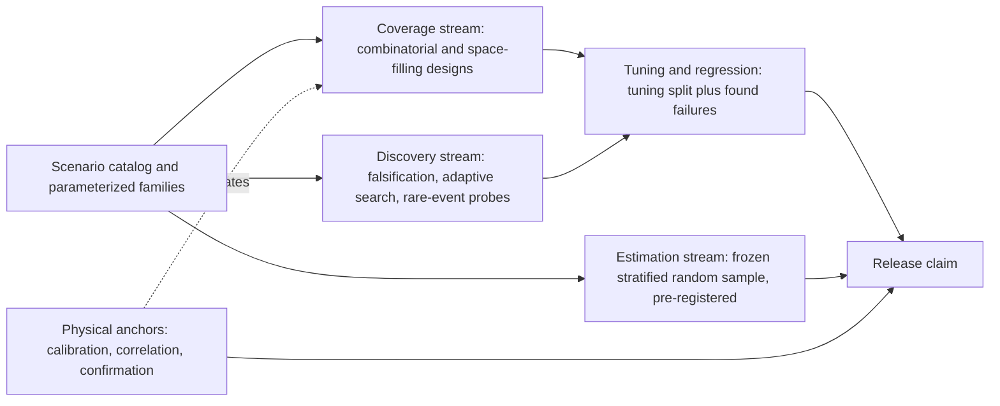

*The three streams in Chapter 9's campaign architecture: tuning draws only on the coverage and discovery streams, and the release claim is computed only on the frozen estimation sample plus the physical anchors.*

**Why it matters here.** The booklet lists "falsification and adaptive-search results cannot be used as rate estimates" among its well-established findings, and its campaign architecture states that the three streams never share data. Under a four-month deadline the temptation to count every run toward the release claim is strongest, which is why the separation is a governance rule and not only a statistical nicety [Chapter 9].

**Related terms.** [Falsification](#falsification-failure-seeking-search), [Random sampling, stratified sampling and probability-weighted sampling](#random-sampling-stratified-sampling-and-probability-weighted-sampling), [Hold-out set, tuning split and cross-validation](#hold-out-set-tuning-split-and-cross-validation), [Over-fitting](#over-fitting), [Pre-registration](#pre-registration), [Regression](#regression-a-new-version-performing-worse), [Campaign (test campaign) and campaign architecture](#campaign-test-campaign-and-campaign-architecture), [Test management](#test-management-versioning-and-the-traceability-chain), [versioning and the traceability chain for thousands of runs](#test-management-versioning-and-the-traceability-chain).

### Pre-registration

**In one sentence.** Pre-registration means writing down, before the data exist, exactly what will be claimed, how it will be measured, which samples will be used and when testing will stop, so that the analysis cannot be bent to fit the results.

**Explained.** In medical research, a trial registers its hypothesis, its main outcome and its sample size in advance. Otherwise a team could measure twenty outcomes, report the one that looks best, and stop recruiting on the day the numbers turn favorable. Each move inflates apparent success without anyone lying.

The booklet applies the same discipline to the braking system. Acceptance criteria, strata, confidence levels and stopping rules are fixed in the test plan before the hardware arrives. The estimation sample is drawn before tuning starts, with a fixed random seed and a content hash so that nobody can quietly swap cases. The weighting and the estimators are frozen before any results are inspected. Chapter 10 adds pre-registered acceptance criteria to the pre-hardware work, Chapter 12 asks that a pilot be predicted blind against pre-registered criteria, and Chapter 13 asks that the sensor-model correlation pilot be judged against pre-registered metrics [Chapter 9, Chapter 10, Chapter 12, Chapter 13].

Pre-registration has a cost. If the sensor types are decided late, after the strata and sample sizes are frozen, the strata that depend on sensor physics (dust, glare, rain) must be re-derived and the frozen sample redrawn, which costs calendar time inside the window [Chapter 9].

**Why it matters here.** A pre-registered plan is what allows an outside assessor to believe a result produced under schedule pressure. It is also the main protection against the quiet forms of over-fitting described in the next entries [Chapter 9].

**Related terms.** [Keeping failure-seeking tests separate from performance estimates](#keeping-failure-seeking-tests-separate-from-performance-estimates), [Acceptance criteria and pass or fail criteria](#acceptance-criteria-and-pass-or-fail-criteria), [Over-fitting](#over-fitting), [Hold-out set, tuning split and cross-validation](#hold-out-set-tuning-split-and-cross-validation), [Bayesian methods and sequential testing](#bayesian-methods-and-sequential-testing), [Independent review of the test plan](#independent-review-of-the-test-plan), [Sensor and prototype freeze (project milestones)](#sensor-and-prototype-freeze).

### Over-fitting

**In one sentence.** Over-fitting is what happens when a system's settings are adjusted so closely to the particular tests it was tuned on that it performs well on those tests and worse on anything new.

**Explained.** A student who memorizes last year's exam paper scores perfectly on that paper and poorly on this year's. The memorized answers fit the old questions, not the subject. In engineering and machine learning, over-fitting means the thresholds, filters or learned weights have absorbed the accidents of the tuning data (this site's berm height, that day's dust, the way one camera was mounted) rather than the general behavior the system must show everywhere.

For the braking system, the tuned quantities are detection thresholds, zone sizes, confirmation filters and timing constants. If engineers adjust them until every tuning scenario passes, the tuning scenarios no longer measure anything; they measure how well the settings fit themselves. The booklet's remedies are specific. Use grouped partitions, not random frame splits: hold out entire sites, weather episodes, machine identities or scenario families, because adjacent frames from the same run appearing in both tuning and validation sets create severe leakage. Keep a three-way split: a development or tuning set, a validation or confirmation set, and an untouched audit set. Use leave-one-site-type-out validation to test generalization to unseen sites. Limit how often the frozen set is queried, freezing it at a version and refreshing it only for a new release. Report tuned-set and frozen-set performance side by side; a large gap signals over-fitting [Chapter 9].

Over-fitting can also target the simulator rather than the test set. Chapter 13 describes "the function is overfitted to the simulator" as a project failure mode: virtual metrics keep improving while performance on held-out real data stalls or worsens. The remedy is independent withheld physical datasets and blind correlation tests [Chapter 13]. Chapter 9's tuning table rates the over-fitting risk of each method: low for physics-based parameterization whose inputs are measured independently, higher for evolutionary and cost-weighted optimization because many configurations are tried, and direct per-model manual tuning is described as susceptible to engineer and test-set over-fit and as recreating "the historical multi-year problem" [Chapter 9].

**Why it matters here.** Over-fitting is the central danger of tuning under time pressure, because a system that passes every known test looks finished. The booklet's protection is structural: a frozen, pre-registered audit set that the tuning team cannot see case by case, and physics-based parameters that are measured rather than fitted [Chapter 9].

**Related terms.** [Hold-out set, tuning split and cross-validation](#hold-out-set-tuning-split-and-cross-validation), [Keeping failure-seeking tests separate from performance estimates](#keeping-failure-seeking-tests-separate-from-performance-estimates), [Pre-registration](#pre-registration), [Data lineage and the independence rule](#data-lineage-and-the-independence-rule), [Transferring settings across machine models](#transferring-settings-across-machine-models-physics-based-parameterization-archetypes-partial-pooling-transfer-optimization), [Model validation versus model calibration](#model-validation-versus-model-calibration), [Training data, validation data, test data, and the independence rule (data lineage)](#training-data-validation-data-test-data-and-the-independence-rule-data-lineage), [Tuning thresholds in simulation before field tests](#tuning-thresholds-in-simulation-before-field-tests).

### Hold-out set, tuning split and cross-validation

**In one sentence.** A hold-out set is a portion of the test data kept back and never used for tuning, a tuning split is the division of data into parts for tuning, confirming and auditing, and cross-validation is the practice of rotating which part is held out so that every part is used for checking once.

**Explained.** A teacher writing a course keeps some exam questions secret. The students practice on the rest, and the secret questions show whether they learned the subject or memorized the practice set. The secret questions are the hold-out set.

The booklet's tuning split has three parts. The tuning set is where thresholds and filters are adjusted. The validation or confirmation set checks the chosen settings on data the tuning did not see and may be looked at many times. The audit set, also called the frozen test set, is untouched until the release candidate, queried rarely, and is the only basis for the release claim. The parts must be grouped, not random: whole sites, weather episodes, machine identities or scenario families go into one part or another [Chapter 9].

Cross-validation rotates the role: with five groups, the system is tuned on four and checked on the fifth, five times over, and the checks are averaged. "Leave-one-site-type-out" is the booklet's version for job sites. Nested cross-validation, where the choice of method is itself validated inside the loop, is the recognized way to remove the optimistic bias of repeated model selection in machine learning; the booklet calls the three-way split its engineering equivalent [Chapter 9].

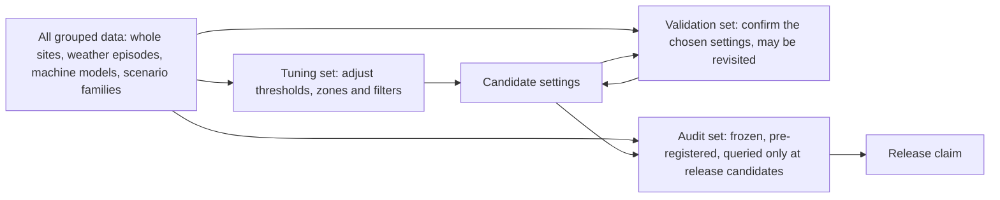

*The three-way split: settings move from tuning to confirmation and only then to the frozen audit set, which never feeds back into tuning.*

**Why it matters here.** The "reusable holdout" principle the booklet cites means the tuning team sees only aggregate pass or fail from the audit set. Whenever a failing audit case is examined and a threshold changed in response, that case is contaminated and should be retired and replaced [Chapter 9].

**Related terms.** [Over-fitting](#over-fitting), [Keeping failure-seeking tests separate from performance estimates](#keeping-failure-seeking-tests-separate-from-performance-estimates), [Pre-registration](#pre-registration), [Training data, validation data, test data, and the independence rule (data lineage)](#training-data-validation-data-test-data-and-the-independence-rule-data-lineage), [Held-out measurements and independent physical data](#held-out-measurements-and-independent-physical-data), [Data lineage and the independence rule](#data-lineage-and-the-independence-rule).

### Performance baseline

**In one sentence.** A performance baseline is a careful measurement of how well the existing warning-only system performs, made before the new braking system is judged, so that "better" has something to be better than.

**Explained.** Before starting a training program, an athlete records their current times. Without that record, nobody can say later whether the program worked. The baseline is that record for the warning system the manufacturer already sells.

Chapter 7 sets out how to build it. The unit of analysis is the encounter, not the frame: "machine A approached object B under scenario C while the object occupied or approached a defined risk region". Each encounter carries its factors: machine model and configuration, sensor mounting, object class, direction, speed, grade, surface, load, weather, light, dust and site type. The risk region should follow ISO 21815-3 (a standard from the International Organization for Standardization on collision warning risk areas for earth-moving machinery), not an arbitrary sensor range [Chapter 7].

The recommended measures fall into four groups. Detection: probability of detection per encounter, broken down by object class (a worker standing, crouching or lying; a light vehicle; another machine), by distance band, by bearing and by condition, plus first-detection distance and time and missed encounters, reported as curves or bins rather than one fleet-wide average that hides weak conditions. False and nuisance warnings: per operating hour, split into false (no object), nuisance (a real object but no risk, such as the machine's own tires or a berm) and correct, because these are different engineering problems. Warning timing: time to collision or distance at first warning, detection latency, warning duration and repeated warnings. Availability: time in normal, degraded, inhibited and fault states, since an impressive detection rate measured only while "available" can hide unavailability [Chapter 7].

The established way to measure all this without driving the machine is to replay recorded raw sensor logs against an independent ground truth. The baseline is only as good as what was recorded, and using the detector's own output as truth is circular: objects it missed vanish from both the prediction and the "truth". That is why the booklet says recording must start now, in October 2026, not when the prototype arrives. Measures of the braking function itself (brake-request time, achieved deceleration, stopping distance, false interventions) cannot be measured on the old system and are judged against new requirements instead [Chapter 7].

How much data is needed follows the claim, exactly as in the sample-size entry: 59 consecutive successful encounters per stratum for 95 percent detection, 299 for 99 percent, and 30 failure-free hours per condition to show fewer than 0.1 false alarms per hour. No standard sets these numbers [Chapter 7].

**Why it matters here.** The baseline is also the source of the field distribution that every rate claim must be weighted by, and the only real exposure and false-alarm data the program will have. Chapter 7 calls parallel recording on current machines "the single most valuable pre-hardware action" [Chapter 7].

**Related terms.** [Fair comparison of old and new systems](#fair-comparison-of-old-and-new-systems), [Ground truth](#ground-truth), [Replay and re-simulation of recorded data (open-loop replay)](#replay-and-re-simulation-of-recorded-data-open-loop-replay), [Data logging](#data-logging-what-to-record-on-the-machine-raw-versus-processed-data-common-mistakes), [Base rate and exposure-based rates](#base-rate-and-exposure-based-rates-events-per-1000-hours), [Warning-system fleet](#warning-system-fleet), [Key performance indicator (KPI) and metric](#key-performance-indicator-kpi-and-metric), [ISO 21815 series](#iso-21815-series-collision-warning-and-avoidance), [Collision Warning System (CWS) and Collision Avoidance System (CAS)](#collision-warning-system-cws-and-collision-avoidance-system-cas).

### Fair comparison of old and new systems

**In one sentence.** A fair comparison judges the old warning system and the new braking system on the same hazards, in the same conditions, using the same yardstick, so that any difference is due to the systems and not to the circumstances.

**Explained.** Comparing two runners by their times on different days and tracks proves nothing; put them in the same race and the comparison is fair. The booklet's rule is to compare "at the highest common layer that still answers the safety question", which, when sensors or mounting positions differ, is the externally measured encounter rather than the raw sensor data [Chapter 7].

Directly comparable, according to Chapter 7: system-level outputs against the same ground truth (warnings and interventions per hazard, missed hazards, false and nuisance alarms per hour, warning timing); results restricted to a common zone such as the ISO 21815-3 risk area rather than each sensor's field of view; and paired results from parallel recording on the same machine, the only setting in which paired tests such as McNemar's test are valid. Not comparable: raw detection internals such as radar detections against camera boxes, coverage outside the overlap of the two fields of view, and conditions that only one system was recorded in [Chapter 7].

Two practical rules follow. Range must be normalized to hazard geometry, as separation from the machine's swept envelope or entry into a standard risk region; otherwise a sensor mounted 3 meters farther forward appears to have a longer warning range while the safety margin is identical. And old logs cannot simply be replayed into a system with new sensor types or positions; neural re-rendering of recorded scenes degrades once the viewpoint moves 1 to 4 meters from the recorded path, so re-rendered data is a development aid, not validation evidence [Chapter 7].

**Why it matters here.** The new system adds braking, which the old one lacks, so only the common warning stage can be compared with the baseline; the braking stage is assessed against requirements in closed loop. The strongest experiment is simultaneous collection: both sensor suites on one machine, judged against one independent reference trajectory [Chapter 7].

**Related terms.** [Performance baseline](#performance-baseline), [Hypothesis testing basics](#hypothesis-testing-basics-null-hypothesis-significance-mcnemar-test), [Shadow mode (silent testing)](#shadow-mode-silent-testing), [Ground truth](#ground-truth), [Replay and re-simulation of recorded data (open-loop replay)](#replay-and-re-simulation-of-recorded-data-open-loop-replay), [Open loop versus closed loop](#open-loop-versus-closed-loop), [Neural rendering: NeRF and Gaussian splatting (3DGS)](#neural-rendering-nerf-and-gaussian-splatting-3dgs-as-ways-to-rebuild-a-scene-from-photos), [Zones (warning zone, braking zone, detection zone) and their geometry](#zones-warning-zone-braking-zone-detection-zone).

### Regression (a new version performing worse)

**In one sentence.** A regression is a case that used to pass and now fails after a change to the software or the settings, and regression testing is the habit of rerunning a fixed set of cases after every change to catch exactly that.

**Explained.** A plumber who fixes a leak under the sink and thereby cuts off the hot water has caused a regression. The fix worked; something else broke. Software and calibration changes do this constantly: a threshold lowered to catch one missed worker may now brake for every berm.

In the booklet, requirement and regression testing is one of the three campaign classes: deterministic pass-or-fail cases tied to individual requirements, rerun continually, answering "did this software or calibration change break a required behavior?" Every failure found by search becomes a permanent regression test. Chapter 9 describes a layered rhythm: a fast "smoke" subset of software-in-the-loop runs on every code change; a small mandatory safety regression set on every eligible build; larger virtual campaigns overnight or at release gates; hardware-in-the-loop and physical confirmation chosen by risk. A change-impact graph picks the scenarios a change touches: a brake-model change selects stopping-margin scenarios, a perception change selects everything downstream of detections [Chapter 9].

Two rules protect the statistics. The frozen estimation set is run only at release candidates, never continuously rerun and optimized against. And a late change to a safety-relevant decision threshold triggers a new independent statistical confirmation for the affected claim, not merely a rerun of the failures that caused the change [Chapter 9]. ("Regression" also names a statistical technique for fitting lines to data; the booklet uses the testing sense.)

**Why it matters here.** In a four-month window with many late corrections, regression testing keeps a fix in one stratum from silently undoing a pass in another. Chapter 1 cautions that running millions of regression tests does not show that the test set represents the real operating domain [Chapter 1, Chapter 9].

**Related terms.** [Regression testing and continuous integration (CI/CD) for simulation](#regression-testing-and-continuous-integration-cicd-for-simulation), [Keeping failure-seeking tests separate from performance estimates](#keeping-failure-seeking-tests-separate-from-performance-estimates), [Falsification](#falsification-failure-seeking-search), [Requirements and requirements-based testing](#requirements-and-requirements-based-testing), [Software-in-the-loop (SIL)](#software-in-the-loop-sil), [Test management](#test-management-versioning-and-the-traceability-chain), [versioning and the traceability chain for thousands of runs](#test-management-versioning-and-the-traceability-chain).

### Key performance indicator (KPI) and metric

**In one sentence.** A metric is any quantity you measure, and a key performance indicator (KPI) is a metric that has been chosen, with a target value, to judge whether the system or the project is succeeding.

**Explained.** A car's dashboard shows many metrics: speed, engine temperature, fuel level. A delivery company's KPI might be "on-time deliveries per week", a chosen metric with a target. Metrics describe; KPIs judge.

For the braking system, the booklet's verdict functions should record far more than "collision or no collision": first valid detection, time to collision at detection, intervention time, stopping margin, closest approach, false-warning duration, unnecessary braking, deceleration and jerk, sensor degradation state and the operator-warning sequence [Chapter 9]. From these the KPIs are drawn: detection rate per encounter by stratum, false warnings per operating hour, unnecessary brake events per hour, intervention timing and productivity loss. Chapter 3 found a gap: a few scenario-level performance values exist in off-road standards, but fleet-statistical KPIs such as detection rate in the field and false alarms per operating hour appear in no off-road standard or regulation, so the program must define and defend its own [Chapter 3, Chapter 9].

KPIs can mislead. A "no false brakes" KPI creates the wrong incentive, because suppressing nuisance interventions can increase late or missed braking; a detection-only KPI can produce a system that stops production. The booklet asks for joint safety and productivity criteria [Chapter 9]. Chapter 2 notes that Euro NCAP's virtual-testing regime requires KPIs with tolerances as part of the dossier [Chapter 2].

**Why it matters here.** The KPIs chosen before testing are the pre-registered claims; the metrics recorded in every run are the raw material for any claim the program may need later.

**Related terms.** [Acceptance criteria and pass or fail criteria](#acceptance-criteria-and-pass-or-fail-criteria), [Base rate and exposure-based rates](#base-rate-and-exposure-based-rates-events-per-1000-hours), [Constrained multi-objective optimization](#constrained-multi-objective-optimization), [Pre-registration](#pre-registration), [True positive rate, precision, recall, F1 score](#true-positive-rate-precision-recall-f1-score), [Euro NCAP](#euro-ncap-and-its-virtual-testing-protocol), [Performance baseline](#performance-baseline).

### Constrained multi-objective optimization

**In one sentence.** Constrained multi-objective optimization is the task of choosing settings that do well on several goals at once (few misses, few false alarms, few unnecessary brakes, little lost production) while never violating certain hard limits.

**Explained.** Planning a family holiday involves several goals: low cost, short travel, good weather, something for everyone. Some are hard limits: the budget cannot exceed a fixed sum and the dates are fixed. Within those limits you trade the others off. You cannot maximize all of them, and adding them into one score ("holiday points") hides the real choice.

Tuning the braking system has the same shape. The settings (decision variables) are detection confidence thresholds, warning and brake zone dimensions per speed, track-confirmation filters that require N detections in M frames, persistence and debounce times, time-to-collision triggers and filter constants. The outcomes are missed or late interventions, false warnings per hour, unnecessary brake events per hour, intervention timing (too early or too late) and productivity loss from time stopped [Chapter 9].

The booklet's guidance is a hierarchy, not a formula. First, impose hard safety constraints: a minimum stopping margin, a maximum permitted miss probability (for example zero misses in critical scenarios), a maximum intervention latency and required coverage of particular hazardous scenarios. Second, within the settings that satisfy those constraints, minimize false warnings, unnecessary brakes, discomfort and productivity loss. Third, keep the Pareto frontier visible so that engineers and safety authorities can see exactly what is traded. The booklet warns against beginning by adding all outcomes into one weighted cost, because the safety objectives have different meanings; a cost-weighted objective needs an explicit price for a miss against a nuisance brake, which is a safety-policy decision to be documented, not hidden in weights, and sensitivity analysis on the weights is mandatory. Constraint-based wording ("minimize nuisance subject to miss rate at most the bound") is easier to defend [Chapter 9].

Two refinements matter on a mine site. Robust or worst-case optimization optimizes the worst stratum or a high percentile rather than the average, so that a setting does not buy good average performance with a weak dust-at-night stratum. And when several settings perform similarly, the booklet prefers the one in a broad stable region over a knife-edge optimum that fails after a small sensor misalignment, a brake-temperature shift or a change in dust [Chapter 9].

**Why it matters here.** The old process tuned each machine model by hand over years. The booklet's position is that tuning should be formulated once, as this constrained problem, and solved with methods that scale across machine models and keep the safety trade-off visible to the people accountable for it. It also notes that over-fitting risk rises with the number of configurations tried, so the final point must be chosen with pre-declared constraints and confirmed on an independent set [Chapter 9].

**Related terms.** [Pareto front and trade-off](#pareto-front-and-trade-off), [Optimization methods named in the booklet](#optimization-methods-named-in-the-booklet-genetic-algorithms-nsga-ii-bayesian-optimization-gradient-free-search), [Thresholds and filters (confirmation logic, persistence, hysteresis, risk determination)](#thresholds-and-filters), [Zones (warning zone, braking zone, detection zone) and their geometry](#zones-warning-zone-braking-zone-detection-zone), [Human factors as a tuning objective](#human-factors-as-a-tuning-objective), [Over-fitting](#over-fitting), [Key performance indicator (KPI) and metric](#key-performance-indicator-kpi-and-metric), [Decision logic (when to warn, when to brake)](#decision-logic-when-to-warn-when-to-brake).

### Pareto front and trade-off

**In one sentence.** A trade-off is a situation where improving one goal worsens another, and the Pareto front is the set of settings where no goal can be improved any further without making some other goal worse.

**Explained.** Among all the cars on sale, consider price and fuel economy. Some cars are beaten on both counts by another car and are not worth considering. The ones that remain, where any cheaper car uses more fuel and any thriftier car costs more, form the Pareto front, named after the economist Vilfredo Pareto. Choosing among them is a matter of values, not arithmetic.

Imagine three candidate settings, all with zero misses in the critical scenarios. Setting A brakes unnecessarily 2 times per 100 hours and stops with a generous margin. Setting B brakes unnecessarily 0.5 times per 100 hours but stops with a thinner margin. Setting C brakes unnecessarily 1 time per 100 hours with a margin thinner than A's. C is worse than A on margin and worse than B on nuisance, so it is dominated and discarded. A and B are both on the front; choosing between them is a safety-policy decision.

The booklet asks that the front be preserved and shown rather than collapsed into one weighted score. Evolutionary methods such as NSGA-II produce the whole front in one run but "leave a policy decision over which Pareto point is acceptable". The booklet treats that as a feature: the trade-off becomes a documented decision by the safety authority rather than a hidden weight chosen by an engineer [Chapter 9].

**Why it matters here.** Chapter 9 observes that a "no false brakes" target or a detection-only target each produce a bad system; only an explicit Pareto view keeps safety and productivity both in sight. Chapter 4's evidence that operators switch off systems with too many unnecessary stops is why the nuisance axis carries safety weight [Chapter 4, Chapter 9].

**Related terms.** [Constrained multi-objective optimization](#constrained-multi-objective-optimization), [Optimization methods named in the booklet](#optimization-methods-named-in-the-booklet-genetic-algorithms-nsga-ii-bayesian-optimization-gradient-free-search), [Human factors as a tuning objective](#human-factors-as-a-tuning-objective), [Nuisance braking (unnecessary intervention, false intervention)](#nuisance-braking), [Residual safe distance (clearance left when the machine stops)](#residual-safe-distance), [Key performance indicator (KPI) and metric](#key-performance-indicator-kpi-and-metric).

### Optimization methods named in the booklet (genetic algorithms, NSGA-II, Bayesian optimization, gradient-free search)

**In one sentence.** These are the search procedures the booklet names for finding good settings when the only way to judge a setting is to run it through a slow simulation and see what happens.

**Explained.** Finding the best settings is like finding the highest point in hilly country while blindfolded. If the ground is smooth, you can feel which way is uphill; that is gradient-based search. If the ground is full of cliffs and steps, as pass-or-fail outcomes are, the slope tells you nothing, and you need gradient-free search: methods that only compare the heights of points they have visited. All the methods below are gradient-free, which suits closed-loop braking tests, where the result jumps from "stopped in time" to "collision" at a threshold.

Genetic algorithms, also called evolutionary methods, keep a population of candidate settings, score each by simulation, keep the better ones, and breed new candidates by mixing and slightly altering the survivors. NSGA-II (Non-dominated Sorting Genetic Algorithm II, Deb and colleagues, 2002) is the version for several objectives at once; it evolves the whole Pareto front. The booklet rates these methods robust and easy to run in parallel, but hungry for evaluations [Chapter 9].

Bayesian optimization is for expensive evaluations, such as hardware-in-the-loop or physical runs. It fits a surrogate model to the results so far, uses the model's uncertainty to pick the most informative next setting, runs it, and repeats. Multi-objective variants seek the frontier, and "safe" variants keep exploration inside settings believed safe. Its weaknesses are surrogate error, poor scaling beyond roughly 20 parameters, trouble around discontinuities, adaptive bias, and the danger that an apparently safe extrapolation is wrong [Chapter 9].

The booklet also names response-surface methods for a handful of smooth parameters, and ROC (receiver operating characteristic) operating-point selection for the detector threshold alone, which must be followed by closed-loop evaluation because it ignores braking timing [Chapter 9].

**Why it matters here.** The booklet's tuning table matches each method to a job: response surfaces for a few continuous constants, evolutionary methods for the misses-against-nuisance-against-margin trade-off in simulation, Bayesian optimization for expensive rigs. None has a published off-road braking application [Chapter 9].

**Related terms.** [Constrained multi-objective optimization](#constrained-multi-objective-optimization), [Pareto front and trade-off](#pareto-front-and-trade-off), [Design of experiments (DOE)](#design-of-experiments-doe), [Adaptive and Bayesian test selection](#adaptive-and-bayesian-test-selection), [Falsification](#falsification-failure-seeking-search), [ROC curve and DET curve](#roc-curve-and-det-curve), [Over-fitting](#over-fitting).

### Human factors as a tuning objective

**In one sentence.** Treating human factors as a tuning objective means counting the rate of unnecessary warnings and brakes as a safety goal in its own right, because operators who are interrupted too often stop trusting the system and start disabling it.

**Explained.** A car alarm that goes off every time a truck passes is soon ignored by the whole street, and on the one night it matters, nobody looks. If the braking system stops a loader for every berm and every spotter, the operator will find a way around it, and the protection is gone precisely when it is needed.

The booklet's evidence is direct. In a seven-day test by NIOSH (the United States National Institute for Occupational Safety and Health) of a radar warning system on a Caterpillar 793B haul truck, 580 alarms sounded in 618 reversals; 18 percent were false, 42 percent were nuisance alarms about objects the driver already knew of, and only 41 percent warranted action. Researchers found the audible warning disabled after shifts. Of another radar trial on the same truck type, NIOSH reported that "Occasional false alarms did occur, but not frequently enough to cause the system to be ignored" [Chapter 4, Chapter 9]. Underground, stop-capable systems were reported to shut down vehicles "anywhere from once a day up to 15 times during a single cut of coal", and one fatal accident investigation found 87 prior activations of the deceased worker's override [Chapter 4].

From this the booklet draws a tuning rule: the nuisance rate is a safety objective, not only a comfort one, and belongs among the optimization goals with the misses. ISO 16001 (the object-detection standard for earth-moving machinery) requires that the warning cannot be disabled by a single action. No study defines a false alarm rate that off-road operators will accept; the useful measures are unnecessary warnings or interventions per operating hour, per loading cycle and per reverse maneuver [Chapter 4, Chapter 9].

**Why it matters here.** A system tuned only for zero misses will be switched off; a system tuned only for zero nuisance will miss. The booklet's answer is the constrained multi-objective formulation, with the human-factors rate on one axis of the Pareto front [Chapter 9].

**Related terms.** [Alarm fatigue](#alarm-fatigue), [False alarm (nuisance alarm) and alarm accuracy](#false-alarm-and-alarm-accuracy), [Nuisance braking (unnecessary intervention, false intervention)](#nuisance-braking), [Switching off and bypassing (defeating a safety system)](#switching-off-and-bypassing), [Human factors](#human-factors), [Constrained multi-objective optimization](#constrained-multi-objective-optimization), [Base rate and exposure-based rates](#base-rate-and-exposure-based-rates-events-per-1000-hours), [Pareto front and trade-off](#pareto-front-and-trade-off).

### Transferring settings across machine models (physics-based parameterization, archetypes, partial pooling, transfer optimization)

**In one sentence.** Transferring settings means getting a braking system tuned on one machine model to work on another, with a different size, mass and sensor layout, by expressing the settings in physical terms that can be measured on each machine instead of re-tuning each one by hand.

**Explained.** A tailor does not design a new suit from scratch for each customer; the pattern stays the same and the measurements change. Physics-based parameterization applies that idea: instead of storing "brake at 8 meters" for one loader and "brake at 11 meters" for a bigger one, the system stores the rule that produces those numbers from measurable quantities.

The booklet anchors the rule in ISO 21815-3:2023, which links collision-risk areas to the machine's kinematics and dimensions and defines the avoidance distance through detection, decision and action time, stopping distance and a safety distance. The common engineering form is `required detection distance = v × (t_detect + t_decision + t_actuation) + v^2 / (2 × a_brake) + machine-envelope offset + margin`. Here v is speed, the three t values are the times to detect, decide and act (t_detect is capped at 300 milliseconds by ISO 16001), a_brake is the braking deceleration, which depends on mass, slope and surface, and the offset accounts for the machine's own extent. Each machine model then supplies measured data (footprint, sensor positions and fields of view, stopping curves by grade and load, latencies) instead of tuned constants [Chapter 9].

Three further tools handle what physics leaves over. Archetypes group machines by the features that affect collision behavior (kinematics, mass and braking regime, footprint, sensor arrangement), not by marketing names; a new model is seeded from its archetype, calibrated with a small test set, and confirmed at its boundaries. Partial pooling, through hierarchical models, estimates a population-level response plus per-model deviations, borrowing strength across similar machines while keeping uncertainty for sparsely tested ones; it does not prove that a loader and an excavator are exchangeable. Transfer and multi-task Bayesian optimization use the tuned model as a prior and search only the residual parameters on a new model; negative transfer is possible when machines differ a lot, and safe multi-task optimization remains research [Chapter 9].

**Why it matters here.** Per-model tuning is what made the old process take years. The booklet's position is to transfer settings through physics, not copied constants, while warning that no published ISO rule says testing N representative machines validates a family, so some confirmation evidence is needed for every safety-relevant variant [Chapter 9].

**Related terms.** [Variant management](#variant-management), [Equivalence argument (similarity argument) between machine variants](#equivalence-argument-between-machine-variants), [Required detection range](#required-detection-range), [Stopping distance and the formula d = v^2 / (2a)](#stopping-distance), [ISO 21815 series](#iso-21815-series-collision-warning-and-avoidance), [Proven in use and reuse of evidence (across machine models)](#proven-in-use-and-reuse-of-evidence), [Bayesian methods and sequential testing](#bayesian-methods-and-sequential-testing), [Design of experiments (DOE)](#design-of-experiments-doe).

### Variant management

**In one sentence.** Variant management is the discipline of keeping track of every version of the machine, its sensors and its settings, so that the right evidence is attached to the right variant and a change to one does not silently invalidate another.

**Explained.** A bakery that sells one cake in twelve sizes and three flavors has 36 variants, and a change to one flavor's recipe must not be applied to the others by mistake. Heavy machines come in many models, each with options, attachments, sensor positions and software versions, and each combination may behave differently in a collision.

The booklet treats sensor placement as a primary source of model-to-model difference. NIOSH found that a single rear radar missed people near the rear tires of a haul truck, and that two antennas mounted about 1.8 meters apart with beams crossed inward at about 20 degrees improved detection there; the booklet recommends simulating blind-spot maps per model before building. Viewpoint changes matter too: a mining dataset (SimMining-3D, 2024) was built because changes in sensor height on mine benches degraded 3D detection, so a new mounting height may need retraining of the detector, not only new thresholds [Chapter 9].

The management approach is a common core plus a per-model calibration dataset under configuration control, using feature-model or variant tools (commercial, open-source or in-house), with every calibration value traced to its measurement. The machine coverage hierarchy for the four-month window is: all models virtually; all materially different hardware on hardware-in-the-loop rigs where possible; representative and boundary archetypes physically; and a small confirmation on every released model and configuration [Chapter 9]. Chapter 3 notes that the predicted-performance-plus-random-physical-verification structure of on-road regimes maps directly onto variant management [Chapter 3].

**Why it matters here.** Reuse of evidence across machine models is, in the booklet's words, the biggest lever and the least documented: Chapter 7 found no published method for transferring results across variants with different sizes and sensor positions [Chapter 1, Chapter 7].

**Related terms.** [Transferring settings across machine models](#transferring-settings-across-machine-models-physics-based-parameterization-archetypes-partial-pooling-transfer-optimization), [Equivalence argument (similarity argument) between machine variants](#equivalence-argument-between-machine-variants), [Calibration (intrinsic and extrinsic) and sensor mounting](#calibration-intrinsic-and-extrinsic-and-sensor-mounting), [Blind spot and operator visibility](#blind-spot-and-operator-visibility), [Test management](#test-management-versioning-and-the-traceability-chain), [versioning and the traceability chain for thousands of runs](#test-management-versioning-and-the-traceability-chain), [Data lineage and the independence rule](#data-lineage-and-the-independence-rule), [Proven in use and reuse of evidence (across machine models)](#proven-in-use-and-reuse-of-evidence).

### Data lineage and the independence rule

**In one sentence.** Data lineage is the recorded history of where every piece of data came from and what was done to it, and the independence rule says that the data used to judge a system must have had no part in building or tuning it.

**Explained.** An examiner must not have coached the candidate. If the same person wrote the practice questions and the exam, nobody can tell whether the candidate learned anything. Data lineage is the paper trail that proves who wrote what; the independence rule is the ban on coaching.

Part C of this glossary describes the rule from the machine-learning side. From the test-design side, Chapter 9 states it for the whole program: validation and estimation data must be real or physically independent of whatever generated the training data, with different 3D assets, sites, people and generator, all documented in a data-lineage record. Validation is contaminated when the same simulator assets or generative model are used for training and testing, because the detector may have learned the generator's quirks rather than the world. The booklet notes that this is consistent with the data-centric lifecycle in ISO/PAS 8800:2024, a road-vehicle publication on safety and artificial intelligence [Chapter 9].

The same rule governs tuning without machine learning. Grouped splits keep whole sites and weather episodes on one side of the line; the audit set is drawn before tuning with a fixed seed and content hash; and every executed run carries a provenance manifest listing, among other things, the requirement, hazard, scenario-family version, parameter vector, machine and sensor configuration, software build, simulator version, random seed, raw-data checksums and verdict. That manifest lets an assessor check, months later, that no estimation case ever touched the tuning loop [Chapter 9].

**Why it matters here.** The booklet's recommended loop is anchored in real data: real off-road logs feed the distributions, targeted gaps are synthesized, the detector is trained, and it is tested on untouched real data. Without lineage, "untouched" cannot be proven [Chapter 9].

**Related terms.** [Training data, validation data, test data, and the independence rule (data lineage)](#training-data-validation-data-test-data-and-the-independence-rule-data-lineage), [Hold-out set, tuning split and cross-validation](#hold-out-set-tuning-split-and-cross-validation), [Over-fitting](#over-fitting), [Synthetic and generated training data (domain gap, data augmentation)](#synthetic-and-generated-training-data-domain-gap-data-augmentation), [Test management](#test-management-versioning-and-the-traceability-chain), [versioning and the traceability chain for thousands of runs](#test-management-versioning-and-the-traceability-chain), [Data storage, data lineage and record keeping for thousands of runs](#data-storage-data-lineage-and-record-keeping-for-thousands-of-runs), [Traceability](#traceability).

### Scenario description languages (OpenSCENARIO, DSL)

**In one sentence.** A scenario description language is a formal written format for describing a test situation (who is where, moving how, under what conditions) so that a computer can generate and run it, and a domain-specific language (DSL) is a small programming language built for one subject area.

**Explained.** A recipe in plain prose can be read by a person; a recipe in a strict format can be executed by a machine. Where a catalog says "machine reverses toward a worker emerging from behind a stockpile in dust", a scenario language fixes positions, speeds, triggers and parameter ranges in a form a simulator can read.

The booklet reviews the main options. ASAM OpenSCENARIO XML (version 1.4.0, 2026; ASAM is the Association for Standardization of Automation and Measuring Systems) describes precise, synchronized maneuvers for road vehicles tied to road networks; its off-road fit is rated poor to moderate. ASAM OpenSCENARIO DSL (version 2.2.0, March 2026) makes abstract and logical scenarios, parameter variation and key performance indicators first-class concepts, which suits scenario families, but its domain model is on-road and tool support is limited; the fit is moderate. ASAM's own off-road work identified missing concepts for deformable terrain, airborne particles, vegetation, heavy-machine manipulation and sensor degradation. Scenic 3 (peer-reviewed, 2023) is an open-source probabilistic language with native 3D geometry, occlusion-aware visibility and placement without lanes; its fit is rated good, but it is not an ISO or ASAM standard [Chapter 9].

The booklet's position is to encode the catalog in a domain-neutral, version-controlled form, either Scenic or an in-house YAML schema with an OpenODD-style taxonomy, owned by the manufacturer, and to export to OpenSCENARIO for tools that need it. No off-road scenario standard was found in development that could arrive before mid-2027 [Chapter 9].

**Why it matters here.** The language determines whether thousands of concrete tests can be generated, varied and traced automatically. One built for roads would force every pit, bench and stockpile into a lane-based model that does not fit [Chapter 9].

**Related terms.** [Scene description standards: OpenUSD, OpenDRIVE, OpenCRG, OpenSCENARIO, OpenLABEL, OpenODD, OpenXOntology](#scene-description-standards-openusd-opendrive-opencrg-openscenario-openlabel-openodd-openxontology), [Scenario (functional, logical, concrete)](#scenario-functional-logical-concrete), [Scenario catalog, scenario family and scenario parameter](#scenario-catalog-scenario-family-and-scenario-parameter), [Operational design domain (ODD) and operating-domain taxonomy](#operational-design-domain-odd-and-operating-domain-taxonomy), [Falsification](#falsification-failure-seeking-search), [Scenario generation and test management tools](#scenario-generation-and-test-management-tools), [Parameter, parameter range and parameterized scenario family](#parameter-parameter-range-and-parameterized-scenario-family).

### Campaign (test campaign) and campaign architecture

**In one sentence.** A test campaign is a planned set of test runs executed together for one purpose, and the campaign architecture is the overall arrangement of campaigns, in time and by purpose, that turns a limited window into a defensible safety claim.

**Explained.** An election campaign is not one speech but a coordinated series of events with a date and a goal. A test campaign is the same: not one run, but hundreds or thousands, planned to answer one question, with a defined start, end and verdict. The booklet distinguishes campaigns by what they can claim (coverage, discovery, estimation, regression) and insists that the different kinds never share data.

The campaign architecture for the four-month window has two halves. Before the prototype arrives (October 2026 to mid-2027): freeze a machine-readable requirement, hazard and scenario hierarchy; build the operating-domain taxonomy and logical scenario families; write the pre-registered statistical plan (claims, strata, confidence levels, stopping rules); engage a notified body early; start shadow-mode logging on the existing warning fleet now and ingest years of its logs to estimate the operational distribution; measure braking curves, latencies, footprints and sensor positions on current machines; pre-build a simulator-independent scenario library, a campaign generator and automated verdict functions; and build paired simulation-to-real correlation tests, hardware-in-the-loop (HIL) rigs and a dry run of the tuning pipeline on the warning-only system [Chapter 9].

After the prototype arrives, about 16 weeks run as a funnel of eight steps: integration smoke tests and safety-envelope checks; calibration with modest design-of-experiments tests; a broad virtual campaign of combinatorial coverage across the logical space; failure search around stopping boundaries, partial visibility, high closing speed, field-of-view edges and sensor degradation; physical confirmation of important virtual failures, updating simulator discrepancy models rather than tuning the simulation to match; frozen tuning of the final settings; a statistical audit on the pre-declared sample without tuning, which produces the detection and false-intervention claims; and impact-selected regression after any late correction [Chapter 9].

Two tests keep the architecture honest. For every physical run: does it estimate a population rate, identify a model parameter, validate simulation fidelity, confirm a boundary or satisfy a deterministic requirement? Runs with no evidentiary role should not consume the window. And the compute needed (about 6,000 zero-miss trials for 20 strata plus hundreds of exposure hours, "thousands of runs per night") has not been quantified and should be budgeted before mid-2027 [Chapter 9].

**Why it matters here.** No published off-road program has compressed collision-avoidance validation from three or four years to under four months. The booklet judges the window credible only if most of the work happens before the hardware arrives, and the campaign architecture is the shape that work must take [Chapter 9].

**Related terms.** [Keeping failure-seeking tests separate from performance estimates](#keeping-failure-seeking-tests-separate-from-performance-estimates), [Validation window (the under-four-month window after the prototype arrives)](#validation-window), [Pre-registration](#pre-registration), [Regression](#regression-a-new-version-performing-worse), [Falsification](#falsification-failure-seeking-search), [Combinatorial testing](#combinatorial-testing-t-way-testing-pairwise-testing-covering-arrays), [Shadow mode (silent testing)](#shadow-mode-silent-testing), [Correlation test](#correlation-test), [Hardware-in-the-loop (HIL) with data injection](#hardware-in-the-loop-hil-with-data-injection), [Test management](#test-management-versioning-and-the-traceability-chain), [versioning and the traceability chain for thousands of runs](#test-management-versioning-and-the-traceability-chain), [Compute cost and run time](#compute-cost-and-run-time).

## Part G: Trusting a simulation: credibility, correlation and uncertainty

A simulation is trusted only within the envelope where it has been checked against reality. This part explains the frameworks that aerospace, medicine, nuclear power, rail and car regulation use to decide when a model is credible, the metrics used to compare simulated and measured results, and the documented cases where simulation gave false confidence. It ends with what a safety board or outside assessor expects to see.

### Credibility of a simulation

**In one sentence.** The credibility of a simulation is the degree to which a decision maker can trust its results enough to act on them, and it is earned with evidence, not with realistic-looking pictures.

**Explained.** A flight simulator in a shopping mall looks like a cockpit and feels convincing, but nobody earns a pilot's license on it. An airline training simulator may look less exciting, yet pilots who pass on it fly passengers. The difference is not realism. It is credibility: documented proof that the simulator behaves like the real aircraft for the decisions it supports.

A simulation is a computer program that imitates how a machine, a sensor or an environment behaves. "It looks right" is weak evidence, because a simulation can be visually convincing and physically wrong at the same time. Credibility rests on a set of questions instead. What exactly is the simulation being used to decide? How bad would a wrong decision be? Has the program been checked for errors? Have its outputs been compared with measurements from the real machine, in the conditions that matter? How large is the remaining uncertainty? Has someone independent reviewed all this? Where does the evidence stop? Every industry the booklet examined, from space flight to medical devices, nuclear power, aviation, rail and road vehicles, asks these same questions in different words [Chapter 10].

Two consequences follow. Credibility belongs to a combination: this version of this model, with these inputs, for this decision, inside this range of conditions. No commercial package, open-source simulator or digital twin is credible on its own. And credibility is not one number; the space agency standard refuses to add its credibility factors into a single score, because a high mark in one area can hide a weak validation in another [Chapter 10].

Example: a simulated haul truck stops in 42 m from 30 km/h on a wet ramp. That number is credible for a braking decision only if the brake model was compared with real stops on a similar truck, surface and speed, and the measured disagreement plus the remaining uncertainty is smaller than the safety margin the decision needs.

**Why it matters here.** The manufacturer has never used simulation as safety evidence, and the booklet's hostile review ranks "the simulator has not earned the right to replace physical evidence" as the strongest objection to the plan [Chapter 13]. Credibility work must be finished before the prototype arrives in mid-2027, or the four-month window becomes the first attempt at simulation methodology rather than a confirmation campaign [Chapter 10].

**Related terms.** [Verification, validation and uncertainty quantification (VVUQ)](#verification-validation-and-uncertainty-quantification-vvuq), [Context of use and question of interest](#context-of-use-and-question-of-interest), [Model risk: influence times consequence](#model-risk-influence-times-consequence), [Credibility factors and credibility levels](#credibility-factors-and-credibility-levels), [Validity envelope (domain of validity) and extrapolation](#validity-envelope-domain-of-validity-and-extrapolation), [Simulation and simulator](#simulation-and-simulator), [Virtual validation (virtual testing)](#virtual-validation-virtual-testing), [Safety case and safety argument](#safety-case-and-safety-argument), [Evidence](#evidence).

### Verification, validation and uncertainty quantification (VVUQ)

**In one sentence.** VVUQ is the three-part discipline of checking that a simulation program is built correctly (verification), that it matches the real world (validation), and how much its answers could still be wrong (uncertainty quantification).

**Explained.** Think of a recipe. Verification asks: did I follow the recipe exactly, with no steps skipped and no quantities mistyped? Validation asks: does the cake taste like the one the recipe promised? Uncertainty quantification asks: if I bake it ten times, how much will the results vary?

In simulation, verification confirms that the software solves its equations correctly, with no programming bugs and with numerical errors that are small and known. Validation compares the simulation's outputs with measurements from physical tests of the real system, under the conditions the simulation will be used for. Uncertainty quantification (UQ) puts numbers on everything not known exactly: the spread of inputs such as payload or tire grip, measurement error in the test data, numerical error, random variation between runs, and model-form uncertainty, the part of the disagreement caused by the model being a simplification. The booklet quotes the engineering society ASME: verification asks whether the implementation matches the mathematics, validation asks whether the model represents the real application, and UQ sizes the remaining doubt [Chapter 13].

The three do not substitute for one another. A verified model can be wrong about reality. A validated model can be used outside the conditions it was validated in. A model can agree with tests on average while its uncertainty band is wider than the safety margin. The booklet adds that calibrating a model to a test is not validation, a point made outright in aviation guidance and equally by ASME, NASA and the nuclear regulator [Chapter 10].

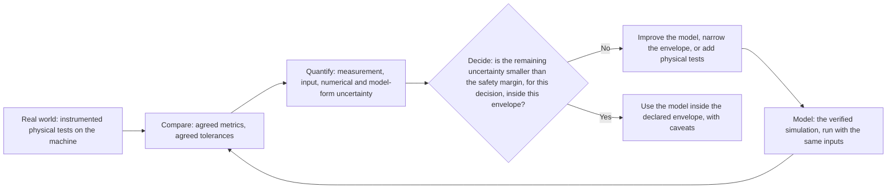

*The VVUQ loop: reality and the model are compared, the remaining uncertainty is sized, and a decision is made about where the model may be trusted.*

**Why it matters here.** Every framework the booklet compared is built on this loop, with the effort scaled to the risk of a wrong decision [Chapter 10]. For this program the booklet asks for separate verification, validation and uncertainty results for the sensor models, machine dynamics, brake actuation, environment and system timing, rather than one global "validated" label [Chapter 13].

**Related terms.** [Credibility of a simulation](#credibility-of-a-simulation), [Code verification versus solution verification](#code-verification-versus-solution-verification), [Model validation versus model calibration](#model-validation-versus-model-calibration), [Uncertainty: aleatory versus epistemic](#uncertainty-aleatory-versus-epistemic), [Verification versus validation (V&V)](#verification-versus-validation-vv), [ASME V&V 10, V&V 20 and V&V 40](#asme-vv-10-vv-20-and-vv-40), [NASA-STD-7009 and NASA-HDBK-7009](#nasa-std-7009-and-nasa-hdbk-7009), [Correlation](#correlation).

### Code verification versus solution verification

**In one sentence.** Code verification checks that the simulation software has no errors in how it solves its equations; solution verification estimates how much numerical error remains in one particular run.

**Explained.** Code verification is checking that a calculator is not faulty: every key does what its label says. Solution verification is checking that, for the particular sum you typed, rounding did not change the answer in a way that matters.

Simulation software solves equations for motion, braking, light or radio waves step by step in time and across a grid in space. Code verification tests the program against problems with known exact answers to catch programming mistakes; it is done once per software version. Solution verification is done for each kind of run: the engineer shortens the time step or refines the grid and watches whether the answer settles. If a stopping distance moves from 41.9 m to 41.2 m when the time step is halved, the numerical error is of that order and belongs in the uncertainty budget.

The space agency standard lists "implementation and solution verification" as a credibility factor, and the shared structure of all the frameworks places "verify code and solution" before any comparison with physical data [Chapter 10].

**Why it matters here.** Until its numerical errors are known, a model cannot be validated honestly, because a numerical artifact may be mistaken for physics or tuned away. The booklet's assessor checklist asks for verification evidence showing that the equations were "implemented and solved correctly rather than correlated after tuning" [Chapter 10].

**Related terms.** [Verification, validation and uncertainty quantification (VVUQ)](#verification-validation-and-uncertainty-quantification-vvuq), [Verification versus validation (V&V)](#verification-versus-validation-vv), [Model validation versus model calibration](#model-validation-versus-model-calibration), [Tool chain](#tool-chain), [Real time (hard real time) and why HIL needs it](#real-time-hard-real-time).

### Model validation versus model calibration

**In one sentence.** Calibration adjusts a model's parameters until it matches a set of measurements; validation tests whether the adjusted model then predicts measurements it has never seen, and doing both on the same data is cheating.

**Explained.** A student shown the exam questions in advance who scores full marks has demonstrated memory, not understanding. Validation is the exam with unseen questions. Calibration is the study session.

Every simulation has knobs: tire friction on wet gravel, the delay before brake pressure builds, how strongly dust weakens a laser beam. Calibration sets the knobs so the model reproduces a measured test, which is necessary. The error is to present the same test as proof that the model works. A model can fit its calibration cases perfectly and fail on the first downhill stop or heavier load, because the knobs were tuned to those cases, not to the physics [Chapter 8].

Aviation guidance on certifying aircraft seats by analysis states that calibration is not validation, and that a model cannot be validated merely by agreement with another validated model [Chapter 10]. The practical rule is to split the physical tests in advance into calibration data, validation data and withheld confirmation data, and to freeze the model before touching the validation set [Chapter 10].

**Why it matters here.** In a four-month window the temptation is to use every expensive prototype stop both to tune the model and to claim validation. An assessor will ask which data calibrated the model and which stayed independent. The booklet's summary: "Never use the same stop to both tune and claim validation" [Chapters 8, 10].

**Related terms.** [Verification, validation and uncertainty quantification (VVUQ)](#verification-validation-and-uncertainty-quantification-vvuq), [Held-out measurements and independent physical data](#held-out-measurements-and-independent-physical-data), [Over-fitting](#over-fitting), [Hold-out set, tuning split](#hold-out-set-tuning-split-and-cross-validation), [cross-validation](#hold-out-set-tuning-split-and-cross-validation), [Training data, validation data, test data, and the independence rule (data lineage)](#training-data-validation-data-test-data-and-the-independence-rule-data-lineage), [Pre-registration (deciding the analysis before seeing the data)](#pre-registration), [Correlation test (first tests on the prototype that anchor the models)](#correlation-test).

### Context of use and question of interest

**In one sentence.** The question of interest is the exact decision a simulation is meant to inform, and the context of use is the precise role the simulation's output plays in making that decision.

**Explained.** "Is this bridge safe?" cannot be answered by a calculation. "Will the main beam deflect less than 50 mm under a 40 t truck?" can, and the calculation's job is then clear. The second is a question of interest with a defined context of use.

The idea comes from the medical-device guidance the booklet describes. Before trusting a model, the organization writes down the decision it must inform, the output the model supplies, and how that output combines with other evidence. Only then can anyone judge how good the model must be [Chapter 10]. A brake model accurate for stopping distance on level ground may say nothing about machine stability when braking on a side slope.

The booklet applies the idea directly: "simulation validates automatic braking" is too broad a context of use. A defensible program would state separate claims, for example about sensor detection range, object classification, decision timing, brake-system response, stopping distance, speed reduction at impact, the rate of unnecessary braking, or the remaining collision risk. Each needs its own physical evidence and limits of validity [Chapter 10].

**Why it matters here.** The assessor checklist puts the context of use first because it prevents evidence validated for one purpose being reused for a stronger claim [Chapter 10]. Reviewers should approve specific substitutions ("within this envelope, this validated model may replace this physical test"), never "virtual testing" as a category [Chapter 13].

**Related terms.** [Credibility of a simulation](#credibility-of-a-simulation), [Model risk: influence times consequence](#model-risk-influence-times-consequence), [FDA guidance on computational modeling for medical devices](#fda-guidance-on-computational-modeling-for-medical-devices), [Validity envelope (domain of validity) and extrapolation](#validity-envelope-domain-of-validity-and-extrapolation), [Acceptance criteria and pass or fail criteria](#acceptance-criteria-and-pass-or-fail-criteria), [Safety case and safety argument](#safety-case-and-safety-argument).

### Model risk: influence times consequence

**In one sentence.** Model risk is how much a simulation's output drives a decision (its influence) combined with how severe a wrong decision would be (the consequence), and it sets how much credibility evidence the simulation must have.

**Explained.** You check a restaurant bill casually but check a house contract with a lawyer. Checking effort should match what is at stake and how much you rely on the thing being checked. Model risk applies that idea to simulation.

The medical-device standard ASME V&V 40 (American Society of Mechanical Engineers, 2018) defines model risk as the combination of two things. Model influence is how much the decision depends on the simulation rather than on other evidence such as physical tests or field data. Decision consequence is how bad a wrong decision would be. A model that is one of five independent lines of evidence for a minor design choice has low model risk. A model that is the only evidence for whether a 100 t machine stops before a person has very high model risk [Chapter 10].

The rating is a grid, not a formula with units: low, medium and high influence on one axis, low, medium and high consequence on the other. The position sets credibility goals, agreed in advance, for each kind of evidence: how thorough verification must be, how close validation must come, how well inputs must be known. Goals rise with risk, and no universal minimum of physical evidence exists [Chapter 10]. The space agency standard makes the same move with a criticality assessment, and the European automated-vehicle regulation requires one [Chapter 10].

For this program, the booklet reasons that the physical brake model is probably the highest-risk model in the chain, because brake behavior varies with wear and temperature and has the highest decision consequence, and that sensor models in dust, darkness and glare are high risk because they are least validated. A combinatorial sweep over site layouts and speeds exercises validated physics many times and carries lower model risk [Chapter 10].

**Why it matters here.** No framework prescribes a universal percentage of physical tests or a universal tolerance; mature practice derives both from model influence, decision consequence, applicability and uncertainty, and physical testing is kept where model risk is high and validation evidence weakest [Chapter 10]. Rating each claim's model risk is the honest route to a defensible test split.

**Related terms.** [Credibility of a simulation](#credibility-of-a-simulation), [Context of use and question of interest](#context-of-use-and-question-of-interest), [ASME V&V 10, V&V 20 and V&V 40](#asme-vv-10-vv-20-and-vv-40), [FDA guidance on computational modeling for medical devices](#fda-guidance-on-computational-modeling-for-medical-devices), [Deciding which physical tests to keep and which to replace](#deciding-which-physical-tests-to-keep-and-which-to-replace), [Hazard analysis and risk assessment (including the risk matrix)](#hazard-analysis-and-risk-assessment), [Acceptance criteria and pass or fail criteria](#acceptance-criteria-and-pass-or-fail-criteria).

### Credibility factors and credibility levels

**In one sentence.** Credibility factors are the separate aspects of a simulation that are each rated, and credibility levels are the 0 to 4 scale on which the NASA standard scores each factor, without adding the scores into one total.

**Explained.** A school report card gives separate grades for mathematics, reading and science. A single average would hide a failing subject behind two strong ones. The space agency's Credibility Assessment Scale works like the report card.

NASA-STD-7009 rates each factor from 0 to 4. The current factors cover data pedigree (where the reference data came from and how good they are), implementation and solution verification, validation, technical review and management, input pedigree, uncertainty, robustness, and appropriateness for the intended use. The original 2008 version used eight factors in three groups: development, operations and supporting evidence [Chapter 10].

The levels define what earns each score. For validation, Level 4 means all outputs "compare favorably" with real-world data across the full operating range in the real environment; lower levels mean partial data, comparison with other models, or expert judgment only. The standard states that overall credibility cannot be one number, and its 2026 handbook warns against a single total; secondary sources describe the overall score as the lowest factor score, which keeps the weakest link visible. The threshold for each factor is declared in advance from the criticality of the decision [Chapter 10].

**Why it matters here.** The booklet recommends that a safety board receive a map of validated, interpolated and unsupported regions, not a green dashboard or "the model is 95% accurate" [Chapter 10]. Chapter 12 suggests a scale of this kind for the simulation toolchain instead of technology readiness levels, which measure component maturity rather than evidence quality [Chapter 12].

**Related terms.** [NASA-STD-7009 and NASA-HDBK-7009](#nasa-std-7009-and-nasa-hdbk-7009), [Credibility of a simulation](#credibility-of-a-simulation), [Model risk: influence times consequence](#model-risk-influence-times-consequence), [Technology readiness level (TRL)](#technology-readiness-level-trl), [Validity envelope (domain of validity) and extrapolation](#validity-envelope-domain-of-validity-and-extrapolation), [Evidence](#evidence).

### Credible Simulation Process and simulation quality (ASAM QSQ)

**In one sentence.** The Credible Simulation Process is a German industry method for building credibility evidence into every step of a simulation project, and ASAM QSQ is a standardization project trying to define measurable simulation-quality metrics, still unfinished in 2026.

**Explained.** A good kitchen controls ingredients, temperatures and timing throughout, not only when the plate leaves. The Credible Simulation Process (CSP) applies that thinking to simulation. Published by the SET Level research consortium in August 2021, with related work by the prostep ivip association (Simulation Credibility technical paper, version 8.1, 2024), it embeds credibility activities inside product development: define the simulation task and its criticality, plan the evidence, record assumptions, verify and validate along the way, and carry credibility information with the models. A related method, M&S SPICE (2023), derives how much credibility a task needs from its criticality and assesses whether the process can deliver it [Chapters 10, 11].

ASAM is a standards association for automotive simulation data and interfaces. Its project P_2025_04, Quantifying Simulation Quality (QSQ), aims to standardize machine-readable simulation-quality metrics with use-case-specific weighting. ASAM itself states that "no standardized metrics exist" for assessing simulation quality, particularly sensor simulation; the proposal workshop was held on 11 September 2025 and the project was still under way in 2026 [Chapters 6, 7, 11].

**Why it matters here.** The booklet classifies both as process templates from road-vehicle research, not proven off-road, and notes that the credibility communities agree validation is required but have not agreed on metrics [Chapters 10, 11]. The manufacturer can borrow the process discipline now but must agree its own correlation metrics with its assessor rather than wait for a standard [Chapter 10].

**Related terms.** [Credibility of a simulation](#credibility-of-a-simulation), [Open Simulation Interface (ASAM OSI) and the ASAM organization](#open-simulation-interface-asam-osi-and-the-asam-organization), [PEGASUS, VVM (Verification and Validation Methods), SET Level, VaViM and EVIDENT](#pegasus-vvm-set-level-vavim-and-evident-german-and-european-research-programs-on-scenario-based-validation), [Standards bodies](#standards-bodies-iso-iec-cen-cenelec-asam-sae-ieee-ul-and-national-bodies), [Correlation](#correlation), [Tolerance and acceptance band](#tolerance-and-acceptance-band).

### NASA-STD-7009 and NASA-HDBK-7009

**In one sentence.** NASA-STD-7009 is the US space agency's standard for models and simulations, written after the Columbia accident, and NASA-HDBK-7009 is its implementation handbook.

**Explained.** After the loss of the space shuttle Columbia in 2003, in which a model was used far outside its data and its warning was then reinterpreted, NASA wrote a standard for how models and simulations must be developed, used and reported when they support decisions. The current version is NASA-STD-7009B, approved 5 March 2024; the handbook NASA-HDBK-7009B was finalized on 3 February 2026 [Chapter 10].

Three features stand out. The credibility effort must be proportional to the risk of a wrong decision, set by a criticality assessment. Credibility is rated factor by factor on a 0 to 4 scale, never as one number. And every report to a decision maker must contain a fixed set: the best estimate, a statement of uncertainty, the credibility assessment, explicit caveats such as use outside the model's assumptions or limits, and the risk of accepting the result [Chapter 10]. Acceptance criteria are defined by the program and approved by technical authority [Chapter 13].

The booklet is careful about status: this is a governance template for an internal board, not an aviation certification rule and not an off-road regulation [Chapter 10].

**Why it matters here.** The booklet uses the NASA reporting set as one of three layers for the program's validity record, recommends its credibility scale for the toolchain, and cites it, with ASME, as the reason the simulator must be validated "against the real application, not internal consistency" [Chapters 10, 12, 13].

**Related terms.** [Credibility factors and credibility levels](#credibility-factors-and-credibility-levels), [Verification, validation and uncertainty quantification (VVUQ)](#verification-validation-and-uncertainty-quantification-vvuq), [False confidence from simulation](#false-confidence-from-simulation), [Columbia Accident Investigation Board](#columbia-accident-investigation-board-why-a-space-shuttle-accident-appears-in-a-mining-booklet), [Validity envelope (domain of validity) and extrapolation](#validity-envelope-domain-of-validity-and-extrapolation), [The credibility package (what a safety board or outside assessor expects to see)](#the-credibility-package-what-a-safety-board-or-outside-assessor-expects-to-see).

### ASME V&V 10, V&V 20 and V&V 40

**In one sentence.** These are three standards from the American Society of Mechanical Engineers (ASME) on verification and validation: V&V 10 for structural models, V&V 20 for fluid-flow and heat-transfer models, and V&V 40 for judging model credibility by risk, written for medical devices.

**Explained.** ASME runs a program of verification, validation and uncertainty quantification (VVUQ) standards. V&V 10 (Verification and Validation in Computational Solid Mechanics, 2019 edition) covers models of structures and solids. V&V 20 covers computational fluid dynamics and heat transfer, with emphasis on computing validation uncertainty. V&V 40 (2018), Assessing Credibility of Computational Modeling through Verification and Validation: Application to Medical Devices, is the one the booklet relies on most. It introduces the question of interest, the context of use, and model risk as model influence combined with decision consequence, and asks that credibility goals be set in advance to match that risk [Chapters 10, 12].

The booklet records that V&V 10 and V&V 20 were named but not verified in its research, while V&V 40 was read through the US medical regulator's guidance that adopts it. A related document, ASME VVUQ 30.1-2024, covers scaling methods for nuclear thermal-fluid applications [Chapter 10].

**Why it matters here.** The booklet calls V&V 40 "the most transferable reasoning framework" for this program, with one limit: it applies to physics-based models only. If the perception software uses a machine-learned detector, the framework covers the vehicle-dynamics and brake models but not the neural network, which needs separate assurance [Chapter 10].

**Related terms.** [Model risk: influence times consequence](#model-risk-influence-times-consequence), [Context of use and question of interest](#context-of-use-and-question-of-interest), [FDA guidance on computational modeling for medical devices](#fda-guidance-on-computational-modeling-for-medical-devices), [Verification, validation and uncertainty quantification (VVUQ)](#verification-validation-and-uncertainty-quantification-vvuq), [Machine learning in safety functions](#machine-learning-in-safety-functions), [Physics-based versus data-driven models](#physics-based-versus-data-driven-models).

### FDA guidance on computational modeling for medical devices

**In one sentence.** The US Food and Drug Administration (FDA) published final guidance in November 2023 on assessing the credibility of computer models in medical-device submissions, and the booklet cites it as the clearest regulator-level statement of how to start from the decision rather than from the simulator.

**Explained.** Why does a document about pacemakers appear in a booklet about mining machines? Because the FDA has had to answer, for years, the question the manufacturer faces: when may a computer model stand in for a physical test as safety evidence?

The guidance builds on ASME V&V 40, and its order of work is the lesson. First define the question of interest and the context of use. Then rate model risk as model influence combined with decision consequence. Then set credibility goals before collecting evidence. Then collect it (eight categories of evidence, within a nine-step process) and finally judge whether it is adequate. There is no universal minimum of physical, bench or clinical evidence; the amount depends on risk and context, and credibility applies to the stated context of use, not to "the model" for every future application [Chapter 10].

Two cautions: the guidance covers physics-based and mechanistic models only, not data-driven ones, and validation thresholds must be justified for the decision; it sets no universal acceptance error [Chapter 10].

**Why it matters here.** The booklet uses the FDA logic to argue that "simulation validates automatic braking" is too broad a claim and must be split into separate testable claims, and it lists prospective credibility goals, which stop the metric being changed after inconvenient results, among the items an assessor expects [Chapter 10].

**Related terms.** [ASME V&V 10, V&V 20 and V&V 40](#asme-vv-10-vv-20-and-vv-40), [Context of use and question of interest](#context-of-use-and-question-of-interest), [Model risk: influence times consequence](#model-risk-influence-times-consequence), [Tolerance and acceptance band](#tolerance-and-acceptance-band), [Pre-registration (deciding the analysis before seeing the data)](#pre-registration), [Regulation, directive, law and guidance note (the difference)](#regulation-directive-law-and-guidance-note).

### Nuclear practice: EMDAP, PIRT and BEPU

**In one sentence.** EMDAP is the US nuclear regulator's 20-step process for building and judging a safety-analysis model, PIRT is its ranked list of the physical phenomena that matter most, and BEPU is the nuclear practice of reporting a best-estimate result with its uncertainty rather than a single worst-case number.

**Explained.** Nuclear plants cannot be tested to destruction, so the industry built a disciplined method for deciding when a model may be trusted. US Nuclear Regulatory Commission Regulatory Guide 1.203 (December 2005) defines the Evaluation Model Development and Assessment Process (EMDAP): four elements in 20 steps. Element 1 sets requirements, including a Phenomena Identification and Ranking Table (PIRT): a list of every physical effect that could influence the result, ranked by importance and by how well it is understood. Element 2 builds the assessment base: experiments chosen with the PIRT, including separate-effects tests that isolate one phenomenon and integral-effects tests that exercise the coupled system, plus scaling analysis showing that test-rig data apply to the full plant. Element 3 develops the model; Element 4 judges adequacy. Highly ranked phenomena need test data; low-ranked ones get less emphasis [Chapter 10].

BEPU, best estimate plus uncertainty, runs the most realistic model available and reports its result with a quantified uncertainty band instead of stacking conservative assumptions. The booklet names BEPU and the older CSAU method but did not verify them [Chapter 10].

Mapped onto braking: separate sensor propagation, perception, latency, control logic, brake dynamics and tire or track interaction, test each in isolation, then reserve fewer full-machine tests for coupled behavior. This applies the nuclear logic; it is not a nuclear requirement for earth-moving machinery [Chapter 10].

**Why it matters here.** A PIRT-style ranking (brake fade, dust attenuation, glare, mount vibration) is on the assessor's list and decides which physical tests to keep. A peer-reviewed criticism notes that PIRT ranking is subjective and should be treated explicitly [Chapter 10].

**Related terms.** [Deciding which physical tests to keep and which to replace](#deciding-which-physical-tests-to-keep-and-which-to-replace), [Extending a validated model to another machine model or sensor position](#extending-a-validated-model-to-another-machine-model-or-sensor-position), [Uncertainty: aleatory versus epistemic](#uncertainty-aleatory-versus-epistemic), [Sensitivity analysis](#sensitivity-analysis), [Hazard analysis and risk assessment (including the risk matrix)](#hazard-analysis-and-risk-assessment), [Model risk: influence times consequence](#model-risk-influence-times-consequence).

### Aerospace practice: FAA similarity rules, DO-178C, DO-330 and MIL-STD-3022

**In one sentence.** Aviation accepts simulation and prior evidence under strict rules: the Federal Aviation Administration (FAA) lets a validated model cover similar designs and accepts service history for similar systems, DO-178C and DO-330 govern software and the tools that produce evidence, and MIL-STD-3022 is the US defense template for documenting model verification, validation and accreditation.

**Explained.** The FAA's clearest example of simulation as compliance evidence is Advisory Circular 20-146A (June 2018) on certifying aircraft seats by analysis. A baseline seat must pass physical dynamic tests; the model is validated against them with criteria agreed in advance; eligible modifications within the same family may then be substantiated by simulation; changes that alter load paths, failure mechanisms, materials or interfaces require new tests; and extrapolation is limited to conditions similar to the validation. Separately, AC 25.1309-1B and AC 00-72 accept satisfactory service history as evidence for systems sufficiently similar to a fielded one, provided the differences are identified and justified [Chapter 10]. These are the similarity rules.

DO-178C is the standard for software in airborne systems; DO-330 is its supplement on tool qualification, which qualifies tools whose output is relied on without further checking and, the booklet notes, does not address whether a physics model is valid. MIL-STD-3022 is the US Department of Defense standard for documenting the verification, validation and accreditation (VV&A) of models and simulations. The booklet names all three but did not verify them [Chapter 10].

**Why it matters here.** The FAA seat guidance is the booklet's clearest "physical anchor plus virtual variants" precedent and the source of two rules for the program: calibration is not validation, and a model is not validated by agreement with another model. Its 10% tolerances belong to seats and must not be copied to braking [Chapter 10]. If simulation results become safety evidence, the simulator is a tool whose errors can mask defects, so tool qualification must be budgeted as work [Chapter 13].

**Related terms.** [Model validation versus model calibration](#model-validation-versus-model-calibration), [Extending a validated model to another machine model or sensor position](#extending-a-validated-model-to-another-machine-model-or-sensor-position), [Equivalence argument (similarity argument) between machine variants](#equivalence-argument-between-machine-variants), [Proven in use and reuse of evidence (across machine models)](#proven-in-use-and-reuse-of-evidence), [Rail and aviation standards](#rail-and-aviation-standards-en-50126-to-en-50129-en-50716-en-14363-do-178c-do-330-do-385-ed-256), [Tool chain](#tool-chain).

### Rail practice: EN 14363 and DynoTRAIN

**In one sentence.** EN 14363 is the European rail standard for approving how a vehicle runs on track, and it is the one standard in the booklet that formally lets a validated simulation extend acceptance to new conditions and modified vehicles; DynoTRAIN is the research project that built its validation method.

**Explained.** When a new train is approved in Europe, its running behavior (stability, forces on the rail, ride) is normally measured on real track. EN 14363:2016+A2:2022 adds two informative annexes: Annex T on simulating on-track tests and Annex U on extending acceptance. Running tests validate the vehicle model; the validated model may then extend the range of tested conditions, assess a modified vehicle, or compare against an approved reference vehicle. The European Union Agency for Railways publishes guidance on doing this [Chapter 10].

The DynoTRAIN project (results published 2014 to 2015) built the method. It compared several vehicle models, several software tools and measurements from multiple vehicles and countries, with more than 1,000 simulations. Its key finding was that checking large numbers of plots by engineering judgment does not scale, so objective validation metrics were developed. The resulting practice judges agreement on sets of deviations: at least 24 simulation-versus-measurement comparisons per quantity from at least 12 track sections, with validation limits on the means and standard deviations across the set [Chapter 10].

**Why it matters here.** The booklet rates rail as the strongest precedent for family transfer and test reduction, with one warning: wheel-rail dynamics are far more deterministic than perception in dust, rain, glare or snow, so the mechanism transfers, not the physics. No percentage of physical tests actually removed was published [Chapter 10].

**Related terms.** [Distributional agreement](#distributional-agreement), [Extending a validated model to another machine model or sensor position](#extending-a-validated-model-to-another-machine-model-or-sensor-position), [Deciding which physical tests to keep and which to replace](#deciding-which-physical-tests-to-keep-and-which-to-replace), [Rail and aviation standards](#rail-and-aviation-standards-en-50126-to-en-50129-en-50716-en-14363-do-178c-do-330-do-385-ed-256), [Rail collision avoidance precedents](#rail-port-forklift-and-agriculture-precedents-wabtec-and-others), [Equivalence argument (similarity argument) between machine variants](#equivalence-argument-between-machine-variants).

### Technology readiness level (TRL)

**In one sentence.** A technology readiness level is a 1 to 9 score of how mature a technology is, from a basic idea (TRL 1) to a system proven in real operation (TRL 9), defined for space systems in ISO 16290:2013.

**Explained.** TRLs began at NASA in the 1990s as a shared vocabulary for program reviews. As general background: TRL 1, basic principles observed; TRL 3, proof of concept; TRL 4, component validated in a laboratory; TRL 6, prototype demonstrated in a relevant environment; TRL 7, prototype demonstrated in the operational environment; TRL 9, system proven through successful operation. ISO 16290:2013 standardizes the levels and their assessment criteria [Chapter 12].

Mining uses the vocabulary for collision systems. The South African MOSH test specification requires independent verification at TRL 4 and TRL 7 stage gates, and at TRL 9 calls for statistical monitoring in production, for example over three months or 2,000 hours. The University of Pretoria runs a staged protocol from laboratory-scale TRL 4 tests to mine-like trials [Chapters 3, 7, 8].

The booklet's verdict: TRLs are useful vocabulary but weak measurement. Practitioners reported 15 challenges, the most critical at system and integration level, because a component can be mature while integration, data, model credibility, scenario coverage and the safety argument are not. Assign TRLs only to genuinely novel elements, never one average for the whole program, and use a simulation credibility scale such as NASA-STD-7009B for the toolchain [Chapter 12].

**Why it matters here.** A high TRL for the sensor or brake controller says nothing about whether the simulator that tests them is credible; the two scales measure different things and the program needs both [Chapter 12].

**Related terms.** [Credibility factors and credibility levels](#credibility-factors-and-credibility-levels), [MOSH and its TRL stage gates](#mosh-and-its-trl-stage-gates-mining-industry-occupational-safety-and-health-learning-hub), [Stage gate, evidence gate and go or no-go decision](#stage-gate-evidence-gate-and-go-or-no-go-decision), [ISO 16290 (TRL)](#iso-18571-iso-16290-and-iso-25119), [Independent assessment, independent test body and safety board](#independent-assessment-independent-test-body-and-safety-board).

### Sim-to-real gap, measured

**In one sentence.** The measured sim-to-real gap is the difference between what a simulation produces and what the real sensor, machine or function produces in the same situation, expressed as a number with a stated metric and condition rather than as a general worry.

**Explained.** Part D introduces the sim-to-real gap as a concept: a simulation is never a perfect copy of reality. This entry is about measuring it. A gap that is only talked about cannot be managed. A gap measured for a named quantity, under named conditions, with a named metric, can be compared with the safety margin and then accepted, reduced or fenced off.

The booklet collects many such measurements, almost all from road vehicles. A clear-weather automotive lidar model reached a mean absolute percentage error of 1.7% on signal amplitude and under 2 cm on distance. A lidar rain and fog model matched measurements well when the simulated and real rain distributions were the same, but the mismatch grew as fog visibility fell. In a fog chamber at 10 m visibility, all lidars but one failed to see a target at 10.5 m, a cliff a model calibrated in moderate fog would miss [Chapters 6, 10]. For point clouds, real and simulated scans averaged a density-aware Chamfer distance of 0.63 while a segmentation algorithm reached only 21% on the simulated data. An end-to-end driving benchmark scored one planner at 0.449 on real data and 0.413 on simulated data, another at 0.490 versus 0.489. A physics-based radar simulator improved image-similarity scores dramatically, yet a detector trained on real radar images still failed on the simulated ones. A detector pre-trained on synthetic fog and fine-tuned on real fog gained only 0.0117 in mean average precision over the real-only baseline [Chapter 6]. A small-scale self-driving-car study found physical tests could be safely avoided for 40 of 61 configurations [Chapter 10].

The pattern is the lesson. The gap is small where conditions are benign and the model was validated there. It grows near physical thresholds (fog, darkness, dust), and it differs by layer: a small gap in appearance can coexist with a large gap in what a detector sees. Several conditions are reproduced poorly everywhere: heavy rain at short range, non-uniform dust and its time dynamics, lens soiling, vibration, night and artificial lighting, multipath from large metal structures, and combinations of these [Chapter 6].

**Why it matters here.** No validated radar or camera dust model with a reported error metric was found, and the lidar dust model for mining has limited validation. The manufacturer must therefore measure its own gaps, sensor by sensor and condition by condition, with reference instrumentation and withheld real data; "how much agreement is enough" for a braking claim has no mature rule [Chapters 6, 10].

**Related terms.** [Sim-to-real gap (as a concept; metrics are in Part G)](#sim-to-real-gap), [Correlation](#correlation), [Error metrics (MAE, MAPE, RMSE)](#error-metrics-mae-mape-rmse), [Distributional agreement](#distributional-agreement), [Task-level gap versus pixel-level similarity](#task-level-gap-versus-pixel-level-similarity), [Sensor degradation: dust, mud, rain, snow, fog, spray, glare, darkness, artificial lighting, vibration](#sensor-degradation-dust-mud-rain-snow-fog-spray-glare-darkness-artificial-lighting-vibration), [Validity envelope (domain of validity) and extrapolation](#validity-envelope-domain-of-validity-and-extrapolation).

### Correlation

**In one sentence.** In this field, correlation means the demonstrated agreement between a simulation and a physical test of the same situation, measured with agreed metrics; it is the act of anchoring the virtual world to the real one.

**Explained.** A caution first. In statistics, correlation is a number between minus 1 and 1 describing how two variables move together. Test engineers use the word differently: a model "correlates" when simulated and measured results of the same test agree closely enough, by metrics agreed beforehand. This entry uses the engineering meaning.

A correlation campaign has a simple shape. Run a physical test with good instrumentation: a loader approaching a target at 10 km/h on wet gravel, with brake command time, brake pressure, deceleration and stopping distance recorded. Reproduce exactly that test in the simulator with the same machine parameters, speed, surface and target. Compare the two, quantity by quantity, across the conditions that matter. The comparison uses several kinds of metric at once: single numbers such as stopping distance, whole time curves such as deceleration against time, distributions over repeated runs, and outcomes such as whether the machine stopped before the target. Agreement is "measured with several metrics at once, never one number" [Chapter 10].

The precedents follow this shape. A 2016 heavy-truck program ran physical track tests of a tractor-trailer's automatic braking first, then benchmarked hardware-in-the-loop simulations against them. Euro NCAP's 2026 virtual-testing protocol requires the manufacturer's model to correlate with physical tests using ISO-based scores before virtual results count, then physically spot-checks randomly chosen grid cells. A test house and tool vendor demonstrated an automatic-braking controller correlated against proving-ground tests using ISO 18571 metrics [Chapters 2, 13]. For this program, correlation tests should come first when the prototype arrives, before the scenario matrix: measured end-to-end latency, detection range, brake-command timing, stopping dynamics, repeatability and model error on each representative variant [Chapter 1].

Correlation is also where honesty is tested. The deliverable is residual plots and an uncertainty budget, not a "looks close" judgment; the stop signal is errors that are systematic, sensitive to hidden tuning, or larger than the margin the safety conclusion needs [Chapter 13].

**Why it matters here.** The organization has never correlated a simulator against its own machines. "No agreed correlation metrics by the first quarter of 2027" is an early warning sign of failure, and "one machine, one scenario, physical versus virtual correlation" is among the cheapest experiments to run before building a large platform [Chapter 13].

**Related terms.** [Correlation test (first tests on the prototype that anchor the models)](#correlation-test), [Scalar-output agreement](#scalar-output-agreement), [Time-history agreement](#time-history-agreement), [Distributional agreement](#distributional-agreement), [Closed-loop agreement](#closed-loop-agreement), [Tolerance and acceptance band](#tolerance-and-acceptance-band), [Sim-to-real gap, measured](#sim-to-real-gap-measured), [Euro NCAP (and the Euro NCAP virtual-testing protocol with 75 percent cluster acceptance)](#euro-ncap-and-its-virtual-testing-protocol).

### Scalar-output agreement

**In one sentence.** Scalar-output agreement compares one number from the simulation with the same number from the physical test, for example stopping distance or the time at which braking was triggered, usually as a percentage error with an agreed error band.

**Explained.** A scalar is a single value: stopping distance in meters, peak deceleration in m/s², time from object appearance to brake command in seconds. The simplest check is the relative error:

`error = |simulated minus measured| / measured`

The booklet's worked example comes from aircraft-seat certification. A measured load peak of 1,315 lb and a simulated peak of 1,360 lb give (1360 minus 1315) divided by 1315, that is 3.42%. The aviation guidance uses 10% criteria for several quantities, agreed in advance [Chapter 10]. For braking the equivalent might be: measured stopping distance 38.0 m, simulated 39.5 m, error 3.9%.

An error band must respect uncertainty. In the same aviation example the regulatory maximum is 1,500 lb and the test scatter about 42 lb standard deviation; for 95% confidence that the true value stays below the limit, the prediction must stay below about 1,431 lb (1500 minus 1.645 times 42). Predicting 1,490 lb is not enough just because it is below 1,500: uncertainty consumes part of the margin [Chapter 10].

Scalars are necessary but not sufficient. Two systems can reach the same peak deceleration at very different times, and for automatic braking that changes whether the collision happens [Chapter 10].

**Why it matters here.** The booklet recommends scalar quantities for this program, including stopping-distance error, intervention-time error, residual impact-speed error and range and relative-speed errors, and warns that the aviation 10% figure must not be copied as a generic tolerance for off-road braking [Chapter 10].

**Related terms.** [Correlation](#correlation), [Time-history agreement](#time-history-agreement), [Tolerance and acceptance band](#tolerance-and-acceptance-band), [Error metrics (MAE, MAPE, RMSE)](#error-metrics-mae-mape-rmse), [Stopping distance and the formula d = v^2 / (2a)](#stopping-distance), [with reaction and dead time added](#stopping-distance), [Sample size, confidence level and confidence interval](#sample-size-confidence-level-and-confidence-interval).

### Time-history agreement

**In one sentence.** Time-history agreement compares a whole curve over time from the simulation with the same curve from the physical test, so that differences in timing and shape are caught, not only differences in the peak value.

**Explained.** A time history is a quantity recorded against time: brake pressure rising, speed falling, distance to the object shrinking. Two curves can share the same peak and still disagree badly if one peak arrives half a second late or the shape differs. Time-history metrics score magnitude (how big), phase (how early or late) and shape separately and then combine them.

The booklet's example is decisive. In an aviation seat comparison, the simulated and measured peaks differed by only 0.3%, which a peak-only check would call excellent, yet the time-history error was 60.4%. In another case the peak error was 3.42% and the time-history error 7.2%, both within the 10% guideline [Chapter 10]. The method behind these figures is the Sprague-Geers error, which combines a magnitude term and a phase term.

ISO 18571 is an international standard that rates two time signals with corridor, phase, magnitude and slope scores combined into one rating; the booklet mentions it as the metric in a 2026 demonstration correlating an automatic-braking controller with proving-ground tests, and Euro NCAP's virtual-testing protocol likewise qualifies models with an "ISO score" and defined indicators [Chapters 2, 3]. CORA (correlation and analysis) is an older crash-safety rating method with a similar structure; it is general background, not from the booklet.

**Why it matters here.** For automatic braking the booklet argues for validating the whole causal timing chain, not only stopping distance: detection time, decision time, brake command time, pressure build-up, deceleration, speed and position histories, plus distance-to-object and relative-speed histories near the collision or no-collision boundary [Chapter 10].

**Related terms.** [Scalar-output agreement](#scalar-output-agreement), [Correlation](#correlation), [End-to-end latency budget (sensing, processing, decision, command, brake fill, deceleration)](#end-to-end-latency-budget), [Brake dead time and brake build-up time (brake-system delays)](#brake-dead-time-and-brake-build-up-time), [ISO 18571 (time-history validation metric)](#iso-18571-iso-16290-and-iso-25119), [False confidence from simulation](#false-confidence-from-simulation).

### Distributional agreement

**In one sentence.** Distributional agreement compares the whole spread of many simulated results with the whole spread of many measured results, which is needed when repeated runs of the same situation legitimately differ.

**Explained.** Run the same perception trial ten times on a real site and the detections will differ, because dust density, target reflectivity, lighting, rain rate, sensor contamination and random software effects vary. Comparing one simulated run with one real run is then meaningless. The right comparison is between distributions: the collection of all outcomes and their spread [Chapter 10].

A helpful picture is the cumulative curve: for every possible value, the fraction of results that fall below it. Two distributions can be compared by how far apart their cumulative curves are. Rail acceptance works this way, with at least 24 comparisons per quantity across at least 12 track sections and limits on the set of deviations. The booklet's layered scheme places distributional metrics between signal-level accuracy and image similarity [Chapters 6, 10]. The table lists the metrics named in the booklet.

| Metric | What it compares | Plain-words reading |
|---|---|---|
| Kolmogorov-Smirnov test (KS) | The largest vertical gap between the two cumulative curves | Near 0: the two sets are spread almost alike. Near 1: very different. Also gives a probability that both came from the same source. |
| Wasserstein distance (earth mover's distance) | How much "work" it takes to reshape one pile of results into the other, in the units of the quantity | Small, for example 0.3 m of stopping distance: alike. Large: far apart, and the number says by how much. |
| Maximum mean discrepancy (MMD) | The difference between the two sets after mapping each result into a rich mathematical feature space | 0: the sets cannot be told apart. Larger: more different. Works for point clouds and other multi-dimensional data. |
| Kullback-Leibler divergence (KL) | How surprised you would be if you expected one distribution and observed the other | 0: identical. Grows without limit. Not symmetric, and undefined where one distribution gives zero chance to something the other produces. |
| Chamfer distance | For two point clouds, the average distance from each point to its nearest neighbor in the other cloud, both ways | Small: the clouds sit on top of each other. Large: shapes differ. Ignores whether points are crowded or sparse. |
| Density-aware Chamfer distance (DCD) | Chamfer distance corrected for point density, bounded between 0 and 1 | 0: identical. 1: completely different. Real versus simulated scans averaged 0.63 in a 2025 study, and this metric tracked perception results best. |
| Area validation metric (AVM) | The area between the two cumulative curves, in the units of the quantity | Small: alike. Large: the model's spread of results is wrong by about that amount. The booklet treats the value as model-form uncertainty to add to predictions. |

The metrics have traps. More experimental scatter makes the area validation metric smaller and the model look "more valid", and it can over- or under-compensate when random and knowledge-based uncertainty are mixed. A radar validation paper evaluated KL divergence and dismissed it for its purpose. Point-cloud metrics disagree with one another, which is why the finding that density-aware Chamfer distance tracked perception best matters [Chapters 6, 10].

**Why it matters here.** Perception in dust, rain and glare is stochastic, so the booklet recommends distributional validation quantities such as detection probability by condition, range-error distributions and the frequency of model residuals near decision boundaries. Whether these metrics predict safety-relevant perception errors is listed as uncertain [Chapters 6, 10].

**Related terms.** [Correlation](#correlation), [Point cloud](#point-cloud), [Sim-to-real gap, measured](#sim-to-real-gap-measured), [Uncertainty: aleatory versus epistemic](#uncertainty-aleatory-versus-epistemic), [Rail practice: EN 14363 and DynoTRAIN](#rail-practice-en-14363-and-dynotrain), [Sample size, confidence level and confidence interval](#sample-size-confidence-level-and-confidence-interval), [Random sampling, stratified sampling and probability-weighted sampling](#random-sampling-stratified-sampling-and-probability-weighted-sampling).

### Image and field similarity metrics (SSIM, PSNR, LPIPS, FID, mutual information)

**In one sentence.** These metrics score how much a simulated image, radar map or other field of values resembles a real one; they are useful for rendering quality but can disagree with whether a detector behaves the same on both.

**Explained.** Peak signal-to-noise ratio (PSNR) measures pixel-by-pixel difference between two images in decibels (dB); higher is closer, with values above about 30 dB looking near identical and 15 to 20 dB visibly wrong. Structural similarity index (SSIM) compares local patterns of brightness, contrast and structure, from 0 to 1. Learned perceptual image patch similarity (LPIPS) uses a neural network to judge how different two images look; lower is better. Frechet inception distance (FID) compares the statistics of whole collections of images rather than matched pairs; lower is better. Mutual information measures how much knowing one image tells you about the other, useful for radar maps. PSNR, SSIM and LPIPS need pixel-matched pairs; FID works at the distribution level [Chapter 6].

The booklet reports PSNR for neural rendering of driving scenes: about 30.9 dB on the recorded path, falling to 19.2 dB when the viewpoint moves 4 m sideways, and 13.2 to 20.8 dB for generative world models, which it reads as "not yet metric-faithful" [Chapter 5]. For radar, a physics-based simulator improved mutual-information and structural-similarity scores dramatically, yet a detector trained on real data still failed on the simulated images [Chapter 6].

These metrics measure appearance and structure, not safety. FID targets no particular perception algorithm, and all of them can improve while the quantity that matters, such as detection range in dust, stays wrong [Chapter 6].

**Why it matters here.** The booklet's rule is that image similarity must be accompanied by task-level and closed-loop validation, because "different realism metrics answer different questions" [Chapter 6]. A photorealistic dusty pit is not evidence that the simulated camera degrades like the real one.

**Related terms.** [Task-level gap versus pixel-level similarity](#task-level-gap-versus-pixel-level-similarity), [Sim-to-real gap, measured](#sim-to-real-gap-measured), [Neural rendering: NeRF and Gaussian splatting (3DGS)](#neural-rendering-nerf-and-gaussian-splatting-3dgs-as-ways-to-rebuild-a-scene-from-photos), [Generative models (GAN, diffusion models) and what "generated weather" means](#generative-models-gan-diffusion-models-and-what-generated-weather-means), [Radar](#radar-radio-detection-and-ranging), [Camera](#camera-rgb-camera-cmos-sensor-lens-image-signal-processor-isp-hdr-rolling-shutter), [Distributional agreement](#distributional-agreement).

### Error metrics (MAE, MAPE, RMSE)

**In one sentence.** MAE, MAPE and RMSE are three standard ways to turn many individual simulation-versus-measurement differences into one average error figure.

**Explained.** Suppose a lidar model is compared with the real sensor on 100 measurements of distance to a plate. Each comparison gives an error; the three metrics summarize them differently.

Mean absolute error (MAE) is the average of the absolute differences, in the units of the quantity: `MAE = (1/n) × sum of |simulated minus measured|`, where n is the number of comparisons. An MAE of 1.3 cm means the model is typically about 1.3 cm off; the booklet quotes that figure for a lidar survey method [Chapter 5].

Mean absolute percentage error (MAPE) divides each difference by the measured value first: `MAPE = (100/n) × sum of |simulated minus measured| / measured`. It is scale-free, so a 1.7% MAPE on lidar signal amplitude can sit beside an 8.5% MAPE on point count, the booklet's figures for a clear-weather lidar model [Chapters 6, 10]. MAPE misbehaves when measured values are near zero.

Root mean square error (RMSE) squares each difference, averages, then takes the square root: `RMSE = square root of ((1/n) × sum of (simulated minus measured)^2)`. Squaring punishes large errors, so RMSE exceeds MAE whenever a few comparisons are badly wrong, which for a braking model is often what matters.

All three hide the shape of the errors; a radar validation paper noted that mean and RMSE errors cannot accommodate the random and knowledge-based uncertainty of stochastic detections [Chapter 6].

**Why it matters here.** MAPE is in published use for sensor-signal models, reported rather than thresholded, and low average error can coexist with dangerous optimism near the collision boundary. An average error is a start, never the whole validation [Chapter 10].

**Related terms.** [Scalar-output agreement](#scalar-output-agreement), [Sim-to-real gap, measured](#sim-to-real-gap-measured), [Distributional agreement](#distributional-agreement), [Tolerance and acceptance band](#tolerance-and-acceptance-band), [Key performance indicator (KPI) and metric](#key-performance-indicator-kpi-and-metric).

### Task-level gap versus pixel-level similarity

**In one sentence.** Pixel-level similarity asks whether a simulated sensor output looks like the real one; task-level gap asks whether the software that uses it (detector, tracker, braking logic) behaves the same on both, and a pretty image can still fail the second test.

**Explained.** A forged banknote can look perfect to the eye and still be rejected by the machine that reads its magnetic strip. The eye and the machine test different things. Sensor simulation has the same split. Pixel-level or signal-level metrics (PSNR, SSIM, point-cloud distances) judge appearance and structure. Task-level metrics judge the behavior of the perception and decision software: detection rate, false alarms, tracking error, estimated time to collision, trigger distance, and finally whether the brake fired at the right moment.

The booklet documents the two disagreeing. The sharpest case is radar: a physics-based simulator improved mutual-information and structural-similarity scores dramatically, yet a detector trained only on real radar data failed to detect most cars in the simulated images. For point clouds, common metrics disagree with one another, and the one that tracked perception best still gave 0.63 alongside 21% segmentation accuracy. A 2024 paper warns that mean average precision, a detector score, can mislead because broader synthetic coverage raises it even when the domains differ, and that FID targets no particular algorithm [Chapter 6]. The booklet's layered scheme therefore runs from component response through signal accuracy, distributional agreement and image similarity to task-level gap and closed-loop agreement, and insists the upper layers be checked rather than inferred from the lower ones [Chapter 6].

Three claims must not be confused: that a generated image looks plausible, that it reproduces the real sensor's output statistics under that condition, and that the real system meets its requirement under that condition. Only the third is a safety claim, and it needs separate calibration and validation [Chapter 6]. A sensor-model correlation pilot should therefore compare detection outcomes, not just images, against pre-registered metrics; the stop signal is "the simulator shows clean detections where the real sensor degrades, or vice versa" [Chapter 13].

**Why it matters here.** The perception engineer's leading objection in Chapter 13 is that "realistic-looking synthetic scenes are being confused with validated sensor behavior", and Chapter 1 concludes that the 2025 sim-to-real evidence argues against treating visually plausible synthetic weather as validation. For a braking decision the only layer that finally matters is whether the machine stops when it should and does not stop when it should not [Chapters 1, 6, 13].

**Related terms.** [Image and field similarity metrics (SSIM, PSNR, LPIPS, FID, mutual information)](#image-and-field-similarity-metrics-ssim-psnr-lpips-fid-mutual-information), [Closed-loop agreement](#closed-loop-agreement), [Sim-to-real gap, measured](#sim-to-real-gap-measured), [Perception (the sensing and understanding pipeline)](#perception), [Machine learning detector](#machine-learning-detector-neural-network-convolutional-neural-network-cnn-training-data-inference), [Synthetic and generated training data (domain gap, data augmentation)](#synthetic-and-generated-training-data-domain-gap-data-augmentation), [Generative models (GAN, diffusion models) and what "generated weather" means](#generative-models-gan-diffusion-models-and-what-generated-weather-means).

### Closed-loop agreement

**In one sentence.** Closed-loop agreement checks that, when the simulated braking system is allowed to act and the simulated machine responds, the outcome (when the brake fired, where the machine stopped, and whether it braked when it should not have) matches the real machine doing the same.

**Explained.** In an open-loop test, recorded data are played into the software and its outputs are scored, but nothing it decides changes what happens next. In a closed loop, the software's brake command slows the simulated machine, the sensors see a different scene, and the loop continues. Closed-loop agreement is the top validation layer: brake trigger timing, stopping trajectory, minimum clearance to the object, and the counts of false interventions (braking with nothing there) and missed interventions, under matched real and simulated runs. A 2023 study matched real and simulated brake values as a behavior-similarity measure [Chapter 6].

Closed-loop evidence is hard to obtain because of the first-divergence point. A replayed recording is valid up to the first brake command that did not occur in the original run; after that instant the simulation must take over with its machine, environment and sensor models, and the evidence is only as trustworthy as they are. The booklet keeps three evidence classes apart: the recorded prefix up to the first intervention (measured), everything after the branch (model-dependent), and selected real stopping outcomes on a proving ground (measured, few cases) [Chapter 7].

**Why it matters here.** Validating the perception subsystem and the brake plant separately does not prove their combination is safe; latency, message delays, actuator saturation and operator behavior can create emergent failures, so full-system tests remain important. Closed-loop stops at the collision or no-collision boundary are on the list of tests to keep physical [Chapter 10].

**Related terms.** [Open loop versus closed loop](#open-loop-versus-closed-loop), [Replay and re-simulation of recorded data (open-loop replay)](#replay-and-re-simulation-of-recorded-data-open-loop-replay), [Software-in-the-loop (SIL)](#software-in-the-loop-sil), [Hardware-in-the-loop (HIL) with data injection](#hardware-in-the-loop-hil-with-data-injection), [Vehicle-in-the-loop (VIL) and mixed reality](#vehicle-in-the-loop-vil-and-mixed-reality), [Nuisance braking](#nuisance-braking), [Task-level gap versus pixel-level similarity](#task-level-gap-versus-pixel-level-similarity), [Correlation](#correlation).

### Tolerance and acceptance band

**In one sentence.** A tolerance, or acceptance band, is the amount of disagreement between simulation and physical test that is allowed before the model is judged not good enough for the decision it supports.

**Explained.** A ruler marked in millimeters is fine for cutting shelves and useless for machining engine parts. How accurate a tool must be depends on the job, and the acceptance band is derived from the decision, not chosen for convenience.

No framework prescribes a universal simulation-to-test tolerance. The aviation seat guidance's 10% criteria are application-specific. The European automated-vehicle regulation requires manufacturers to set and document their own thresholds for each model, and the United Nations car braking regulation leaves them to the manufacturer's documented method with the authority's agreement. No published tolerance for an off-road automatic-braking model was found [Chapter 10]. Euro NCAP's virtual-testing protocol gives a related rule: at least 75% of the verification tests in a scenario cluster must meet the qualification criteria, and several of its numeric tolerances are still bracketed as unconfirmed [Chapter 3].

The booklet's design principle is to derive the band from the safety margin and the measurement uncertainty. If the risk area in the mining standard leaves X meters of margin, then model-form, numerical and input uncertainty together must be demonstrably smaller than X. And a model accuracy criterion is not a system safety criterion: a model can be imperfect yet conservative enough for a decision, or have low average error while being dangerously optimistic at the collision boundary. The band is set before results are seen, so it cannot be changed after inconvenient findings [Chapter 10].

**Why it matters here.** Measurement uncertainty can become the limiting factor: ground truth for object position, relative speed, intervention timing and stopping distance must be more precise than the discrepancy being measured, or the band cannot be tested at all [Chapter 10].

**Related terms.** [Acceptance criteria and pass or fail criteria](#acceptance-criteria-and-pass-or-fail-criteria), [Scalar-output agreement](#scalar-output-agreement), [Model risk: influence times consequence](#model-risk-influence-times-consequence), [Uncertainty: aleatory versus epistemic](#uncertainty-aleatory-versus-epistemic), [Pre-registration (deciding the analysis before seeing the data)](#pre-registration), [Residual safe distance (clearance left when the machine stops)](#residual-safe-distance), [Ground truth](#ground-truth), [Euro NCAP (and the Euro NCAP virtual-testing protocol with 75 percent cluster acceptance)](#euro-ncap-and-its-virtual-testing-protocol).

### Uncertainty: aleatory versus epistemic

**In one sentence.** Aleatory uncertainty is natural randomness that no amount of study removes; epistemic uncertainty is lack of knowledge that more data or a better model could reduce, and the two must be tracked separately.

**Explained.** Roll a fair die and you cannot predict the number; that is aleatory uncertainty (from the Latin for dice). Not knowing whether the die is fair is epistemic uncertainty (from the Greek for knowledge); you could find out by testing it.

In the braking program, aleatory uncertainty includes run-to-run variation in dust density, rain rate, target reflectivity, tire grip and brake temperature. Running the simulation many times with those inputs drawn from their distributions estimates how the outcome varies. Epistemic uncertainty includes not knowing a surface's true friction, not knowing a sensor's exact response in dense dust, and above all model-form uncertainty: the error from the model being a simplification that leaves out some physics. More runs do nothing for model-form uncertainty. The booklet puts it starkly: ten million simulated runs may estimate variability within the model very precisely while saying almost nothing about an omitted phenomenon [Chapter 10].

The distinction shapes the metrics. The area validation metric estimates model-form uncertainty from the gap between simulated and measured distributions, but can over- or under-compensate when the two kinds are mixed, and plain mean and RMSE errors cannot accommodate both in stochastic radar detections [Chapters 6, 10]. Even a hand-built virtual site carries epistemic risk: undocumented assumptions can become "truth" [Chapter 5].

**Why it matters here.** The booklet asks the safety board to distinguish the two, as NASA and nuclear practice do, especially for rare events such as a missed detection, whose credibility depends on input-distribution validity and tail modeling rather than on run count [Chapter 10]. The simulation specialist asks for proof that results are not dominated by model uncertainty [Chapter 13].

**Related terms.** [Verification, validation and uncertainty quantification (VVUQ)](#verification-validation-and-uncertainty-quantification-vvuq), [Distributional agreement](#distributional-agreement), [Sensitivity analysis](#sensitivity-analysis), [Monte Carlo methods](#monte-carlo-methods), [Rare-event methods (importance sampling, rare-event probes)](#rare-event-methods-importance-sampling), [Tolerance and acceptance band](#tolerance-and-acceptance-band).

### Sensitivity analysis

**In one sentence.** Sensitivity analysis changes a model's inputs, one or several at a time, to learn which of them most affect the output, so that effort, physical tests and worry go where they matter.

**Explained.** A cook learns that doubling the salt ruins the dish while doubling the parsley changes little. Sensitivity analysis is the systematic version: vary each input across its plausible range and watch how much the result moves. Inputs that barely move it can be fixed at a nominal value; inputs that swing it must be measured carefully and validated physically.

A mining example is a 2018 dynamic stopping tool that varied six inputs at five values each, 30 simulation rows, and analyzed brake force, grade, initial speed, lag and rolling resistance [Chapter 8]. Space-filling sampling methods (Latin hypercube, Sobol sequences) spread runs through larger parameter spaces [Chapter 9].

Sensitivity analysis has three jobs in the program. It decides which parameters define the corners of the validated envelope: "any other parameter that sensitivity analysis shows governs the safety output" joins machine size, mount height and mass [Chapter 10]. It answers the second question in any transfer to a new machine or sensor position: can this change affect a validated phenomenon or safety output [Chapter 10]? And it tests tuning choices: when nuisance braking and missed detections are traded through cost weights, sensitivity analysis on the weights is mandatory [Chapter 9]. The cheap "calibration perturbation test" in Chapter 13, which checks whether modest mounting changes move perception or brake-trigger behavior, is a sensitivity analysis whose output is a map from calibration variables to safety metrics [Chapter 13].

**Why it matters here.** Sensitivity analysis is on every assessor's list, paired with uncertainty analysis and the validity envelope, because it "shows which variables dominate the outcome and whether safety margin remains after uncertainty", and it can start before the prototype arrives [Chapter 10].

**Related terms.** [Uncertainty: aleatory versus epistemic](#uncertainty-aleatory-versus-epistemic), [Validity envelope (domain of validity) and extrapolation](#validity-envelope-domain-of-validity-and-extrapolation), [Extending a validated model to another machine model or sensor position](#extending-a-validated-model-to-another-machine-model-or-sensor-position), [Design of experiments (DOE)](#design-of-experiments-doe), [Space-filling designs (Latin hypercube and similar)](#space-filling-designs-latin-hypercube), [Parameter, parameter range and parameterized scenario family](#parameter-parameter-range-and-parameterized-scenario-family), [Calibration (intrinsic and extrinsic) and sensor mounting](#calibration-intrinsic-and-extrinsic-and-sensor-mounting).

### Validity envelope (domain of validity) and extrapolation

**In one sentence.** The validity envelope is the documented range of machines, sensors, conditions and scenarios within which a simulation has been validated against physical data; extrapolation is using the simulation outside that range, and it is where credibility fails fastest.

**Explained.** A weather forecast for your town, checked daily for years, is trustworthy. The same method applied to a desert where it has never been checked is a guess, however confident the presenter sounds. The town is inside the envelope. The desert is extrapolation.

For a simulation the envelope is a multi-dimensional box. The booklet's validity record for this program lists its dimensions: machine models, mass and payload range, articulation and braking configuration; sensor hardware, firmware, installation coordinates and mounting tolerances; software versions; validated and excluded object classes; surface types, grades, rain, snow, fog and dust ranges, illuminance, glare and temperature; speed ranges, brake delay and friction domain; maneuvers covered and not covered; where physical validation points exist versus where results are interpolated or extrapolated; the uncertainty budget; known discrepancies; and the change triggers that invalidate the evidence [Chapter 10].

Inside the envelope, between physical anchor points, the simulation interpolates, which the frameworks accept with quantified uncertainty. Outside it, the simulation extrapolates. The booklet's rules: mark every result as interpolated or extrapolated; never present an extrapolated result without an extra uncertainty margin; show the board a map of validated, conditionally supported and unsupported regions rather than a score [Chapter 10]. The European automated-vehicle regulation requires the credibility assessment to "define the envelope in which the virtual tool can be used", and aviation guidance limits extrapolation to conditions similar to the validation [Chapter 10].

Extrapolation also applies to conservatism. The Columbia foam-strike model had been conservative for small impacts; that bias was assumed to persist for an impact hundreds of times larger, and it did not. The booklet's mapping: a perception model conservative in light dust cannot be assumed conservative in dense dust; a brake model conservative on dry soil cannot be assumed conservative on an icy grade. "Conservatism itself has a validity domain" [Chapter 10]. A heavy-truck braking system that worked at 40 to 85 km/h but failed below 40 km/h shows why testing a few speeds and interpolating is unsafe unless monotonic behavior has been demonstrated [Chapter 2].

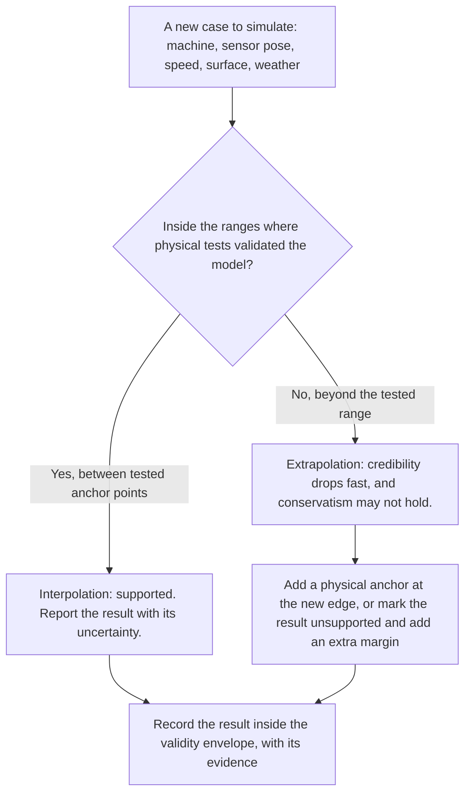

*Inside the envelope the model interpolates between physical anchors; outside it extrapolates and needs new anchors or explicit caveats.*

**Why it matters here.** The envelope is likely to exclude exactly the conditions the system most needs to handle. Natural fog, snow, dense dust and low sun may not occur during a four-month window, so physical anchors in those classes need chambers, artificial dust and night sessions booked before mid-2027, or the envelope will not contain them [Chapter 10]. The responsible fallback is to release automatic braking only inside the envelope where the safety case is closed, and keep warning-only behavior outside it [Chapter 13].

**Related terms.** [Operational design domain (ODD) and operating-domain taxonomy](#operational-design-domain-odd-and-operating-domain-taxonomy), [Validated parameter ranges and known model limits](#validated-parameter-ranges-and-known-model-limits), [Extending a validated model to another machine model or sensor position](#extending-a-validated-model-to-another-machine-model-or-sensor-position), [False confidence from simulation](#false-confidence-from-simulation), [Staged release and limited operating domain](#staged-release-and-limited-operating-domain), [Sensitivity analysis](#sensitivity-analysis), [Credibility factors and credibility levels](#credibility-factors-and-credibility-levels).

### Validated parameter ranges and known model limits

**In one sentence.** Validated parameter ranges are the specific values of each input (speed, mass, mount height, visibility) between which a model has been checked against physical data, and known model limits are the documented places where it is known to be wrong, approximate or silent.

**Explained.** A validity envelope is the overall box; validated parameter ranges are its individual edges, written one parameter at a time. "Brake model validated for 15 to 60 t gross mass, 0 to 12% grade, 5 to 40 km/h, dry compacted and wet gravel" is a set of validated ranges. "Does not represent brake fade above 150 degrees C; dust model validated only above 70% optical transmittance" is a set of known limits.

The booklet treats this record as a deliverable. In Chapter 1's phase plan, the evidence leaving the sensor-correlation phase is literally "validated parameter ranges, known model limits" [Chapter 1]. Chapter 6 lists what a sensor model's credibility file should hold: sensor and firmware version; machine and mounting configuration; which conditions were used for calibration and which held out for validation; reference instrumentation and its uncertainty; weather, lighting and material parameters; metric and threshold; error and confidence intervals; known invalid regions; and any tuning done with validation data [Chapter 6]. Chapter 10 adds known discrepancies (biases, unexplained residuals, non-conservative cases) and change triggers, the product, software or environment changes that invalidate the evidence [Chapter 10].

Known limits are safety information. The failure these records prevent is a model "silently extrapolated to a different machine or sensor position" [Chapter 6]. Failed validation cases belong in the record; deleting them destroys information about model-form weakness [Chapter 10].

**Why it matters here.** With 100 or more machine models and many sensor positions, the organization will constantly ask whether an existing model covers a new case. Only written ranges and limits can answer [Chapter 10].

**Related terms.** [Validity envelope (domain of validity) and extrapolation](#validity-envelope-domain-of-validity-and-extrapolation), [Extending a validated model to another machine model or sensor position](#extending-a-validated-model-to-another-machine-model-or-sensor-position), [Sensor and prototype freeze (project milestones)](#sensor-and-prototype-freeze), [Data storage, data lineage and record keeping for thousands of runs](#data-storage-data-lineage-and-record-keeping-for-thousands-of-runs), [Test management](#test-management-versioning-and-the-traceability-chain), [versioning and the traceability chain for thousands of runs](#test-management-versioning-and-the-traceability-chain), [Model validation versus model calibration](#model-validation-versus-model-calibration).

### Held-out measurements and independent physical data

**In one sentence.** Held-out measurements are physical test results deliberately kept away from the people and processes that build and tune the model, so that they can later prove, rather than suggest, that the model predicts reality.

**Explained.** A teacher who lets students see the exam in advance learns nothing from their marks. Held-out data are the unseen exam. Before prototype testing begins, the physical tests are split into calibration, validation and withheld confirmation sets, and nobody touches the last set until the model and its acceptance criteria are frozen [Chapter 10].

Independence has two parts. The data must be physical, from the real machine or sensor, because comparing one model with another validated model is not accepted as validation; it helps debugging but is circular as evidence [Chapter 10]. And the data must be untouched by tuning: "If every physical case is used to tune sensor, friction and brake parameters, no untouched evidence remains to demonstrate predictive performance" [Chapter 10]. The governance is the reusable holdout: the tuning team sees only aggregate pass or fail at release gates, never per-case results from the audit set [Chapter 9]. Blind prediction, in which the team predicts a test's outcome before it is run, is the strongest form; in structured challenges, expert teams' blind predictions often diverged from experiment [Chapter 12].

The existing warning fleet's logs can serve as an independent replay set that was not used to tune the simulation, within the limits discussed under field history [Chapter 10].

**Why it matters here.** "Virtual metrics keep improving while performance on held-out real data stalls or worsens" is the early sign that the function is being overfitted to the simulator; withheld physical datasets and blind correlation tests are the defense. The assessor will ask which data calibrated the model and which remained independent [Chapters 10, 13].

**Related terms.** [Model validation versus model calibration](#model-validation-versus-model-calibration), [Hold-out set, tuning split](#hold-out-set-tuning-split-and-cross-validation), [cross-validation](#hold-out-set-tuning-split-and-cross-validation), [Over-fitting](#over-fitting), [Training data, validation data, test data, and the independence rule (data lineage)](#training-data-validation-data-test-data-and-the-independence-rule-data-lineage), [Data lineage and the independence rule](#data-lineage-and-the-independence-rule), [Keeping failure-seeking tests separate from performance estimates](#keeping-failure-seeking-tests-separate-from-performance-estimates), [Using the existing warning system's field history as a reference](#using-the-existing-warning-systems-field-history-as-a-reference).

### Deciding which physical tests to keep and which to replace

**In one sentence.** The decision follows information value and extrapolation risk, not a fixed percentage: physical tests stay where they anchor new physics, boundaries and high-consequence outcomes, and simulation fills the repetitive interior between those anchors.

**Explained.** The frameworks agree on the logic though none gives a number. Space and medical practice keep physical testing where model risk is high and validation evidence weakest; nuclear practice gives test data to highly ranked phenomena; aviation always tests the baseline seat and lets simulation cover eligible variants; rail validates the model with running tests and then extends the assessed conditions [Chapter 10].

Physical tests are the strongest candidates to keep when they establish a new phenomenon, validate the ends of the intended domain, expose coupled failure mechanisms, verify conditions where the safety margin is smallest, test new sensor placement, validate weather and contamination models, or investigate a discrepancy. Simulation is strongest for interpolation within an anchored domain, parameter sweeps around a validated configuration, and closely related variants whose differences can be bounded [Chapter 10].

Published percentages are rare: a working document for the United Nations car braking regulation carries 30% physical tests, but the adopted text leaves the number to agreement with the authority; a small-scale academic study avoided 51% to 66% of physical tests; no off-road figure exists. The booklet therefore plans in physical anchors rather than percentages [Chapter 10].

Its recommended split, a reasoned position: keep physical the brake performance and stopping distance per machine class across load, slope and surface extremes; the mining standard's performance and false-positive tests per scenario class; sensor characterization at each mounting extreme and in each degraded-visibility class; and end-to-end confirmation runs chosen by the assessor, including closed-loop stops at the collision boundary. Simulation replaces or densifies the combinatorial sweep across layouts, angles, speeds and objects, weather intensities between anchors, intermediate machine sizes, and fault-injection cases [Chapter 10].

**Why it matters here.** "A defensible physical-test percentage for this program cannot be specified today"; the replaceable fraction must be an output of the credibility work, not an input assumption [Chapters 10, 13].

**Related terms.** [Model risk: influence times consequence](#model-risk-influence-times-consequence), [Nuclear practice: EMDAP, PIRT and BEPU](#nuclear-practice-emdap-pirt-and-bepu), [Validity envelope (domain of validity) and extrapolation](#validity-envelope-domain-of-validity-and-extrapolation), [Physical tests needed to build and check a braking model (how many, which)](#physical-tests-needed-to-build-and-check-a-braking-model), [Combining simulation and physical evidence (how many virtual runs a physical test can anchor)](#combining-simulation-and-physical-evidence), [Proving ground, track test and whole-machine test](#proving-ground-track-test-and-whole-machine-test), [Campaign (test campaign) and campaign architecture for the four-month window](#campaign-test-campaign-and-campaign-architecture).

### Extending a validated model to another machine model or sensor position

**In one sentence.** A model validated on one machine is extended to another by showing what changed, whether the change can affect a validated phenomenon, and what targeted bridging tests close the gap; it is never inherited automatically.

**Explained.** A tailor who has fitted one suit takes far fewer measurements for the next customer, because the pattern is known, but does not skip them. Model transfer works the same way: validation-domain extension by similarity plus bridging evidence, not "Model A was validated, therefore Model B is validated". Rail, aviation, nuclear and medical practice all formalize this; no published off-road example of variant transfer was found [Chapter 10].

The booklet's recommended practice is a parameterized family model rather than 20 unrelated models, with parameters such as geometry and articulation, mass and payload, brake dynamics, sensor type, mounting height and angle, vibration and latency, validated at the corners of the envelope (smallest and largest machine, lowest and highest mount, lowest and highest mass). For each new variant the safety case answers three questions: what changed (a configuration-controlled delta); can that change affect a validated phenomenon or safety output (sensitivity analysis and uncertainty propagation); and what bridging evidence closes the gap (none for irrelevant differences, targeted component tests for influential ones, new full-system anchors where new physics appear). A variant inside the validated hull gets a reduced delta set: brake calibration plus a sensor field-of-view and detection check at the new mount. A variant outside the hull, or one introducing a new phenomenon such as articulated steering, is re-validated [Chapter 10].

Sensor relocation deserves special caution: even with unchanged hardware, moving a sensor changes occlusion, angle of incidence, ground returns, vibration and contamination patterns, so sensor pose is a model input with its own validated range [Chapter 10].

**Why it matters here.** Portability is a key experiment, not a fact: the "machine-variant portability test" checks whether a second, substantially different model is parameterization or redevelopment. The claim that chosen extremes bound all intermediate machines must itself be demonstrated, because geometry and occlusion can create non-monotonic effects [Chapters 10, 13].

**Related terms.** [Equivalence argument (similarity argument) between machine variants](#equivalence-argument-between-machine-variants), [Validity envelope (domain of validity) and extrapolation](#validity-envelope-domain-of-validity-and-extrapolation), [Sensitivity analysis](#sensitivity-analysis), [Variant management (sensor placement, viewpoint changes, machine variants)](#variant-management), [Transferring settings across machine models](#transferring-settings-across-machine-models-physics-based-parameterization-archetypes-partial-pooling-transfer-optimization), [Calibration (intrinsic and extrinsic) and sensor mounting](#calibration-intrinsic-and-extrinsic-and-sensor-mounting), [Rail practice: EN 14363 and DynoTRAIN](#rail-practice-en-14363-and-dynotrain).

### Using the existing warning system's field history as a reference

**In one sentence.** The years of recorded operation of the current warning system can validate the simulation's inputs and some of its submodels, but not the new closed-loop braking chain, and only if three traps are respected.

**Explained.** The manufacturer's warning systems have logged detections, warnings and conditions for years. Can that history be the reference against which the simulator is checked? The booklet's answer: yes as part of the evidence, no as a validation of the braking function [Chapter 10].

The accepted forms come from other industries: aviation accepts service history for similar systems when differences are justified; replaying logged sensor data is common road-vehicle practice; the European automated-vehicle rules require real-world data in the validation set. If the new system reuses the warning system's sensors and mounting, the logs are direct validation data for those models, provided they hold usable ground truth. The history can anchor the frequency and geometry of encountered objects, weather and site distributions, sensor contamination, nuisance-warning patterns and operator response timing, and serve as an independent replay set [Chapter 10].

What it is not: "proven in use" (ISO 26262-8 clause 14, IEC 61508) is a route for reusing an element whose conditions of use match the fielded ones. It does not validate a simulator, and adding automatic braking changes the item. No standard or assessor statement accepting a legacy system's history as the reference for validating a simulator was found [Chapter 10].

The three traps. Exposure must be known: "few incidents in ten million hours" says little without the number of relevant encounters. Field history is censored and open-loop: a warning may cause the operator to brake, so the logs rarely show what would have happened without intervention, or how machine and operator behave once braking intervenes. And the system boundary changes: the warning product has no field evidence for brake command timing, pressure build-up, stability during intervention or unintended-braking hazards [Chapter 10].

**Why it matters here.** The defensible claim is that field history validates selected inputs and submodels and supports the representativeness of the scenario distribution, not that it validates the automatic-braking simulator [Chapter 10].

**Related terms.** [Warning-system fleet (the existing machines with a warning system; "field history")](#warning-system-fleet), [Proven in use and reuse of evidence (across machine models)](#proven-in-use-and-reuse-of-evidence), [Replay and re-simulation of recorded data (open-loop replay)](#replay-and-re-simulation-of-recorded-data-open-loop-replay), [Open loop versus closed loop](#open-loop-versus-closed-loop), [Exposure (hours of operation, number of interactions)](#exposure), [Held-out measurements and independent physical data](#held-out-measurements-and-independent-physical-data), [Field monitoring and operational monitoring](#field-monitoring-and-operational-monitoring).

### False confidence from simulation

**In one sentence.** False confidence is trusting a result more than its evidence justifies, and the booklet documents three ways it happens: using a model outside its data, choosing a metric that hides the error, and relying on a test protocol that never sampled the dangerous condition.

**Explained.** The canonical case is the space shuttle Columbia, lost on re-entry on 1 February 2003. After a foam strike at launch, engineers used the Crater impact model to assess tile damage. The investigation board found that the debris was about 400 times (an early briefing said 640 times) the size in the model's test database, and that when the model predicted penetration deeper than the tile, engineers "used their judgment" to conclude it would not. Crater had overpredicted damage for small impacts, and that conservative bias was assumed to hold for a far larger strike. The board also criticized briefing slides that buried key information in vague words. A former program manager argues instead that the model warned correctly and management overrode it; the booklet records both views. Either way, two failure modes appear: a model used outside its envelope, and human reinterpretation of its result [Chapter 10].

The second form is metric-driven. In aviation seat certification, one comparison showed 0.3% peak error but 60.4% time-history error; validating only the peak would have called the model excellent. A head-injury model passed its validation comparisons but showed a non-conservative tendency, so the regulator limited its use to lower-severity cases [Chapter 10].

The third form is protocol-bounded evidence. Independent tests of pedestrian automatic braking on cars found that none of four vehicles avoided a pedestrian at night at 25 mph in 2019; by 2025 night avoidance had improved to 60%. Daytime protocols had not revealed the cliff [Chapter 10].

**Why it matters here.** Mapped onto the program: conservatism in light dust does not transfer to dense dust; one agreement number can hide timing disagreement that changes a collision outcome; and a scenario catalog that omits night, glare or dense dust produces clean results that mean nothing there. "If the virtual and bench models are wrong, millions of virtual scenarios produce false confidence" [Chapters 1, 10].

**Related terms.** [Columbia Accident Investigation Board](#columbia-accident-investigation-board-why-a-space-shuttle-accident-appears-in-a-mining-booklet), [Validity envelope (domain of validity) and extrapolation](#validity-envelope-domain-of-validity-and-extrapolation), [Time-history agreement](#time-history-agreement), [Pedestrian AEB (PAEB)](#pedestrian-aeb-paeb), [Season and weather coverage (why winter matters for the timeline)](#season-and-weather-coverage), [NASA-STD-7009 and NASA-HDBK-7009](#nasa-std-7009-and-nasa-hdbk-7009), [Visuals that work](#visuals-that-work).

### Simulation specialist's objections

**In one sentence.** In the booklet's hostile review, the simulation specialist's objections reduce to three: the model is unvalidated, the simulator architecture is being frozen against assumed hardware, and metrics risk being chosen for convenience after the fact.

**Explained.** Chapter 13 gives seven reviewers the strongest version of their case against the plan. The simulation specialist's case is the one this part of the glossary exists to explain.

Unvalidated model. The simulator is a measurement instrument that has not been calibrated or validated and has no defined envelope. The European automated-vehicle regulation requires a credibility assessment that defines the envelope, documented validation of each model, and evidence of the competence of the teams that validate and use the toolchain; NASA and ASME require validation against the real application, not internal consistency. A related worry is common-mode error: if the virtual sensor, the collision logic and the test oracle share the same simplifying assumptions, a large virtual campaign gives very consistent, very misleading results [Chapter 13].

Frozen simulator architecture. The toolchain is built against assumed hardware until mid-2027, and a model is credible only for its validated configuration. If sensor type, mounting, controller timing or brake controller change in 2027 without impact analysis, the pre-built simulator is invalidated. The counsel is to settle every supplier dependency before the architecture is frozen, freeze sensors early, and reserve physical re-correlation tests after changes [Chapter 13].

Convenient metric. The assessor package must contain a prospective validation plan with pre-declared metrics and thresholds, precisely to prevent "changing the metric or tolerance after seeing inconvenient results", and physical confirmatory tests should be chosen by the assessor or by risk analysis "rather than by convenience" [Chapter 10]. Early warning signs: no agreed correlation metrics by early 2027, and huge virtual test counts with no residuals, uncertainty or approved envelope [Chapter 13].

**Why it matters here.** What would satisfy this reviewer: a verification report; a credibility assessment defining the envelope; validation against independent held-out physical referents; uncertainty and sensitivity analysis; configuration and provenance control; model-change revalidation rules; proof that results are not dominated by model uncertainty; and an explicit list of unsupported claims [Chapter 13].

**Related terms.** [Red team and hostile review (as used in Chapter 13)](#red-team-and-hostile-review), [Failure mode (of a project) and early warning sign (as used in Chapter 13)](#failure-mode-of-a-project-and-early-warning-sign), [Credibility of a simulation](#credibility-of-a-simulation), [Sensor and prototype freeze (project milestones)](#sensor-and-prototype-freeze), [Pre-registration (deciding the analysis before seeing the data)](#pre-registration), [Common-cause failure and independence of channels](#common-cause-failure-and-independence-of-channels), [Held-out measurements and independent physical data](#held-out-measurements-and-independent-physical-data).

### The credibility package (what a safety board or outside assessor expects to see)

**In one sentence.** The credibility package is the full set of documents an internal safety board or external assessor needs before relying on simulation evidence, and it contains far more than simulator results.

**Explained.** A court does not accept "trust me, the analysis was thorough". It wants the evidence, the method, the chain of custody and the dissent. The booklet synthesizes what the space, medical, nuclear, aviation, rail and automotive frameworks jointly expect [Chapter 10].

The items: the safety decision and context of use with a model-risk rating; traceability from each simulation output to the hazard it addresses; a scenario catalog traced to the hazard analysis, with a ranking of phenomena; model architecture and assumptions, showing which physics are represented, simplified or omitted; software and model verification plus configuration management; input and data pedigree; a prospective validation plan with pre-declared metrics and thresholds; independent physical validation data covering the operating domain; multi-metric correlation evidence; uncertainty and sensitivity analysis and a documented validity envelope; applicability and transfer analysis for variants and sensor poses; physical confirmatory tests, some chosen by the assessor, with results; failed tests and how each discrepancy was resolved; configuration and change control; a record of qualified people and independent review; an in-service monitoring plan; and a residual-risk statement with limitations [Chapter 10].

Three presentation rules: show a map, not a score; use plain charts and words, not slides that bury caveats; and represent the argument in a structured form such as Goal Structuring Notation. Chapter 13 adds a one-page credibility map for every safety claim and the rule that reviewers approve specific substitutions, never "virtual testing" as a category [Chapters 10, 13].

**Why it matters here.** A board should be especially skeptical of validation evidence produced only after mid-2027 if the same four months were used to tune the model. The strongest argument is not "simulation replaced physical testing" but: physical testing established the anchors; independent validation showed the simulation predicts the safety-relevant quantities with quantified uncertainty inside them; the model covered the infeasible interior; targeted physical confirmation remained at high-risk boundaries [Chapter 10].

**Related terms.** [Safety case and safety argument (claims, arguments, evidence)](#safety-case-and-safety-argument), [Goal Structuring Notation (GSN) and Structured Assurance Case Metamodel (SACM)](#goal-structuring-notation-gsn-and-structured-assurance-case-metamodel-sacm), [Independent assessment, independent test body and safety board](#independent-assessment-independent-test-body-and-safety-board), [Traceability (claim to requirement to scenario to test to evidence)](#traceability), [Residual risk and "as low as reasonably practicable" (ALARP)](#residual-risk-and-as-low-as-reasonably-practicable-alarp), [Field monitoring and operational monitoring](#field-monitoring-and-operational-monitoring), [CE marking and notified body](#ce-marking-and-notified-body), [Validity envelope (domain of validity) and extrapolation](#validity-envelope-domain-of-validity-and-extrapolation).

### Independent review of the test plan

**In one sentence.** Independent review of the test plan is having people who did not write the plan, and who do not need it to succeed, examine what will be tested, how, with which metrics and thresholds, before the tests begin.

**Explained.** An author cannot proofread their own book well; they read what they meant to write. The people who built the simulator and chose the scenarios are least able to see what the plan omits. Independent review brings in reviewers with no stake in the result: an internal safety board, an independent test body, a notified body, or a red team of skeptical experts.

The review happens before the campaign. Its targets are the context of use, the metrics and thresholds (fixed before results are seen), the split between calibration, validation and withheld data, the choice of physical confirmatory tests (some chosen by the reviewer), the scenario coverage argument, and the declared validity envelope [Chapter 10]. Chapter 1 places "independent test-body review of the plan" before prototype safety testing; Chapter 12 suggests a sequence for the preparation months: structured interviews, a pre-mortem with the skeptics present, an independent red team, and a gate review with recorded dissent [Chapters 1, 12]. Chapter 13 adds a "safety and legal dry run" in which reviewers see one representative evidence package months before launch [Chapter 13].

Independent review cannot rescue incomplete engineering late in a project, and review queues can become the critical path [Chapter 1].

**Why it matters here.** "A record of qualified people and independent review" is on the assessor's list because high-criticality decisions should not depend solely on the model developers' judgment [Chapter 10]. The booklet found no evidence that red teams improve engineering outcomes, so independent review is a safeguard supported by practice and the standards, not a proven cure [Chapter 12].

**Related terms.** [Independent assessment, independent test body and safety board](#independent-assessment-independent-test-body-and-safety-board), [Red team and hostile review (as used in Chapter 13)](#red-team-and-hostile-review), [Pre-mortem, red team and expert review (Delphi method, expert elicitation)](#pre-mortem-red-team-and-expert-review-delphi-method-expert-elicitation), [Pre-registration (deciding the analysis before seeing the data)](#pre-registration), [Evidence gate and decision gate](#evidence-gate-and-decision-gate), [The credibility package (what a safety board or outside assessor expects to see)](#the-credibility-package-what-a-safety-board-or-outside-assessor-expects-to-see), [Stage gate, evidence gate and go or no-go decision](#stage-gate-evidence-gate-and-go-or-no-go-decision).

## Part H: Standards, regulations, bodies and the programs that came before

This part has three runs of entries. The first explains what standards and regulations are and how they work. The second explains every standard and regulation the booklet names, with its status as of October 2026. The third covers the organizations, industry groups and precedent programs, from the mining round tables to the European research projects and the aviation and space cases that the booklet uses as lessons.

### Standard

**In one sentence.** A standard is a written agreement, produced by a committee of experts, that says how something should be made, tested or described so that everyone means the same thing.

**Explained.** The everyday idea is a shared recipe. Paper comes in A4 sheets and a phone charger fits any phone with the same socket because someone wrote down the rules and most makers follow them. A technical standard does the same for machines, tests and words. It is a published document with a number, a title and an edition year, for example "ISO 16001:2017".

Standards are written by volunteers from manufacturers, users, test laboratories, regulators and universities, meeting in a technical committee run by a standards body such as the International Organization for Standardization (ISO). The draft passes through rounds of comment and voting by member countries before publication, and is then reviewed every few years and confirmed, revised or withdrawn. Standards come in levels: basic safety standards for all machines (ISO 12100), generic standards for one aspect of many machines (ISO 13849 for control systems), and machine-specific "type-C" standards such as ISO 21815-3 for collision avoidance on earth-moving machines [Chapter 3].

The point a non-engineer most needs is that a standard is voluntary. It becomes binding in one of four ways: a law points to it (by citing it, "harmonizing" it in the European Union or "designating" it in Great Britain); a contract or purchase specification requires it; a regulator or insurer accepts it as proof of good practice; or the manufacturer chooses it to show it has applied the state of the art. The booklet draws this line firmly: ISO, European EN and Australian AS documents are standards, while the rules of the United States workplace and mine safety agencies (OSHA and MSHA), European Union regulations and South African mine regulations are law, and compliance with one does not prove compliance with the other [Chapter 3]. ISO 16001's 300 millisecond detection limit binds an Australian quarry only if a contract or regulator says "comply with AS ISO 16001".

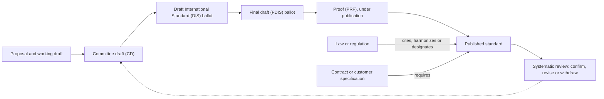

*How a standard is born, and the two ways it becomes binding: a law points to it, or a contract requires it.*

**Why it matters here.** Every core off-road document for this project (ISO 21815, ISO 16001, ISO 3450, ISO 19014) is a standard, not a law, and most are being reissued in late 2026, shortly before the design is frozen [Chapter 3]. The plan must track which standard binds in which market, baseline the editions actually published at the freeze, and remember that no off-road standard found by the booklet lets simulation replace a prescribed physical test [Chapter 3].

**Related terms.** [Standards bodies](#standards-bodies-iso-iec-cen-cenelec-asam-sae-ieee-ul-and-national-bodies), [Technical committee ISO/TC 127 and how a standard is numbered](#technical-committee-isotc-127-and-how-a-standard-is-numbered), [Stage codes](#stage-codes-ts-pas-tr-dis-fdis-prf-under-revision-under-publication), [Regulation, directive, law and guidance note](#regulation-directive-law-and-guidance-note), [Harmonized standard, presumption of conformity and state of the art](#harmonized-standard-presumption-of-conformity-and-state-of-the-art), [Test method](#test-method-test-object-distance-speed-condition-pass-criterion), [ISO 21815 series](#iso-21815-series-collision-warning-and-avoidance), [Evidence](#evidence).

### Standards bodies (ISO, IEC, CEN, CENELEC, ASAM, SAE, IEEE, UL and national bodies)

**In one sentence.** Standards bodies are the organizations that run the committees, hold the votes and publish the standards.

**Explained.** Think of them as publishers that also referee the writing. The International Organization for Standardization (ISO) publishes international standards for almost everything, including the earth-moving machinery standards at the heart of the booklet. The International Electrotechnical Commission (IEC) covers electrical and electronic matters; IEC 61508 (functional safety) and IEC 61496 (safety sensors) are its work. Joint documents carry both names, as in ISO/IEC TR 5469, or three when the Institute of Electrical and Electronics Engineers (IEEE) takes part, as in ISO/IEC/IEEE 15288 [Chapters 3, 12].

In Europe, the European Committee for Standardization (CEN) and its electrical sister CENELEC publish "EN" standards. Many adopt ISO texts (EN ISO 16001:2017); others are European only, such as EN 474 for earth-moving machinery and the railway standards EN 14363 and EN 50716 [Chapters 3, 10]. Their joint artificial-intelligence committee, JTC 21, is listed by the booklet as not verified [Chapter 3].

Industry associations publish standards too. ASAM (Association for Standardization of Automation and Measuring Systems) publishes the file formats simulators use to exchange roads, scenarios, sensor data and materials; the booklet notes ASAM's own statement that no standardized metrics yet exist for judging simulation quality [Chapter 11]. SAE International publishes SAE J1939, the network language ISO/TS 21815-2 uses to let a collision device ask a machine to slow or stop [Chapter 3]. Underwriters Laboratories (UL) publishes UL 4600 for autonomous products [Chapter 12].

National bodies adopt international standards, sometimes with changes. Standards Australia publishes AS 21815.1:2023, a modified adoption of ISO 21815-1 [Chapter 3]. CSA Group (formerly the Canadian Standards Association) publishes CSA M424 for mining machines, not verified by the booklet [Chapter 3]. The British Standards Institution (BSI) circulated the draft of ISO 21815-5 for comment in 2025 [Chapter 3]. DIN, the German Institute for Standardization, plays the same role in Germany; the booklet does not cite it directly.

**Why it matters here.** Knowing which body wrote a document tells you its reach: an ISO or IEC text is an international baseline, an EN text can carry legal weight in Europe, an ASAM text is an engineering file format, and a national adoption may differ from the original for a machine sold in that country [Chapter 3].

**Related terms.** [Standard](#standard), [Technical committee ISO/TC 127 and how a standard is numbered](#technical-committee-isotc-127-and-how-a-standard-is-numbered), [Open Simulation Interface (ASAM OSI) and the ASAM organization](#open-simulation-interface-asam-osi-and-the-asam-organization), [Vehicle network: CAN bus, SAE J1939, DBC file](#vehicle-network-can-bus-sae-j1939-dbc-file), [Assurance case for autonomous products (UL 4600)](#assurance-case-for-autonomous-products-ul-4600), [ISO 6165 and ISO 20474 / EN 474](#iso-6165-and-iso-20474--en-474-classification-and-general-safety-of-earth-moving-machinery).

### Technical committee ISO/TC 127 and how a standard is numbered

**In one sentence.** ISO/TC 127 is the ISO committee for earth-moving machinery, and the numbers, parts and years in a standard's name tell you exactly which document and which edition is meant.

**Explained.** The International Organization for Standardization (ISO) divides its work among numbered technical committees (TC). ISO/TC 127 is responsible for earth-moving machinery, and nearly every off-road standard in the booklet comes from it: the ISO 21815 collision series, ISO 16001 on object detection, ISO 3450 on brakes, ISO 19014 on functional safety, ISO 17757 on autonomous machines and ISO 6165, which defines the machines [Chapter 3]. The booklet found no ISO/TC 127 study on applying road-vehicle simulation methods to off-road machines [Chapter 2].

Reading a name takes a minute. In "ISO 21815-1:2022", "ISO" is the body, "21815" the standard's number, "-1" Part 1 of a multi-part series (each part is a separate document with its own scope and date) and ":2022" the edition year. "ISO 16001:2017" is a single-part standard whose current edition is from 2017; an old year does not mean an outdated text, since ISO 3450:2011 was reviewed and confirmed in 2022 [Chapter 8]. A new edition replaces the old one, which is why the booklet keeps saying that all five parts of ISO 19014 change in October 2026 [Chapter 3].

Letters after "ISO" say what kind of document it is: "ISO/TS" a technical specification, "ISO/PAS" a publicly available specification, "ISO/IEC TR" a technical report written jointly with the International Electrotechnical Commission (IEC), "ISO/PRF" a standard at proof stage. Prefixes such as "EN ISO" or "AS" mark a European or Australian adoption.

**Why it matters here.** Mixing editions is a real risk. The plan should baseline the ISO 19014 editions actually published in October 2026 rather than mixing 2018, 2020, 2022 and 2026 clauses, and ISO 21815-4 should not be cited as published until its text appears [Chapter 3].

**Related terms.** [Standard](#standard), [Standards bodies](#standards-bodies-iso-iec-cen-cenelec-asam-sae-ieee-ul-and-national-bodies), [Stage codes](#stage-codes-ts-pas-tr-dis-fdis-prf-under-revision-under-publication), [ISO 21815 series](#iso-21815-series-collision-warning-and-avoidance), [ISO 19014 series](#iso-19014-series-functional-safety-for-earth-moving-machinery), [ISO 6165 and ISO 20474 / EN 474](#iso-6165-and-iso-20474--en-474-classification-and-general-safety-of-earth-moving-machinery).

### Stage codes (TS, PAS, TR, DIS, FDIS, PRF, under revision, under publication)

**In one sentence.** Stage codes are the labels that tell you how far a standard has traveled from first draft to published text, and whether the published text is about to change.

**Explained.** A standard moves through stages, and the International Organization for Standardization (ISO) gives each a code. A Committee Draft (CD) circulates inside the committee; ISO/IEC CD TS 22440 on artificial intelligence (AI) and functional safety, a joint document with the International Electrotechnical Commission (IEC), was there in 2026, which is why the booklet expects no publication before 2027 or 2028 [Chapter 3]. A Draft International Standard (DIS) goes to all member countries for a vote; the booklet reviewed the 2022 DIS of ISO 21815-3, not the published text, and warns the final edition may differ [Chapter 3]. A Final Draft International Standard (FDIS) is the last ballot on wording; ISO 21815-4 passed it on 28 May 2026. A Proof (PRF) is the typeset text awaiting printing, stage 50.20; ISO/PRF 21815-5 was there in September 2026. "Under publication" is stage 60.00: the vote is won and the text is being prepared; all five parts of ISO 19014 reached it in August 2026 for publication in October 2026 [Chapter 3]. Only after that is a document a published standard.

Three labels mark documents that are not full standards. A Technical Specification (TS) is published when a committee agrees on content but not yet on a full standard; ISO/TS 21815-2 and ISO/TS 19014-5:2021 are examples, and the latter is being promoted to a full standard in October 2026 [Chapter 3]. A Publicly Available Specification (PAS) is faster still; ISO/PAS 8800 and the draft ISO/PAS 34506 are examples [Chapters 3, 5]. A Technical Report (TR) is informative guidance with no requirements; ISO/IEC TR 5469:2024 is "guidance on AI and functional safety, not a requirements document" [Chapter 3].

"Under revision" means a published edition is in force but its replacement is in the pipeline; the booklet marks ISO 19014, ISO 13849-2 and ISO 3691-4 this way [Chapter 12]. "Confirmed" means a review found no need to change (ISO 16001:2017, confirmed 2023). "Withdrawn" means dead: ISO 15998 was withdrawn on 14 June 2022 [Chapter 3]. Quoting a DIS as if it were a standard is like quoting a bill as if it were law.

**Why it matters here.** The booklet's evidence labels "(draft)", "(under publication)" and "(under revision)" rest on these codes, and the timing is awkward: ISO 19014 Parts 1 to 5, ISO 21815-4 and ISO 21815-5 all change in October and November 2026, a few months before the design freeze, so the plan needs a standards watch and a re-baselining step [Chapter 3].

**Related terms.** [Standard](#standard), [Technical committee ISO/TC 127 and how a standard is numbered](#technical-committee-isotc-127-and-how-a-standard-is-numbered), [ISO 21815 series](#iso-21815-series-collision-warning-and-avoidance), [ISO 19014 series](#iso-19014-series-functional-safety-for-earth-moving-machinery), [ISO 21448, ISO 26262 and the AI safety standards](#iso-21448-iso-26262-and-the-ai-safety-standards-isopas-8800-isoiec-tr-5469-isoiec-42001-23894-24029), [Evidence](#evidence).

### Regulation, directive, law and guidance note

**In one sentence.** A law is a rule the state can enforce, a regulation and a directive are two forms that European Union law takes, and a guidance note is official advice that explains how to comply without itself being law.

**Explained.** A law is made by a parliament or government and enforced by inspectors and courts. On a job site that means, for example, United States rule 29 CFR 1926.601, which requires a reverse alarm or an observer when a machine's rear view is blocked, or South Africa's Mine Health and Safety Regulation 8.10, which requires automatic braking on diesel trackless mobile machines [Chapter 3]. The booklet calls such texts "law" to separate them from standards.

In the European Union (EU), two forms matter. A regulation applies directly and identically in every member state from a fixed date; the Machinery Regulation (EU) 2023/1230 applies from 20 January 2027 with no national rewriting [Chapter 3]. A directive sets goals that each member state must write into national law, so wording and enforcement can differ by country; the Machinery Directive 2006/42/EC, which the Regulation replaces, and the Product Liability Directive (EU) 2024/2853, applying to products placed on the market after 9 December 2026, are directives [Chapters 3, 12].

Countries use their own words. United States federal rules sit in the Code of Federal Regulations: "30 CFR 75.1732" is title 30, part 75, section 1732 [Chapter 3]. Australia has "model" Work Health and Safety regulations that bind only once a state or territory adopts them [Chapter 3]. South Africa has an Act with regulations under it, which can be "promulgated" (published) in one year and "commenced" (brought into force) much later: Regulation 8.10 was promulgated in 2015 and its braking clauses commenced on 21 December 2022 [Chapter 3].

A guidance note is official advice from a regulator about how to meet the law. It is not binding, but inspectors use it. Queensland's Guidance Note QGN 33 says of itself that it "is not a Recognised Standard"; India's mines-safety circulars are "official guidance and enforcement material"; Australia's Code of Practice on plant is "the official explanatory material" [Chapter 3]. Interpretation letters from OSHA, the United States construction safety agency, which accept a camera or radar as an alternative to a reverse alarm under conditions, play a similar role [Chapter 3].

**Why it matters here.** The booklet's regional survey found law of very different shapes: a hard automatic-braking mandate only in South Africa, warning and risk-program duties in the United States, general machinery law in the EU and Britain, and guidance notes in Australia and India. None sets a complete numeric test for automatic braking, so most acceptance criteria must come from standards, customer specifications and the manufacturer's own safety case [Chapter 3].

**Related terms.** [Standard](#standard), [Harmonized standard, presumption of conformity and state of the art](#harmonized-standard-presumption-of-conformity-and-state-of-the-art), [CE marking and notified body](#ce-marking-and-notified-body), [EU Machinery Regulation (EU) 2023/1230, the AI Act, the Product Liability Directive and the Data Act](#eu-machinery-regulation-eu-20231230-the-ai-act-the-product-liability-directive-and-the-data-act), [United States rules (OSHA 29 CFR 1926.601, MSHA 30 CFR, NIOSH)](#united-states-rules-osha-29-cfr-1926601-msha-30-cfr-niosh), [South Africa rules (MHSA, DMRE, Chapter 8 regulations, MOSH, CPS verification specifications)](#south-africa-rules-mhsa-dmre-chapter-8-regulations-mosh-cps-verification-specifications).

### Harmonized standard, presumption of conformity and state of the art

**In one sentence.** A harmonized standard is one that European law officially lists, so that a product built to it is presumed to meet the law, and "state of the art" is the legal phrase for the level of safety that current good practice makes possible.

**Explained.** European Union (EU) product law such as the Machinery Regulation sets "essential health and safety requirements" in general words: the machine must be safe, risks reduced, control systems reliable. It does not say how. The European Commission asks the European standards bodies CEN and CENELEC to write standards that spell out the how, and publishes their references in the Official Journal. A standard on that list is "harmonized" [Chapter 3].

The reward is the presumption of conformity: build and test to a harmonized standard and the law presumes the matching requirement is met, so the burden shifts to anyone who claims otherwise. Following the published building code is not the only way to build a safe house, but it is the way the inspector accepts without argument. Great Britain copied the mechanism as "designated standards"; its notice of 8 August 2026 designated the EN 474:2022 earth-moving machinery family [Chapter 3].

The presumption is only as wide as the standard. EN 474 gives "a presumption-of-conformity route but is not an automatic-braking performance matrix", and whether EN 474 or EN ISO 21815 will be harmonized under the new Machinery Regulation was not verified, because the Commission was still preparing the list in 2026 [Chapter 3].

"State of the art" is the fallback when no harmonized standard fits: the manufacturer must apply what competent engineers currently know how to do, and standards are the usual evidence of that even when not harmonized. The booklet lists "the manufacturer's chosen route to demonstrate the state of the art" as one way a voluntary standard becomes legally significant [Chapter 3].

**Why it matters here.** The machine will be sold in the EU under a regulation whose harmonized list was unfinished in 2026, so the booklet asks for a standards-status checkpoint immediately before the 2027 declaration of conformity [Chapter 3]. Where no harmonized standard covers automatic braking, the manufacturer's own safety case carries the weight.

**Related terms.** [Standard](#standard), [Regulation, directive, law and guidance note](#regulation-directive-law-and-guidance-note), [CE marking and notified body](#ce-marking-and-notified-body), [Type approval, self-certification and conformity assessment](#type-approval-self-certification-and-conformity-assessment), [EU Machinery Regulation (EU) 2023/1230, the AI Act, the Product Liability Directive and the Data Act](#eu-machinery-regulation-eu-20231230-the-ai-act-the-product-liability-directive-and-the-data-act), [ISO 6165 and ISO 20474 / EN 474](#iso-6165-and-iso-20474--en-474-classification-and-general-safety-of-earth-moving-machinery), [Safety case and safety argument](#safety-case-and-safety-argument).

### Type approval, self-certification and conformity assessment

**In one sentence.** Conformity assessment is the process of checking that a product meets the rules; type approval and self-certification are two ways of doing it, an authority checking a sample and issuing an approval, or the manufacturer checking and declaring for itself.

**Explained.** There are two ways to prove a restaurant kitchen is clean: an inspector certifies it before you open, or you follow the rules, keep records, sign a declaration and expect inspection later. Both are conformity assessment; they differ in who checks and when.

Type approval is the first model and the way road vehicles are regulated under the United Nations (UN) regulations and in the European Union. The manufacturer presents a representative vehicle, the "type", to a national type-approval authority, which tests it against the regulation (UN R131 for truck emergency braking, for example) and issues an approval covering every vehicle of that type [Chapter 3]. Under UN R171 the credibility assessment of any simulation "shall be provided to the Type Approval Authority" [Chapter 3].

Self-certification, more precisely the manufacturer's declaration of conformity, is the normal model for machinery. The manufacturer performs the risk assessment, applies standards, compiles a technical file and signs; a notified body is involved only for listed high-risk products. The booklet puts it plainly: "off-road relies on manufacturer self-declaration, notified bodies or site acceptance, not vehicle type approval" [Chapter 3]. Site acceptance is the third layer, common in mining: the mine operator or an independent verifier checks the installed system against the regulation and the customer's specification, as South African mines do against Regulation 8.10 and the mining industry's MOSH requirements [Chapters 2, 3].

Conformity assessment also fixes the evidence rules. EU machinery conformity "rests on technical documentation of design, risk assessment and verification rather than on every conclusion being generated on a proving ground", which is what makes analytical and simulation evidence admissible at all [Chapter 3].

**Why it matters here.** Nobody will hand this project a type approval. In most markets the accepting body is the manufacturer's safety board plus customers; in the EU it may include a notified body if machine learning performs the safety function; in South Africa it is the mine against law and industry specifications [Chapters 2, 3]. The booklet's advice is to decide early who accepts the evidence, because that shapes what evidence must be produced [Chapter 2].

**Related terms.** [CE marking and notified body](#ce-marking-and-notified-body), [Harmonized standard, presumption of conformity and state of the art](#harmonized-standard-presumption-of-conformity-and-state-of-the-art), [UN regulations (UN R152, R131, R159, R171) and UNECE WP.29, GRVA, VMAD and NATM](#un-regulations-un-r152-r131-r159-r171-and-unece-wp29-grva-vmad-and-natm), [Independent assessment, independent test body and safety board](#independent-assessment-independent-test-body-and-safety-board), [Safety case and safety argument](#safety-case-and-safety-argument), [MOSH and its TRL stage gates](#mosh-and-its-trl-stage-gates-mining-industry-occupational-safety-and-health-learning-hub).

### CE marking and notified body

**In one sentence.** CE marking is the label a manufacturer puts on a product to declare that it meets European Union law, and a notified body is an independent organization appointed by the authorities to check high-risk products before that label may be applied.

**Explained.** The letters "CE" on a machine are not a quality award. They are the manufacturer's own signed statement that the product complies with every European Union (EU) law that applies to it and that a technical file proves it. Applying the mark is the last step of conformity assessment, and for most machinery the manufacturer does the whole assessment alone, using harmonized standards where they exist [Chapter 3].

For products the law considers especially dangerous, a notified body must take part. A notified body is a private test or certification organization that an EU member state has assessed and "notified" to the European Commission as competent for a kind of product. It examines the design, the documentation and sometimes the quality system, and issues a certificate without which the product may not be CE marked. It does not approve the product the way a type-approval authority does; it checks and certifies, and the manufacturer still signs. The comparison is a tax return: most people sign and file, but for complex returns the law may demand an accountant's certificate first.

The Machinery Regulation (EU) 2023/1230 lists the products needing a notified body in Annex I Part A, which now includes "safety components with fully or partially self-evolving behaviour using machine learning approaches ensuring safety functions" and machinery embedding them; every conformity route for Part A involves a notified body [Chapters 1, 3]. Whether a trained perception network that is frozen before delivery counts as "self-evolving" is disputed and was unsettled in 2026 [Chapter 3]. TÜV SÜD announced in September 2024 that it had become the first notified body under the new regulation, so the route exists, but notified-body positions on this question were not found [Chapter 13]. Great Britain has a parallel mark, UKCA (UK Conformity Assessed), and "approved bodies"; Northern Ireland stays under EU product law [Chapter 3].

**Why it matters here.** A machine first sold in mid-2027 falls under the Machinery Regulation from 20 January 2027. If machine learning performs the braking function, the conservative plan budgets for notified-body involvement, and the booklet warns that notified-body lead time alone could exceed the four-month validation window, with that lead time not found [Chapters 1, 3]. Whether any notified body will accept simulation evidence for machinery conformity was also not found; a safety channel without machine learning could change the route [Chapter 13].

**Related terms.** [Type approval, self-certification and conformity assessment](#type-approval-self-certification-and-conformity-assessment), [Harmonized standard, presumption of conformity and state of the art](#harmonized-standard-presumption-of-conformity-and-state-of-the-art), [EU Machinery Regulation (EU) 2023/1230, the AI Act, the Product Liability Directive and the Data Act](#eu-machinery-regulation-eu-20231230-the-ai-act-the-product-liability-directive-and-the-data-act), [United Kingdom rules (HSE, Supply of Machinery Regulations, UKCA)](#united-kingdom-rules-hse-supply-of-machinery-regulations-ukca), [Machine learning in safety functions](#machine-learning-in-safety-functions), [Independent assessment, independent test body and safety board](#independent-assessment-independent-test-body-and-safety-board).

### Test method (test object, distance, speed, condition, pass criterion)

**In one sentence.** A test method, as a standard or regulation defines it, is the exact recipe for one test: what object to use, where to place it, how fast to drive, under what conditions, and what result counts as a pass.

**Explained.** "We tested it and it worked" means nothing until five questions are answered. What was the test object: a person, a mannequin, a foam car, a steel plate? Where was it, how far away, still or moving? How fast was the machine going? What were the conditions: gravel or asphalt, daylight or darkness, loaded or empty, flat or sloped? And what counts as a pass: no contact, impact below a given speed, a warning within a fixed time, or no braking at all in a "false reaction" test? A test method answers all five so that two laboratories get comparable results.

The on-road rules are the most prescriptive. UN R131 for heavy trucks demands a warning at least 0.8 s before emergency braking, a braking demand of at least 4 m/s² (meters per second squared, the rate of slowing), a child pedestrian target to ISO 19206-2 crossing at 5 km/h, and a false-reaction test passing between two parked cars 4.5 m apart at 50 km/h with no warning and no braking [Chapter 3]. The United States rule FMVSS 127 fails a car if a false activation on a steel trench plate at 80 km/h exceeds manual braking by 0.25 g or more [Chapter 3].

Off-road documents give far less. ISO 16001 specifies a test body representative of a person, detection within 300 ms and the pass wording "Detection shall take place unambiguously with an uninterrupted sequence of the signal"; target geometry and distances sit in the paid text [Chapter 3]. ISO 21815-3 works by calculation: the CxS distance (CxS is the standard's shorthand for a collision warning or avoidance system) must let the machine stop short of the object; test object sizes, speeds and trial counts were not found in the reviewed draft [Chapter 3]. The South African, United States and Australian laws state outcomes ("stop before contact", "adequate time to escape") with no meters or speeds [Chapter 3]. The most concrete mining numbers come from the South African mining industry's MOSH specification: 200 m minimum detection range, a 2.5 to 3.0 s warning before intervention, stop gaps of 1.0 to 4.0 m at 10 km/h or less [Chapter 3]. No off-road document quantifies a rain, fog, dust, glare or darkness test condition, and none gives a false-alarm or unnecessary-brake rate per operating hour [Chapter 3].

**Why it matters here.** The project must write most of its own test methods, borrowing the on-road structure, including explicit false-activation tests for berms, dust plumes and parked machines, while replacing the content with off-road objects, speeds and surfaces [Chapter 3]. Prescribed physical tests remain physical unless the standard says otherwise; simulation can inform and extend them but not replace them [Chapter 3].

**Related terms.** [Acceptance criteria and pass or fail criteria](#acceptance-criteria-and-pass-or-fail-criteria), [Soft target, robotic target and target platform](#soft-target-robotic-target-and-target-platform-iso-19206), [ISO 16001 and ISO 5006](#iso-16001-and-iso-5006-object-detection-visibility-aids-and-operator-visibility), [ISO 21815 series](#iso-21815-series-collision-warning-and-avoidance), [UN regulations (UN R152, R131, R159, R171) and UNECE WP.29, GRVA, VMAD and NATM](#un-regulations-un-r152-r131-r159-r171-and-unece-wp29-grva-vmad-and-natm), [FMVSS 127, NHTSA, NTSB and IIHS](#fmvss-127-nhtsa-ntsb-and-iihs), [MOSH and its TRL stage gates](#mosh-and-its-trl-stage-gates-mining-industry-occupational-safety-and-health-learning-hub), [Nuisance braking](#nuisance-braking), [Proving ground, track test and whole-machine test](#proving-ground-track-test-and-whole-machine-test).

### ISO 21815 series (collision warning and avoidance)

**In one sentence.** ISO 21815 is the family of international standards that says what a collision warning or collision avoidance system on an earth-moving machine must do, how it talks to the machine, and how to work out the distance at which it must act.

**Explained.** This is the standard written for the kind of product the booklet is about. It comes from the International Organization for Standardization (ISO) committee ISO/TC 127 and covers earth-moving machines as defined in ISO 6165, underground mining machines per ISO 19296 and road-construction machines [Chapter 3]. It is technology-neutral (no sensor is prescribed), it covers avoidance "by speed reduction or motion inhibit" but not automatic steering, it leaves responsibility for safe operation with the operator, and it does not apply to systems installed before its publication [Chapter 3]. The table gives the five parts and their status as the booklet reports it, October 2026.

| Part | Title (short) | Status in the booklet | What it does |
|---|---|---|---|
| ISO 21815-1:2022 | General requirements | Published, edition 1, January 2022 | Requirements for detecting objects, warning the operator, intervening automatically, and test procedures (numbers sit in the paid text, not reviewed) |
| ISO/TS 21815-2:2021 | On-board J1939 communication interface | Published technical specification, July 2021; confirmed December 2024 | Defines the SAE International J1939 network messages (SLOW_DOWN, CONTROLLED-STOP, EMERGENCY-STOP, capability discovery, keep-alive) by which a collision device (CxD) asks the machine to slow, stop or stay still; "not intended for plug-and-play" |
| ISO 21815-3:2023 | Risk area and risk level for forward and reverse motion | Published, edition 1, August 2023 (the booklet reviewed the 2022 draft) | Defines the CxS distance (CxS being the standard's shorthand for a collision warning or avoidance system): detection, decision, action and stopping distance plus a safe distance; the manufacturer must declare system delays; worked examples for surface and underground machines; type-C under ISO 12100 |
| ISO 21815-4 | Risk area and risk level for swing and rotation | Under publication (stage 60.00) since September 2026; scheduled October 2026 | Rotation of excavators and similar; motion inhibit before rotation starts; expressly "does not cover avoidance by automatic application of the braking" |
| ISO/PRF 21815-5 | Risk area and risk level for other forms of motion | Proof stage (50.20) since September 2026; scheduled November 2026 | Articulation, four-wheel steering, towed trailers in reverse, skid-steer turning, telescopic and vertical motions |

Standards Australia published AS 21815.1:2023, a modified adoption of Part 1 whose changes the booklet could not read, and SA TS ISO 21815.2:2023 for the interface; neither is law unless incorporated [Chapter 3].

On simulation the series says nothing that was found. Part 3 relies on calculation of the CxS distance, which "supports analytical evidence for stopping-distance margins but is not simulation-based acceptance"; Parts 1 and 3 expect physical tests, and an ISO 21815 physical test cannot be declared satisfied because a simulation passed [Chapter 3]. Part 3 notes that false positives "could create alarm fatigue", and its safe offset is set "by the authorized person" at the worksite, so configurable site parameters must be validated too [Chapter 3].

**Why it matters here.** ISO 21815 is "the core off-road standard family, and it is still being completed" [Chapter 3]. The booklet's plan uses Part 3 as the backbone: calculate the CxS distance per machine model from ISO 3450 brake data and declared delays, build the scenario catalog around its risk areas, and present simulation as coverage evidence beside the physical tests the standard prescribes [Chapters 2, 3]. Its separate parts for forward and reverse, swing and articulation are also evidence that off-road motion types need their own hazard models, one reason road scenarios do not transfer directly [Chapter 3].

**Related terms.** [Technical committee ISO/TC 127 and how a standard is numbered](#technical-committee-isotc-127-and-how-a-standard-is-numbered), [Stage codes](#stage-codes-ts-pas-tr-dis-fdis-prf-under-revision-under-publication), [ISO 3450 and ISO 10265](#iso-3450-and-iso-10265-brake-performance), [ISO 6165 and ISO 20474 / EN 474](#iso-6165-and-iso-20474--en-474-classification-and-general-safety-of-earth-moving-machinery), [Vehicle network: CAN bus, SAE J1939, DBC file](#vehicle-network-can-bus-sae-j1939-dbc-file), [Collision Warning System (CWS) and Collision Avoidance System (CAS)](#collision-warning-system-cws-and-collision-avoidance-system-cas), [Required detection range](#required-detection-range), [Stopping distance](#stopping-distance), [Zones (warning zone, braking zone, detection zone)](#zones-warning-zone-braking-zone-detection-zone), [Alarm fatigue](#alarm-fatigue), [Test method](#test-method-test-object-distance-speed-condition-pass-criterion).

### ISO 19014 series (functional safety for earth-moving machinery)

**In one sentence.** ISO 19014 is the family of standards that tells a maker of earth-moving machines how to make sure the electronic control system behind a safety function, such as an automatic brake, is designed, built, tested and programmed so that its faults do not cause harm.

**Explained.** Performance asks "does the system brake when it should?"; functional safety asks "what happens when a wire breaks, a chip fails, the software has a bug or the sensor is caked in mud, and how sure are we that the failure does not cause an accident?" The International Organization for Standardization (ISO) has a generic machinery method for this (ISO 13849) and road vehicles have ISO 26262. For earth-moving machines the sector framework is ISO 19014, and the booklet is clear that this, not ISO 26262, is the right one [Chapter 3].

The series uses the Machine Performance Level (MPL). A hazard and risk analysis assigns a required level, MPLr, to each safety function; the design is then evaluated to show an achieved level, MPLa, at least as high. The method for MPLr is the Machine Control System Safety Analysis (MCSSA) [Chapter 3]. Part 1 gives the MCSSA method and MPLr; Part 2 covers hardware, architecture and MPLa; Part 3 sets environmental tests (vibration, temperature, electrical robustness) for the safety-related electronics; Part 4 covers software and data transmission; Part 5 gives tables of MPLr for common functions so a manufacturer can apply them "without performing a full MCSSA for each new model" when the tables' assumptions hold [Chapter 3].

Scope is the hinge. ISO 19014-2 covers systems that control machine motion or mitigate a hazard and excludes "awareness systems that do not impact machine motion (e.g. cameras and radar detectors)". A warning-only system is outside; a system that can command the brakes is inside [Chapter 3]. The booklet asks for two safety functions to be analyzed separately: failure to intervene when needed, and intervention when it is unsafe or unnecessary, since an unexpected full brake on a loaded truck on a slope is itself a hazard [Chapter 3].

All five parts change at once: edition 2 of Parts 1 to 4 and the first full-standard edition of Part 5 (replacing ISO/TS 19014-5:2021) reached "under publication" in August 2026, scheduled for October 2026, with a European adoption of Part 1 in approval at the European standards body CEN [Chapter 3]. ISO 19014 replaced ISO 15998, withdrawn in June 2022. Whether the Part 5 tables contain an entry for collision avoidance was not reviewed; no published MPLr for this function was found [Chapter 3]. No simulation wording was found [Chapter 12]; functional safety does rest on analytical evidence by nature, which is why the booklet treats simulation as admissible design evidence even where no standard accepts it as a replacement for a physical test [Chapter 3]. Part 4 excludes cybersecurity, whether it requires tool qualification was not found, and Part 3's environmental tests are "not the same as proving a camera, lidar or radar perception chain across visibility and weather combinations" [Chapters 3, 12, 13].

**Why it matters here.** Adding a brake command moves the product into ISO 19014's scope, so the plan needs an MPLr assignment, architecture and fault evidence, environmental qualification and software process evidence, all against editions that appear in October 2026 [Chapter 3]. The Part 5 tables are the only sourced route to reducing the per-model analysis burden when many machine models must be covered in four months [Chapter 3].

**Related terms.** [Functional safety](#functional-safety), [Machine Performance Level (MPL, ISO 19014)](#machine-performance-level-mpl), [Safety function and safety-related control system](#safety-function-and-safety-related-control-system), [Hazard analysis and risk assessment](#hazard-analysis-and-risk-assessment), [Fault, failure, failure mode, and fault injection](#fault-failure-failure-mode-and-fault-injection), [Performance Level (PL) and Category (ISO 13849)](#performance-level-pl-and-category), [Automotive Safety Integrity Level (ASIL, ISO 26262)](#automotive-safety-integrity-level-asil), [ISO 15998 and ISO 13766](#iso-15998-and-iso-13766-withdrawn-control-system-standard-and-emc), [ISO 12100, ISO 13849, IEC 62061 and IEC 61508](#iso-12100-iso-13849-iec-62061-and-iec-61508-the-machinery-and-functional-safety-family), [New risks created by automatic braking](#new-risks-created-by-automatic-braking).

### ISO 3450 and ISO 10265 (brake performance)

**In one sentence.** ISO 3450 and ISO 10265 are the standards that say how well the brakes of an earth-moving machine must work and how to test them, ISO 3450 for wheeled and fast rubber-tracked machines and ISO 10265 for slow crawler machines.

**Explained.** Before anyone asks whether a machine brakes automatically, the brakes themselves must stop it. ISO 3450:2011 (edition 4, confirmed 2022) specifies minimum service, secondary and parking brake performance and tests for wheeled earth-moving machines and rubber-tracked machines with a top speed of 20 km/h or more; purpose-built underground mining machines are covered only by an annex of modifications [Chapters 3, 8]. ISO 10265:2008 (confirmed 2025) covers crawler machines at 20 km/h or less, whose tracks spread the load over a long contact patch and stop differently [Chapter 8].

From a secondary technical article, the booklet reports that ISO 3450 tests at 32 km/h or 80 percent of maximum speed and sets formula-based stopping limits by machine type, for example `v^2 / 44 + 0.1 (32 - v)` for rigid and articulated dumpers under 32 t, where v is the test speed in km/h and the result is in meters; these formulas should be checked against the standard [Chapter 3]. One definition is firm: stopping distance runs from the start of brake-control actuation to standstill, so it includes brake-system response time but excludes operator reaction time [Chapter 8]. These are physical tests; no simulation wording was found, and neither standard gives a number of calibration stops that would let a braking model be trusted across 100 or more site types [Chapters 3, 8]. ISO 17757 requires autonomous machines to pass the same physical braking tests in manual and autonomous mode [Chapter 10].

**Why it matters here.** ISO 21815-3's CxS distance (its required collision-system distance) is built on real stopping distance, so ISO 3450 brake data per machine model is an input to the collision-avoidance calculation [Chapter 3]. Passing ISO 3450 proves nothing about perception, and excellent perception cannot rescue a brake plant that fails its own stopping requirements; on gravel, mud, ice and grades of 10 percent or more, ISO 3450 is more relevant than any imported passenger-car deceleration target [Chapter 3].

**Related terms.** [Stopping distance and the formula d = v^2 / (2a)](#stopping-distance), [Brake dead time and brake build-up time](#brake-dead-time-and-brake-build-up-time), [Deceleration limits and how regulators specify them](#deceleration-limits-and-how-regulators-specify-them), [Wheels versus tracks (crawler machines)](#wheels-versus-tracks), [Hydrostatic drive, retarder and service brake](#hydrostatic-drive-retarder-and-service-brake), [ISO 21815 series](#iso-21815-series-collision-warning-and-avoidance), [ISO 17757 and ISO 19296](#iso-17757-and-iso-19296-autonomous-machine-safety-and-underground-mining-machines), [Physical tests needed to build and check a braking model](#physical-tests-needed-to-build-and-check-a-braking-model).

### ISO 16001 and ISO 5006 (object detection, visibility aids and operator visibility)

**In one sentence.** ISO 16001 sets performance requirements and tests for the systems that detect objects and help the operator see around an earth-moving machine, and ISO 5006 defines how the operator's own field of view is measured.

**Explained.** ISO 16001:2017 (edition 2, confirmed 2023; also EN ISO 16001:2017 in Europe and AS ISO 16001:2020 in Australia) is "the only off-road standard found with hard detection and warning numbers" [Chapter 3]. It covers object detection systems (ODS) and visibility aids such as cameras and mirrors on ISO 6165 machines. It is about warning, not braking.

Its numbers: detection time not more than 300 ms; detection "unambiguously with an uninterrupted sequence of the signal"; an audible warning at least 3 dB above ambient noise, preferably at 500 to 3,400 Hz; a flashing red light within a 120 degree arc as the most severe visual warning; no warnings by vibration alone; self-check at start-up and continuous fault monitoring; deactivation only by "two or more separate and distinct actions"; electromagnetic compatibility to ISO 13766. False signals from fog, snow, rain, wind and dust "should be minimized", a "should" with no number [Chapter 3]. The test body is "a person or a standard measuring unit representative of a person", sized in technology annexes for CCTV, radar, ultrasonic, transponder, electromagnetic transceiver, surround view and vision systems; there is no lidar annex, and the detection zone test is a physical test on the machine or a representative configuration [Chapter 3].

ISO 5006 is the standard for measuring the operator's field of view from the cab and mapping blind areas. The booklet lists it as not verified [Chapter 3] but cites ISO 5006 and ISO 16001 visibility-type methods, with the small-cylinder method of UN R159, as the geometric approach that a digital twin of each machine can reproduce to compute coverage and blind zones before hardware arrives [Chapter 7].

**Why it matters here.** ISO 16001 supplies the only hard off-road numbers for detection latency and warnings and the only per-technology test annexes, so the booklet's plan runs its annex tests for each candidate sensor technology [Chapter 3]. Its gaps matter as much: no lidar annex, no quantified weather conditions and no false-alarm rate, so that evidence must be argued by the manufacturer [Chapter 3].

**Related terms.** [Blind spot and operator visibility](#blind-spot-and-operator-visibility), [Proximity Detection System (PDS)](#proximity-detection-system-pds), [Latency (end-to-end latency, from sensing to brake command)](#latency), [Electromagnetic compatibility (EMC)](#electromagnetic-compatibility-emc), [Switching off and bypassing](#switching-off-and-bypassing), [Test method](#test-method-test-object-distance-speed-condition-pass-criterion), [ISO 15998 and ISO 13766](#iso-15998-and-iso-13766-withdrawn-control-system-standard-and-emc), [Digital twin](#digital-twin), [Lidar](#lidar-light-detection-and-ranging).

### ISO 17757 and ISO 19296 (autonomous machine safety and underground mining machines)

**In one sentence.** ISO 17757 is the safety standard for autonomous and semi-autonomous earth-moving and mining machine systems, and ISO 19296 is the general safety standard for mobile machines that work underground.

**Explained.** ISO 17757:2019 (edition 2, confirmed) applies to autonomous and semi-autonomous machine systems (ASAMS): machines, infrastructure, hardware and software. It requires the safety-related parts of their control systems to meet appropriate functional safety performance, notes that electronic commands control brakes and steering on such machines, and uses the idea of a "defined functional environment" within which the system is meant to operate [Chapters 1, 3]. Its braking and steering tests are physical, run in manual and autonomous mode under ISO 3450 and ISO 10265 [Chapter 10]. Whether it applies here is unclear: function-specific automated features are outside its scope unless used as part of an ASAMS, so "an isolated automatic-braking function on an operator-driven machine should not automatically be claimed to fall under it" [Chapter 3]. No simulation wording was found [Chapter 12].

ISO 19296:2018 gives general safety and foreseeable-misuse requirements for mobile machines working underground. ISO 21815-1 cites it to define the underground machines in its scope; it is "not a stand-alone collision-avoidance performance protocol" [Chapter 3]. For mining machines outside the ISO 6165 definition, ISO 19014 should not simply be assumed to apply; ISO 19296 and generic standards may apply by contract or jurisdiction [Chapter 3].

**Why it matters here.** An operator-driven machine with an intervention function sits in a gray zone between ISO 21815 (collision avoidance) and ISO 17757 (autonomy). The booklet lists this among its open uncertainties and asks that applicable standards be settled early by a qualified functional-safety specialist [Chapters 3, 12]. ISO 17757's "defined functional environment" is the off-road cousin of the operational design domain used for staged release [Chapter 1].

**Related terms.** [Operational design domain (ODD) and operating-domain taxonomy](#operational-design-domain-odd-and-operating-domain-taxonomy), [Staged release and limited operating domain](#staged-release-and-limited-operating-domain), [ISO 3450 and ISO 10265](#iso-3450-and-iso-10265-brake-performance), [ISO 21815 series](#iso-21815-series-collision-warning-and-avoidance), [ISO 19014 series](#iso-19014-series-functional-safety-for-earth-moving-machinery), [ISO 6165 and ISO 20474 / EN 474](#iso-6165-and-iso-20474--en-474-classification-and-general-safety-of-earth-moving-machinery), [Load-haul-dump machine (LHD)](#load-haul-dump-machine-lhd).

### ISO 6165 and ISO 20474 / EN 474 (classification and general safety of earth-moving machinery)

**In one sentence.** ISO 6165 defines which machines count as earth-moving machinery, and ISO 20474 and its European twin EN 474 set the general safety requirements that every such machine must meet.

**Explained.** ISO 6165 is a vocabulary standard that names and classifies earth-moving machines (loaders, excavators, dozers, dumpers, graders). Its importance is indirect: ISO 21815-1, ISO 16001 and ISO 19014 all apply to "machines as defined in ISO 6165", so whether a mining machine is inside ISO 6165 decides which rules reach it [Chapter 3].

ISO 20474-1:2017 and its machine-specific Parts 2 to 15 give baseline safety requirements for earth-moving machinery. Collision avoidance is not their specialized purpose; they sit alongside ISO 21815 and ISO 19014 rather than serving as the acceptance standard for automatic braking [Chapter 3]. EN 474 is the European version, in the 2022 family (EN 474-1 plus machine-specific parts), and is a machine-specific type-C standard [Chapter 3].

EN 474's legal role is why it recurs. In Great Britain, a notice of 8 August 2026 listed the EN 474:2022 family as designated standards, giving a presumption of conformity under the Supply of Machinery (Safety) Regulations 2008, though "not an automatic-braking performance matrix"; the booklet notes a small uncertainty about the notice number [Chapter 3]. Whether EN 474 will be harmonized under the European Union's new Machinery Regulation was not verified, since the list was still being prepared in 2026 [Chapter 3].

**Why it matters here.** Compliance with EN 474 will be part of the machine's declaration but does not answer the automatic-braking question; that evidence must come from ISO 21815, ISO 19014 and the safety case [Chapter 3]. ISO 6165 decides scope, so a project spanning surface and underground machines must check, machine by machine, which standards apply.

**Related terms.** [Heavy off-road machine](#heavy-off-road-machine), [Harmonized standard, presumption of conformity and state of the art](#harmonized-standard-presumption-of-conformity-and-state-of-the-art), [United Kingdom rules (HSE, Supply of Machinery Regulations, UKCA)](#united-kingdom-rules-hse-supply-of-machinery-regulations-ukca), [ISO 21815 series](#iso-21815-series-collision-warning-and-avoidance), [ISO 19014 series](#iso-19014-series-functional-safety-for-earth-moving-machinery), [ISO 17757 and ISO 19296](#iso-17757-and-iso-19296-autonomous-machine-safety-and-underground-mining-machines).

### ISO 15998 and ISO 13766 (withdrawn control-system standard and EMC)

**In one sentence.** ISO 15998 was the former functional-safety standard for electronic machine-control systems on earth-moving machinery, withdrawn in 2022 and replaced by ISO 19014, and ISO 13766 is the standard for electromagnetic compatibility of such machines.

**Explained.** ISO 15998:2008 ("Machine-control systems using electronic components, performance criteria and tests for functional safety") and its companion ISO/TS 15998-2:2012 were withdrawn on 14 June 2022 and replaced by the ISO 19014 series [Chapter 3]. Older documents still refer to it: ISO 16001:2017 points to ISO 15998 for environmental conditions and notes that "ISO 19014-3 can be used as an alternative" [Chapter 3]. A reader who sees ISO 15998 in a supplier document should treat it as dated and ask for the ISO 19014 equivalent.

ISO 13766 covers electromagnetic compatibility (EMC) for earth-moving machinery: the electronics must neither emit radio interference that disturbs other equipment nor be disturbed by interference from outside. ISO 16001 requires an object detection system to meet it, and the South African mining industry's MOSH laboratory phase lists EMC testing among its TRL4 bench tests [Chapters 3, 7].

**Why it matters here.** Withdrawn standards are a trap in a fast project: an old data sheet may cite ISO 15998, which no longer exists [Chapter 3]. EMC matters because a brake request travels on an electronic network and a radar shares the air with other radios; the booklet notes radio-frequency coexistence as one reason a factory emergency brake was disabled in an on-road case [Chapter 13].

**Related terms.** [ISO 19014 series](#iso-19014-series-functional-safety-for-earth-moving-machinery), [ISO 16001 and ISO 5006](#iso-16001-and-iso-5006-object-detection-visibility-aids-and-operator-visibility), [Electromagnetic compatibility (EMC)](#electromagnetic-compatibility-emc), [Electronic control unit (ECU)](#electronic-control-unit-ecu), [Vehicle network: CAN bus, SAE J1939, DBC file](#vehicle-network-can-bus-sae-j1939-dbc-file).

### ISO 12100, ISO 13849, IEC 62061 and IEC 61508 (the machinery and functional-safety family)

**In one sentence.** These four standards form the general toolkit for making any machine safe: ISO 12100 for assessing and reducing risk, ISO 13849 and IEC 62061 for the safety of control systems on machinery, and IEC 61508 as the parent standard for electronic safety systems in every industry.

**Explained.** ISO 12100 is the basic ("type-A") safety-of-machinery standard: identify hazards, estimate and evaluate risk, reduce it first by design, then by safeguards, then by information for use. Machine-specific standards hang from it; ISO 21815-3 is "a type-C standard under ISO 12100" [Chapter 3].

ISO 13849-1:2023 (edition 4) is the generic machinery method for safety-related parts of control systems, including software, using the Performance Level (PL) scale. It "does not itself assign the performance level required for this collision function"; for ISO 6165 machines ISO 19014 is the sector framework, but ISO 13849 stays relevant for subsystems developed generically or machines outside the earth-moving scope [Chapter 3]. ISO 13849-2:2012 covers validation and lists simulation among validation methods and "software simulation of faults"; a draft of edition 3 was issued in 2026 [Chapter 12]. IEC 62061:2021, from the International Electrotechnical Commission (IEC), is the parallel machinery standard on the Safety Integrity Level (SIL) scale; the booklet lists it as current but not reviewed [Chapter 12].

IEC 61508 is the parent: a seven-part standard for electrical, electronic and programmable safety systems in any industry, from which ISO 26262 (cars), ISO 13849 and IEC 62061 (machinery) and ISO 25119 (agriculture) descend. The booklet uses two of its ideas. IEC 61508-3:2010 defines software tool classes T1 to T3, a reference for how much a tool such as a simulator must be qualified when its output is relied on [Chapter 12]. Its "proven in use" route lets a reused element claim credit from field history under strict conditions, with higher confidence demanded than the comparable ISO 26262 clause [Chapter 10]. Neither was verified in detail [Chapter 13].

**Why it matters here.** The booklet's safety-case skeleton maps the intervention chain to ISO 13849 or IEC 62061 where ISO 19014 does not reach, and the intervention path needs a performance-level or integrity assignment plus fault testing [Chapters 1, 9]. If simulation results become safety evidence, the simulator is a tool whose errors can hide defects, which is what tool qualification addresses [Chapter 13]. The warning system's field history does not transfer to the braking function as "proven in use", because adding braking changes the item [Chapter 10].

**Related terms.** [Safety of machinery (ISO 12100) and the general approach to machine risk reduction](#safety-of-machinery-iso-12100), [Performance Level (PL) and Category (ISO 13849)](#performance-level-pl-and-category), [Safety Integrity Level (SIL) in IEC 61508](#safety-integrity-level-sil), [Functional safety](#functional-safety), [Proven in use and reuse of evidence](#proven-in-use-and-reuse-of-evidence), [ISO 19014 series](#iso-19014-series-functional-safety-for-earth-moving-machinery), [Hazard analysis and risk assessment](#hazard-analysis-and-risk-assessment), [Credibility of a simulation](#credibility-of-a-simulation).

### IEC 61496, IEC TS 62998, ISO 3691-4 and ISO 18497 (safety sensors, driverless industrial trucks and agricultural automation)

**In one sentence.** These are neighboring standards from other sectors: IEC 61496 and IEC TS 62998 certify safety sensors in factories, ISO 3691-4 covers driverless warehouse trucks, and ISO 18497 covers automated farm machines, including how to test their obstacle detection.

**Explained.** IEC 61496 is the International Electrotechnical Commission (IEC) series for electro-sensitive protective equipment: light curtains, laser scanners and, in IEC TS 61496-5:2023, radar protective devices that stop a factory machine when someone enters a zone. It gives sensors an established certification basis, but the radar part states that it "does not consider the aspects of a moving RPD application", and a vendor's use of IEC TS 62998-1 (a technical specification on safety-related sensors) for a radar in mobile outdoor use is a vendor claim. Component certification "does not deliver system-level performance on a moving outdoor machine" [Chapter 1].

ISO 3691-4:2023 covers driverless industrial trucks and their systems; a draft of edition 3 was in progress and no simulation wording was found [Chapter 12].

ISO 18497:2024 is the closest published cousin of this project's function. Revised in July 2024 into four parts for partially automated, semi-autonomous and autonomous agricultural machinery (design principles, obstacle protection systems, autonomous operating zones, verification and validation), it starts from the premise that no detection technology works perfectly in all conditions and names four failure categories: failure to detect, late detection, incorrect classification and localization error [Chapter 2]. Part 4 includes braking, steering and person or obstacle detection tests, defines test objects in Annex C, and lists "Simulation (virtual evaluation of functions and performance)" among verification methods alongside inspection, measurement, test and analysis, "the closest off-road standard support found" for simulation, though no evidence was found that it authorizes replacing any share of field tests [Chapters 2, 7, 12].

**Why it matters here.** ISO 18497 shows an off-road sector writing perception test objects and simulation into a standard, and the booklet suggests building the scenario catalog around ISO 21815-3 risk areas and ISO 18497-2's four failure categories [Chapters 1, 2]. The sensor standards show the limit of buying certified parts: a certified radar still has to be proved as part of a moving machine in dust and rain [Chapter 1].

**Related terms.** [Electro-sensitive protective equipment (ESPE) and safety-related sensors (IEC 61496, IEC TS 62998)](#electro-sensitive-protective-equipment-espe-and-safety-related-sensors), [Radar](#radar-radio-detection-and-ranging), [Soft target, robotic target and target platform](#soft-target-robotic-target-and-target-platform-iso-19206), [Detection, classification and tracking](#detection-classification-and-tracking), [Scenario catalog, scenario family and scenario parameter](#scenario-catalog-scenario-family-and-scenario-parameter), [ISO 21815 series](#iso-21815-series-collision-warning-and-avoidance), [ISO 18571, ISO 16290 and ISO 25119](#iso-18571-iso-16290-and-iso-25119).

### ISO 21448, ISO 26262 and the AI safety standards (ISO/PAS 8800, ISO/IEC TR 5469, ISO/IEC 42001, 23894, 24029)

**In one sentence.** ISO 26262 and ISO 21448 are the road-vehicle standards for functional safety and for safety when sensors and software misjudge a situation without failing, and the ISO/PAS 8800 and ISO/IEC documents are the first, mostly unfinished, attempts to write standards for machine learning in safety functions.

**Explained.** ISO 26262 is the functional-safety standard for electronic systems in road vehicles, with its own risk scale, the Automotive Safety Integrity Level (ASIL). ISO 21448:2022, known as SOTIF (Safety of the Intended Functionality), deals with harm that occurs when nothing is broken but the system misreads the world, for example a camera blinded by glare. The booklet is firm that both "are road-vehicle standards and do not apply by scope", and that the Machine Performance Level scale of ISO 19014 is not the ASIL scale [Chapter 3]. They remain useful as method: the booklet's safety-case skeleton borrows ISO 21448's triggering-condition logic for perception, and ISO 26262-8 is the reference for tool qualification (clause 11) and "proven in use" (clause 14), the latter resting on a 70 percent confidence level and not carrying the warning system's history over to the braking function [Chapters 1, 10, 12].

The artificial intelligence (AI) documents are younger. ISO/PAS 8800:2024 (December 2024) tailors ISO 26262 for AI in road vehicles and is road-vehicle only. ISO/IEC TR 5469:2024 (January 2024) is guidance on AI and functional safety, "not a requirements document". ISO/IEC CD TS 22440-1, -2 and -3 were committee drafts in 2026, so publication much before 2027 or 2028 is unlikely. ISO/IEC 42001 (AI management systems), ISO/IEC 23894 (AI risk management) and ISO/IEC 24029 (robustness of neural networks) are published ISO and IEC documents that the booklet lists, with UL 4600 (from Underwriters Laboratories) and the European standards bodies' committee CEN/CENELEC JTC 21, as not verified [Chapter 3].

The key finding is a gap: "Off-road and mining standards with machine-learning clauses: not found." ISO 19014 has no separate acceptance process for machine-learning perception, so training-set coverage, distribution shift, retraining, non-determinism, confidence calibration and change control "must be treated as additional safety-case subjects rather than closed by ISO 19014 compliance" [Chapter 3]. Legally, the European Union's Machinery Regulation pulls machine-learning safety components into notified-body assessment from 20 January 2027, and AI-specific machinery requirements are expected by 2 August 2028 through delegated acts not yet adopted in October 2026 [Chapter 3].

**Why it matters here.** If a neural network decides when to brake, no standard yet tells the manufacturer how to validate it for an off-road machine, and the road-vehicle documents cannot be claimed by scope. The booklet's advice is to borrow their structure as method, keep the machine-learning subjects explicit in the safety case, and consider a deterministic safety channel so that less has to be proved about the learned part; one view keeps machine learning out of the safety function entirely, the other accepts it under ISO/PAS 8800-style assurance [Chapters 1, 3].

**Related terms.** [Safety of the Intended Functionality (SOTIF, ISO 21448)](#safety-of-the-intended-functionality-sotif), [Automotive Safety Integrity Level (ASIL, ISO 26262)](#automotive-safety-integrity-level-asil), [Machine learning in safety functions](#machine-learning-in-safety-functions), [Machine learning detector](#machine-learning-detector-neural-network-convolutional-neural-network-cnn-training-data-inference), [Training data, validation data, test data, and the independence rule](#training-data-validation-data-test-data-and-the-independence-rule-data-lineage), [Proven in use and reuse of evidence](#proven-in-use-and-reuse-of-evidence), [CE marking and notified body](#ce-marking-and-notified-body), [EU Machinery Regulation (EU) 2023/1230, the AI Act, the Product Liability Directive and the Data Act](#eu-machinery-regulation-eu-20231230-the-ai-act-the-product-liability-directive-and-the-data-act), [ISO 19014 series](#iso-19014-series-functional-safety-for-earth-moving-machinery).

### ISO 34501 to 34505, ISO/PAS 34506, ISO/TS 5083 and ISO 19206 (scenario-based evaluation and test targets)

**In one sentence.** The ISO 3450x series and ISO/TS 5083 are road-vehicle standards for describing, sorting and choosing the test scenarios of an automated driving system, and ISO 19206 defines the dummies and foam cars that stand in for people and vehicles in crash-avoidance tests.

**Explained.** When a car can drive itself you cannot test "everything", so the industry wrote standards for organizing the test space. ISO 34501:2022 gives the vocabulary; ISO 34502:2022 the scenario-based safety evaluation framework; ISO 34503:2023 how to describe an operational design domain (ODD), the set of conditions a system is meant to handle; ISO 34504:2024 how to categorize scenarios with tags; ISO 34505:2025 how to evaluate and prioritize test cases, with a clause on the validity of simulation in virtual testing [Chapters 5, 9]. ISO/PAS 34506, on qualification of virtual test environments, was a draft in October 2026 and "should not be treated as a finished standard" [Chapter 10]. ISO/TS 5083:2025 covers design, verification and validation of automated driving systems [Chapter 12]. All are "explicitly scoped to road vehicles and limited-access highways"; they are "methodological precedent, not off-road compliance evidence", and they establish no physical-to-virtual ratio [Chapters 1, 10]. The series carries the three-level scenario idea from the German PEGASUS project (functional, logical, concrete), which the booklet adopts for the off-road catalog with ISO 21815 and the mining industry group EMESRT's storyboards supplying the content [Chapter 9].

ISO 19206 specifies test targets: ISO 19206-2:2018 the pedestrian dummy and ISO 19206-4:2020 the bicyclist target, used by UN R131 and the Euro NCAP consumer rating program [Chapter 3]. Their value off-road is the principle, not the objects: surrogates must represent persons in protective clothing, light vehicles under the nose of a haul truck, machines and fixed obstacles, with camera appearance, radar cross-section, lidar reflectivity and ultrasonic response matched to each sensor [Chapter 3].

**Why it matters here.** The structure transfers and the content does not. The booklet uses the ISO 3450x layering and ODD taxonomy to organize the off-road scenario space while warning that road attributes dominate and off-road taxonomies are immature [Chapter 9]. ISO 19206 shows that standardized targets are a precondition for comparable tests, and no off-road equivalent exists [Chapter 3].

**Related terms.** [Scenario (functional, logical, concrete)](#scenario-functional-logical-concrete), [Operational design domain (ODD) and operating-domain taxonomy](#operational-design-domain-odd-and-operating-domain-taxonomy), [Scenario catalog, scenario family and scenario parameter](#scenario-catalog-scenario-family-and-scenario-parameter), [Test case, test matrix and scenario grid](#test-case-test-matrix-and-scenario-grid), [Soft target, robotic target and target platform](#soft-target-robotic-target-and-target-platform-iso-19206), [PEGASUS, VVM, SET Level, VaViM and EVIDENT](#pegasus-vvm-set-level-vavim-and-evident-german-and-european-research-programs-on-scenario-based-validation), [Euro NCAP and its virtual-testing protocol](#euro-ncap-and-its-virtual-testing-protocol), [EMESRT and PR-5A](#emesrt-and-pr-5a-earth-moving-equipment-safety-round-table-vehicle-interaction-performance-requirement).

### ISO 18571, ISO 16290 and ISO 25119

**In one sentence.** ISO 18571 defines a score for how closely two curves agree, ISO 16290 defines the technology readiness levels, and ISO 25119 is the functional-safety standard for control systems on farm machines.

**Explained.** ISO 18571 is a road-vehicle standard giving an objective way to compare two signals over time, for example a measured deceleration curve from a track test and the simulated curve for the same run. It combines sub-scores for corridor, phase, magnitude and slope into one number, often called the "ISO score". The Euro NCAP consumer rating program's virtual-testing protocol requires manufacturers to qualify their simulation against physical tests using "the ISO score and defined KPIs", and an April 2026 test-house demonstration correlated a virtual emergency-braking setup against proving-ground tests with ISO 18571 metrics [Chapters 2, 3]. The booklet's wider point is that peaks alone mislead: in one worked example the peaks differed by 0.3 percent while the time-history error was 60.4 percent [Chapter 10].

ISO 16290:2013 standardizes the technology readiness levels (TRL), the one-to-nine maturity scale from basic principles (TRL 1) to proven in operation (TRL 9), which originated at NASA [Chapter 12]. The South African mining industry's MOSH regime uses TRL4 and TRL7 as stage gates, and the booklet uses TRLs for critical-technology maturity only, not as a measure of a whole system [Chapters 3, 12].

ISO 25119 is the agricultural counterpart of ISO 13849 and ISO 19014, functional safety for control systems on tractors and farm machinery; the booklet lists it as current but not reviewed [Chapters 3, 12].

**Why it matters here.** ISO 18571 is the kind of metric a correlation test needs if simulation is to be presented in the Euro NCAP manner [Chapter 3]. TRLs supply the vocabulary of the only published independent verification regime for mining automatic braking [Chapter 3]. ISO 25119 is a reminder that neighboring sectors have their own functional-safety standards, which may apply by contract.

**Related terms.** [Time-history agreement](#time-history-agreement), [Correlation (agreement between simulation and physical test)](#correlation), [Technology readiness level (TRL) and the ISO 16290 definition](#technology-readiness-level-trl), [MOSH and its TRL stage gates](#mosh-and-its-trl-stage-gates-mining-industry-occupational-safety-and-health-learning-hub), [Euro NCAP and its virtual-testing protocol](#euro-ncap-and-its-virtual-testing-protocol), [Functional safety](#functional-safety), [ISO 12100, ISO 13849, IEC 62061 and IEC 61508](#iso-12100-iso-13849-iec-62061-and-iec-61508-the-machinery-and-functional-safety-family).

### Systems and software engineering standards (ISO/IEC/IEEE 15288, 29119, 42010, 15026-2, IEEE 1012, ISO 31000, IEC 31010)

**In one sentence.** These are the general standards for how to run an engineering project: how to organize a system's life cycle, document tests, describe an architecture, write an assurance case, verify and validate, and manage risk.

**Explained.** None of these mentions a collision or a brake; they are the scaffolding a safety program is built on, and the booklet cites them as documented practice. ISO/IEC/IEEE 15288:2023 defines system life-cycle processes and, with the handbooks of the International Council on Systems Engineering (INCOSE) and NASA, is the backbone of verification and validation planning; IEEE 1012-2016 is the standard for system, software and hardware verification and validation [Chapter 12]. ISO/IEC/IEEE 29119-3:2021 defines test documentation (plan, design, case and completion reports) and Part 4:2021 test-design techniques; they have "no collision-avoidance content" but supply the discipline of separating test processes, techniques and documentation [Chapter 9].

ISO/IEC/IEEE 42010:2022 covers architecture description, the idea of several views matched to the viewer's role rather than one universal diagram; the booklet applies it to the simulation toolchain, marking which elements are real, modeled, emulated or substituted [Chapter 12]. ISO/IEC/IEEE 15026-2:2022 standardizes the assurance case, the structured argument from claims through evidence [Chapter 12]. ISO 31000:2018 and IEC 31010:2019 document risk-management practice and risk-assessment techniques, the basis of the risk register; the booklet notes that outcome evidence for risk registers is thin [Chapter 12].

**Why it matters here.** The program's final question is evidentiary: can a safety board trust a virtual result enough to support a safety decision? These standards supply the structure for an evidence plan that traces each claim to its evidence, method, acceptance criterion, owner and gate [Chapter 12]. They do not say what to test; they make sure nothing tested is untraceable.

**Related terms.** [Verification versus validation (V&V)](#verification-versus-validation-vv), [Traceability (claim to requirement to scenario to test to evidence)](#traceability), [Safety case and safety argument](#safety-case-and-safety-argument), [Goal Structuring Notation (GSN) and Structured Assurance Case Metamodel (SACM)](#goal-structuring-notation-gsn-and-structured-assurance-case-metamodel-sacm), [Risk register, assumption log and unknowns](#risk-register-assumption-log-and-unknowns-known-unknowns), [Test and Evaluation Master Plan (TEMP) and integrated test planning](#test-and-evaluation-master-plan-temp-and-integrated-test-planning), [Test management, versioning and the traceability chain](#test-management-versioning-and-the-traceability-chain).

### Rail and aviation standards (EN 50126 to EN 50129, EN 50716, EN 14363, DO-178C, DO-330, DO-385, ED-256)

**In one sentence.** These are the safety and simulation standards of two industries, railways and aviation, that have accepted simulation as evidence for longer than road or off-road vehicles have.

**Explained.** Railways. EN 50126, EN 50128 and EN 50129 are the European railway standards for reliability and safety management, software and electronic signaling; EN 50716:2023 is the current railway software standard and successor to EN 50128. The booklet lists all four as not verified [Chapter 10]. EN 14363:2016+A2:2022, the standard for accepting the running behavior of railway vehicles, was studied closely: its Annex T covers simulation of on-track tests and Annex U extension of acceptance to vehicles of the same basic design. In the related practice, at least 24 simulation-versus-measurement comparisons are drawn from at least 12 track sections and validation limits are set on the whole set of deviations; the European Union Agency for Railways' guidance describes modifying a validated model to represent a changed vehicle and using it as evidence, and the DynoTRAIN research behind the method compared many models and tools against measurements [Chapter 10].

Aviation. DO-178C is the software standard for airborne systems and DO-330 its companion on qualifying software tools whose output is relied on without further checking; DO-330 "does not address whether a physics model is valid", and both are listed as not verified [Chapter 10]. DO-385 and its European twin ED-256 are the minimum operational performance standards for the Airborne Collision Avoidance System X (ACAS X), the new aircraft collision-avoidance system, published in October 2018 by the aviation standards bodies RTCA and EUROCAE; the system was validated largely by simulating encounters equivalent to billions of flight hours [Chapter 2].

**Why it matters here.** Rail gives the booklet its clearest model of "validation-domain extension by similarity plus bridging evidence": a family model validated at the corners of the envelope, with a documented difference and targeted extra tests when a vehicle changes, which is the shape of argument needed to cover many machine models and sensor positions [Chapter 10]. Aviation gives the tool-qualification idea and a precedent of statistical simulation accepted by standards bodies and authorities after years of building the underlying models [Chapters 2, 10].

**Related terms.** [Rail practice: EN 14363 and the DynoTRAIN virtual homologation work](#rail-practice-en-14363-and-dynotrain), [Aerospace practice: FAA similarity rules](#aerospace-practice-faa-similarity-rules-do-178c-do-330-and-mil-std-3022), [DO-178C and DO-330 (tool qualification)](#aerospace-practice-faa-similarity-rules-do-178c-do-330-and-mil-std-3022), [MIL-STD-3022](#aerospace-practice-faa-similarity-rules-do-178c-do-330-and-mil-std-3022), [ACAS X and TCAS](#acas-x-and-tcas-aircraft-collision-avoidance-encounter-models), [Extending a validated model to another machine model or sensor position](#extending-a-validated-model-to-another-machine-model-or-sensor-position), [Equivalence argument (similarity argument) between machine variants](#equivalence-argument-between-machine-variants), [Distributional agreement](#distributional-agreement).

### UL 4600 (autonomous products safety case)

**In one sentence.** UL 4600 is a standard that tells a developer what a complete safety case for an autonomous product must cover, in the form of long lists of questions and claims to be answered with evidence.

**Explained.** Published by Underwriters Laboratories (UL), UL 4600 "Standard for Safety for the Evaluation of Autonomous Products" is in its third edition, dated 17 March 2023 [Chapter 12]. It sets no performance numbers and prescribes no tests. It takes the safety-case approach: the developer states a top-level claim ("this product is acceptably safe for its intended use"), decomposes it into sub-claims, and supports each with arguments and evidence, while the standard's question lists let an assessor check nothing was skipped. The booklet groups it with the assurance-case standard ISO/IEC/IEEE 15026-2 and Goal Structuring Notation as structured ways to organize such an argument, and uses its question lists as one format for presenting a plan to reviewers [Chapter 12].

Its limits are noted too. UL 4600 was written for autonomous road products, appears among standards "not verified in this research" on simulation acceptance, and is among the artificial intelligence (AI) documents whose applicability was not checked [Chapters 3, 5, 10]. Safety cases have critics as well as proponents, and the booklet records both [Chapter 12].

**Why it matters here.** No regulation spells out acceptance for off-road automatic braking, so a structured safety case is the instrument that ties simulation, physical tests and analysis to claims an assessor can judge. UL 4600 is the most developed published template for such a case on a product with perception and machine learning [Chapters 1, 12].

**Related terms.** [Assurance case for autonomous products (UL 4600)](#assurance-case-for-autonomous-products-ul-4600), [Safety case and safety argument](#safety-case-and-safety-argument), [Goal Structuring Notation (GSN) and Structured Assurance Case Metamodel (SACM)](#goal-structuring-notation-gsn-and-structured-assurance-case-metamodel-sacm), [Systems and software engineering standards](#systems-and-software-engineering-standards-isoiecieee-15288-29119-42010-15026-2-ieee-1012-iso-31000-iec-31010), [Machine learning in safety functions](#machine-learning-in-safety-functions), [Standards bodies](#standards-bodies-iso-iec-cen-cenelec-asam-sae-ieee-ul-and-national-bodies).

### UN regulations (UN R152, R131, R159, R171) and UNECE WP.29, GRVA, VMAD and NATM

**In one sentence.** The UN regulations are the shared road-vehicle approval rules written at the United Nations in Geneva, R131 and R152 for emergency braking on trucks and cars, R159 for moving-off information and R171 for driver assistance, and WP.29, GRVA, VMAD and NATM are the forum, working party, expert group and method that produce them.

**Explained.** Most countries outside North America approve road vehicles against regulations agreed at the United Nations Economic Commission for Europe (UNECE). The forum that adopts them is WP.29, the World Forum for Harmonization of Vehicle Regulations; its working party on automated, autonomous and connected vehicles is GRVA; and an informal group under it, VMAD (Validation Method for Automated Driving), developed the New Assessment/Test Method (NATM) [Chapters 2, 10]. All are road-vehicle bodies, and the booklet marks everything from them as "on-road evidence" that does not regulate a quarry loader or haul truck [Chapter 3].

UN R131 covers advanced emergency braking on heavy vehicles. Its 02 series, in force 4 January 2023, requires a warning at least 0.8 s before emergency braking, a braking demand of at least 4 m/s², tabulated impact speeds, a child pedestrian target to ISO 19206-2, a false-reaction test between two parked cars 4.5 m apart at 50 km/h, and no more than 10 percent failed runs in robustness testing [Chapter 3]. UN R152 covers cars and vans, with car-to-car tests at 10 to 60 km/h and pedestrian tests at 20 to 60 km/h; supplements adopted by WP.29 in 2025 permit virtual testing as an alternative to some physical tests, with the number of physical confirmation tests "defined in agreement between" manufacturer and authority, after a January 2024 GRVA paper found an earlier proposal short of the full credibility framework [Chapters 3, 10]. UN R159 (2021) covers moving-off information systems that warn truck drivers of pedestrians and cyclists in front; the booklet cites its small-cylinder visibility method and road users moving at 3 to 5 km/h [Chapter 7]. UN R171 (2025) covers driver control assistance systems: validation "may include the use of virtual testing", in which case "a credibility assessment as described in Annex 5 shall be provided to the Type Approval Authority", with the manufacturer demonstrating the tool's scope, its validity for the scenario and the toolchain's validation [Chapter 3].

NATM has five pillars (audit and assessment, virtual testing, track testing, real-world testing, in-service monitoring) and a credibility framework covering toolchain management, analysis, verification, validation and uncertainty, with the rule that "the outcome of the credibility assessment will define the envelope in which the virtual tool can be used" [Chapters 10, 12]. The European Union's Implementing Regulation 2022/1426 on automated-vehicle approval carries a related annex and states that simulation "shall not be a substitute for physical tests" [Chapter 13].

**Why it matters here.** These are the most developed rules anywhere for accepting simulation as safety evidence, and the booklet adopts their structure: qualify the toolchain, state the envelope, keep physical tests as the default and spot-check [Chapters 3, 10]. Their content does not transfer (road geometry, car targets, asphalt and the type-approval regime itself are absent off-road), and no off-road body has adopted an equivalent [Chapter 3]. The on-road false-reaction tests are the model for off-road false-activation tests with berms, dust plumes and parked machines [Chapter 3].

**Related terms.** [Type approval, self-certification and conformity assessment](#type-approval-self-certification-and-conformity-assessment), [Automatic Emergency Braking (AEB) and AEBS (on-road)](#automatic-emergency-braking-aeb-and-advanced-emergency-braking-system-aebs), [Credibility of a simulation](#credibility-of-a-simulation), [Validity envelope (domain of validity) and extrapolation](#validity-envelope-domain-of-validity-and-extrapolation), [Euro NCAP and its virtual-testing protocol](#euro-ncap-and-its-virtual-testing-protocol), [ISO 34501 to 34505, ISO/PAS 34506, ISO/TS 5083 and ISO 19206](#iso-34501-to-34505-isopas-34506-isots-5083-and-iso-19206-scenario-based-evaluation-and-test-targets), [Test method](#test-method-test-object-distance-speed-condition-pass-criterion), [Nuisance braking](#nuisance-braking).

### FMVSS 127, NHTSA, NTSB and IIHS

**In one sentence.** FMVSS 127 is the United States rule requiring automatic emergency braking on new cars, NHTSA is the agency that writes such rules and investigates defects, NTSB is the independent board that investigates accidents, and IIHS is the insurer-funded institute that tests and rates vehicles.

**Explained.** In the United States, road-vehicle safety rules are Federal Motor Vehicle Safety Standards (FMVSS), written by the National Highway Traffic Safety Administration (NHTSA); manufacturers self-certify to them and NHTSA checks afterward. FMVSS No. 127 is the automatic emergency braking (AEB) rule for light vehicles up to 4,536 kg: final rule 9 May 2024, compliance from 1 September 2029. It requires no-contact avoidance of a lead vehicle up to 62 mph, pedestrian AEB in daylight and darkness, and forward-collision warning, with two false-activation tests, a steel trench plate at 80 km/h and a pass-through between parked vehicles, failing if peak deceleration exceeds manual braking by 0.25 g or more [Chapter 3]. Car makers petitioned against it citing false-activation risk and sued in January 2025; in March 2026 the Department of Transportation said it was preparing to extend the lead time by two years; and NHTSA rejected judging compliance over several trials instead of each trial, a debate the booklet expects off-road too [Chapters 2, 3].

NHTSA also runs defect investigations in two stages, Preliminary Evaluation (PE) and Engineering Analysis (EA). The booklet's record of unnecessary braking comes from these: Honda, Nissan, Tesla (closed June 2026 with no defect finding) and Daimler heavy trucks [Chapter 2]. Its New Car Assessment Program adds consumer ratings with AEB tests at 40 to 80 km/h [Chapter 3].

The National Transportation Safety Board (NTSB) is independent of NHTSA and investigates accidents rather than writing rules. Its 2019 report on the 2018 Uber automated-vehicle fatality found that the factory emergency brake had been disabled, that the system recognized the emergency 1.2 s before impact while planned braking was held back by a one-second action suppression, and that safety risk management and culture were deficient [Chapters 2, 13].

The Insurance Institute for Highway Safety (IIHS) is funded by insurers and publishes crash tests and effectiveness studies; the booklet cites its findings that rear automatic braking with camera and sensors cut backing crash involvement by 78 percent and that 93 percent of drivers keep AEB switched on [Chapter 4].

**Why it matters here.** FMVSS 127's false-activation tests and 0.25 g limit are the clearest published definition of an unacceptable unnecessary brake, which no off-road document provides [Chapter 3]. NHTSA's investigations show that false braking, not missed detection, is the dominant documented field failure of production AEB [Chapter 2]. The NTSB case shows that intervention-timing decisions and organizational oversight become central evidence after an accident [Chapter 13].

**Related terms.** [Automatic Emergency Braking (AEB) and AEBS (on-road)](#automatic-emergency-braking-aeb-and-advanced-emergency-braking-system-aebs), [Nuisance braking](#nuisance-braking), [Honda CMBS investigations (NHTSA PE22-003, EA24-002, EA25-002)](#honda-cmbs-investigations-nhtsa-pe22-003-ea24-002-ea25-002-as-a-precedent-for-unnecessary-braking), [Type approval, self-certification and conformity assessment](#type-approval-self-certification-and-conformity-assessment), [Test method](#test-method-test-object-distance-speed-condition-pass-criterion), [United States rules (OSHA 29 CFR 1926.601, MSHA 30 CFR, NIOSH)](#united-states-rules-osha-29-cfr-1926601-msha-30-cfr-niosh), [Operator behavior change (risk compensation, over-reliance)](#operator-behavior-change).

### Euro NCAP and its virtual-testing protocol

**In one sentence.** Euro NCAP is the European consumer program that crash-tests cars and awards star ratings, and its virtual-testing protocol is the first published procedure under which an outside assessor accepts a manufacturer's simulation results for crash avoidance, subject to correlation and random physical checks.

**Explained.** The European New Car Assessment Programme (Euro NCAP) is not a regulator. It is an independent consumer-assessment body backed by governments, motoring clubs and insurers; its stars are not legal approval and "its score is not regulatory evidence for any machine" [Chapters 2, 3]. For 2026 to 2028 it made what it calls its largest overhaul since 2009, adding robustness testing with varied speed and offset, real-world driving assessment prompted by complaints about "annoying warnings or intrusive interventions", and virtual testing with spot checks; the 2026 protocols hold more than 1,200 scenarios and use ISO 19206 targets [Chapters 2, 3].

The virtual-testing supporting protocol (version 1.00, March 2025, in force January 2026) works in steps. The manufacturer submits a simulation dossier of vehicle, sensor, target and environment models, qualifies its simulation in-house against physical tests using "the ISO score and defined KPIs calculated using the Euro NCAP scripts", and submits color-coded predictions for the whole scenario grid. Euro NCAP physically tests randomly selected grid cells. The virtual results are accepted for a scenario cluster only if at least 75 percent of the verification tests in that cluster meet the qualification criteria; otherwise the dossier is rejected for that cluster and the manufacturer may re-simulate or test physically [Chapter 3]. Virtual sensor positions, opening angles and ranges must match the physical car, function logic must be similar, and targets and environment models must match the physical tests [Chapter 3].

Two cautions. The protocol allows "perfect perception" to be assumed, "which limits its value as a precedent for sensor robustness": it cannot establish that a camera works in dust or glare [Chapter 3]. And several of its tolerances are printed in square brackets as provisional, so they should not be copied into an off-road specification as final thresholds [Chapter 3]. Per-manufacturer build time was not found [Chapter 2].

**Why it matters here.** This is "the clearest collision-avoidance example of simulation evidence accepted by an external assessor" [Chapter 2]. The booklet recommends presenting the project's simulation in the Euro NCAP manner (qualify the models, predict the grid, let an independent party pick physical spot checks, requalify after material software, sensor-position or machine changes) and offers its governance split, developer predicts and independent organization verifies, as a template for the internal safety board [Chapters 2, 3]. The 75 percent criterion and the perfect-perception assumption are both reasons it is a structure to borrow, not a number to copy [Chapter 3].

**Related terms.** [Virtual validation (virtual testing)](#virtual-validation-virtual-testing), [Correlation test](#correlation-test), [Credibility of a simulation](#credibility-of-a-simulation), [Time-history agreement](#time-history-agreement), [Test case, test matrix and scenario grid](#test-case-test-matrix-and-scenario-grid), [Independent assessment, independent test body and safety board](#independent-assessment-independent-test-body-and-safety-board), [Soft target, robotic target and target platform](#soft-target-robotic-target-and-target-platform-iso-19206), [UN regulations (UN R152, R131, R159, R171) and UNECE WP.29, GRVA, VMAD and NATM](#un-regulations-un-r152-r131-r159-r171-and-unece-wp29-grva-vmad-and-natm), [Sensor degradation](#sensor-degradation-dust-mud-rain-snow-fog-spray-glare-darkness-artificial-lighting-vibration).

### EU Machinery Regulation (EU) 2023/1230, the AI Act, the Product Liability Directive and the Data Act

**In one sentence.** These four European Union laws set the legal ground for a machine sold in Europe from 2027: the Machinery Regulation governs its safety and conformity, the AI Act and its 2026 amendment govern artificial intelligence in it, the Product Liability Directive governs who pays when it causes harm, and the Data Act governs access to the data it produces.

**Explained.** The Machinery Regulation (EU) 2023/1230, adopted 14 June 2023, applies from 20 January 2027 and replaces the Machinery Directive 2006/42/EC, which covers machines placed on the market until 19 January 2027 [Chapter 3]. For a product arriving in mid-2027 it is "the core market-access law". It requires risk reduction, safe and reliable control systems, protection against corruption (cybersecurity) and technical documentation, and contains no automatic-braking test matrix [Chapter 3]. Three changes matter here. Annex I Part A lists "safety components with fully or partially self-evolving behaviour using machine learning approaches ensuring safety functions" and machinery embedding them, both needing a notified body. Annex II makes "software ensuring safety functions" a safety component. And it reportedly requires logging of safety-related decisions and software versions for some machinery [Chapters 3, 7]. Whether a frozen trained model is "self-evolving" is disputed and unsettled, the harmonized-standards list was still being prepared in 2026, and no wording accepting simulation as evidence was found [Chapters 3, 12].

The AI Act (EU) 2024/1689 is the general law on artificial intelligence. Regulation (EU) 2026/1744, the "Digital Omnibus on AI", adopted 8 July 2026 and in force 27 July 2026, rewrote its timeline and amended the Machinery Regulation directly: high-risk obligations for AI embedded in products now apply from 2 August 2028; machinery is taken out of direct AI Act high-risk classification; AI health and safety requirements for machinery are to arrive through delegated acts under the Machinery Regulation by the same date; and a "safety function" is defined as one that prevents or mitigates risks to health, safety or property. Those delegated acts had not been adopted by 1 October 2026, and the booklet warns that machine learning cannot be treated as "unregulated until 2028", because the general machinery and functional-safety duties exist in 2027 [Chapter 3].

The Product Liability Directive (EU) 2024/2853 applies to products placed on the market after 9 December 2026. Software, including updates, is a product; courts may order disclosure of evidence; and a defect is presumed if the defendant fails to disclose or where technical complexity makes proof "excessively difficult" [Chapters 12, 13]. The booklet's product-liability review concludes that "the assumptions and gaps of a disclosed simulation safety case become the claimant's exhibit" [Chapter 13]. The EU Data Act gives users rights to data from connected products; its application dates, and those of the Cyber Resilience Act, were not verified [Chapter 13].

**Why it matters here.** Three dates fall inside the program window: 9 December 2026 (liability), 20 January 2027 (machinery) and 2 August 2028 (AI requirements for machinery) [Chapter 12]. If machine learning performs the braking function, the conservative plan budgets for a notified body from 2027 and expects machinery-specific AI rules by 2028 [Chapter 3]. Every simulation assumption in the safety case should be written as if a court will read it [Chapter 13].

**Related terms.** [CE marking and notified body](#ce-marking-and-notified-body), [Regulation, directive, law and guidance note](#regulation-directive-law-and-guidance-note), [Harmonized standard, presumption of conformity and state of the art](#harmonized-standard-presumption-of-conformity-and-state-of-the-art), [Machine learning in safety functions](#machine-learning-in-safety-functions), [Product liability and the EU Product Liability Directive (PLD)](#product-liability-and-the-eu-product-liability-directive-pld), [Data logging](#data-logging-what-to-record-on-the-machine-raw-versus-processed-data-common-mistakes), [Executive reviewer, finance reviewer, product liability reviewer](#executive-reviewer-finance-reviewer-product-liability-reviewer), [ISO 21448, ISO 26262 and the AI safety standards](#iso-21448-iso-26262-and-the-ai-safety-standards-isopas-8800-isoiec-tr-5469-isoiec-42001-23894-24029).

### United Kingdom rules (HSE, Supply of Machinery Regulations, UKCA)

**In one sentence.** In Great Britain the Health and Safety Executive (HSE) enforces workplace safety, the Supply of Machinery (Safety) Regulations 2008 govern what machines may be sold, and UKCA is the British conformity mark that replaced CE marking after the United Kingdom left the European Union.

**Explained.** Great Britain kept the European machinery law it already had. The Supply of Machinery (Safety) Regulations 2008 (SI 2008/1597), as amended, impose general essential health and safety requirements and conformity obligations; amendments in SI 2026/867 take effect on 20 January 2027, the day the EU's new Machinery Regulation applies [Chapter 3]. In place of harmonized standards Britain has "designated standards"; the notice of 8 August 2026 designated the EN 474:2022 earth-moving machinery family. No dedicated off-road automatic-braking regime and "no UK collision-avoidance mandate" were found [Chapter 3]. Northern Ireland is different: under the Windsor Framework EU product law applies there, so one declaration route should not be assumed to cover both [Chapter 3].

UKCA (UK Conformity Assessed) is the mark placed on a product sold in Great Britain to declare compliance, the counterpart of the CE mark, with "approved bodies" as the counterpart of notified bodies. The booklet does not discuss the mark itself; it treats the British route as a parallel declaration path [Chapter 3].

The HSE is the workplace regulator that inspects sites and prosecutes after accidents. The booklet uses its statistics and guidance: in 2025/26, 126 workers were killed in Great Britain and being struck by a moving vehicle was the second most common cause with 24 deaths; HSE's workplace transport guidance says "nearly a quarter of all deaths involving Workplace transport occur during reversing"; and its quarry guidance states that "transport accounts for 40% of all accidents in quarries and 60% of all deaths" [Chapter 4]. The Quarries Regulations 1999 and HSE's quarry guidance documents were not verified [Chapter 3].

**Why it matters here.** Britain adds a second declaration, a separate standards-designation calendar and separate treatment for Northern Ireland, with no automatic-braking mandate to meet [Chapter 3]. HSE's figures are part of the evidence that reversing and workplace transport dominate the harm the system is meant to prevent [Chapter 4].

**Related terms.** [CE marking and notified body](#ce-marking-and-notified-body), [Harmonized standard, presumption of conformity and state of the art](#harmonized-standard-presumption-of-conformity-and-state-of-the-art), [ISO 6165 and ISO 20474 / EN 474](#iso-6165-and-iso-20474--en-474-classification-and-general-safety-of-earth-moving-machinery), [EU Machinery Regulation (EU) 2023/1230, the AI Act, the Product Liability Directive and the Data Act](#eu-machinery-regulation-eu-20231230-the-ai-act-the-product-liability-directive-and-the-data-act), [Reversing (backing up) and reverse alarm](#reversing-and-reverse-alarm), [Fatality, serious injury and property damage](#fatality-serious-injury-and-property-damage).

### United States rules (OSHA 29 CFR 1926.601, MSHA 30 CFR, NIOSH)

**In one sentence.** In the United States, OSHA writes and enforces construction safety rules, MSHA does the same for mines, and NIOSH is the research institute whose studies and tests inform both; none of their rules requires automatic braking.

**Explained.** The Occupational Safety and Health Administration (OSHA) regulates construction sites. Rules 29 CFR 1926.601(b)(4) and 1926.602(a)(9)(ii) require a reverse signal alarm audible above surrounding noise, or an observer, when a machine's rear view is obstructed. OSHA interpretation letters accept alternatives: a camera can remove the "obstructed view" trigger if it truly provides a clear view, and radar warning can satisfy the rule where it warns in time. There is no numeric range and no automatic-brake mandate [Chapter 3].

The Mine Safety and Health Administration (MSHA) regulates mines under title 30 of the Code of Federal Regulations. 30 CFR 77.410 (surface coal) requires, for loaders, trucks, graders and similar equipment, a reverse alarm or discriminating detection "using infrared, ultrasonic, radar, or another effective device", with a sensing area large enough for an endangered person to escape; lidar is not named, so it should not be called "approved" [Chapter 3]. 30 CFR 56.14132 and 57.14132 (metal and non-metal mines) require a reverse-activated alarm, alternatives or an observer. 30 CFR 75.1732 (2015) requires proximity detection on continuous mining machines underground: warn, then stop before contacting a miner, with no numeric distance after the proposed 3 ft and 5 ft values were dropped [Chapter 3]. The Safety Program for Surface Mobile Equipment rule (compliance from 17 July 2024) requires mine-specific written programs that evaluate "currently available and newly emerging feasible technologies"; it does not mandate collision avoidance, and 863 citations had been issued by April 2026 [Chapter 3]. A federal rule requiring a machine to command its own brakes after an ignored warning was not found [Chapter 3].

The National Institute for Occupational Safety and Health (NIOSH) researches rather than regulates, and the booklet relies on it heavily: its 2000 haul-truck tests defining "reliable" detection as an alarm within 200 ms, its 2007 finding that 67 percent of blind-area fatalities occurred in the rear blind area of reversing equipment, its 2022 rapid review of collision-avoidance technology and its field studies of false alarms [Chapters 1, 3, 4].

**Why it matters here.** The United States "requires warnings and risk programs, not automatic braking", and MSHA's technology-neutral wording supports arguing against the hazard rather than by sensor label [Chapter 3]. NIOSH's measurement definitions and accident analyses supply much of the booklet's evidence on what gets hit and how [Chapter 4].

**Related terms.** [Reversing (backing up) and reverse alarm](#reversing-and-reverse-alarm), [Proximity Detection System (PDS)](#proximity-detection-system-pds), [Regulation, directive, law and guidance note](#regulation-directive-law-and-guidance-note), [NIOSH, MSHA, BLS and CPWR (US accident data)](#niosh-msha-bls-and-cpwr-us-bodies-that-publish-accident-data), [FMVSS 127, NHTSA, NTSB and IIHS](#fmvss-127-nhtsa-ntsb-and-iihs), [Proven in use and reuse of evidence](#proven-in-use-and-reuse-of-evidence), [Blind spot and operator visibility](#blind-spot-and-operator-visibility).

### Canada and Australia rules (CSA M424, WHS laws, NSW Resources Regulator, RSHQ QGN 27 and QGN 33, DMIRS)

**In one sentence.** Canada regulates mining province by province with CSA M424 as the relevant national standard, and Australia uses model Work Health and Safety laws plus state mining regulators in New South Wales, Queensland and Western Australia, none of which mandates automatic braking.

**Explained.** Canada. A federal collision-avoidance or automatic-braking rule was not found; requirements are provincial. CSA M424 is the CSA Group standard series for mining machinery; the booklet did not verify it or the provincial regulations and advises a province-by-province matrix before claiming Canadian compliance [Chapter 3].

Australia. The model Work Health and Safety (WHS) Regulations bind only once a state or territory adopts them. Regulation 215 (powered mobile plant) requires, "so far as reasonably practicable", control of the risk of collision with pedestrians and other mobile plant and a warning device where collision is possible, with no prescribed braking, speed or distance; the Model Code of Practice "Managing the risks of plant in the workplace" (June 2023) is the official explanatory material [Chapter 3]. Standards Australia has adopted ISO 21815-1 as AS 21815.1:2023 (modified) and ISO 16001 as AS ISO 16001:2020; none is law unless incorporated [Chapter 3].

State regulators add guidance. The New South Wales (NSW) Resources Regulator issued a discussion paper on vehicle interaction controls (September 2023) and is developing a draft Technical Reference Guide [Chapter 3]. Its 2023 paper reported "no meaningful reduction in the number of incidents being reported year on year" and no proximity technology in NSW mining yet "reliably capable of correctly discriminating between potentially hazardous or spurious conditions" [Chapter 4]. Resources Safety and Health Queensland (RSHQ) publishes guidance notes: QGN 27 on collision prevention (2017) states that 26 percent of mineral mine and quarry fatalities from 1998 to 2016 were collisions, gives a worked stopping example (22.2 m covered at 40 km/h during a 2 s reaction-plus-delay period) and warns of a "false sense of protection" from idealized detection zones; QGN 33 on autonomous mobile machinery says of itself that it "is not a Recognised Standard" [Chapters 3, 4, 7]. In Western Australia the mines regulator (DMIRS, now DEMIRS) followed up the 2019 autonomous-truck collisions at Fortescue and BHP sites; its codes were not verified [Chapters 2, 3].

**Why it matters here.** Australia is a major mining market with risk-based duties, modified adoptions of the ISO standards and active regulator guidance, but "no prescriptive collision-avoidance mandate was found", so the destination state's WHS adoption and mine legislation must be checked site by site [Chapter 3]. The NSW and Queensland material is also evidence of the industry's unsolved false-alarm problem [Chapter 4].

**Related terms.** [Regulation, directive, law and guidance note](#regulation-directive-law-and-guidance-note), [ISO 21815 series](#iso-21815-series-collision-warning-and-avoidance), [ISO 16001 and ISO 5006](#iso-16001-and-iso-5006-object-detection-visibility-aids-and-operator-visibility), [WorkSafe New Zealand, WorkSafe Western Australia (SIR 286), HSE and EU-OSHA](#worksafe-new-zealand-worksafe-western-australia-sir-286-hse-and-eu-osha), [ACARP and its two-tier test approach](#acarp-and-its-two-tier-test-approach-australian-coal-association-research-program), [False alarm (nuisance alarm) and alarm accuracy](#false-alarm-and-alarm-accuracy), [Standards bodies](#standards-bodies-iso-iec-cen-cenelec-asam-sae-ieee-ul-and-national-bodies).

### South Africa rules (MHSA, DMRE, Chapter 8 regulations, MOSH, CPS verification specifications)

**In one sentence.** South Africa is the only country the booklet found that legally requires automatic slow-down and braking on mining machines, through regulations under the Mine Health and Safety Act, with the industry's MOSH specifications and independent test regime filling in the numbers the law leaves out.

**Explained.** The Mine Health and Safety Act 29 of 1996 (MHSA) is the governing law, administered by the Department of Mineral Resources and Energy (DMRE, since renamed the Department of Mineral and Petroleum Resources). Its Regulations Chapter 8 covers machinery, and Regulation 8.10 covers trackless mobile machinery (TMM). The regulations were promulgated on 27 February 2015, but the two critical sub-regulations, 8.10.1.2(b) for machine-to-pedestrian risk underground and 8.10.2.1(b) for machine-to-machine risk, commenced only on 21 December 2022 by Government Gazette No. 47790, Notice 2908, with no transitional period [Chapters 2, 3]. They require diesel-powered TMMs to detect and warn automatically and, "in the event where no action is taken to prevent potential collision", to be retarded "to a safe speed where after the brakes... are automatically applied", and the system "must fail to safe without human intervention" [Chapter 3]. The law sets no detection percentage, distance, false-alarm limit or stopping test, and whether battery-electric machines fall within its "diesel powered" wording is unclear [Chapter 3]. Mines must also write mandatory codes of practice that address braking systems and their testing [Chapter 3]. A 2019 task team had judged the technology immature, yet the clauses came into force; the nearly eight-year lag shows how long the industry needed [Chapters 2, 3].

The Minerals Council South Africa, through its MOSH learning hub (Mining Industry Occupational Safety and Health), wrote the engineering layer: the Surface Collision Prevention System (CPS) Functional and Technical Performance Requirements (F&TPR, Rev 1), a Requirements Verification Regime with technology readiness level (TRL) gates at TRL4 and TRL7 (11 October 2025), a Surface TMM CPS Independent Verification Test Specification (29 August 2025), a TRL7 Stage Gate specification (20 January 2026) and a fail-to-safe addendum [Chapters 1, 3]. Their numbers are the most concrete in mining: 200 m minimum detection range, a 2.5 to 3.0 s warning before intervention, stop gaps of 1.0 to 4.0 m at 10 km/h or less and 15 m plus or minus 5 m above, fail-to-safe within 500 ms, and "no false interventions and false warnings" at the TRL4 gate [Chapter 3]. Independent verification is carried out by the University of Pretoria [Chapters 2, 7]. One consultant's opinion piece questions whether the MOSH blueprint is valid unless mandated by the regulator [Chapter 3].

One acronym can confuse: MCSSA, which appears near these documents, is not a South African body but the Machine Control System Safety Analysis method of ISO 19014-1 [Chapter 3].

**Why it matters here.** South African compliance is "a design input even if South Africa is not the launch market", because it is the strongest explicit off-road automatic-braking mandate found anywhere, and the MOSH numbers with the scenarios of the mining industry group EMESRT are "the most concrete acceptance targets available" for mining customers [Chapter 3]. The MOSH regime requires physical independent verification at TRL gates, with no simulation substitute [Chapter 3].

**Related terms.** [Trackless mobile machinery (TMM)](#trackless-mobile-machinery-tmm), [Fail-safe, safe state, controlled stop and emergency stop](#fail-safe-safe-state-controlled-stop-and-emergency-stop), [MOSH and its TRL stage gates](#mosh-and-its-trl-stage-gates-mining-industry-occupational-safety-and-health-learning-hub), [The Pretoria process and MineSim](#the-pretoria-process-and-minesim-mining-research-precedents), [EMESRT and PR-5A](#emesrt-and-pr-5a-earth-moving-equipment-safety-round-table-vehicle-interaction-performance-requirement), [ISO 21815 series](#iso-21815-series-collision-warning-and-avoidance), [ISO 19014 series](#iso-19014-series-functional-safety-for-earth-moving-machinery), [Regulation, directive, law and guidance note](#regulation-directive-law-and-guidance-note), [FMEA, FMECA and FMEDA](#fmea-fmeca-and-fmeda).

### South America and Asia rules (NR-22, NR-12, DS 132, SERNAGEOMIN, DS 024-2016-EM, DGMS, GB standards, JARI)

**In one sentence.** Brazil, Chile, Peru, India, China and Japan each have general mining or machinery safety rules, and in none of them did the booklet find a dedicated rule with numeric tests for automatic braking on off-road machines.

**Explained.** South America has no continent-wide machinery regime. Brazil's NR-22 (occupational safety and health in mining, last modified 29 January 2026) and NR-12 (machinery safety) set general machine, mining, brake and operating requirements; an automatic-braking mandate with prescribed tests was not found [Chapter 3]. Chile's Decreto Supremo 132, the Reglamento de Seguridad Minera (promulgated 2002, published 2004, consolidated to 2024), gives broad mining safety controls; a dedicated braking test standard was not found, and guidance from SERNAGEOMIN, Chile's mining regulator, was not verified [Chapter 3]. Peru's DS 024-2016-EM is the mining occupational safety regulation, a general risk framework with no collision-braking acceptance regime found [Chapter 3]. For all of these the answer on numeric items is "not found", not "not required" [Chapter 3].

India. The Directorate General of Mines Safety (DGMS) issues circulars under the Coal Mines Regulations 2017, with regulation 216(2) as the legal hook: Circular No. 03 of 2024 (21 August 2024) on wheeled trackless machinery in opencast coal mines calls for proper proximity-warning or anti-collision devices, a 2025 technical circular refers to fail-safe braking before tippers are deployed, and a cited circular sets a 30 km/h maximum speed. These were read through secondary summaries, so confidence on details is low [Chapter 3].

China. A peer-reviewed article states that the Coal Mine Safety Regulations require trackless rubber-tired vehicles traveling in the same direction underground to keep at least 50 m apart; the regulation text was not reviewed, and whether GB or GB/T (Chinese national) adoptions of ISO 21815, ISO 16001, ISO 17757 or ISO 19014 exist was not found [Chapter 3].

Japan. No dedicated off-road automatic-braking rule was found. The Japan Automobile Research Institute (JARI) appears in the booklet not as a regulator but as one of the weather test facilities, with CEREMA, CARISSMA and NIED, whose fog chambers provide ground truth for sensor models [Chapters 3, 6]. Korea and Indonesia were not verified [Chapter 3].

**Why it matters here.** A machine sold worldwide meets risk-based duties everywhere but a numeric braking test almost nowhere, so the project's own acceptance criteria will be judged against general obligations in these markets [Chapter 3]. India's circulars and China's following-distance rule are the kind of site-specific expectations a configurable system must be able to meet.

**Related terms.** [Regulation, directive, law and guidance note](#regulation-directive-law-and-guidance-note), [South Africa rules (MHSA, DMRE, Chapter 8 regulations, MOSH, CPS verification specifications)](#south-africa-rules-mhsa-dmre-chapter-8-regulations-mosh-cps-verification-specifications), [Canada and Australia rules (CSA M424, WHS laws, NSW Resources Regulator, RSHQ QGN 27 and QGN 33, DMIRS)](#canada-and-australia-rules-csa-m424-whs-laws-nsw-resources-regulator-rshq-qgn-27-and-qgn-33-dmirs), [Sensor degradation: dust, mud, rain, snow, fog, spray, glare, darkness](#sensor-degradation-dust-mud-rain-snow-fog-spray-glare-darkness-artificial-lighting-vibration), [Acceptance criteria and pass or fail criteria](#acceptance-criteria-and-pass-or-fail-criteria).

### EMESRT and PR-5A (Earth Moving Equipment Safety Round Table, vehicle interaction performance requirement)

**In one sentence.** EMESRT is a group of mining companies that writes shared safety requirements for the makers of mining machines, and PR-5A is its requirement for controlling collisions between vehicles and people, which gives the industry its nine-layer model of controls and its catalog of collision scenarios.

**Explained.** The Earth Moving Equipment Safety Round Table (EMESRT) was formed by large mining companies to speak with one voice to equipment manufacturers about design-related safety problems. It is an industry body, not a regulator; its documents are a "risk-control philosophy, not law, and not proof that a product passes a mine's acceptance test" [Chapter 3]. Because mining fleets mix machines from many makers with third-party detection systems, EMESRT's requirements shape what mining customers ask for worldwide.

Performance Requirement PR-5A, Vehicle Interaction Systems, is the document that matters here. It exists in Rev 1.0 (April 2016), Rev 2.0 (August 2019, a version dated 2 September 2019) and Rev 3.0 (September 2024, as cited in a vendor white paper) [Chapters 3, 5]. It does two things. First, it defines the nine levels of vehicle interaction controls: site requirements, segregation controls, operating procedures, authority to operate, fitness to operate, operating compliance, operator awareness (Level 7), advisory controls (Level 8) and intervention controls (Level 9), where the system takes control from the operator [Chapter 5]. Levels 1 to 7 are the site's own defenses; Level 8 warns; Level 9 slows or stops the machine. EMESRT and its partners insist that "Level 9 intervention is not a standalone product" but a machine-control capability resting on a strong Level 1 to 7 baseline [Chapters 3, 8].

Second, PR-5A sets out the surface vehicle interaction scenarios as "storyboards": following on straight roads and curves, overtaking, head-on, junctions, congested dump and park areas, light vehicle against heavy equipment and so on. The booklet records two counts: 24 scenarios according to a 2019 trade article and 17 published surface storyboards according to EMESRT's own 2024 Activity Report, and it does not resolve the difference [Chapters 1, 5]. An agricultural research paper calls PR-5A "a replicable model for ODD definition and validation", ODD meaning operational design domain [Chapter 5].

**Why it matters here.** PR-5A supplies the only sector-specific scenario list and the control vocabulary that mining customers use, so the booklet maps the project's requirements and scenario catalog to the PR-5A storyboards and the South African MOSH numbers as "the most concrete acceptance targets available" [Chapters 3, 9]. Its nine-layer model also warns against validating the brake in isolation from roadway design, segregation, procedures and advisory controls [Chapter 1].

**Related terms.** [Nine levels of control](#nine-levels-of-control), [Vehicle interaction](#vehicle-interaction), [Scenario catalog, scenario family and scenario parameter](#scenario-catalog-scenario-family-and-scenario-parameter), [Operational design domain (ODD) and operating-domain taxonomy](#operational-design-domain-odd-and-operating-domain-taxonomy), [ICMM, the nine-layer control model and the ICSV program](#icmm-the-nine-layer-control-model-and-the-icsv-program-international-council-on-mining-and-metals-innovation-for-cleaner-safer-vehicles), [MOSH and its TRL stage gates](#mosh-and-its-trl-stage-gates-mining-industry-occupational-safety-and-health-learning-hub), [South Africa rules (MHSA, DMRE, Chapter 8 regulations, MOSH, CPS verification specifications)](#south-africa-rules-mhsa-dmre-chapter-8-regulations-mosh-cps-verification-specifications), [Collision Mitigation System (CMS)](#collision-mitigation-system-cms).

### ICMM, the nine-layer control model and the ICSV program (International Council on Mining and Metals, Innovation for Cleaner Safer Vehicles)

**In one sentence.** ICMM is the international association of the largest mining companies, and its Innovation for Cleaner, Safer Vehicles program set the industry goal of making collision avoidance technology available by 2025, using EMESRT's nine-layer model of controls.

**Explained.** The International Council on Mining and Metals (ICMM) is a membership body of major mining companies and associations that publishes shared commitments on safety, environment and community matters. Its Innovation for Cleaner, Safer Vehicles (ICSV) program brought mining companies and equipment makers together around the goal to "make collision avoidance technology available to mining companies by 2025", using the requirements of EMESRT (the Earth Moving Equipment Safety Round Table) as the technical basis [Chapter 3].

The nine-layer control model is EMESRT's, and ICMM adopted it. In April 2024 ICMM and EMESRT published the Vehicle Interaction Leading Sites Program, which treats intervention as one layer within design, operating, advisory and intervention controls, insists on a Level 1 to 7 baseline before Levels 8 and 9, and states plainly that "there are no silver bullets" [Chapters 1, 3]. ICMM material also warns that unqualified Level 9 deployment can hurt production and accelerate brake wear [Chapter 3]. The booklet labels all of this expert opinion from an industry group; it did not review the ICSV program in depth and lists it as not verified in several chapters [Chapters 10, 12, 13].

**Why it matters here.** ICMM's position is the clearest statement from customers that an automatic brake is a last layer, not a substitute for site controls, which argues against validating the brake in isolation and for measuring nuisance as carefully as misses [Chapters 1, 8]. The 2025 availability goal also explains why mining customers expect intervention systems now.

**Related terms.** [EMESRT and PR-5A](#emesrt-and-pr-5a-earth-moving-equipment-safety-round-table-vehicle-interaction-performance-requirement), [Nine levels of control](#nine-levels-of-control), [Vehicle interaction](#vehicle-interaction), [Nuisance braking](#nuisance-braking), [Staged release and limited operating domain](#staged-release-and-limited-operating-domain), [MOSH and its TRL stage gates](#mosh-and-its-trl-stage-gates-mining-industry-occupational-safety-and-health-learning-hub).

### ACARP and its two-tier test approach (Australian Coal Association Research Program)

**In one sentence.** ACARP is the research fund of the Australian coal industry, and its project C26028 proposed a two-tier framework for testing proximity detection systems: first prove that the system detects objects, then prove that its advisory or intervention action works.

**Explained.** The Australian Coal Association Research Program (ACARP) is funded by a levy on coal production and commissions applied research for the industry. Two of its projects appear in the booklet. Project C26028, delivered by the research company Mining3 in January 2021, is a proximity detection system testing framework. Its two tiers are object detection first (Tier 1) and Level 8 or Level 9 advisory or intervention second (Tier 2). The framework states its own limits: the baseline covers "limited choreographed test scenarios" and ignores "pre-existing site controls" and "complex, multi-variate dynamic vehicle interactions" [Chapter 1]. The booklet lists it, with the Mining3 toolkit, evaluations by the United States research institute NIOSH and the South African MOSH regime, among the industry-shared frameworks that give comparability and credible independent evidence [Chapter 1].

Project C24028, by the University of Queensland (2017, with follow-on work to 2019), used a modified haul-truck simulator to study the design of proximity-advisory interfaces. A richer schematic display reduced collision risk and braking force and shortened travel time; the project explicitly listed "acceptable false alarm rate" among the questions still requiring research [Chapter 4].

**Why it matters here.** The two tiers are a sensible shape for the project's own physical campaign: detection first, intervention second, with the stated caution that choreographed tests cannot stand in for site-specific, multi-variable dynamics [Chapter 1]. The simulator study is the booklet's main off-road evidence that operator-in-the-loop testing works, and its open question on acceptable false alarms is still open [Chapter 4].

**Related terms.** [Test method](#test-method-test-object-distance-speed-condition-pass-criterion), [Proximity Detection System (PDS)](#proximity-detection-system-pds), [Driver-in-the-loop (DIL), operator-in-the-loop and the machine simulator](#driver-in-the-loop-dil-operator-in-the-loop-and-the-machine-simulator), [False alarm (nuisance alarm) and alarm accuracy](#false-alarm-and-alarm-accuracy), [Independent assessment, independent test body and safety board](#independent-assessment-independent-test-body-and-safety-board), [Canada and Australia rules (CSA M424, WHS laws, NSW Resources Regulator, RSHQ QGN 27 and QGN 33, DMIRS)](#canada-and-australia-rules-csa-m424-whs-laws-nsw-resources-regulator-rshq-qgn-27-and-qgn-33-dmirs).

### MOSH and its TRL stage gates (Mining Industry Occupational Safety and Health learning hub)

**In one sentence.** MOSH is the learning hub of the Minerals Council South Africa that turned the country's automatic-braking law into engineering specifications and a staged, independently verified test regime organized by technology readiness level.

**Explained.** South Africa's Regulation 8.10 says that a mining machine must warn, slow and brake automatically, but gives no numbers. The Minerals Council South Africa, through its Mining Industry Occupational Safety and Health (MOSH) learning hub, wrote the missing engineering: functional and technical performance requirements for surface collision prevention systems, a requirements verification regime and independent test specifications [Chapter 3].

The regime uses technology readiness levels (TRL) as stage gates. At TRL4, the laboratory phase, a system is bench-tested: the ISO/TS 21815-2 interface test, log keeping, self-diagnostics, radio spectrum approval and electromagnetic compatibility, with the requirement of "no false interventions and false warnings" [Chapters 3, 7]. At TRL7 the system is verified on machines at a representative site, under a stage-gate specification dated 20 January 2026 [Chapter 1]. At TRL9, in production, statistical monitoring continues, with data "collected over an extended period (e.g., 3 months or 2000 hours)" and a requirement of "no significant production loss" [Chapters 3, 7]. The MOSH specification also requires fail-to-safe within 500 ms of a critical failure, a supplier FMECA (failure mode, effects and criticality analysis), 10 Hz logging during interventions and defined override rules [Chapter 3].

Independent verification is done by the University of Pretoria. Its reported results show how hard the gates are: pass rates of 62 percent for detection devices, 42 percent for machine-side systems and 83 percent for third-party interfaces across 189 tests, at 1.6 tests per week and with an 18-week lead time (October 2025) [Chapter 7]. Hexagon's intervention system passed TRL4 in March 2026 and Komatsu South Africa reported in August 2026 that it was the first surface mining machine maker to achieve TRL4 [Chapters 2, 7].

**Why it matters here.** MOSH is "the one published independent verification regime for automatic slow-down and stop in mining", and it shows high first-pass failure and long queues, so review and retest time can become the critical path [Chapter 7]. Its gates are physical; it offers no simulation substitute [Chapter 3].

**Related terms.** [Technology readiness level (TRL) and the ISO 16290 definition](#technology-readiness-level-trl), [Stage gate, evidence gate and go or no-go decision](#stage-gate-evidence-gate-and-go-or-no-go-decision), [Fail-safe, safe state, controlled stop and emergency stop](#fail-safe-safe-state-controlled-stop-and-emergency-stop), [FMEA, FMECA and FMEDA](#fmea-fmeca-and-fmeda), [The Pretoria process and MineSim](#the-pretoria-process-and-minesim-mining-research-precedents), [South Africa rules (MHSA, DMRE, Chapter 8 regulations, MOSH, CPS verification specifications)](#south-africa-rules-mhsa-dmre-chapter-8-regulations-mosh-cps-verification-specifications), [Hardware-in-the-loop (HIL) with data injection](#hardware-in-the-loop-hil-with-data-injection).

### NIOSH, MSHA, BLS and CPWR (US bodies that publish accident data)

**In one sentence.** These four United States bodies produce the accident statistics the booklet relies on: NIOSH researches workplace safety, MSHA regulates mines and records their accidents, BLS counts all workplace deaths and injuries, and CPWR analyzes the construction figures.

**Explained.** The National Institute for Occupational Safety and Health (NIOSH) is the federal research institute for workplace safety; it has no enforcement power. Its mining research is the booklet's richest source: an analysis of fatality reports from 2000 to mid-2006 found 22 blind-area deaths, with dump trucks (38 percent) and front-end loaders (33 percent) the machines most involved and 67 percent of victims "in the rear blind area of reversing equipment"; a 2022 analysis of 54 haul-truck deaths from 2005 to 2021 found 21 berm-related, 13 collisions, 12 at dump points and 8 other, with 12 of the 13 collisions involving a forward-moving truck; and underground studies concluded that 82 percent of 39 continuous-miner fatalities might have been prevented by proximity systems [Chapter 4]. NIOSH also documented false and nuisance alarm rates in the field and reviewed collision-avoidance technology in 2022 [Chapters 4, 1].

The Mine Safety and Health Administration (MSHA) regulates mines and publishes their fatality and injury counts: in 2025 powered haulage caused 13 of 33 mining deaths and 426 of 4,792 nonfatal injuries, and from 2003 to 2018 surface mobile equipment was involved in 109 deaths and 1,543 injuries at mines with six or more miners [Chapter 4].

The Bureau of Labor Statistics (BLS) runs the national census of fatal occupational injuries. The Center for Construction Research and Training (CPWR) analyzes those data for construction: vehicles and mobile heavy equipment caused 7,681 construction deaths from 1992 to 2010, about 404 a year, with 131 road-site deaths from backing equipment; in 2019 struck-by incidents caused 170 construction deaths, 47.1 percent involving transport vehicles [Chapter 4].

**Why it matters here.** These figures tell the project which collisions to prevent first: reversing loaders and small dump trucks at quarries and construction sites, forward-moving or starting haul trucks hitting light vehicles and pedestrians at mines [Chapter 4]. The booklet also warns that databases record fatalities far better than property damage or near misses, and that figures from different agencies must not be added into one rate [Chapter 4].

**Related terms.** [Fatality, serious injury and property damage](#fatality-serious-injury-and-property-damage), [Collision](#collision), [Blind spot and operator visibility](#blind-spot-and-operator-visibility), [Reversing (backing up) and reverse alarm](#reversing-and-reverse-alarm), [Haul truck](#haul-truck), [United States rules (OSHA 29 CFR 1926.601, MSHA 30 CFR, NIOSH)](#united-states-rules-osha-29-cfr-1926601-msha-30-cfr-niosh), [False alarm (nuisance alarm) and alarm accuracy](#false-alarm-and-alarm-accuracy).

### WorkSafe New Zealand, WorkSafe Western Australia (SIR 286), HSE and EU-OSHA

**In one sentence.** These are workplace-safety regulators and agencies whose incident reports and statistics the booklet uses: WorkSafe New Zealand for mines and quarries, WorkSafe Western Australia for the Significant Incident Reports on autonomous haul trucks, Britain's HSE for national figures, and EU-OSHA, the European agency, mainly as a source of legislation summaries.

**Explained.** WorkSafe New Zealand is the national regulator; its extractives inspectorate covers mines and quarries. Its August 2017 alert was triggered by "numerous" interactions involving heavy mobile plant: a dozer reversing into a loaded dump truck at a tip head, a night-shift truck clipping a dozer, a loader bucket tipping a loader onto its side during stockpile loading. Its quarterly data for late 2019 split vehicle events as 46 percent overturning, 27 percent unintended movement or brake failure and 11 percent collision with other plant, with an explicit warning that reporting was incomplete [Chapter 4].

WorkSafe Western Australia is a different regulator with a similar name, and it is the source of the Significant Incident Reports (SIR) the booklet cites. SIR 286 records operators who approached autonomous haul trucks during a recovery without recognizing that the trucks were in exception mode rather than suspended; when communications were restored the trucks resumed moving. Contributory factors were lack of understanding of system modes, limited communications redundancy, the ability to override safety controls, failure to observe status lights and desensitization after prior communication problems [Chapter 13]. SIR 226 describes an autonomous truck colliding with a manned water cart at night after a route was released in the control system but not marked on the ground [Chapter 13].

The Health and Safety Executive (HSE) is Great Britain's regulator; its figures appear under the United Kingdom entry [Chapter 4]. EU-OSHA, the European Agency for Safety and Health at Work, is an information agency rather than a regulator; the booklet cites its summary of the Machinery Regulation and notes that EU-OSHA breakdowns of machine collisions by movement type were not found [Chapters 4, 10].

**Why it matters here.** SIR 286 is the booklet's direct warning that degraded and recovery modes can be more dangerous than normal operation and that repeated faults desensitize people, so test plans must include communications loss, blocked sensors, restart and recovery cases [Chapter 13]. The New Zealand events show that ordinary production tasks at tip heads and stockpiles produce the collisions [Chapter 4].

**Related terms.** [Near miss](#near-miss), [Fatality, serious injury and property damage](#fatality-serious-injury-and-property-damage), [Stockpile, dump point and tip point](#stockpile-dump-point-and-tip-point), [Alarm fatigue](#alarm-fatigue), [Operator behavior change (risk compensation, over-reliance)](#operator-behavior-change), [United Kingdom rules (HSE, Supply of Machinery Regulations, UKCA)](#united-kingdom-rules-hse-supply-of-machinery-regulations-ukca), [Canada and Australia rules (CSA M424, WHS laws, NSW Resources Regulator, RSHQ QGN 27 and QGN 33, DMIRS)](#canada-and-australia-rules-csa-m424-whs-laws-nsw-resources-regulator-rshq-qgn-27-and-qgn-33-dmirs).

### PEGASUS, VVM, SET Level, VaViM and EVIDENT (German and European research programs on scenario-based validation)

**In one sentence.** These are the publicly funded research programs, mostly German and Swedish, that worked out how to validate automated driving with scenarios and simulation, and whose durations show how long building such a capability takes.

**Explained.** PEGASUS was the German project that defined a method for validating a Level 3 highway automation function. It ran from 1 January 2016 to 30 June 2019, 42 months, with 17 partners, about EUR 34.5 million (EUR 16.3 million public subsidy) and about 1,791 person-months, roughly 149 person-years. It produced a method, not a certified product: a scenario database built from field recordings, simulation, proving-ground and field tests, and the three-level scenario idea (functional, logical, concrete) that later entered the ISO 3450x standards [Chapters 2, 9]. Its partners included car makers, suppliers, simulation vendors and test laboratories [Chapter 2].

VVM (Verification and Validation Methods) was the follow-on for urban Level 4 and 5 automation, July 2019 to June 2023, with a EUR 47 million project volume and the stated goal of a "significant shift from real tests to simulation" [Chapter 2]. SET Level, a sister project, published the Credible Simulation Process (August 2021), which embeds simulation credibility in product development with credibility levels tied to the criticality of the simulation task; the booklet treats it as a process template, not proven off-road [Chapter 10].

Two Swedish programs addressed credibility directly. VaViM (February to August 2022; Volvo Autonomous Solutions and Blekinge Institute of Technology, funded through Vinnova and Drive Sweden) studied validation of virtual models for autonomous vehicles in fenced areas, built a feasibility model, planned simple comparative physical tests, and concluded that validated models and real tests must be used side by side; six months "sufficed for a pre-study, not an accepted capability" [Chapter 2]. EVIDENT (April 2022 to December 2024, about 33 months, SAFER and Vinnova) researched credible virtual verification, correlation and the replacement or complementing of real recordings, and EVIDENT 2 was still running in 2026 [Chapter 2].

**Why it matters here.** The booklet's central timeline finding rests on these programs: "building the capability took years in every documented case", so a four-month window must be a validation window, not a capability-construction window [Chapter 2]. VaViM is the nearest precedent for off-road machines and supports using automotive credibility concepts without assuming automotive sensor and environment models are valid off-road [Chapter 2]. The booklet also uses these programs as a reference class for schedule forecasting [Chapter 12].

**Related terms.** [Scenario (functional, logical, concrete)](#scenario-functional-logical-concrete), [Credible Simulation Process (the German SET Level and prostep ivip approach)](#credible-simulation-process-and-simulation-quality-asam-qsq), [Credibility of a simulation](#credibility-of-a-simulation), [Validation window](#validation-window), [Planning fallacy, reference class forecasting and P50 / P80 estimates](#planning-fallacy-reference-class-forecasting-and-p50--p80-estimates), [ISO 34501 to 34505, ISO/PAS 34506, ISO/TS 5083 and ISO 19206](#iso-34501-to-34505-isopas-34506-isots-5083-and-iso-19206-scenario-based-evaluation-and-test-targets), [Team and skills needed](#team-and-skills-needed).

### Waymo and Motional collision-avoidance validation methods (on-road precedents)

**In one sentence.** Waymo and Motional are developers of self-driving road vehicles whose published safety methods show how simulation, replay, closed-course tests, public roads and shadow mode are layered, and whose material the booklet treats as vendor evidence from on-road.

**Explained.** Waymo published a collision avoidance testing methodology in 2022 and documented city-by-city release, in which the vehicles' operating area is widened only as evidence accumulates [Chapter 1]. Its material distinguishes open-loop replay of recorded data from closed-loop simulation, and its Open Dataset illustrates what a reproducible reference needs: synchronized lidar and camera data, calibration, vehicle poses and tracked 3D labels [Chapters 1, 7]. A Waymo study on automatic labeling found that "human labels do not have the consistency one may expect", a caution for anyone building ground truth [Chapter 7]. Its 2026 "world model" for generating driving scenes is a vendor claim with no off-road qualification [Chapter 5].

Motional's 2026 safety material describes a progression from synthetic simulation and re-simulation of recorded data through closed-course and public-road testing to deployment, with daily testing that includes shadow-mode deployment of features before broader roll-out [Chapter 1]. Shadow mode means the new software runs on the vehicle and produces decisions "which are not executed by the actuator system", so its behavior can be measured without risk [Chapter 1].

Both are vendor sources, both are on-road, and neither discloses validation durations or physical-test shares that would count as verified sign-off [Chapters 1, 2].

**Why it matters here.** The booklet uses these programs to show that the best-documented developers use simulation, replay and shadow mode as filters before scarce physical time, not as substitutes for it, and that staged release with a limited operating domain is standard practice [Chapter 1]. Shadow mode on the existing warning-only fleet is the booklet's single most valuable lever for gathering false-positive evidence before the prototype arrives [Chapter 2].

**Related terms.** [Shadow mode (silent testing)](#shadow-mode-silent-testing), [Replay and re-simulation of recorded data (open-loop replay)](#replay-and-re-simulation-of-recorded-data-open-loop-replay), [Open loop versus closed loop](#open-loop-versus-closed-loop), [Staged release and limited operating domain](#staged-release-and-limited-operating-domain), [Ground truth](#ground-truth), [Labeling and annotation](#labeling-and-annotation-human-labels-auto-labeling-offboard-detectors), [Warning-system fleet](#warning-system-fleet), [Datasets and benchmarks](#datasets-and-benchmarks-what-mocs-soda-rellis-3d-rugd-and-similar-names-are).

### Auto-GCAS (Automatic Ground Collision Avoidance System for fighter aircraft)

**In one sentence.** Auto-GCAS is the system on F-16 and F-35 fighter aircraft that takes control and pulls the aircraft up when it is about to fly into the ground, a precedent for an automatic intervention that had to be proven both effective and free of nuisance activations.

**Explained.** The Automatic Ground Collision Avoidance System (Auto-GCAS) grew out of research by NASA, the US Air Force Research Laboratory and Lockheed Martin dating to the early 1980s. Retrofits on F-16 Block 40 and 50 aircraft began in September 2014, and F-35 integration followed in 2019, which the manufacturer says came "seven years earlier than previously planned" thanks to reuse of the F-16 work, with eight F-16 pilots' lives credited as saved by then [Chapter 2]. A 2007 NASA release reported 98 percent effectiveness [Chapter 2].

Its design requirement is the reason it appears in the booklet: the system had to be "nuisance free". The test lead put the order of priorities plainly: "It's only if we can make sure we're not going to do any harm, and not be a nuisance, only then will we worry about providing protection" [Chapter 2]. Flight testing remained part of the program throughout. Auto-GCAS is an automatic flight-control recovery, so it is an analog for intervention rather than for object-triggered braking, and its acceptance came from the US Air Force, not a civil regulator [Chapter 2].

**Why it matters here.** Auto-GCAS is a real case of validation time compressed by reuse, but only after about three decades of foundational work, which supports the booklet's conclusion that reuse is fast and first construction is slow [Chapter 2]. Its nuisance-first philosophy is the one the booklet recommends for a machine brake: prove it does no harm and does not annoy, then prove it protects [Chapters 2, 4].

**Related terms.** [Nuisance braking](#nuisance-braking), [Intervention (what a system does when it acts)](#intervention), [Proven in use and reuse of evidence](#proven-in-use-and-reuse-of-evidence), [ACAS X and TCAS](#acas-x-and-tcas-aircraft-collision-avoidance-encounter-models), [PEGASUS, VVM, SET Level, VaViM and EVIDENT](#pegasus-vvm-set-level-vavim-and-evident-german-and-european-research-programs-on-scenario-based-validation), [Operator behavior change (risk compensation, over-reliance)](#operator-behavior-change).

### ACAS X and TCAS (aircraft collision avoidance, encounter models)

**In one sentence.** TCAS is the long-standing system that warns airline pilots of a possible mid-air collision and tells them to climb or descend, ACAS X is its successor, and the encounter model is the statistical description of near-collisions that let ACAS X be validated largely by simulation.

**Explained.** The Traffic Alert and Collision Avoidance System (TCAS) has flown on airliners for decades. Its replacement, the Airborne Collision Avoidance System X (ACAS X), chooses its advice from a table computed by optimization, and its minimum operational performance standards, DO-385 and ED-256 from the aviation standards bodies RTCA and EUROCAE, were published in October 2018 [Chapter 2]. Both systems are advisory: the pilot remains in the loop and flies the maneuver, so they are a precedent for warning logic rather than for automatic braking [Chapter 2].

The validation method is what the booklet draws on. An encounter model is a statistical model of how aircraft come close to each other, built from years of radar data; the MIT Lincoln Laboratory model used nine months of radar recordings, and the European CREME model was built "based on twelve million flight[s]". Validation of the threat-resolution logic "involved simulation of close encounters equivalent to billions of flight hours", with pilot assessment of individual advisories alongside. Acceptance came through the RTCA and EUROCAE standards and aviation authorities [Chapter 2]. A caution survives in the record: in March 2022 committee minutes, European results suggested ACAS Xa induced more near mid-air collisions than TCAS, the US laboratory "didn't see the same disparity", and participants noted that sensor noise had not been assessed [Chapter 2].

**Why it matters here.** ACAS X shows that a standards body and regulators can accept statistical simulation as primary evidence for a safety-critical collision function, but only on encounter models built over years from real data, and even then with unresolved disagreements about sensor noise [Chapter 2]. For the project, the lesson is that a credible statistical argument needs field data about real interactions first, which is one reason the booklet presses for logging on the existing warning fleet [Chapter 2].

**Related terms.** [Rare-event methods (importance sampling, rare-event probes)](#rare-event-methods-importance-sampling), [Monte Carlo methods](#monte-carlo-methods), [Rail and aviation standards](#rail-and-aviation-standards-en-50126-to-en-50129-en-50716-en-14363-do-178c-do-330-do-385-ed-256), [Auto-GCAS](#auto-gcas-automatic-ground-collision-avoidance-system-for-fighter-aircraft), [Warning-system fleet](#warning-system-fleet), [Exposure (hours of operation, number of interactions)](#exposure).

### Honda CMBS investigations (NHTSA PE22-003, EA24-002, EA25-002) as a precedent for unnecessary braking

**In one sentence.** The Honda investigations are the United States regulator's inquiries into cars whose Collision Mitigation Braking System braked hard with nothing in the way, the largest documented case of unnecessary automatic braking reaching a production fleet.

**Explained.** Honda's Collision Mitigation Braking System (CMBS) is the maker's name for its automatic emergency braking (AEB). The National Highway Traffic Safety Administration (NHTSA) opened Preliminary Evaluation PE22-003 on 21 February 2022 with 278 complaints (107 Accord, 171 CR-V) of inadvertent activation, six alleging a collision, "some with large speed changes, occurring with nothing obstructing the vehicle's path" [Chapter 2]. In April 2024 it upgraded the case to Engineering Analysis EA24-002, covering 2,997,604 vehicles (2018 to 2022 Accord and 2017 to 2022 CR-V, including hybrids) and 1,294 complaints. Crash and injury counts differ by outlet, from 31 crashes and 50 injuries to 47 crashes and 93 injuries [Chapter 2]. A further analysis, EA25-002, added 295,125 Insight and Passport vehicles in January 2025; Honda cited about 412 reports, dealer technicians who could not replicate the fault told customers it was "normal AEB operation", and the agency reviewed 475 reports in total [Chapters 2, 13]. Honda's own review concluded that some customers did not understand the system or its limits; no recall had been ordered as of 2026 according to secondary sources [Chapter 2].

The booklet is careful about what the case proves. None of the investigations shows that weak pre-production validation caused the field problem; they establish that unnecessary braking reached very large fleets and kept the regulator busy for years [Chapter 2]. The Tesla investigation closed in June 2026 is the counterexample: about 25,900 reports, zero crashes, and reports that fell steeply after firmware updates [Chapter 2].

**Why it matters here.** "Unnecessary braking is the dominant documented failure mode" of production automatic braking, so a validation campaign measured only by collisions avoided is incomplete [Chapter 2]. The dealer episode shows that complaints which cannot be reproduced in the workshop are an early warning sign to watch for in field pilots [Chapter 13].

**Related terms.** [Nuisance braking](#nuisance-braking), [Automatic Emergency Braking (AEB) and AEBS (on-road)](#automatic-emergency-braking-aeb-and-advanced-emergency-braking-system-aebs), [FMVSS 127, NHTSA, NTSB and IIHS](#fmvss-127-nhtsa-ntsb-and-iihs), [Failure mode (of a project) and early warning sign](#failure-mode-of-a-project-and-early-warning-sign), [Field monitoring and operational monitoring](#field-monitoring-and-operational-monitoring), [Operator behavior change (risk compensation, over-reliance)](#operator-behavior-change).

### Rail, port, forklift and agriculture precedents (Wabtec and others)

**In one sentence.** These are the neighboring industries the booklet searched for cases of automatic braking validated with less physical testing, and in each it found products on the market but no published validation method, duration or share of physical testing.

**Explained.** Rail. Bosch's tram collision assistance combines camera and radar to detect vehicles, pedestrians and cyclists, warn the driver and brake automatically; radar is presented as adding detection in fog, rain and at night, the technology was adapted from automotive systems, and approval for public transport was reported by 2016. Development duration and the split between physical and virtual validation were not found, and positive train control and other rail systems were not researched in depth [Chapter 2]. Wabtec, a company known for railway equipment, appears in the booklet for its mining work: its Level 9 collision awareness system tested on Komatsu 730E and 860E haul trucks in December 2021 showed controlled deceleration at speeds up to 30 km/h, and detection zones were then adjusted through further physical tests for braking distance, speed, payload and haul-road grade [Chapters 1, 2].

Port equipment. A June 2024 case at a container terminal describes straddle carriers with area awareness and active obstacle detection giving visual and audible warnings; automatic braking is not stated, so it is customer acceptance of a warning system [Chapter 2].

Forklifts. Toyota's SEnS+ (August 2021) uses a rear stereo camera to tell people from objects and slows by cutting power; the maker states it "does not have function in using the brake to decelerate and automatically stop". Linde's Reverse Assist Radar slows and can stop the truck, with an optional camera recognizing work and protective clothing. Validation methods and field problems were not found [Chapter 2].

Agriculture and forestry. The ISO 18497 standards exist, but no agricultural or forestry case of simulation-reduced validation with a stated timeline was found, and no currently sold farm system with documented object-triggered emergency braking and a public operating envelope was found [Chapter 2].

**Why it matters here.** The search across sectors is what supports the booklet's headline: "no case exists, in any sector, of a new automatic braking function being taken from first representative hardware to accepted validation in about four months" [Chapter 2]. Where products exist, physical testing still dominated at integration, as Wabtec's zone adjustments show [Chapter 2].

**Related terms.** [Collision Warning System (CWS) and Collision Avoidance System (CAS)](#collision-warning-system-cws-and-collision-avoidance-system-cas), [Nine levels of control](#nine-levels-of-control), [Proving ground, track test and whole-machine test](#proving-ground-track-test-and-whole-machine-test), [IEC 61496, IEC TS 62998, ISO 3691-4 and ISO 18497](#iec-61496-iec-ts-62998-iso-3691-4-and-iso-18497-safety-sensors-driverless-industrial-trucks-and-agricultural-automation), [Validation window](#validation-window), [EMESRT and PR-5A](#emesrt-and-pr-5a-earth-moving-equipment-safety-round-table-vehicle-interaction-performance-requirement).

### The Pretoria process and MineSim (mining research precedents)

**In one sentence.** The Pretoria process is the University of Pretoria's step-by-step method for independently verifying mining collision-avoidance systems, and MineSim is an open-source simulation test system for autonomous trucks in open-pit mines.

**Explained.** The University of Pretoria's Vehicle Dynamics Group acts as the independent verifier for the South African mining industry's MOSH regime. Its methodology, described in 2020, starts with controlled laboratory tests and progresses to interaction tests in a representative mine, using high-precision satellite positioning as ground truth on surface and combinations of lidar, cameras and automotive radar underground; the group opened an underground test facility in December 2020 and has worked with mining organizations and an ISO working group [Chapter 2]. Its reported pass rates (62 percent for detection devices, 42 percent for machine-side systems, 83 percent for third-party interfaces across 189 tests, at 1.6 tests per week with an 18-week lead time) are the only published independent results for automatic slow-down and stop in mining [Chapter 7]. Its 2024 research found that mining collision-avoidance systems "tend to be very conservative" and suffer "false positive interventions leading to production losses, increased wear, and resistance to adopt", and investigated adding steering rate to collision prediction, modeling South African mining scenarios in a scene-building tool [Chapters 2, 7].

MineSim (published April 2025 in Accident Analysis & Prevention) is an open-source, peer-reviewed, scenario-based simulation test system and benchmark for autonomous trucks in open-pit mines. It incorporates scenarios from two real mines and represents mining-specific features such as unstructured roads, noting that urban simulators "lack coverage of unstructured road environments in open-pit mining" [Chapters 1, 5]. The booklet calls it proof that mine-specific closed-loop scenario simulation is feasible today, "not to be confused with validated sensor physics" [Chapter 1].

**Why it matters here.** Pretoria's process shows that off-road validation is still far more physical than the automotive state of the art and that independent gates have long queues, which bears directly on a four-month schedule [Chapters 2, 7]. MineSim shows that the scenario and planning layer of a mining simulator can be built now, while sensor models in dust, snow and fog remain the unsolved part [Chapter 1].

**Related terms.** [MOSH and its TRL stage gates](#mosh-and-its-trl-stage-gates-mining-industry-occupational-safety-and-health-learning-hub), [Independent assessment, independent test body and safety board](#independent-assessment-independent-test-body-and-safety-board), [Ground truth](#ground-truth), [Satellite positioning (GNSS, GPS, RTK) and inertial sensing (IMU, INS)](#satellite-positioning-gnss-gps-rtk-and-inertial-sensing-imu-ins), [Mining, construction, agriculture and forestry specific tools](#mining-construction-agriculture-and-forestry-specific-tools), [Simulation and simulator](#simulation-and-simulator), [Nuisance braking](#nuisance-braking).

### RAND Corporation and GAO (the Driving to Safety report and the US Government Accountability Office cost and schedule guides)

**In one sentence.** RAND is an independent American research institute whose 2016 report showed that road miles alone cannot prove a self-driving car is safe, and GAO is the audit arm of the United States Congress whose guides and program reviews show what makes cost and schedule estimates credible.

**Explained.** RAND's report "Driving to Safety" (Kalra and Paddock, April 2016) calculated that autonomous vehicles "would have to be driven hundreds of millions of miles and sometimes hundreds of billions of miles" to demonstrate their reliability: 275 million failure-free miles to show, with 95 percent confidence, a fatality rate no worse than the human rate of 1.09 per 100 million miles, and about 11 billion miles to show a 20 percent improvement [Chapter 9]. The booklet states that the logic transfers to off-road machines and the numbers do not, and that off-road machines accumulate far less exposure per unit than cars, "so the gap is worse on a job site, not better" [Chapters 1, 9]. The report is the statistical reason virtual testing is pursued at all [Chapter 12]. RAND also developed assumption-based planning in the 1990s, which the booklet adopts for tracking load-bearing assumptions [Chapter 12].

The Government Accountability Office (GAO) audits federal programs. Its long series of acquisition reviews links immature technology at the point of commitment to cost growth and delay: in 2006 most of 23 major defense programs began development with immature technologies and 10 already expected more than 30 percent cost growth or a year's delay; a July 2026 report on 104 programs found "almost half" entered with immature technologies and average delivery time above 12 years [Chapter 12]. GAO's guides turn this into practice: the Schedule Assessment Guide (2015) with ten best-practice areas and schedule-risk analysis, the Cost Estimating and Assessment Guide (2020), the Technology Readiness Assessment Guide (2020) and a 2025 recommendation of iterative minimum viable products [Chapter 12]. The booklet notes that GAO's evidence is correlational and sometimes small-sample [Chapter 12].

**Why it matters here.** RAND's argument is why the project cannot rely on field hours to prove a rare-event safety function and must combine simulation, statistics and targeted tests [Chapters 1, 9]. GAO's principle of "knowledge before commitment" underlies the booklet's gate-based plan, its use of ranges instead of dates and its warning that immature technology at commitment is the most consistently documented cause of schedule failure [Chapter 12].

**Related terms.** [The RAND argument (why road miles alone cannot prove safety) and what transfers to off-road](#the-rand-argument), [Exposure (hours of operation, number of interactions)](#exposure), [Sample size, confidence level and confidence interval](#sample-size-confidence-level-and-confidence-interval), [Cost estimating and schedule guides (GAO guides, AACE)](#cost-estimating-and-schedule-guides-gao-guides-aace), [Stage gate, evidence gate and go or no-go decision](#stage-gate-evidence-gate-and-go-or-no-go-decision), [Technology readiness level (TRL) and the ISO 16290 definition](#technology-readiness-level-trl), [Risk register, assumption log and unknowns](#risk-register-assumption-log-and-unknowns-known-unknowns).

### DARPA RACER program (off-road autonomy research)

**In one sentence.** RACER is a program of the United States defense research agency DARPA to make military ground vehicles drive themselves fast across rough off-road terrain, and its simulation arm built a very large virtual off-road environment.

**Explained.** The Defense Advanced Research Projects Agency (DARPA) funds high-risk research for the United States military. Its RACER program (Robotic Autonomy in Complex Environments with Resiliency) pursues high-speed autonomous driving over unstructured off-road terrain. The companion RACER-Sim effort, announced in January 2022 with Duality Robotics and Intel Federal as the two prime contractors and a reported Phase 1 budget of about USD 6 million, tasked one team with building an 80 square kilometer (20 km by 4 km) virtual off-road environment on a digital-twin simulation platform; NASA's Jet Propulsion Laboratory contracted the same platform for RACER Phase II in September 2024 [Chapter 11]. The booklet records this as documented government use of an off-road simulator, with a focus on high-speed military driving rather than on close-quarters work with people [Chapter 11].

For validation precedent the booklet found nothing: no publicly documented military ground-vehicle automatic-braking safety case with quantified simulation substitution, and RACER itself was "not found" as a validation case in Chapter 2 and "not verified" as a lead in Chapter 13 [Chapters 2, 13].

**Why it matters here.** RACER shows that large off-road virtual environments can be built and that a government customer has paid for one, which supports the feasibility of virtual job sites; it offers no evidence about accepting simulation as safety evidence for braking [Chapter 11].

**Related terms.** [Virtual job site (virtual environment, scene, 3D asset)](#virtual-job-site-virtual-environment-scene-3d-asset), [Digital twin](#digital-twin), [Terrain model, digital elevation model (DEM), mesh and collision proxy](#terrain-model-digital-elevation-model-dem-mesh-and-collision-proxy), [Complete and near-complete simulation platforms](#complete-and-near-complete-simulation-platforms), [Open-source simulators](#open-source-simulators).

### Columbia Accident Investigation Board (why a space shuttle accident appears in a mining booklet)

**In one sentence.** The Columbia Accident Investigation Board was the body that investigated the loss of the space shuttle Columbia in 2003, and its findings about a computer model used far outside the range it had been tested on are the textbook case of false confidence from simulation.

**Explained.** During Columbia's launch in January 2003 a piece of insulating foam struck the wing. Engineers assessed the damage with Crater, an empirical model of impact penetration. The debris was about 400 times the size of anything in the model's test database (an early briefing said 640 times). Crater actually predicted penetration deeper than the tile, but because the model had tended to overpredict in its small-impact calibration data and was considered conservative, engineers "used their judgment" to conclude the damage would not penetrate, and the in-flight assessment reported no safety-of-flight issue. Columbia broke up on re-entry on 1 February 2003 [Chapter 10].

The Columbia Accident Investigation Board reported in August 2003. Finding F6.3-10 said the assessment used "an impact simulation that was well outside Crater's test database" and that the analyst was inexperienced; finding F6.3-11 recorded the override of the model's prediction by judgment. The Board also criticized the briefing slides for burying key information in vague words such as "significant" [Chapter 10]. A former shuttle program manager has dissented, arguing that Crater gave a correct warning and the failure was management's override of it; the booklet records both views [Chapter 10].

**Why it matters here.** Columbia is "the canonical false-confidence case", and the lesson is extrapolation: a model's known bias cannot be assumed to hold outside the domain where it was validated, so every simulation claim needs an explicit validity envelope and margin [Chapter 10]. The booklet also draws from it the rule to present results in plain charts and words rather than slides that bury caveats [Chapter 10]. For a program that will simulate machines, sensors and weather it has not physically tested, the case is a standing warning.

**Related terms.** [False confidence from simulation: the Columbia STS-107 case](#false-confidence-from-simulation), [Validity envelope (domain of validity) and extrapolation](#validity-envelope-domain-of-validity-and-extrapolation), [Credibility of a simulation](#credibility-of-a-simulation), [Model validation versus model calibration](#model-validation-versus-model-calibration), [Visuals that work](#visuals-that-work), [Independent review of the test plan](#independent-review-of-the-test-plan).

## Part I: Tools, computing, cost and project planning

This part covers the practical side: the categories of simulation tools and the products the booklet lists in each, described neutrally; the computing they need and what it costs; and the vocabulary of planning and presenting a program under high uncertainty, from Gantt charts and P80 estimates to evidence gates, red teams and the one-page summary.

### Tool chain

**In one sentence.** A tool chain is the set of separate software programs and hardware boxes that are connected together so that one virtual test can run from start to finish.

**Explained.** No single program does everything that virtual testing needs. One program describes the test situation (a loader reversing toward a person in dust). Another builds the three-dimensional job site. Another calculates how the machine moves, how its tires sink into gravel and how fast its brakes act. Another pretends to be the camera, radar or lidar and produces fake sensor data. The braking software under test reads that data and decides to brake. Then something has to run thousands of these tests, collect the results and store them. Each of these jobs is done by a different tool, often from a different company. Linking them is the tool chain. A kitchen is a fair comparison: oven, refrigerator and mixer from different makers all have to fit the same counter and the same power outlet.

The booklet maps the market into eight categories: complete platforms, sensor simulation, vehicle and machine dynamics, terrain and soil, environment creation, scenario generation and test management, data replay and hardware-in-the-loop (HIL), and cloud execution. Its central finding is that the market is modular. Road-vehicle tool chains have strong sensor and scenario tooling but thin soil physics; heavy-machine physics tools have strong terrain and hydraulics but thin sensor and scenario tooling. No single tool, open-source or commercial, has public evidence of validating automatic braking for earth-moving machines across many job sites and all weather [Chapter 11].

The "glue" between tools is a set of open standards: the Functional Mock-up Interface (FMI, supported by about 250 tools by mid-2025), the ASAM Open Simulation Interface (OSI), OpenSCENARIO and OpenDRIVE for scenarios and roads, OpenUSD for scenes, and Robot Operating System 2 (ROS 2) for robotics software. Standards reduce the work but do not remove it. The hard parts are making two programs agree on coordinate systems and clocks, feeding the machine's position to the sensor program at exactly the same time step, matching surface materials across programs, representing an articulated machine and its attachment, and proving that a software update has not changed results. The booklet quotes the Project Chrono developers that common tire models silently do not work on deformable terrain: "plugging together" tools can quietly break the physics. No benchmark of integration effort in engineer-weeks was found; the booklet ranks it only relatively, from same-vendor modules (lower) through standards-linked components (medium) to a separate sensor renderer plus third-party dynamics plus soil plus a hardware bench (high) and raw-signal sensor benches (highest) [Chapter 11].

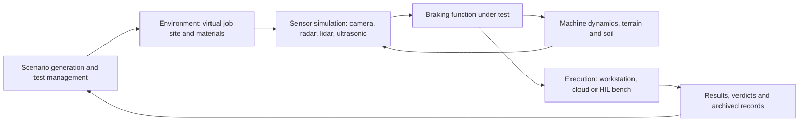

*The categories of a simulation tool chain and the main flow of data between them; the loop from the braking function back to the machine dynamics is what makes the test closed-loop.*

**Why it matters here.** The organization has no virtual testing capability and about nine months before hardware arrives, so the integration work, not the choice of any one tool, is the schedule risk. The booklet notes that the ASAM project refining OSI for high-fidelity sensors runs until March 2027, exactly when this program would be integrating its first chain [Chapter 11].

**Related terms.** [Complete and near-complete simulation platforms](#complete-and-near-complete-simulation-platforms), [Co-simulation, Functional Mock-up Interface (FMI)](#co-simulation-functional-mock-up-interface-fmi-functional-mock-up-unit-fmu-and-ssp), [Open Simulation Interface (ASAM OSI)](#open-simulation-interface-asam-osi-and-the-asam-organization), [Scene description standards](#scene-description-standards-openusd-opendrive-opencrg-openscenario-openlabel-openodd-openxontology), [Hardware-in-the-loop (HIL)](#hardware-in-the-loop-hil-with-data-injection), [Build, buy or partner](#build-buy-or-partner), [The three example tool chains at different cost levels](#the-three-example-tool-chains-at-different-cost-levels), ["Do not make one simulator carry every test"](#do-not-make-one-simulator-carry-every-test-multi-simulator-architecture).

### Complete and near-complete simulation platforms

**In one sentence.** A complete simulation platform is a commercial or open-source product that tries to cover several layers of the tool chain at once: scenarios, environments, sensors, vehicle motion and test execution.

**Explained.** Think of a complete platform as a whole kitchen bought from one supplier instead of appliances from several. The booklet warns that "complete" is relative: these products usually still rely on a separate machine model, controller, asset pipeline or hardware bench [Chapter 11].

The table lists the platforms named in Chapter 11. "Demonstrated" means a documented customer use, peer-reviewed study, government program or shipped example; "claimed" means a vendor statement only; "on-road only" means proven for road vehicles with no off-road evidence found. "Not found" is a finding, not a gap.

| Platform | Type and license | What the booklet reports on off-road use | Public price |
|---|---|---|---|
| MathWorks MATLAB and Simulink with the Offroad Autonomy Library and RoadRunner | Commercial, annual or perpetual per product | Demonstrated as shipped examples: an autonomous excavator, a backhoe loading a truck, an open-pit haul truck (release R2026b); Volvo CE built a human-in-the-loop excavator simulator with it | Quote only; an unofficial January 2024 price list exists |
| Applied Intuition | Commercial | Demonstrated: a Komatsu partnership announced September 2025 covering collision avoidance on staffed sites; also sells an autonomy stack, which the booklet flags as a possible conflict; owns CarSim and TruckSim | Not found |
| Cognata | Commercial | Claimed: a construction and mining use-case page; camera, radar, lidar and thermal marketed | Not found |
| Duality AI Falcon | Commercial | Demonstrated in military off-road work (DARPA RACER-Sim, NASA JPL), not construction or mining | Education license USD 20 per month; commercial price not found |
| Cadence (formerly Hexagon) Virtual Test Drive (VTD) and VTDx | Commercial | On-road only; ownership moved to Cadence in February 2026 | Not found |
| IPG Automotive CarMaker and TruckMaker with an off-highway stack | Commercial | Claimed with named applications: a lidar accident-prevention application with Linde and tractor vehicle-in-the-loop; targets construction, agriculture and mining | Not found |
| dSPACE AURELION with SIMPHERA | Commercial | On-road only; camera, ray-traced radar, lidar, infrared and ultrasonic models; integrates with dSPACE benches | Not found |
| Siemens Simcenter Prescan | Commercial | On-road only; camera, radar, lidar and ultrasonic models | Not found |
| CARLA | Open source (MIT code) | A mining earth-mover vehicle asset exists (release 0.10.0, December 2024); no soil physics | Free |
| NVIDIA Isaac Sim | Open source (Apache 2.0) with separate asset terms | Not found for construction or mining; 25 RTX lidar models and one radar model listed | Free for internal research; enterprise price not found |
| Project Chrono | Open source (BSD-3) | Demonstrated in off-road mobility research; wheeled, tracked and articulated vehicles on deformable terrain | Free |
| BeamNG.tech | Commercial business license | Off-road driving feasible, but the vehicle model is car-scale, not an excavator or haul truck | Not found |
| MORAI | Commercial | Not found | Contact for price |
| rFpro | Commercial | On-road only; detailed camera pipeline | Not found |
| Gazebo | Open source (Apache 2.0) | Not found (general robotics) | Free |

Two names in common use do not appear as platforms. Ansys sensor simulation is now Synopsys AVxcelerate Sensors, covered under sensor simulation tools; NVIDIA DRIVE Sim is mentioned only as a tool whose frame rates were not found [Chapter 6]. AVL appears as an engineering service company with its own vehicle models and scenario tool, not as a complete platform [Chapter 11].

**Why it matters here.** Only a few platforms publicly position for construction or mining, and most of that is claimed rather than independently demonstrated; independent validation of any platform for automatic braking on heavy machines was not found. The booklet also records that nearly every commercial product is quote-only, so a budget must be built from vendor quotations [Chapter 11].

**Related terms.** [Tool chain](#tool-chain), [Open-source simulators](#open-source-simulators), [Sensor simulation tools](#sensor-simulation-tools), [Vehicle and machine dynamics tools](#vehicle-and-machine-dynamics-tools), [License types and pricing models](#license-types-and-pricing-models), [Build, buy or partner](#build-buy-or-partner), [Simulation and simulator](#simulation-and-simulator), [Game engine](#game-engine-unreal-engine-unity).

### Open-source simulators

**In one sentence.** An open-source simulator is a simulation program whose source code anyone may read, change and use without paying a license fee, under conditions set by its license.

**Explained.** Most software is sold as a sealed box. Open-source software comes with the recipe, under a license that states the conditions. The licenses the booklet names are all "permissive": MIT (CARLA's code), BSD-3 (Project Chrono) and Apache 2.0 (Isaac Sim, Gazebo). In plain terms, all three let a company use, modify and redistribute the software, including inside a commercial product, as long as the original copyright notice is kept; Apache 2.0 also includes an explicit patent grant. None requires the company to publish its own changes.

The open-source simulators the booklet names: CARLA (a driving simulator on the Unreal game engine, with a mining earth-mover asset since December 2024), NVIDIA Isaac Sim (robotics simulation with ray-traced lidar and radar), Project Chrono (a physics engine for wheeled, tracked and articulated vehicles on deformable terrain), Gazebo (a robotics simulator with a long-term release supported to 2031), Scenic (a scenario language), MineSim (a test system for autonomous trucks in open-pit mines, built from two real mines), AutoDRIVE (a digital-twin framework used in an off-road braking study) and MAVS, a university off-road simulation library [Chapters 1, 5, 11].

Three cautions. "Open" can be mixed: Isaac Sim's core is Apache 2.0, but some assets carry other terms, redistribution with certain components needs a paid enterprise license, and vendor staff described free use for teams of up to two people. Open-source projects change fast; CARLA changed game engine between release lines, so a frozen, qualified build is advisable. And the research did not examine who funds and maintains these projects or how quickly they patch security problems [Chapter 11].

**Why it matters here.** The booklet concludes that open source is viable for a low-license-cost core but is not the lowest total cost: someone must still build and maintain the coupling, the assets, the scenario database and all the validation evidence, with no vendor support [Chapter 11].

**Related terms.** [Complete and near-complete simulation platforms](#complete-and-near-complete-simulation-platforms), [License types and pricing models](#license-types-and-pricing-models), [Build, buy or partner](#build-buy-or-partner), [Total cost of ownership, capital versus operating cost, full-time equivalent (FTE)](#total-cost-of-ownership-capital-versus-operating-cost-full-time-equivalent-fte), [Game engine](#game-engine-unreal-engine-unity), [The Pretoria process and MineSim](#the-pretoria-process-and-minesim-mining-research-precedents).

### Sensor simulation tools

**In one sentence.** A sensor simulation tool produces artificial camera images, radar returns, lidar point clouds or ultrasonic echoes from a virtual scene, so the braking software can be tested without a real sensor.

**Explained.** A sensor turns the world into data. A sensor simulation tool does the reverse: it starts from a described world and produces the data a sensor would have produced. The booklet insists on the difference between sensor presence and sensor credibility. A checkbox saying "radar supported" may mean anything from a perfect list of objects, to simple geometric ray casting, to tuned statistical detections, to simulation of the raw radio signal, and for automatic braking those levels are not interchangeable [Chapter 11]. The ladder of realism runs: ideal object lists; geometric ray casting; phenomenological models tuned to measurements; physics-based raw-signal models using ray tracing and material properties; and full-wave electromagnetic solvers, far too slow for whole job sites [Chapter 6].

Commercial tools named: dSPACE AURELION (camera, ray-traced radar, lidar, infrared, ultrasonic, with a material database); Synopsys AVxcelerate Sensors, formerly Ansys (camera, lidar, radar, thermal; co-simulation with CarMaker and CARLA documented); Simcenter Prescan sensor models; rFpro's camera pipeline; and Persival, which builds sensor models to the ASAM Open Simulation Interface (OSI) standard, packaged as Functional Mock-up Units (FMUs), and correlates them against real sensor output. Open-source options are the RTX sensors in Isaac Sim, Chrono::Sensor and CARLA's sensors; physics-based ultrasonic simulation in these was not found. None of the commercial tools had public off-road validation [Chapter 11].

Research tools discussed: RadaRays, a real-time radar ray tracer whose authors mounted a radar on a wheel loader in a hall, the most directly relevant heavy-machine result found; RadSimReal and Sim2Radar, on the radar gap between simulation and reality; SplatAD and the NVIDIA NuRec engine, which rebuild scenes from recordings with Gaussian splatting; LiDARsim-style meshing from machine logs; and Boreal3D, synthetic forest lidar plots [Chapters 5, 6].

**Why it matters here.** Sensor and environment fidelity is the hardest uncertainty in the whole program, and it is weakest exactly where the risk is: dust, fog, snow, rain, glare and darkness [Chapter 13]. ASAM itself states that no standardized metrics exist to assess the quality of sensor simulation [Chapter 11].

**Related terms.** [Sensor](#sensor), [Camera](#camera-rgb-camera-cmos-sensor-lens-image-signal-processor-isp-hdr-rolling-shutter), [Radar](#radar-radio-detection-and-ranging), [Lidar](#lidar-light-detection-and-ranging), [Ultrasonic sensor](#ultrasonic-sensor), [Sensor degradation](#sensor-degradation-dust-mud-rain-snow-fog-spray-glare-darkness-artificial-lighting-vibration), [Ray tracing and shooting-and-bouncing rays (SBR)](#ray-tracing-and-shooting-and-bouncing-rays-sbr-for-sensor-simulation), [Neural rendering: NeRF and Gaussian splatting](#neural-rendering-nerf-and-gaussian-splatting-3dgs-as-ways-to-rebuild-a-scene-from-photos), [Material and sensor material](#material-and-sensor-material-asam-openmaterial), [Sim-to-real gap](#sim-to-real-gap), [Credibility of a simulation](#credibility-of-a-simulation), [Request for proposal (RFP), non-disclosure agreement (NDA), statement of work, and supplier information](#request-for-proposal-rfp-non-disclosure-agreement-nda-statement-of-work-and-supplier-information).

### Vehicle and machine dynamics tools

**In one sentence.** A vehicle and machine dynamics tool calculates how a machine moves: how it accelerates, steers, tips, sinks into soft ground and stops when the brakes act.

**Explained.** A braking test is only as good as the model of the machine. A 40-ton loader on wet gravel, with a full bucket raised, does not stop like a car. Dynamics tools calculate the forces on every body of the machine (frame, boom, bucket, wheels or tracks), the hydraulics that move them and the contact with the ground, many times per second.

The booklet separates two families. Heavy-machine physics tools built for mobile machinery: Mevea (real-time multibody dynamics with hydraulics and soil, used for crane digital twins and training simulators; it claims over 100 simulator models for more than 50 customers); Algoryx AGX Dynamics (modules for terrain, tires, tracks, hydraulics and granular material; a peer-reviewed 2025 paper calibrated an AGX wheel-loader twin against a real machine; its Unity version added a reverse auto-brake example with a lidar module in April 2025); CM Labs Vortex Studio (real-time physics for earthmoving and cranes, documented mainly for operator training); and Project Chrono (open source; wheeled, tracked and articulated vehicles; its developers report that common handling tire models do not work on its deformable terrain). Road-heritage tools: CarSim and TruckSim (owned by Applied Intuition; a 2022 press release claimed expansion into off-road, agricultural, construction and mining use); IPG TruckMaker; MSC/Cadence Adams (high-end multibody dynamics, not an environment simulator); MathWorks Vehicle Dynamics Blockset and Simscape, with articulated steering since R2025a; and Altair MotionSolve, cited for a tracked-vehicle tutorial with soft soil [Chapters 8, 11]. RecurDyn is not discussed in the booklet.

**Why it matters here.** Surface friction, slope, mass, payload, attachment position, tire or track state and brake and hydraulic delay dominate stopping distance and must be in the model; the booklet finds that heavy-machine physics vendors are mature in dynamics and demonstrated off-road, but their sensor physics is not independently validated in weather [Chapters 8, 11].

**Related terms.** [Stopping distance](#stopping-distance), [Tire model and tire-soil interaction](#tire-model-and-tire-soil-interaction), [Terramechanics: Bekker-Wong](#terramechanics-scm-dem-sph-crm-fem), [Brake model and powertrain model](#brake-model-and-powertrain-model), [Articulated steering](#articulated-steering), [Digital twin](#digital-twin), [Terrain and soil tools](#terrain-and-soil-tools), [Model fidelity levels for braking](#model-fidelity-levels-for-braking).

### Terrain and soil tools

**In one sentence.** Terrain and soil tools calculate how the ground deforms under a machine, how a bucket digs into a pile and how loose material flows, because soft ground changes how a machine stops.

**Explained.** On a paved road the ground is a fixed surface. On a job site the ground is part of the machine: gravel shifts, mud ruts, a berm collapses. Three mathematical approaches appear in the booklet, each available inside several tools. The Soil Contact Model (SCM) is a fast, semi-empirical method from Bekker and Wong that treats the ground as a deformable mat with pressure-sinkage rules. The Discrete Element Method (DEM) simulates thousands or millions of individual grains and their collisions, which is realistic for piles and digging but very slow. Smoothed Particle Hydrodynamics (SPH) and related continuum methods treat the soil as a flowing material represented by particles; Chrono calls its version CRM [Chapters 8, 11].

The tools: EDEM, a DEM program for bulk material such as soil, ore and coal that couples with multibody tools (Chapter 11 lists it as Simcenter EDEM; Chapter 8 cites an Altair MotionSolve tutorial that couples a tracked vehicle to EDEM); Fraunhofer ITWM Demify, DEM-oriented soil-tool interaction for heavy machinery, a research and service product; Project Chrono's terrain models (SCM, CRM and DEM), where the developers report CRM running 50 to 200 times slower than real time and needing a graphics processing unit (GPU) from one specific maker; AGX Terrain and AGX Granular; Mevea's soil simulation; and MAVS, with a tire-soil model for sand and clay [Chapters 5, 8, 11].

**Why it matters here.** The booklet finds high-detail soil simulation far too slow for scenario sweeps and notes that uncertain soil inputs can overwhelm fidelity. It recommends a multi-fidelity approach: use DEM or deformable terrain to learn how stopping distance depends on soil, slope and payload, fit simpler parameterized models for the large regression, and confirm the parameter envelope with targeted physical tests [Chapters 8, 11].

**Related terms.** [Terramechanics: Bekker-Wong](#terramechanics-scm-dem-sph-crm-fem), [Surface and traction](#surface-and-traction), [Tire model and tire-soil interaction](#tire-model-and-tire-soil-interaction), [Vehicle and machine dynamics tools](#vehicle-and-machine-dynamics-tools), [Model fidelity levels for braking](#model-fidelity-levels-for-braking), ["Do not make one simulator carry every test"](#do-not-make-one-simulator-carry-every-test-multi-simulator-architecture), [High-performance computing (HPC) and cluster, versus workstation](#high-performance-computing-hpc-and-cluster-versus-workstation).

### Environment creation and reconstruction tools

**In one sentence.** Environment creation and reconstruction tools build the three-dimensional virtual job site, either by designing it by hand and by rules or by rebuilding a real site from photographs, laser scans and machine recordings.

**Explained.** Before a virtual loader can reverse toward a virtual pile, someone must make the pile, the ramp, the parked truck and the person, and give every surface the properties a camera, a radar and a lidar would see. The booklet identifies eleven families of method, from hand-built models and rule-based (procedural) generation to drone photogrammetry, lidar survey, reconstruction from the machine's own recordings, neural reconstruction and reuse of mine plans. It stresses that the combination matters more than any one authoring package: a quarry model might start from a mine plan, replace the active pit with a drone mesh, fill gaps by hand and then generate hundreds of variants by rules [Chapter 5].

The named tools: MathWorks RoadRunner with Scene Builder, which imports map data and point clouds and exports to CARLA, dSPACE and IPG CarMaker, but whose base editor remains road-oriented; the Fraunhofer ITWM VMC Road and Scene Generator, which builds scenes from fused real measurements; OpenUSD and Omniverse tooling, a domain-neutral way to describe scenes (an open standard plus one vendor's components); Unreal Engine editors inside Falcon, CARLA and the MathWorks stack; photogrammetry software such as COLMAP, with quarry examples from drone surveys; neural reconstruction such as NuRec, SplatAD and LiDAR-EVS, which rebuild appearance from logs but struggle when the sensor viewpoint moves; Boreal3D for forest plots; CropCraft, an open-source generator for farm fields; AgriGen, which generates large agricultural scenes in Isaac Sim; and MAVS, which generates off-road terrain with controllable roughness and haze. ASAM OpenMATERIAL 3D (version 1.0.0, April 2025) standardizes the material properties sensors react to; it excludes dirt on the sensor itself [Chapters 5, 11].

**Why it matters here.** The booklet calls job-site reconstruction a bottleneck: a reusable representation of sites is needed before scenario volume matters, and the open road formats assume lanes, so stockpiles, berms and ruts often need custom representations. Every captured environment also needs a capture date and revision history, or "the quarry model" becomes ambiguous [Chapters 5, 11].

**Related terms.** [Virtual job site](#virtual-job-site-virtual-environment-scene-3d-asset), [Photogrammetry, laser scanning and SLAM](#photogrammetry-laser-scanning-and-slam), [Procedural generation](#procedural-generation), [Neural rendering: NeRF and Gaussian splatting](#neural-rendering-nerf-and-gaussian-splatting-3dgs-as-ways-to-rebuild-a-scene-from-photos), [Material and sensor material](#material-and-sensor-material-asam-openmaterial), [Scene description standards](#scene-description-standards-openusd-opendrive-opencrg-openscenario-openlabel-openodd-openxontology), [Game engine](#game-engine-unreal-engine-unity), [Digital twin](#digital-twin).

### Scenario generation and test management tools

**In one sentence.** Scenario generation tools describe and vary the test situations; test management tools decide which runs to execute, run them, and keep track of the results.

**Explained.** A scenario is a short story for a test: "loader reverses at 8 km/h, person steps out from behind a truck 12 m away, light rain, dusk." A scenario generation tool lets engineers write that story in a standard language, then vary its numbers (speed, distance, weather) to create thousands of related tests. A test management tool is the bookkeeper: it schedules the runs, records every result and shows which situations have been covered.

The standard languages are ASAM OpenSCENARIO (the story) and OpenDRIVE (the road), supported by VTD, the dSPACE chain, CARLA, RoadRunner, Prescan and MORAI. OpenDRIVE assumes roads, so job sites without lane geometry fit poorly [Chapter 11]. Named tools: Foretellix Foretify (coverage-driven generation with constrained random variation and large-scale validation management; a 2021 partnership with Volvo Autonomous Solutions adapted it for mines and quarries, and the vendor sells a mining suite); AVL SCENIUS (scenario lifecycle from requirements to reporting); RoadRunner Scenario; the VTD 2025.2 ScenarioEngine; dSPACE SIMPHERA; and Scenic, an open-source probabilistic scenario language that places objects without needing lanes and connects to several simulators. Scenic integrates with VerifAI, and together with S-TaLiRo and Breach these are falsification tools that search for the parameter combinations where a function fails [Chapters 9, 11]. The open-source editor esmini was not assessed [Chapter 11].

For test management, the booklet names no single product. It describes what a neutral implementation needs: a requirements platform for hazards and traceability, version control and continuous integration, a database and object store, and a campaign service that generates runs and computes verdicts and coverage; ASAM ATX for test metadata and ASAM MDF for measured data are named as neutral formats [Chapter 9].

**Why it matters here.** Scenario count is not coverage; the booklet warns that the brief confuses the two and that interface standards are still being revised during the program [Chapters 11, 13].

**Related terms.** [Scenario](#scenario-functional-logical-concrete), [Scenario catalog, scenario family and scenario parameter](#scenario-catalog-scenario-family-and-scenario-parameter), [Scenario description languages](#scenario-description-languages-openscenario-dsl), [Falsification](#falsification-failure-seeking-search), [Test case, test matrix and scenario grid](#test-case-test-matrix-and-scenario-grid), [Test management](#test-management-versioning-and-the-traceability-chain), [versioning and the traceability chain for thousands of runs](#test-management-versioning-and-the-traceability-chain), [Campaign](#campaign-test-campaign-and-campaign-architecture), [Scene description standards](#scene-description-standards-openusd-opendrive-opencrg-openscenario-openlabel-openodd-openxontology).

### Data replay and HIL hardware

**In one sentence.** Data replay feeds recorded real sensor data back into the braking software, and hardware-in-the-loop (HIL) hardware is the real-time computer and signal equipment that lets the real control unit run against a simulated machine.

**Explained.** Replay is like showing a trainee a video of yesterday's near miss and asking what they would have done. Recorded camera, radar or bus data from real machines is played into the software and its decisions are compared with what happened. Hardware-in-the-loop (HIL) goes further: the real electronic control unit (ECU) is wired to a computer that pretends to be the rest of the machine, in real time, down to the millisecond. Data injection means pushing simulated or recorded signals into the sensor path, for example raw camera data behind the imager or radar detections, together with recorded J1939 or CAN (controller area network) bus traffic and "restbus" models of the rest of the network [Chapter 7].

The hardware the booklet names: dSPACE SCALEXIO (real-time HIL systems), VEOS (PC-based virtual ECU simulation) and AURELION; NI VeriStand with PXI and CompactRIO (a PXIe-8842 controller is listed at about USD 5,200, but that is only a controller, not a bench); Speedgoat with Simulink Real-Time; OPAL-RT 4DV-SIM and the OP5707XG2, which combines a CPU with a field-programmable gate array (FPGA), with named off-highway and defense users; IPG's model-, software- and hardware-in-the-loop (MIL, SIL, HIL) and vehicle-in-the-loop; Mevea, Vortex and Applied Intuition HIL; and RoadRunner with the Automated Driving Toolbox for reconstructing and replaying recorded scenarios. ISO/TS 21815-2:2021 defines the J1939 command interface (stop, slow down, motion inhibit) that a bench can emulate between the collision-avoidance device and the machine [Chapters 7, 11]. Vector tools are not discussed in the booklet.

**Why it matters here.** HIL is the only way to test ECU timing and interfaces before the machine exists, but sensor injection is sensor- and ECU-specific and raw-signal benches are the highest integration effort. The booklet suggests a HIL bench on the ISO/TS 21815-2 interface as a mid-2027 target that should not be on the critical path unless interfaces stabilize early [Chapters 1, 11].

**Related terms.** [Hardware-in-the-loop (HIL)](#hardware-in-the-loop-hil-with-data-injection), [Direct digital or raw signal injection](#direct-digital-or-raw-signal-injection), [Over-the-air sensor stimulation](#over-the-air-sensor-stimulation-sensor-in-the-loop), [Replay and re-simulation of recorded data](#replay-and-re-simulation-of-recorded-data-open-loop-replay), [Electronic control unit (ECU)](#electronic-control-unit-ecu), [Vehicle network: CAN bus, SAE J1939, DBC file](#vehicle-network-can-bus-sae-j1939-dbc-file), [Real time](#real-time-hard-real-time), [CPU, GPU, FPGA, VRAM and real-time computers](#cpu-gpu-fpga-vram-and-real-time-computers).

### Operator-in-the-loop simulators

**In one sentence.** An operator-in-the-loop simulator is a cab, screens and controls where a real person drives a simulated machine, so that human reactions to warnings and automatic braking can be measured.

**Explained.** Flight simulators train pilots; machine simulators train loader and excavator operators. The same equipment can be used to study behavior: how long an operator takes to react to a warning, whether a sudden automatic stop surprises them, and how many nuisance stops they will tolerate before switching the system off.

The booklet names the Fraunhofer ITWM RODOS human-in-the-loop driving simulator; CM Labs Vortex Studio, documented mainly as a training simulator for construction equipment; Mevea's training simulators for mining; and Volvo Construction Equipment's real-time human-in-the-loop excavator simulator built with Simulink and Simscape. A haul-truck proximity-interface simulator has been used in academic work [Chapters 1, 11]. The booklet's early-experiment list includes an operator clinic: expose operators to simulated or real nuisance stops and measure the acceptance threshold by scenario [Chapter 13].

**Why it matters here.** Warning-then-brake depends on the operator's reaction, and nuisance interventions are documented as the primary reason deployed proximity systems fail; the booklet lists human-in-the-loop simulators as a likely need and makes operator acceptance a release criterion [Chapters 11, 13].

**Related terms.** [Driver-in-the-loop (DIL)](#driver-in-the-loop-dil-operator-in-the-loop-and-the-machine-simulator), [Operator reaction time](#operator-reaction-time), [Human factors](#human-factors), [Nuisance braking](#nuisance-braking), [Switching off and bypassing](#switching-off-and-bypassing), [Human-machine interface](#human-machine-interface-hmi).

### Cloud execution services

**In one sentence.** Cloud execution means renting computers, including graphics processors, by the hour over the internet instead of buying them, so that thousands of simulations can run in parallel.

**Explained.** "The cloud" is a large data center owned by someone else. A company rents a slice of it for as long as it needs and pays by the hour. For simulation this matters because the work comes in bursts: a few hundred computers for a week, then none. Buying that capacity would leave it idle most of the year.

The booklet reports two kinds of cloud. Vendor clouds run a specific simulator: FalconCloud, VTDx, AURELION cloud, and the large-scale services of Applied Intuition and MORAI; their prices were not found. Generic cloud rents raw machines. Third-party price trackers listed an Amazon Web Services (AWS) g6e.xlarge instance, with one NVIDIA L40S graphics processor, at about USD 1.861 per hour on demand in the US East region, rising to about USD 30.131 per hour for eight such processors; a one-year commitment brought the single-processor price to about USD 1.17, and "spot" prices for interruptible capacity fluctuated widely. Google Cloud listed a g2-standard-32 with one L4 processor at about USD 1.734 per hour. Spot pricing suits regression runs that can be paused and restarted, not deterministic hardware-in-the-loop (HIL) tests or irreplaceable long jobs. Regional availability and quotas vary, and prices should be rechecked at purchase [Chapter 11].

Orchestration, the software that hands out runs to machines and collects results, is named as Kubernetes, batch systems or high-performance computing (HPC) schedulers plus object storage. Vendor cloud terms, export control and data residency were not researched; the booklet notes that site scans, mine layouts and machine CAD are commercially sensitive and that an on-premises or private-cloud option is a mitigation [Chapter 11].

**Why it matters here.** Compute is cheap relative to engineering labor, but the four-month window caps how many runs fit: ten single-processor instances running continuously for 122 days cost on the order of USD 54,000 and deliver at most about 29,000 processor-hours [Chapter 11].

**Related terms.** [Cloud execution and compute budget](#cloud-execution-and-compute-budget), [Compute cost and run time](#compute-cost-and-run-time), [Graphics cards named in the booklet](#graphics-cards-named-in-the-booklet), [High-performance computing (HPC) and cluster, versus workstation](#high-performance-computing-hpc-and-cluster-versus-workstation), [Data storage, data lineage and record keeping for thousands of runs](#data-storage-data-lineage-and-record-keeping-for-thousands-of-runs).

### Mining, construction, agriculture and forestry specific tools

**In one sentence.** These are the few simulation tools, datasets and frameworks that were built for, or deliberately adapted to, off-road working machines rather than road cars.

**Explained.** Most simulation tools grew up on roads with lanes, curbs and traffic lights. A quarry has none of these. The booklet sorts the off-road-relevant tools into three groups. Machine and terrain physics tools built for mobile machinery: Mevea, AGX Dynamics, Vortex Studio, Project Chrono, EDEM and Fraunhofer Demify. Road-vehicle validation platforms with explicit off-road packages: the MathWorks Offroad Autonomy Library, IPG's off-highway stack, Applied Intuition, Cognata, AVL's off-road engineering (its Generic Off-Road Automation System demonstrated on a tractor) and Foretellix (a 2021 partnership for mines and quarries). Research and military programs: Duality Falcon (DARPA RACER-Sim), Fraunhofer ITWM (InVerS construction-site digital twins, RODOS, VMC), Fraunhofer IVI (agricultural and construction machinery testing), Southwest Research Institute (off-road scene tools for military, space and agriculture) and OPAL-RT 4DV-SIM (off-highway and defense users). CARLA has a mining earth-mover asset only [Chapter 11].

From other chapters: MineSim, an open-source, peer-reviewed scenario-based test system and benchmark for autonomous trucks in open-pit mines (April 2025), built from two real mines and modeling unstructured roads and heavy-truck response lag; SimMining-3D, a synthetic lidar dataset that varies sensor height because detection degrades when viewpoint changes on mine benches; CropCraft, AgriGen and Boreal3D for agricultural and forest scenes; a Robotec.ai digital twin for Boliden; and the Mining3 and ACARP proximity-detection testing framework (project C26028, January 2021), a shared physical test protocol rather than a simulator [Chapters 1, 5, 9]. KomVision is not a tool: it is Komatsu's human detection and collision mitigation product on excavators, used in the booklet as a market precedent [Chapters 2, 13]. CSIRO was not assessed as a provider, so its status is "not found" rather than "does not offer" [Chapter 11].

**Why it matters here.** Independent validation of any of these for automatic braking on heavy machines was not found; the booklet treats MineSim as proof that mine-specific closed-loop scenario simulation is feasible, "not to be confused with validated sensor physics" [Chapter 1].

**Related terms.** [The Pretoria process and MineSim](#the-pretoria-process-and-minesim-mining-research-precedents), [ACARP](#acarp-and-its-two-tier-test-approach-australian-coal-association-research-program), [DARPA RACER program](#darpa-racer-program-off-road-autonomy-research), [Complete and near-complete simulation platforms](#complete-and-near-complete-simulation-platforms), [Vehicle and machine dynamics tools](#vehicle-and-machine-dynamics-tools), [Datasets and benchmarks](#datasets-and-benchmarks-what-mocs-soda-rellis-3d-rugd-and-similar-names-are), [Variant management](#variant-management).

### Engineering service companies and research institutes

**In one sentence.** Engineering service companies sell engineering work by the hour or by the project, and research institutes sell applied research, test facilities and independent assessment; both can do parts of virtual validation for a manufacturer.

**Explained.** A company that has never built a simulation capability has three kinds of outside help available. An engineering service company (like hiring a builder) does the integration, modeling and testing work under contract. A research institute (like hiring a specialist laboratory) brings methods, measurement facilities and people who have done similar work for others. An independent test or assessment body (like a building inspector) checks the result without having built it.

Service companies in the booklet: AVL (its Generic Off-Road Automation System demonstrated on a retrofitted tractor, VSM vehicle models with a vendor-claimed correlation "up to 97%", the SCENIUS scenario tool, and scenario-based validation services; explicit agriculture, forestry, construction and mining work); IPG Automotive (consulting around CarMaker, TruckMaker and the off-highway stack); OPAL-RT (real-time hardware-in-the-loop or HIL benches); Mevea (modeling services and digital twins); MathWorks Consulting; Persival (sensor-model development and validation); Speedgoat engineering services; FEV.io (virtual validation, with an automotive case study); EDAG and Bertrandt (not assessed in depth); and IAV and Capgemini Engineering (not assessed). Test houses: IDIADA (vehicle-in-the-loop services; a 2026 demonstration with MathWorks correlating simulated and proving-ground automatic braking), UTAC (proposals on virtual testing methods to the United Nations working group on automatic emergency braking), and TÜV SÜD (independent simulation and model validation; it played the test-lab role in the PEGASUS program) [Chapters 1, 2, 10, 11].

Research institutes: Fraunhofer ITWM (construction-site digital twins, the RODOS simulator, real-data scenes, Demify soil simulation), Fraunhofer IVI (agricultural and construction machinery testing), Fraunhofer IESE (modular co-simulation and fault injection), VTT in Finland (sensor simulation and digital twins for non-road mobile machinery), TNO in the Netherlands (scenario-based testing, mostly road), Southwest Research Institute (off-road autonomy tools), Mining3 (the ACARP proximity-detection testing framework) and CSIRO (not assessed). The German aerospace center DLR and the Karlsruhe Institute of Technology (KIT) appear only as authors of cited technical work, not as assessed providers [Chapters 7, 10, 11].

Weather facilities are a special case: the CEREMA fog and rain tunnel in France, CARISSMA in Germany, and NIED and JARI in Japan are named as the main ground truth for weather models, because a fog model is tuned by matching a real sensor's output in real fog. The booklet did not examine their booking lead times, capacity or suitability for machines of this size [Chapter 6].

**Why it matters here.** The booklet's preferred option is a hybrid in which a partner accelerates the first correlated sensor model while the manufacturer keeps the operating-domain definition, scenario catalog, acceptance criteria and correlation data in-house. No public contract values or delivery timelines were found for any provider [Chapter 11].

**Related terms.** [Build, buy or partner](#build-buy-or-partner), [Independent assessment, independent test body and safety board](#independent-assessment-independent-test-body-and-safety-board), [PEGASUS, VVM](#pegasus-vvm-set-level-vavim-and-evident-german-and-european-research-programs-on-scenario-based-validation), [Sensor simulation tools](#sensor-simulation-tools), [Request for proposal (RFP), non-disclosure agreement (NDA), statement of work, and supplier information](#request-for-proposal-rfp-non-disclosure-agreement-nda-statement-of-work-and-supplier-information), [Sensor degradation](#sensor-degradation-dust-mud-rain-snow-fog-spray-glare-darkness-artificial-lighting-vibration).

### Build, buy or partner

**In one sentence.** Build, buy or partner is the decision between writing the simulation capability in-house on open-source parts, buying commercial products, or paying an outside company to deliver it.

**Explained.** It is the same choice a household faces with a kitchen renovation: do it yourself, buy fitted units, or hire a contractor. Each trades money against time, control and dependence.

The booklet compares five options. Build in-house on open source (CARLA or Isaac Sim or Gazebo, Chrono, Robot Operating System 2 or ROS 2): lowest license cost, highest internal labor, full ownership of source and models, but no vendor support, key-person dependence and the organization owns all the credibility evidence. Buy an integrated commercial stack: lower integration burden, but domain modeling and correlation remain substantial, the core cannot be owned, and there are off-road gaps, license dependence and roadmap risk. Buy specialist tools and integrate internally: high flexibility, high interface and version complexity. Partner-led implementation: potentially fastest, but knowledge and models stay with the partner and the dependency can become permanent. Hybrid: an internal owner plus a partner plus commercial or open-source tools, which the booklet judges the best balance of retained knowledge and outside specialization, provided the contract has unusually clear ownership clauses [Chapter 11].

The evidence gap is explicit: no independent 2024 to 2026 benchmark states total cost, team headcount or time to a first useful result for any option; vendor case studies report large gains but are not controlled measurements. Whatever the choice, the booklet says a partner contract should require delivery of editable machine models, scene and source assets, parameter provenance, correlation datasets, test definitions, continuous-integration scripts, simulator version manifests, known-limitation registers and interface specifications, not only test reports [Chapter 11].

**Why it matters here.** With no internal capability and nine months before hardware, the booklet calls the hybrid the most defensible choice and warns that outsourcing alone "solves the 2027 deadline while creating a larger long-term dependency" [Chapter 11].

**Related terms.** [Tool chain](#tool-chain), [Engineering service companies and research institutes](#engineering-service-companies-and-research-institutes), [Open-source simulators](#open-source-simulators), [License types and pricing models](#license-types-and-pricing-models), [Total cost of ownership, capital versus operating cost, full-time equivalent (FTE)](#total-cost-of-ownership-capital-versus-operating-cost-full-time-equivalent-fte), [Team and skills needed](#team-and-skills-needed).

### License types and pricing models

**In one sentence.** A software license is the permission to use a program under stated conditions, and the pricing model is how the vendor charges for it: per computer, per shared pool, per year, per person, or not at all.

**Explained.** Common license forms, in plain words. Node-locked: the license is tied to one named computer. Floating (or concurrent): a pool of licenses on a server; any computer may use one until the pool is empty. Per-seat: one license per named user. Subscription: paid yearly, stops working when payment stops. Perpetual: paid once, often with a yearly maintenance fee for updates. Runtime or OEM licenses: permission to ship the software inside a product. Academic or education licenses: cheap but limited to non-commercial use. Open source: free to use under the license conditions.

The booklet found public prices almost entirely absent. The only dated price points: an unofficial January 2024 copy of a MathWorks price list showing MATLAB at 980 (annual) or 3,920 (perpetual), Simulink 1,480 or 5,920, RoadRunner 4,680 or 9,360 and RoadRunner Scenario 3,400 or 13,600, presumed US dollars and indicative only; a Duality Falcon education license at USD 20 per month, non-commercial; an NI PXIe-8842 controller at about USD 5,200; and cloud graphics-processor rates. AGX Dynamics sells a yearly subscription per seat in three tiers at "price upon request", with separate runtime, OEM (original equipment manufacturer) and academic licenses. Isaac Sim is free for internal research, but redistribution needs a paid enterprise license and staff described free use for teams of up to two people. AURELION requires a valid maintenance contract for new versions [Chapter 11].

**Why it matters here.** License limits are a listed risk: parallel cloud execution, build servers, hardware-in-the-loop (HIL) nodes, subcontractor access and geography are often licensed separately and terms are not public. The booklet advises pricing peak concurrent workers, continuous-integration and cloud rights, subcontractors and disaster-recovery environments in the request for proposal, not only desktop seats [Chapter 11].

**Related terms.** [Open-source simulators](#open-source-simulators), [Request for proposal (RFP), non-disclosure agreement (NDA), statement of work, and supplier information](#request-for-proposal-rfp-non-disclosure-agreement-nda-statement-of-work-and-supplier-information), [Total cost of ownership, capital versus operating cost, full-time equivalent (FTE)](#total-cost-of-ownership-capital-versus-operating-cost-full-time-equivalent-fte), [Cloud execution services](#cloud-execution-services), [Build, buy or partner](#build-buy-or-partner).

### The three example tool chains at different cost levels

**In one sentence.** The booklet sketches three ways to assemble a tool chain, from an open-source core to a fully commercial chain with a partner, and labels them lowest, middle and highest by relative cost and integration posture, not by dollar figures.

**Explained.** Because almost every commercial vendor is quote-only, the levels are relative. All three are expert assessment built from the tool entries, the integration findings and the compute figures [Chapter 11].

Lowest cost, an open-source core plus in-house integration: CARLA, Isaac Sim or Gazebo for sensors and environments; Project Chrono for machine dynamics and Soil Contact Model (SCM) terrain; Robot Operating System 2 (ROS 2); in-house scenario scripts or Scenic; J1939 emulation to ISO/TS 21815-2; on-premises RTX graphics cards or spot cloud. It can do camera and lidar sensor-in-the-loop, articulated and tracked dynamics on deformable terrain and scripted job-site scenarios, with full control of intellectual property. Without major work it cannot provide validated radar, physics-based ultrasonic, weather effects with correlation evidence, vendor support or tool-qualification evidence, and it depends on hiring scarce skills.

Middle, a model-based engineering stack plus heavy-machine physics: MATLAB and Simulink with the Offroad Autonomy Library, RoadRunner and RoadRunner Scenario, Unreal and the sensor toolboxes; Mevea or AGX Dynamics coupled through the Functional Mock-up Interface (FMI) for terrain, hydraulics and machine variants; one externally validated sensor model packaged to the ASAM Open Simulation Interface (OSI) as a Functional Mock-up Unit (FMU); Speedgoat or NI for later hardware-in-the-loop (HIL) testing; cloud graphics processors (GPUs) for batch runs. It gives credible machine dynamics, explicit construction and mining workflows, camera and lidar sensing and HIL with real electronic control units (ECUs), but not broad validated multi-sensor weather physics or large-scale coverage-driven scenario management; module prices are not public.

Highest, an integrated commercial chain plus a partner: a commercial validation platform (for example dSPACE AURELION with SIMPHERA, VEOS and SCALEXIO; Applied Intuition; Cognata; VTD; or Foretellix); heavy-machine dynamics from IPG TruckMaker, Mevea, AGX or Vortex; specialist sensor simulation (AURELION or AVxcelerate); dSPACE or NI benches; cloud execution; and an engineering partner such as AVL, IPG or Fraunhofer for integration and correlation. It offers physics-based simulation of all four sensor types, large-scale regression and partner capacity for the four-month window, but cannot guarantee off-road sensor realism, avoid multi-vendor dependence or remove the manufacturer's own physical correlation tests. No public evidence shows this chain validated end to end for off-road automatic braking.

**Why it matters here.** The booklet adds a fourth architecture that applies at every cost level: do not make one simulator carry every test. Use fast functional tests for millions of logic combinations, medium-fidelity dynamics for broad regression, high-fidelity rendering and soil only for sensitive subsets, HIL for timing, and targeted physical tests for correlation, with the allocation decided by sensitivity and correlation work, not assumption [Chapter 11].

**Related terms.** [Tool chain](#tool-chain), [Build, buy or partner](#build-buy-or-partner), [Open-source simulators](#open-source-simulators), [Complete and near-complete simulation platforms](#complete-and-near-complete-simulation-platforms), ["Do not make one simulator carry every test"](#do-not-make-one-simulator-carry-every-test-multi-simulator-architecture), [Model fidelity levels for braking](#model-fidelity-levels-for-braking), [Hardware-in-the-loop (HIL)](#hardware-in-the-loop-hil-with-data-injection).

### CPU, GPU, FPGA, VRAM and real-time computers

**In one sentence.** These are the kinds of computing hardware a simulation program needs: the central processor for general work, the graphics processor for massively parallel work, the programmable chip for exact timing, the graphics memory that holds the scene, and computers built to answer on a fixed schedule.

**Explained.** A central processing unit (CPU) is the general-purpose brain of a computer. It has a few very capable cores that handle one complex task each, very fast. Think of a few expert chefs. A graphics processing unit (GPU) has thousands of small cores that all do the same simple operation on different pieces of data at once. Think of a hall of line cooks all chopping. GPUs were built to draw pictures, which is why they are good at rendering camera images, tracing light rays or radar rays through a scene, and simulating millions of soil grains. VRAM is the GPU's own memory. A whole job site, its textures and its material properties must fit in it; the booklet reports CARLA on Unreal Engine 5 needing at least 16 GB, cloud GPUs with 48 GB, and workstation cards with 96 GB [Chapter 11].

A field-programmable gate array (FPGA) is a chip whose internal wiring can be reconfigured for one job. It is used where timing must be exact to the microsecond, for example to generate bus signals toward a real control unit. A real-time computer is a machine whose software is guaranteed to finish each calculation step within a fixed time, every time. For hardware-in-the-loop (HIL) testing, where a real control unit expects a sensor message every 50 milliseconds, missing a deadline would be a false test result. The booklet names OPAL-RT's CPU and FPGA systems and the dSPACE, Speedgoat and NI real-time products as this class [Chapter 11].

The booklet's workload table shows that one program needs all of them in different places. Braking-logic tests on object lists are CPU work, very parallel, suited to commodity servers. Rigid vehicle dynamics is CPU work, often faster than real time. Camera photorealism and lidar are GPU work, where VRAM and ray tracing matter. Physics-based radar can be very GPU-intensive. Discrete-element soil is highly compute-intensive and suits dedicated GPU or high-performance computing workers; Chrono's continuum terrain runs 50 to 200 times slower than real time. HIL needs deterministic real-time CPU, FPGA and input-output hardware, where timing matters more than throughput. Campaign orchestration and results are CPU, database and storage heavy [Chapter 11].

**Why it matters here.** There is no single hardware requirement because the workloads differ by orders of magnitude; the real-time factor each tool reaches on the actual machine geometry and sensor set decides what the compute budget buys, and it must be benchmarked rather than assumed [Chapter 11].

**Related terms.** [Graphics cards named in the booklet](#graphics-cards-named-in-the-booklet), [High-performance computing (HPC) and cluster, versus workstation](#high-performance-computing-hpc-and-cluster-versus-workstation), [Compute cost and run time](#compute-cost-and-run-time), [Real time](#real-time-hard-real-time), [Hardware-in-the-loop (HIL)](#hardware-in-the-loop-hil-with-data-injection), [Ray tracing and shooting-and-bouncing rays (SBR)](#ray-tracing-and-shooting-and-bouncing-rays-sbr-for-sensor-simulation), [Data replay and HIL hardware](#data-replay-and-hil-hardware).

### Graphics cards named in the booklet

**In one sentence.** A graphics card is a circuit board carrying a graphics processing unit (GPU) and its memory, and the booklet names specific models because the speed of sensor simulation depends heavily on which one is used.

**Explained.** The cards named are mostly from one maker, NVIDIA, because the simulators the booklet reviews depend on that maker's ray-tracing libraries. The booklet flags this as a dependency risk rather than a recommendation: the Chrono community itself has raised the NVIDIA-specific requirement of its high-performance modules [Chapter 11].

RTX is the maker's line of cards with dedicated ray-tracing cores, from consumer to workstation models. CARLA on Unreal Engine 5 requires at least an RTX 3000-series card with 16 GB of VRAM. The RadaRays radar simulator produced one radar image in 7.8 to 18.8 milliseconds on an RTX 2070 Super, against 25.8 to 78.5 milliseconds on a desktop CPU. A workstation card with 96 GB of memory exists (RTX PRO 6000 Blackwell), but server prices were not found [Chapters 6, 11]. A100 and A40 are data-center cards: SplatAD trains a scene in about one hour on one A100, and a diffusion weather-editing network took 20.52 seconds per image on one A40 [Chapter 6]. L40S (48 GB) and L4 are the data-center cards in the Amazon Web Services (AWS) G6e and Google Cloud G2 instances whose hourly prices the booklet quotes [Chapter 11]. One non-NVIDIA figure appears: a radar signature calculation on a supercomputer with AMD MI250X cards, for an aircraft [Chapter 6]. "AGX" in the booklet refers to Algoryx AGX Dynamics, a physics engine, not to a graphics card; embedded computing boards carrying that name are not discussed.

Why the type matters: ray-tracing cores speed up the light and radio ray calculations that camera, lidar and radar simulation depend on; VRAM sets how large a scene fits; and users of one simulator reported severe frame-rate loss in multi-sensor scenes, so performance is a qualification item, not a given [Chapter 11].

**Why it matters here.** No neutral cross-vendor benchmark that holds scene, sensor and settings constant was found, so published figures are examples, not planning constants, and every candidate tool must be timed on this program's own machine geometry and sensors [Chapters 6, 11].

**Related terms.** [CPU, GPU, FPGA, VRAM and real-time computers](#cpu-gpu-fpga-vram-and-real-time-computers), [Compute cost and run time](#compute-cost-and-run-time), [Cloud execution services](#cloud-execution-services), [Ray tracing and shooting-and-bouncing rays (SBR)](#ray-tracing-and-shooting-and-bouncing-rays-sbr-for-sensor-simulation), [Neural rendering: NeRF and Gaussian splatting](#neural-rendering-nerf-and-gaussian-splatting-3dgs-as-ways-to-rebuild-a-scene-from-photos), [Sensor simulation tools](#sensor-simulation-tools).

### High-performance computing (HPC) and cluster, versus workstation

**In one sentence.** A workstation is one powerful desktop computer; a cluster is many computers wired together and managed as one; high-performance computing (HPC) is the largest class of cluster, built for scientific calculation.

**Explained.** One engineer running one simulation at a time needs a workstation: a desktop with a strong central processor (CPU), a capable graphics processing unit (GPU) and a large disk. CARLA alone asks for 130 GB of disk space [Chapter 11]. A program that must run thousands of scenarios in four months cannot queue them one by one on desktops. It needs a cluster: tens or hundreds of computers in racks, with scheduling software that hands each run to a free machine and gathers the results. HPC means the same idea at supercomputer scale, usually shared by a university or national laboratory. A cloud is simply a cluster someone else owns and rents by the hour.

The booklet gives three glimpses of scale. A digital-twin off-road validation study ran on HPC clusters because sequential parameter sweeps could not explore the variability space under time constraints; the same group ran 128 simulated off-road braking cases this way. A radar signature calculation used eight supercomputer nodes with four GPUs each. A European virtual-testing study needed "800+ hours" of compute and "300+ hours" of manual case selection [Chapters 1, 5, 6]. The booklet's point is that in a four-month window, tests per wall-clock hour matter more than real-time rendering: low-fidelity models should screen the broad space and expensive models should run only where they are needed [Chapter 5].

**Why it matters here.** The compute character of the work decides the architecture: commodity servers or cloud containers for logic tests, GPU workers for sensors, dedicated GPU or HPC workers for soil, and a local real-time system for hardware-in-the-loop (HIL) testing; orchestration and storage become their own CPU and database load [Chapter 11].

**Related terms.** [CPU, GPU, FPGA, VRAM and real-time computers](#cpu-gpu-fpga-vram-and-real-time-computers), [Cloud execution services](#cloud-execution-services), [Compute cost and run time](#compute-cost-and-run-time), [Campaign](#campaign-test-campaign-and-campaign-architecture), [Terrain and soil tools](#terrain-and-soil-tools), [Headless simulation versus rendered simulation](#headless-simulation-versus-rendered-simulation).

### Compute cost and run time

**In one sentence.** Compute cost is what it costs to run the simulations, and it is set by three numbers: the price per hour of the computer, how many hours it runs, and how much simulated time each hour produces.

**Explained.** The key idea is the real-time factor (RTF): simulated seconds produced per wall-clock second. A simulator at 10 times real time produces ten minutes of virtual driving per minute of computer time; one at 0.1 times real time needs ten minutes of computer time for one minute of driving. The booklet's rule: cost per simulated hour equals the cloud price per wall-clock hour divided by the real-time factor. In symbols, `cost_sim = price_hour / RTF`, where `price_hour` is the hourly rent and `RTF` the real-time factor. A tool at 10 times real time therefore costs one tenth as much per simulated hour as one at real time, and one at 0.1 times costs ten times as much [Chapter 11].

To estimate how many runs fit a budget: hours bought equals budget divided by hourly price; simulated hours equals hours bought times RTF; runs equals simulated hours divided by the length of one scenario. The booklet's example: ten cloud instances, each with one graphics processing unit (GPU), running 24 hours a day for 122 days give about 29,000 GPU-hours for about USD 54,490 on demand. If sensor-realistic runs are near real time, that is roughly 29,000 hours of simulated driving, which caps how many of the 100-plus sites times 10-plus scenarios times weather times machine variants can run at full fidelity and forces a tiered strategy [Chapter 11]. The reference table: 1,000 GPU-hours cost about USD 1,734 to 1,861, 10,000 about USD 17,344 to 18,610 and 100,000 about USD 173,438 to 186,100, excluding licenses, storage, network traffic and support.

Two examples show how far the RTF can swing. A radar solver on a central processor (CPU) took 14 hours to simulate a 12-second scenario, an RTF of about 0.0002, while the GPU version of the same vendor's method produced a frame in about 12 milliseconds. Chrono's continuum soil runs 50 to 200 times slower than real time [Chapters 6, 11].

**Why it matters here.** Compute is cheap relative to engineering labor, which the booklet puts at roughly USD 150,000 to 260,000 per specialist per year. The larger risks it names are model preparation, correlation measurements and human triage of failures, to be benchmarked end to end before scaling infrastructure [Chapters 6, 11, 13].

**Related terms.** [Cloud execution services](#cloud-execution-services), [Cloud execution and compute budget](#cloud-execution-and-compute-budget), [Real time](#real-time-hard-real-time), [Graphics cards named in the booklet](#graphics-cards-named-in-the-booklet), [Model fidelity levels for braking](#model-fidelity-levels-for-braking), ["Do not make one simulator carry every test"](#do-not-make-one-simulator-carry-every-test-multi-simulator-architecture), [Campaign](#campaign-test-campaign-and-campaign-architecture).

### Software terms a planner meets

**In one sentence.** These are the everyday words of software work that appear throughout the booklet: how programs talk to each other, which programming tools the simulators use, and how teams package, track and automatically test their code.

**Explained.** An application programming interface (API) is the agreed set of commands one program accepts from another; CARLA offers a Python API, Prescan offers Python and MATLAB APIs, and RoadRunner uses gRPC, a network protocol for calls between programs [Chapter 11]. Python is a widely used programming language; many simulators and research generators (Scenic, CropCraft, Demify) are driven from it. MATLAB is a commercial numerical computing environment and Simulink its block-diagram tool for modeling control systems; MathWorks' off-road library, Simulink Real-Time and Simscape belong to that family, released twice a year (R2026b is the second 2026 release) [Chapter 11]. Robot Operating System (ROS) is open-source middleware that lets the parts of a robot's software exchange messages; ROS 2 is its current generation, integrated in CARLA, Isaac Sim, Gazebo and BeamNG [Chapter 11].

A container packages a program with everything it needs so it runs identically on any computer; the booklet advises containerizing a frozen tool-chain version and archiving the containers for the safety case [Chapter 11]. Version control records every change to code and files with a unique identifier (a commit hash) for each state; GitHub is a widely used hosting service, and the booklet requires the software build or commit in every run record [Chapter 9]. DevOps means the people who write software also run and maintain it, with heavy automation; the booklet lists it among the internal labor an open-source build requires [Chapter 11]. Continuous integration and continuous delivery (CI/CD) means every change is automatically built and tested and tested software is automatically released; the booklet names cloud and CI as a skill to acquire and CI scripts as a deliverable a partner must hand over [Chapter 11].

**Why it matters here.** Evidence produced on one software version may need re-qualification after an update, so freezing versions, containerizing, and regression-testing upgrades before adopting them are listed mitigations against fast-changing tools [Chapter 11].

**Related terms.** [Regression testing and continuous integration (CI/CD)](#regression-testing-and-continuous-integration-cicd-for-simulation), [Data formats and versioning](#data-formats-and-versioning-mdf-csv-yaml-xml-json-robot-operating-system-ros-bags), [Test management](#test-management-versioning-and-the-traceability-chain), [versioning and the traceability chain for thousands of runs](#test-management-versioning-and-the-traceability-chain), [Tool chain](#tool-chain), [Open-source simulators](#open-source-simulators), [Data storage, data lineage and record keeping for thousands of runs](#data-storage-data-lineage-and-record-keeping-for-thousands-of-runs).

### Data storage, data lineage and record keeping for thousands of runs

**In one sentence.** Record keeping for simulation means storing, for every one of thousands of runs, exactly what was run, with which versions and inputs, and where every input came from, so that any result can be reproduced and defended later.

**Explained.** A single simulation run produces a verdict: braked in time, or did not. That verdict is worthless as evidence unless someone can later recreate the run exactly. Data lineage is the record of where each piece of data came from and what was done to it, like the chain of custody for a court exhibit. The booklet's rule is to treat every executed run as a reproducible experiment with an immutable provenance manifest [Chapter 9].

The minimum manifest stored with each run: requirement and hazard identifiers, scenario family and version, the concrete parameter values, machine configuration, sensor hardware, mounting and calibration, software build or commit, simulator or rig version, random seed, environmental measurements, timestamp, raw-data identifiers and checksums, the metric version, the verdict and any deviations. Everything that can change a result gets an immutable identifier; content hashes do this. Neutral formats named are ASAM MDF 4.3.0 for measured signals and ASAM ATX for test metadata; the implementation can be commercial, open-source or in-house, as long as the data model is stable and machine-readable [Chapter 9]. The traceability chain runs hazard, safety requirement, logical scenario, test case, run, result, evidence item in the safety case [Chapter 9].

Chapter 11 adds that tool versions, binaries or containers, drivers, graphics-processor type, assets and seeds must be archived for the safety case; Chapter 13 lists version drift making evidence irreproducible as a failure mode. Storage itself is a cost: large synchronized camera, lidar and radar programs create storage, retention, worker-imagery privacy and access-control obligations [Chapter 7]. Lineage also enforces the independence rule: data used to validate a detector must be independent of the data that generated or trained it [Chapter 9].

**Why it matters here.** Under the EU Product Liability Directive, applying to products placed on the market after 9 December 2026, the program's evidence records may be disclosable in court, and defectiveness may be presumed if evidence is not disclosed; a retention policy and auditable provenance are therefore part of the safety case, not housekeeping [Chapters 12, 13].

**Related terms.** [Test management](#test-management-versioning-and-the-traceability-chain), [versioning and the traceability chain for thousands of runs](#test-management-versioning-and-the-traceability-chain), [Data lineage and the independence rule](#data-lineage-and-the-independence-rule), [Data formats and versioning](#data-formats-and-versioning-mdf-csv-yaml-xml-json-robot-operating-system-ros-bags), [Data logging](#data-logging-what-to-record-on-the-machine-raw-versus-processed-data-common-mistakes), [Traceability](#traceability), [Product liability and the EU Product Liability Directive (PLD)](#product-liability-and-the-eu-product-liability-directive-pld), [Software terms a planner meets](#software-terms-a-planner-meets).

### Project plan, work package and deliverable

**In one sentence.** A project plan says what will be done, by whom and by when; a work package is one bounded chunk of that work; a deliverable is the concrete thing a work package hands over.

**Explained.** Building a house has a plan, work packages (foundations, framing, roof, wiring) and deliverables (a poured slab, a signed inspection). A technical program is organized the same way. The work package is the unit that gets an owner, a budget and a date. The deliverable is how you know it is finished: a document, a model, a dataset, a test result, not "progress".

The booklet's distinctive rule is that every work package must be tied to the safety evidence it will produce. The central artifact of the plan should be an evidence plan, not merely a schedule: a ledger mapping each safety sub-claim to the evidence required, the method, the acceptance criterion, the owner, the work package, the date and the gate. Traceability must run both ways, and anything that cannot be connected in either direction deserves challenge: either it is unnecessary work or a claim lacks evidence [Chapter 12]. Example deliverables from the booklet's cadence: a signed scope and context of use, an evidence tree and a schedule model by November 2026; a first end-to-end result and an unresolved-assumption report by January 2027; a pilot evidence package by March 2027 [Chapter 12].

Two planning habits are named. Rolling-wave planning details near-term work and outlines later work; it is standard practice without outcome evidence. Discovery-driven planning makes early milestones learning milestones: "we know whether X is possible" rather than "feature X is 80% coded" [Chapter 12].

**Why it matters here.** The plan will be reviewed by skeptical engineers, safety specialists and executives; a work package that produces activity rather than evidence will not survive their question "why does this exist?" [Chapter 12].

**Related terms.** [Gantt chart, milestone and dependency](#gantt-chart-milestone-and-dependency), [Stage gate, evidence gate and go or no-go decision](#stage-gate-evidence-gate-and-go-or-no-go-decision), [Safety case and safety argument](#safety-case-and-safety-argument), [Traceability](#traceability), [Evidence](#evidence), [Test and Evaluation Master Plan (TEMP) and integrated test planning](#test-and-evaluation-master-plan-temp-and-integrated-test-planning).

### Gantt chart, milestone and dependency

**In one sentence.** A Gantt chart is a calendar drawing in which each task is a horizontal bar from its start to its finish, a milestone is a single dated event with no duration, and a dependency is the rule that one task cannot start until another has finished.

**Explained.** Imagine a wall calendar turned on its side. Each row is one task. A bar shows when it runs. A diamond marks a moment that matters, such as "prototype arrives". An arrow from the end of one bar to the start of another says "this must finish first". That is the whole language of a Gantt chart, named after the engineer Henry Gantt, who popularized it in the early 1900s.

Dependencies are where the real information lies. In this program, sensor-model correlation cannot start until a sensor has been chosen and real recordings exist; a hardware-in-the-loop (HIL) bench cannot be finished until the control unit's interfaces are stable; track correlation tests cannot start until the prototype arrives in mid-2027. The booklet's own indicative plan runs operating-domain and hazard work for about 90 days from October 2026, sensor down-select for 120 days, fleet logging through the winter for 300 days, machine and brake models for 180 days from December 2026, sensor-model correlation for 150 days from March 2027, a HIL bench from February 2027, the prototype milestone on 1 July 2027, then 60 days of correlation and track tests followed by 55 days of shadow-mode validation; the booklet labels it an assessment, not a documented case [Chapter 1].

Chapter 12 adds how a plan drawing should be read. Put time horizontally and evidence streams vertically, with dependencies and gate diamonds rather than isolated boxes. A roadmap without gate criteria, evidence ownership or schedule logic "is a picture". Wherever several parallel paths converge on one milestone, a single-date plan is optimistic, an effect known as merge bias: if three tasks must all finish before a fourth starts, the chance that all three are on time is lower than the chance for any one. The booklet also urges integration before optimization, exercising the whole chain early even with crude components, because late integration is a repeatedly documented cause of failure [Chapter 12].

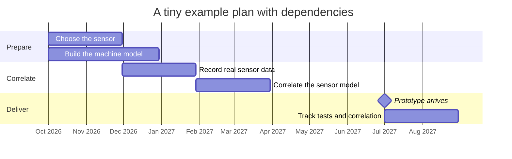

*A minimal Gantt chart: two preparation tasks, two dependent correlation tasks, a milestone for the prototype, and the track tests that depend on it.*

**Why it matters here.** The deadline is fixed by hardware arrival, so what matters is which chains of dependent tasks end at that date; the booklet asks every plan to show its critical or near-critical path, its integration buffer and its long-lead items [Chapter 12].

**Related terms.** [Critical path and buffer](#critical-path-and-buffer), [Project plan, work package and deliverable](#project-plan-work-package-and-deliverable), [Sensor and prototype freeze](#sensor-and-prototype-freeze), [Validation window](#validation-window), [Schedule risk analysis and Monte Carlo schedule simulation](#schedule-risk-analysis-and-monte-carlo-schedule-simulation), [Visuals that work](#visuals-that-work).

### Critical path and buffer

**In one sentence.** The critical path is the longest chain of dependent tasks in a plan, so any delay on it delays the end date; a buffer is spare time deliberately placed in the plan to absorb such delays.

**Explained.** If a dinner needs the roast (3 hours) and the salad (20 minutes), the roast is the critical path: starting the salad late changes nothing, starting the roast late delays dinner. In a program with hundreds of tasks, the critical path is found by adding up durations along every dependency chain and taking the longest; tasks just short of it are "near-critical" and become critical after a small slip. The method is called the critical path method (CPM) and is the model that schedule-risk tools work on [Chapter 12].

A buffer is time nobody is allowed to plan work into. Where to put it matters. The booklet rejects "add 20% everywhere" as indefensible and asks for uncertainty to be put where it exists: model accuracy, data access, hardware lead time, integration, safety review and rework. It asks for a buffer before the first physical-correlation test, and its reviewer checklist asks where the integration buffer is and what happens if test slots slip four weeks [Chapter 12]. The Critical Chain method, which pools buffers at the end of chains, is described as popular but unproven [Chapter 12].

Other chapters point to what is likely to sit on this program's critical path. An unconfirmed sensor choice is called "the single largest schedule risk", because sensor models, logged data and false-positive behavior are all specific to the sensor [Chapter 2]. Review queues and independent retesting can become the critical path [Chapter 1]. The hardware-in-the-loop (HIL) bench "should not be on the critical path unless ECU, bus and actuator interfaces stabilize early", the ECU being the machine's electronic control unit [Chapter 1].

**Why it matters here.** With a fixed end date, the critical path tells management which slips matter and where a buffer buys the most protection; the booklet asks at what date scope must be reduced to preserve delivery confidence [Chapter 12].

**Related terms.** [Gantt chart, milestone and dependency](#gantt-chart-milestone-and-dependency), [Schedule risk analysis and Monte Carlo schedule simulation](#schedule-risk-analysis-and-monte-carlo-schedule-simulation), [Planning fallacy, reference class forecasting and P50 / P80 estimates](#planning-fallacy-reference-class-forecasting-and-p50--p80-estimates), [Sensor and prototype freeze](#sensor-and-prototype-freeze), [Fallback option](#fallback-option).

### Planning fallacy, reference class forecasting and P50 / P80 estimates

**In one sentence.** The planning fallacy is the proven human habit of underestimating how long one's own work will take; reference class forecasting corrects it by looking at how long similar past projects actually took; and P50 and P80 dates state the finish date with a 50% and an 80% chance of being met.

**Explained.** Ask anyone when they will finish a report and they will name a date; most will miss it. In the classic 1994 experiments by Buehler, Griffin and Ross, only 29.7% of students finished their thesis by their own "best estimate" date, they kept underestimating even when told to be pessimistic, and they focused on their plan rather than on how past tasks had gone. The booklet rates this as proven [Chapter 12].

The remedy Kahneman and Lovallo called the outside view, and Flyvbjerg formalized as reference class forecasting: do not estimate from the inside details of your plan, estimate from the actual distribution of outcomes of comparable past projects, then adjust. The United Kingdom Treasury applies such uplifts to public projects. The evidence: reference class forecasting beat Monte Carlo and earned-value forecasting on accuracy only when the reference class was genuinely similar, and a 2025 review concludes it works "only if the right reference classes have been constructed"; its behavioral explanation is contested [Chapter 12].

The problem here is that no reference class of first-time virtual-validation programs meeting a four-month window exists; Chapter 13 states that none was found and calls the four months "a target, not a forecast". The booklet's answer is to decompose the work into components that do have history: the machine model (previous model-development tasks), sensor integrations (past supplier model deliveries), rig commissioning, software and hardware procurement lead times, hazard-analysis campaigns, earlier correlation projects, data-pipeline work, past assessor review durations, test automation, and hiring lead times, with an openly stated uplift where data are thin [Chapter 12].

P50 and P80 are how the result is stated. The P50 date is the median: a 50% chance of finishing by then. The P80 date has an 80% chance. The gap between them is a measure of uncertainty. A credible schedule statement has three parts, not one date: "a median readiness date of March X, an 80%-confidence date of April Y, and a Z% probability of meeting the April gate." The values must come from the program's own schedule model. Numeric ranges like these preserved trust better than verbal hedges in experiments, and estimators' own "90%" confidence ranges are known to be far too narrow [Chapter 12].

**Why it matters here.** The booklet asks the executive brief to show P50 and P80 dates for the end of preparation and the end of delivery, the descoping steps that keep the P80 date inside the deadline, and the current probability of making the fixed date rather than the planned one [Chapter 12].

**Related terms.** [Schedule risk analysis and Monte Carlo schedule simulation](#schedule-risk-analysis-and-monte-carlo-schedule-simulation), [Critical path and buffer](#critical-path-and-buffer), [Validation window](#validation-window), [Bottom line up front (BLUF) and the one-page summary](#bottom-line-up-front-bluf-and-the-one-page-summary), [Fallback option](#fallback-option), [RAND Corporation](#rand-corporation-and-gao-the-driving-to-safety-report-and-the-us-government-accountability-office-cost-and-schedule-guides).

### Schedule risk analysis and Monte Carlo schedule simulation

**In one sentence.** Schedule risk analysis gives every task a range of possible durations instead of one number, and a Monte Carlo schedule simulation runs the whole plan thousands of times with random draws from those ranges to find how likely each finish date is.

**Explained.** A plan built from single durations gives a single end date that is almost always optimistic. Schedule risk analysis replaces each duration with a low, likely and high estimate, and adds named risk events that may or may not happen. A computer then "plays" the plan many thousands of times, each time drawing a random duration for every task and following the dependency network to the end. The result is not one date but a curve: the share of plays that finished by each date. Reading 50% off the curve gives the P50 date, 80% the P80 date, and the share finished by the fixed deadline gives the probability of meeting it. A tornado chart, which lists tasks by how much their variation moves the end date, shows where to spend buffer or effort [Chapter 12].

The method is a best practice in the United States Government Accountability Office's Schedule Assessment Guide and is described in AACE International's recommended practice 57R-09. NASA requires joint confidence levels for its programs, though evidence of the effect of that requirement was not found. One experiment found that showing distributions as quantile dotplots or cumulative curves improved decisions [Chapter 12]. The booklet warns against a popular idea: the "cone of uncertainty" is not borne out by project data [Chapter 12]. This is the same Monte Carlo technique used elsewhere in the booklet to sample test scenarios; here the random variable is task duration rather than machine speed or weather.

**Why it matters here.** The booklet's schedule should carry the prototype's possible slip as an explicit modeled assumption with a signpost and a hedge, and should show the probability of the deadline rather than a planned date, because that is what a finance or executive reviewer will ask for [Chapter 12].

**Related terms.** [Planning fallacy, reference class forecasting and P50 / P80 estimates](#planning-fallacy-reference-class-forecasting-and-p50--p80-estimates), [Critical path and buffer](#critical-path-and-buffer), [Monte Carlo methods](#monte-carlo-methods), [Risk register, assumption log and unknowns](#risk-register-assumption-log-and-unknowns-known-unknowns), [Visuals that work](#visuals-that-work), [Cost estimating and schedule guides](#cost-estimating-and-schedule-guides-gao-guides-aace).

### Risk register, assumption log and unknowns (known unknowns)

**In one sentence.** A risk register lists the uncertain events that could hurt the plan, an assumption log lists the propositions the plan currently depends on, and the unknowns list records the questions the team knows it cannot yet answer.

**Explained.** The booklet asks planners to separate four things that are usually mixed into one spreadsheet: risks (uncertain events), assumptions (things taken to be true), issues (problems that have already happened) and unknowns (questions without answers yet). Each calls for a different action [Chapter 12].

A useful risk record has: cause, possible event, consequence, owner, probability or range, impact, early warning sign, preventive action, trigger, contingency, and the evidence required to retire it. The practice is documented in ISO 31000:2018 and IEC 31010:2019, but the evidence that risk management improves outcomes is thin: a 2010 review found only two of 29 papers reporting some positive impact. The familiar colored five-by-five "heat map" has proven mathematical defects (poor resolution, range compression, ranking errors), so the booklet prefers a ranked table with quantified ranges and allows a heat map only for familiarity, never for prioritization [Chapter 12].

An assumption log follows assumption-based planning, developed at RAND for the United States Army: identify the load-bearing and vulnerable assumptions, attach a signpost that shows when each is failing, and plan hedges. Examples for this program: "the supplier plant model is available by January", "the safety specialist will accept a residual model error of X", "the assessor accepts virtual evidence for scenario class X" [Chapter 12]. Chapter 13's failure-mode table is a ready-made register with early warning signs, for example "no correlation metrics by the first quarter of 2027".

Known unknowns are handled by a standing question at every gate: what do we know that we do not know, and which unknown must become known before the next irreversible commitment? Under truly unforeseeable uncertainty, the booklet cites work arguing for budgeting detection, buffers and parallel trials rather than attempting prediction [Chapter 12].

**Why it matters here.** The prototype's arrival date is itself an assumption the research did not treat as a planned branch; the booklet says the schedule model should carry it with a signpost and a hedge, such as extending the virtual campaign on the previous hardware generation [Chapter 12].

**Related terms.** [Pre-mortem, red team and expert review](#pre-mortem-red-team-and-expert-review-delphi-method-expert-elicitation), [Schedule risk analysis and Monte Carlo schedule simulation](#schedule-risk-analysis-and-monte-carlo-schedule-simulation), [Failure mode](#fault-failure-failure-mode-and-fault-injection), [Fallback option](#fallback-option), [Stage gate, evidence gate and go or no-go decision](#stage-gate-evidence-gate-and-go-or-no-go-decision), [Visuals that work](#visuals-that-work).

### Pre-mortem, red team and expert review (Delphi method, expert elicitation)

**In one sentence.** A pre-mortem imagines the project has already failed and asks why; a red team is a group charged with attacking the plan; expert review, including the Delphi method and structured elicitation, is a disciplined way of collecting and weighing what specialists believe.

**Explained.** A post-mortem explains a death after the fact. Klein's pre-mortem (2007) runs the same exercise before the start: "It is August 2027. The virtual-testing results were rejected by the safety review board. What happened?" It rests on 1989 experiments showing that reasoning about a future event as if it had happened changes the explanations people produce. The one direct test, with 178 students, found that the pre-mortem reduced confidence in the plan more than four other techniques; evidence that it improves real program outcomes was not found. The booklet recommends one early and one before the delivery-readiness gate [Chapter 12].

A red team gets an adversarial charter, not a proofreading job: "Demonstrate that this plan cannot support its stated safety claim by the deadline." Documented practice includes the United Kingdom Ministry of Defence and United States Army red-teaming handbooks; controlled evidence that red teams improve engineering outcomes was not found. Laboratory studies show that authentic dissent beats an assigned devil's advocate, so the booklet says to recruit real skeptics [Chapter 12].

Expert review for a non-specialist author starts with independent structured interviews, not a workshop, asking for specific past cases ("the last time a sensor model failed to match field data, what happened?"). For numbers such as durations and error magnitudes, structured elicitation protocols (Cooke's Classical Model, IDEA, SHELF) calibrate experts against questions with known answers; in 33 applications fewer than one third of experts met the accuracy criterion, so judgments must be calibrated and dissent recorded, never averaged into a falsely precise figure. The Delphi method collects anonymous estimates in rounds with feedback between rounds; it generally beats unstructured groups, but consensus is not correctness [Chapter 12]. The booklet's sequence: 8 to 12 interviews in months 1 to 2, elicitation in month 2, a pre-mortem in month 3, an independent red team in month 4, a gate review with recorded dissent in months 5 to 6 [Chapter 12].

**Why it matters here.** Reviewers weigh weaknesses more than strengths and disagree with each other, so the booklet's advice is to find the single weakness that would let a competent reviewer reject the plan before the reviewer does [Chapter 12].

**Related terms.** [Red team and hostile review](#red-team-and-hostile-review), [Independent review of the test plan](#independent-review-of-the-test-plan), [Risk register, assumption log and unknowns](#risk-register-assumption-log-and-unknowns-known-unknowns), [Independent assessment, independent test body and safety board](#independent-assessment-independent-test-body-and-safety-board), [Stage gate, evidence gate and go or no-go decision](#stage-gate-evidence-gate-and-go-or-no-go-decision), [Simulation specialist's objections](#simulation-specialists-objections).

### Stage gate, evidence gate and go or no-go decision

**In one sentence.** A stage gate is a formal decision point between phases of a project, an evidence gate is one whose pass criterion is demonstrated knowledge rather than a date, and a go or no-go decision is the choice made there to continue, restrict, change course or stop.

**Explained.** A gate is a locked door between two rooms of work. Management opens it only if the agreed evidence is in hand. Cooper's Stage-Gate process (1990, updated 2008) made this standard in product development. The booklet rates it "supported (mixed)": benchmarking surveys come mainly from the method's originator, one study found rigid gates can cause learning failure in novel products, and gates can become ceremonial, with documents completed to pass a date rather than evidence obtained to retire uncertainty [Chapter 12].

The fix is evidence-based gates: "model correlation meets criterion X and scenario coverage reaches Y" is a better gate than "Phase 2 complete by February". Four or five such gates serve better than many administrative phases. The pass criteria must be written now, signed by the sponsor, with a named decider. Every gate should permit at least four outcomes: go, go with restriction, pivot or fallback, and stop; a gate that permits only "go" is a review meeting. The case for pre-committed stop criteria rests on the escalation-of-commitment literature: a meta-analysis across more than 35 years confirms that decision makers keep investing in failing courses of action, and randomized trials of hypothesis-driven management raised rational termination [Chapter 12].

The booklet proposes five gates: G0 scope and evidence plan (end of November 2026); G1 feasibility (end of January 2027: one scenario runs end to end, reproducibly, under configuration control); G2 credibility and delivery readiness (March to April 2027: blind pilot meets pre-set metrics, P80 date inside the deadline); G3 coverage (end of June 2027); and G4 evidence release (August to September 2027: the package states envelope, limitations and residual uncertainty). A one-page gate card asks at each: decision, required knowledge, evidence, threshold, open uncertainty, deadline probability, options, fallback, dissent and authority [Chapter 12]. Chapter 13 adds a four-question sequence for early investment: can we obtain the data, correlate one system to reality, transfer that credibility to a second configuration, and will the safety and legal reviewers accept the evidence.

**Why it matters here.** The possibility that the correct conclusion is "virtual evidence is not yet adequate" must remain legitimate; a program whose definition of success requires a positive technical conclusion creates pressure to reinterpret discrepancies and gate criteria [Chapter 12].

**Related terms.** [Evidence gate and decision gate](#evidence-gate-and-decision-gate), [Pilot, proof of concept and minimum viable product (MVP)](#pilot-proof-of-concept-and-minimum-viable-product-mvp), [Fallback option](#fallback-option), [Technology readiness level (TRL)](#technology-readiness-level-trl), [Risk register, assumption log and unknowns](#risk-register-assumption-log-and-unknowns-known-unknowns), [Project plan, work package and deliverable](#project-plan-work-package-and-deliverable).

### Pilot, proof of concept and minimum viable product (MVP)

**In one sentence.** A proof of concept shows that something can work at all, a pilot tests whether the approach is feasible on a small but real slice, and a minimum viable product (MVP) is the smallest deliverable that is still useful.

**Explained.** A proof of concept answers "is this possible?" with a quick demonstration. A pilot answers "will this work for us?" with a small, controlled trial. An MVP is the smallest thing you could actually hand over. The three are often confused, and the booklet is strict about the pilot.

From the health-research literature it borrows the rule that pilots test feasibility, not effectiveness, and that progression criteria (go, restricted go, pivot, stop) must be declared before results are known; the transfer to engineering is an analogy, not proof [Chapter 12]. The recommended pilot is a deliberately difficult thin vertical slice, not an attractive demonstration: one safety function, one or two machine variants, normal cases plus boundary, degraded and known-difficult cases such as an occluded person in low visibility, the whole tool chain end to end, physical or bench comparators, and pre-declared criteria. Concretely: run it in months 3 to 5; choose 3 to 5 scenario classes including at least one edge case; pre-specify 10 to 30 physical test points; simulate blind before the physical results are seen; compare against pre-registered metrics such as detection-range error and stopping-distance error; report as a traffic light showing the trusted envelope and the failures. "A polished animation of one nominal cycle has almost no evidentiary value" [Chapter 12]. A pilot charter fixes the decision it informs, the uncertainty it removes, scope, comparator, challenge cases, metrics, progression criteria, deliverables and the claim limit, exactly what the pilot does not establish [Chapter 12]. Chapter 13 calls the same idea a single "golden thread" credibility slice.

The MVP appears as the "minimum viable deliverable" at the bottom of the descoping ladder; the booklet cites a 2025 report by the United States Government Accountability Office (GAO) recommending iterative minimum viable products for newer programs [Chapter 12]. The engineering cousins are the "walking skeleton", a crude end-to-end chain, and blind prediction, as in the Sandia Fracture Challenges where expert predictions often diverged from experiment [Chapter 12].

**Why it matters here.** A credible pilot conclusion reads "within these regimes, on configuration A, discrepancy stayed within tolerance for X and Y; the simulation failed criterion Z in condition Q, which keeps physical confirmation", which is far stronger than "the proof of concept was successful" [Chapter 12].

**Related terms.** [Stage gate, evidence gate and go or no-go decision](#stage-gate-evidence-gate-and-go-or-no-go-decision), [Pre-registration](#pre-registration), [Correlation test](#correlation-test), [Validity envelope](#validity-envelope-domain-of-validity-and-extrapolation), [Cheapest early experiments](#cheapest-early-experiments), [Fallback option](#fallback-option), [Tolerance and acceptance band](#tolerance-and-acceptance-band).

### Test and Evaluation Master Plan (TEMP) and integrated test planning

**In one sentence.** A Test and Evaluation Master Plan (TEMP) is the single overarching document that ties every planned test, virtual or physical, to the decision it informs, the data it needs, its resources, its schedule and its pass criteria.

**Explained.** The United States Department of Defense requires a TEMP for its major programs (DoD Instruction 5000.89 of November 2020 and the TEMP Guidebook version 3.1 of January 2017). The document links program decisions to test objectives, metrics, data needs, resources, schedule, entrance and exit criteria and reporting. Its core device is the Integrated Decision Support Key: for each decision, state the evaluation question, then the data required to answer it. The defense practice also treats modeling-and-simulation verification and validation as part of the integrated test strategy rather than an isolated exercise, a precedent against having "a simulation team over here, a test team over there" [Chapter 12].

Outcome studies comparing TEMP use with alternatives were not found, and a literal defense TEMP would be excessive for an eleven-month program. The transferable idea is an integrated virtual and physical test strategy with one line per claim: decision to be informed, evidence required, test or model method, comparator, acceptance rule, data, owner, date [Chapter 12]. In this program that means planning the four months after the prototype arrives as a physical correlation window: first measure latency, detection range, brake timing and stopping dynamics on the real machine, update the models, then let virtual regression run the large scenario matrix while physical machines focus on boundary conditions and worst cases [Chapters 1, 2].

**Why it matters here.** Every documented virtualization of automatic braking kept physical referents, so the plan must state separately what virtual evidence will explore, screen, verify, validate or replace; "reduce physical testing" and "take safety credit instead of physical testing" are very different claims [Chapters 12, 13].

**Related terms.** [Project plan, work package and deliverable](#project-plan-work-package-and-deliverable), [Verification versus validation (V&V)](#verification-versus-validation-vv), [Combining simulation and physical evidence](#combining-simulation-and-physical-evidence), [Deciding which physical tests to keep and which to replace](#deciding-which-physical-tests-to-keep-and-which-to-replace), [Correlation test](#correlation-test), [Evidence](#evidence), [Stage gate, evidence gate and go or no-go decision](#stage-gate-evidence-gate-and-go-or-no-go-decision).

### PMBOK, PMI, PRINCE2 and agile

**In one sentence.** PMBOK, PRINCE2 and agile are general frameworks for how to run projects: two are published bodies of project-management method, and agile is a family of practices that delivers work in short, repeated cycles.

**Explained.** The Project Management Institute (PMI) is a United States professional body. Its Guide to the Project Management Body of Knowledge (PMBOK Guide, seventh edition, 2021) collects accepted practice, including rolling-wave planning and risk-register practice. PRINCE2 (seventh edition, 2023, published by PeopleCert) is a method of United Kingdom government origin built around stages, defined roles and a project initiation document. Agile methods, which began in software, deliver in short cycles with frequent review; Cooper's 2016 Agile-Stage-Gate hybrid brought them into physical product development, and the F-35 integration of an automatic ground-collision avoidance function was credited by its maker to agile development and reuse of earlier work [Chapters 2, 12].

What the booklet found about their evidence base is sobering. It labels the PMBOK and PRINCE2 sources as expert opinion. Rolling-wave planning is documented practice with no outcome evidence found. No planning method of any kind has consistent outcome evidence for programs like this one. The best-supported underlying principle is knowledge before commitment, which United States Government Accountability Office (GAO) audits link, correlationally, to better cost and schedule outcomes. The booklet therefore says to layer methods rather than pick one: systems-engineering verification and validation planning as the backbone, evidence-based gates for governance, readiness levels for novel elements only, assumption-based and discovery-driven planning for uncertainty, reference class forecasting and schedule-risk analysis for time, and a roadmap for communication [Chapter 12].

**Why it matters here.** PMBOK and PRINCE2 are useful as templates for document structure, and the booklet lists them among the sources to borrow from, but neither tells a safety reviewer whether a simulation can be trusted; that question is answered by the credibility frameworks, not by project method [Chapter 12].

**Related terms.** [Stage gate, evidence gate and go or no-go decision](#stage-gate-evidence-gate-and-go-or-no-go-decision), [Project plan, work package and deliverable](#project-plan-work-package-and-deliverable), [Technology readiness level (TRL)](#technology-readiness-level-trl), [Cost estimating and schedule guides](#cost-estimating-and-schedule-guides-gao-guides-aace), [NASA-STD-7009](#nasa-std-7009-and-nasa-hdbk-7009).

### Cost estimating and schedule guides (GAO guides, AACE)

**In one sentence.** These are published handbooks on how to build a cost estimate and a project schedule that can withstand audit, written by the United States Government Accountability Office (GAO) and by AACE International, a professional association for cost engineering.

**Explained.** GAO audits government programs and has distilled what a defensible estimate looks like. Its Schedule Assessment Guide (GAO-16-89G, December 2015) sets out ten best-practice areas for a reliable integrated schedule, including that all activities are captured, sequenced with logic, resourced, and that a schedule-risk analysis is performed. Its Cost Estimating and Assessment Guide (GAO-20-195G, March 2020) is the companion for cost, and its Technology Readiness Assessment Guide (2020) describes a high-quality maturity assessment. AACE International's Recommended Practice 57R-09 describes integrated cost and schedule risk analysis using risk drivers and Monte Carlo simulation of a critical-path model [Chapter 12]. The United Kingdom Treasury's optimism-bias uplifts are a related documented practice [Chapter 12].

The booklet uses these guides in two ways. The schedule guide underlies its demand for an integrated schedule with reference classes, range assumptions, an S-curve, a critical path, buffers and long-lead items in the plan's "schedule and basis of estimate" section. The cost guide fills a blind spot: the research questions never asked how to estimate and present the cost of the capability (licenses, rigs, staff, external assessor), and the booklet names the GAO cost guide as the natural template [Chapter 12]. From the tools side, the booklet is blunt that any budget must be built from vendor quotations, since public prices are almost entirely absent, and the finance reviewer wants bottom-up estimates after the pilots rather than before [Chapters 11, 13].

**Why it matters here.** A finance or executive reviewer will ask whether the deadline claim and the budget are auditable; these guides are the recognized yardsticks for that question [Chapter 12].

**Related terms.** [Schedule risk analysis and Monte Carlo schedule simulation](#schedule-risk-analysis-and-monte-carlo-schedule-simulation), [Planning fallacy, reference class forecasting and P50 / P80 estimates](#planning-fallacy-reference-class-forecasting-and-p50--p80-estimates), [Critical path and buffer](#critical-path-and-buffer), [Technology readiness level (TRL)](#technology-readiness-level-trl), [Total cost of ownership, capital versus operating cost, full-time equivalent (FTE)](#total-cost-of-ownership-capital-versus-operating-cost-full-time-equivalent-fte), [RAND Corporation](#rand-corporation-and-gao-the-driving-to-safety-report-and-the-us-government-accountability-office-cost-and-schedule-guides).

### Bottom line up front (BLUF) and the one-page summary

**In one sentence.** Bottom line up front (BLUF) is the writing rule that the conclusion and the decision requested come first, and the one-page summary is the document that applies it so an executive can grasp the decision, the confidence and the risks in a page or two.

**Explained.** Most technical writing builds up to its point. BLUF, a military rule from United States Army Regulation 25-50, reverses that: say the answer, then explain. Minto's Pyramid Principle, with its situation-complication-question-answer opening, is the consulting version of the same idea [Chapter 12].

The booklet's executive decision brief, one to two pages, answers in this order: the decision requested; why now; what will exist by the deadline; what will not exist; the probability or confidence (P50 and P80 dates and the probability of meeting the deadline); the top risks; what "stop" looks like; the fallback; and the resources and decisions needed from leadership. Engineers and safety specialists then need a different view of the same truth: the chain of reasoning, model credibility, assumptions, coverage, acceptance thresholds and open disputes [Chapter 12]. Three other one-page instruments recur: the gate card; the evidence ledger (claim, evidence required, method, acceptance criterion, owner, due date, status, limitation); and, from Chapter 13, a credibility map showing every safety claim, whether its evidence is virtual, physical or mixed, what real data validated the model behind it, the uncertainty remaining and who may accept it.

The evidence is modest. No controlled study shows that BLUF, a six-page narrative or a pyramid structure makes a technical program more likely to be approved; the booklet classes them as popular and unproven. One survey of 1,048 business decisions found that the decision process explained more of the variance in outcomes than the quality of the analysis [Chapter 12].

**Why it matters here.** Reviewers are won by closing weaknesses, not by adding upside, so the first page should state the hardest uncertainty and the fallback plainly rather than lead with promised savings [Chapter 12].

**Related terms.** [PR/FAQ (working backwards) and other presentation formats](#prfaq-working-backwards-and-other-presentation-formats), [Executive reviewer, finance reviewer, product liability reviewer](#executive-reviewer-finance-reviewer-product-liability-reviewer), [Planning fallacy, reference class forecasting and P50 / P80 estimates](#planning-fallacy-reference-class-forecasting-and-p50--p80-estimates), [Visuals that work](#visuals-that-work), [Credibility of a simulation](#credibility-of-a-simulation).

### PR/FAQ (working backwards) and other presentation formats

**In one sentence.** PR/FAQ is a planning document written as the press release and the questions-and-answers that would accompany a finished product, and it is one of several named formats for presenting a plan to decision makers and expert reviewers.

**Explained.** Amazon's "working backwards" method asks a team to write the press release for the product before building it, followed by a list of frequently asked questions with honest answers. Writing the ending first forces clarity about who benefits and what would have to be true. Its sibling is the six-page narrative memo, read in silence at the start of a meeting instead of slides [Chapter 12].

Other formats the booklet names. The United Kingdom Treasury Five Case Model structures a business case into strategic, economic, commercial, financial and management cases. The Heilmeier Catechism of the United States Defense Advanced Research Projects Agency (DARPA) is the most compact reviewer test: what are you trying to do, in plain words; how is it done today and what are the limits; what is new and why will it succeed; who cares; what are the risks; how much will it cost; how long will it take; what are the mid-term and final "exams"? The United States National Institutes of Health reviews proposals on three questions (should it be done, can it be done well, are expertise and resources in place), and Horizon Europe scores excellence, impact and quality of implementation, with a critical-risks table [Chapter 12]. On slides versus prose, the Columbia accident investigators and Tufte criticized dense slide decks for engineering reasoning, and a quasi-experiment found that assertion-evidence slides, a full-sentence headline backed by visual evidence, improved comprehension over bullet slides [Chapter 12].

The booklet's recommended plan outline has fifteen sections, from an executive decision brief through safety scope, architecture, evidence strategy, credibility, standards, pilot, roadmap and gates, schedule, risks, organization, review protocol and sustainment, with appendices carrying depth. Two lengths are defensible, both opinion: a 12 to 15 page main body, or a two-page brief plus roughly 25 to 35 core pages [Chapter 12].

**Why it matters here.** None of these formats has controlled evidence of improving approval or success; their value is that each forces the author to answer the questions reviewers actually ask, especially "what would show that you are wrong?" [Chapter 12].

**Related terms.** [Bottom line up front (BLUF) and the one-page summary](#bottom-line-up-front-bluf-and-the-one-page-summary), [Visuals that work](#visuals-that-work), [Pre-mortem, red team and expert review](#pre-mortem-red-team-and-expert-review-delphi-method-expert-elicitation), [Executive reviewer, finance reviewer, product liability reviewer](#executive-reviewer-finance-reviewer-product-liability-reviewer), [Project plan, work package and deliverable](#project-plan-work-package-and-deliverable).

### Visuals that work

**In one sentence.** Visuals that work are the drawings in a plan that expose dependencies and gaps, rather than decorate; the booklet found no format proven to increase reviewer trust and recommends a division of labor among six kinds.

**Explained.** A picture persuades only if it shows the reader something true that prose would hide. The booklet is explicit that no credible research shows one visual format universally earns trust from engineering reviewers, and that the finding that trivial graphs increase persuasion failed to replicate. Its rule: do not decorate to persuade; decorate, if at all, to aid recall [Chapter 12].

The six recommended kinds. A layered roadmap: time horizontal, evidence streams vertical (safety argument, model credibility, physical correlation, scenario coverage, tool chain, governance), with dependencies and gate diamonds rather than isolated boxes. A claim-to-evidence map that tells the safety reviewer why each work package exists. A coverage map with scenario or hazard dimensions on one axis and evidence source on the other, each cell marked virtual-only, virtual plus physical correlation, physical-only or uncovered; uncovered cells must stay visibly blank rather than disappear into an "85% coverage" score. An architecture view showing machine, sensors, controller, environment, simulator, data stores, test oracle and comparators, marking which elements are real, modeled, emulated or substituted. A probabilistic schedule view: a Monte Carlo S-curve with P50 and P80 marked, or a fan chart. Risk views: a ranked top-risks table with ranges, a schedule-sensitivity tornado diagram and a risk burn-down by gate, with a heat map included only for familiarity because of its documented ranking defects [Chapter 12]. Chapter 13 adds the one-page credibility map and the traffic-light pilot report that shows the trusted envelope and the failures side by side.

**Why it matters here.** Reviewers disagree with each other and weigh weaknesses more than strengths; a visual that hides a gap will be found out, and one that shows it openly, with the plan to close it, is the booklet's definition of a visual that works [Chapter 12].

**Related terms.** [Gantt chart, milestone and dependency](#gantt-chart-milestone-and-dependency), [Schedule risk analysis and Monte Carlo schedule simulation](#schedule-risk-analysis-and-monte-carlo-schedule-simulation), [Risk register, assumption log and unknowns](#risk-register-assumption-log-and-unknowns-known-unknowns), [Safety case and safety argument](#safety-case-and-safety-argument), [Goal Structuring Notation](#goal-structuring-notation-gsn-and-structured-assurance-case-metamodel-sacm), [Test case, test matrix and scenario grid](#test-case-test-matrix-and-scenario-grid), [Bottom line up front (BLUF) and the one-page summary](#bottom-line-up-front-bluf-and-the-one-page-summary).

### Request for proposal (RFP), non-disclosure agreement (NDA), statement of work, and supplier information

**In one sentence.** A request for proposal (RFP) asks vendors to propose a solution and a price, a non-disclosure agreement (NDA) lets two companies share secrets safely, a statement of work spells out exactly what a supplier will deliver, and supplier information is the technical data a sensor or tool vendor must hand over for a simulation to represent its product.

**Explained.** An RFP is a written invitation: here is our problem, tell us what you would supply, how, and for how much. An NDA is signed before the detail is shared, so that each side's confidential information stays confidential. A statement of work is the contract annex that lists deliverables, dates and acceptance criteria. The booklet says what should go in them for this program.

For simulation tool vendors, the RFP should price peak concurrent workers, continuous-integration and cloud rights, subcontractor access, hardware-in-the-loop (HIL) nodes and disaster-recovery environments, not only desktop seats, and should require export in open formats (the ASAM Open Simulation Interface or OSI, OpenSCENARIO, the Functional Mock-up Interface or FMI, and OpenUSD) plus exit clauses for ownership changes, since two large simulation vendors changed hands during 2025 and 2026 [Chapter 11]. For an engineering partner, the statement of work should require editable machine models, scene and source assets, parameter provenance, correlation datasets, test definitions, continuous-integration (CI) scripts, version manifests, known-limitation registers and interface specifications, not only test reports [Chapter 11].

For sensor suppliers, Chapter 6 lists what a credible model needs. For lidar: scan pattern, beam divergence, wavelength, transmit power, detector model, detection thresholds and the signal-processing chain. For radar: carrier band, waveform, antenna patterns, receiver noise, detection and tracking logic, radome properties. For cameras: lens distortion, spectral response, shutter timing, noise, exposure control and the image-processing pipeline. For all sensors: exact mounting pose and tolerances, the machine's vibration transfer function, firmware version and degradation modes. If a supplier will not share internals, five options remain: ask for a black-box model packaged to OSI as a Functional Mock-up Unit (FMU), characterize the sensor yourself in controlled tests, estimate parameters inversely from measurements, put the real sensor in the loop, or write model-delivery and validation-data requirements into the sourcing contract now, while the sensor choice is still open [Chapter 6].

**Why it matters here.** Supplier data and usage rights can block the schedule before any test runs: a mining company needed cooperation from multiple machine makers for automatic stopping, a government review found manufacturer validation documentation proprietary, and "rights still under NDA or contract negotiation close to prototype delivery" is an early warning sign. Chapter 13's first cheap experiment is a supplier data-room drill mapping every required artifact to an owner, a contractual right and a delivery date [Chapter 13].

**Related terms.** [License types and pricing models](#license-types-and-pricing-models), [Build, buy or partner](#build-buy-or-partner), [Engineering service companies and research institutes](#engineering-service-companies-and-research-institutes), [Sensor simulation tools](#sensor-simulation-tools), [Co-simulation, Functional Mock-up Interface (FMI)](#co-simulation-functional-mock-up-interface-fmi-functional-mock-up-unit-fmu-and-ssp), [Cheapest early experiments](#cheapest-early-experiments), [Calibration](#calibration-intrinsic-and-extrinsic-and-sensor-mounting).

### Total cost of ownership, capital versus operating cost, full-time equivalent (FTE)

**In one sentence.** Total cost of ownership is everything a capability costs over its life, not just the purchase price; capital cost is money spent once on things that last, operating cost is money spent every month to keep running; and a full-time equivalent (FTE) is the work of one person for one full year.

**Explained.** Buying a car is a capital cost; fuel, insurance and repairs are operating costs; total cost of ownership adds them all over the years you keep it. For a simulation capability, capital items are things like a hardware-in-the-loop (HIL) bench, workstations and perpetual licenses; operating items are cloud hours, subscriptions, maintenance contracts, storage and, above all, people. FTE converts part-time contributions into whole-person years so that staffing can be budgeted; three engineers at half time are 1.5 FTE. The booklet does not use the term FTE, but its labor figures are per specialist per year, which is the same unit.

The booklet's central cost finding is that "free" software does not mean low total cost. It builds a labor anchor from United States Bureau of Labor Statistics May 2025 median wages (about USD 135,980 for software developers, 104,110 for mechanical engineers, 161,740 for computer hardware engineers) and a 31.5% benefits share, giving employer costs of roughly USD 150,000 to 260,000 per specialist per year, before overhead, recruiting, contractors and licenses. Several specialist years therefore make a seven-figure annual program whatever the software costs. Compute, by contrast, is cheap: on the order of USD 54,000 for ten cloud graphics processors running four months. Team headcount was not found in any public source [Chapter 11].

Chapter 13's finance reviewer adds the hidden items: until the simulator is trusted the company pays twice, for the simulator and for the physical tests that validate it; recurring costs for compute, labeling, weather-chamber hire, storage, notified-body fees and dealer training were not found anywhere; and the business case depends on unproven reuse across machine families. Chapter 12 asks the plan to state what happens after September 2027: ownership, budget and licenses for sustaining the models and staff.

**Why it matters here.** The booklet asks that physical-test savings be counted only after the safety team agrees that a specific physical test category can be displaced, and that costs be estimated bottom-up after the pilots, not before [Chapter 13].

**Related terms.** [Build, buy or partner](#build-buy-or-partner), [License types and pricing models](#license-types-and-pricing-models), [Compute cost and run time](#compute-cost-and-run-time), [Team and skills needed](#team-and-skills-needed), [Cost estimating and schedule guides](#cost-estimating-and-schedule-guides-gao-guides-aace), [Executive reviewer, finance reviewer, product liability reviewer](#executive-reviewer-finance-reviewer-product-liability-reviewer).

### Team and skills needed

**In one sentence.** The team and skills needed are the distinct specialist disciplines a manufacturer must have in place at the same time to build and defend a virtual validation capability.

**Explained.** Chapter 2 derives the disciplines from the partner lists of the European research programs and from what accepted workflows require, as expert synthesis rather than a published staffing prescription: safety, requirements and scenario engineering; perception and sensor-model specialists, one credibility argument per sensor type; machine dynamics and braking; simulation and model-, software- and hardware-in-the-loop engineering; test automation and data engineering; physical-test and ground-truth engineering; statistics and model credibility; functional-safety and safety-argument specialists plus supplier integration; and an independent safety or acceptance authority able to reject the evidence [Chapter 2].

Chapter 11 lists the same ground from the tools side: simulation architecture and co-simulation; heavy-machine dynamics; tires, tracks, soil and braking; camera, radar, lidar and ultrasonic modeling; Unreal, OpenUSD and 3D asset engineering; scenario and verification and validation (V&V) automation; data engineering; cloud and continuous integration; electronic control unit (ECU) and hardware-in-the-loop (HIL) work; statistics and coverage; functional safety. An open-source build needs simulation software engineers, rendering specialists, multibody and terramechanics experts, sensor physicists and test-automation engineers; a bought stack needs tool specialists, scenario engineers and safety staff; a partner model needs a smaller internal core that owns requirements and acceptance [Chapter 11].

Team size was not found anywhere. For scale, the PEGASUS program on one highway function took 17 partners, 42 months and about 1,791 person-months [Chapter 2]. Chapter 12 asks the plan for named owners, key-person cover, an independent assessor, a red team and a list of skill gaps, and Chapter 13 insists that independence be designed in: model developers should not be the only people deciding whether discrepancies are acceptable.

**Why it matters here.** A manufacturer with no capability must stand up all of these domains simultaneously, with scarce skills, which is why the booklet favors a hybrid that buys peak expertise while keeping the operating-domain definition, scenario catalog and correlation data in-house [Chapter 11].

**Related terms.** [Build, buy or partner](#build-buy-or-partner), [Total cost of ownership, capital versus operating cost, full-time equivalent (FTE)](#total-cost-of-ownership-capital-versus-operating-cost-full-time-equivalent-fte), [Independent assessment, independent test body and safety board](#independent-assessment-independent-test-body-and-safety-board), [PEGASUS, VVM](#pegasus-vvm-set-level-vavim-and-evident-german-and-european-research-programs-on-scenario-based-validation), [Engineering service companies and research institutes](#engineering-service-companies-and-research-institutes), [Software terms a planner meets](#software-terms-a-planner-meets).

### Cheapest early experiments

**In one sentence.** The cheapest early experiments are small tests that can start immediately, with existing data and one machine, and are designed to prove the proposal wrong before expensive infrastructure is built.

**Explained.** Before buying a factory, make one part by hand. Chapter 13 lists sixteen such experiments, each with the artifact it produces and the signal that should stop or escalate the program. Among them: a supplier data-room drill (can the needed sensor, brake and controller data be obtained with legal rights?); a single "golden thread" credibility slice (one requirement carried from real test to model to virtual result to decision); a credibility-framework dry run against EU Regulation 2022/1426 Annex III; open-loop replay of existing warning-system logs through candidate braking logic, to estimate the false-activation rate before new hardware exists; one machine, one scenario, physical versus virtual correlation, reported as residual plots and an uncertainty budget rather than "looks close"; a sensor-model correlation pilot for one sensor in one dust or fog condition, judged on detection outcomes; a weather falsification test (does simulated rain or dust reproduce measured sensor degradation, not just appearance?); a physical stopping-distance matrix over two machine families, three surfaces and grades; a calibration perturbation test (do small mounting changes move the brake trigger?); a machine-variant portability test; a shadow-mode intervention study on real sites; a winter 2026 to 2027 data capture before the season passes; an end-to-end throughput benchmark including human triage; notified-body and counsel pre-consultation; a safety and legal dry run on one evidence package; and an operator clinic measuring nuisance-stop tolerance [Chapter 13].

The booklet orders the investment behind four questions: can we obtain the required data; can we correlate one representative system to reality; can we transfer that credibility to a second, materially different configuration; will the safety and legal reviewers accept the resulting evidence. Failure at any step is more informative now than after a full platform has been built [Chapter 13].

**Why it matters here.** Several of these can start in October 2026 with the existing warning-system fleet, historical tests and one representative machine, and the finance reviewer's first request is exactly their stage-gated results [Chapter 13].

**Related terms.** [Pilot, proof of concept and minimum viable product (MVP)](#pilot-proof-of-concept-and-minimum-viable-product-mvp), [Stage gate, evidence gate and go or no-go decision](#stage-gate-evidence-gate-and-go-or-no-go-decision), [Shadow mode](#shadow-mode-silent-testing), [Correlation test](#correlation-test), [Replay and re-simulation of recorded data](#replay-and-re-simulation-of-recorded-data-open-loop-replay), [Warning-system fleet](#warning-system-fleet), [Season and weather coverage](#season-and-weather-coverage), [Request for proposal (RFP), non-disclosure agreement (NDA), statement of work, and supplier information](#request-for-proposal-rfp-non-disclosure-agreement-nda-statement-of-work-and-supplier-information).

### Executive reviewer, finance reviewer, product liability reviewer

**In one sentence.** These are three of the skeptical readers the plan must satisfy, each needing a different view of the same evidence: the executive decides, the finance reviewer checks the money, and the product liability reviewer checks what would survive in court.

**Explained.** Chapter 13 reviews the proposal through the eyes of seven critics, including a functional safety engineer, a perception engineer, a simulation specialist, a field test engineer and a site operations manager as well as the three named here. Two rules apply to all: every reviewer should see a one-page credibility map (each safety claim, whether its evidence is virtual, physical or mixed, what real data validated the model, the remaining uncertainty and who may accept it), and no reviewer should be asked to approve "virtual testing" as a category, only specific substitutions of the form "within this envelope, this validated model may replace this defined physical test" [Chapter 13].

The executive needs the first two pages of Chapter 12: the decision requested, why now, what will and will not exist by the deadline, the probability of meeting it, the principal risks, the fallback and the resources needed. The executive's challenge questions: how much money and engineering capacity is committed versus physical-only testing; what is the minimum useful result; what is the cost of believing an incorrect virtual result; what is the mid-program "exam"; and what happens after September 2027 [Chapter 12].

The finance reviewer objects that savings are counted before the substitution is earned (the company pays for the simulator and the validating physical tests at once), that no independent return-on-investment evidence exists for off-road virtual validation, that the case depends on unproven reuse across machine families, and that recurring costs (compute, labeling, chamber hire, storage, notified-body fees, dealer training) were not found. What answers this: stage-gate results from the early experiments, demonstrated reuse, measured build and maintenance cost, throughput and triage labor, bottom-up estimates after the pilots, physical-test categories actually approved for retirement, a costed fallback and staged investment gates [Chapter 13].

The product liability reviewer needs a jurisdiction-specific compliance analysis; documented standards and editions; supplier and machine-maker authorizations; a litigation-ready safety case with a defensible rationale for every virtual substitution; auditable evidence provenance and a retention policy; an enforced and logged operating envelope; review of product claims, warnings and the operator manual; a comparison against competitors' systems; a notified-body or legal opinion on the EU Machinery Regulation and AI Act; independent safety sign-off; and a documented launch decision. The reason is the EU Product Liability Directive, applying to products placed on the market after 9 December 2026: software is a product, courts may order disclosure of evidence, and defectiveness may be presumed if the defendant fails to disclose, so the gaps of a disclosed simulation safety case become the claimant's exhibit [Chapter 13].

**Why it matters here.** The booklet's blunt summary is that the business case counts savings before they are earned, that the regulatory route is unconfirmed and that liability exposure rises sharply; the plan must address all three before it reaches the technical reviewers [Chapter 13].

**Related terms.** [Bottom line up front (BLUF) and the one-page summary](#bottom-line-up-front-bluf-and-the-one-page-summary), [Product liability and the EU Product Liability Directive (PLD)](#product-liability-and-the-eu-product-liability-directive-pld), [EU Machinery Regulation](#eu-machinery-regulation-eu-20231230-the-ai-act-the-product-liability-directive-and-the-data-act), [CE marking and notified body](#ce-marking-and-notified-body), [Simulation specialist's objections](#simulation-specialists-objections), [What an internal safety board or outside assessor expects to see](#the-credibility-package-what-a-safety-board-or-outside-assessor-expects-to-see), [Cheapest early experiments](#cheapest-early-experiments), [Total cost of ownership, capital versus operating cost, full-time equivalent (FTE)](#total-cost-of-ownership-capital-versus-operating-cost-full-time-equivalent-fte).

---

## A to Z index

Every term, sub-term and acronym in this glossary, with the entry that explains it. The letter in parentheses is the part.

### 0 to 9

- **000 hours**: [Base rate and exposure-based rates (events per 1,000 hours)](#base-rate-and-exposure-based-rates-events-per-1000-hours) (F)
- **The "100+ site types" claim**: [Site type and the "100+ site types" claim](#site-type-and-the-100-site-types-claim) (A)
- **15026-2**: [Systems and software engineering standards (ISO/IEC/IEEE 15288, 29119, 42010, 15026-2, IEEE 1012, ISO 31000, IEC 31010)](#systems-and-software-engineering-standards-isoiecieee-15288-29119-42010-15026-2-ieee-1012-iso-31000-iec-31010) (H)
- **23894**: [ISO 21448, ISO 26262 and the AI safety standards (ISO/PAS 8800, ISO/IEC TR 5469, ISO/IEC 42001, 23894, 24029)](#iso-21448-iso-26262-and-the-ai-safety-standards-isopas-8800-isoiec-tr-5469-isoiec-42001-23894-24029) (H)
- **24029**: [ISO 21448, ISO 26262 and the AI safety standards (ISO/PAS 8800, ISO/IEC TR 5469, ISO/IEC 42001, 23894, 24029)](#iso-21448-iso-26262-and-the-ai-safety-standards-isopas-8800-isoiec-tr-5469-isoiec-42001-23894-24029) (H)
- **29119**: [Systems and software engineering standards (ISO/IEC/IEEE 15288, 29119, 42010, 15026-2, IEEE 1012, ISO 31000, IEC 31010)](#systems-and-software-engineering-standards-isoiecieee-15288-29119-42010-15026-2-ieee-1012-iso-31000-iec-31010) (H)
- **3D asset**: [Virtual job site (virtual environment, scene, 3D asset)](#virtual-job-site-virtual-environment-scene-3d-asset) (D)
- **3DGS**: [Neural rendering: NeRF and Gaussian splatting (3DGS) as ways to rebuild a scene from photos](#neural-rendering-nerf-and-gaussian-splatting-3dgs-as-ways-to-rebuild-a-scene-from-photos) (C)
- **42010**: [Systems and software engineering standards (ISO/IEC/IEEE 15288, 29119, 42010, 15026-2, IEEE 1012, ISO 31000, IEC 31010)](#systems-and-software-engineering-standards-isoiecieee-15288-29119-42010-15026-2-ieee-1012-iso-31000-iec-31010) (H)
- **"Do not make one simulator carry every test"**: ["Do not make one simulator carry every test" (multi-simulator architecture)](#do-not-make-one-simulator-carry-every-test-multi-simulator-architecture) (D)

### A

- **AACE**: [Cost estimating and schedule guides (GAO guides, AACE)](#cost-estimating-and-schedule-guides-gao-guides-aace) (I)
- **ACARP**: [ACARP and its two-tier test approach (Australian Coal Association Research Program)](#acarp-and-its-two-tier-test-approach-australian-coal-association-research-program) (H)
- **ACARP and its two-tier test approach**: [ACARP and its two-tier test approach (Australian Coal Association Research Program)](#acarp-and-its-two-tier-test-approach-australian-coal-association-research-program) (H)
- **ACAS X**: [ACAS X and TCAS (aircraft collision avoidance, encounter models)](#acas-x-and-tcas-aircraft-collision-avoidance-encounter-models) (H)
- **ACAS X and TCAS**: [ACAS X and TCAS (aircraft collision avoidance, encounter models)](#acas-x-and-tcas-aircraft-collision-avoidance-encounter-models) (H)
- **Acceptance band**: [Tolerance and acceptance band](#tolerance-and-acceptance-band) (G)
- **Acceptance criteria**: [Acceptance criteria and pass or fail criteria](#acceptance-criteria-and-pass-or-fail-criteria) (B)
- **Acceptance criteria and pass or fail criteria**: [Acceptance criteria and pass or fail criteria](#acceptance-criteria-and-pass-or-fail-criteria) (B)
- **Adaptive and Bayesian test selection**: [Adaptive and Bayesian test selection](#adaptive-and-bayesian-test-selection) (F)
- **ADT**: [Articulated hauler (ADT)](#articulated-hauler-adt) (A)
- **Advanced Emergency Braking System**: [Automatic Emergency Braking (AEB) and Advanced Emergency Braking System (AEBS)](#automatic-emergency-braking-aeb-and-advanced-emergency-braking-system-aebs) (A)
- **AEB**: [Automatic Emergency Braking (AEB) and Advanced Emergency Braking System (AEBS)](#automatic-emergency-braking-aeb-and-advanced-emergency-braking-system-aebs) (A)
- **AEBS**: [Automatic Emergency Braking (AEB) and Advanced Emergency Braking System (AEBS)](#automatic-emergency-braking-aeb-and-advanced-emergency-braking-system-aebs) (A)
- **Aerospace practice**: [Aerospace practice: FAA similarity rules, DO-178C, DO-330 and MIL-STD-3022](#aerospace-practice-faa-similarity-rules-do-178c-do-330-and-mil-std-3022) (G)
- **Agile**: [PMBOK, PMI, PRINCE2 and agile](#pmbok-pmi-prince2-and-agile) (I)
- **Agricultural automation**: [IEC 61496, IEC TS 62998, ISO 3691-4 and ISO 18497 (safety sensors, driverless industrial trucks and agricultural automation)](#iec-61496-iec-ts-62998-iso-3691-4-and-iso-18497-safety-sensors-driverless-industrial-trucks-and-agricultural-automation) (H)
- **Agriculture precedents**: [Rail, port, forklift and agriculture precedents (Wabtec and others)](#rail-port-forklift-and-agriculture-precedents-wabtec-and-others) (H)
- **AI**: [ISO 21448, ISO 26262 and the AI safety standards (ISO/PAS 8800, ISO/IEC TR 5469, ISO/IEC 42001, 23894, 24029)](#iso-21448-iso-26262-and-the-ai-safety-standards-isopas-8800-isoiec-tr-5469-isoiec-42001-23894-24029) (H)
- **The AI Act**: [EU Machinery Regulation (EU) 2023/1230, the AI Act, the Product Liability Directive and the Data Act](#eu-machinery-regulation-eu-20231230-the-ai-act-the-product-liability-directive-and-the-data-act) (H)
- **Alarm accuracy**: [False alarm and alarm accuracy](#false-alarm-and-alarm-accuracy) (A)
- **Alarm fatigue**: [Alarm fatigue](#alarm-fatigue) (A)
- **ALARP**: [Residual risk and as low as reasonably practicable (ALARP)](#residual-risk-and-as-low-as-reasonably-practicable-alarp) (B)
- **Amazon Web Services**: [Graphics cards named in the booklet](#graphics-cards-named-in-the-booklet) (I)
- **American Society of Mechanical Engineers**: [ASME V&V 10, V&V 20 and V&V 40](#asme-vv-10-vv-20-and-vv-40) (G)
- **Annotation**: [Labeling and annotation (human labels, auto-labeling, offboard detectors)](#labeling-and-annotation-human-labels-auto-labeling-offboard-detectors) (C)
- **API**: [Software terms a planner meets](#software-terms-a-planner-meets) (I)
- **An application programming interface**: [Software terms a planner meets](#software-terms-a-planner-meets) (I)
- **Archetypes**: [Transferring settings across machine models (physics-based parameterization, archetypes, partial pooling, transfer optimization)](#transferring-settings-across-machine-models-physics-based-parameterization-archetypes-partial-pooling-transfer-optimization) (F)
- **Area validation metric**: [Distributional agreement](#distributional-agreement) (G)
- **Articulated hauler**: [Articulated hauler (ADT)](#articulated-hauler-adt) (A)
- **Articulated steering**: [Articulated steering](#articulated-steering) (E)
- **The artificial intelligence**: [ISO 21448, ISO 26262 and the AI safety standards (ISO/PAS 8800, ISO/IEC TR 5469, ISO/IEC 42001, 23894, 24029)](#iso-21448-iso-26262-and-the-ai-safety-standards-isopas-8800-isoiec-tr-5469-isoiec-42001-23894-24029) (H)
- **Artificial lighting**: [Sensor degradation: dust, mud, rain, snow, fog, spray, glare, darkness, artificial lighting, vibration](#sensor-degradation-dust-mud-rain-snow-fog-spray-glare-darkness-artificial-lighting-vibration) (C)
- **ASAM**: [Standards bodies (ISO, IEC, CEN, CENELEC, ASAM, SAE, IEEE, UL and national bodies)](#standards-bodies-iso-iec-cen-cenelec-asam-sae-ieee-ul-and-national-bodies) (H)
- **ASAM OpenMATERIAL**: [Material and sensor material (ASAM OpenMATERIAL)](#material-and-sensor-material-asam-openmaterial) (D)
- **ASAM Open Simulation Interface**: [Tool chain](#tool-chain) (I)
- **The ASAM organization**: [Open Simulation Interface (ASAM OSI) and the ASAM organization](#open-simulation-interface-asam-osi-and-the-asam-organization) (D)
- **ASAM OSI**: [Open Simulation Interface (ASAM OSI) and the ASAM organization](#open-simulation-interface-asam-osi-and-the-asam-organization) (D)
- **ASAM QSQ**: [Credible Simulation Process and simulation quality (ASAM QSQ)](#credible-simulation-process-and-simulation-quality-asam-qsq) (G)
- **Asia rules**: [South America and Asia rules (NR-22, NR-12, DS 132, SERNAGEOMIN, DS 024-2016-EM, DGMS, GB standards, JARI)](#south-america-and-asia-rules-nr-22-nr-12-ds-132-sernageomin-ds-024-2016-em-dgms-gb-standards-jari) (H)
- **ASIL**: [Automotive Safety Integrity Level (ASIL)](#automotive-safety-integrity-level-asil) (B)
- **ASME**: [ASME V&V 10, V&V 20 and V&V 40](#asme-vv-10-vv-20-and-vv-40) (G)
- **ASME V&V 10**: [ASME V&V 10, V&V 20 and V&V 40](#asme-vv-10-vv-20-and-vv-40) (G)
- **ASME V&V 10, V&V 20 and V&V 40**: [ASME V&V 10, V&V 20 and V&V 40](#asme-vv-10-vv-20-and-vv-40) (G)
- **Assumption log**: [Risk register, assumption log and unknowns (known unknowns)](#risk-register-assumption-log-and-unknowns-known-unknowns) (I)
- **Assurance case for autonomous products**: [Assurance case for autonomous products (UL 4600)](#assurance-case-for-autonomous-products-ul-4600) (B)
- **The Australian Coal Association Research Program**: [ACARP and its two-tier test approach (Australian Coal Association Research Program)](#acarp-and-its-two-tier-test-approach-australian-coal-association-research-program) (H)
- **Australia rules**: [Canada and Australia rules (CSA M424, WHS laws, NSW Resources Regulator, RSHQ QGN 27 and QGN 33, DMIRS)](#canada-and-australia-rules-csa-m424-whs-laws-nsw-resources-regulator-rshq-qgn-27-and-qgn-33-dmirs) (H)
- **Auto-GCAS**: [Auto-GCAS (Automatic Ground Collision Avoidance System for fighter aircraft)](#auto-gcas-automatic-ground-collision-avoidance-system-for-fighter-aircraft) (H)
- **Auto-labeling**: [Labeling and annotation (human labels, auto-labeling, offboard detectors)](#labeling-and-annotation-human-labels-auto-labeling-offboard-detectors) (C)
- **Automatic Emergency Braking**: [Automatic Emergency Braking (AEB) and Advanced Emergency Braking System (AEBS)](#automatic-emergency-braking-aeb-and-advanced-emergency-braking-system-aebs) (A)
- **Automotive Safety Integrity Level**: [Automotive Safety Integrity Level (ASIL)](#automotive-safety-integrity-level-asil) (B)
- **Aviation standards**: [Rail and aviation standards (EN 50126 to EN 50129, EN 50716, EN 14363, DO-178C, DO-330, DO-385, ED-256)](#rail-and-aviation-standards-en-50126-to-en-50129-en-50716-en-14363-do-178c-do-330-do-385-ed-256) (H)
- **AVM**: [Distributional agreement](#distributional-agreement) (G)
- **Avoidance**: [ISO 21815 series (collision warning and avoidance)](#iso-21815-series-collision-warning-and-avoidance) (H)
- **AWS**: [Cloud execution services](#cloud-execution-services) (I)

### B

- **Base rate**: [Base rate and exposure-based rates (events per 1,000 hours)](#base-rate-and-exposure-based-rates-events-per-1000-hours) (F)
- **Base rate and exposure-based rates**: [Base rate and exposure-based rates (events per 1,000 hours)](#base-rate-and-exposure-based-rates-events-per-1000-hours) (F)
- **Bayesian methods**: [Bayesian methods and sequential testing](#bayesian-methods-and-sequential-testing) (F)
- **Bayesian methods and sequential testing**: [Bayesian methods and sequential testing](#bayesian-methods-and-sequential-testing) (F)
- **Bayesian optimization**: [Optimization methods named in the booklet (genetic algorithms, NSGA-II, Bayesian optimization, gradient-free search)](#optimization-methods-named-in-the-booklet-genetic-algorithms-nsga-ii-bayesian-optimization-gradient-free-search) (F)
- **Bayesian test selection**: [Adaptive and Bayesian test selection](#adaptive-and-bayesian-test-selection) (F)
- **Bench**: [Haul road, berm, bench and pit wall](#haul-road-berm-bench-and-pit-wall) (A)
- **Benchmarks**: [Datasets and benchmarks (what MOCS, SODA, RELLIS-3D, RUGD and similar names are)](#datasets-and-benchmarks-what-mocs-soda-rellis-3d-rugd-and-similar-names-are) (C)
- **BEPU**: [Nuclear practice: EMDAP, PIRT and BEPU](#nuclear-practice-emdap-pirt-and-bepu) (G)
- **Berm**: [Haul road, berm, bench and pit wall](#haul-road-berm-bench-and-pit-wall) (A)
- **Binomial claims**: [Binomial claims and the rule of three](#binomial-claims-and-the-rule-of-three) (F)
- **Binomial claims and the rule of three**: [Binomial claims and the rule of three](#binomial-claims-and-the-rule-of-three) (F)
- **Blind spot**: [Blind spot and operator visibility](#blind-spot-and-operator-visibility) (A)
- **Blind spot and operator visibility**: [Blind spot and operator visibility](#blind-spot-and-operator-visibility) (A)
- **Blocked sensor**: [Occlusion (hidden objects) and sensor obstruction (blocked sensor)](#occlusion-hidden-objects-and-sensor-obstruction-blocked-sensor) (C)
- **BLS**: [NIOSH, MSHA, BLS and CPWR (US bodies that publish accident data)](#niosh-msha-bls-and-cpwr-us-bodies-that-publish-accident-data) (H)
- **BLUF**: [Bottom line up front (BLUF) and the one-page summary](#bottom-line-up-front-bluf-and-the-one-page-summary) (I)
- **Bottom line up front**: [Bottom line up front (BLUF) and the one-page summary](#bottom-line-up-front-bluf-and-the-one-page-summary) (I)
- **Brake build-up time**: [Brake dead time and brake build-up time](#brake-dead-time-and-brake-build-up-time) (E)
- **Brake dead time**: [Brake dead time and brake build-up time](#brake-dead-time-and-brake-build-up-time) (E)
- **Brake dead time and brake build-up time**: [Brake dead time and brake build-up time](#brake-dead-time-and-brake-build-up-time) (E)
- **Brake model**: [Brake model and powertrain model](#brake-model-and-powertrain-model) (E)
- **Brake model and powertrain model**: [Brake model and powertrain model](#brake-model-and-powertrain-model) (E)
- **Brake performance**: [ISO 3450 and ISO 10265 (brake performance)](#iso-3450-and-iso-10265-brake-performance) (H)
- **Braking zone**: [Zones (warning zone, braking zone, detection zone)](#zones-warning-zone-braking-zone-detection-zone) (E)
- **BRDF**: [Physically based rendering (PBR), BRDF and BSDF (how materials reflect light and radar)](#physically-based-rendering-pbr-brdf-and-bsdf-how-materials-reflect-light-and-radar) (C)
- **The British Standards Institution**: [Standards bodies (ISO, IEC, CEN, CENELEC, ASAM, SAE, IEEE, UL and national bodies)](#standards-bodies-iso-iec-cen-cenelec-asam-sae-ieee-ul-and-national-bodies) (H)
- **BSD-3**: [Complete and near-complete simulation platforms](#complete-and-near-complete-simulation-platforms) (I)
- **BSDF**: [Physically based rendering (PBR), BRDF and BSDF (how materials reflect light and radar)](#physically-based-rendering-pbr-brdf-and-bsdf-how-materials-reflect-light-and-radar) (C)
- **BSI**: [Standards bodies (ISO, IEC, CEN, CENELEC, ASAM, SAE, IEEE, UL and national bodies)](#standards-bodies-iso-iec-cen-cenelec-asam-sae-ieee-ul-and-national-bodies) (H)
- **Build, buy or partner**: [Build, buy or partner](#build-buy-or-partner) (I)
- **The Bureau of Labor Statistics**: [NIOSH, MSHA, BLS and CPWR (US bodies that publish accident data)](#niosh-msha-bls-and-cpwr-us-bodies-that-publish-accident-data) (H)
- **Bypassing**: [Switching off and bypassing](#switching-off-and-bypassing) (A)

### C

- **CAE**: [Goal Structuring Notation (GSN) and Structured Assurance Case Metamodel (SACM)](#goal-structuring-notation-gsn-and-structured-assurance-case-metamodel-sacm) (B)
- **Calibration**: [Calibration (intrinsic and extrinsic) and sensor mounting](#calibration-intrinsic-and-extrinsic-and-sensor-mounting) (C)
- **Camera**: [Camera (RGB camera, CMOS sensor, lens, image signal processor ISP, HDR, rolling shutter)](#camera-rgb-camera-cmos-sensor-lens-image-signal-processor-isp-hdr-rolling-shutter) (C)
- **Campaign**: [Campaign (test campaign) and campaign architecture](#campaign-test-campaign-and-campaign-architecture) (F)
- **Campaign architecture**: [Campaign (test campaign) and campaign architecture](#campaign-test-campaign-and-campaign-architecture) (F)
- **Canada**: [Canada and Australia rules (CSA M424, WHS laws, NSW Resources Regulator, RSHQ QGN 27 and QGN 33, DMIRS)](#canada-and-australia-rules-csa-m424-whs-laws-nsw-resources-regulator-rshq-qgn-27-and-qgn-33-dmirs) (H)
- **Canada and Australia rules**: [Canada and Australia rules (CSA M424, WHS laws, NSW Resources Regulator, RSHQ QGN 27 and QGN 33, DMIRS)](#canada-and-australia-rules-csa-m424-whs-laws-nsw-resources-regulator-rshq-qgn-27-and-qgn-33-dmirs) (H)
- **CAN bus**: [Vehicle network: CAN bus, SAE J1939, DBC file](#vehicle-network-can-bus-sae-j1939-dbc-file) (C)
- **CAS**: [Collision Warning System (CWS) and Collision Avoidance System (CAS)](#collision-warning-system-cws-and-collision-avoidance-system-cas) (A)
- **Category**: [Performance Level (PL) and Category](#performance-level-pl-and-category) (B)
- **CD**: [Standard](#standard) (H)
- **CE marking**: [CE marking and notified body](#ce-marking-and-notified-body) (H)
- **CE marking and notified body**: [CE marking and notified body](#ce-marking-and-notified-body) (H)
- **CEN**: [Standards bodies (ISO, IEC, CEN, CENELEC, ASAM, SAE, IEEE, UL and national bodies)](#standards-bodies-iso-iec-cen-cenelec-asam-sae-ieee-ul-and-national-bodies) (H)
- **CENELEC**: [Standards bodies (ISO, IEC, CEN, CENELEC, ASAM, SAE, IEEE, UL and national bodies)](#standards-bodies-iso-iec-cen-cenelec-asam-sae-ieee-ul-and-national-bodies) (H)
- **Chamfer distance**: [Point cloud](#point-cloud) (C)
- **Chapter 8 regulations**: [South Africa rules (MHSA, DMRE, Chapter 8 regulations, MOSH, CPS verification specifications)](#south-africa-rules-mhsa-dmre-chapter-8-regulations-mosh-cps-verification-specifications) (H)
- **Cheapest early experiments**: [Cheapest early experiments](#cheapest-early-experiments) (I)
- **CI/CD**: [Regression testing and continuous integration (CI/CD) for simulation](#regression-testing-and-continuous-integration-cicd-for-simulation) (D)
- **Claims-Arguments-Evidence**: [Goal Structuring Notation (GSN) and Structured Assurance Case Metamodel (SACM)](#goal-structuring-notation-gsn-and-structured-assurance-case-metamodel-sacm) (B)
- **Classification**: [Detection, classification and tracking](#detection-classification-and-tracking) (C); [ISO 6165 and ISO 20474 / EN 474 (classification and general safety of earth-moving machinery)](#iso-6165-and-iso-20474--en-474-classification-and-general-safety-of-earth-moving-machinery) (H)
- **Closed loop**: [Open loop versus closed loop](#open-loop-versus-closed-loop) (D)
- **Closed-loop agreement**: [Closed-loop agreement](#closed-loop-agreement) (G)
- **Cloud execution**: [Cloud execution and compute budget](#cloud-execution-and-compute-budget) (D)
- **Cloud execution and compute budget**: [Cloud execution and compute budget](#cloud-execution-and-compute-budget) (D)
- **Cloud execution services**: [Cloud execution services](#cloud-execution-services) (I)
- **Cluttered and reflective surroundings**: [Cluttered and reflective surroundings](#cluttered-and-reflective-surroundings) (C)
- **CMBS**: [Honda CMBS investigations (NHTSA PE22-003, EA24-002, EA25-002) as a precedent for unnecessary braking](#honda-cmbs-investigations-nhtsa-pe22-003-ea24-002-ea25-002-as-a-precedent-for-unnecessary-braking) (H)
- **CMOS sensor**: [Camera (RGB camera, CMOS sensor, lens, image signal processor ISP, HDR, rolling shutter)](#camera-rgb-camera-cmos-sensor-lens-image-signal-processor-isp-hdr-rolling-shutter) (C)
- **CMS**: [Collision Mitigation System (CMS)](#collision-mitigation-system-cms) (A)
- **Code verification**: [Code verification versus solution verification](#code-verification-versus-solution-verification) (G)
- **Code verification versus solution verification**: [Code verification versus solution verification](#code-verification-versus-solution-verification) (G)
- **Collision**: [Collision](#collision) (A)
- **Collision Avoidance System**: [Collision Warning System (CWS) and Collision Avoidance System (CAS)](#collision-warning-system-cws-and-collision-avoidance-system-cas) (A)
- **Collision Mitigation Braking System**: [Honda CMBS investigations (NHTSA PE22-003, EA24-002, EA25-002) as a precedent for unnecessary braking](#honda-cmbs-investigations-nhtsa-pe22-003-ea24-002-ea25-002-as-a-precedent-for-unnecessary-braking) (H)
- **Collision Mitigation System**: [Collision Mitigation System (CMS)](#collision-mitigation-system-cms) (A)
- **Collision proxy**: [Terrain model, digital elevation model (DEM), mesh and collision proxy](#terrain-model-digital-elevation-model-dem-mesh-and-collision-proxy) (D)
- **Collision warning**: [ISO 21815 series (collision warning and avoidance)](#iso-21815-series-collision-warning-and-avoidance) (H)
- **Collision Warning System**: [Collision Warning System (CWS) and Collision Avoidance System (CAS)](#collision-warning-system-cws-and-collision-avoidance-system-cas) (A)
- **COLMAP**: [Structure from motion (COLMAP) and scene reconstruction](#structure-from-motion-colmap-and-scene-reconstruction) (D)
- **Columbia Accident Investigation Board**: [Columbia Accident Investigation Board (why a space shuttle accident appears in a mining booklet)](#columbia-accident-investigation-board-why-a-space-shuttle-accident-appears-in-a-mining-booklet) (H)
- **The combinatorial explosion**: [Test space and the combinatorial explosion](#test-space-and-the-combinatorial-explosion) (F)
- **Combinatorial testing**: [Combinatorial testing (t-way testing, pairwise testing, covering arrays)](#combinatorial-testing-t-way-testing-pairwise-testing-covering-arrays) (F)
- **Combining simulation**: [Combining simulation and physical evidence](#combining-simulation-and-physical-evidence) (F)
- **Combining simulation and physical evidence**: [Combining simulation and physical evidence](#combining-simulation-and-physical-evidence) (F)
- **Committee Draft**: [Stage codes (TS, PAS, TR, DIS, FDIS, PRF, under revision, under publication)](#stage-codes-ts-pas-tr-dis-fdis-prf-under-revision-under-publication) (H)
- **Committee draft**: [Standard](#standard) (H)
- **Common-cause failure**: [Common-cause failure and independence of channels](#common-cause-failure-and-independence-of-channels) (B)
- **Common-cause failure and independence of channels**: [Common-cause failure and independence of channels](#common-cause-failure-and-independence-of-channels) (B)
- **Common mistakes**: [Data logging (what to record on the machine, raw versus processed data, common mistakes)](#data-logging-what-to-record-on-the-machine-raw-versus-processed-data-common-mistakes) (C)
- **Complete and near-complete simulation platforms**: [Complete and near-complete simulation platforms](#complete-and-near-complete-simulation-platforms) (I)
- **Compute budget**: [Cloud execution and compute budget](#cloud-execution-and-compute-budget) (D)
- **Compute cost**: [Compute cost and run time](#compute-cost-and-run-time) (I)
- **Compute cost and run time**: [Compute cost and run time](#compute-cost-and-run-time) (I)
- **Concrete**: [Scenario (functional, logical, concrete)](#scenario-functional-logical-concrete) (D)
- **Condition**: [Test method (test object, distance, speed, condition, pass criterion)](#test-method-test-object-distance-speed-condition-pass-criterion) (H)
- **Confidence interval**: [Sample size, confidence level and confidence interval](#sample-size-confidence-level-and-confidence-interval) (F)
- **Confidence level**: [Sample size, confidence level and confidence interval](#sample-size-confidence-level-and-confidence-interval) (F)
- **Conformity assessment**: [Type approval, self-certification and conformity assessment](#type-approval-self-certification-and-conformity-assessment) (H)
- **Constrained multi-objective optimization**: [Constrained multi-objective optimization](#constrained-multi-objective-optimization) (F)
- **Context of use**: [Context of use and question of interest](#context-of-use-and-question-of-interest) (G)
- **Context of use and question of interest**: [Context of use and question of interest](#context-of-use-and-question-of-interest) (G)
- **Continuum model**: [Terramechanics (SCM, DEM, SPH, CRM, FEM)](#terramechanics-scm-dem-sph-crm-fem) (E)
- **Controlled stop**: [Fail-safe, safe state, controlled stop and emergency stop](#fail-safe-safe-state-controlled-stop-and-emergency-stop) (B)
- **Corner case**: [Corner case, edge case and rare event](#corner-case-edge-case-and-rare-event) (D)
- **Corner case, edge case and rare event**: [Corner case, edge case and rare event](#corner-case-edge-case-and-rare-event) (D)
- **Correlation**: [Correlation](#correlation) (G)
- **Correlation test**: [Correlation test](#correlation-test) (D)
- **Co-simulation**: [Co-simulation, Functional Mock-up Interface (FMI), Functional Mock-up Unit (FMU) and SSP](#co-simulation-functional-mock-up-interface-fmi-functional-mock-up-unit-fmu-and-ssp) (D)
- **Co-simulation, Functional Mock-up Interface**: [Co-simulation, Functional Mock-up Interface (FMI), Functional Mock-up Unit (FMU) and SSP](#co-simulation-functional-mock-up-interface-fmi-functional-mock-up-unit-fmu-and-ssp) (D)
- **Cost estimating**: [Cost estimating and schedule guides (GAO guides, AACE)](#cost-estimating-and-schedule-guides-gao-guides-aace) (I)
- **Cost estimating and schedule guides**: [Cost estimating and schedule guides (GAO guides, AACE)](#cost-estimating-and-schedule-guides-gao-guides-aace) (I)
- **Covering arrays**: [Combinatorial testing (t-way testing, pairwise testing, covering arrays)](#combinatorial-testing-t-way-testing-pairwise-testing-covering-arrays) (F)
- **CPM**: [Critical path and buffer](#critical-path-and-buffer) (I)
- **CPS**: [South Africa rules (MHSA, DMRE, Chapter 8 regulations, MOSH, CPS verification specifications)](#south-africa-rules-mhsa-dmre-chapter-8-regulations-mosh-cps-verification-specifications) (H)
- **CPU**: [CPU, GPU, FPGA, VRAM and real-time computers](#cpu-gpu-fpga-vram-and-real-time-computers) (I)
- **CPU, GPU, FPGA, VRAM and real-time computers**: [CPU, GPU, FPGA, VRAM and real-time computers](#cpu-gpu-fpga-vram-and-real-time-computers) (I)
- **CPU with a field-programmable gate array**: [Data replay and HIL hardware](#data-replay-and-hil-hardware) (I)
- **CPWR**: [NIOSH, MSHA, BLS and CPWR (US bodies that publish accident data)](#niosh-msha-bls-and-cpwr-us-bodies-that-publish-accident-data) (H)
- **Credibility factors**: [Credibility factors and credibility levels](#credibility-factors-and-credibility-levels) (G)
- **Credibility factors and credibility levels**: [Credibility factors and credibility levels](#credibility-factors-and-credibility-levels) (G)
- **Credibility levels**: [Credibility factors and credibility levels](#credibility-factors-and-credibility-levels) (G)
- **Credibility of a simulation**: [Credibility of a simulation](#credibility-of-a-simulation) (G)
- **The credibility package**: [The credibility package (what a safety board or outside assessor expects to see)](#the-credibility-package-what-a-safety-board-or-outside-assessor-expects-to-see) (G)
- **Credible Simulation Process**: [Credible Simulation Process and simulation quality (ASAM QSQ)](#credible-simulation-process-and-simulation-quality-asam-qsq) (G)
- **The Credible Simulation Process**: [Credible Simulation Process and simulation quality (ASAM QSQ)](#credible-simulation-process-and-simulation-quality-asam-qsq) (G)
- **Credible Simulation Process and simulation quality**: [Credible Simulation Process and simulation quality (ASAM QSQ)](#credible-simulation-process-and-simulation-quality-asam-qsq) (G)
- **Critical path**: [Critical path and buffer](#critical-path-and-buffer) (I)
- **Critical path and buffer**: [Critical path and buffer](#critical-path-and-buffer) (I)
- **CRM**: [Terramechanics (SCM, DEM, SPH, CRM, FEM)](#terramechanics-scm-dem-sph-crm-fem) (E)
- **Cross-validation**: [Hold-out set, tuning split and cross-validation](#hold-out-set-tuning-split-and-cross-validation) (F)
- **CSA M424**: [Canada and Australia rules (CSA M424, WHS laws, NSW Resources Regulator, RSHQ QGN 27 and QGN 33, DMIRS)](#canada-and-australia-rules-csa-m424-whs-laws-nsw-resources-regulator-rshq-qgn-27-and-qgn-33-dmirs) (H)
- **CSP**: [Credible Simulation Process and simulation quality (ASAM QSQ)](#credible-simulation-process-and-simulation-quality-asam-qsq) (G)
- **CSV**: [Data formats and versioning (MDF, CSV, YAML, XML, JSON, Robot Operating System ROS bags)](#data-formats-and-versioning-mdf-csv-yaml-xml-json-robot-operating-system-ros-bags) (C)
- **CWS**: [Collision Warning System (CWS) and Collision Avoidance System (CAS)](#collision-warning-system-cws-and-collision-avoidance-system-cas) (A)

### D

- **Darkness**: [Sensor degradation: dust, mud, rain, snow, fog, spray, glare, darkness, artificial lighting, vibration](#sensor-degradation-dust-mud-rain-snow-fog-spray-glare-darkness-artificial-lighting-vibration) (C)
- **DARPA**: [DARPA RACER program (off-road autonomy research)](#darpa-racer-program-off-road-autonomy-research) (H)
- **DARPA RACER program**: [DARPA RACER program (off-road autonomy research)](#darpa-racer-program-off-road-autonomy-research) (H)
- **The Data Act**: [EU Machinery Regulation (EU) 2023/1230, the AI Act, the Product Liability Directive and the Data Act](#eu-machinery-regulation-eu-20231230-the-ai-act-the-product-liability-directive-and-the-data-act) (H)
- **Data augmentation**: [Synthetic and generated training data (domain gap, data augmentation)](#synthetic-and-generated-training-data-domain-gap-data-augmentation) (C)
- **Data-driven models**: [Physics-based versus data-driven models](#physics-based-versus-data-driven-models) (D)
- **Data formats**: [Data formats and versioning (MDF, CSV, YAML, XML, JSON, Robot Operating System ROS bags)](#data-formats-and-versioning-mdf-csv-yaml-xml-json-robot-operating-system-ros-bags) (C)
- **Data formats and versioning**: [Data formats and versioning (MDF, CSV, YAML, XML, JSON, Robot Operating System ROS bags)](#data-formats-and-versioning-mdf-csv-yaml-xml-json-robot-operating-system-ros-bags) (C)
- **Data lineage**: [Training data, validation data, test data, and the independence rule (data lineage)](#training-data-validation-data-test-data-and-the-independence-rule-data-lineage) (C); [Data lineage and the independence rule](#data-lineage-and-the-independence-rule) (F); [Data storage, data lineage and record keeping for thousands of runs](#data-storage-data-lineage-and-record-keeping-for-thousands-of-runs) (I)
- **Data lineage and the independence rule**: [Data lineage and the independence rule](#data-lineage-and-the-independence-rule) (F)
- **Data logging**: [Data logging (what to record on the machine, raw versus processed data, common mistakes)](#data-logging-what-to-record-on-the-machine-raw-versus-processed-data-common-mistakes) (C)
- **Data replay**: [Data replay and HIL hardware](#data-replay-and-hil-hardware) (I)
- **Data replay and HIL hardware**: [Data replay and HIL hardware](#data-replay-and-hil-hardware) (I)
- **Datasets**: [Datasets and benchmarks (what MOCS, SODA, RELLIS-3D, RUGD and similar names are)](#datasets-and-benchmarks-what-mocs-soda-rellis-3d-rugd-and-similar-names-are) (C)
- **Datasets and benchmarks**: [Datasets and benchmarks (what MOCS, SODA, RELLIS-3D, RUGD and similar names are)](#datasets-and-benchmarks-what-mocs-soda-rellis-3d-rugd-and-similar-names-are) (C)
- **Data storage**: [Data storage, data lineage and record keeping for thousands of runs](#data-storage-data-lineage-and-record-keeping-for-thousands-of-runs) (I)
- **Data storage, data lineage and record keeping for thousands of runs**: [Data storage, data lineage and record keeping for thousands of runs](#data-storage-data-lineage-and-record-keeping-for-thousands-of-runs) (I)
- **DBC file**: [Vehicle network: CAN bus, SAE J1939, DBC file](#vehicle-network-can-bus-sae-j1939-dbc-file) (C)
- **DC**: [Performance Level (PL) and Category](#performance-level-pl-and-category) (B)
- **DCD**: [Point cloud](#point-cloud) (C)
- **Deceleration**: [Speed, acceleration and deceleration](#speed-acceleration-and-deceleration) (E)
- **Deceleration limits**: [Deceleration limits and how regulators specify them](#deceleration-limits-and-how-regulators-specify-them) (E)
- **Deceleration limits and how regulators specify them**: [Deceleration limits and how regulators specify them](#deceleration-limits-and-how-regulators-specify-them) (E)
- **Deciding which physical tests to keep and which to replace**: [Deciding which physical tests to keep and which to replace](#deciding-which-physical-tests-to-keep-and-which-to-replace) (G)
- **Decision gate**: [Evidence gate and decision gate](#evidence-gate-and-decision-gate) (B)
- **Decision logic**: [Decision logic (when to warn, when to brake)](#decision-logic-when-to-warn-when-to-brake) (E)
- **The Defense Advanced Research Projects Agency**: [DARPA RACER program (off-road autonomy research)](#darpa-racer-program-off-road-autonomy-research) (H)
- **Delphi method**: [Pre-mortem, red team and expert review (Delphi method, expert elicitation)](#pre-mortem-red-team-and-expert-review-delphi-method-expert-elicitation) (I)
- **DEM**: [Terrain model, digital elevation model (DEM), mesh and collision proxy](#terrain-model-digital-elevation-model-dem-mesh-and-collision-proxy) (D); [Terramechanics (SCM, DEM, SPH, CRM, FEM)](#terramechanics-scm-dem-sph-crm-fem) (E)
- **Density-aware Chamfer distance**: [Distributional agreement](#distributional-agreement) (G)
- **Depth camera**: [Stereo camera and depth camera (RGB-D)](#stereo-camera-and-depth-camera-rgb-d) (C)
- **Design of experiments**: [Design of experiments (DOE)](#design-of-experiments-doe) (F)
- **DET curve**: [ROC curve and DET curve](#roc-curve-and-det-curve) (C)
- **Detection**: [Detection, classification and tracking](#detection-classification-and-tracking) (C)
- **Detection, classification and tracking**: [Detection, classification and tracking](#detection-classification-and-tracking) (C)
- **Detection zone**: [Zones (warning zone, braking zone, detection zone)](#zones-warning-zone-braking-zone-detection-zone) (E)
- **DGMS**: [South America and Asia rules (NR-22, NR-12, DS 132, SERNAGEOMIN, DS 024-2016-EM, DGMS, GB standards, JARI)](#south-america-and-asia-rules-nr-22-nr-12-ds-132-sernageomin-ds-024-2016-em-dgms-gb-standards-jari) (H)
- **Diagnostic coverage**: [Diagnostic coverage and dead time of a safety function](#diagnostic-coverage-and-dead-time-of-a-safety-function) (B)
- **Diagnostic coverage and dead time of a safety function**: [Diagnostic coverage and dead time of a safety function](#diagnostic-coverage-and-dead-time-of-a-safety-function) (B)
- **Diffusion models**: [Generative models (GAN, diffusion models) and what "generated weather" means](#generative-models-gan-diffusion-models-and-what-generated-weather-means) (C)
- **Digital elevation model**: [Terrain model, digital elevation model (DEM), mesh and collision proxy](#terrain-model-digital-elevation-model-dem-mesh-and-collision-proxy) (D)
- **Digital twin**: [Digital twin](#digital-twin) (D)
- **DIL**: [Driver-in-the-loop (DIL), operator-in-the-loop and the machine simulator](#driver-in-the-loop-dil-operator-in-the-loop-and-the-machine-simulator) (D); [The X-in-the-loop family (MIL, SIL, HIL, PIL, VIL, DIL)](#the-x-in-the-loop-family-mil-sil-hil-pil-vil-dil) (D)
- **Direct digital**: [Direct digital or raw signal injection](#direct-digital-or-raw-signal-injection) (D)
- **Direct digital or raw signal injection**: [Direct digital or raw signal injection](#direct-digital-or-raw-signal-injection) (D)
- **The Directorate General of Mines Safety**: [South America and Asia rules (NR-22, NR-12, DS 132, SERNAGEOMIN, DS 024-2016-EM, DGMS, GB standards, JARI)](#south-america-and-asia-rules-nr-22-nr-12-ds-132-sernageomin-ds-024-2016-em-dgms-gb-standards-jari) (H)
- **DIS**: [Stage codes (TS, PAS, TR, DIS, FDIS, PRF, under revision, under publication)](#stage-codes-ts-pas-tr-dis-fdis-prf-under-revision-under-publication) (H)
- **Discrete element method**: [Terramechanics (SCM, DEM, SPH, CRM, FEM)](#terramechanics-scm-dem-sph-crm-fem) (E)
- **The Discrete Element Method**: [Terrain and soil tools](#terrain-and-soil-tools) (I)
- **Distance**: [Test method (test object, distance, speed, condition, pass criterion)](#test-method-test-object-distance-speed-condition-pass-criterion) (H)
- **Distributional agreement**: [Distributional agreement](#distributional-agreement) (G)
- **DMIRS**: [Canada and Australia rules (CSA M424, WHS laws, NSW Resources Regulator, RSHQ QGN 27 and QGN 33, DMIRS)](#canada-and-australia-rules-csa-m424-whs-laws-nsw-resources-regulator-rshq-qgn-27-and-qgn-33-dmirs) (H)
- **DMRE**: [South Africa rules (MHSA, DMRE, Chapter 8 regulations, MOSH, CPS verification specifications)](#south-africa-rules-mhsa-dmre-chapter-8-regulations-mosh-cps-verification-specifications) (H)
- **DO-178C**: [Aerospace practice: FAA similarity rules, DO-178C, DO-330 and MIL-STD-3022](#aerospace-practice-faa-similarity-rules-do-178c-do-330-and-mil-std-3022) (G); [Rail and aviation standards (EN 50126 to EN 50129, EN 50716, EN 14363, DO-178C, DO-330, DO-385, ED-256)](#rail-and-aviation-standards-en-50126-to-en-50129-en-50716-en-14363-do-178c-do-330-do-385-ed-256) (H)
- **DO-330**: [Aerospace practice: FAA similarity rules, DO-178C, DO-330 and MIL-STD-3022](#aerospace-practice-faa-similarity-rules-do-178c-do-330-and-mil-std-3022) (G); [Rail and aviation standards (EN 50126 to EN 50129, EN 50716, EN 14363, DO-178C, DO-330, DO-385, ED-256)](#rail-and-aviation-standards-en-50126-to-en-50129-en-50716-en-14363-do-178c-do-330-do-385-ed-256) (H)
- **DO-385**: [Rail and aviation standards (EN 50126 to EN 50129, EN 50716, EN 14363, DO-178C, DO-330, DO-385, ED-256)](#rail-and-aviation-standards-en-50126-to-en-50129-en-50716-en-14363-do-178c-do-330-do-385-ed-256) (H)
- **DOE**: [Design of experiments (DOE)](#design-of-experiments-doe) (F)
- **Domain gap**: [Synthetic and generated training data (domain gap, data augmentation)](#synthetic-and-generated-training-data-domain-gap-data-augmentation) (C)
- **Domain randomization**: [Domain randomization](#domain-randomization) (D)
- **Dozer**: [Dozer and grader](#dozer-and-grader) (A)
- **Dozer and grader**: [Dozer and grader](#dozer-and-grader) (A)
- **Draft International Standard**: [Standard](#standard) (H)
- **Driver-in-the-loop**: [Driver-in-the-loop (DIL), operator-in-the-loop and the machine simulator](#driver-in-the-loop-dil-operator-in-the-loop-and-the-machine-simulator) (D)
- **DS 024-2016-EM**: [South America and Asia rules (NR-22, NR-12, DS 132, SERNAGEOMIN, DS 024-2016-EM, DGMS, GB standards, JARI)](#south-america-and-asia-rules-nr-22-nr-12-ds-132-sernageomin-ds-024-2016-em-dgms-gb-standards-jari) (H)
- **DS 132**: [South America and Asia rules (NR-22, NR-12, DS 132, SERNAGEOMIN, DS 024-2016-EM, DGMS, GB standards, JARI)](#south-america-and-asia-rules-nr-22-nr-12-ds-132-sernageomin-ds-024-2016-em-dgms-gb-standards-jari) (H)
- **DSL**: [Scenario description languages (OpenSCENARIO, DSL)](#scenario-description-languages-openscenario-dsl) (F)
- **Dump point**: [Stockpile, dump point and tip point](#stockpile-dump-point-and-tip-point) (A)
- **Dust**: [Sensor degradation: dust, mud, rain, snow, fog, spray, glare, darkness, artificial lighting, vibration](#sensor-degradation-dust-mud-rain-snow-fog-spray-glare-darkness-artificial-lighting-vibration) (C)
- **DynoTRAIN**: [Rail practice: EN 14363 and DynoTRAIN](#rail-practice-en-14363-and-dynotrain) (G)

### E

- **EA**: [FMVSS 127, NHTSA, NTSB and IIHS](#fmvss-127-nhtsa-ntsb-and-iihs) (H)
- **EA24-002**: [Honda CMBS investigations (NHTSA PE22-003, EA24-002, EA25-002) as a precedent for unnecessary braking](#honda-cmbs-investigations-nhtsa-pe22-003-ea24-002-ea25-002-as-a-precedent-for-unnecessary-braking) (H)
- **EA25-002**: [Honda CMBS investigations (NHTSA PE22-003, EA24-002, EA25-002) as a precedent for unnecessary braking](#honda-cmbs-investigations-nhtsa-pe22-003-ea24-002-ea25-002-as-a-precedent-for-unnecessary-braking) (H)
- **Early warning sign**: [Failure mode of a project and early warning sign](#failure-mode-of-a-project-and-early-warning-sign) (B)
- **ECU**: [Electronic control unit (ECU)](#electronic-control-unit-ecu) (C)
- **ED-256**: [Rail and aviation standards (EN 50126 to EN 50129, EN 50716, EN 14363, DO-178C, DO-330, DO-385, ED-256)](#rail-and-aviation-standards-en-50126-to-en-50129-en-50716-en-14363-do-178c-do-330-do-385-ed-256) (H)
- **Edge case**: [Corner case, edge case and rare event](#corner-case-edge-case-and-rare-event) (D)
- **Electromagnetic compatibility**: [Electromagnetic compatibility (EMC)](#electromagnetic-compatibility-emc) (C)
- **Electronic control unit**: [Electronic control unit (ECU)](#electronic-control-unit-ecu) (C)
- **Electro-sensitive protective equipment**: [Electro-sensitive protective equipment (ESPE) and safety-related sensors](#electro-sensitive-protective-equipment-espe-and-safety-related-sensors) (B)
- **EMC**: [Electromagnetic compatibility (EMC)](#electromagnetic-compatibility-emc) (C); [ISO 15998 and ISO 13766 (withdrawn control-system standard and EMC)](#iso-15998-and-iso-13766-withdrawn-control-system-standard-and-emc) (H)
- **EMDAP**: [Nuclear practice: EMDAP, PIRT and BEPU](#nuclear-practice-emdap-pirt-and-bepu) (G)
- **Emergency stop**: [Fail-safe, safe state, controlled stop and emergency stop](#fail-safe-safe-state-controlled-stop-and-emergency-stop) (B)
- **EMESRT**: [EMESRT and PR-5A (Earth Moving Equipment Safety Round Table, vehicle interaction performance requirement)](#emesrt-and-pr-5a-earth-moving-equipment-safety-round-table-vehicle-interaction-performance-requirement) (H)
- **EMESRT and PR-5A**: [EMESRT and PR-5A (Earth Moving Equipment Safety Round Table, vehicle interaction performance requirement)](#emesrt-and-pr-5a-earth-moving-equipment-safety-round-table-vehicle-interaction-performance-requirement) (H)
- **EN 14363**: [Rail practice: EN 14363 and DynoTRAIN](#rail-practice-en-14363-and-dynotrain) (G); [Rail and aviation standards (EN 50126 to EN 50129, EN 50716, EN 14363, DO-178C, DO-330, DO-385, ED-256)](#rail-and-aviation-standards-en-50126-to-en-50129-en-50716-en-14363-do-178c-do-330-do-385-ed-256) (H)
- **EN 50126 to EN 50129**: [Rail and aviation standards (EN 50126 to EN 50129, EN 50716, EN 14363, DO-178C, DO-330, DO-385, ED-256)](#rail-and-aviation-standards-en-50126-to-en-50129-en-50716-en-14363-do-178c-do-330-do-385-ed-256) (H)
- **EN 50716**: [Rail and aviation standards (EN 50126 to EN 50129, EN 50716, EN 14363, DO-178C, DO-330, DO-385, ED-256)](#rail-and-aviation-standards-en-50126-to-en-50129-en-50716-en-14363-do-178c-do-330-do-385-ed-256) (H)
- **Encounter models**: [ACAS X and TCAS (aircraft collision avoidance, encounter models)](#acas-x-and-tcas-aircraft-collision-avoidance-encounter-models) (H)
- **End-to-end latency budget**: [End-to-end latency budget](#end-to-end-latency-budget) (E)
- **Engineering Analysis**: [FMVSS 127, NHTSA, NTSB and IIHS](#fmvss-127-nhtsa-ntsb-and-iihs) (H)
- **Engineering service companies**: [Engineering service companies and research institutes](#engineering-service-companies-and-research-institutes) (I)
- **Engineering service companies and research institutes**: [Engineering service companies and research institutes](#engineering-service-companies-and-research-institutes) (I)
- **Environment creation**: [Environment creation and reconstruction tools](#environment-creation-and-reconstruction-tools) (I)
- **Environment creation and reconstruction tools**: [Environment creation and reconstruction tools](#environment-creation-and-reconstruction-tools) (I)
- **Equivalence argument between machine variants**: [Equivalence argument between machine variants](#equivalence-argument-between-machine-variants) (B)
- **Error metrics**: [Error metrics (MAE, MAPE, RMSE)](#error-metrics-mae-mape-rmse) (G)
- **ESPE**: [Electro-sensitive protective equipment (ESPE) and safety-related sensors](#electro-sensitive-protective-equipment-espe-and-safety-related-sensors) (B)
- **EU**: [EU Machinery Regulation (EU) 2023/1230, the AI Act, the Product Liability Directive and the Data Act](#eu-machinery-regulation-eu-20231230-the-ai-act-the-product-liability-directive-and-the-data-act) (H)
- **EU Machinery Regulation**: [EU Machinery Regulation (EU) 2023/1230, the AI Act, the Product Liability Directive and the Data Act](#eu-machinery-regulation-eu-20231230-the-ai-act-the-product-liability-directive-and-the-data-act) (H)
- **EU Machinery Regulation  2023/1230**: [EU Machinery Regulation (EU) 2023/1230, the AI Act, the Product Liability Directive and the Data Act](#eu-machinery-regulation-eu-20231230-the-ai-act-the-product-liability-directive-and-the-data-act) (H)
- **EU-OSHA**: [WorkSafe New Zealand, WorkSafe Western Australia (SIR 286), HSE and EU-OSHA](#worksafe-new-zealand-worksafe-western-australia-sir-286-hse-and-eu-osha) (H)
- **Euro NCAP**: [Euro NCAP and its virtual-testing protocol](#euro-ncap-and-its-virtual-testing-protocol) (H)
- **Euro NCAP and its virtual-testing protocol**: [Euro NCAP and its virtual-testing protocol](#euro-ncap-and-its-virtual-testing-protocol) (H)
- **European Committee for Standardization**: [Standards bodies (ISO, IEC, CEN, CENELEC, ASAM, SAE, IEEE, UL and national bodies)](#standards-bodies-iso-iec-cen-cenelec-asam-sae-ieee-ul-and-national-bodies) (H)
- **Evaluation Master Plan**: [Test and Evaluation Master Plan (TEMP) and integrated test planning](#test-and-evaluation-master-plan-temp-and-integrated-test-planning) (I)
- **Evaluation Model Development and Assessment Process**: [Nuclear practice: EMDAP, PIRT and BEPU](#nuclear-practice-emdap-pirt-and-bepu) (G)
- **Events per 1**: [Base rate and exposure-based rates (events per 1,000 hours)](#base-rate-and-exposure-based-rates-events-per-1000-hours) (F)
- **Evidence**: [Evidence](#evidence) (B)
- **Evidence gate**: [Evidence gate and decision gate](#evidence-gate-and-decision-gate) (B); [Stage gate, evidence gate and go or no-go decision](#stage-gate-evidence-gate-and-go-or-no-go-decision) (I)
- **Evidence gate and decision gate**: [Evidence gate and decision gate](#evidence-gate-and-decision-gate) (B)
- **EVIDENT**: [PEGASUS, VVM, SET Level, VaViM and EVIDENT (German and European research programs on scenario-based validation)](#pegasus-vvm-set-level-vavim-and-evident-german-and-european-research-programs-on-scenario-based-validation) (H)
- **Excavator**: [Excavator](#excavator) (A)
- **Executive reviewer**: [Executive reviewer, finance reviewer, product liability reviewer](#executive-reviewer-finance-reviewer-product-liability-reviewer) (I)
- **Executive reviewer, finance reviewer, product liability reviewer**: [Executive reviewer, finance reviewer, product liability reviewer](#executive-reviewer-finance-reviewer-product-liability-reviewer) (I)
- **Expert elicitation**: [Pre-mortem, red team and expert review (Delphi method, expert elicitation)](#pre-mortem-red-team-and-expert-review-delphi-method-expert-elicitation) (I)
- **Expert review**: [Pre-mortem, red team and expert review (Delphi method, expert elicitation)](#pre-mortem-red-team-and-expert-review-delphi-method-expert-elicitation) (I)
- **Exposure**: [Exposure](#exposure) (A)
- **Exposure-based rates**: [Base rate and exposure-based rates (events per 1,000 hours)](#base-rate-and-exposure-based-rates-events-per-1000-hours) (F)
- **Extending a validated model to another machine model or sensor position**: [Extending a validated model to another machine model or sensor position](#extending-a-validated-model-to-another-machine-model-or-sensor-position) (G)
- **Extrinsic**: [Calibration (intrinsic and extrinsic) and sensor mounting](#calibration-intrinsic-and-extrinsic-and-sensor-mounting) (C)

### F

- **F1 score**: [True positive rate, precision, recall, F1 score](#true-positive-rate-precision-recall-f1-score) (C)
- **FAA**: [Aerospace practice: FAA similarity rules, DO-178C, DO-330 and MIL-STD-3022](#aerospace-practice-faa-similarity-rules-do-178c-do-330-and-mil-std-3022) (G)
- **FAA similarity rules**: [Aerospace practice: FAA similarity rules, DO-178C, DO-330 and MIL-STD-3022](#aerospace-practice-faa-similarity-rules-do-178c-do-330-and-mil-std-3022) (G)
- **Fail criteria**: [Acceptance criteria and pass or fail criteria](#acceptance-criteria-and-pass-or-fail-criteria) (B)
- **Fail-safe**: [Fail-safe, safe state, controlled stop and emergency stop](#fail-safe-safe-state-controlled-stop-and-emergency-stop) (B)
- **Fail-safe, safe state, controlled stop and emergency stop**: [Fail-safe, safe state, controlled stop and emergency stop](#fail-safe-safe-state-controlled-stop-and-emergency-stop) (B)
- **Failure mode**: [Fault, failure, failure mode and fault injection](#fault-failure-failure-mode-and-fault-injection) (B)
- **Failure mode of a project**: [Failure mode of a project and early warning sign](#failure-mode-of-a-project-and-early-warning-sign) (B)
- **Failure mode of a project and early warning sign**: [Failure mode of a project and early warning sign](#failure-mode-of-a-project-and-early-warning-sign) (B)
- **Failure-seeking search**: [Falsification (failure-seeking search)](#falsification-failure-seeking-search) (F)
- **Fair comparison of old**: [Fair comparison of old and new systems](#fair-comparison-of-old-and-new-systems) (F)
- **Fair comparison of old and new systems**: [Fair comparison of old and new systems](#fair-comparison-of-old-and-new-systems) (F)
- **Fallback option**: [Fallback option](#fallback-option) (B)
- **False alarm**: [False alarm and alarm accuracy](#false-alarm-and-alarm-accuracy) (A)
- **False alarm and alarm accuracy**: [False alarm and alarm accuracy](#false-alarm-and-alarm-accuracy) (A)
- **False confidence from simulation**: [False confidence from simulation](#false-confidence-from-simulation) (G)
- **False negative**: [True positive, false positive, false negative, miss (the four outcomes)](#true-positive-false-positive-false-negative-miss-the-four-outcomes) (C)
- **False positive**: [True positive, false positive, false negative, miss (the four outcomes)](#true-positive-false-positive-false-negative-miss-the-four-outcomes) (C)
- **Falsification**: [Falsification (failure-seeking search)](#falsification-failure-seeking-search) (F)
- **Fatality, serious injury and property damage**: [Fatality, serious injury and property damage](#fatality-serious-injury-and-property-damage) (A)
- **Fault, failure, failure mode and fault injection**: [Fault, failure, failure mode and fault injection](#fault-failure-failure-mode-and-fault-injection) (B)
- **Fault injection**: [Fault, failure, failure mode and fault injection](#fault-failure-failure-mode-and-fault-injection) (B)
- **Fault tree analysis**: [Fault tree analysis (FTA)](#fault-tree-analysis-fta) (B)
- **FCW**: [Forward Collision Warning (FCW)](#forward-collision-warning-fcw) (A)
- **FDA**: [FDA guidance on computational modeling for medical devices](#fda-guidance-on-computational-modeling-for-medical-devices) (G)
- **FDA guidance on computational modeling for medical devices**: [FDA guidance on computational modeling for medical devices](#fda-guidance-on-computational-modeling-for-medical-devices) (G)
- **FDIS**: [Stage codes (TS, PAS, TR, DIS, FDIS, PRF, under revision, under publication)](#stage-codes-ts-pas-tr-dis-fdis-prf-under-revision-under-publication) (H)
- **Federal Aviation Administration**: [Aerospace practice: FAA similarity rules, DO-178C, DO-330 and MIL-STD-3022](#aerospace-practice-faa-similarity-rules-do-178c-do-330-and-mil-std-3022) (G)
- **Federal Motor Vehicle Safety Standards**: [FMVSS 127, NHTSA, NTSB and IIHS](#fmvss-127-nhtsa-ntsb-and-iihs) (H)
- **FEM**: [Terramechanics (SCM, DEM, SPH, CRM, FEM)](#terramechanics-scm-dem-sph-crm-fem) (E)
- **FID**: [Image and field similarity metrics (SSIM, PSNR, LPIPS, FID, mutual information)](#image-and-field-similarity-metrics-ssim-psnr-lpips-fid-mutual-information) (G)
- **Field monitoring**: [Field monitoring and operational monitoring](#field-monitoring-and-operational-monitoring) (B)
- **Field monitoring and operational monitoring**: [Field monitoring and operational monitoring](#field-monitoring-and-operational-monitoring) (B)
- **Field of view**: [Field of view (FOV), range, resolution and frame rate (FPS)](#field-of-view-fov-range-resolution-and-frame-rate-fps) (C)
- **Field similarity metrics**: [Image and field similarity metrics (SSIM, PSNR, LPIPS, FID, mutual information)](#image-and-field-similarity-metrics-ssim-psnr-lpips-fid-mutual-information) (G)
- **Filters**: [Thresholds and filters](#thresholds-and-filters) (E)
- **Final draft**: [Standard](#standard) (H)
- **Final Draft International Standard**: [Stage codes (TS, PAS, TR, DIS, FDIS, PRF, under revision, under publication)](#stage-codes-ts-pas-tr-dis-fdis-prf-under-revision-under-publication) (H)
- **Finance reviewer**: [Executive reviewer, finance reviewer, product liability reviewer](#executive-reviewer-finance-reviewer-product-liability-reviewer) (I)
- **FMEA**: [FMEA, FMECA and FMEDA](#fmea-fmeca-and-fmeda) (B)
- **FMEA, FMECA and FMEDA**: [FMEA, FMECA and FMEDA](#fmea-fmeca-and-fmeda) (B)
- **FMECA**: [FMEA, FMECA and FMEDA](#fmea-fmeca-and-fmeda) (B)
- **FMEDA**: [FMEA, FMECA and FMEDA](#fmea-fmeca-and-fmeda) (B)
- **FMI**: [Co-simulation, Functional Mock-up Interface (FMI), Functional Mock-up Unit (FMU) and SSP](#co-simulation-functional-mock-up-interface-fmi-functional-mock-up-unit-fmu-and-ssp) (D)
- **FMU**: [Co-simulation, Functional Mock-up Interface (FMI), Functional Mock-up Unit (FMU) and SSP](#co-simulation-functional-mock-up-interface-fmi-functional-mock-up-unit-fmu-and-ssp) (D)
- **FMVSS**: [FMVSS 127, NHTSA, NTSB and IIHS](#fmvss-127-nhtsa-ntsb-and-iihs) (H)
- **FMVSS 127**: [FMVSS 127, NHTSA, NTSB and IIHS](#fmvss-127-nhtsa-ntsb-and-iihs) (H)
- **FMVSS 127, NHTSA, NTSB and IIHS**: [FMVSS 127, NHTSA, NTSB and IIHS](#fmvss-127-nhtsa-ntsb-and-iihs) (H)
- **FN**: [True positive, false positive, false negative, miss (the four outcomes)](#true-positive-false-positive-false-negative-miss-the-four-outcomes) (C)
- **Fog**: [Sensor degradation: dust, mud, rain, snow, fog, spray, glare, darkness, artificial lighting, vibration](#sensor-degradation-dust-mud-rain-snow-fog-spray-glare-darkness-artificial-lighting-vibration) (C)
- **Forestry specific tools**: [Mining, construction, agriculture and forestry specific tools](#mining-construction-agriculture-and-forestry-specific-tools) (I)
- **For hardware-in-the-loop**: [CPU, GPU, FPGA, VRAM and real-time computers](#cpu-gpu-fpga-vram-and-real-time-computers) (I)
- **Forward Collision Warning**: [Forward Collision Warning (FCW)](#forward-collision-warning-fcw) (A)
- **FOV**: [Field of view (FOV), range, resolution and frame rate (FPS)](#field-of-view-fov-range-resolution-and-frame-rate-fps) (C)
- **FP**: [True positive, false positive, false negative, miss (the four outcomes)](#true-positive-false-positive-false-negative-miss-the-four-outcomes) (C)
- **FPGA**: [CPU, GPU, FPGA, VRAM and real-time computers](#cpu-gpu-fpga-vram-and-real-time-computers) (I)
- **FPS**: [Field of view (FOV), range, resolution and frame rate (FPS)](#field-of-view-fov-range-resolution-and-frame-rate-fps) (C)
- **Frame rate**: [Field of view (FOV), range, resolution and frame rate (FPS)](#field-of-view-fov-range-resolution-and-frame-rate-fps) (C)
- **Frechet inception distance**: [Image and field similarity metrics (SSIM, PSNR, LPIPS, FID, mutual information)](#image-and-field-similarity-metrics-ssim-psnr-lpips-fid-mutual-information) (G)
- **FTA**: [Fault tree analysis (FTA)](#fault-tree-analysis-fta) (B)
- **FTE**: [Total cost of ownership, capital versus operating cost, full-time equivalent (FTE)](#total-cost-of-ownership-capital-versus-operating-cost-full-time-equivalent-fte) (I)
- **Full-time equivalent**: [Total cost of ownership, capital versus operating cost, full-time equivalent (FTE)](#total-cost-of-ownership-capital-versus-operating-cost-full-time-equivalent-fte) (I)
- **Functional**: [Scenario (functional, logical, concrete)](#scenario-functional-logical-concrete) (D)
- **Functional Mock-up Interface**: [Co-simulation, Functional Mock-up Interface (FMI), Functional Mock-up Unit (FMU) and SSP](#co-simulation-functional-mock-up-interface-fmi-functional-mock-up-unit-fmu-and-ssp) (D)
- **Functional Mock-up Unit**: [Co-simulation, Functional Mock-up Interface (FMI), Functional Mock-up Unit (FMU) and SSP](#co-simulation-functional-mock-up-interface-fmi-functional-mock-up-unit-fmu-and-ssp) (D)
- **Functional safety**: [Functional safety](#functional-safety) (B)
- **Functional-safety family**: [ISO 12100, ISO 13849, IEC 62061 and IEC 61508 (the machinery and functional-safety family)](#iso-12100-iso-13849-iec-62061-and-iec-61508-the-machinery-and-functional-safety-family) (H)

### G

- **Game engine**: [Game engine (Unreal Engine, Unity)](#game-engine-unreal-engine-unity) (D)
- **GAN**: [Generative models (GAN, diffusion models) and what "generated weather" means](#generative-models-gan-diffusion-models-and-what-generated-weather-means) (C)
- **Gantt chart**: [Gantt chart, milestone and dependency](#gantt-chart-milestone-and-dependency) (I)
- **Gantt chart, milestone and dependency**: [Gantt chart, milestone and dependency](#gantt-chart-milestone-and-dependency) (I)
- **GAO**: [RAND Corporation and GAO (the Driving to Safety report and the US Government Accountability Office cost and schedule guides)](#rand-corporation-and-gao-the-driving-to-safety-report-and-the-us-government-accountability-office-cost-and-schedule-guides) (H)
- **GAO guides**: [Cost estimating and schedule guides (GAO guides, AACE)](#cost-estimating-and-schedule-guides-gao-guides-aace) (I)
- **GB standards**: [South America and Asia rules (NR-22, NR-12, DS 132, SERNAGEOMIN, DS 024-2016-EM, DGMS, GB standards, JARI)](#south-america-and-asia-rules-nr-22-nr-12-ds-132-sernageomin-ds-024-2016-em-dgms-gb-standards-jari) (H)
- **Generated training data**: [Synthetic and generated training data (domain gap, data augmentation)](#synthetic-and-generated-training-data-domain-gap-data-augmentation) (C)
- **Generative models**: [Generative models (GAN, diffusion models) and what "generated weather" means](#generative-models-gan-diffusion-models-and-what-generated-weather-means) (C)
- **Genetic algorithms**: [Optimization methods named in the booklet (genetic algorithms, NSGA-II, Bayesian optimization, gradient-free search)](#optimization-methods-named-in-the-booklet-genetic-algorithms-nsga-ii-bayesian-optimization-gradient-free-search) (F)
- **German**: [PEGASUS, VVM, SET Level, VaViM and EVIDENT (German and European research programs on scenario-based validation)](#pegasus-vvm-set-level-vavim-and-evident-german-and-european-research-programs-on-scenario-based-validation) (H)
- **Glare**: [Sensor degradation: dust, mud, rain, snow, fog, spray, glare, darkness, artificial lighting, vibration](#sensor-degradation-dust-mud-rain-snow-fog-spray-glare-darkness-artificial-lighting-vibration) (C)
- **GNSS**: [Satellite positioning (GNSS, GPS, RTK) and inertial sensing (IMU, INS)](#satellite-positioning-gnss-gps-rtk-and-inertial-sensing-imu-ins) (C)
- **Goal Structuring Notation**: [Goal Structuring Notation (GSN) and Structured Assurance Case Metamodel (SACM)](#goal-structuring-notation-gsn-and-structured-assurance-case-metamodel-sacm) (B)
- **The Government Accountability Office**: [RAND Corporation and GAO (the Driving to Safety report and the US Government Accountability Office cost and schedule guides)](#rand-corporation-and-gao-the-driving-to-safety-report-and-the-us-government-accountability-office-cost-and-schedule-guides) (H)
- **GPS**: [Satellite positioning (GNSS, GPS, RTK) and inertial sensing (IMU, INS)](#satellite-positioning-gnss-gps-rtk-and-inertial-sensing-imu-ins) (C)
- **GPU**: [CPU, GPU, FPGA, VRAM and real-time computers](#cpu-gpu-fpga-vram-and-real-time-computers) (I)
- **Grade**: [Grade (slope) and its effect on braking](#grade-slope-and-its-effect-on-braking) (E)
- **Grader**: [Dozer and grader](#dozer-and-grader) (A)
- **Gradient-free search**: [Optimization methods named in the booklet (genetic algorithms, NSGA-II, Bayesian optimization, gradient-free search)](#optimization-methods-named-in-the-booklet-genetic-algorithms-nsga-ii-bayesian-optimization-gradient-free-search) (F)
- **Graphics cards named in the booklet**: [Graphics cards named in the booklet](#graphics-cards-named-in-the-booklet) (I)
- **Gross vehicle weight**: [Mass, payload and gross vehicle weight (GVWR)](#mass-payload-and-gross-vehicle-weight-gvwr) (E)
- **Ground truth**: [Ground truth](#ground-truth) (C)
- **GRVA**: [UN regulations (UN R152, R131, R159, R171) and UNECE WP.29, GRVA, VMAD and NATM](#un-regulations-un-r152-r131-r159-r171-and-unece-wp29-grva-vmad-and-natm) (H)
- **GSN**: [Goal Structuring Notation (GSN) and Structured Assurance Case Metamodel (SACM)](#goal-structuring-notation-gsn-and-structured-assurance-case-metamodel-sacm) (B)
- **Guidance note**: [Regulation, directive, law and guidance note](#regulation-directive-law-and-guidance-note) (H)
- **GVWR**: [Mass, payload and gross vehicle weight (GVWR)](#mass-payload-and-gross-vehicle-weight-gvwr) (E)

### H

- **Hardware-in-the-loop**: [Hardware-in-the-loop (HIL) with data injection](#hardware-in-the-loop-hil-with-data-injection) (D)
- **The hardware-in-the-loop**: [Critical path and buffer](#critical-path-and-buffer) (I)
- **Hardware-in-the-loop  with data injection**: [Hardware-in-the-loop (HIL) with data injection](#hardware-in-the-loop-hil-with-data-injection) (D)
- **Harmonized standard**: [Harmonized standard, presumption of conformity and state of the art](#harmonized-standard-presumption-of-conformity-and-state-of-the-art) (H)
- **Harmonized standard, presumption of conformity and state of the art**: [Harmonized standard, presumption of conformity and state of the art](#harmonized-standard-presumption-of-conformity-and-state-of-the-art) (H)
- **Haul road**: [Haul road, berm, bench and pit wall](#haul-road-berm-bench-and-pit-wall) (A)
- **Haul road, berm, bench and pit wall**: [Haul road, berm, bench and pit wall](#haul-road-berm-bench-and-pit-wall) (A)
- **Haul truck**: [Haul truck](#haul-truck) (A)
- **Hazard**: [Hazard, harm and risk](#hazard-harm-and-risk) (B)
- **Hazard analysis**: [Hazard analysis and risk assessment](#hazard-analysis-and-risk-assessment) (B)
- **Hazard analysis and risk assessment**: [Hazard analysis and risk assessment](#hazard-analysis-and-risk-assessment) (B)
- **Hazard, harm and risk**: [Hazard, harm and risk](#hazard-harm-and-risk) (B)
- **HDR**: [Camera (RGB camera, CMOS sensor, lens, image signal processor ISP, HDR, rolling shutter)](#camera-rgb-camera-cmos-sensor-lens-image-signal-processor-isp-hdr-rolling-shutter) (C)
- **Headless simulation**: [Headless simulation versus rendered simulation](#headless-simulation-versus-rendered-simulation) (D)
- **Headless simulation versus rendered simulation**: [Headless simulation versus rendered simulation](#headless-simulation-versus-rendered-simulation) (D)
- **The Health and Safety Executive**: [WorkSafe New Zealand, WorkSafe Western Australia (SIR 286), HSE and EU-OSHA](#worksafe-new-zealand-worksafe-western-australia-sir-286-hse-and-eu-osha) (H)
- **Heavy off-road machine**: [Heavy off-road machine](#heavy-off-road-machine) (A)
- **Held-out measurements**: [Held-out measurements and independent physical data](#held-out-measurements-and-independent-physical-data) (G)
- **Held-out measurements and independent physical data**: [Held-out measurements and independent physical data](#held-out-measurements-and-independent-physical-data) (G)
- **Hidden objects**: [Occlusion (hidden objects) and sensor obstruction (blocked sensor)](#occlusion-hidden-objects-and-sensor-obstruction-blocked-sensor) (C)
- **High dynamic range**: [Camera (RGB camera, CMOS sensor, lens, image signal processor ISP, HDR, rolling shutter)](#camera-rgb-camera-cmos-sensor-lens-image-signal-processor-isp-hdr-rolling-shutter) (C)
- **High-performance computing**: [High-performance computing (HPC) and cluster, versus workstation](#high-performance-computing-hpc-and-cluster-versus-workstation) (I)
- **HIL**: [Hardware-in-the-loop (HIL) with data injection](#hardware-in-the-loop-hil-with-data-injection) (D); [The X-in-the-loop family (MIL, SIL, HIL, PIL, VIL, DIL)](#the-x-in-the-loop-family-mil-sil-hil-pil-vil-dil) (D)
- **HIL hardware**: [Data replay and HIL hardware](#data-replay-and-hil-hardware) (I)
- **HMI**: [Human-machine interface (HMI)](#human-machine-interface-hmi) (A)
- **Hold-out set**: [Hold-out set, tuning split and cross-validation](#hold-out-set-tuning-split-and-cross-validation) (F)
- **Hold-out set, tuning split and cross-validation**: [Hold-out set, tuning split and cross-validation](#hold-out-set-tuning-split-and-cross-validation) (F)
- **Honda CMBS investigations**: [Honda CMBS investigations (NHTSA PE22-003, EA24-002, EA25-002) as a precedent for unnecessary braking](#honda-cmbs-investigations-nhtsa-pe22-003-ea24-002-ea25-002-as-a-precedent-for-unnecessary-braking) (H)
- **Hostile review**: [Red team and hostile review](#red-team-and-hostile-review) (B)
- **HPC**: [High-performance computing (HPC) and cluster, versus workstation](#high-performance-computing-hpc-and-cluster-versus-workstation) (I)
- **HSE**: [United Kingdom rules (HSE, Supply of Machinery Regulations, UKCA)](#united-kingdom-rules-hse-supply-of-machinery-regulations-ukca) (H); [WorkSafe New Zealand, WorkSafe Western Australia (SIR 286), HSE and EU-OSHA](#worksafe-new-zealand-worksafe-western-australia-sir-286-hse-and-eu-osha) (H)
- **Human factors**: [Human factors](#human-factors) (A)
- **Human factors as a tuning objective**: [Human factors as a tuning objective](#human-factors-as-a-tuning-objective) (F)
- **Human labels**: [Labeling and annotation (human labels, auto-labeling, offboard detectors)](#labeling-and-annotation-human-labels-auto-labeling-offboard-detectors) (C)
- **Human-machine interface**: [Human-machine interface (HMI)](#human-machine-interface-hmi) (A)
- **The human-machine interface**: [Human-machine interface (HMI)](#human-machine-interface-hmi) (A)
- **Hydrostatic drive**: [Hydrostatic drive, retarder and service brake](#hydrostatic-drive-retarder-and-service-brake) (E)
- **Hydrostatic drive, retarder and service brake**: [Hydrostatic drive, retarder and service brake](#hydrostatic-drive-retarder-and-service-brake) (E)
- **Hypothesis testing basics**: [Hypothesis testing basics (null hypothesis, significance, McNemar test)](#hypothesis-testing-basics-null-hypothesis-significance-mcnemar-test) (F)

### I

- **ICMM**: [ICMM, the nine-layer control model and the ICSV program (International Council on Mining and Metals, Innovation for Cleaner Safer Vehicles)](#icmm-the-nine-layer-control-model-and-the-icsv-program-international-council-on-mining-and-metals-innovation-for-cleaner-safer-vehicles) (H)
- **ICMM, the nine-layer control model and the ICSV program**: [ICMM, the nine-layer control model and the ICSV program (International Council on Mining and Metals, Innovation for Cleaner Safer Vehicles)](#icmm-the-nine-layer-control-model-and-the-icsv-program-international-council-on-mining-and-metals-innovation-for-cleaner-safer-vehicles) (H)
- **ICSV**: [ICMM, the nine-layer control model and the ICSV program (International Council on Mining and Metals, Innovation for Cleaner Safer Vehicles)](#icmm-the-nine-layer-control-model-and-the-icsv-program-international-council-on-mining-and-metals-innovation-for-cleaner-safer-vehicles) (H)
- **The ICSV program**: [ICMM, the nine-layer control model and the ICSV program (International Council on Mining and Metals, Innovation for Cleaner Safer Vehicles)](#icmm-the-nine-layer-control-model-and-the-icsv-program-international-council-on-mining-and-metals-innovation-for-cleaner-safer-vehicles) (H)
- **IEC**: [Standards bodies (ISO, IEC, CEN, CENELEC, ASAM, SAE, IEEE, UL and national bodies)](#standards-bodies-iso-iec-cen-cenelec-asam-sae-ieee-ul-and-national-bodies) (H)
- **IEC 31010**: [Systems and software engineering standards (ISO/IEC/IEEE 15288, 29119, 42010, 15026-2, IEEE 1012, ISO 31000, IEC 31010)](#systems-and-software-engineering-standards-isoiecieee-15288-29119-42010-15026-2-ieee-1012-iso-31000-iec-31010) (H)
- **IEC 61496**: [IEC 61496, IEC TS 62998, ISO 3691-4 and ISO 18497 (safety sensors, driverless industrial trucks and agricultural automation)](#iec-61496-iec-ts-62998-iso-3691-4-and-iso-18497-safety-sensors-driverless-industrial-trucks-and-agricultural-automation) (H)
- **IEC 61496, IEC TS 62998, ISO 3691-4 and ISO 18497**: [IEC 61496, IEC TS 62998, ISO 3691-4 and ISO 18497 (safety sensors, driverless industrial trucks and agricultural automation)](#iec-61496-iec-ts-62998-iso-3691-4-and-iso-18497-safety-sensors-driverless-industrial-trucks-and-agricultural-automation) (H)
- **IEC 61508**: [ISO 12100, ISO 13849, IEC 62061 and IEC 61508 (the machinery and functional-safety family)](#iso-12100-iso-13849-iec-62061-and-iec-61508-the-machinery-and-functional-safety-family) (H)
- **IEC 62061**: [ISO 12100, ISO 13849, IEC 62061 and IEC 61508 (the machinery and functional-safety family)](#iso-12100-iso-13849-iec-62061-and-iec-61508-the-machinery-and-functional-safety-family) (H)
- **IEC TS 62998**: [IEC 61496, IEC TS 62998, ISO 3691-4 and ISO 18497 (safety sensors, driverless industrial trucks and agricultural automation)](#iec-61496-iec-ts-62998-iso-3691-4-and-iso-18497-safety-sensors-driverless-industrial-trucks-and-agricultural-automation) (H)
- **IEEE**: [Standards bodies (ISO, IEC, CEN, CENELEC, ASAM, SAE, IEEE, UL and national bodies)](#standards-bodies-iso-iec-cen-cenelec-asam-sae-ieee-ul-and-national-bodies) (H)
- **IEEE 1012**: [Systems and software engineering standards (ISO/IEC/IEEE 15288, 29119, 42010, 15026-2, IEEE 1012, ISO 31000, IEC 31010)](#systems-and-software-engineering-standards-isoiecieee-15288-29119-42010-15026-2-ieee-1012-iso-31000-iec-31010) (H)
- **IIHS**: [FMVSS 127, NHTSA, NTSB and IIHS](#fmvss-127-nhtsa-ntsb-and-iihs) (H)
- **Image**: [Image and field similarity metrics (SSIM, PSNR, LPIPS, FID, mutual information)](#image-and-field-similarity-metrics-ssim-psnr-lpips-fid-mutual-information) (G)
- **Image and field similarity metrics**: [Image and field similarity metrics (SSIM, PSNR, LPIPS, FID, mutual information)](#image-and-field-similarity-metrics-ssim-psnr-lpips-fid-mutual-information) (G)
- **Image quality terms**: [Image quality terms: modulation transfer function (MTF), point spread function (PSF), noise, signal-to-noise ratio (SNR)](#image-quality-terms-modulation-transfer-function-mtf-point-spread-function-psf-noise-signal-to-noise-ratio-snr) (C)
- **Importance sampling**: [Rare-event methods (importance sampling)](#rare-event-methods-importance-sampling) (F)
- **IMU**: [Satellite positioning (GNSS, GPS, RTK) and inertial sensing (IMU, INS)](#satellite-positioning-gnss-gps-rtk-and-inertial-sensing-imu-ins) (C)
- **In a sequential probability ratio test**: [Bayesian methods and sequential testing](#bayesian-methods-and-sequential-testing) (F)
- **INCOSE**: [Systems and software engineering standards (ISO/IEC/IEEE 15288, 29119, 42010, 15026-2, IEEE 1012, ISO 31000, IEC 31010)](#systems-and-software-engineering-standards-isoiecieee-15288-29119-42010-15026-2-ieee-1012-iso-31000-iec-31010) (H)
- **Independence of channels**: [Common-cause failure and independence of channels](#common-cause-failure-and-independence-of-channels) (B)
- **The independence rule**: [Training data, validation data, test data, and the independence rule (data lineage)](#training-data-validation-data-test-data-and-the-independence-rule-data-lineage) (C); [Data lineage and the independence rule](#data-lineage-and-the-independence-rule) (F)
- **Independent assessment**: [Independent assessment, independent test body and safety board](#independent-assessment-independent-test-body-and-safety-board) (B)
- **Independent assessment, independent test body and safety board**: [Independent assessment, independent test body and safety board](#independent-assessment-independent-test-body-and-safety-board) (B)
- **Independent physical data**: [Held-out measurements and independent physical data](#held-out-measurements-and-independent-physical-data) (G)
- **Independent review of the test plan**: [Independent review of the test plan](#independent-review-of-the-test-plan) (G)
- **Independent test body**: [Independent assessment, independent test body and safety board](#independent-assessment-independent-test-body-and-safety-board) (B)
- **Inertial sensing**: [Satellite positioning (GNSS, GPS, RTK) and inertial sensing (IMU, INS)](#satellite-positioning-gnss-gps-rtk-and-inertial-sensing-imu-ins) (C)
- **Inference**: [Machine learning detector (neural network, convolutional neural network CNN, training data, inference)](#machine-learning-detector-neural-network-convolutional-neural-network-cnn-training-data-inference) (C)
- **Influence times consequence**: [Model risk: influence times consequence](#model-risk-influence-times-consequence) (G)
- **INS**: [Satellite positioning (GNSS, GPS, RTK) and inertial sensing (IMU, INS)](#satellite-positioning-gnss-gps-rtk-and-inertial-sensing-imu-ins) (C)
- **Institute of Electrical and Electronics Engineers**: [Standards bodies (ISO, IEC, CEN, CENELEC, ASAM, SAE, IEEE, UL and national bodies)](#standards-bodies-iso-iec-cen-cenelec-asam-sae-ieee-ul-and-national-bodies) (H)
- **The Insurance Institute for Highway Safety**: [FMVSS 127, NHTSA, NTSB and IIHS](#fmvss-127-nhtsa-ntsb-and-iihs) (H)
- **Integrated test planning**: [Test and Evaluation Master Plan (TEMP) and integrated test planning](#test-and-evaluation-master-plan-temp-and-integrated-test-planning) (I)
- **International Council on Systems Engineering**: [Systems and software engineering standards (ISO/IEC/IEEE 15288, 29119, 42010, 15026-2, IEEE 1012, ISO 31000, IEC 31010)](#systems-and-software-engineering-standards-isoiecieee-15288-29119-42010-15026-2-ieee-1012-iso-31000-iec-31010) (H)
- **Intervention**: [Intervention](#intervention) (A)
- **Intrinsic**: [Calibration (intrinsic and extrinsic) and sensor mounting](#calibration-intrinsic-and-extrinsic-and-sensor-mounting) (C)
- **ISO**: [Standards bodies (ISO, IEC, CEN, CENELEC, ASAM, SAE, IEEE, UL and national bodies)](#standards-bodies-iso-iec-cen-cenelec-asam-sae-ieee-ul-and-national-bodies) (H)
- **ISO 10265**: [ISO 3450 and ISO 10265 (brake performance)](#iso-3450-and-iso-10265-brake-performance) (H)
- **ISO 12100**: [Safety of machinery (ISO 12100)](#safety-of-machinery-iso-12100) (B); [ISO 12100, ISO 13849, IEC 62061 and IEC 61508 (the machinery and functional-safety family)](#iso-12100-iso-13849-iec-62061-and-iec-61508-the-machinery-and-functional-safety-family) (H)
- **ISO 12100, ISO 13849, IEC 62061 and IEC 61508**: [ISO 12100, ISO 13849, IEC 62061 and IEC 61508 (the machinery and functional-safety family)](#iso-12100-iso-13849-iec-62061-and-iec-61508-the-machinery-and-functional-safety-family) (H)
- **ISO 13766**: [ISO 15998 and ISO 13766 (withdrawn control-system standard and EMC)](#iso-15998-and-iso-13766-withdrawn-control-system-standard-and-emc) (H)
- **ISO 13849**: [ISO 12100, ISO 13849, IEC 62061 and IEC 61508 (the machinery and functional-safety family)](#iso-12100-iso-13849-iec-62061-and-iec-61508-the-machinery-and-functional-safety-family) (H)
- **ISO 15998**: [ISO 15998 and ISO 13766 (withdrawn control-system standard and EMC)](#iso-15998-and-iso-13766-withdrawn-control-system-standard-and-emc) (H)
- **ISO 15998 and ISO 13766**: [ISO 15998 and ISO 13766 (withdrawn control-system standard and EMC)](#iso-15998-and-iso-13766-withdrawn-control-system-standard-and-emc) (H)
- **ISO 16001**: [ISO 16001 and ISO 5006 (object detection, visibility aids and operator visibility)](#iso-16001-and-iso-5006-object-detection-visibility-aids-and-operator-visibility) (H)
- **ISO 16001 and ISO 5006**: [ISO 16001 and ISO 5006 (object detection, visibility aids and operator visibility)](#iso-16001-and-iso-5006-object-detection-visibility-aids-and-operator-visibility) (H)
- **ISO 16290**: [ISO 18571, ISO 16290 and ISO 25119](#iso-18571-iso-16290-and-iso-25119) (H)
- **ISO 17757**: [ISO 17757 and ISO 19296 (autonomous machine safety and underground mining machines)](#iso-17757-and-iso-19296-autonomous-machine-safety-and-underground-mining-machines) (H)
- **ISO 17757 and ISO 19296**: [ISO 17757 and ISO 19296 (autonomous machine safety and underground mining machines)](#iso-17757-and-iso-19296-autonomous-machine-safety-and-underground-mining-machines) (H)
- **ISO 18497**: [IEC 61496, IEC TS 62998, ISO 3691-4 and ISO 18497 (safety sensors, driverless industrial trucks and agricultural automation)](#iec-61496-iec-ts-62998-iso-3691-4-and-iso-18497-safety-sensors-driverless-industrial-trucks-and-agricultural-automation) (H)
- **ISO 18571**: [ISO 18571, ISO 16290 and ISO 25119](#iso-18571-iso-16290-and-iso-25119) (H)
- **ISO 18571, ISO 16290 and ISO 25119**: [ISO 18571, ISO 16290 and ISO 25119](#iso-18571-iso-16290-and-iso-25119) (H)
- **ISO 19014 series**: [ISO 19014 series (functional safety for earth-moving machinery)](#iso-19014-series-functional-safety-for-earth-moving-machinery) (H)
- **ISO 19206**: [Soft target, robotic target and target platform (ISO 19206)](#soft-target-robotic-target-and-target-platform-iso-19206) (D); [ISO 34501 to 34505, ISO/PAS 34506, ISO/TS 5083 and ISO 19206 (scenario-based evaluation and test targets)](#iso-34501-to-34505-isopas-34506-isots-5083-and-iso-19206-scenario-based-evaluation-and-test-targets) (H)
- **ISO 19296**: [ISO 17757 and ISO 19296 (autonomous machine safety and underground mining machines)](#iso-17757-and-iso-19296-autonomous-machine-safety-and-underground-mining-machines) (H)
- **ISO 20474 / EN 474**: [ISO 6165 and ISO 20474 / EN 474 (classification and general safety of earth-moving machinery)](#iso-6165-and-iso-20474--en-474-classification-and-general-safety-of-earth-moving-machinery) (H)
- **ISO 21448**: [ISO 21448, ISO 26262 and the AI safety standards (ISO/PAS 8800, ISO/IEC TR 5469, ISO/IEC 42001, 23894, 24029)](#iso-21448-iso-26262-and-the-ai-safety-standards-isopas-8800-isoiec-tr-5469-isoiec-42001-23894-24029) (H)
- **ISO 21448, ISO 26262 and the AI safety standards**: [ISO 21448, ISO 26262 and the AI safety standards (ISO/PAS 8800, ISO/IEC TR 5469, ISO/IEC 42001, 23894, 24029)](#iso-21448-iso-26262-and-the-ai-safety-standards-isopas-8800-isoiec-tr-5469-isoiec-42001-23894-24029) (H)
- **ISO 21815 series**: [ISO 21815 series (collision warning and avoidance)](#iso-21815-series-collision-warning-and-avoidance) (H)
- **ISO 25119**: [ISO 18571, ISO 16290 and ISO 25119](#iso-18571-iso-16290-and-iso-25119) (H)
- **ISO 26262**: [ISO 21448, ISO 26262 and the AI safety standards (ISO/PAS 8800, ISO/IEC TR 5469, ISO/IEC 42001, 23894, 24029)](#iso-21448-iso-26262-and-the-ai-safety-standards-isopas-8800-isoiec-tr-5469-isoiec-42001-23894-24029) (H)
- **ISO 31000**: [Systems and software engineering standards (ISO/IEC/IEEE 15288, 29119, 42010, 15026-2, IEEE 1012, ISO 31000, IEC 31010)](#systems-and-software-engineering-standards-isoiecieee-15288-29119-42010-15026-2-ieee-1012-iso-31000-iec-31010) (H)
- **ISO 3450**: [ISO 3450 and ISO 10265 (brake performance)](#iso-3450-and-iso-10265-brake-performance) (H)
- **ISO 34501 to 34505**: [ISO 34501 to 34505, ISO/PAS 34506, ISO/TS 5083 and ISO 19206 (scenario-based evaluation and test targets)](#iso-34501-to-34505-isopas-34506-isots-5083-and-iso-19206-scenario-based-evaluation-and-test-targets) (H)
- **ISO 34501 to 34505, ISO/PAS 34506, ISO/TS 5083 and ISO 19206**: [ISO 34501 to 34505, ISO/PAS 34506, ISO/TS 5083 and ISO 19206 (scenario-based evaluation and test targets)](#iso-34501-to-34505-isopas-34506-isots-5083-and-iso-19206-scenario-based-evaluation-and-test-targets) (H)
- **ISO 3450 and ISO 10265**: [ISO 3450 and ISO 10265 (brake performance)](#iso-3450-and-iso-10265-brake-performance) (H)
- **ISO 3691-4**: [IEC 61496, IEC TS 62998, ISO 3691-4 and ISO 18497 (safety sensors, driverless industrial trucks and agricultural automation)](#iec-61496-iec-ts-62998-iso-3691-4-and-iso-18497-safety-sensors-driverless-industrial-trucks-and-agricultural-automation) (H)
- **ISO 5006**: [ISO 16001 and ISO 5006 (object detection, visibility aids and operator visibility)](#iso-16001-and-iso-5006-object-detection-visibility-aids-and-operator-visibility) (H)
- **ISO 6165**: [ISO 6165 and ISO 20474 / EN 474 (classification and general safety of earth-moving machinery)](#iso-6165-and-iso-20474--en-474-classification-and-general-safety-of-earth-moving-machinery) (H)
- **ISO 6165 and ISO 20474 / EN 474**: [ISO 6165 and ISO 20474 / EN 474 (classification and general safety of earth-moving machinery)](#iso-6165-and-iso-20474--en-474-classification-and-general-safety-of-earth-moving-machinery) (H)
- **ISO/IEC 42001**: [ISO 21448, ISO 26262 and the AI safety standards (ISO/PAS 8800, ISO/IEC TR 5469, ISO/IEC 42001, 23894, 24029)](#iso-21448-iso-26262-and-the-ai-safety-standards-isopas-8800-isoiec-tr-5469-isoiec-42001-23894-24029) (H)
- **ISO/IEC/IEEE 15288**: [Systems and software engineering standards (ISO/IEC/IEEE 15288, 29119, 42010, 15026-2, IEEE 1012, ISO 31000, IEC 31010)](#systems-and-software-engineering-standards-isoiecieee-15288-29119-42010-15026-2-ieee-1012-iso-31000-iec-31010) (H)
- **ISO/IEC TR 5469**: [ISO 21448, ISO 26262 and the AI safety standards (ISO/PAS 8800, ISO/IEC TR 5469, ISO/IEC 42001, 23894, 24029)](#iso-21448-iso-26262-and-the-ai-safety-standards-isopas-8800-isoiec-tr-5469-isoiec-42001-23894-24029) (H)
- **ISO/PAS 34506**: [ISO 34501 to 34505, ISO/PAS 34506, ISO/TS 5083 and ISO 19206 (scenario-based evaluation and test targets)](#iso-34501-to-34505-isopas-34506-isots-5083-and-iso-19206-scenario-based-evaluation-and-test-targets) (H)
- **ISO/PAS 8800**: [ISO 21448, ISO 26262 and the AI safety standards (ISO/PAS 8800, ISO/IEC TR 5469, ISO/IEC 42001, 23894, 24029)](#iso-21448-iso-26262-and-the-ai-safety-standards-isopas-8800-isoiec-tr-5469-isoiec-42001-23894-24029) (H)
- **ISO/TS 5083**: [ISO 34501 to 34505, ISO/PAS 34506, ISO/TS 5083 and ISO 19206 (scenario-based evaluation and test targets)](#iso-34501-to-34505-isopas-34506-isots-5083-and-iso-19206-scenario-based-evaluation-and-test-targets) (H)
- **It covers object detection systems**: [ISO 16001 and ISO 5006 (object detection, visibility aids and operator visibility)](#iso-16001-and-iso-5006-object-detection-visibility-aids-and-operator-visibility) (H)
- **Its virtual-testing protocol**: [Euro NCAP and its virtual-testing protocol](#euro-ncap-and-its-virtual-testing-protocol) (H)

### J

- **The Japan Automobile Research Institute**: [South America and Asia rules (NR-22, NR-12, DS 132, SERNAGEOMIN, DS 024-2016-EM, DGMS, GB standards, JARI)](#south-america-and-asia-rules-nr-22-nr-12-ds-132-sernageomin-ds-024-2016-em-dgms-gb-standards-jari) (H)
- **JARI**: [South America and Asia rules (NR-22, NR-12, DS 132, SERNAGEOMIN, DS 024-2016-EM, DGMS, GB standards, JARI)](#south-america-and-asia-rules-nr-22-nr-12-ds-132-sernageomin-ds-024-2016-em-dgms-gb-standards-jari) (H)
- **Job site**: [Job site](#job-site) (A)
- **JSON**: [Data formats and versioning (MDF, CSV, YAML, XML, JSON, Robot Operating System ROS bags)](#data-formats-and-versioning-mdf-csv-yaml-xml-json-robot-operating-system-ros-bags) (C)

### K

- **Keeping failure-seeking tests separate from performance estimates**: [Keeping failure-seeking tests separate from performance estimates](#keeping-failure-seeking-tests-separate-from-performance-estimates) (F)
- **Key performance indicator**: [Key performance indicator (KPI) and metric](#key-performance-indicator-kpi-and-metric) (F)
- **KIT**: [Engineering service companies and research institutes](#engineering-service-companies-and-research-institutes) (I)
- **KL**: [Distributional agreement](#distributional-agreement) (G)
- **Known model limits**: [Validated parameter ranges and known model limits](#validated-parameter-ranges-and-known-model-limits) (G)
- **Known unknowns**: [Risk register, assumption log and unknowns (known unknowns)](#risk-register-assumption-log-and-unknowns-known-unknowns) (I)
- **Kolmogorov-Smirnov test**: [Distributional agreement](#distributional-agreement) (G)
- **KPI**: [Key performance indicator (KPI) and metric](#key-performance-indicator-kpi-and-metric) (F)
- **KS**: [Distributional agreement](#distributional-agreement) (G)
- **Kullback-Leibler divergence**: [Distributional agreement](#distributional-agreement) (G)

### L

- **Labeling**: [Labeling and annotation (human labels, auto-labeling, offboard detectors)](#labeling-and-annotation-human-labels-auto-labeling-offboard-detectors) (C)
- **Labeling and annotation**: [Labeling and annotation (human labels, auto-labeling, offboard detectors)](#labeling-and-annotation-human-labels-auto-labeling-offboard-detectors) (C)
- **Laser scanning**: [Photogrammetry, laser scanning and SLAM](#photogrammetry-laser-scanning-and-slam) (D)
- **Latency**: [Latency](#latency) (C)
- **Latin hypercube**: [Space-filling designs (Latin hypercube)](#space-filling-designs-latin-hypercube) (F)
- **Learned perceptual image patch similarity**: [Image and field similarity metrics (SSIM, PSNR, LPIPS, FID, mutual information)](#image-and-field-similarity-metrics-ssim-psnr-lpips-fid-mutual-information) (G)
- **Lens**: [Camera (RGB camera, CMOS sensor, lens, image signal processor ISP, HDR, rolling shutter)](#camera-rgb-camera-cmos-sensor-lens-image-signal-processor-isp-hdr-rolling-shutter) (C)
- **LHD**: [Load-haul-dump machine (LHD)](#load-haul-dump-machine-lhd) (A)
- **License types**: [License types and pricing models](#license-types-and-pricing-models) (I)
- **License types and pricing models**: [License types and pricing models](#license-types-and-pricing-models) (I)
- **Lidar**: [Lidar (light detection and ranging)](#lidar-light-detection-and-ranging) (C)
- **Light detection**: [Lidar (light detection and ranging)](#lidar-light-detection-and-ranging) (C)
- **Light vehicle**: [Light vehicle](#light-vehicle) (A)
- **Limited operating domain**: [Staged release and limited operating domain](#staged-release-and-limited-operating-domain) (B)
- **Load-haul-dump machine**: [Load-haul-dump machine (LHD)](#load-haul-dump-machine-lhd) (A)
- **Load shift**: [Load shift and stability](#load-shift-and-stability) (E)
- **Load shift and stability**: [Load shift and stability](#load-shift-and-stability) (E)
- **Logical**: [Scenario (functional, logical, concrete)](#scenario-functional-logical-concrete) (D)
- **Long-wave infrared**: [Thermal camera (long-wave infrared, LWIR, NETD)](#thermal-camera-long-wave-infrared-lwir-netd) (C)
- **LPIPS**: [Image and field similarity metrics (SSIM, PSNR, LPIPS, FID, mutual information)](#image-and-field-similarity-metrics-ssim-psnr-lpips-fid-mutual-information) (G)
- **LWIR**: [Thermal camera (long-wave infrared, LWIR, NETD)](#thermal-camera-long-wave-infrared-lwir-netd) (C)

### M

- **Machine Control System Safety Analysis**: [Hazard analysis and risk assessment](#hazard-analysis-and-risk-assessment) (B)
- **Machine dynamics tools**: [Vehicle and machine dynamics tools](#vehicle-and-machine-dynamics-tools) (I)
- **Machine learning**: [Machine learning in safety functions](#machine-learning-in-safety-functions) (B)
- **Machine learning detector**: [Machine learning detector (neural network, convolutional neural network CNN, training data, inference)](#machine-learning-detector-neural-network-convolutional-neural-network-cnn-training-data-inference) (C)
- **Machine learning in safety functions**: [Machine learning in safety functions](#machine-learning-in-safety-functions) (B)
- **Machine Performance Level**: [Machine Performance Level (MPL)](#machine-performance-level-mpl) (B)
- **The machinery**: [ISO 12100, ISO 13849, IEC 62061 and IEC 61508 (the machinery and functional-safety family)](#iso-12100-iso-13849-iec-62061-and-iec-61508-the-machinery-and-functional-safety-family) (H)
- **The machine simulator**: [Driver-in-the-loop (DIL), operator-in-the-loop and the machine simulator](#driver-in-the-loop-dil-operator-in-the-loop-and-the-machine-simulator) (D)
- **MAE**: [Error metrics (MAE, MAPE, RMSE)](#error-metrics-mae-mape-rmse) (G)
- **Magnetic field**: [Tag-based proximity systems (UWB, RFID, magnetic field)](#tag-based-proximity-systems-uwb-rfid-magnetic-field) (C)
- **MAPE**: [Error metrics (MAE, MAPE, RMSE)](#error-metrics-mae-mape-rmse) (G)
- **Mass, payload and gross vehicle weight**: [Mass, payload and gross vehicle weight (GVWR)](#mass-payload-and-gross-vehicle-weight-gvwr) (E)
- **Material**: [Material and sensor material (ASAM OpenMATERIAL)](#material-and-sensor-material-asam-openmaterial) (D)
- **Material and sensor material**: [Material and sensor material (ASAM OpenMATERIAL)](#material-and-sensor-material-asam-openmaterial) (D)
- **Maximum mean discrepancy**: [Distributional agreement](#distributional-agreement) (G)
- **McNemar test**: [Hypothesis testing basics (null hypothesis, significance, McNemar test)](#hypothesis-testing-basics-null-hypothesis-significance-mcnemar-test) (F)
- **MCSSA**: [Hazard analysis and risk assessment](#hazard-analysis-and-risk-assessment) (B)
- **MDF**: [Data formats and versioning (MDF, CSV, YAML, XML, JSON, Robot Operating System ROS bags)](#data-formats-and-versioning-mdf-csv-yaml-xml-json-robot-operating-system-ros-bags) (C)
- **Mean absolute error**: [Error metrics (MAE, MAPE, RMSE)](#error-metrics-mae-mape-rmse) (G)
- **Mean absolute percentage error**: [Error metrics (MAE, MAPE, RMSE)](#error-metrics-mae-mape-rmse) (G)
- **Mesh**: [Terrain model, digital elevation model (DEM), mesh and collision proxy](#terrain-model-digital-elevation-model-dem-mesh-and-collision-proxy) (D)
- **Metals**: [ICMM, the nine-layer control model and the ICSV program (International Council on Mining and Metals, Innovation for Cleaner Safer Vehicles)](#icmm-the-nine-layer-control-model-and-the-icsv-program-international-council-on-mining-and-metals-innovation-for-cleaner-safer-vehicles) (H)
- **Metric**: [Key performance indicator (KPI) and metric](#key-performance-indicator-kpi-and-metric) (F)
- **MHSA**: [South Africa rules (MHSA, DMRE, Chapter 8 regulations, MOSH, CPS verification specifications)](#south-africa-rules-mhsa-dmre-chapter-8-regulations-mosh-cps-verification-specifications) (H)
- **MIL**: [Model-in-the-loop (MIL)](#model-in-the-loop-mil) (D); [The X-in-the-loop family (MIL, SIL, HIL, PIL, VIL, DIL)](#the-x-in-the-loop-family-mil-sil-hil-pil-vil-dil) (D)
- **MIL-STD-3022**: [Aerospace practice: FAA similarity rules, DO-178C, DO-330 and MIL-STD-3022](#aerospace-practice-faa-similarity-rules-do-178c-do-330-and-mil-std-3022) (G)
- **The Mine Safety and Health Administration**: [United States rules (OSHA 29 CFR 1926.601, MSHA 30 CFR, NIOSH)](#united-states-rules-osha-29-cfr-1926601-msha-30-cfr-niosh) (H)
- **MineSim**: [The Pretoria process and MineSim (mining research precedents)](#the-pretoria-process-and-minesim-mining-research-precedents) (H)
- **Minimum viable product**: [Pilot, proof of concept and minimum viable product (MVP)](#pilot-proof-of-concept-and-minimum-viable-product-mvp) (I)
- **Mining, construction, agriculture and forestry specific tools**: [Mining, construction, agriculture and forestry specific tools](#mining-construction-agriculture-and-forestry-specific-tools) (I)
- **Mining Industry Occupational Safety and Health**: [MOSH and its TRL stage gates (Mining Industry Occupational Safety and Health learning hub)](#mosh-and-its-trl-stage-gates-mining-industry-occupational-safety-and-health-learning-hub) (H)
- **Mixed motion**: [Mixed motion and prediction of movement](#mixed-motion-and-prediction-of-movement) (E)
- **Mixed motion and prediction of movement**: [Mixed motion and prediction of movement](#mixed-motion-and-prediction-of-movement) (E)
- **Mixed reality**: [Vehicle-in-the-loop (VIL) and mixed reality](#vehicle-in-the-loop-vil-and-mixed-reality) (D)
- **ML**: [Machine learning in safety functions](#machine-learning-in-safety-functions) (B)
- **MMD**: [Distributional agreement](#distributional-agreement) (G)
- **Model and model fidelity**: [Model and model fidelity](#model-and-model-fidelity) (D)
- **Model calibration**: [Model validation versus model calibration](#model-validation-versus-model-calibration) (G)
- **Model fidelity**: [Model and model fidelity](#model-and-model-fidelity) (D)
- **Model fidelity levels for braking**: [Model fidelity levels for braking](#model-fidelity-levels-for-braking) (E)
- **Model-in-the-loop**: [Model-in-the-loop (MIL)](#model-in-the-loop-mil) (D)
- **Model risk**: [Model risk: influence times consequence](#model-risk-influence-times-consequence) (G)
- **Model validation**: [Model validation versus model calibration](#model-validation-versus-model-calibration) (G)
- **Model validation versus model calibration**: [Model validation versus model calibration](#model-validation-versus-model-calibration) (G)
- **The model Work Health and Safety**: [Canada and Australia rules (CSA M424, WHS laws, NSW Resources Regulator, RSHQ QGN 27 and QGN 33, DMIRS)](#canada-and-australia-rules-csa-m424-whs-laws-nsw-resources-regulator-rshq-qgn-27-and-qgn-33-dmirs) (H)
- **Modulation transfer function**: [Image quality terms: modulation transfer function (MTF), point spread function (PSF), noise, signal-to-noise ratio (SNR)](#image-quality-terms-modulation-transfer-function-mtf-point-spread-function-psf-noise-signal-to-noise-ratio-snr) (C)
- **The modulation transfer function**: [Image quality terms: modulation transfer function (MTF), point spread function (PSF), noise, signal-to-noise ratio (SNR)](#image-quality-terms-modulation-transfer-function-mtf-point-spread-function-psf-noise-signal-to-noise-ratio-snr) (C)
- **Monte Carlo methods**: [Monte Carlo methods](#monte-carlo-methods) (F)
- **Monte Carlo schedule simulation**: [Schedule risk analysis and Monte Carlo schedule simulation](#schedule-risk-analysis-and-monte-carlo-schedule-simulation) (I)
- **MOSH**: [MOSH and its TRL stage gates (Mining Industry Occupational Safety and Health learning hub)](#mosh-and-its-trl-stage-gates-mining-industry-occupational-safety-and-health-learning-hub) (H); [South Africa rules (MHSA, DMRE, Chapter 8 regulations, MOSH, CPS verification specifications)](#south-africa-rules-mhsa-dmre-chapter-8-regulations-mosh-cps-verification-specifications) (H)
- **MOSH and its TRL stage gates**: [MOSH and its TRL stage gates (Mining Industry Occupational Safety and Health learning hub)](#mosh-and-its-trl-stage-gates-mining-industry-occupational-safety-and-health-learning-hub) (H)
- **Motional collision-avoidance validation methods**: [Waymo and Motional collision-avoidance validation methods (on-road precedents)](#waymo-and-motional-collision-avoidance-validation-methods-on-road-precedents) (H)
- **MPL**: [Machine Performance Level (MPL)](#machine-performance-level-mpl) (B)
- **MSHA**: [NIOSH, MSHA, BLS and CPWR (US bodies that publish accident data)](#niosh-msha-bls-and-cpwr-us-bodies-that-publish-accident-data) (H)
- **MSHA 30 CFR**: [United States rules (OSHA 29 CFR 1926.601, MSHA 30 CFR, NIOSH)](#united-states-rules-osha-29-cfr-1926601-msha-30-cfr-niosh) (H)
- **MTF**: [Image quality terms: modulation transfer function (MTF), point spread function (PSF), noise, signal-to-noise ratio (SNR)](#image-quality-terms-modulation-transfer-function-mtf-point-spread-function-psf-noise-signal-to-noise-ratio-snr) (C)
- **Mud**: [Sensor degradation: dust, mud, rain, snow, fog, spray, glare, darkness, artificial lighting, vibration](#sensor-degradation-dust-mud-rain-snow-fog-spray-glare-darkness-artificial-lighting-vibration) (C)
- **Multi-simulator architecture**: ["Do not make one simulator carry every test" (multi-simulator architecture)](#do-not-make-one-simulator-carry-every-test-multi-simulator-architecture) (D)
- **Mutual information**: [Image and field similarity metrics (SSIM, PSNR, LPIPS, FID, mutual information)](#image-and-field-similarity-metrics-ssim-psnr-lpips-fid-mutual-information) (G)
- **MVP**: [Pilot, proof of concept and minimum viable product (MVP)](#pilot-proof-of-concept-and-minimum-viable-product-mvp) (I)

### N

- **NASA-HDBK-7009**: [NASA-STD-7009 and NASA-HDBK-7009](#nasa-std-7009-and-nasa-hdbk-7009) (G)
- **NASA-STD-7009**: [NASA-STD-7009 and NASA-HDBK-7009](#nasa-std-7009-and-nasa-hdbk-7009) (G)
- **NASA-STD-7009 and NASA-HDBK-7009**: [NASA-STD-7009 and NASA-HDBK-7009](#nasa-std-7009-and-nasa-hdbk-7009) (G)
- **National bodies**: [Standards bodies (ISO, IEC, CEN, CENELEC, ASAM, SAE, IEEE, UL and national bodies)](#standards-bodies-iso-iec-cen-cenelec-asam-sae-ieee-ul-and-national-bodies) (H)
- **National Highway Traffic Safety Administration**: [FMVSS 127, NHTSA, NTSB and IIHS](#fmvss-127-nhtsa-ntsb-and-iihs) (H)
- **The National Highway Traffic Safety Administration**: [Honda CMBS investigations (NHTSA PE22-003, EA24-002, EA25-002) as a precedent for unnecessary braking](#honda-cmbs-investigations-nhtsa-pe22-003-ea24-002-ea25-002-as-a-precedent-for-unnecessary-braking) (H)
- **National Institute of Standards and Technology**: [Design of experiments (DOE)](#design-of-experiments-doe) (F)
- **The National Transportation Safety Board**: [FMVSS 127, NHTSA, NTSB and IIHS](#fmvss-127-nhtsa-ntsb-and-iihs) (H)
- **NATM**: [UN regulations (UN R152, R131, R159, R171) and UNECE WP.29, GRVA, VMAD and NATM](#un-regulations-un-r152-r131-r159-r171-and-unece-wp29-grva-vmad-and-natm) (H)
- **NDA**: [Request for proposal (RFP), non-disclosure agreement (NDA), statement of work, and supplier information](#request-for-proposal-rfp-non-disclosure-agreement-nda-statement-of-work-and-supplier-information) (I)
- **Near-complete simulation platforms**: [Complete and near-complete simulation platforms](#complete-and-near-complete-simulation-platforms) (I)
- **Near miss**: [Near miss](#near-miss) (A)
- **NeRF**: [Neural rendering: NeRF and Gaussian splatting (3DGS) as ways to rebuild a scene from photos](#neural-rendering-nerf-and-gaussian-splatting-3dgs-as-ways-to-rebuild-a-scene-from-photos) (C)
- **NETD**: [Thermal camera (long-wave infrared, LWIR, NETD)](#thermal-camera-long-wave-infrared-lwir-netd) (C)
- **Neural network**: [Machine learning detector (neural network, convolutional neural network CNN, training data, inference)](#machine-learning-detector-neural-network-convolutional-neural-network-cnn-training-data-inference) (C)
- **Neural rendering**: [Neural rendering: NeRF and Gaussian splatting (3DGS) as ways to rebuild a scene from photos](#neural-rendering-nerf-and-gaussian-splatting-3dgs-as-ways-to-rebuild-a-scene-from-photos) (C)
- **New risks created by automatic braking**: [New risks created by automatic braking](#new-risks-created-by-automatic-braking) (A)
- **The New South Wales**: [Canada and Australia rules (CSA M424, WHS laws, NSW Resources Regulator, RSHQ QGN 27 and QGN 33, DMIRS)](#canada-and-australia-rules-csa-m424-whs-laws-nsw-resources-regulator-rshq-qgn-27-and-qgn-33-dmirs) (H)
- **New systems**: [Fair comparison of old and new systems](#fair-comparison-of-old-and-new-systems) (F)
- **NHTSA**: [FMVSS 127, NHTSA, NTSB and IIHS](#fmvss-127-nhtsa-ntsb-and-iihs) (H)
- **NHTSA PE22-003**: [Honda CMBS investigations (NHTSA PE22-003, EA24-002, EA25-002) as a precedent for unnecessary braking](#honda-cmbs-investigations-nhtsa-pe22-003-ea24-002-ea25-002-as-a-precedent-for-unnecessary-braking) (H)
- **Nine levels of control**: [Nine levels of control](#nine-levels-of-control) (A)
- **NIOSH**: [NIOSH, MSHA, BLS and CPWR (US bodies that publish accident data)](#niosh-msha-bls-and-cpwr-us-bodies-that-publish-accident-data) (H); [United States rules (OSHA 29 CFR 1926.601, MSHA 30 CFR, NIOSH)](#united-states-rules-osha-29-cfr-1926601-msha-30-cfr-niosh) (H)
- **NIOSH, MSHA, BLS and CPWR**: [NIOSH, MSHA, BLS and CPWR (US bodies that publish accident data)](#niosh-msha-bls-and-cpwr-us-bodies-that-publish-accident-data) (H)
- **NIST**: [Design of experiments (DOE)](#design-of-experiments-doe) (F)
- **No-go decision**: [Stage gate, evidence gate and go or no-go decision](#stage-gate-evidence-gate-and-go-or-no-go-decision) (I)
- **Non-disclosure agreement**: [Request for proposal (RFP), non-disclosure agreement (NDA), statement of work, and supplier information](#request-for-proposal-rfp-non-disclosure-agreement-nda-statement-of-work-and-supplier-information) (I)
- **Notified body**: [CE marking and notified body](#ce-marking-and-notified-body) (H)
- **NR-12**: [South America and Asia rules (NR-22, NR-12, DS 132, SERNAGEOMIN, DS 024-2016-EM, DGMS, GB standards, JARI)](#south-america-and-asia-rules-nr-22-nr-12-ds-132-sernageomin-ds-024-2016-em-dgms-gb-standards-jari) (H)
- **NR-22**: [South America and Asia rules (NR-22, NR-12, DS 132, SERNAGEOMIN, DS 024-2016-EM, DGMS, GB standards, JARI)](#south-america-and-asia-rules-nr-22-nr-12-ds-132-sernageomin-ds-024-2016-em-dgms-gb-standards-jari) (H)
- **NSGA-II**: [Optimization methods named in the booklet (genetic algorithms, NSGA-II, Bayesian optimization, gradient-free search)](#optimization-methods-named-in-the-booklet-genetic-algorithms-nsga-ii-bayesian-optimization-gradient-free-search) (F)
- **NSW**: [Canada and Australia rules (CSA M424, WHS laws, NSW Resources Regulator, RSHQ QGN 27 and QGN 33, DMIRS)](#canada-and-australia-rules-csa-m424-whs-laws-nsw-resources-regulator-rshq-qgn-27-and-qgn-33-dmirs) (H)
- **NTSB**: [FMVSS 127, NHTSA, NTSB and IIHS](#fmvss-127-nhtsa-ntsb-and-iihs) (H)
- **Nuclear practice**: [Nuclear practice: EMDAP, PIRT and BEPU](#nuclear-practice-emdap-pirt-and-bepu) (G)
- **Nuisance braking**: [Nuisance braking](#nuisance-braking) (A)
- **Nuisance braking from the decision side**: [Nuisance braking from the decision side](#nuisance-braking-from-the-decision-side) (E)
- **Null hypothesis**: [Hypothesis testing basics (null hypothesis, significance, McNemar test)](#hypothesis-testing-basics-null-hypothesis-significance-mcnemar-test) (F)

### O

- **Object detection**: [ISO 16001 and ISO 5006 (object detection, visibility aids and operator visibility)](#iso-16001-and-iso-5006-object-detection-visibility-aids-and-operator-visibility) (H)
- **Object-list replay**: [Semantic or object-list replay](#semantic-or-object-list-replay) (D)
- **Occlusion**: [Occlusion (hidden objects) and sensor obstruction (blocked sensor)](#occlusion-hidden-objects-and-sensor-obstruction-blocked-sensor) (C)
- **The Occupational Safety and Health Administration**: [United States rules (OSHA 29 CFR 1926.601, MSHA 30 CFR, NIOSH)](#united-states-rules-osha-29-cfr-1926601-msha-30-cfr-niosh) (H)
- **ODD**: [Operational design domain (ODD) and operating-domain taxonomy](#operational-design-domain-odd-and-operating-domain-taxonomy) (D)
- **ODS**: [ISO 16001 and ISO 5006 (object detection, visibility aids and operator visibility)](#iso-16001-and-iso-5006-object-detection-visibility-aids-and-operator-visibility) (H)
- **Offboard detectors**: [Labeling and annotation (human labels, auto-labeling, offboard detectors)](#labeling-and-annotation-human-labels-auto-labeling-offboard-detectors) (C)
- **The one-page summary**: [Bottom line up front (BLUF) and the one-page summary](#bottom-line-up-front-bluf-and-the-one-page-summary) (I)
- **On-road precedents**: [Waymo and Motional collision-avoidance validation methods (on-road precedents)](#waymo-and-motional-collision-avoidance-validation-methods-on-road-precedents) (H)
- **OpenCRG**: [Scene description standards: OpenUSD, OpenDRIVE, OpenCRG, OpenSCENARIO, OpenLABEL, OpenODD, OpenXOntology](#scene-description-standards-openusd-opendrive-opencrg-openscenario-openlabel-openodd-openxontology) (D)
- **OpenDRIVE**: [Scene description standards: OpenUSD, OpenDRIVE, OpenCRG, OpenSCENARIO, OpenLABEL, OpenODD, OpenXOntology](#scene-description-standards-openusd-opendrive-opencrg-openscenario-openlabel-openodd-openxontology) (D)
- **OpenLABEL**: [Scene description standards: OpenUSD, OpenDRIVE, OpenCRG, OpenSCENARIO, OpenLABEL, OpenODD, OpenXOntology](#scene-description-standards-openusd-opendrive-opencrg-openscenario-openlabel-openodd-openxontology) (D)
- **Open loop**: [Open loop versus closed loop](#open-loop-versus-closed-loop) (D)
- **Open-loop replay**: [Replay and re-simulation of recorded data (open-loop replay)](#replay-and-re-simulation-of-recorded-data-open-loop-replay) (D)
- **Open loop versus closed loop**: [Open loop versus closed loop](#open-loop-versus-closed-loop) (D)
- **OpenODD**: [Scene description standards: OpenUSD, OpenDRIVE, OpenCRG, OpenSCENARIO, OpenLABEL, OpenODD, OpenXOntology](#scene-description-standards-openusd-opendrive-opencrg-openscenario-openlabel-openodd-openxontology) (D)
- **OpenSCENARIO**: [Scene description standards: OpenUSD, OpenDRIVE, OpenCRG, OpenSCENARIO, OpenLABEL, OpenODD, OpenXOntology](#scene-description-standards-openusd-opendrive-opencrg-openscenario-openlabel-openodd-openxontology) (D); [Scenario description languages (OpenSCENARIO, DSL)](#scenario-description-languages-openscenario-dsl) (F)
- **Open Simulation Interface**: [Open Simulation Interface (ASAM OSI) and the ASAM organization](#open-simulation-interface-asam-osi-and-the-asam-organization) (D)
- **Open source**: [Complete and near-complete simulation platforms](#complete-and-near-complete-simulation-platforms) (I)
- **Open-source simulators**: [Open-source simulators](#open-source-simulators) (I)
- **OpenUSD**: [Scene description standards: OpenUSD, OpenDRIVE, OpenCRG, OpenSCENARIO, OpenLABEL, OpenODD, OpenXOntology](#scene-description-standards-openusd-opendrive-opencrg-openscenario-openlabel-openodd-openxontology) (D)
- **OpenXOntology**: [Scene description standards: OpenUSD, OpenDRIVE, OpenCRG, OpenSCENARIO, OpenLABEL, OpenODD, OpenXOntology](#scene-description-standards-openusd-opendrive-opencrg-openscenario-openlabel-openodd-openxontology) (D)
- **Operating cost**: [Total cost of ownership, capital versus operating cost, full-time equivalent (FTE)](#total-cost-of-ownership-capital-versus-operating-cost-full-time-equivalent-fte) (I)
- **Operating-domain taxonomy**: [Operational design domain (ODD) and operating-domain taxonomy](#operational-design-domain-odd-and-operating-domain-taxonomy) (D)
- **Operational design domain**: [Operational design domain (ODD) and operating-domain taxonomy](#operational-design-domain-odd-and-operating-domain-taxonomy) (D)
- **Operational monitoring**: [Field monitoring and operational monitoring](#field-monitoring-and-operational-monitoring) (B)
- **Operator-already-reacting detection**: [Operator-already-reacting detection](#operator-already-reacting-detection) (E)
- **Operator and cab**: [Operator and cab](#operator-and-cab) (A)
- **Operator behavior change**: [Operator behavior change](#operator-behavior-change) (A)
- **Operator-in-the-loop**: [Driver-in-the-loop (DIL), operator-in-the-loop and the machine simulator](#driver-in-the-loop-dil-operator-in-the-loop-and-the-machine-simulator) (D)
- **Operator-in-the-loop simulators**: [Operator-in-the-loop simulators](#operator-in-the-loop-simulators) (I)
- **Operator reaction time**: [Operator reaction time](#operator-reaction-time) (A)
- **Operator visibility**: [Blind spot and operator visibility](#blind-spot-and-operator-visibility) (A); [ISO 16001 and ISO 5006 (object detection, visibility aids and operator visibility)](#iso-16001-and-iso-5006-object-detection-visibility-aids-and-operator-visibility) (H)
- **Optimization methods named in the booklet**: [Optimization methods named in the booklet (genetic algorithms, NSGA-II, Bayesian optimization, gradient-free search)](#optimization-methods-named-in-the-booklet-genetic-algorithms-nsga-ii-bayesian-optimization-gradient-free-search) (F)
- **OSHA**: [United States rules (OSHA 29 CFR 1926.601, MSHA 30 CFR, NIOSH)](#united-states-rules-osha-29-cfr-1926601-msha-30-cfr-niosh) (H)
- **OSHA 29 CFR 1926.601**: [United States rules (OSHA 29 CFR 1926.601, MSHA 30 CFR, NIOSH)](#united-states-rules-osha-29-cfr-1926601-msha-30-cfr-niosh) (H)
- **OSI**: [Tool chain](#tool-chain) (I)
- **OSI as a Functional Mock-up Unit**: [Request for proposal (RFP), non-disclosure agreement (NDA), statement of work, and supplier information](#request-for-proposal-rfp-non-disclosure-agreement-nda-statement-of-work-and-supplier-information) (I)
- **OTA**: [Over-the-air (OTA) sensor stimulation (as a sensor concept)](#over-the-air-ota-sensor-stimulation-as-a-sensor-concept) (C)
- **Other presentation formats**: [PR/FAQ (working backwards) and other presentation formats](#prfaq-working-backwards-and-other-presentation-formats) (I)
- **Others**: [Rail, port, forklift and agriculture precedents (Wabtec and others)](#rail-port-forklift-and-agriculture-precedents-wabtec-and-others) (H)
- **Over-fitting**: [Over-fitting](#over-fitting) (F)
- **Over-the-air**: [Over-the-air (OTA) sensor stimulation (as a sensor concept)](#over-the-air-ota-sensor-stimulation-as-a-sensor-concept) (C)
- **Over-the-air  sensor stimulation**: [Over-the-air (OTA) sensor stimulation (as a sensor concept)](#over-the-air-ota-sensor-stimulation-as-a-sensor-concept) (C)
- **Over-the-air sensor stimulation**: [Over-the-air sensor stimulation (sensor-in-the-loop)](#over-the-air-sensor-stimulation-sensor-in-the-loop) (D)

### P

- **P50 / P80 estimates**: [Planning fallacy, reference class forecasting and P50 / P80 estimates](#planning-fallacy-reference-class-forecasting-and-p50--p80-estimates) (I)
- **PAEB**: [Pedestrian AEB (PAEB)](#pedestrian-aeb-paeb) (A)
- **Pairwise testing**: [Combinatorial testing (t-way testing, pairwise testing, covering arrays)](#combinatorial-testing-t-way-testing-pairwise-testing-covering-arrays) (F)
- **Parameterized scenario family**: [Parameter, parameter range and parameterized scenario family](#parameter-parameter-range-and-parameterized-scenario-family) (F)
- **Parameter, parameter range and parameterized scenario family**: [Parameter, parameter range and parameterized scenario family](#parameter-parameter-range-and-parameterized-scenario-family) (F)
- **Parameter range**: [Parameter, parameter range and parameterized scenario family](#parameter-parameter-range-and-parameterized-scenario-family) (F)
- **Pareto front**: [Pareto front and trade-off](#pareto-front-and-trade-off) (F)
- **Pareto front and trade-off**: [Pareto front and trade-off](#pareto-front-and-trade-off) (F)
- **Partial pooling**: [Transferring settings across machine models (physics-based parameterization, archetypes, partial pooling, transfer optimization)](#transferring-settings-across-machine-models-physics-based-parameterization-archetypes-partial-pooling-transfer-optimization) (F)
- **Partner**: [Build, buy or partner](#build-buy-or-partner) (I)
- **PAS**: [Stage codes (TS, PAS, TR, DIS, FDIS, PRF, under revision, under publication)](#stage-codes-ts-pas-tr-dis-fdis-prf-under-revision-under-publication) (H)
- **Pass**: [Acceptance criteria and pass or fail criteria](#acceptance-criteria-and-pass-or-fail-criteria) (B)
- **Pass criterion**: [Test method (test object, distance, speed, condition, pass criterion)](#test-method-test-object-distance-speed-condition-pass-criterion) (H)
- **PBR**: [Physically based rendering (PBR), BRDF and BSDF (how materials reflect light and radar)](#physically-based-rendering-pbr-brdf-and-bsdf-how-materials-reflect-light-and-radar) (C)
- **PDS**: [Proximity Detection System (PDS)](#proximity-detection-system-pds) (A)
- **PE**: [FMVSS 127, NHTSA, NTSB and IIHS](#fmvss-127-nhtsa-ntsb-and-iihs) (H)
- **Peak signal-to-noise ratio**: [Image and field similarity metrics (SSIM, PSNR, LPIPS, FID, mutual information)](#image-and-field-similarity-metrics-ssim-psnr-lpips-fid-mutual-information) (G)
- **Pedestrian AEB**: [Pedestrian AEB (PAEB)](#pedestrian-aeb-paeb) (A)
- **Pedestrian Automatic Emergency Braking**: [Pedestrian AEB (PAEB)](#pedestrian-aeb-paeb) (A)
- **PEGASUS**: [PEGASUS, VVM, SET Level, VaViM and EVIDENT (German and European research programs on scenario-based validation)](#pegasus-vvm-set-level-vavim-and-evident-german-and-european-research-programs-on-scenario-based-validation) (H)
- **PEGASUS, VVM, SET Level, VaViM and EVIDENT**: [PEGASUS, VVM, SET Level, VaViM and EVIDENT (German and European research programs on scenario-based validation)](#pegasus-vvm-set-level-vavim-and-evident-german-and-european-research-programs-on-scenario-based-validation) (H)
- **Perception**: [Perception](#perception) (C)
- **Performance baseline**: [Performance baseline](#performance-baseline) (F)
- **Performance Level**: [Performance Level (PL) and Category](#performance-level-pl-and-category) (B)
- **Phenomena Identification and Ranking Table**: [Nuclear practice: EMDAP, PIRT and BEPU](#nuclear-practice-emdap-pirt-and-bepu) (G)
- **Photogrammetry**: [Photogrammetry, laser scanning and SLAM](#photogrammetry-laser-scanning-and-slam) (D)
- **Photogrammetry, laser scanning and SLAM**: [Photogrammetry, laser scanning and SLAM](#photogrammetry-laser-scanning-and-slam) (D)
- **Physical evidence**: [Combining simulation and physical evidence](#combining-simulation-and-physical-evidence) (F)
- **Physically based rendering**: [Physically based rendering (PBR), BRDF and BSDF (how materials reflect light and radar)](#physically-based-rendering-pbr-brdf-and-bsdf-how-materials-reflect-light-and-radar) (C)
- **Physical tests needed to build**: [Physical tests needed to build and check a braking model](#physical-tests-needed-to-build-and-check-a-braking-model) (E)
- **Physical tests needed to build and check a braking model**: [Physical tests needed to build and check a braking model](#physical-tests-needed-to-build-and-check-a-braking-model) (E)
- **Physics-based**: [Physics-based versus data-driven models](#physics-based-versus-data-driven-models) (D)
- **Physics-based parameterization**: [Transferring settings across machine models (physics-based parameterization, archetypes, partial pooling, transfer optimization)](#transferring-settings-across-machine-models-physics-based-parameterization-archetypes-partial-pooling-transfer-optimization) (F)
- **Physics-based versus data-driven models**: [Physics-based versus data-driven models](#physics-based-versus-data-driven-models) (D)
- **PIL**: [The X-in-the-loop family (MIL, SIL, HIL, PIL, VIL, DIL)](#the-x-in-the-loop-family-mil-sil-hil-pil-vil-dil) (D)
- **Pilot, proof of concept and minimum viable product**: [Pilot, proof of concept and minimum viable product (MVP)](#pilot-proof-of-concept-and-minimum-viable-product-mvp) (I)
- **PIRT**: [Nuclear practice: EMDAP, PIRT and BEPU](#nuclear-practice-emdap-pirt-and-bepu) (G)
- **Pit wall**: [Haul road, berm, bench and pit wall](#haul-road-berm-bench-and-pit-wall) (A)
- **Pixel-level similarity**: [Task-level gap versus pixel-level similarity](#task-level-gap-versus-pixel-level-similarity) (G)
- **PL**: [Performance Level (PL) and Category](#performance-level-pl-and-category) (B)
- **Planning fallacy**: [Planning fallacy, reference class forecasting and P50 / P80 estimates](#planning-fallacy-reference-class-forecasting-and-p50--p80-estimates) (I)
- **Planning fallacy, reference class forecasting and P50 / P80 estimates**: [Planning fallacy, reference class forecasting and P50 / P80 estimates](#planning-fallacy-reference-class-forecasting-and-p50--p80-estimates) (I)
- **PLD**: [Product liability and the EU Product Liability Directive (PLD)](#product-liability-and-the-eu-product-liability-directive-pld) (B)
- **PMBOK**: [PMBOK, PMI, PRINCE2 and agile](#pmbok-pmi-prince2-and-agile) (I)
- **PMBOK, PMI, PRINCE2 and agile**: [PMBOK, PMI, PRINCE2 and agile](#pmbok-pmi-prince2-and-agile) (I)
- **PMI**: [PMBOK, PMI, PRINCE2 and agile](#pmbok-pmi-prince2-and-agile) (I)
- **Point cloud**: [Point cloud](#point-cloud) (C)
- **Point spread function**: [Image quality terms: modulation transfer function (MTF), point spread function (PSF), noise, signal-to-noise ratio (SNR)](#image-quality-terms-modulation-transfer-function-mtf-point-spread-function-psf-noise-signal-to-noise-ratio-snr) (C)
- **Powertrain model**: [Brake model and powertrain model](#brake-model-and-powertrain-model) (E)
- **PR-5A**: [EMESRT and PR-5A (Earth Moving Equipment Safety Round Table, vehicle interaction performance requirement)](#emesrt-and-pr-5a-earth-moving-equipment-safety-round-table-vehicle-interaction-performance-requirement) (H)
- **Prediction of movement**: [Mixed motion and prediction of movement](#mixed-motion-and-prediction-of-movement) (E)
- **Preliminary Evaluation**: [FMVSS 127, NHTSA, NTSB and IIHS](#fmvss-127-nhtsa-ntsb-and-iihs) (H)
- **Pre-mortem**: [Pre-mortem, red team and expert review (Delphi method, expert elicitation)](#pre-mortem-red-team-and-expert-review-delphi-method-expert-elicitation) (I)
- **Pre-mortem, red team and expert review**: [Pre-mortem, red team and expert review (Delphi method, expert elicitation)](#pre-mortem-red-team-and-expert-review-delphi-method-expert-elicitation) (I)
- **Pre-registration**: [Pre-registration](#pre-registration) (F)
- **Presumption of conformity**: [Harmonized standard, presumption of conformity and state of the art](#harmonized-standard-presumption-of-conformity-and-state-of-the-art) (H)
- **The Pretoria process**: [The Pretoria process and MineSim (mining research precedents)](#the-pretoria-process-and-minesim-mining-research-precedents) (H)
- **The Pretoria process and MineSim**: [The Pretoria process and MineSim (mining research precedents)](#the-pretoria-process-and-minesim-mining-research-precedents) (H)
- **PRF**: [Stage codes (TS, PAS, TR, DIS, FDIS, PRF, under revision, under publication)](#stage-codes-ts-pas-tr-dis-fdis-prf-under-revision-under-publication) (H)
- **PR/FAQ**: [PR/FAQ (working backwards) and other presentation formats](#prfaq-working-backwards-and-other-presentation-formats) (I)
- **Pricing models**: [License types and pricing models](#license-types-and-pricing-models) (I)
- **PRINCE2**: [PMBOK, PMI, PRINCE2 and agile](#pmbok-pmi-prince2-and-agile) (I)
- **Probability-weighted sampling**: [Random sampling, stratified sampling and probability-weighted sampling](#random-sampling-stratified-sampling-and-probability-weighted-sampling) (F)
- **Procedural generation**: [Procedural generation](#procedural-generation) (D)
- **Product liability**: [Product liability and the EU Product Liability Directive (PLD)](#product-liability-and-the-eu-product-liability-directive-pld) (B)
- **Product liability and the EU Product Liability Directive**: [Product liability and the EU Product Liability Directive (PLD)](#product-liability-and-the-eu-product-liability-directive-pld) (B)
- **Product liability reviewer**: [Executive reviewer, finance reviewer, product liability reviewer](#executive-reviewer-finance-reviewer-product-liability-reviewer) (I)
- **The Project Management Institute**: [PMBOK, PMI, PRINCE2 and agile](#pmbok-pmi-prince2-and-agile) (I)
- **Project plan**: [Project plan, work package and deliverable](#project-plan-work-package-and-deliverable) (I)
- **Project plan, work package and deliverable**: [Project plan, work package and deliverable](#project-plan-work-package-and-deliverable) (I)
- **Proof**: [Standard](#standard) (H)
- **Proof of concept**: [Pilot, proof of concept and minimum viable product (MVP)](#pilot-proof-of-concept-and-minimum-viable-product-mvp) (I)
- **Property damage**: [Fatality, serious injury and property damage](#fatality-serious-injury-and-property-damage) (A)
- **Prototype freeze**: [Sensor and prototype freeze](#sensor-and-prototype-freeze) (A)
- **Proven in use**: [Proven in use and reuse of evidence](#proven-in-use-and-reuse-of-evidence) (B)
- **Proven in use and reuse of evidence**: [Proven in use and reuse of evidence](#proven-in-use-and-reuse-of-evidence) (B)
- **Proving ground**: [Proving ground, track test and whole-machine test](#proving-ground-track-test-and-whole-machine-test) (D)
- **Proving ground, track test and whole-machine test**: [Proving ground, track test and whole-machine test](#proving-ground-track-test-and-whole-machine-test) (D)
- **Proximity Detection System**: [Proximity Detection System (PDS)](#proximity-detection-system-pds) (A)
- **PSF**: [Image quality terms: modulation transfer function (MTF), point spread function (PSF), noise, signal-to-noise ratio (SNR)](#image-quality-terms-modulation-transfer-function-mtf-point-spread-function-psf-noise-signal-to-noise-ratio-snr) (C)
- **PSNR**: [Image and field similarity metrics (SSIM, PSNR, LPIPS, FID, mutual information)](#image-and-field-similarity-metrics-ssim-psnr-lpips-fid-mutual-information) (G)
- **Publicly Available Specification**: [Stage codes (TS, PAS, TR, DIS, FDIS, PRF, under revision, under publication)](#stage-codes-ts-pas-tr-dis-fdis-prf-under-revision-under-publication) (H)
- **Published by Underwriters Laboratories**: [UL 4600 (autonomous products safety case)](#ul-4600-autonomous-products-safety-case) (H)

### Q

- **QGN 33**: [Canada and Australia rules (CSA M424, WHS laws, NSW Resources Regulator, RSHQ QGN 27 and QGN 33, DMIRS)](#canada-and-australia-rules-csa-m424-whs-laws-nsw-resources-regulator-rshq-qgn-27-and-qgn-33-dmirs) (H)
- **QSQ**: [Credible Simulation Process and simulation quality (ASAM QSQ)](#credible-simulation-process-and-simulation-quality-asam-qsq) (G)
- **Quantifying Simulation Quality**: [Credible Simulation Process and simulation quality (ASAM QSQ)](#credible-simulation-process-and-simulation-quality-asam-qsq) (G)
- **Question of interest**: [Context of use and question of interest](#context-of-use-and-question-of-interest) (G)

### R

- **R131**: [UN regulations (UN R152, R131, R159, R171) and UNECE WP.29, GRVA, VMAD and NATM](#un-regulations-un-r152-r131-r159-r171-and-unece-wp29-grva-vmad-and-natm) (H)
- **R159**: [UN regulations (UN R152, R131, R159, R171) and UNECE WP.29, GRVA, VMAD and NATM](#un-regulations-un-r152-r131-r159-r171-and-unece-wp29-grva-vmad-and-natm) (H)
- **R171**: [UN regulations (UN R152, R131, R159, R171) and UNECE WP.29, GRVA, VMAD and NATM](#un-regulations-un-r152-r131-r159-r171-and-unece-wp29-grva-vmad-and-natm) (H)
- **Radar**: [Physically based rendering (PBR), BRDF and BSDF (how materials reflect light and radar)](#physically-based-rendering-pbr-brdf-and-bsdf-how-materials-reflect-light-and-radar) (C); [Radar (radio detection and ranging)](#radar-radio-detection-and-ranging) (C)
- **Radar cross-section**: [Radar (radio detection and ranging)](#radar-radio-detection-and-ranging) (C)
- **Radio detection**: [Radar (radio detection and ranging)](#radar-radio-detection-and-ranging) (C)
- **Rail and aviation standards**: [Rail and aviation standards (EN 50126 to EN 50129, EN 50716, EN 14363, DO-178C, DO-330, DO-385, ED-256)](#rail-and-aviation-standards-en-50126-to-en-50129-en-50716-en-14363-do-178c-do-330-do-385-ed-256) (H)
- **Rail, port, forklift and agriculture precedents**: [Rail, port, forklift and agriculture precedents (Wabtec and others)](#rail-port-forklift-and-agriculture-precedents-wabtec-and-others) (H)
- **Rail practice**: [Rail practice: EN 14363 and DynoTRAIN](#rail-practice-en-14363-and-dynotrain) (G)
- **Rain**: [Sensor degradation: dust, mud, rain, snow, fog, spray, glare, darkness, artificial lighting, vibration](#sensor-degradation-dust-mud-rain-snow-fog-spray-glare-darkness-artificial-lighting-vibration) (C)
- **The RAND argument**: [The RAND argument](#the-rand-argument) (F)
- **RAND Corporation**: [RAND Corporation and GAO (the Driving to Safety report and the US Government Accountability Office cost and schedule guides)](#rand-corporation-and-gao-the-driving-to-safety-report-and-the-us-government-accountability-office-cost-and-schedule-guides) (H)
- **RAND Corporation and GAO**: [RAND Corporation and GAO (the Driving to Safety report and the US Government Accountability Office cost and schedule guides)](#rand-corporation-and-gao-the-driving-to-safety-report-and-the-us-government-accountability-office-cost-and-schedule-guides) (H)
- **Random sampling**: [Random sampling, stratified sampling and probability-weighted sampling](#random-sampling-stratified-sampling-and-probability-weighted-sampling) (F)
- **Random sampling, stratified sampling and probability-weighted sampling**: [Random sampling, stratified sampling and probability-weighted sampling](#random-sampling-stratified-sampling-and-probability-weighted-sampling) (F)
- **Ranging**: [Lidar (light detection and ranging)](#lidar-light-detection-and-ranging) (C); [Radar (radio detection and ranging)](#radar-radio-detection-and-ranging) (C)
- **Rare event**: [Corner case, edge case and rare event](#corner-case-edge-case-and-rare-event) (D)
- **Rare-event methods**: [Rare-event methods (importance sampling)](#rare-event-methods-importance-sampling) (F)
- **Raw signal injection**: [Direct digital or raw signal injection](#direct-digital-or-raw-signal-injection) (D)
- **Ray tracing**: [Ray tracing and shooting-and-bouncing rays (SBR) for sensor simulation](#ray-tracing-and-shooting-and-bouncing-rays-sbr-for-sensor-simulation) (C)
- **Ray tracing and shooting-and-bouncing rays**: [Ray tracing and shooting-and-bouncing rays (SBR) for sensor simulation](#ray-tracing-and-shooting-and-bouncing-rays-sbr-for-sensor-simulation) (C)
- **RCS**: [Radar (radio detection and ranging)](#radar-radio-detection-and-ranging) (C)
- **Real time**: [Real time (hard real time)](#real-time-hard-real-time) (D)
- **Real-time computers**: [CPU, GPU, FPGA, VRAM and real-time computers](#cpu-gpu-fpga-vram-and-real-time-computers) (I)
- **Reconstruction tools**: [Environment creation and reconstruction tools](#environment-creation-and-reconstruction-tools) (I)
- **Red team**: [Red team and hostile review](#red-team-and-hostile-review) (B); [Pre-mortem, red team and expert review (Delphi method, expert elicitation)](#pre-mortem-red-team-and-expert-review-delphi-method-expert-elicitation) (I)
- **Red team and hostile review**: [Red team and hostile review](#red-team-and-hostile-review) (B)
- **Reference class forecasting**: [Planning fallacy, reference class forecasting and P50 / P80 estimates](#planning-fallacy-reference-class-forecasting-and-p50--p80-estimates) (I)
- **Reflective surroundings**: [Cluttered and reflective surroundings](#cluttered-and-reflective-surroundings) (C)
- **The regime uses technology readiness levels**: [MOSH and its TRL stage gates (Mining Industry Occupational Safety and Health learning hub)](#mosh-and-its-trl-stage-gates-mining-industry-occupational-safety-and-health-learning-hub) (H)
- **Regression**: [Regression (a new version performing worse)](#regression-a-new-version-performing-worse) (F)
- **Regression testing**: [Regression testing and continuous integration (CI/CD) for simulation](#regression-testing-and-continuous-integration-cicd-for-simulation) (D)
- **Regression testing and continuous integration**: [Regression testing and continuous integration (CI/CD) for simulation](#regression-testing-and-continuous-integration-cicd-for-simulation) (D)
- **Regulation, directive, law and guidance note**: [Regulation, directive, law and guidance note](#regulation-directive-law-and-guidance-note) (H)
- **RELLIS-3D**: [Datasets and benchmarks (what MOCS, SODA, RELLIS-3D, RUGD and similar names are)](#datasets-and-benchmarks-what-mocs-soda-rellis-3d-rugd-and-similar-names-are) (C)
- **Rendered simulation**: [Headless simulation versus rendered simulation](#headless-simulation-versus-rendered-simulation) (D)
- **Replay**: [Replay and re-simulation of recorded data (open-loop replay)](#replay-and-re-simulation-of-recorded-data-open-loop-replay) (D)
- **Replay and re-simulation of recorded data**: [Replay and re-simulation of recorded data (open-loop replay)](#replay-and-re-simulation-of-recorded-data-open-loop-replay) (D)
- **Request for proposal**: [Request for proposal (RFP), non-disclosure agreement (NDA), statement of work, and supplier information](#request-for-proposal-rfp-non-disclosure-agreement-nda-statement-of-work-and-supplier-information) (I)
- **Required detection range**: [Required detection range](#required-detection-range) (E)
- **Requirements**: [Requirements and requirements-based testing](#requirements-and-requirements-based-testing) (B)
- **Requirements and requirements-based testing**: [Requirements and requirements-based testing](#requirements-and-requirements-based-testing) (B)
- **Requirements-based testing**: [Requirements and requirements-based testing](#requirements-and-requirements-based-testing) (B)
- **Research institutes**: [Engineering service companies and research institutes](#engineering-service-companies-and-research-institutes) (I)
- **Residual risk**: [Residual risk and as low as reasonably practicable (ALARP)](#residual-risk-and-as-low-as-reasonably-practicable-alarp) (B)
- **Residual risk and as low as reasonably practicable**: [Residual risk and as low as reasonably practicable (ALARP)](#residual-risk-and-as-low-as-reasonably-practicable-alarp) (B)
- **Residual safe distance**: [Residual safe distance](#residual-safe-distance) (E)
- **Resources Safety and Health Queensland**: [Canada and Australia rules (CSA M424, WHS laws, NSW Resources Regulator, RSHQ QGN 27 and QGN 33, DMIRS)](#canada-and-australia-rules-csa-m424-whs-laws-nsw-resources-regulator-rshq-qgn-27-and-qgn-33-dmirs) (H)
- **Retarder**: [Hydrostatic drive, retarder and service brake](#hydrostatic-drive-retarder-and-service-brake) (E)
- **Reuse of evidence**: [Proven in use and reuse of evidence](#proven-in-use-and-reuse-of-evidence) (B)
- **Reverse alarm**: [Reversing and reverse alarm](#reversing-and-reverse-alarm) (A)
- **Reversing**: [Reversing and reverse alarm](#reversing-and-reverse-alarm) (A)
- **Reversing and reverse alarm**: [Reversing and reverse alarm](#reversing-and-reverse-alarm) (A)
- **RFID**: [Tag-based proximity systems (UWB, RFID, magnetic field)](#tag-based-proximity-systems-uwb-rfid-magnetic-field) (C)
- **RFP**: [Request for proposal (RFP), non-disclosure agreement (NDA), statement of work, and supplier information](#request-for-proposal-rfp-non-disclosure-agreement-nda-statement-of-work-and-supplier-information) (I)
- **RGB camera**: [Camera (RGB camera, CMOS sensor, lens, image signal processor ISP, HDR, rolling shutter)](#camera-rgb-camera-cmos-sensor-lens-image-signal-processor-isp-hdr-rolling-shutter) (C)
- **RGB-D**: [Stereo camera and depth camera (RGB-D)](#stereo-camera-and-depth-camera-rgb-d) (C)
- **Risk assessment**: [Hazard analysis and risk assessment](#hazard-analysis-and-risk-assessment) (B)
- **Risk register**: [Risk register, assumption log and unknowns (known unknowns)](#risk-register-assumption-log-and-unknowns-known-unknowns) (I)
- **Risk register, assumption log and unknowns**: [Risk register, assumption log and unknowns (known unknowns)](#risk-register-assumption-log-and-unknowns-known-unknowns) (I)
- **RMSE**: [Error metrics (MAE, MAPE, RMSE)](#error-metrics-mae-mape-rmse) (G)
- **Robotic target**: [Soft target, robotic target and target platform (ISO 19206)](#soft-target-robotic-target-and-target-platform-iso-19206) (D)
- **Robot Operating System**: [Model-in-the-loop (MIL)](#model-in-the-loop-mil) (D)
- **ROC curve**: [ROC curve and DET curve](#roc-curve-and-det-curve) (C)
- **ROC curve and DET curve**: [ROC curve and DET curve](#roc-curve-and-det-curve) (C)
- **Rolling shutter**: [Camera (RGB camera, CMOS sensor, lens, image signal processor ISP, HDR, rolling shutter)](#camera-rgb-camera-cmos-sensor-lens-image-signal-processor-isp-hdr-rolling-shutter) (C)
- **Root mean square error**: [Error metrics (MAE, MAPE, RMSE)](#error-metrics-mae-mape-rmse) (G)
- **ROS**: [Model-in-the-loop (MIL)](#model-in-the-loop-mil) (D)
- **RSHQ**: [Canada and Australia rules (CSA M424, WHS laws, NSW Resources Regulator, RSHQ QGN 27 and QGN 33, DMIRS)](#canada-and-australia-rules-csa-m424-whs-laws-nsw-resources-regulator-rshq-qgn-27-and-qgn-33-dmirs) (H)
- **RSHQ QGN 27**: [Canada and Australia rules (CSA M424, WHS laws, NSW Resources Regulator, RSHQ QGN 27 and QGN 33, DMIRS)](#canada-and-australia-rules-csa-m424-whs-laws-nsw-resources-regulator-rshq-qgn-27-and-qgn-33-dmirs) (H)
- **RTF**: [Compute cost and run time](#compute-cost-and-run-time) (I)
- **RTK**: [Satellite positioning (GNSS, GPS, RTK) and inertial sensing (IMU, INS)](#satellite-positioning-gnss-gps-rtk-and-inertial-sensing-imu-ins) (C)
- **RUGD**: [Datasets and benchmarks (what MOCS, SODA, RELLIS-3D, RUGD and similar names are)](#datasets-and-benchmarks-what-mocs-soda-rellis-3d-rugd-and-similar-names-are) (C)
- **Run time**: [Compute cost and run time](#compute-cost-and-run-time) (I)

### S

- **SACM**: [Goal Structuring Notation (GSN) and Structured Assurance Case Metamodel (SACM)](#goal-structuring-notation-gsn-and-structured-assurance-case-metamodel-sacm) (B)
- **SAE**: [Standards bodies (ISO, IEC, CEN, CENELEC, ASAM, SAE, IEEE, UL and national bodies)](#standards-bodies-iso-iec-cen-cenelec-asam-sae-ieee-ul-and-national-bodies) (H)
- **SAE J1939**: [Vehicle network: CAN bus, SAE J1939, DBC file](#vehicle-network-can-bus-sae-j1939-dbc-file) (C)
- **Safer Vehicles**: [ICMM, the nine-layer control model and the ICSV program (International Council on Mining and Metals, Innovation for Cleaner Safer Vehicles)](#icmm-the-nine-layer-control-model-and-the-icsv-program-international-council-on-mining-and-metals-innovation-for-cleaner-safer-vehicles) (H)
- **Safe state**: [Fail-safe, safe state, controlled stop and emergency stop](#fail-safe-safe-state-controlled-stop-and-emergency-stop) (B)
- **Safety argument**: [Safety case and safety argument](#safety-case-and-safety-argument) (B)
- **Safety board**: [Independent assessment, independent test body and safety board](#independent-assessment-independent-test-body-and-safety-board) (B)
- **Safety case**: [Safety case and safety argument](#safety-case-and-safety-argument) (B)
- **Safety case and safety argument**: [Safety case and safety argument](#safety-case-and-safety-argument) (B)
- **Safety function**: [Safety function and safety-related control system](#safety-function-and-safety-related-control-system) (B)
- **Safety function and safety-related control system**: [Safety function and safety-related control system](#safety-function-and-safety-related-control-system) (B)
- **Safety Integrity Level**: [Safety Integrity Level (SIL)](#safety-integrity-level-sil) (B)
- **Safety of machinery**: [Safety of machinery (ISO 12100)](#safety-of-machinery-iso-12100) (B)
- **Safety of the Intended Functionality**: [Safety of the Intended Functionality (SOTIF)](#safety-of-the-intended-functionality-sotif) (B)
- **Safety-related control system**: [Safety function and safety-related control system](#safety-function-and-safety-related-control-system) (B)
- **Safety-related sensors**: [Electro-sensitive protective equipment (ESPE) and safety-related sensors](#electro-sensitive-protective-equipment-espe-and-safety-related-sensors) (B)
- **Safety sensors**: [IEC 61496, IEC TS 62998, ISO 3691-4 and ISO 18497 (safety sensors, driverless industrial trucks and agricultural automation)](#iec-61496-iec-ts-62998-iso-3691-4-and-iso-18497-safety-sensors-driverless-industrial-trucks-and-agricultural-automation) (H)
- **Sample size**: [Sample size, confidence level and confidence interval](#sample-size-confidence-level-and-confidence-interval) (F)
- **Sample size, confidence level and confidence interval**: [Sample size, confidence level and confidence interval](#sample-size-confidence-level-and-confidence-interval) (F)
- **Satellite positioning**: [Satellite positioning (GNSS, GPS, RTK) and inertial sensing (IMU, INS)](#satellite-positioning-gnss-gps-rtk-and-inertial-sensing-imu-ins) (C)
- **SBR**: [Ray tracing and shooting-and-bouncing rays (SBR) for sensor simulation](#ray-tracing-and-shooting-and-bouncing-rays-sbr-for-sensor-simulation) (C)
- **Scalar-output agreement**: [Scalar-output agreement](#scalar-output-agreement) (G)
- **Scenario**: [Scenario (functional, logical, concrete)](#scenario-functional-logical-concrete) (D)
- **Scenario-based evaluation**: [ISO 34501 to 34505, ISO/PAS 34506, ISO/TS 5083 and ISO 19206 (scenario-based evaluation and test targets)](#iso-34501-to-34505-isopas-34506-isots-5083-and-iso-19206-scenario-based-evaluation-and-test-targets) (H)
- **Scenario catalog**: [Scenario catalog, scenario family and scenario parameter](#scenario-catalog-scenario-family-and-scenario-parameter) (D)
- **Scenario catalog, scenario family and scenario parameter**: [Scenario catalog, scenario family and scenario parameter](#scenario-catalog-scenario-family-and-scenario-parameter) (D)
- **Scenario description languages**: [Scenario description languages (OpenSCENARIO, DSL)](#scenario-description-languages-openscenario-dsl) (F)
- **Scenario family**: [Scenario catalog, scenario family and scenario parameter](#scenario-catalog-scenario-family-and-scenario-parameter) (D)
- **Scenario generation**: [Scenario generation and test management tools](#scenario-generation-and-test-management-tools) (I)
- **Scenario generation and test management tools**: [Scenario generation and test management tools](#scenario-generation-and-test-management-tools) (I)
- **Scenario grid**: [Test case, test matrix and scenario grid](#test-case-test-matrix-and-scenario-grid) (D)
- **Scenario parameter**: [Scenario catalog, scenario family and scenario parameter](#scenario-catalog-scenario-family-and-scenario-parameter) (D)
- **Scene**: [Virtual job site (virtual environment, scene, 3D asset)](#virtual-job-site-virtual-environment-scene-3d-asset) (D)
- **Scene description standards**: [Scene description standards: OpenUSD, OpenDRIVE, OpenCRG, OpenSCENARIO, OpenLABEL, OpenODD, OpenXOntology](#scene-description-standards-openusd-opendrive-opencrg-openscenario-openlabel-openodd-openxontology) (D)
- **Scene reconstruction**: [Structure from motion (COLMAP) and scene reconstruction](#structure-from-motion-colmap-and-scene-reconstruction) (D)
- **Schedule guides**: [RAND Corporation and GAO (the Driving to Safety report and the US Government Accountability Office cost and schedule guides)](#rand-corporation-and-gao-the-driving-to-safety-report-and-the-us-government-accountability-office-cost-and-schedule-guides) (H); [Cost estimating and schedule guides (GAO guides, AACE)](#cost-estimating-and-schedule-guides-gao-guides-aace) (I)
- **Schedule risk analysis**: [Schedule risk analysis and Monte Carlo schedule simulation](#schedule-risk-analysis-and-monte-carlo-schedule-simulation) (I)
- **Schedule risk analysis and Monte Carlo schedule simulation**: [Schedule risk analysis and Monte Carlo schedule simulation](#schedule-risk-analysis-and-monte-carlo-schedule-simulation) (I)
- **SCM**: [Terramechanics (SCM, DEM, SPH, CRM, FEM)](#terramechanics-scm-dem-sph-crm-fem) (E)
- **Season**: [Season and weather coverage](#season-and-weather-coverage) (A)
- **Season and weather coverage**: [Season and weather coverage](#season-and-weather-coverage) (A)
- **Secondary hazards of an automatic stop**: [Secondary hazards of an automatic stop](#secondary-hazards-of-an-automatic-stop) (E)
- **Self-certification**: [Type approval, self-certification and conformity assessment](#type-approval-self-certification-and-conformity-assessment) (H)
- **Semantic**: [Semantic or object-list replay](#semantic-or-object-list-replay) (D)
- **Semantic or object-list replay**: [Semantic or object-list replay](#semantic-or-object-list-replay) (D)
- **Sensitivity analysis**: [Sensitivity analysis](#sensitivity-analysis) (G)
- **Sensor**: [Sensor](#sensor) (C)
- **Sensor and prototype freeze**: [Sensor and prototype freeze](#sensor-and-prototype-freeze) (A)
- **Sensor degradation**: [Sensor degradation: dust, mud, rain, snow, fog, spray, glare, darkness, artificial lighting, vibration](#sensor-degradation-dust-mud-rain-snow-fog-spray-glare-darkness-artificial-lighting-vibration) (C)
- **Sensor fusion**: [Sensor fusion](#sensor-fusion) (C)
- **Sensor-in-the-loop**: [Over-the-air sensor stimulation (sensor-in-the-loop)](#over-the-air-sensor-stimulation-sensor-in-the-loop) (D)
- **Sensor material**: [Material and sensor material (ASAM OpenMATERIAL)](#material-and-sensor-material-asam-openmaterial) (D)
- **Sensor mounting**: [Calibration (intrinsic and extrinsic) and sensor mounting](#calibration-intrinsic-and-extrinsic-and-sensor-mounting) (C)
- **Sensor obstruction**: [Occlusion (hidden objects) and sensor obstruction (blocked sensor)](#occlusion-hidden-objects-and-sensor-obstruction-blocked-sensor) (C)
- **Sensor position**: [Extending a validated model to another machine model or sensor position](#extending-a-validated-model-to-another-machine-model-or-sensor-position) (G)
- **Sensor simulation tools**: [Sensor simulation tools](#sensor-simulation-tools) (I)
- **Sequential testing**: [Bayesian methods and sequential testing](#bayesian-methods-and-sequential-testing) (F)
- **Serious injury**: [Fatality, serious injury and property damage](#fatality-serious-injury-and-property-damage) (A)
- **SERNAGEOMIN**: [South America and Asia rules (NR-22, NR-12, DS 132, SERNAGEOMIN, DS 024-2016-EM, DGMS, GB standards, JARI)](#south-america-and-asia-rules-nr-22-nr-12-ds-132-sernageomin-ds-024-2016-em-dgms-gb-standards-jari) (H)
- **Service brake**: [Hydrostatic drive, retarder and service brake](#hydrostatic-drive-retarder-and-service-brake) (E)
- **SET Level**: [PEGASUS, VVM, SET Level, VaViM and EVIDENT (German and European research programs on scenario-based validation)](#pegasus-vvm-set-level-vavim-and-evident-german-and-european-research-programs-on-scenario-based-validation) (H)
- **Shadow mode**: [Shadow mode (silent testing)](#shadow-mode-silent-testing) (D)
- **Signal-to-noise ratio**: [Image quality terms: modulation transfer function (MTF), point spread function (PSF), noise, signal-to-noise ratio (SNR)](#image-quality-terms-modulation-transfer-function-mtf-point-spread-function-psf-noise-signal-to-noise-ratio-snr) (C)
- **The signal-to-noise ratio**: [Image quality terms: modulation transfer function (MTF), point spread function (PSF), noise, signal-to-noise ratio (SNR)](#image-quality-terms-modulation-transfer-function-mtf-point-spread-function-psf-noise-signal-to-noise-ratio-snr) (C)
- **Significance**: [Hypothesis testing basics (null hypothesis, significance, McNemar test)](#hypothesis-testing-basics-null-hypothesis-significance-mcnemar-test) (F)
- **Significant Incident Reports**: [WorkSafe New Zealand, WorkSafe Western Australia (SIR 286), HSE and EU-OSHA](#worksafe-new-zealand-worksafe-western-australia-sir-286-hse-and-eu-osha) (H)
- **SIL**: [Safety Integrity Level (SIL)](#safety-integrity-level-sil) (B); [Software-in-the-loop (SIL)](#software-in-the-loop-sil) (D); [The X-in-the-loop family (MIL, SIL, HIL, PIL, VIL, DIL)](#the-x-in-the-loop-family-mil-sil-hil-pil-vil-dil) (D)
- **Silent testing**: [Shadow mode (silent testing)](#shadow-mode-silent-testing) (D)
- **Sim-to-real gap**: [Sim-to-real gap](#sim-to-real-gap) (D); [Sim-to-real gap, measured](#sim-to-real-gap-measured) (G)
- **Sim-to-real gap, measured**: [Sim-to-real gap, measured](#sim-to-real-gap-measured) (G)
- **Simulation and simulator**: [Simulation and simulator](#simulation-and-simulator) (D)
- **Simulation quality**: [Credible Simulation Process and simulation quality (ASAM QSQ)](#credible-simulation-process-and-simulation-quality-asam-qsq) (G)
- **Simulation specialist's objections**: [Simulation specialist's objections](#simulation-specialists-objections) (G)
- **Simulator**: [Simulation and simulator](#simulation-and-simulator) (D)
- **SIR**: [WorkSafe New Zealand, WorkSafe Western Australia (SIR 286), HSE and EU-OSHA](#worksafe-new-zealand-worksafe-western-australia-sir-286-hse-and-eu-osha) (H)
- **SIR 286**: [WorkSafe New Zealand, WorkSafe Western Australia (SIR 286), HSE and EU-OSHA](#worksafe-new-zealand-worksafe-western-australia-sir-286-hse-and-eu-osha) (H)
- **Site type**: [Site type and the "100+ site types" claim](#site-type-and-the-100-site-types-claim) (A)
- **Site type and the "100+ site types" claim**: [Site type and the "100+ site types" claim](#site-type-and-the-100-site-types-claim) (A)
- **Skills needed**: [Team and skills needed](#team-and-skills-needed) (I)
- **SLAM**: [Photogrammetry, laser scanning and SLAM](#photogrammetry-laser-scanning-and-slam) (D)
- **Slope**: [Grade (slope) and its effect on braking](#grade-slope-and-its-effect-on-braking) (E)
- **Smoothed Particle Hydrodynamics**: [Terrain and soil tools](#terrain-and-soil-tools) (I)
- **Smoothed particle hydrodynamics**: [Terramechanics (SCM, DEM, SPH, CRM, FEM)](#terramechanics-scm-dem-sph-crm-fem) (E)
- **Snow**: [Sensor degradation: dust, mud, rain, snow, fog, spray, glare, darkness, artificial lighting, vibration](#sensor-degradation-dust-mud-rain-snow-fog-spray-glare-darkness-artificial-lighting-vibration) (C)
- **SNR**: [Image quality terms: modulation transfer function (MTF), point spread function (PSF), noise, signal-to-noise ratio (SNR)](#image-quality-terms-modulation-transfer-function-mtf-point-spread-function-psf-noise-signal-to-noise-ratio-snr) (C)
- **SODA**: [Datasets and benchmarks (what MOCS, SODA, RELLIS-3D, RUGD and similar names are)](#datasets-and-benchmarks-what-mocs-soda-rellis-3d-rugd-and-similar-names-are) (C)
- **Soft target**: [Soft target, robotic target and target platform (ISO 19206)](#soft-target-robotic-target-and-target-platform-iso-19206) (D)
- **Soft target, robotic target and target platform**: [Soft target, robotic target and target platform (ISO 19206)](#soft-target-robotic-target-and-target-platform-iso-19206) (D)
- **Software engineering standards**: [Systems and software engineering standards (ISO/IEC/IEEE 15288, 29119, 42010, 15026-2, IEEE 1012, ISO 31000, IEC 31010)](#systems-and-software-engineering-standards-isoiecieee-15288-29119-42010-15026-2-ieee-1012-iso-31000-iec-31010) (H)
- **Software-in-the-loop**: [Software-in-the-loop (SIL)](#software-in-the-loop-sil) (D)
- **Software terms a planner meets**: [Software terms a planner meets](#software-terms-a-planner-meets) (I)
- **Soil Contact Model**: [Terramechanics (SCM, DEM, SPH, CRM, FEM)](#terramechanics-scm-dem-sph-crm-fem) (E)
- **The Soil Contact Model**: [Terrain and soil tools](#terrain-and-soil-tools) (I)
- **Soil tools**: [Terrain and soil tools](#terrain-and-soil-tools) (I)
- **Solution verification**: [Code verification versus solution verification](#code-verification-versus-solution-verification) (G)
- **SOTIF**: [Safety of the Intended Functionality (SOTIF)](#safety-of-the-intended-functionality-sotif) (B)
- **South Africa rules**: [South Africa rules (MHSA, DMRE, Chapter 8 regulations, MOSH, CPS verification specifications)](#south-africa-rules-mhsa-dmre-chapter-8-regulations-mosh-cps-verification-specifications) (H)
- **South America**: [South America and Asia rules (NR-22, NR-12, DS 132, SERNAGEOMIN, DS 024-2016-EM, DGMS, GB standards, JARI)](#south-america-and-asia-rules-nr-22-nr-12-ds-132-sernageomin-ds-024-2016-em-dgms-gb-standards-jari) (H)
- **South America and Asia rules**: [South America and Asia rules (NR-22, NR-12, DS 132, SERNAGEOMIN, DS 024-2016-EM, DGMS, GB standards, JARI)](#south-america-and-asia-rules-nr-22-nr-12-ds-132-sernageomin-ds-024-2016-em-dgms-gb-standards-jari) (H)
- **Space-filling designs**: [Space-filling designs (Latin hypercube)](#space-filling-designs-latin-hypercube) (F)
- **Speed**: [Test method (test object, distance, speed, condition, pass criterion)](#test-method-test-object-distance-speed-condition-pass-criterion) (H)
- **Speed, acceleration and deceleration**: [Speed, acceleration and deceleration](#speed-acceleration-and-deceleration) (E)
- **Speedgoat or NI for later hardware-in-the-loop**: [The three example tool chains at different cost levels](#the-three-example-tool-chains-at-different-cost-levels) (I)
- **SPH**: [Terramechanics (SCM, DEM, SPH, CRM, FEM)](#terramechanics-scm-dem-sph-crm-fem) (E)
- **Spotter and pedestrian**: [Spotter and pedestrian](#spotter-and-pedestrian) (A)
- **Spray**: [Sensor degradation: dust, mud, rain, snow, fog, spray, glare, darkness, artificial lighting, vibration](#sensor-degradation-dust-mud-rain-snow-fog-spray-glare-darkness-artificial-lighting-vibration) (C)
- **SPRT**: [Bayesian methods and sequential testing](#bayesian-methods-and-sequential-testing) (F)
- **SSIM**: [Image and field similarity metrics (SSIM, PSNR, LPIPS, FID, mutual information)](#image-and-field-similarity-metrics-ssim-psnr-lpips-fid-mutual-information) (G)
- **SSP**: [Co-simulation, Functional Mock-up Interface (FMI), Functional Mock-up Unit (FMU) and SSP](#co-simulation-functional-mock-up-interface-fmi-functional-mock-up-unit-fmu-and-ssp) (D)
- **Stability**: [Load shift and stability](#load-shift-and-stability) (E)
- **Stage codes**: [Stage codes (TS, PAS, TR, DIS, FDIS, PRF, under revision, under publication)](#stage-codes-ts-pas-tr-dis-fdis-prf-under-revision-under-publication) (H)
- **Staged intervention**: [Staged intervention](#staged-intervention) (A)
- **Staged interventions in the decision logic**: [Staged interventions in the decision logic](#staged-interventions-in-the-decision-logic) (E)
- **Staged release**: [Staged release and limited operating domain](#staged-release-and-limited-operating-domain) (B)
- **Staged release and limited operating domain**: [Staged release and limited operating domain](#staged-release-and-limited-operating-domain) (B)
- **Stage gate**: [Stage gate, evidence gate and go or no-go decision](#stage-gate-evidence-gate-and-go-or-no-go-decision) (I)
- **Stage gate, evidence gate and go or no-go decision**: [Stage gate, evidence gate and go or no-go decision](#stage-gate-evidence-gate-and-go-or-no-go-decision) (I)
- **Standard**: [Standard](#standard) (H)
- **Standards Australia**: [Open Simulation Interface (ASAM OSI) and the ASAM organization](#open-simulation-interface-asam-osi-and-the-asam-organization) (D)
- **Standards bodies**: [Standards bodies (ISO, IEC, CEN, CENELEC, ASAM, SAE, IEEE, UL and national bodies)](#standards-bodies-iso-iec-cen-cenelec-asam-sae-ieee-ul-and-national-bodies) (H)
- **Statement of work**: [Request for proposal (RFP), non-disclosure agreement (NDA), statement of work, and supplier information](#request-for-proposal-rfp-non-disclosure-agreement-nda-statement-of-work-and-supplier-information) (I)
- **Stereo camera**: [Stereo camera and depth camera (RGB-D)](#stereo-camera-and-depth-camera-rgb-d) (C)
- **Stereo camera and depth camera**: [Stereo camera and depth camera (RGB-D)](#stereo-camera-and-depth-camera-rgb-d) (C)
- **Stockpile**: [Stockpile, dump point and tip point](#stockpile-dump-point-and-tip-point) (A)
- **Stockpile, dump point and tip point**: [Stockpile, dump point and tip point](#stockpile-dump-point-and-tip-point) (A)
- **Stopping distance**: [Stopping distance](#stopping-distance) (E)
- **Stratified sampling**: [Random sampling, stratified sampling and probability-weighted sampling](#random-sampling-stratified-sampling-and-probability-weighted-sampling) (F)
- **Structural similarity index**: [Image and field similarity metrics (SSIM, PSNR, LPIPS, FID, mutual information)](#image-and-field-similarity-metrics-ssim-psnr-lpips-fid-mutual-information) (G)
- **Structured Assurance Case Metamodel**: [Goal Structuring Notation (GSN) and Structured Assurance Case Metamodel (SACM)](#goal-structuring-notation-gsn-and-structured-assurance-case-metamodel-sacm) (B)
- **Structure from motion**: [Structure from motion (COLMAP) and scene reconstruction](#structure-from-motion-colmap-and-scene-reconstruction) (D)
- **Supplier information**: [Request for proposal (RFP), non-disclosure agreement (NDA), statement of work, and supplier information](#request-for-proposal-rfp-non-disclosure-agreement-nda-statement-of-work-and-supplier-information) (I)
- **Surface and traction**: [Surface and traction](#surface-and-traction) (E)
- **Surface Collision Prevention System**: [South Africa rules (MHSA, DMRE, Chapter 8 regulations, MOSH, CPS verification specifications)](#south-africa-rules-mhsa-dmre-chapter-8-regulations-mosh-cps-verification-specifications) (H)
- **Switching off**: [Switching off and bypassing](#switching-off-and-bypassing) (A)
- **Switching off and bypassing**: [Switching off and bypassing](#switching-off-and-bypassing) (A)
- **Synthetic**: [Synthetic and generated training data (domain gap, data augmentation)](#synthetic-and-generated-training-data-domain-gap-data-augmentation) (C)
- **Synthetic and generated training data**: [Synthetic and generated training data (domain gap, data augmentation)](#synthetic-and-generated-training-data-domain-gap-data-augmentation) (C)
- **Systems**: [Systems and software engineering standards (ISO/IEC/IEEE 15288, 29119, 42010, 15026-2, IEEE 1012, ISO 31000, IEC 31010)](#systems-and-software-engineering-standards-isoiecieee-15288-29119-42010-15026-2-ieee-1012-iso-31000-iec-31010) (H)
- **Systems and software engineering standards**: [Systems and software engineering standards (ISO/IEC/IEEE 15288, 29119, 42010, 15026-2, IEEE 1012, ISO 31000, IEC 31010)](#systems-and-software-engineering-standards-isoiecieee-15288-29119-42010-15026-2-ieee-1012-iso-31000-iec-31010) (H)

### T

- **Tag-based proximity systems**: [Tag-based proximity systems (UWB, RFID, magnetic field)](#tag-based-proximity-systems-uwb-rfid-magnetic-field) (C)
- **Target platform**: [Soft target, robotic target and target platform (ISO 19206)](#soft-target-robotic-target-and-target-platform-iso-19206) (D)
- **Task-level gap**: [Task-level gap versus pixel-level similarity](#task-level-gap-versus-pixel-level-similarity) (G)
- **Task-level gap versus pixel-level similarity**: [Task-level gap versus pixel-level similarity](#task-level-gap-versus-pixel-level-similarity) (G)
- **Tasks that look like a collision risk to a sensor**: [Tasks that look like a collision risk to a sensor](#tasks-that-look-like-a-collision-risk-to-a-sensor) (A)
- **TCAS**: [ACAS X and TCAS (aircraft collision avoidance, encounter models)](#acas-x-and-tcas-aircraft-collision-avoidance-encounter-models) (H)
- **Team and skills needed**: [Team and skills needed](#team-and-skills-needed) (I)
- **Technical committee ISO/TC 127**: [Technical committee ISO/TC 127 and how a standard is numbered](#technical-committee-isotc-127-and-how-a-standard-is-numbered) (H)
- **Technical committee ISO/TC 127 and how a standard is numbered**: [Technical committee ISO/TC 127 and how a standard is numbered](#technical-committee-isotc-127-and-how-a-standard-is-numbered) (H)
- **Technical Report**: [Stage codes (TS, PAS, TR, DIS, FDIS, PRF, under revision, under publication)](#stage-codes-ts-pas-tr-dis-fdis-prf-under-revision-under-publication) (H)
- **Technical Specification**: [Stage codes (TS, PAS, TR, DIS, FDIS, PRF, under revision, under publication)](#stage-codes-ts-pas-tr-dis-fdis-prf-under-revision-under-publication) (H)
- **Technology readiness level**: [Technology readiness level (TRL)](#technology-readiness-level-trl) (G)
- **TEMP**: [Test and Evaluation Master Plan (TEMP) and integrated test planning](#test-and-evaluation-master-plan-temp-and-integrated-test-planning) (I)
- **Terrain**: [Terrain and soil tools](#terrain-and-soil-tools) (I)
- **Terrain and soil tools**: [Terrain and soil tools](#terrain-and-soil-tools) (I)
- **Terrain model**: [Terrain model, digital elevation model (DEM), mesh and collision proxy](#terrain-model-digital-elevation-model-dem-mesh-and-collision-proxy) (D)
- **Terrain model, digital elevation model**: [Terrain model, digital elevation model (DEM), mesh and collision proxy](#terrain-model-digital-elevation-model-dem-mesh-and-collision-proxy) (D)
- **Terramechanics**: [Terramechanics (SCM, DEM, SPH, CRM, FEM)](#terramechanics-scm-dem-sph-crm-fem) (E)
- **Test and Evaluation Master Plan**: [Test and Evaluation Master Plan (TEMP) and integrated test planning](#test-and-evaluation-master-plan-temp-and-integrated-test-planning) (I)
- **Test campaign**: [Campaign (test campaign) and campaign architecture](#campaign-test-campaign-and-campaign-architecture) (F)
- **Test case**: [Test case, test matrix and scenario grid](#test-case-test-matrix-and-scenario-grid) (D)
- **Test case, test matrix and scenario grid**: [Test case, test matrix and scenario grid](#test-case-test-matrix-and-scenario-grid) (D)
- **Test data**: [Training data, validation data, test data, and the independence rule (data lineage)](#training-data-validation-data-test-data-and-the-independence-rule-data-lineage) (C)
- **Test management**: [Test management, versioning and the traceability chain](#test-management-versioning-and-the-traceability-chain) (D)
- **Test management tools**: [Scenario generation and test management tools](#scenario-generation-and-test-management-tools) (I)
- **Test management, versioning and the traceability chain**: [Test management, versioning and the traceability chain](#test-management-versioning-and-the-traceability-chain) (D)
- **Test matrix**: [Test case, test matrix and scenario grid](#test-case-test-matrix-and-scenario-grid) (D)
- **Test Method**: [UN regulations (UN R152, R131, R159, R171) and UNECE WP.29, GRVA, VMAD and NATM](#un-regulations-un-r152-r131-r159-r171-and-unece-wp29-grva-vmad-and-natm) (H)
- **Test method**: [Test method (test object, distance, speed, condition, pass criterion)](#test-method-test-object-distance-speed-condition-pass-criterion) (H)
- **Test object**: [Test method (test object, distance, speed, condition, pass criterion)](#test-method-test-object-distance-speed-condition-pass-criterion) (H)
- **Test selection method**: [Test selection method](#test-selection-method) (F)
- **Test space**: [Test space and the combinatorial explosion](#test-space-and-the-combinatorial-explosion) (F)
- **Test space and the combinatorial explosion**: [Test space and the combinatorial explosion](#test-space-and-the-combinatorial-explosion) (F)
- **Test targets**: [ISO 34501 to 34505, ISO/PAS 34506, ISO/TS 5083 and ISO 19206 (scenario-based evaluation and test targets)](#iso-34501-to-34505-isopas-34506-isots-5083-and-iso-19206-scenario-based-evaluation-and-test-targets) (H)
- **Thermal camera**: [Thermal camera (long-wave infrared, LWIR, NETD)](#thermal-camera-long-wave-infrared-lwir-netd) (C)
- **The three example tool chains at different cost levels**: [The three example tool chains at different cost levels](#the-three-example-tool-chains-at-different-cost-levels) (I)
- **Thresholds**: [Thresholds and filters](#thresholds-and-filters) (E)
- **Thresholds and filters**: [Thresholds and filters](#thresholds-and-filters) (E)
- **Time headway**: [Time to collision (TTC), time headway and trigger distance](#time-to-collision-ttc-time-headway-and-trigger-distance) (E)
- **Time-history agreement**: [Time-history agreement](#time-history-agreement) (G)
- **Time stamps**: [Time synchronization and time stamps](#time-synchronization-and-time-stamps) (C)
- **Time synchronization**: [Time synchronization and time stamps](#time-synchronization-and-time-stamps) (C)
- **Time synchronization and time stamps**: [Time synchronization and time stamps](#time-synchronization-and-time-stamps) (C)
- **Time to collision**: [Time to collision (TTC) and trigger distance (as perception outputs that matter for braking)](#time-to-collision-ttc-and-trigger-distance-as-perception-outputs-that-matter-for-braking) (C); [Time to collision (TTC), time headway and trigger distance](#time-to-collision-ttc-time-headway-and-trigger-distance) (E)
- **Tip point**: [Stockpile, dump point and tip point](#stockpile-dump-point-and-tip-point) (A)
- **Tire model**: [Tire model and tire-soil interaction](#tire-model-and-tire-soil-interaction) (E)
- **Tire model and tire-soil interaction**: [Tire model and tire-soil interaction](#tire-model-and-tire-soil-interaction) (E)
- **Tire-soil interaction**: [Tire model and tire-soil interaction](#tire-model-and-tire-soil-interaction) (E)
- **TMM**: [Trackless mobile machinery (TMM)](#trackless-mobile-machinery-tmm) (A)
- **TN**: [True positive, false positive, false negative, miss (the four outcomes)](#true-positive-false-positive-false-negative-miss-the-four-outcomes) (C)
- **Tolerance and acceptance band**: [Tolerance and acceptance band](#tolerance-and-acceptance-band) (G)
- **Tool chain**: [Tool chain](#tool-chain) (I)
- **Total cost of ownership**: [Total cost of ownership, capital versus operating cost, full-time equivalent (FTE)](#total-cost-of-ownership-capital-versus-operating-cost-full-time-equivalent-fte) (I)
- **Total cost of ownership, capital versus operating cost, full-time equivalent**: [Total cost of ownership, capital versus operating cost, full-time equivalent (FTE)](#total-cost-of-ownership-capital-versus-operating-cost-full-time-equivalent-fte) (I)
- **TP**: [True positive, false positive, false negative, miss (the four outcomes)](#true-positive-false-positive-false-negative-miss-the-four-outcomes) (C)
- **TR**: [Stage codes (TS, PAS, TR, DIS, FDIS, PRF, under revision, under publication)](#stage-codes-ts-pas-tr-dis-fdis-prf-under-revision-under-publication) (H)
- **Traceability**: [Traceability](#traceability) (B)
- **The traceability chain**: [Test management, versioning and the traceability chain](#test-management-versioning-and-the-traceability-chain) (D)
- **Tracking**: [Detection, classification and tracking](#detection-classification-and-tracking) (C)
- **Trackless mobile machinery**: [Trackless mobile machinery (TMM)](#trackless-mobile-machinery-tmm) (A)
- **Tracks**: [Wheels versus tracks](#wheels-versus-tracks) (E)
- **Track test**: [Proving ground, track test and whole-machine test](#proving-ground-track-test-and-whole-machine-test) (D)
- **Trade-off**: [Pareto front and trade-off](#pareto-front-and-trade-off) (F)
- **Training data**: [Machine learning detector (neural network, convolutional neural network CNN, training data, inference)](#machine-learning-detector-neural-network-convolutional-neural-network-cnn-training-data-inference) (C); [Training data, validation data, test data, and the independence rule (data lineage)](#training-data-validation-data-test-data-and-the-independence-rule-data-lineage) (C)
- **Training data, validation data, test data, and the independence rule**: [Training data, validation data, test data, and the independence rule (data lineage)](#training-data-validation-data-test-data-and-the-independence-rule-data-lineage) (C)
- **Transfer optimization**: [Transferring settings across machine models (physics-based parameterization, archetypes, partial pooling, transfer optimization)](#transferring-settings-across-machine-models-physics-based-parameterization-archetypes-partial-pooling-transfer-optimization) (F)
- **Transferring settings across machine models**: [Transferring settings across machine models (physics-based parameterization, archetypes, partial pooling, transfer optimization)](#transferring-settings-across-machine-models-physics-based-parameterization-archetypes-partial-pooling-transfer-optimization) (F)
- **Trigger distance**: [Time to collision (TTC) and trigger distance (as perception outputs that matter for braking)](#time-to-collision-ttc-and-trigger-distance-as-perception-outputs-that-matter-for-braking) (C); [Time to collision (TTC), time headway and trigger distance](#time-to-collision-ttc-time-headway-and-trigger-distance) (E)
- **TRL**: [Technology readiness level (TRL)](#technology-readiness-level-trl) (G)
- **True negative**: [True positive, false positive, false negative, miss (the four outcomes)](#true-positive-false-positive-false-negative-miss-the-four-outcomes) (C)
- **True positive**: [True positive, false positive, false negative, miss (the four outcomes)](#true-positive-false-positive-false-negative-miss-the-four-outcomes) (C)
- **True positive, false positive, false negative, miss**: [True positive, false positive, false negative, miss (the four outcomes)](#true-positive-false-positive-false-negative-miss-the-four-outcomes) (C)
- **True positive rate**: [True positive rate, precision, recall, F1 score](#true-positive-rate-precision-recall-f1-score) (C)
- **True positive rate, precision, recall, F1 score**: [True positive rate, precision, recall, F1 score](#true-positive-rate-precision-recall-f1-score) (C)
- **TS**: [Stage codes (TS, PAS, TR, DIS, FDIS, PRF, under revision, under publication)](#stage-codes-ts-pas-tr-dis-fdis-prf-under-revision-under-publication) (H)
- **TTC**: [Time to collision (TTC) and trigger distance (as perception outputs that matter for braking)](#time-to-collision-ttc-and-trigger-distance-as-perception-outputs-that-matter-for-braking) (C); [Time to collision (TTC), time headway and trigger distance](#time-to-collision-ttc-time-headway-and-trigger-distance) (E)
- **Tuning split**: [Hold-out set, tuning split and cross-validation](#hold-out-set-tuning-split-and-cross-validation) (F)
- **Tuning thresholds in simulation before field tests**: [Tuning thresholds in simulation before field tests](#tuning-thresholds-in-simulation-before-field-tests) (E)
- **T-way testing**: [Combinatorial testing (t-way testing, pairwise testing, covering arrays)](#combinatorial-testing-t-way-testing-pairwise-testing-covering-arrays) (F)
- **Type approval**: [Type approval, self-certification and conformity assessment](#type-approval-self-certification-and-conformity-assessment) (H)
- **Type approval, self-certification and conformity assessment**: [Type approval, self-certification and conformity assessment](#type-approval-self-certification-and-conformity-assessment) (H)

### U

- **UKCA**: [United Kingdom rules (HSE, Supply of Machinery Regulations, UKCA)](#united-kingdom-rules-hse-supply-of-machinery-regulations-ukca) (H)
- **UL**: [Standards bodies (ISO, IEC, CEN, CENELEC, ASAM, SAE, IEEE, UL and national bodies)](#standards-bodies-iso-iec-cen-cenelec-asam-sae-ieee-ul-and-national-bodies) (H)
- **UL 4600**: [Assurance case for autonomous products (UL 4600)](#assurance-case-for-autonomous-products-ul-4600) (B); [UL 4600 (autonomous products safety case)](#ul-4600-autonomous-products-safety-case) (H)
- **Ultrasonic sensor**: [Ultrasonic sensor](#ultrasonic-sensor) (C)
- **UN**: [Type approval, self-certification and conformity assessment](#type-approval-self-certification-and-conformity-assessment) (H)
- **Uncertainty**: [Uncertainty: aleatory versus epistemic](#uncertainty-aleatory-versus-epistemic) (G)
- **Uncertainty quantification**: [Verification, validation and uncertainty quantification (VVUQ)](#verification-validation-and-uncertainty-quantification-vvuq) (G)
- **Under publication**: [Stage codes (TS, PAS, TR, DIS, FDIS, PRF, under revision, under publication)](#stage-codes-ts-pas-tr-dis-fdis-prf-under-revision-under-publication) (H)
- **Under revision**: [Stage codes (TS, PAS, TR, DIS, FDIS, PRF, under revision, under publication)](#stage-codes-ts-pas-tr-dis-fdis-prf-under-revision-under-publication) (H)
- **Underwriters Laboratories**: [Standards bodies (ISO, IEC, CEN, CENELEC, ASAM, SAE, IEEE, UL and national bodies)](#standards-bodies-iso-iec-cen-cenelec-asam-sae-ieee-ul-and-national-bodies) (H)
- **UNECE**: [UN regulations (UN R152, R131, R159, R171) and UNECE WP.29, GRVA, VMAD and NATM](#un-regulations-un-r152-r131-r159-r171-and-unece-wp29-grva-vmad-and-natm) (H)
- **UNECE WP.29**: [UN regulations (UN R152, R131, R159, R171) and UNECE WP.29, GRVA, VMAD and NATM](#un-regulations-un-r152-r131-r159-r171-and-unece-wp29-grva-vmad-and-natm) (H)
- **United Kingdom rules**: [United Kingdom rules (HSE, Supply of Machinery Regulations, UKCA)](#united-kingdom-rules-hse-supply-of-machinery-regulations-ukca) (H)
- **United Nations**: [Type approval, self-certification and conformity assessment](#type-approval-self-certification-and-conformity-assessment) (H)
- **United Nations Economic Commission for Europe**: [UN regulations (UN R152, R131, R159, R171) and UNECE WP.29, GRVA, VMAD and NATM](#un-regulations-un-r152-r131-r159-r171-and-unece-wp29-grva-vmad-and-natm) (H)
- **United States Government Accountability Office**: [Pilot, proof of concept and minimum viable product (MVP)](#pilot-proof-of-concept-and-minimum-viable-product-mvp) (I)
- **United States rules**: [United States rules (OSHA 29 CFR 1926.601, MSHA 30 CFR, NIOSH)](#united-states-rules-osha-29-cfr-1926601-msha-30-cfr-niosh) (H)
- **Unity**: [Game engine (Unreal Engine, Unity)](#game-engine-unreal-engine-unity) (D)
- **Unknowns**: [Risk register, assumption log and unknowns (known unknowns)](#risk-register-assumption-log-and-unknowns-known-unknowns) (I)
- **UN R152**: [UN regulations (UN R152, R131, R159, R171) and UNECE WP.29, GRVA, VMAD and NATM](#un-regulations-un-r152-r131-r159-r171-and-unece-wp29-grva-vmad-and-natm) (H)
- **Unreal Engine**: [Game engine (Unreal Engine, Unity)](#game-engine-unreal-engine-unity) (D)
- **UN regulations**: [UN regulations (UN R152, R131, R159, R171) and UNECE WP.29, GRVA, VMAD and NATM](#un-regulations-un-r152-r131-r159-r171-and-unece-wp29-grva-vmad-and-natm) (H)
- **UQ**: [Verification, validation and uncertainty quantification (VVUQ)](#verification-validation-and-uncertainty-quantification-vvuq) (G)
- **The US Food and Drug Administration**: [FDA guidance on computational modeling for medical devices](#fda-guidance-on-computational-modeling-for-medical-devices) (G)
- **Using the existing warning system's field history as a reference**: [Using the existing warning system's field history as a reference](#using-the-existing-warning-systems-field-history-as-a-reference) (G)
- **UWB**: [Tag-based proximity systems (UWB, RFID, magnetic field)](#tag-based-proximity-systems-uwb-rfid-magnetic-field) (C)

### V

- **Validated parameter ranges**: [Validated parameter ranges and known model limits](#validated-parameter-ranges-and-known-model-limits) (G)
- **Validated parameter ranges and known model limits**: [Validated parameter ranges and known model limits](#validated-parameter-ranges-and-known-model-limits) (G)
- **Validation data**: [Training data, validation data, test data, and the independence rule (data lineage)](#training-data-validation-data-test-data-and-the-independence-rule-data-lineage) (C)
- **Validation window**: [Validation window](#validation-window) (A)
- **Validity envelope**: [Validity envelope (domain of validity) and extrapolation](#validity-envelope-domain-of-validity-and-extrapolation) (G)
- **Variant management**: [Variant management](#variant-management) (F)
- **VaViM**: [PEGASUS, VVM, SET Level, VaViM and EVIDENT (German and European research programs on scenario-based validation)](#pegasus-vvm-set-level-vavim-and-evident-german-and-european-research-programs-on-scenario-based-validation) (H)
- **Vehicle and machine dynamics tools**: [Vehicle and machine dynamics tools](#vehicle-and-machine-dynamics-tools) (I)
- **Vehicle dynamics model**: [Vehicle dynamics model](#vehicle-dynamics-model) (E)
- **Vehicle interaction**: [Vehicle interaction](#vehicle-interaction) (A)
- **Vehicle-in-the-loop**: [Vehicle-in-the-loop (VIL) and mixed reality](#vehicle-in-the-loop-vil-and-mixed-reality) (D)
- **Vehicle network**: [Vehicle network: CAN bus, SAE J1939, DBC file](#vehicle-network-can-bus-sae-j1939-dbc-file) (C)
- **Verification, validation and uncertainty quantification**: [Verification, validation and uncertainty quantification (VVUQ)](#verification-validation-and-uncertainty-quantification-vvuq) (G)
- **Verification versus validation**: [Verification versus validation (V&V)](#verification-versus-validation-vv) (B)
- **Vibration**: [Sensor degradation: dust, mud, rain, snow, fog, spray, glare, darkness, artificial lighting, vibration](#sensor-degradation-dust-mud-rain-snow-fog-spray-glare-darkness-artificial-lighting-vibration) (C)
- **VIL**: [The X-in-the-loop family (MIL, SIL, HIL, PIL, VIL, DIL)](#the-x-in-the-loop-family-mil-sil-hil-pil-vil-dil) (D); [Vehicle-in-the-loop (VIL) and mixed reality](#vehicle-in-the-loop-vil-and-mixed-reality) (D)
- **Virtual environment**: [Virtual job site (virtual environment, scene, 3D asset)](#virtual-job-site-virtual-environment-scene-3d-asset) (D)
- **Virtual job site**: [Virtual job site (virtual environment, scene, 3D asset)](#virtual-job-site-virtual-environment-scene-3d-asset) (D)
- **Virtual Test Drive**: [Complete and near-complete simulation platforms](#complete-and-near-complete-simulation-platforms) (I)
- **Virtual testing**: [Virtual validation (virtual testing)](#virtual-validation-virtual-testing) (D)
- **Virtual validation**: [Virtual validation (virtual testing)](#virtual-validation-virtual-testing) (D)
- **Visibility aids**: [ISO 16001 and ISO 5006 (object detection, visibility aids and operator visibility)](#iso-16001-and-iso-5006-object-detection-visibility-aids-and-operator-visibility) (H)
- **Visuals that work**: [Visuals that work](#visuals-that-work) (I)
- **VMAD**: [UN regulations (UN R152, R131, R159, R171) and UNECE WP.29, GRVA, VMAD and NATM](#un-regulations-un-r152-r131-r159-r171-and-unece-wp29-grva-vmad-and-natm) (H)
- **The V-model of development**: [The V-model of development](#the-v-model-of-development) (B)
- **VRAM**: [CPU, GPU, FPGA, VRAM and real-time computers](#cpu-gpu-fpga-vram-and-real-time-computers) (I)
- **VTD**: [Complete and near-complete simulation platforms](#complete-and-near-complete-simulation-platforms) (I)
- **V&V**: [Verification versus validation (V&V)](#verification-versus-validation-vv) (B)
- **V&V 20**: [ASME V&V 10, V&V 20 and V&V 40](#asme-vv-10-vv-20-and-vv-40) (G)
- **V&V 40**: [ASME V&V 10, V&V 20 and V&V 40](#asme-vv-10-vv-20-and-vv-40) (G)
- **VVM**: [PEGASUS, VVM, SET Level, VaViM and EVIDENT (German and European research programs on scenario-based validation)](#pegasus-vvm-set-level-vavim-and-evident-german-and-european-research-programs-on-scenario-based-validation) (H)
- **VVUQ**: [Verification, validation and uncertainty quantification (VVUQ)](#verification-validation-and-uncertainty-quantification-vvuq) (G)

### W

- **Wabtec**: [Rail, port, forklift and agriculture precedents (Wabtec and others)](#rail-port-forklift-and-agriculture-precedents-wabtec-and-others) (H)
- **Warning-system fleet**: [Warning-system fleet](#warning-system-fleet) (A)
- **Warning zone**: [Zones (warning zone, braking zone, detection zone)](#zones-warning-zone-braking-zone-detection-zone) (E)
- **Waymo**: [Waymo and Motional collision-avoidance validation methods (on-road precedents)](#waymo-and-motional-collision-avoidance-validation-methods-on-road-precedents) (H)
- **Waymo and Motional collision-avoidance validation methods**: [Waymo and Motional collision-avoidance validation methods (on-road precedents)](#waymo-and-motional-collision-avoidance-validation-methods-on-road-precedents) (H)
- **Weather coverage**: [Season and weather coverage](#season-and-weather-coverage) (A)
- **Weighting strata to a field rate**: [Weighting strata to a field rate](#weighting-strata-to-a-field-rate) (F)
- **What MOCS**: [Datasets and benchmarks (what MOCS, SODA, RELLIS-3D, RUGD and similar names are)](#datasets-and-benchmarks-what-mocs-soda-rellis-3d-rugd-and-similar-names-are) (C)
- **Wheel loader**: [Wheel loader](#wheel-loader) (A)
- **Wheels**: [Wheels versus tracks](#wheels-versus-tracks) (E)
- **Wheels versus tracks**: [Wheels versus tracks](#wheels-versus-tracks) (E)
- **Which to replace**: [Deciding which physical tests to keep and which to replace](#deciding-which-physical-tests-to-keep-and-which-to-replace) (G)
- **Whole-machine test**: [Proving ground, track test and whole-machine test](#proving-ground-track-test-and-whole-machine-test) (D)
- **WHS**: [Canada and Australia rules (CSA M424, WHS laws, NSW Resources Regulator, RSHQ QGN 27 and QGN 33, DMIRS)](#canada-and-australia-rules-csa-m424-whs-laws-nsw-resources-regulator-rshq-qgn-27-and-qgn-33-dmirs) (H)
- **WHS laws**: [Canada and Australia rules (CSA M424, WHS laws, NSW Resources Regulator, RSHQ QGN 27 and QGN 33, DMIRS)](#canada-and-australia-rules-csa-m424-whs-laws-nsw-resources-regulator-rshq-qgn-27-and-qgn-33-dmirs) (H)
- **Working backwards**: [PR/FAQ (working backwards) and other presentation formats](#prfaq-working-backwards-and-other-presentation-formats) (I)
- **Work package**: [Project plan, work package and deliverable](#project-plan-work-package-and-deliverable) (I)
- **WorkSafe New Zealand**: [WorkSafe New Zealand, WorkSafe Western Australia (SIR 286), HSE and EU-OSHA](#worksafe-new-zealand-worksafe-western-australia-sir-286-hse-and-eu-osha) (H)
- **WorkSafe New Zealand, WorkSafe Western Australia**: [WorkSafe New Zealand, WorkSafe Western Australia (SIR 286), HSE and EU-OSHA](#worksafe-new-zealand-worksafe-western-australia-sir-286-hse-and-eu-osha) (H)
- **WorkSafe Western Australia**: [WorkSafe New Zealand, WorkSafe Western Australia (SIR 286), HSE and EU-OSHA](#worksafe-new-zealand-worksafe-western-australia-sir-286-hse-and-eu-osha) (H)
- **Workstation**: [High-performance computing (HPC) and cluster, versus workstation](#high-performance-computing-hpc-and-cluster-versus-workstation) (I)

### X

- **The X-in-the-loop family**: [The X-in-the-loop family (MIL, SIL, HIL, PIL, VIL, DIL)](#the-x-in-the-loop-family-mil-sil-hil-pil-vil-dil) (D)
- **XML**: [Data formats and versioning (MDF, CSV, YAML, XML, JSON, Robot Operating System ROS bags)](#data-formats-and-versioning-mdf-csv-yaml-xml-json-robot-operating-system-ros-bags) (C)

### Y

- **YAML**: [Data formats and versioning (MDF, CSV, YAML, XML, JSON, Robot Operating System ROS bags)](#data-formats-and-versioning-mdf-csv-yaml-xml-json-robot-operating-system-ros-bags) (C)

### Z

- **Zones**: [Zones (warning zone, braking zone, detection zone)](#zones-warning-zone-braking-zone-detection-zone) (E)
