# Virtual Validation of a Collision Mitigation System for Heavy Off-Road Machines

**Pre-project research: thirteen questions answered from the published evidence**

Research orchestrator: Neo Mohsenvand

October 2026

---

## Contents

**Introduction**

- [Purpose](#purpose)
- [The challenge](#the-challenge)
- [How the research was done](#how-the-research-was-done)
- [Dates and moving targets](#dates-and-moving-targets)
- [What each chapter contains](#what-each-chapter-contains)
- [How to read this booklet](#how-to-read-this-booklet)

**[Research map](#research-map)**

**[Cross-chapter synthesis](#cross-chapter-synthesis)**

- [The shape of the answer](#the-shape-of-the-answer)
- [Challenge question 1: creating virtual job sites and simulated sensors](#challenge-question-1-creating-virtual-job-sites-and-simulated-sensors)
- [Challenge questions 2 and 3: baseline and fair comparison](#challenge-questions-2-and-3-baseline-and-fair-comparison)
- [Challenge question 4: covering the combinations and optimizing](#challenge-question-4-covering-the-combinations-and-optimizing)
- [Challenge question 5: brake intervention timing](#challenge-question-5-brake-intervention-timing)
- [What the rules require](#what-the-rules-require)
- [When simulation can be trusted](#when-simulation-can-be-trusted)
- [Tools and cost](#tools-and-cost)
- [Planning and presenting](#planning-and-presenting)
- [The strongest objections](#the-strongest-objections)
- [Figures worth remembering](#figures-worth-remembering)
- [What the research could not find](#what-the-research-could-not-find)
- [Where the manufacturer's own facts will change the picture](#where-the-manufacturers-own-facts-will-change-the-picture)

**Part I: Frame the problem**

- [Chapter 1: The full range of options](#chapter-1-the-full-range-of-options)
  - _What every documented way of shortening the validation of a sensor-based automatic braking function can and cannot deliver, how the approaches are combined in practice, what resists compression, and what a team starting in October 2026 can realistically have working by mid-2027._
- [Chapter 2: Precedents and realistic timelines](#chapter-2-precedents-and-realistic-timelines)
  - _Who has already validated collision warning or automatic braking with less physical testing, how long it took, where it failed, and what that implies for a four-month validation window in 2027._
- [Chapter 3: Rules and acceptance criteria](#chapter-3-rules-and-acceptance-criteria)
  - _Which standards and regulations govern collision warning and automatic braking on heavy off-road machines, what counts as passing, and whether simulation is accepted as evidence._
- [Chapter 4: Real accidents and operator behavior](#chapter-4-real-accidents-and-operator-behavior)
  - _What accident records from several countries say about who gets hit by heavy off-road machines and how, how operators really respond to proximity warnings, and which new hazards automatic braking brings with it._

**Part II: The building blocks**

- [Chapter 5: Creating virtual job sites](#chapter-5-creating-virtual-job-sites)
  - _Every documented way to build virtual 3D job sites for sensor and machine testing, from hand-built models and procedural rules to survey capture, machine-log reconstruction and neural or generative scenes, what each one costs in effort and gives in accuracy, what an environment needs beyond appearance, whether field recordings can be turned into test sites, how teams decide when they have enough sites, and which published off-road examples exist._
- [Chapter 6: Simulating sensors, weather, and light](#chapter-6-simulating-sensors-weather-and-light)
  - _How well today's methods can simulate cameras, radar, lidar, ultrasonic and thermal sensors on a heavy machine in rain, snow, fog, dust, mud, glare and darkness, and how that realism is proven._
- [Chapter 7: Testing the old and the new system](#chapter-7-testing-the-old-and-the-new-system)
  - _How to measure the existing detection and warning system as a baseline without driving the machine, how to compare the new braking system against it fairly when sensors, positions or software differ, and what has to be recorded now for any of this to be possible._
- [Chapter 8: Machine motion and brake timing](#chapter-8-machine-motion-and-brake-timing)
  - _How heavy off-road machines actually stop, which models predict it well enough, and how the moment of automatic braking is decided, tested and tuned._
- [Chapter 9: Covering the combinations and tuning](#chapter-9-covering-the-combinations-and-tuning)
  - _How to test a very large space of site, weather, light, machine and sensor combinations with a limited number of runs, what can honestly be claimed from the results, and how to use them to tune the system without over-fitting._
- [Chapter 10: When simulation can be trusted](#chapter-10-when-simulation-can-be-trusted)
  - _What makes simulation results acceptable as evidence for a safety decision on an automatic-braking function for heavy off-road machines, how agreement between simulation and physical tests is measured, and how much physical testing has to remain._
- [Chapter 11: Tools, vendors, and cost](#chapter-11-tools-vendors-and-cost)
  - _A neutral map of the simulation tools, open-source projects and service providers available for virtual testing of driver-assistance and autonomy functions on heavy off-road machines, what each is proven to do, what the market will and will not say about prices, and what it costs in compute, people and risk to build this capability._

**Part III: Make the plan hold up**

- [Chapter 12: Planning and presenting the plan](#chapter-12-planning-and-presenting-the-plan)
  - _How to plan an eleven-month, first-of-a-kind virtual-validation programme under a hard deadline, estimate it honestly, tie every work package to the safety evidence it must produce, and present the result so that skeptical engineers, safety specialists and executives accept it._
- [Chapter 13: The skeptic's review](#chapter-13-the-skeptics-review)
  - _What a hostile but fair review panel would say about the plan to replace most physical validation with virtual testing inside a four-month window, and what evidence would answer each objection._

**[Image credits](#image-credits)**

---

## Introduction

### Purpose

A manufacturer of heavy off-road machines is developing a Collision Mitigation System that brakes automatically when the operator does not react to a proximity warning. Prototype hardware and software arrive in mid-2027, and validation must be finished in less than four months after that. The last comparable function took three to four years to validate, mostly through physical testing and tuning on each machine model. The manufacturer wants a strategy and roadmap for doing most of that validation virtually.

This booklet is the reference material for writing that strategy. It answers thirteen research questions from the published evidence: standards, regulations, peer-reviewed studies, agency reports, industry guidance and vendor material. It covers what the automotive industry and other sectors have already done, what the rules require, what really goes wrong on job sites, how virtual job sites and simulated sensors are built and how well they are proven, how an old and a new system can be compared fairly, how heavy machines stop, how a very large test space can be covered with a limited number of tests, when simulation can be trusted as safety evidence, what the tool market offers and costs, how to plan and present a program like this, and what a skeptical reviewer would say about it.

The booklet is deliberately neutral. No vendor, partner or technology was favored, and vendor claims are labeled as such throughout. It contains no internal data: no machine recordings, site video, sensor specifications or internal documents were used. The manufacturer's own facts (sensor types, machine types, software maturity, existing recordings) were not available when the research was done, so every chapter treats them as unknown and says where they would change the picture.

What the booklet is not: it is not the plan, it recommends no tools to buy, and it does not replace the judgment of the manufacturer's safety, perception and test specialists. It is the evidence base that the plan will cite.

### The challenge

The manufacturer already sells a proximity awareness system. It warns the operator when the machine gets too close to an object, much like parking sensors on a car. Reaching an acceptable balance between hazard detection and false positives took years of calibration, and each machine platform needed its own tuning and validation.

The next-generation Collision Mitigation System (CMS) gives the same warnings and, if the operator does not act, applies the brakes automatically. Prototype hardware and software are expected in mid-2027. That leaves less than four months for validation. In the past, validation of similar functions took three to four years.

The variables that make validation hard:

- **Job sites and applications.** A machine may work across 100 or more job sites and applications.
- **Operating scenarios.** Most machine platforms have 10 or more critical scenarios.
- **Environment.** Rain, snow, fog, dawn and dusk, darkness, bright sunlight, and more.
- **Machine variants and sensors.** Machine sizes vary a lot, and sensor types, numbers and mounting positions differ by platform.

The automotive industry has virtual validation capabilities for similar problems. This industrial equipment domain does not have them yet. The task is a strategy and roadmap that answers five questions:

1. **Virtual environment creation.** How can realistic virtual job sites be created for the many applications? Can machine video, sensor telemetry or site information be used to build digital copies of real sites? Can these be paired with simulated sensors to predict system behavior?
2. **Baseline system validation.** How can the existing object detection system be evaluated in these virtual environments to set a performance baseline?
3. **Next-generation system evaluation.** How can the new CMS be tested in the same environments and compared with the baseline?
4. **System optimization.** How can simulation-based testing improve the new system so that it meets or beats the current one?
5. **Brake intervention tuning.** How can virtual testing show when automatic braking should happen, and how can the results tune thresholds and calibration before field testing?

The goal is a scalable virtual validation framework that reduces physical testing, speeds up development, and gives confidence across all conditions, use cases, machine configurations and environments.

### How the research was done

The five challenge questions were broken into thirteen research questions, worked in three waves. Wave 1 (Chapters 1 to 4) frames the problem: the full range of options for shortening validation, the precedents and their real timelines, the rules and acceptance criteria, and the accident record and operator behavior. Wave 2 (Chapters 5 to 11) covers the technical building blocks: virtual job sites, sensor and weather simulation, baseline and comparison testing, machine motion and brake timing, test-space coverage and tuning, simulation credibility, and the tool market. Wave 3 (Chapters 12 and 13) turns on the plan itself: planning and presentation methods, and a skeptic's review of the proposal.

Each question was researched from published sources only. Several hundred documents, roughly 200 to 600 per question, were read, and the ones that carry the findings are cited. The research followed the same ground rules for every question: stay neutral across vendors, products and technologies; cover commercial, open-source, academic and in-house options; label every important claim by its type of evidence; date every source; report failures, limits and evidence against each approach, not only successes; say clearly when something is proven only for road vehicles; and write "not found" rather than guess a number, a price or a timeline.

Evidence is labeled with one of three tags. **Independent** means a peer-reviewed study, the text of a standard or regulation, official statistics, a third-party test, or a government or agency report. **Vendor** means a supplier's own claim, product page, press release or white paper. **Expert opinion** means a practitioner, consultant or industry-group view without data behind it. Findings that are proven only for road vehicles carry the marker **(on-road evidence)**, because the step from a highway to a quarry is one of the central uncertainties of this program. Standards that had not been issued by October 2026 carry **(draft)**, **(under publication)** or **(under revision)**.

The thirteen chapters together contain about 173,000 words of findings and 1,437 source entries, pointing to more than 1,000 distinct documents. Of the source entries, 974 are labeled Independent, 282 Vendor and 181 Expert opinion. Citations are numbered within each chapter and refer to that chapter's own source list.

### Dates and moving targets

All research closed on 1 October 2026. Several standards were in motion on that date and are stated at their catalog status on that day: the second editions of ISO 19014-1 to -4 and the first edition of ISO 19014-5 were under publication for October 2026; ISO 21815-4 was under publication for October 2026; ISO/PRF 21815-5 was at proof stage for November 2026. Three regulatory dates fall inside the program window: the EU Product Liability Directive applies to products placed on the market after 9 December 2026, the EU Machinery Regulation (EU) 2023/1230 applies from 20 January 2027, and the Digital Omnibus on AI, Regulation (EU) 2026/1744, moved high-risk AI obligations for machinery to 2 August 2028 with machinery-specific requirements to follow by delegated act. Anyone using this booklet after October 2026 should re-check these items first.

### What each chapter contains

Every chapter has the same shape, so a reader can go straight to the part needed.

- **The research question.** The question that was asked, in plain language: the situation, the goal, the numbered sub-questions, and the ground rules that applied.
- **About the evidence.** How many sources the chapter rests on and how evidence is labeled.
- **Key findings.** At most twelve bullets with the findings that matter most for a decision, each with its evidence label and citations.
- **Detailed findings.** The full answer, following the numbered sub-questions of the research question, so the same number means the same thing in the question and in the answer.
- **Comparison tables.** The tables the question called for, with one row per option and consistent columns.
- **Where the evidence stands.** What is well established, what is uncertain, and where experts disagree.
- **Blind spots.** Important issues that the question itself did not ask about. These are candidates for follow-up work.
- **Sources.** One numbered list for the chapter, with author, title, venue, date, link where one exists, and evidence label.

Chapters 11, 12 and 13 also contain the extra items their questions called for: three example tool chains at different cost levels (Chapter 11); a comparison of planning methods, a recommended outline for the final plan and a checklist of the questions skeptical reviewers ask most often (Chapter 12); and a ranked list of the ten most serious objections, a failure-mode table and the evidence that would satisfy each reviewer (Chapter 13).

### How to read this booklet

Three reading paths, depending on the time available and the reader's role.

- **The short path, about an hour.** Read the cross-chapter synthesis that follows this introduction, then the "Key findings" section of each chapter, then Chapter 13 in full. This gives the shape of the evidence and the strongest objections.
- **The technical path.** Chapters 5 to 10 in order. They move from building the virtual site, through sensor realism, baseline testing, brake physics and test statistics, to the question of when any of it can be trusted.
- **The governance path.** Chapters 3, 10, 12 and 13. They cover what the rules require, what an assessor will expect, how to plan under uncertainty, and what reviewers will attack.

Diagrams are written in Mermaid. They render in viewers that support it (GitHub, Obsidian, Visual Studio Code with a Mermaid extension, and most documentation generators); in other viewers the diagram source appears as text.

## Research map

| Chapter | Research question | Challenge question served | Sources |
| --- | --- | --- | --- |
| 1 | The full range of options: every way to shorten validation, not only simulation | All five | 88 |
| 2 | Precedents and realistic timelines: who did this before, how long it took, where it failed | All five | 100 |
| 3 | Rules and acceptance criteria: standards, regulations, what counts as passing | 2, 3, 5 | 98 |
| 4 | Real accidents and operator behavior: what goes wrong on sites, how operators react | 4, 5 | 93 |
| 5 | Creating virtual job sites: all methods to build environments, including from recordings | 1 | 109 |
| 6 | Simulating sensors, weather and light: how real simulated sensors are, and how that is proven | 1 | 101 |
| 7 | Testing the old and the new system: baseline and fair comparison before final hardware | 2, 3 | 79 |
| 8 | Machine motion and brake timing: how machines stop, and how to tune the brake moment | 5 | 91 |
| 9 | Covering the combinations and tuning: test selection, statistics, tuning, transfer across models | 4 | 92 |
| 10 | When simulation can be trusted: credibility, correlation, how much physical testing stays | All five | 97 |
| 11 | Tools, vendors and cost: neutral market map with costs and effort | All five | 154 |
| 12 | Planning and presenting the plan: proven planning methods, convincing experts and skeptics | The plan itself | 234 |
| 13 | The skeptic's review: the strongest objections, and the evidence that would answer them | The plan itself | 101 |

## Cross-chapter synthesis

This section pulls together what the thirteen chapters say, organized around the five challenge questions and the cross-cutting constraints. It is a map of the evidence, not a plan. Chapter numbers in parentheses point to the detail.

### The shape of the answer

The research found no case, in any industry, of a new automatic braking function going from first representative hardware to accepted validation in about four months (Chapters 1, 2, 13). Every documented reduction in physical testing rested on years of earlier investment in simulation and statistics, on a deliberately narrow operating envelope, or on both. Building a credible virtual validation capability took 42 months and 17 partners in the German PEGASUS project, and years in every other documented case (Chapter 2).

What the evidence does support is a different reading of the deadline. The four months cannot be compressed, but most of the work can be moved in front of them. A program that starts in October 2026 can realistically have the following working by mid-2027: an operating-domain definition and scenario catalog built on ISO 21815 and the EMESRT scenarios; a data-recording and replay pipeline running on the existing warning-system fleet; software-in-the-loop simulation with partly validated sensor models; one hardware-in-the-loop bench; a parameterized machine and brake model; a proving-ground test kit; and a credibility dossier that an assessor has already seen (Chapters 1, 7, 10). The four months then become a confirmation and calibration campaign, not the first iteration of a simulation method (Chapters 6, 10, 13).

Every chapter that touched the question converged on the same reframing: build the credibility envelope before the prototype arrives, substitute virtual for physical evidence only inside that envelope, launch a restricted operating domain the way Volvo CE, Komatsu and Caterpillar did, and keep physical testing where the simulation is weak (Chapters 1, 2, 10, 13).

### Challenge question 1: creating virtual job sites and simulated sensors

No single method produces valid environments for camera, radar, lidar and ultrasonic testing across 100 or more site types in the time available. The evidence points to a hybrid "environment factory": a library of parameterized representative site types, built with procedural rules and asset libraries, anchored to a small number of surveyed real sites that measure the gap between simulation and reality (Chapter 5). Procedural generation has the strongest off-road track record; survey capture is the only method whose geometric accuracy can be measured against a published standard.

Field recordings from the machines can become test environments, but usually not validation-ready ones in one step. Camera and lidar logs with accurate poses support replay and near-path novel-view simulation; neural reconstruction degrades sharply once the viewpoint moves 1 to 4 m from the recorded path, and height changes are worse than sideways shifts, which matters when sensors move between machine models. Re-simulating a sensor type that was never recorded has no validated evidence, and radar and ultrasonic cannot be recovered from camera logs (Chapters 5, 7).

A photorealistic scene is not a valid sensor simulation. Camera appearance, lidar response, radar propagation, ultrasonic response, ground mechanics, collision geometry and labels are separate layers, each needing its own material data (Chapter 5). Lidar in rain and fog is the best-validated case; radar realism depends on knowing material properties at 77 GHz, which usually have to be measured; dust is the biggest off-road gap; soiling, vibration, glare and artificial lighting are simulated with heuristics or not at all; thermal and ultrasonic simulation have the weakest evidence; and there is no accepted realism score (Chapter 6). Generative weather and lighting edits look convincing but are not yet trustworthy as test evidence (Chapters 5, 6).

### Challenge questions 2 and 3: baseline and fair comparison

Replay of raw sensor logs against an independent ground truth is the established way to baseline the existing warning system without driving the machine. It measures detection, false alarms and warning timing only for the sensors, mounting positions and scenarios that were actually recorded, and everything upstream of the re-injection point (lens, imager, antenna, contamination, vibration, glare) is not retested. Recording must start now, in October 2026, including through the winter, because the validation window of mid-2027 plus four months contains no northern cold season (Chapters 1, 7, 13).

Ground truth must be independent of the system under test; using the production detector's own output as truth is circular. A hybrid of surveyed targets, a reference lidar with RTK-GNSS/INS, and audited auto-labels is the documented approach (Chapter 7). Independent off-road field data are old and sparse: the best hard false-alarm figure is still a 2006 NIOSH study on a Caterpillar 793B, where 18% of alarms were false and 42% were nuisance alarms, and the audible alarm was found switched off after shifts (Chapters 4, 7).

Old and new systems can be compared fairly only at the system-output level, in world or risk coordinates, ideally recorded in parallel on the same machine: warnings and interventions per hazard, missed hazards, false and nuisance alarms per hour, and warning time-to-collision against a common ground truth and a common hazard zone such as the ISO 21815-3 risk area. Raw detections and per-sensor statistics are not comparable when modality, mounting or processing changes (Chapter 7).

Automatic braking breaks open-loop replay at a definable point: the first brake command the old run did not contain. After it, the recorded future is no longer the future the machine would have experienced. Perception and trigger timing are tested open-loop on logs; braking consequences are tested in closed-loop simulation, hardware-in-the-loop and on a proving ground (Chapters 1, 7).

"Match the old system" is the wrong target. Adding a brake command moves the system into the scope of ISO 19014-2, which excludes awareness systems that do not affect machine motion. Automatic braking is a new safety-control function with its own hazards: unnecessary braking is the dominant documented failure mode on the road (NHTSA investigations covering millions of vehicles), nuisance interventions are the main documented reason deployed proximity systems were disabled in mining, and a rapid stop can destabilize a machine on a slope, with a suspended load or while loading a trailer (Chapters 2, 3, 4, 8, 13). Two safety functions must be analyzed separately: failure to intervene when needed, and intervention when it is unsafe or unnecessary (Chapter 3).

### Challenge question 4: covering the combinations and optimizing

The test space should be structured in three layers, not as one Cartesian matrix: an operating-domain taxonomy, a scenario catalog that guarantees the known fatal-accident patterns are always tested, and parameterized scenario families with a probability distribution over their parameters (Chapter 9). The accident record supplies the catalog: large haul trucks kill mostly while moving forward, often just after starting off; smaller trucks and loaders back over people; most haul-truck deaths are berm and dump-point events, not object collisions; and normal production work (backing to a rock pile, bumping a dump berm, ground crew approaching under procedure) looks dangerous to a simple sensor (Chapter 4).

The statistics are the binding constraint. Demonstrating a miss rate of at most 1% at 95% confidence with zero misses needs 299 independent trials per population; 0.1% needs 2,995; 0.01% needs 29,956. Showing fewer than one unnecessary brake per 100 hours needs 300 representative operating hours with none. Frames are not trials; the unit of analysis is the independent encounter. Across 100 or more site types, 10 or more scenarios, several conditions and many models, the strata exceed 7,000 cells, so exhaustive field coverage is infeasible and stratified sampling plus simulation is unavoidable (Chapters 7, 9).

Three campaign classes must be kept apart: discovery tests that try to break the system, a frozen and pre-registered estimation sample that says how often it succeeds, and regression tests that say whether a change broke a required behavior. The failure fraction of a discovery campaign must never be reported as a field failure rate, and the audit set must never become another tuning set (Chapter 9).

Tuning is a constrained multi-objective problem: missed or late interventions as a hard constraint, then false warnings, unnecessary brakes and productivity loss optimized with the Pareto front kept visible. Over-fitting is avoided with grouped splits (whole sites, weather episodes, machine models held out) and a frozen test set. Settings transfer across machine models through physics, not copied constants: zones expressed as functions of speed, latency, braking deceleration, sensor pose and machine envelope turn per-model tuning into per-model measurement (Chapter 9). Synthetic data has been shown to augment training, not to replace real validation data (Chapter 9).

### Challenge question 5: brake intervention timing

Off-road braking differs from road braking in magnitude and in what dominates it. Regulators specify off-road deceleration in fractions of a m/s² (0.60 m/s² in-service minimum in New South Wales guidance; about 2.94 m/s² in the US MSHA table), against a braking demand of at least 5.0 m/s² for car automatic emergency braking. Latency is a first-order term at work-site speeds: at 5 to 15 km/h the delay term can be half or more of the stopping distance. Grade and payload shift available deceleration by the same order as the deceleration itself (Chapter 8).

A calibrated point-mass model with measured latency, a brake build-up lag and a worst-case deceleration that depends on grade, payload and surface is the right core model for stopping distance; higher fidelity pays off only for brake hydraulics, articulated and high-center-of-gravity stability, hydrostatic drives and soft ground. A fixed time-to-collision threshold is a weak primary trigger at work-site speeds; the published consensus and the ISO 21815-3 structure favor a stopping-distance and risk-zone formulation with time to collision as one input. The intervention ladder is warn, advise, slow, stop and inhibit motion from standstill. No universal maximum automatic deceleration exists for earth-moving machines; the published position is to command the minimum of what is needed to avoid the collision and what stability, brake capacity and payload allow, with a jerk limit (Chapter 8).

Simulation-tuned thresholds have been checked against field results on the road, never off-road. No published off-road case compares simulation-tuned thresholds with field results quantitatively. This gap is the program's main technical risk (Chapter 8).

### What the rules require

ISO 21815 is the core off-road standard family: Parts 1 to 3 are published, Part 4 excludes automatic braking and Part 5 was at proof stage in October 2026. ISO 16001:2017 is the only off-road standard found with hard numbers (300 ms detection time, warning levels), and it covers warning, not braking. Functional safety for a brake-commanding function is ISO 19014, not ISO 26262, and the whole series was reissued in October 2026. South Africa is the only jurisdiction found that legally requires automatic slow-down and braking, since 21 December 2022, and its regulation sets no detection percentage, false-alarm limit or stopping test. The United States requires warnings and risk programs, not automatic braking (Chapter 3).

No off-road document accepts simulation as compliance evidence. On-road regimes accept it only under strict credibility rules: Euro NCAP's 2026 virtual-testing protocol requires in-house qualification against physical tests and random physical spot checks; UN R171 requires a credibility assessment of the toolchain; the UNECE position on adding virtual testing to the AEB regulation R152 leaves the number of physical confirmation tests to agreement between manufacturer and authority (Chapters 2, 3, 10).

The most concrete numeric acceptance values for mining come from industry specifications, not law: the South African MOSH surface specification requires a 200 m minimum detection range, a 2.5 to 3.0 s warning before intervention, defined stop gaps, fail-to-safe within 500 ms, and no false interventions at the TRL4 gate. No published off-road value exists for false alarms per operating hour or unnecessary brake events per hour; these must be set as program-level acceptance criteria (Chapter 3). The University of Pretoria's verification regime under MOSH reported first-pass rates of 62% for detection devices and 42% for machine-side systems, at 1.6 tests per week with an 18-week lead time (Chapter 7).

### When simulation can be trusted

Every industry checked (aerospace, medical devices, nuclear, rail, automotive) has a credibility framework, and they agree on the core: a defined question and context of use, credibility effort scaled to the risk of a wrong decision, verification, validation against physical data, quantified uncertainty, independent review and a documented validity envelope. None prescribes a universal physical-test percentage or a universal tolerance (Chapter 10).

Agreement is measured with several metrics at once, never one number. Transfer to another machine model or sensor position is validation-domain extension by similarity plus bridging evidence, not inheritance: a parameterized family model validated at the corners of the envelope, with targeted bridge tests for each new variant. Field history from the existing warning system can validate inputs and sub-models, not the new closed-loop braking chain. The canonical false-confidence case, Columbia's debris model, is a lesson about extrapolation outside the validated domain (Chapter 10).

Decision makers and assessors expect a fixed reporting set: a best estimate, an uncertainty statement, a factor-by-factor credibility assessment, a declared envelope, separate calibration, validation and withheld confirmation data, and failed validation cases kept in the record (Chapter 10).

### Tools and cost

No single tool, open-source or commercial, has public evidence of validating automatic braking for earth-moving machines across many site types and all-weather sensing. The market is modular: on-road ADAS tool chains with strong sensor and scenario tooling sit beside heavy-machine physics tools with strong terrain and hydraulics but thin sensor and scenario tooling. Open source is viable for a low-license-cost core but is not the lowest total cost. Public prices are almost entirely absent; compute is cheap relative to engineering labor; no public study gives team size, timeline or total cost for an off-highway build-versus-buy decision. The decisive risk is credibility, not tool choice, and the most defensible option for an organization starting from zero is a hybrid: own the scenario catalog, operating-domain definition and correlation data in-house, license or co-develop machine physics, and use a partner for the first correlated sensor model (Chapter 11).

### Planning and presenting

No planning method has consistent outcome evidence, so the plan should layer methods: stage gates for governance, readiness levels as vocabulary, systems-engineering verification and validation planning for the evidence, assumption-based planning for the unknowns, and a safety-case structure to define what the evidence must show. Immature technology at commitment is the most consistently documented cause of schedule failure. Timelines should be presented as P50 and P80 dates with the probability of meeting the deadline, not as single dates. Pre-committed stop and descope criteria are justified by the escalation-of-commitment literature. Reviewers are won by closing weaknesses, not by adding upside, and they disagree with each other more than authors expect. A trust-earning pilot is a deliberately difficult thin vertical slice predicted blind against pre-registered criteria (Chapter 12).

### The strongest objections

The skeptic's review ranks the ten most serious objections. The first three: the simulator has not earned the right to replace physical evidence; the acceptance target is wrong because braking is a new safety-control function; and sensor models are least credible exactly where the risk is. The rest cover machine-family transfer, supplier data and rights, the calendar and the missing winter, nuisance stops, the regulatory route and liability, scenario count mistaken for coverage, and a business case that counts substitution savings before the substitution is earned (Chapter 13).

### Figures worth remembering

| Figure | Meaning | Chapter |
| --- | --- | --- |
| 299, 2,995, 29,956 | Zero-miss trials needed to claim a miss rate of at most 1%, 0.1%, 0.01% at 95% confidence | 9 |
| 3/T | 95% upper bound on an event rate after T event-free hours (300 hours supports "fewer than 1 per 100 hours") | 9 |
| 275 million miles | Failure-free driving needed to show a fatality rate no worse than 1.09 per 100 million miles (RAND, 2016) | 9 |
| 18% false, 42% nuisance | Share of 580 radar alarms on a haul truck over 618 reversals that were false or nuisance (NIOSH, 2006) | 4, 7 |
| 12 of 13 | Haul-truck collision deaths in the US (2005 to 2021) in which the truck was moving forward | 4 |
| 300 ms | Maximum detection time in ISO 16001:2017 (warning systems) | 3 |
| 200 m, 2.5 to 3.0 s, 500 ms | MOSH surface specification: detection range, warning before intervention, fail-to-safe time | 3 |
| 62%, 42%, 83% | First-pass rates for detection devices, machine-side systems and third-party interfaces under the Pretoria/MOSH regime (189 tests, 18-week lead time) | 7 |
| 0.60 m/s², 2.94 m/s², 5.0 m/s² | New South Wales in-service minimum, US MSHA table deceleration, and car AEB braking demand under UN R152 | 8 |
| 0.3 to 2.5 s | Published brake-response latencies, from a modern electro-hydraulic brake to the MSHA response-time table by weight class | 8 |
| 3 to 15 km/h, reverse only | Operating envelope of Volvo CE's Collision Mitigation System (January 2023) | 1, 2 |
| 1 to 4 m | Viewpoint shift beyond which neural reconstruction of a recorded scene degrades sharply | 5, 7 |
| 42 months, 17 partners | Duration and size of the PEGASUS project that defined one scenario-based method for one highway function | 2 |
| 9 December 2026, 20 January 2027, 2 August 2028 | EU Product Liability Directive, Machinery Regulation, and AI high-risk obligations for machinery | 3, 12, 13 |
| October and November 2026 | Publication of the new ISO 19014 series and ISO 21815-4, and expected publication of ISO 21815-5 | 3 |

### What the research could not find

These items were searched for and not found in published sources. Each is a candidate for a question to the manufacturer, a supplier request or an early experiment.

- Reaction times of machine operators to proximity warnings, and the false-alarm rate they accept (Chapter 4).
- Any published off-road value for false alarms per operating hour or unnecessary brake events per hour (Chapter 3).
- A validated operator model for off-road machines (Chapter 4).
- Any off-road case comparing simulation-tuned brake thresholds with field results (Chapter 8).
- Modern brake-delay distributions for production wheel loaders, articulated haulers and haul trucks (Chapter 8).
- Validation of simulated braking distance on gravel, mud, ice or slopes for heavy machines (Chapter 5).
- A validated radar or camera dust model with a reported error metric (Chapters 6, 10).
- Any published method or standard that sets the number of virtual environments needed (Chapter 5).
- Effort, cost, team size or timeline figures for building job-site environments or an off-highway virtual validation capability (Chapters 5, 11).
- Any statement by an off-road manufacturer that simulation, replay or hardware-in-the-loop shortened validation time (Chapter 1).
- Any off-road regulator or notified body committing to accept virtual evidence (Chapters 3, 10, 13).
- The lead time of a notified body for a machine-learning safety component under the Machinery Regulation (Chapter 1).
- A published approach for transferring perception evidence across sensor mounting positions, or any case quantifying the time saved by reusing evidence across machine models (Chapters 1, 10).
- A published account of why past off-road collision-system validation took three to four years (Chapter 13).

### Where the manufacturer's own facts will change the picture

The research treated the manufacturer's facts as unknown. Several conclusions will sharpen once they are known:

- **Sensor types for the current and the new system** decide which sensor-simulation evidence applies (Chapter 6), whether old logs can be replayed into the new system at all (Chapter 7), and which hardware-in-the-loop stimulation limits matter (Chapter 7).
- **Whether the new detection software is the same, modified or new** decides what can be compared directly with the baseline (Chapter 7) and whether machine learning pulls the system into notified-body assessment under the Machinery Regulation (Chapters 3, 12).
- **When the new software can run on a computer** decides how much software-in-the-loop work can start before mid-2027 (Chapters 1, 10).
- **Which recordings exist**, and from which machines, sites and weather, decides whether a baseline can be built from replay and whether a winter data set can still be collected (Chapters 1, 7, 13).
- **What took most of the three to four years** last time decides whether the proposed approach addresses the real bottleneck (Chapter 13).
- **What reviewers need to see before trusting virtual results** decides the credibility plan and the share of physical tests that must remain (Chapters 10, 12).

---

## Part I: Frame the problem

Chapters 1 to 4 set the frame. They map every documented way to shorten the validation of a sensor-based safety function, collect the precedents and their real timelines, lay out the standards and regulations that apply and what they accept as evidence, and ground the whole exercise in what actually goes wrong on job sites and how operators respond to warnings.

*Figure I. The scale of the problem: terraces of an open-pit copper mine at Chuquicamata, Chile. A machine may work across 100 or more job sites, each with its own geometry, surfaces, traffic and light.*

## Chapter 1: The full range of options

_What every documented way of shortening the validation of a sensor-based automatic braking function can and cannot deliver, how the approaches are combined in practice, what resists compression, and what a team starting in October 2026 can realistically have working by mid-2027._

### The research question

A manufacturer of heavy off-road machines for construction, mining, quarrying and similar work already sells a system that warns the operator when the machine gets too close to an object. It is now developing a system that also applies the brakes automatically if the operator does not react. Prototype hardware and software will arrive in mid-2027, and validation must then finish in less than four months. In the past, validating a function of this kind took three to four years, mostly through physical testing and tuning for each machine model. The new system must work across more than 100 types of job site, more than 10 operating scenarios per machine, many weather and light conditions (rain, snow, fog, dust, dusk, darkness, glare) and many machine models with different sizes and sensor positions. The sensor types are not confirmed, so camera, radar, lidar, ultrasonic and other options all had to be covered.

The research set out to map every credible way to shorten the validation of a safety function like this from years to months, without assuming that any one approach is the right one. It worked through five questions:

1. Which approaches have been used, in any industry, to shorten the validation of a safety function that depends on sensors and perception? The list had to include at least: simulation of scenes and sensors; replay of recorded field data through the software; software-in-the-loop, hardware-in-the-loop and vehicle-in-the-loop testing; automated test-track testing with robotic targets; tests with real operators in a machine simulator; running new software silently on machines already in the field; staged release with a limited operating range that widens over time; reuse of evidence across similar machine models; and statistical methods. Any approach not on that list was to be added.
2. For each approach: what can it prove and what can it not prove, which inputs does it need (data, models, hardware, people), how long does it take to set up from zero, what is the cost level, and how mature is it for heavy off-road machines?
3. How are these approaches combined in practice, and in what order?
4. Which parts of validation cannot be shortened by any of these approaches, for example seasonal weather, durability or formal approvals?
5. Based on documented cases only, what can a team that starts from zero in October 2026 realistically have working by mid-2027?

The ground rules were strict. The research was to stay neutral across vendors, products and technologies and to cover commercial, open-source, academic and in-house options. Each important claim was to be labeled by its type of evidence (independent study, standard or third-party test; the vendor's own claim; or expert opinion), and each source was to be dated, with a preference for sources from 2023 or later for software and products. Failures, limits and evidence against each approach were to be reported, not only successes. Anything proven only for on-road vehicles had to be flagged as such, and where nothing could be found the answer was to be "not found" rather than a guessed number, price or timeline.

### About the evidence

This chapter draws on 88 sources, listed at the end of the chapter. Several hundred further documents were read during the research and are not cited. Evidence is labeled in bold after the claim or in the source entry as **Independent** (peer-reviewed study, standard or regulation text, official statistics, third-party test, government or agency report), **Vendor** (a supplier's own claim, product page, press release or white paper) or **Expert opinion** (practitioner, consultant or industry-group view without data). Findings proven only for road vehicles carry the marker **(on-road evidence)**, and standards that had not been issued by October 2026 carry **(draft)**, **(under publication)** or **(under revision)**. Where something was searched for and not found, the chapter says so rather than guessing. Points on which experts and stakeholders disagree are set out in the "Where the evidence stands" section.

### Key findings

- **No single approach compresses validation from years to months, and nobody claims one does.** Every documented programme, on-road and off-road, layers scenario-based simulation, replay of recorded data, X-in-the-loop benches, a small set of physical tests and staged field operation, and the mining industry's own guidance states flatly that "there are no silver bullets". The largest calendar saving comes from moving most of this work before the prototype exists, not from removing physical validation. **Independent**, **Expert opinion** [1, 2, 3].
- **Field exposure alone cannot prove a rare-event safety function.** RAND showed in 2016 that autonomous road vehicles would need "hundreds of millions of miles and sometimes hundreds of billions of miles" to demonstrate reliability by driving alone. Off-road machines accumulate far less exposure per unit than cars, so the gap is worse on a job site, not better. **Independent (on-road evidence)** [1, 4].
- **Scenario-based testing is the backbone, and the off-road standards already supply the vocabulary.** ISO 21815-1:2022 and ISO 21815-3:2023 cover object detection, warning, automatic intervention (speed reduction, stopping, motion inhibition) and test procedures for earth-moving machinery; EMESRT PR-5A (reviewed and updated September 2024; cited by Wabtec as Rev 3.0) defines the surface vehicle-interaction scenarios used in mining (24 scenarios according to a 2019 trade article; EMESRT's 2024 Activity Report refers to 17 surface scenario storyboards published in 2019); ISO 18497-4:2024 defines test objects for agricultural machines; ISO 19014 covers functional-safety hardware, software and environmental tests; ISO/PRF 21815-5 (other forms of motion) reached proof stage in September 2026. What none of them supplies is a statistical acceptance target. ISO 34502:2022 provides a scenario framework but is scoped to road vehicles. **Independent** [5, 6, 7, 8, 9, 10, 11].
- **Simulation shortens the loop but cannot certify perception by itself.** Peer-reviewed sim-to-real studies for radar (RadSimReal, CVPR 2024), lidar (2023 to 2025) and cameras (UniSim 2023; S2R-Bench, December 2025) all show a measurable domain gap, especially in adverse weather. MineSim (April 2025) shows that mine-specific closed-loop scenario simulation is feasible, but no accepted method was found for qualifying sensor models in dust, snow or fog on off-road sites. **Independent**, mostly **(on-road evidence)** [12, 13, 14, 15, 16, 17].
- **Replay of recorded data and shadow mode are the cheapest large-volume methods, and the company already has the right fleet; both are open-loop.** The existing warning systems can log data now, including through winter 2026 to 2027. Open-loop replay and silent testing cannot show what happens after the brakes act, because the recorded world does not react to the new software. **Independent (on-road evidence)**, **Vendor (on-road evidence)** [18, 19, 20, 21, 22].
- **SIL and HIL are mature; vehicle-in-the-loop is emerging and capital-intensive.** HIL is established for controllers, buses, timing and fault injection across industries. VIL with sensor stimulation is documented for road vehicles only; a 2024 survey describes it as costly with varying accuracy, and no end-to-end VIL case for heavy off-road automatic braking was found. **Independent (on-road evidence)**, **Vendor** [23, 24, 25, 26].
- **Physical testing remains indispensable, and the off-road test infrastructure is immature.** Robotic soft-target platforms are standard in road AEB testing but built for passenger-car speeds; no off-road equivalent of a Euro NCAP protocol was found. ACARP C26028 (January 2021) offers a two-tier framework that is explicitly limited to "limited choreographed test scenarios", and South African mining has published independent verification test specifications (29 August 2025) and a TRL7 stage-gate specification (20 January 2026). **Independent**, **Vendor (on-road evidence)** [27, 28, 29, 30, 31].
- **Accelerated and rare-event statistics are the strongest independent evidence for compressing statistical proof, and they are proven only on roads.** Importance sampling (Zhao et al., 2016 to 2017) and dense reinforcement learning (Feng et al., Nature 2023) validate automated vehicles "in an accelerated mode, without loss of unbiasedness", but they need a known exposure distribution, which does not exist for 100+ job-site types. The "curse of rarity" (2024) explains why the tail stays hard. **Independent (on-road evidence)** [32, 33, 34].
- **Staged release with a narrow operating domain is already how off-road collision intervention reaches the market.** Volvo CE's Collision Mitigation System (January 2023) works in reverse at 3 to 15 km/h; Cat Detect automatic braking on medium wheel loaders (May 2025) works in reverse only; Epiroc describes running its system on site "without immediately enforcing level-9 intervention"; South Africa required Level 9 intervention from 21 December 2022 with no transitional period, which pushed the market to deploy and then refine. **Vendor**, **Expert opinion** [35, 36, 37, 38, 39].
- **Formal approval is a hard constraint on the calendar.** The EU Machinery Regulation 2023/1230 applies from 20 January 2027. Its Annex I Part A lists "safety components with fully or partially self-evolving behaviour using machine learning approaches ensuring safety functions", and every conformity route for Part A involves a notified body. If the perception uses machine learning, notified-body lead time alone could exceed the four-month window; that lead time was not found. **Independent** [40, 41].
- **Reusing evidence across machine models is the biggest lever and the least documented.** The standard J1939 intervention interface (ISO/TS 21815-2) and MSHA's extension-of-approval route for adding a proximity system to an approved machine are precedents, and product-line assurance research gives a method, but no published approach was found for transferring perception evidence across sensor mounting positions, and no case quantifies the time saved. **Independent** [42, 43].
- **What is realistic by mid-2027 is a working evidence factory, not completed validation.** Documented off-road development periods are long (Deere "three plus years" of data collection; Mernok/Epiroc "more than ten years"; Wabtec "multiple years of field and production testing"). No case was found of an off-road OEM validating a new perception-based braking function in under four months, and no OEM statement was found that simulation, replay or HIL cut validation time. Seasonal weather, durability, model correlation, operator adaptation and conformity assessment cannot be compressed into the window; release should be planned as a narrow operating domain that widens by evidence gate. **Vendor**, **Expert opinion** [44, 45, 46, 3].

### Detailed findings

#### 1. Approaches used to shorten validation of perception-dependent safety functions

**What validation has to mean for this function.** The proposed function differs from the existing warning function because it changes machine motion. ISO 21815-1:2022 covers object detection, operator warning, automatic intervention and test procedures for earth-moving machinery, mobile underground mining machinery and road-construction machinery, and ISO 21815-3:2023 specifically covers forward and reverse collision avoidance by reducing speed, stopping or inhibiting motion. **Independent** [5, 6]. Validation is therefore not only a perception-accuracy problem. The safety claim spans the whole chain: environment, sensor, perception and detection, threat logic, warning and operator opportunity, intervention decision, machine-control interface, brake, retarder or hydraulics, real machine motion, and the resulting separation or collision outcome. Functional-safety evidence about faults is required as well: ISO 19014-2:2022 defines principles for developing and evaluating safety-control systems, ISO 19014-4:2020 addresses safety-related software and signal transmission, and ISO 19014-3 specifies minimum environmental tests for safety-related electrical and electronic components. **Independent (under revision)** [9, 47, 48].

Two consequences follow. First, no individual test method can "prove the system safe"; in this chapter "can prove" means "can provide strong evidence for the stated claim when its assumptions hold". Second, the multi-pillar structure is not only an automotive convention. The ICMM and EMESRT Vehicle Interaction Leading Sites Program (April 2024) treats intervention as one layer within design, operating, advisory and intervention controls and states that "there are no silver bullets". **Expert opinion** [3].

The scarcity of strong mining evidence is itself a finding. The NIOSH rapid review by Hrica et al. (Mining, Metallurgy & Exploration, published online 17 June 2022) examined 64 publications from 2000 to 2020 and found that most evidence concerned components or prototypes in laboratory or relevant environments, while "less evidence exists for CXS technology at higher levels of maturity (i.e., complete systems evaluated within operational environments) despite the existence of commercial products in the marketplace". It also found a mismatch between a research focus on vehicle-to-vehicle interactions and accident records that contain many vehicle-to-environment events. **Independent** [2]. Mining3 states that supplier "reliability and functionality claims ... are not easily verifiable by the end user". **Expert opinion** [49].

**The inventory.** The table below lists the approaches named in the research question together with those found in addition (marked "added"). Where one of the listed items covers distinct methods with different strengths, they are kept separate. Codes are used in the rest of the chapter.

| Code | Approach | Where documented | Evidence and date |
|---|---|---|---|
| A | Scene, machine-dynamics and sensor simulation (behavioural, sensor-level and closed-loop) | Automotive (CARLA, commercial simulators, UniSim); MineSim open-pit simulator (April 2025); off-road digital twins (Samak et al., GVSETS 2024; construction-vehicle twin, 2025); Robotec.ai and Boliden mining twin | **Independent** [14, 16, 50, 51]; **Vendor** [52] |
| B | Replay of recorded field data through the software (open-loop re-simulation) | Automotive perception-testing review (2021); Applied Intuition, Waymo and Motional material; Robotec.ai twin "enables replay of recorded system data" | **Independent (on-road evidence)** [18]; **Vendor (on-road evidence)** [20, 21, 22]; **Vendor** [52] |
| C | Software-in-the-loop (SIL) | Standard automotive and robotics practice; V-model extensions for machine-learning systems (2025) | **Independent (on-road evidence)** [53] |
| D | Hardware-in-the-loop (HIL) | Automotive, aerospace and industrial controls; heavy-truck controller precedent | **Vendor** [23] |
| E | Vehicle-in-the-loop (VIL) with sensor stimulation | IDIADA ViL injecting virtual hazards into a real vehicle's ECU; augmented-reality proving-ground ViL (2024); testbench VIL survey (2024); dSPACE | **Vendor (on-road evidence)** [26, 25]; **Independent (on-road evidence)** [54, 24] |
| F | Controlled proving-ground tests with the prototype machine | ISO 21815-1 test procedures; ISO 21815-3 stopping and inhibition; MOSH independent verification specifications (2025 to 2026) | **Independent** [5, 6, 30, 31] |
| G | Automated track testing with robotic or soft targets | NHTSA advanced test tools (May 2021); Euro NCAP-style pedestrian and vehicle target platforms | **Independent (on-road evidence)** [27]; **Vendor (on-road evidence)** [28] |
| H | Tests with real operators in a machine simulator | University of Queensland and ACARP haul-truck simulator study (about 2017); VR and AR pedestrian-in-the-loop and driver simulators (2017 to 2019, on-road) | **Independent** [55]; **Independent (on-road evidence)** [56, 57] |
| I | Shadow mode or silent testing on fielded machines | Automotive "silent testing" literature and patents; Motional shadow deployment (2026); Epiroc evaluation without enforcing Level 9 | **Independent (on-road evidence)** [19]; **Vendor (on-road evidence)** [58, 59, 22]; **Vendor** [37] |
| J | Staged release with a limited operating domain that widens over time | Waymo city-by-city release (2022); Volvo CE reverse-only 3 to 15 km/h (January 2023); Cat reverse-only AEB (May 2025); ISO 17757:2019 "defined functional environment"; MOSH TRL stage gates | **Vendor (on-road evidence)** [60]; **Vendor** [35, 36]; **Independent** [61, 62] |
| K | Reuse of evidence across machine models | ISO/TS 21815-2 J1939 interface; MSHA PIL I12-V-19 (extension of approval or RAMP); product-line assurance research | **Independent** [42, 43] |
| L | Statistical methods: exposure bounds, importance sampling, adaptive stress testing, dense reinforcement learning, sequential testing, Bayesian pooling | RAND (2016); Zhao et al. (2016 to 2017); Feng et al., Nature (2023); Corso et al. (Stanford); Liu and Feng, "Curse of rarity" (2024) | **Independent (on-road evidence)** [1, 32, 33, 63, 34] |
| M (added) | Scenario and requirements engineering plus safety-case argumentation (ISO 21448, UL 4600, ISO/PAS 8800 of December 2024, reusable assurance cases) | Standards and safety-engineering literature | **Independent**; **Expert opinion (on-road evidence)** [64]; **Vendor (on-road evidence)** [65] |
| N (added) | Fault injection and robustness testing | Functional-safety standards (ISO 19014-2, ISO 19014-4) | **Independent (under revision)** [9, 47] |
| O (added) | Environmental and component laboratory testing, including weather chambers | ISO 19014-3 environmental tests; common automotive practice; specific off-road weather-chamber facility: not found | **Independent (under revision)** [48] |
| P (added) | Formal or static verification and requirements-based software assurance | ISO 19014-4 software basis | **Independent (under revision)** [47] |
| Q (added) | Continuous automated regression (every captured or synthesised scenario becomes a permanent test) | Road-autonomy programmes report continuous simulation, replay and closed-course loops | **Vendor (on-road evidence)** [22] |
| R (added) | Safety-rated sensor qualification under IEC 61496 and IEC TS 62998 | IEC TS 61496-5:2023 (radar protective devices); Inxpect's use of IEC TS 62998-1 for a safety radar in mobile outdoor use | **Independent** [66]; **Vendor** [67] |
| S (added) | Architecture that limits what perception must prove: a deterministic safety channel plus a machine-learning channel, cooperative tags or wearables, ISO 21815 risk-zone logic | MSHA proximity rules (wearable components); Epiroc Titan multi-technology fusion; ISO 18497-2:2024 failure categories | **Independent** [43, 68]; **Vendor** [45, 69] |
| T (added) | Industry-shared test frameworks, third-party benchmarking and independent audit or test-body review | ACARP C26028 and Mining3 PDS toolkit (January 2021); NIOSH evaluations of commercial proximity systems; MOSH verification regime (October 2025) | **Independent** [29, 70, 62] |

Two further points on the inventory. ISO 34502:2022 is a sophisticated scenario-based evaluation framework for automated driving, but it is explicitly scoped to road vehicles and limited-access highways; it is methodological precedent, not off-road compliance evidence. **Independent (on-road evidence)** [11]. And the agricultural standards ISO 18497-1 to -4:2024 (machine design principles, obstacle-protection design principles, and verification methods including test objects) are the nearest published example of an off-road sector writing perception test objects into a standard. **Independent** [71, 68, 72, 8].

#### 2. What each approach can and cannot prove, inputs, setup time, cost and off-road maturity

The capability comparison (approach by approach: what it can establish, what it cannot establish by itself, critical inputs, documented setup time from zero, relative cost, heavy-off-road maturity) is Table 1 in the "Comparison tables" section. Three notes apply to it and to everything in this section:

- **Setup durations and prices were not found** for any approach applied to heavy-off-road automatic braking. Giving "six weeks" or "three months" would violate the evidence base, so Table 1 records the earliest dependency for each approach instead.
- **Cost levels are relative resource-intensity judgements**, not quoted figures: Low means mostly software, engineering and compute; Medium means substantial data, instrumentation or specialist engineering; High means dedicated real-time rigs, complete machines, facilities, targets or significant operator and test staff. **Expert opinion**.
- **Maturity refers to heavy off-road machines, not to automotive maturity.** High means off-road standardisation or documented independent off-road use; Medium means credible off-road demonstrations or protocols but limited independent end-to-end evidence; Low means the strongest documentation is still automotive, academic or adjacent-industry transfer.

##### Scene and sensor simulation (A)

There are three different kinds of "simulation", and treating them as one is a common source of over-claiming.

- **Behavioural or scenario simulation** models objects, roads, grades, machine motions, speeds, traffic interactions and control responses. MineSim (Accident Analysis & Prevention, April 2025) is unusually relevant: it is an open-source, peer-reviewed, scenario-based simulation test system built for autonomous trucks in open-pit mines, incorporates scenarios from two real mines, and represents mining-specific characteristics such as unstructured roads, irregular intersections and heavy-truck response lag. **Independent** [16]. Samak et al. (GVSETS 2024) ran vision-guided AEB across 128 simulated off-road test cases on high-performance computing clusters using the open-source AutoDRIVE framework. **Independent** [50, 73]. Calibrated physics-based digital twins of construction vehicles exist (2025), but they focus on dynamics and digging, not perception. **Independent** [51].
- **Sensor simulation** generates synthetic photons, radar returns, lidar point clouds or other signals so that rain, fog, darkness, glare, object and material combinations can be swept cheaply at scale. It introduces another model that must itself be validated. The sim-to-real gap is documented for every sensor type: RadSimReal (CVPR 2024) narrows radar detection gaps but only on urban datasets; lidar domain-adaptation work (2023) shows detection accuracy shifting between simulated and real point clouds; UniSim (2023) is a neural closed-loop camera and lidar simulator built from logs; S2R-Bench (Scientific Data, 4 December 2025) was motivated precisely by the mismatch between entirely simulated perception benchmarks and real behaviour under extreme weather and sensor anomalies; and a 2025 study ("Mind the Domain Gap") is still developing the metrics for measuring the gap, which means there is no consensus yet on how to quantify it. **Independent (on-road evidence)** [12, 13, 14, 15, 17]. No accepted method was found for qualifying sensor models in dust, snow or fog on off-road sites.
- **Closed-loop simulation** lets the virtual environment react to the machine's changed motion. Once software brakes earlier or harder, every later position and the collision geometry differ from the recorded case, and ordinary log playback cannot represent that counterfactual. Road-autonomy programmes therefore distinguish replay and re-simulation from fully interactive simulation. **Vendor (on-road evidence)** [20, 21, 22].

The one vendor speed-up claim found for off-road simulation is Robotec.ai's Boliden mining digital twin (with AWS), which reports "30% faster validation cycles for autonomous fleet behaviors". That concerns fleet behaviour, not collision-intervention perception, and it has not been independently verified. **Vendor** [52]. The appropriate claim for this programme is therefore not "simulation replaces tracks" but "simulation determines which physical tests deserve scarce prototype time and supplies broad regression around a limited number of physical anchor points".

**Sensor-specific consequences.** The validation architecture should stay sensor-agnostic until selection is frozen, but the amount of transferable virtual evidence differs by sensor.

| Sensor option | Validation implication | What still needs physical evidence |
|---|---|---|
| Camera, visible imaging | Synthetic scenes sweep geometry, lighting and object combinations efficiently, but adverse weather, glare, darkness, contamination and image-pipeline behaviour make sim-to-real correlation critical; real-versus-simulated perception gaps under weather are independently documented. **Independent (on-road evidence)** [15, 14] | Actual optics, sensor processing, mounting, cleaning and contamination, real dust, rain, snow, fog, dusk, night and glare |
| Radar | RF stimulation and object simulation are compatible with HIL and VIL concepts, so radar is potentially suitable for bench testing; off-road metal structures, irregular terrain and material interactions still need real correlation. **Expert opinion**; VIL evidence is **(on-road evidence)** [25, 12] | Real mounting, machinery clutter, terrain and site structures, actual target signatures, interference, complete-machine EMC |
| Lidar | Synthetic point clouds and scene replay give large coverage, but atmospheric obscuration and real target and surface behaviour remain sim-to-real issues. **Independent (on-road evidence)** [13, 17] | Real dust, fog, rain and snow, contamination, representative people, machines and materials |
| Ultrasonic | Can be stimulated in VIL and HIL set-ups and is relevant at close range; public evidence for comprehensive heavy-off-road virtual validation is sparse. **Vendor (on-road evidence)** [25] | Machine-body reflections, near-field geometry, installation variability, real object surfaces |
| UWB, RFID, GNSS, V2X, cooperative detection | Position and message paths are comparatively easy to emulate and fault-inject; such technologies appear throughout the mining collision-avoidance literature. **Independent** [2, 74] | Coverage, radio propagation, synchronisation, tag failure, and the fact that an untagged person or object is outside the cooperative sensing principle |
| Thermal or infrared, and sensor fusion | Adds complementary observability, but validation becomes a fusion problem: the safety argument must include common-cause degradation and disagreement between modalities. **Expert opinion** | Real environmental contrast, contamination, calibration, correlated multi-sensor failure conditions |

The practical implication for the October 2026 plan: build the scenario and test architecture independently of sensor physics, but do not claim a validated sensor digital twin before sensor hardware and mounting are frozen and correlated.

##### Replay of recorded field data (B)

Replay can prove perception detection and false-alarm rates on real data from the real operating domain and gives regression across software versions; it can reproduce a rare recorded event indefinitely. It cannot show closed-loop consequences, scenarios that were never recorded, or data from other sensor positions. The automotive perception-testing review (2021) and the Springer chapter on test concepts for automated driving (2024) treat it as open-loop evidence. **Independent (on-road evidence)** [18, 19]. Applied Intuition and Waymo make the same open-loop versus closed-loop distinction in current road-autonomy material, and Motional describes synthetic simulation and re-simulation as complementary methods. **Vendor (on-road evidence)** [20, 21, 22].

Replay is likely to have exceptionally high leverage here because the existing warning fleet can start capturing data now. That statement is conditional: what is established is that a warning system exists, not that raw camera, radar or lidar data, machine-state buses, accurate time synchronisation or useful labels are retained today. A useful replay record needs synchronised sensor streams, machine speed, gear, steering and articulation, brake and retarder state, payload where relevant, calibration, weather and site metadata, accurate geometry and a defensible ground-truth channel; without that metadata, large volumes of logs can have little validation value. **Expert opinion**. Labelling capacity dominates cost. NIOSH field work has long recorded detection behaviour of proximity systems in the field, so the practice is established in mining even if the published off-road replay evidence is thin. **Independent** [75, 70]. Robotec.ai's mining twin advertises replay of recorded system data. **Vendor** [52].

##### Software-, hardware- and vehicle-in-the-loop (C, D, E)

The three loops remove different classes of uncertainty.

- **SIL** is where very large test volume is most economical. It exercises software requirements, decision thresholds, timing logic, state transitions, threat metrics, degradations and regression across thousands or millions of scenarios. It cannot show whether the production processor misses deadlines, whether the CAN or J1939 interface has unexpected timing behaviour, or whether the hydraulic and mechanical brake chain behaves as modelled. Extensions of the V-model for systems that incorporate machine learning treat SIL as the first closed-loop stage. **Independent (on-road evidence)** [53].
- **HIL** adds the real controller and its real interfaces: a real ECU is connected to a deterministic real-time plant simulation that drives physical or emulated I/O, so communications, timing and faults are exercised before full-machine testing. It is established across automotive, aerospace and industrial controls, with older independent heavy-truck controller precedent, but no off-road perception-AEB end-to-end HIL case was found. Conventional HIL does not prove optical or RF perception unless real sensor front ends are physically stimulated, and radar or lidar target simulators have limited fidelity. **Vendor** [23]. For this programme the natural HIL interface is the ISO/TS 21815-2 J1939 intervention interface. **Independent** [42].
- **VIL** adds the actual vehicle or machine. IDIADA injects virtual hazards into a real vehicle's ECU on a track; an augmented-reality proving-ground VIL platform was published in 2024; and a 2024 survey of testbench VIL describes physical sensor stimulation and whole-vehicle testing as a bridge between simulation and road tests while identifying different accuracies among stimulation and testbench approaches and substantial equipment cost. dSPACE material shows the intended road-vehicle chain: stimulate camera, radar and ultrasound while observing the response all the way to brakes and steering. **Vendor (on-road evidence)** [26, 25]; **Independent (on-road evidence)** [54, 24]. For off-road VIL, nothing beyond research was found; a public, independent case of complete VIL validation of camera, radar, lidar or ultrasonic automatic braking on mining, quarrying or construction equipment was **not found**.

The sensible hierarchy is SIL for volume, HIL for timing, interfaces and faults, VIL only where its extra physical fidelity justifies the investment, and the real machine for actual stopping, terrain and environment.

##### Proving-ground tests and robotic targets (F, G)

This is the strongest place to validate the complete chain before exposing workers to the system. ISO 21815-1:2022 includes test procedures and ISO 21815-3:2023 directly covers stopping and motion inhibition in forward and reverse travel. **Independent** [5, 6]. South African mining now has a Surface TMM CPS Independent Verification Test Specification dated 29 August 2025, a Collision Prevention Systems Requirements Verification Regime (Rev 1) dated 11 October 2025 and a surface CPS TRL7 Stage Gate specification dated 20 January 2026: an actual heavy-off-road industry move from supplier claims toward independent, staged verification rather than one final field trial. **Independent** [30, 62, 31]. ACARP C26028 (January 2021) offers a two-tier framework, object detection first (Tier 1) and Level 8 or 9 intervention second (Tier 2), and states its own limit: the baseline framework covers "limited choreographed test scenarios" and ignores "pre-existing site controls" and "complex, multi-variate dynamic vehicle interactions". **Independent** [29].

Road AEB testing shows how robotics and soft targets automate approach speeds, crossing paths and repeated near-collision tests: NHTSA's advanced test tools report (May 2021) and commercial pedestrian and vehicle target platforms. **Independent (on-road evidence)** [27]; **Vendor (on-road evidence)** [28]. These platforms are built for passenger-car speeds and shapes. Transferring the principle to a 50 to 400 t machine is credible engineering, but public independent documentation of high-throughput robotic-target systems routinely used to validate heavy-off-road collision avoidance across many machine families was **not found**, and no off-road equivalent of a Euro NCAP protocol was found. Robotic automation should be treated as a candidate investment, not a proven mining shortcut. Targets must be realistic to the chosen sensors (radar cross-section, lidar reflectivity, thermal signature), which is a further reason the sensor decision cannot wait.

##### Real operators in a machine simulator (H)

Human simulation answers a different question: not "did the sensor detect the person?" but "what does the operator do when the machine warns, waits and then brakes?". The University of Queensland and ACARP proximity-advisory project used a 5DT haul-truck simulator to evaluate visual and auditory proximity interfaces with the aim of reducing collision probability; it addressed proximity advisory and HMI rather than automatic braking, and the accessible project page does not state a clear publication date (the work is about 2017-era). **Independent** [55]. VR and AR pedestrian-in-the-loop and driver-simulator work exists on the road side. **Independent (on-road evidence)** [56, 57]. No off-road study of operators experiencing automatic braking in a simulator was found.

Simulator studies can examine warning timing, whether automatic intervention surprises the operator, nuisance-warning workload, simultaneous manual braking, override behaviour, trust and HMI comprehension. They cannot validate real sensors or braking hardware, reproduce motion cues perfectly, or establish long-term complacency, risk compensation, production pressure or behaviour after months of nuisance interventions. ICMM and EMESRT identify "that Human Performance can change both positively and negatively after technology is introduced". **Expert opinion** [3].

##### Shadow mode or silent testing (I)

A candidate algorithm processes live site data while physically prevented from actuating the brakes; logged hypothetical brake events are reviewed against ground truth and operator behaviour. Automotive literature treats silent testing as open-loop: the candidate software produces setpoints "which are not executed by the actuator system". **Independent (on-road evidence)** [19]. Patent literature presents it as a validation method but notes that shadow testing becomes "greatly inefficient, or even infeasible" when many software candidates must be evaluated at once. **Vendor (on-road evidence)** [58, 59]. Motional's 2026 safety material describes daily testing that includes shadow-mode feature deployment before broader roll-out. **Vendor (on-road evidence)** [22]. The nearest off-road analogue is Epiroc's statement that its system can run "system evaluation and traffic management on-site without immediately enforcing level-9 intervention". **Vendor** [37, 76]. A publicly documented heavy-off-road shadow-mode validation programme was **not found**.

Shadow mode can produce evidence about false hypothetical interventions (the nuisance-brake rate at large volume), missed threats, detection range under real dust, light and weather, geometry and mounting differences, previously unknown scenario classes and site-specific exposure frequencies. It cannot establish whether a real automatic stop stays stable on a wet decline with full payload, whether a false stop causes a following haul truck to collide, whether the load shifts, whether an operator counteracts the brake, or whether the actuator has an integration fault. Effectiveness in true near-misses is rare by definition, and behaviour changes once braking is active.

##### Staged release with a limited operating domain (J)

Release can be constrained by machine family, site type, speed, route, grade, object class, visibility or weather, and widened as evidence accumulates. On the road this is the operational design domain concept; Waymo documented city-by-city release and its collision avoidance testing methodology in 2022, and ISO 34502:2022 supplies road-specific scenario methodology that must not be represented as an off-road standard. **Vendor (on-road evidence)** [60]; **Independent (on-road evidence)** [11]. Off-road analogues exist: ISO 17757:2019 (confirmed 2024) uses the notion of a "defined functional environment" for autonomous and semi-autonomous earth-moving and mining systems, and the South African verification regime uses explicit readiness stage gates. **Independent** [61, 62]. Every off-road collision-intervention product found launched with a narrow domain: Volvo CE's system works in reverse at 3 to 15 km/h and brakes for 2 to 3 seconds (January 2023); Cat Detect automatic braking on medium wheel loaders works in reverse (May 2025). **Vendor** [35, 77, 36, 78]. South Africa's Level 9 sub-regulations came into force on 21 December 2022 with no transitional period, which pushed suppliers to deploy and then refine on site. **Expert opinion** [38, 39]; **Vendor** [76].

The limitation is plain: passing on one dry, level quarry with two machine models says nothing automatically about a snowy mine, an underground environment, an articulated loader, a steep decline or a different sensor mounting. Staged release shortens time to a bounded release; it does not validate excluded conditions, and it needs runtime domain monitoring, a field-data loop and regulatory acceptance.

##### Reuse of evidence across machine models (K)

For a product family this may be the single most important lever, but only if designed in from the start. Reusable evidence can plausibly include unchanged safety software, common ECU hardware, communication interfaces, sensor intrinsic qualification, diagnostic logic, common scenario definitions and common requirements. Product-line safety research has developed reusable assurance-case structures for exactly this purpose. The standard J1939 intervention interface (ISO/TS 21815-2) and MSHA's PIL I12-V-19 route for adding a proximity detection system to an already approved machine (extension of approval or RAMP) are the off-road precedents. **Independent** [42, 43].

Automatic collision braking is unusually sensitive to the variant boundary. A different machine can change sensor height, pitch, yaw and occlusion; machine width, length and swept envelope; articulation or swing; maximum speed; gross mass and payload; brake and retarder architecture; stopping response and latency; tyre or track to ground behaviour; visibility around attachments; vibration; and power and network integration. The defensible model is common-core evidence plus explicit delta evidence, not blanket family qualification. A rigorous variant strategy identifies equivalence classes and selects physical representatives at credible worst cases; the machine with the worst stopping distance is not necessarily the one with the worst sensor occlusion, so several representatives may be needed. **Expert opinion**. No published method was found for transferring perception evidence across sensor mounting positions, and no case was found in which such inheritance reduced validation of a large heavy-machine family from years to months.

##### Statistical methods (L)

Brute-force field exposure is intrinsically bad at proving rare-event safety. RAND's 2016 analysis calculated that demonstrating injury and fatality reliability by naturalistic driving alone would take "hundreds of millions of miles and sometimes hundreds of billions of miles". **Independent (on-road evidence)** [1, 4]. Accelerated-evaluation researchers at the University of Michigan learned naturalistic driving distributions, deliberately generated far more critical interactions and used importance sampling to recover unbiased estimates for the event class that was modelled, reporting orders-of-magnitude acceleration in lane-change and car-following cases (2016 to 2017). **Independent (on-road evidence)** [32]. Feng et al. (Nature, 2023) trained dense-reinforcement-learning background agents that validate automated vehicles "in an accelerated mode, without loss of unbiasedness". **Independent (on-road evidence)** [33]. Adaptive stress testing (Corso et al., Stanford) searches for failures in simulation by dynamic programming and scene decomposition. **Independent (on-road evidence)** [63]. Liu and Feng's "Curse of rarity" (Nature Communications, 2024) explains why safety-critical events are both rare and embedded in a very high-dimensional environment, making the tail hard to learn and validate. **Independent (on-road evidence)** [34].

None of those acceleration factors should be copied into a mining or construction business case. Mine roads, pedestrian behaviour, haul-truck dynamics, berms, loaders, reversing and job-site work rules have different distributions, and the off-road exposure dataset needed to reweight them has not been demonstrated. Statistics still offer four mechanisms:

| Statistical mechanism | Value | Fundamental condition |
|---|---|---|
| Stratified sampling | Forces coverage of weather, site, machine and scenario strata instead of letting easy, common conditions dominate | Strata must represent the real domain |
| Importance or rare-event sampling | Concentrates simulation and controlled tests near critical boundaries [32, 33] | The original probability distribution must be known well enough to reweight correctly |
| Sequential confidence testing | Lets a test stop when predefined evidence thresholds are reached rather than at an arbitrary exposure count | Acceptance threshold and statistical test fixed in advance |
| Bayesian or hierarchical pooling across variants | Shares information among genuinely similar machine families while retaining variant uncertainty. **Expert opinion** | The similarity model must be justified, otherwise pooling hides a bad variant |

Coverage statistics and confidence bounds quantify observed miss and intervention rates and stop "we drove a lot" from masquerading as evidence; they require a clearly defined denominator, representative sampling, event labelling and a statistical test plan written before testing. Absence of failures is not proof of zero risk, and no statistical method compensates for an incorrect exposure model, missing hazard classes, unknown unknowns or an unvalidated simulator.

##### Approaches added beyond the research question's list (M to T)

- **Scenario and requirements engineering plus the safety case (M).** Defines what must be tested and links hazards, use cases, conditions, requirements and evidence; exposes missing coverage before hardware arrives. ISO 21815 supplies the collision-avoidance structure, ISO 21448 the triggering-condition logic, and ISO/PAS 8800 (December 2024) and UL 4600 give assurance structures for machine-learning-based and autonomous safety functions. A complete scenario spreadsheet is not physical evidence. **Independent** [5]; **Expert opinion (on-road evidence)** [64]; **Vendor (on-road evidence)** [65].
- **Fault injection and robustness testing (N).** Exercises sensor drop-outs, stale messages, bus faults, disagreement, bad calibration, corrupted data, actuator faults and degraded modes far faster and more safely than waiting for natural faults; functional-safety standards make these failure behaviours central. It does not establish intended-function perception performance when all hardware works, and fault models may omit real failures. **Independent (under revision)** [9, 47].
- **Environmental and component laboratory testing (O).** Accelerates temperature, vibration, shock, electrical and moisture stresses without waiting for seasons; ISO 19014-3 specifies minimum environmental tests for safety-related E/E components. Component qualification does not prove whole-system perception in a dusty snowstorm or with a dirty lens or radome. Weather-chamber sensor testing is common in automotive practice; a specific off-road facility was **not found**. **Independent (under revision)** [48].
- **Formal or static verification (P).** Finds deterministic logic errors, interface violations, unreachable or unsafe states, timing and data-contract problems and traceability gaps without field exposure; ISO 19014-4 supplies the off-road software-safety basis. It cannot prove that a machine-learning perception model recognises arbitrary real scenes. **Independent (under revision)** [47].
- **Continuous automated regression (Q).** Turns every captured or synthesised scenario into a permanent test so regressions are caught as software changes; road-autonomy programmes run continuous simulation, replay and closed-course loops. Running millions of tests does not show that the test set represents the real operating domain. **Vendor (on-road evidence)** [22].
- **Safety-rated sensors (R).** IEC TS 61496-5:2023 gives radar protective devices an established certification basis, but it "does not consider the aspects of a moving RPD application". **Independent** [66]. Inxpect states it used IEC TS 62998-1 to analyse its second-generation safety radar "when the sensor is used in mobile applications and outdoors". **Vendor** [67]. Component certification does not deliver system-level performance on a moving outdoor machine.
- **Architecture choices (S).** A deterministic radar or cooperative channel can bound what a machine-learning channel must prove; MSHA's proximity rules rely on wearable components, Epiroc's Titan fuses several technologies, and ISO 18497-2:2024 defines failure categories for obstacle-protection systems. Multi-technology systems are the norm in mining collision avoidance. **Independent** [43, 68]; **Vendor** [45, 79, 69]. Architecture reduces the scope of proof; it does not remove the need for perception validation.
- **Shared frameworks and independent review (T).** ACARP C26028 and the Mining3 PDS toolkit, NIOSH evaluations of commercial proximity systems, and the MOSH verification regime give comparability and credible independent evidence; review queues and retesting can become the critical path, and independent review cannot rescue incomplete engineering late in a project. Scheduling lead time was **not found**. **Independent** [29, 70, 62]; **Expert opinion** [49, 80].

##### Evidence against mining collision avoidance in general

Beyond the Hrica et al. maturity finding and Mining3's remark on unverifiable supplier claims, NIOSH's 2007 field work found that "system sensitivity settings can effect false alarm rates and detection zone", and NIOSH observed GPS interference that briefly shifted a vehicle's reported position by 15 m. **Independent** [75, 74]. NIOSH's 2022 review of test and evaluation approaches across automotive, mining, construction and agriculture identified false-positive testing, environmental effects and standardised validation methods as gaps. **Independent** [81].

#### 3. How the approaches are combined, and in what order

The best-documented programmes do not use these approaches as substitutes. They use them as filters: inexpensive, high-volume techniques find most defects before scarce physical-machine time. Documented automotive programmes (Waymo's collision avoidance testing methodology, PEGASUS-style scenario approaches, Motional's progression from simulation and re-simulation through closed-course and public-road testing to deployment with shadow features evaluated before roll-out) and mining frameworks (EMESRT PR-5A storyboards; ACARP's two tiers, object detection first and then Level 8 or 9 intervention; the MOSH TRL stage gates) converge on the same structure. **Vendor (on-road evidence)** [60, 22]; **Independent** [29, 62, 82]; **Expert opinion** [80]:

- define the operating domain and scenarios first;
- verify the logic virtually at scale;
- confirm with a smaller set of physical tests;
- release in stages with field monitoring.

ICMM and EMESRT add a mining-specific prerequisite: "To implement Level 8 and 9 controls well, you first need to understand the effectiveness of your Level 1 - 7 baseline for normal operations". They also call for scenario-based functional-performance requirements and insist that intervention technology be integrated with existing site controls. **Expert opinion** [3, 83].

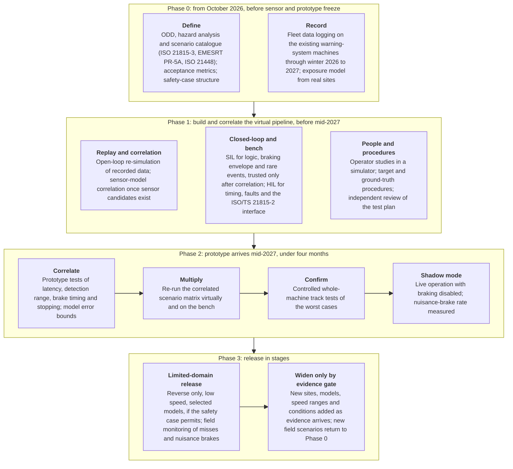

**A credible order for this programme.** The phase table below is an assessment grounded in the documented structures above, not a documented off-road case.

| Phase | Work | Why it belongs here | Evidence leaving the phase |
|---|---|---|---|
| Before sensor and prototype freeze (from October 2026) | Hazard analysis; ISO 21815 and ISO 19014 mapping; machine and use-case taxonomy; scenario vocabulary; safety case; acceptance metrics; data format; variant and equivalence plan | None of this needs a production-intent brake controller; it stops the prototype from becoming the point where validation planning begins [5, 9, 3] | Traceable claim to requirement to scenario to test mapping |
| Immediately, on the existing fleet | Instrument current warning systems where technically possible; capture raw sensors and machine buses; collect positive, negative and nuisance-warning cases; record environmental and site metadata, including through winter 2026 to 2027 | Creates reality-derived scenarios and exposure distributions before the braking software exists | Searchable field-event corpus; exposure model |
| In parallel | SIL, abstract closed-loop simulation, replay framework, continuous regression and fault injection | Highest test throughput and earliest defect removal; MineSim shows mine-specific scenario simulation is feasible [16] | Executable scenario library with pass or fail metrics |
| After sensor candidates exist | Sensor-model correlation; bench and chamber testing; mounting characterisation; high-fidelity sensor simulation | Real hardware is needed to judge whether virtual outputs are credible; the sim-to-real gaps make this essential [15, 12] | Validated parameter ranges, known model limits |
| After ECU and interfaces stabilise | HIL and, selectively, sensor stimulation | Finds real-time, bus and integration faults without occupying a machine [42] | ECU, communications and fault evidence |
| Before prototype safety testing | Operator simulator; robotic and soft-target procedures; independent test-body review of the plan; ground-truth qualification | Avoids learning basic HMI or instrumentation problems during expensive machine tests [55, 30] | Human-factor thresholds; track-ready procedures |
| When the prototype arrives (mid-2027) | Correlation tests first, not the whole scenario matrix: measured end-to-end latency, detection range, brake-command timing, stopping dynamics, repeatability and model error on each representative variant | If the virtual and bench models are wrong, millions of virtual scenarios produce false confidence | Correlation bounds; approved virtual-test envelope |
| Then high-throughput virtual and bench regression | Re-run the now-correlated scenario matrix, critical boundaries, variant sweeps and faults | Physical tests anchor, simulation multiplies coverage | Large coverage body linked to physical anchors |
| Then controlled whole-machine tests | Worst-case stopping, grades and load states, target classes, nuisance braking, mixed motion, sensor obstruction, generated adverse environment where feasible (ACARP Tier 1 and Tier 2 style) | These claims cannot be delegated to an unvalidated model [29, 6] | End-to-end evidence |
| Then shadow and limited field operation | Live environment with no brake authority first; then tightly bounded intervention release if the safety case permits | Discovers unanticipated site combinations before widening scope [22, 37] | Real exposure; false-positive and miss data |
| Widen only by evidence gate | New sites, models, speed ranges, environmental conditions | Prevents evidence from a narrow domain being silently generalised [62] | Controlled, auditable scope growth |

Three ordering rules follow from the evidence. Replay and sensor-model correlation must come before simulation results can be trusted. Track tests should confirm predictions from simulation rather than explore. Shadow mode should run before braking is enabled, so the nuisance-brake rate is measured while braking is still disabled. The sequence turns the prototype into a model-correlation and end-to-end evidence asset rather than the only place where thousands of scenario variants can be exercised.

**An allocation principle.** A practical validation argument can be organised around four questions, each served by different evidence sources; the central mistake would be to apply the same source to all four.

| Question | Evidence sources |
|---|---|
| Did the system perceive correctly? | Field replay, sensor simulation, targeted real environment, shadow mode, statistical sampling |
| Did the software make the right decision? | SIL, closed-loop simulation, formal and requirements-based tests, replay where appropriate, rare-event generation |
| Did the real machine execute the decision safely? | HIL for command, timing and interface behaviour; controlled whole-machine tests for stopping, traction and dynamics |
| Does the complete intervention improve rather than degrade real operations? | Operator simulation, nuisance-intervention testing, shadow operation, staged deployment, operational monitoring |

#### 4. What cannot be shortened by any of these approaches

"Cannot be shortened" needs one qualification: several of these items can be accelerated or run in parallel, but the underlying evidence cannot be removed.

| Item | Why it resists compression | What can be parallelised or partly mitigated |
|---|---|---|
| Real-machine stopping physics | Automatic braking depends on actual mass, payload, grade, ground condition, tyres or tracks, brake, retarder and hydraulics, control latency and wear; a real-machine anchor is needed before a virtual stopping model can carry safety evidence; ISO 21815-3 makes speed reduction, stopping and inhibition core behaviour [6] | Simulation narrows the cases; HIL validates command paths; the prototype window is used for correlation first |
| Natural seasonal weather (snow, freezing fog, low winter sun) | A sub-four-month window starting mid-2027 sits in northern summer and autumn; S2R-Bench shows that entirely simulated perception benchmarks can fail to predict real robustness under weather [15] | Weather chambers (specific off-road facility not found), dust, fog and rain generation, southern-hemisphere sites, and data from the existing warning fleet logged during winter 2026 to 2027, which is a strong reason to start logging immediately |
| Durability, sensor ageing, contamination, vibration | Physical time to failure; dust and mud build-up on sensors; ISO 19014-3 already requires environmental qualification of safety-related E/E components [48] | Accelerated life tests, but an acceleration factor is only meaningful when the accelerated stress reproduces the real failure mechanism; a universal conversion for this architecture was not found; field monitoring after release |
| Model correlation | Every simulation-based shortcut depends on it; a model never compared with the production-intent sensor, mounting, dynamics and environment is a hypothesis, not evidence | None; a late sensor change in 2027 invalidates sensor-model correlation, HIL and VIL stimulation assumptions, detection-range evidence, mounting analysis and parts of the family inheritance case |
| Rare real-world events and unknown unknowns | Rare by definition; RAND's argument applies, and the "curse of rarity" shows the tail gets harder as the state space grows [1, 34] | Rare-event simulation, but only for hazard classes somebody has conceived and parameterised; shadow data and staged operation stay valuable after large simulation campaigns |
| Operator adaptation and trust | Behaviour changes after introduction; "Human Performance can change both positively and negatively after technology is introduced" [3] | Simulator studies show first reactions only; long-term effects need field time |
| Formal approvals | EU Machinery Regulation 2023/1230 applies from 20 January 2027; Annex I Part A lists self-evolving machine-learning safety components and all Part A conformity routes involve a notified body [40, 41]; MSHA approvals where they apply [43]; South African site requirements and MOSH verification [38, 62]; the EU Artificial Intelligence Act's high-risk classification of machine-learning safety components of machinery was noted but not examined | Engage a notified body early; design to avoid self-evolving machine learning in the safety function where possible; notified-body lead times: not found; a universal certification lead time: not found |
| Site-by-site configuration and the site's other safety layers | ACARP's framework ignores "pre-existing site controls" and "complex, multi-variate dynamic vehicle interactions" [29]; the same braking algorithm has different safety results at sites with different traffic separation, intersection rules, maintenance discipline or pedestrian controls; Layers 8 and 9 require understanding Layers 1 to 7 [3, 83] | Site acceptance procedures; staged domain; site controls written into the safety case |

Off-road machinery also carries a hazard absent from most passenger-car AEB discussions: an emergency stop can itself create danger through unstable load behaviour, loss of traction or control, articulation, interaction with a following machine or operator counteraction. The risk varies by machine and operation and belongs in the hazard analysis rather than being assumed safe because the system "stops sooner". **Expert opinion**.

#### 5. What a team starting from zero in October 2026 can realistically have by mid-2027

There are roughly eight to nine months between October 2026 and mid-2027. Public literature does not provide reliable, comparable setup durations for building these capabilities from scratch in a heavy-off-road manufacturer, so what follows is not a set of completion dates. It distinguishes capabilities that documented practice shows can exist without production-intent hardware, capabilities that depend on early interface decisions, and capabilities that should not be assumed.

**Documented anchors.** Table 2 in the "Comparison tables" section lists them in full. In brief:

- Off-road collision-intervention products on the market all started with narrow domains: Volvo CE's Collision Mitigation System, reverse, 3 to 15 km/h, braking for 2 to 3 seconds (January 2023); Cat Detect automatic braking on medium wheel loaders, reverse only (May 2025); Cat asphalt compactors with forward and reverse collision warning and automatic braking, shown at CONEXPO-CON/AGG in March 2026 and "slated for launch by midyear" (Equipment World, 29 May 2026). **Vendor** [35, 77, 36, 78, 84].
- Wabtec's first Level 9 validation with Komatsu covered 730E and 860E trucks at speeds up to 30 km/h (December 2021); Wabtec described its third-generation system as "the result of multiple years of field and production testing" (2023) and planned to adjust "detection zones for braking distance, speed and real-time payload and haul road grade". **Vendor** [85, 46, 86].
- Deere's autonomous tractor obstacle detection followed "three plus years" of data collection (2022); Deere's own sources disagree on volume, 200 million image pairs (Vision Systems Design) against 50 million images (SAE). Deere refers generally to "virtual, simulation, and physical testing". **Vendor** [44, 87].
- Mernok and Epiroc: "more than ten years" of development behind the fourth-generation system (May 2024). **Vendor** [45].
- **No documented case was found of an off-road manufacturer validating a new perception-based braking function in under four months.** No case was found of a team starting from zero validating a comparably broad heavy-off-road automatic-braking product family in four months.
- **No manufacturer statement was found saying that simulation, replay or HIL cut validation time.** The nearest are Deere's general reference to virtual and simulation testing and Robotec.ai's "30% faster validation cycles for autonomous fleet behaviors" in its Boliden digital twin. **Vendor** [44, 52].

**Capabilities that can realistically exist by mid-2027.** "Realistic" means documented practice shows the capability does not need the prototype; it does not mean the duration is documented.

| Capability by mid-2027 | Assessment | Basis |
|---|---|---|
| Safety and validation claim structure mapped to ISO 21815 and ISO 19014, with a safety-case skeleton (ISO 13849 or IEC 62061 for the intervention chain; ISO 21448 and ISO/PAS 8800 concepts for perception) | Realistic | Standards exist and explicitly address collision avoidance, automatic intervention, control-system hardware and software and environmental qualification [5, 9, 64] |
| Operating-domain definition and scenario catalogue mapped to ISO 21815-3 risk areas and EMESRT's PR-5A surface vehicle-interaction scenarios; machine by scenario by environment by sensor-condition taxonomy | Realistic | Scenario-based functional requirements are promoted in mining practice; ISO 34502 and MineSim show structured scenario methodology, though ISO 34502 is road-specific [6, 7, 11, 16] |
| Field logging and data architecture on the existing warning-system fleet, including through winter 2026 to 2027 | Realistic, conditional | Shadow and replay programmes on the road establish the value of collecting real events early; whether the existing machines expose the raw data needed is unknown [22, 21] |
| Replay and event-mining pipeline with labelled data | Realistic if suitable data exist | Open-loop replay is technically mature in road autonomy; public heavy-off-road case evidence is sparse [18, 20] |
| Executable SIL regression framework with machine-dynamics and braking models, continuous regression and a fault-injection campaign | Realistic if software interfaces can be defined | Does not need the final machine; current autonomy practice relies on virtual regression; safety-control standards require systematic treatment of failures [53, 47] |
| Abstract closed-loop machine and site simulation | Realistic | Open-source MineSim shows mining-specific closed-loop scenario infrastructure is feasible today; not to be confused with validated sensor physics [16] |
| Initial statistical test plan and coverage metrics | Realistic | Methods are established; reliable site-frequency estimates need enough representative field data [1, 32] |
| Operator-simulator experiment capability | Realistic if a simulator exists or can be procured; setup duration not documented | A haul-truck proximity-interface simulator has been used academically [55] |
| Physical-test procedures, a procured or adapted soft-target kit, ground-truth specification and engagement of an independent test body (ACARP Tier 1 and Tier 2 style protocol) | Realistic to prepare | ISO 21815-3 and the MOSH independent-verification specifications give a basis before prototypes arrive [6, 30, 29] |
| Machine-family and variant inheritance framework | Realistic to prepare | Product-line assurance methods exist; quantitative off-road savings are not established [42, 43] |
| Early contact with a notified body | Realistic | The Regulation applies from 20 January 2027 [40] |

**Conditional targets.**

- **A production-relevant HIL bench on the ISO/TS 21815-2 interface** could be a mid-2027 target but should not be on the critical path unless ECU, bus and actuator interfaces stabilise early. HIL is mature; what is undocumented is how long a manufacturer with no rig takes to model a particular machine's plant, build harnesses, implement faults and qualify the bench. **Vendor** [23]; **Independent** [42].
- **An initial sensor simulator** is achievable as an engineering artefact, and sensor models calibrated for one or two sensor types in clear and dusty conditions are plausible; a validated production-intent camera, radar, lidar or ultrasonic model is conditional on sensor selection, mounting and calibration data, and the 2025 sim-to-real evidence argues against treating visually plausible synthetic weather as validation. **Independent (on-road evidence)** [15, 17].
- **Rare-event sampling in simulation** can be set up, but its results are only as good as the exposure model behind them. **Independent (on-road evidence)** [33, 34].
- **Shadow infrastructure** (fleet logging and the safety isolation mechanism) can be designed early, but meaningful shadow results need candidate software and compatible sensor input.

**Capabilities that should not be promised from zero.**

- A complete multi-sensor VIL facility for heavy off-road machines: technically credible and demonstrated on road vehicles, but the independent literature describes significant equipment and fidelity challenges and no comparable off-road case exists. **Independent (on-road evidence)** [24].
- A fully correlated sensor digital twin covering camera, radar, lidar, ultrasonic and every weather condition; it cannot precede sensor selection and real calibration.
- A statistically validated rare-event safety rate covering the 100+ site population; automotive importance-sampling results do not supply mining distributions. **Independent (on-road evidence)** [32, 1].
- Evidence for all machine models, or a complete inheritance argument across every model before the actual variant differences are understood.
- Statistically meaningful field exposure, and completed conformity assessment.
- Most importantly: full unrestricted validation of all machine models, 100+ site types, 10+ operating scenarios per machine and all seasonal and weather conditions inside a post-prototype four-month window is not supported by any documented case found.

**What the four post-prototype months should be used for.** The highest-value interpretation of the constraint is to make those months a physical evidence and correlation window, not the beginning of validation. First prototype tests establish measured end-to-end latency, detection-range correlation, brake-command timing, stopping dynamics, repeatability and model error, and those measurements update the SIL, HIL and simulation models. Virtual regression then runs the large scenario matrix with correlated models while physical machines focus on boundary conditions and worst cases: difficult grades and loads, representative low-friction surfaces, sensor occlusion and contamination, nuisance objects, generated dust, fog and rain where feasible, representative targets and fault cases. Controlled whole-machine tests confirm that virtual predictions hold near safety limits. Only then should shadow and site pilots and any actual-intervention release begin. This is consistent with the simulation to controlled physical to real-world progression documented in road automation and with the controlled to representative operational staging visible in mining verification. **Vendor (on-road evidence)** [22]; **Independent** [62].

To finish "validation" within four months after prototype arrival, the organisation would need to arrive at prototype day with most scenarios, test code, infrastructure, data pipelines, safety arguments, acceptance metrics, independent-test plans and reusable evidence already functioning. Public evidence does not establish that even this preparation would make an unrestricted all-machine, all-site product claim safe or approvable four months later; the under-four-month window is only defensible if the release claim is narrower than "all machines, all 100+ site types, all seasons" or if a large body of reusable evidence already exists. Sensor selection is still open, and every month without a decision delays sensor-model correlation and data logging with representative hardware.

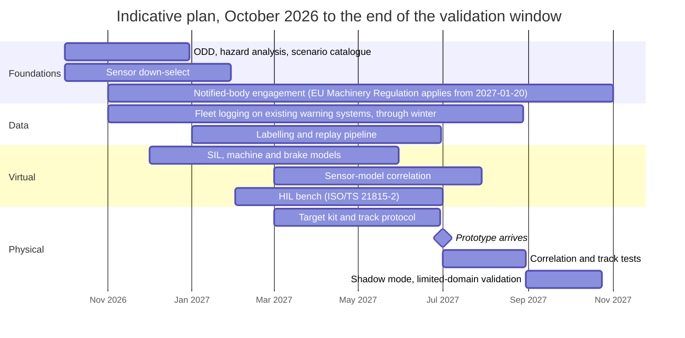

*The plan is an assessment built from the documented structures in this chapter, not a documented case.*

### Comparison tables

**Table 1. Capability comparison of the validation approaches.** Setup time is "not found" throughout because no documented from-zero duration exists for any approach applied to heavy-off-road automatic braking; the column gives the earliest dependency instead. Cost is a relative resource-intensity judgement (**Expert opinion**), not a quoted figure. Maturity refers to heavy off-road machines, not to automotive maturity.

| Code | Approach | Can establish | Cannot establish by itself | Critical inputs | Setup from zero | Relative cost | Heavy-off-road maturity |
|---|---|---|---|---|---|---|---|
| A | Scene, dynamics and sensor simulation | Logic, timing and braking-envelope correctness across large parameter sweeps; coverage of geometry, speed, grade and payload combinations; closed-loop counterfactuals; regression | Real sensor behaviour in dust, snow, fog and glare unless the sensor model is validated; real brake, tyre and ground behaviour unless correlated; rare real artefacts | 3D site models, validated sensor models, machine-dynamics and friction models, ODD and scenario catalogue (OpenSCENARIO, OpenDRIVE, OSI), calibration datasets | Not found; scenario simulation can start now, sensor-model calibration cannot precede real sensors | Medium to High | Low to Medium: MineSim (2025) and a 128-case academic off-road AEB sweep (2024); vendor 30% claim for fleet behaviour [16, 50, 52] |
| B | Replay of recorded data | Detection and false-alarm rates on real data from the real domain; regression across software versions; indefinite reproduction of rare recorded events | Closed-loop consequences of a changed braking decision; unrecorded scenarios; other sensor positions | Synchronised raw sensor logs, machine-state bus data, calibration, timestamps, labels and ground truth, software containers | Not found; can be built before new software if recording formats and interfaces are fixed | Low to Medium (labelling dominates) | Medium for feasibility (existing warning fleets can log; NIOSH has long recorded field behaviour); Low to Medium for published off-road evidence [75, 18] |
| C | SIL | Software integration, requirements regression, fault logic, thresholds, state machines, closed-loop software behaviour at scale | Real ECU timing, electrical behaviour, sensor front ends, actuators, true dynamics | Executable software, plant and environment models, APIs, deterministic harness, pass or fail metrics | Not found; can start before production hardware once interfaces are stable | Low to Medium | Medium [53] |
| D | HIL | Real controller, I/O, buses and real-time timing against a simulated plant; ECU integration, communications, fault injection, brake-command logic | Optical or RF perception unless front ends are stimulated; every brake and terrain interaction | Production-like ECU, harness and bus database, real-time plant, I/O boards, fault injection, J1939 or ISO/TS 21815-2 interface | Not found; depends on stable ECU and I/O definitions | High | Medium for controls; Low for public end-to-end perception evidence [23, 42] |
| E | VIL | Complete machine in a controlled virtual scenario, sensors stimulated, real network and actuator response | Fidelity limited by sensor stimulation, testbench dynamics and the gap between simulated and real ground interaction | Complete machine, real-time environment, test bench or safe-motion facility, multi-sensor stimulation, precise synchronisation | Not found | High | Low; complete heavy-off-road case not found [24, 26, 25] |
| F | Controlled proving-ground tests | Real sensors, actual mounting and occlusion, machine motion and stopping behaviour in repeatable scenarios; ISO 21815-3 forward and reverse stopping | Cannot sample the combinatorial space of sites, weather and actors economically; staged targets may not reproduce natural behaviour or materials | Prototype machine, calibrated targets, ground truth, track or site, instrumentation, safety procedures | Not found; needs the prototype for execution, but procedures and fixtures can be prepared | High | High: ISO 21815 procedures; MOSH independent verification regime [5, 30] |
| G | Automated track tests with robotic or soft targets | Repeatability and throughput; safe near-collision scenarios; parameter sweeps; real end-to-end detection and stopping distance | Statistical rates; weather breadth; site-specific surfaces and objects; not all people, machine shapes, materials, dust clouds or trajectories | Targets realistic to the sensors (radar cross-section, lidar reflectivity), robotic platforms or driver robot, precise positioning, safety supervision | Not found | Medium to High | Low: platforms built for passenger-car speeds; ACARP Tier 2 "limited choreographed test scenarios"; off-road robotic automation not found [27, 28, 29] |
| H | Operators in a machine simulator | Operator reaction to warnings, HMI timing and salience, nuisance tolerance, override behaviour, workload, how warning-to-brake timing is perceived | Perception performance; real braking hardware; long-term trust, complacency and adaptation; real production pressure | High-fidelity cab simulator, representative operators, HMI, scenarios, experimental protocol, human-factors measures | Not found | Medium to High | Medium to High for human factors: UQ and ACARP haul-truck simulator (proximity advisory, about 2017); none for off-road automatic braking [55] |
| I | Shadow or silent mode | Large-volume false-positive rate in real operations; missed threats; detection range in real conditions; unknown scenario discovery; site exposure frequencies | Effectiveness in true near-misses; closed-loop effects of braking; load shift, traction loss, following-machine collision, operator counteraction, actuator faults | Compute on fielded machines, synchronised logs, safe isolation from actuators, telemetry, triage software | Not found; Low to Medium effort with the existing fleet | Low to Medium | Low to Medium: Epiroc evaluation mode is a vendor product claim; no documented off-road shadow validation programme [37, 22] |
| J | Staged, limited-domain release | Real-world safety evidence that grows over time inside a constrained envelope; limited exposure while evidence is collected | Safety outside the current domain; it is risk containment, not proof beyond the release boundary | Explicit operating envelope, safety case, runtime domain monitoring, roll-back and override procedures, change criteria, evidence gates | Not found | Low to Medium | Medium to High: Volvo CE and Cat launched reverse-only scopes; ISO 17757 defined functional environment; MOSH TRL stage gates [35, 36, 61, 62] |
| K | Evidence reuse across models | That shared software, ECU, interfaces, sensor qualification and common requirements are already verified; testing concentrated on variant deltas and worst cases | Perception in new mounting geometries, blind spots and vibration environments, or changed mass, braking and articulation, without a justified equivalence argument | Modular architecture, configuration control, feature and variant matrix, change-impact analysis, equivalence criteria, parameterised machine model | Not found | Low incremental, Medium upfront | Low: interface standardised (ISO/TS 21815-2), MSHA extension-of-approval route; no perception-equivalence method and no quantified case [42, 43] |
| L | Statistical and rare-event methods | Quantified failure-rate bounds; faster discovery of rare failures in simulation; stopping rules; stratified coverage | Anything the simulation or exposure distribution does not model; unknown unknowns; absence of failures is not zero risk | Representative exposure data (scarce off-road), event definitions, probability models, tail data, simulation or test generator, statisticians | Not found; analysis can be prepared now, results depend on data | Low to Medium | Low to Medium: all strong results are on-road [1, 32, 33] |
| M | Scenario and requirements engineering, safety case | What must be tested; traceability from hazards to evidence; missing coverage exposed before hardware | That the implementation works; a scenario spreadsheet is not physical evidence | Hazard analysis, use cases, accident and near-miss data, site experts, acceptance metrics | Not found; can begin now | Low to Medium | High as methodology [5, 3] |
| N | Fault injection and robustness | Behaviour under sensor drop-outs, stale messages, bus faults, disagreement, bad calibration, actuator faults, degraded modes | Intended-function perception with healthy hardware; faults the fault model omits | FMEA or FMEDA, injectable interfaces, SIL and HIL benches, diagnostic requirements | Not found; starts in software, matures into HIL | Low to High by loop | High for safety-control engineering [9, 47] |
| O | Environmental and component laboratory tests | Temperature, vibration, shock, electrical and moisture stresses without waiting for seasons | Whole-system perception in a dusty snowstorm, with a dirty lens or radome, in glare; lifetime field interactions | Sensors and ECUs, chamber, shaker and EMC equipment, mission profile, applicable standards | Not found; some work waits for physical components | High | High for components (ISO 19014-3); off-road weather-chamber facility not found [48] |
| P | Formal and static verification | Deterministic logic errors, interface violations, unsafe states, timing and data-contract problems, traceability gaps | That an ML perception model recognises arbitrary real scenes; sensor physics | Formal requirements, models and contracts, source code, static-analysis and model-checking software, skilled engineers | Not found; can begin before final hardware | Low to Medium | High for conventional safety software; lower for ML perception claims [47] |
| Q | Continuous automated regression | Every captured or synthesised scenario becomes a permanent test; regressions caught as software changes | That the test set represents the real operating domain | CI infrastructure, scenario database, deterministic builds, metrics, compute, triage | Not found; can begin early | Medium | Medium [22] |
| R | Safety-rated sensors (IEC 61496, IEC TS 62998) | Component-level detection capability with an established certification basis | System-level performance on moving outdoor machines; IEC TS 61496-5 "does not consider the aspects of a moving RPD application" | Certified sensors, certification body | Low (buy-in) | Medium | Low to Medium: Inxpect's use of IEC TS 62998-1 for mobile outdoor radar is a vendor claim [66, 67] |
| S | Architecture choices | Reduces the scope of proof (a deterministic channel bounds the ML channel; cooperative tags cover tagged people) | Does not remove the need for perception validation; untagged objects are outside cooperative sensing | Systems engineering, multi-technology fusion design | Not found | Medium | Medium: multi-technology systems are the norm in mining collision avoidance [45, 79, 43] |
| T | Shared frameworks, third parties, independent review | Comparability; credible independent evidence; challenge to assumptions | Site-specific multi-variable dynamics (stated ACARP limit); cannot rescue incomplete engineering late | Access to ACARP and Mining3 methods, MOSH specifications, test sites, qualified independent body, traceability | Scheduling lead time not found | Low to Medium (frameworks); Medium to High (independent testing) | Medium to High for mining [29, 62, 70] |

**Table 2. Documented off-road collision-intervention products and programmes used as anchors.** None of these publishes how long validation took or whether simulation shortened it.

| Supplier and system | Machine and scope at launch | Date | Published development or validation duration | Evidence |
|---|---|---|---|---|
| Volvo CE Collision Mitigation System | Wheel loaders; reverse only, 3 to 15 km/h, brakes for 2 to 3 seconds | January 2023 | Not published | **Vendor** [35, 77] |
| Caterpillar Cat Detect automatic braking | Medium wheel loaders (for example 966); reverse only | May 2025 | Not published | **Vendor** [36, 78] |
| Caterpillar asphalt compactors | Forward and reverse collision warning with automatic braking; shown March 2026, "slated for launch by midyear" | 29 May 2026 (report) | Not published | **Vendor** [84] |
| Wabtec Collision Awareness System, Level 9 | Komatsu 730E and 860E haul trucks, speeds up to 30 km/h; detection zones adjusted for braking distance, speed, payload and grade | December 2021 (first Level 9 test); Generation 3 in 2023 | "Multiple years of field and production testing" | **Vendor** [85, 46, 86] |
| Epiroc (Mernok) collision avoidance, fourth generation; Titan | Mining fleets; Level 9 intervention; evaluation mode without enforcing intervention | May 2024 (fourth generation) | "More than ten years" of development | **Vendor** [45, 37, 76, 79] |
| John Deere autonomous tractor obstacle detection | Agricultural tractor; camera-based | 2022 | "Three plus years" of data collection; 200 million image pairs or 50 million images (sources disagree) | **Vendor** [44, 87] |
| Robotec.ai and Boliden mining digital twin | Autonomous fleet behaviour simulation and replay | Accessed October 2026 | "30% faster validation cycles for autonomous fleet behaviors" (not independently verified) | **Vendor** [52] |
| South African Level 9 mandate | All surface and underground trackless mobile machinery on mines; intervention required | In force 21 December 2022, no transitional period | Market deployed, then refined; MOSH verification specifications followed in 2025 to 2026 | **Expert opinion** [38, 39]; **Independent** [30, 31] |

### Where the evidence stands

#### Well established

- Mileage-based or hours-based proof alone is infeasible for rare events; statistical acceleration is legitimate for modelled event families. **Independent (on-road evidence)** [1, 32].
- No single test pillar covers everything; scenario-based testing combined with simulation and real-world testing is the norm, and mining guidance explicitly rejects silver bullets. **Independent**, **Expert opinion** [2, 3, 60].
- Collision warning plus automatic speed reduction and stopping is explicitly within the earth-moving machinery standards landscape: ISO 21815-1:2022, ISO/TS 21815-2:2021 (confirmed 2024) and ISO 21815-3:2023. **Independent** [5, 42, 6].
- Safety-related control hardware, software and component environmental qualification need their own evidence beyond perception testing (ISO 19014 family). **Independent (under revision)** [9, 48, 47].
- Off-road standards exist for agricultural obstacle protection: ISO 18497-1 to -4:2024. **Independent** [71, 68, 72, 8].
- Simulation is highly useful for mining-specific scenario and planning validation (MineSim, 2025), and simulation does not automatically predict real sensor performance in adverse conditions (S2R-Bench, 2025). **Independent** [16, 15].
- Open-loop replay and silent testing cannot validate the consequences of a changed ego trajectory. **Independent (on-road evidence)**, **Vendor (on-road evidence)** [19, 20, 21].
- HIL is a mature way to test real controllers, I/O, timing and faults before full physical testing; direct perception-heavy off-road evidence is lower. **Vendor** [23].
- Operator behaviour deserves explicit validation; mining simulator research and EMESRT human-factors guidance both support it. **Independent**, **Expert opinion** [55, 3].
- The EU Machinery Regulation applies from 20 January 2027; South African Level 9 sub-regulations have been in force since 21 December 2022. **Independent**, **Expert opinion** [40, 38].
- Heavy-off-road research evidence is weaker at complete-system operational maturity than the commercial market implies. **Independent** [2].

#### Uncertain

- Whether sensor simulation can be qualified for off-road dust, dirty sensors, snow, glare and heterogeneous mine materials; independent research establishes the gap but gives no fidelity threshold, and the gap is sensor-dependent. [15, 17]
- How much virtual evidence an independent assessor or notified body will accept for a specific heavy-off-road automatic-braking function, how a notified body will assess machine-learning perception under the EU Machinery Regulation, and how long that takes; no universal "80 percent virtual, 20 percent physical" ratio was found. [40]
- Whether rare-event acceleration results from on-road traffic carry over to job sites, where pedestrian and machine behaviour is governed by site rules; the exposure distributions for 100+ site types were not found. [32, 33]
- The validation credit obtainable from cross-model reuse: reusing a binary is straightforward, reusing an end-to-end safety claim across changed sensor position, geometry and stopping behaviour is not, and no case quantifies the saving. [42]
- Whether full VIL is economically justified for this programme; many of the same claims can be covered by a chosen mix of HIL and controlled real-machine tests. [24]
- The real benefit behind vendor-reported speed-ups such as Robotec.ai's 30 percent claim, which has not been independently verified. [52]

#### Where experts disagree

- **Weight of simulation against physical evidence, and how much realism a simulator needs.** Automotive simulation advocates (the dense-learning line of work) argue that simulation can carry most of the statistical burden; sim-to-real researchers and mining practitioners (Mining3, EMESRT) stress field verification and site-specific baselines. One school tries to reproduce physical sensor observations at high fidelity; another emphasises statistically meaningful scenarios and validates the real sensor through replay and track testing. Current evidence does not establish a universally superior strategy. [33, 15, 49, 3]
- **Shadow mode as validation or only as discovery.** Industry patents and articles present it as a validation method; academic work treats it as open-loop evidence with limited ability to prove closed-loop safety. It is strong for some safety claims and irrelevant to others. [58, 59, 19]
- **Machine learning in the safety channel.** One view keeps ML out of the safety function and uses certified deterministic sensors (IEC 61496, IEC TS 62998); the other accepts ML under ISO/PAS 8800-style assurance. [66, 64, 65]
- **How aggressively to use staged release.** A small operating envelope gives faster real evidence; customers may regard a heavily constrained function as insufficient. No technical principle settles that commercial trade-off.
- **What constitutes sufficient rare-event evidence.** Pure exposure counting is demonstrably inefficient, while accelerated statistics depend on distributional assumptions; the debate is how much confidence to place in the exposure model used to decide which rare events matter. [1, 34]

### Blind spots

Issues the five questions did not ask about, grouped by theme.

**Hazards created by the intervention itself**

- **Secondary hazards from automatic braking.** The safety goal cannot simply be "stop before object". Nuisance braking on a loaded haul truck or on a slope can cause load shift, loss of traction, articulation instability, a rear-end collision with a following machine, immobilisation in an unsafe location, or operator counteraction; the transition from warning to intervention needs its own hazard analysis. **Expert opinion**.
- **False-positive automatic braking deserves its own acceptance criteria.** NIOSH's test and evaluation work identifies false-positive testing and clear characterisation of system limits as research gaps; an intervention false positive has far higher operational and safety consequence than a warning false positive. **Independent** [81].
- **Braking physics varies by model and payload.** Wabtec planned to adjust "detection zones for braking distance, speed and real-time payload and haul road grade"; evidence reuse across models depends on the braking model, not only on perception. **Vendor** [46].
- **Machine motions other than forward and reverse.** ISO/PRF 21815-5 (proof stage, September 2026) addresses articulation, four-wheel steer, towed-trailer reversing, skid and counter-rotation, telescopic and vertical motions; relevant if the portfolio contains articulated loaders, excavator-like machines or complex attachments. **Independent (draft)** [10].

**Measurement, configuration and data**

- **Ground truth itself needs validation.** Measuring detection latency and stopping distance to tens of milliseconds and centimetres makes target position, time synchronisation and machine-state instrumentation part of the measurement system; a bad reference can make a good system look bad or a bad one look good. **Expert opinion**.
- **Configuration management is safety-critical.** Sensor mounting tolerances, replacement calibration, tyre type, brake updates, attachments, body options, payload limits and software versions determine whether evidence from one configuration remains applicable. **Expert opinion**.
- **Sensor contamination and maintenance state as explicit scenario dimensions.** A clean sensor at the start of a shift does not represent a camera, radar cover or lidar exposed to mud, dust, spray or snow during production; this links validation to diagnostics, cleaning requirements and degraded-mode behaviour. **Expert opinion**.
- **Data governance, labelling capacity and data rights.** Labelling and ground truth are likely to be the real bottleneck for replay; field video and worker-location data may involve labour, privacy, site-owner and jurisdictional requirements, which the sources did not quantify. **Expert opinion**.
- **Supplier evidence must be contractually accessible.** NIOSH notes that manufacturer research and validation material is often proprietary and unavailable to independent researchers; a sensor or perception supplier that delivers only an API and a brochure makes the safety case substantially harder. **Independent** [2, 81].

**Systems, sites and people around the function**

- **Interaction with site controls (EMESRT Levels 1 to 7)** and with other suppliers' collision-avoidance devices over the ISO 21815 interface; the nine-layer framework warns against validating the brake in isolation from roadway design, segregation, procedures, maintenance, operator fitness and advisory controls. **Expert opinion**, **Independent** [83, 3, 42].
- **Operator override and liability.** ISO 21815-1 states that the operator remains responsible because the technology cannot cover every situation. **Independent** [5].
- **Cybersecurity and data integrity.** A sensor and brake system that depends on networks, maps, wireless cooperative detection or remote updates needs threat analysis, time-synchronisation integrity and safe update controls; the EU Machinery Regulation adds requirements on protection against corruption. These need their own standards analysis. **Independent** [40, 88].

**Lifecycle and regulation**

- **Retrofit and aftermarket.** Under the EU Machinery Regulation, substantial-modification rules may trigger new conformity assessment for field upgrades. **Expert opinion** [88].
- **Post-release monitoring and over-the-air change.** Every later software change must be re-assessed against the accumulated safety evidence, so the replay, simulation and HIL infrastructure is a permanent asset, not a launch-time expense. **Expert opinion**.
- **Standards are moving.** Second editions of ISO 19014-1, -2, -3 and -4 and the first edition of ISO 19014-5 are under publication (stage 60.00, listed for October 2026), ISO 21815-4 is under publication for October 2026 and ISO 21815-5 is at proof stage for November 2026; a 2027 programme should track revision status rather than freeze its compliance matrix to an October 2026 snapshot. **Independent (under revision)** [9, 48, 47, 10].

**Further gaps**

- **Underground machines.** ISO 21815-1 covers mobile underground mining machinery, and the South African mandate applies underground, but nearly all the evidence found concerns surface mining and construction. Underground sensing conditions (confined geometry, dust, no GNSS) were not addressed by the research.
- **Proving-ground capacity for heavy machines.** The research did not identify a test site, weather chamber or target supplier able to handle 50 to 400 t machines at representative speeds; availability and booking lead time for such facilities may be a schedule constraint in their own right.
- **The warning-to-braking transition on the existing fleet.** The warning fleet's recorded false-alarm history is both the best available data for setting intervention thresholds and a human-factors risk: operators who have learned to ignore frequent warnings will meet the first automatic stops with that habit. The research did not examine how existing warning-system tuning should carry over.

### Sources

1. Kalra, N. and Paddock, S. M. (RAND Corporation). Driving to Safety: How Many Miles of Driving Would It Take to Demonstrate Autonomous Vehicle Reliability? RAND Research Report RR-1478. 2016. https://www.rand.org/pubs/research_reports/RR1478.html. **Independent (on-road evidence)**.
2. Hrica, J. K., Bellanca, J. L., Benbourenane, I., Carr, J. L., Homer, J. and Stabryla, K. M. (NIOSH Pittsburgh Mining Research Division). A Rapid Review of Collision Avoidance and Warning Technologies for Mining Haul Trucks. Mining, Metallurgy & Exploration 39(4): 1357-1389. Published online 17 June 2022, issue August 2022. https://link.springer.com/article/10.1007/s42461-022-00633-w. **Independent**.
3. ICMM and EMESRT. Vehicle Interaction Leading Sites Program: Principles and Success Factors. April 2024. https://www.emesrt.org/wp-content/uploads/20240322_ICMM_PrinciplesSuccessFactors.pdf. **Expert opinion**.
4. RAND Corporation. Autonomous Vehicles Cannot Be Test-Driven Enough Miles to Demonstrate Their Safety; Alternative Testing Methods Needed. Press release. 12 April 2016. https://www.rand.org/news/press/2016/04/12.html. **Independent (on-road evidence)**.
5. ISO. ISO 21815-1:2022, Earth-moving machinery, Collision warning and avoidance, Part 1: General requirements. International Organization for Standardization. January 2022. https://www.iso.org/standard/77302.html. **Independent**.
6. ISO. ISO 21815-3:2023, Earth-moving machinery, Collision warning and avoidance, Part 3: Risk area and risk level for forward/reverse motion. International Organization for Standardization (catalogue page at the Swedish Institute for Standards). August 2023. https://www.sis.se/en/produkter/materials-handling-equipment/earthmoving-machinery/iso-21815-32023/. **Independent**.
7. Business IT (South Africa). Pioneering collision awareness technology for safer mining practices (reports that EMESRT PR-5A defines 24 surface vehicle-interaction scenarios and nine levels of control; no revision number given). 5 November 2019. https://www.business-it.co.za/pioneering-collision-awareness-technology-for-safer-mining-practices/. **Expert opinion**.
8. ISO. ISO 18497-4:2024, Agricultural machinery and tractors, Safety of partially automated, semi-autonomous and autonomous machinery, Part 4: Verification methods and validation principles (test objects). Sample pages. 2024. https://cdn.standards.iteh.ai/samples/82688/9e77c86a5bb84b87859f194af2752999/ISO-18497-4-2024.pdf. **Independent**.
9. ISO. ISO 19014-2:2022, Earth-moving machinery, Functional safety, Part 2: Design and evaluation of hardware and architecture requirements for safety-related parts of the control system. International Organization for Standardization. 2022; edition 2 under publication, stage 60.00 since 22 August 2026, listed for October 2026 (https://www.iso.org/standard/87718.html). https://www.iso.org/standard/73568.html. **Independent (under revision)**.
10. ISO. ISO/PRF 21815-5, Earth-moving machinery, Collision warning and avoidance, Part 5: Risk area and risk level for other forms of motion. International Organization for Standardization. Proof stage (50.20) since 9 September 2026, publication expected November 2026. https://www.iso.org/standard/89934.html. **Independent (draft)**.
11. ISO. ISO 34502:2022, Road vehicles, Test scenarios for automated driving systems, Scenario based safety evaluation framework. International Organization for Standardization. November 2022. https://www.iso.org/standard/78951.html. **Independent (on-road evidence)**.
12. Bialer, O. and Haitman, Y. RadSimReal: Bridging the Gap Between Synthetic and Real Data in Radar Object Detection With Simulation. CVPR 2024. 2024. https://arxiv.org/html/2404.18150v1. **Independent (on-road evidence)**.
13. Towards Minimizing the LiDAR Sim-to-Real Domain Shift: Object-Level Local Domain Adaptation for 3D Point Clouds of Autonomous Vehicles. Sensors (PMC). 2023. https://pmc.ncbi.nlm.nih.gov/articles/PMC10747793/. **Independent (on-road evidence)**.
14. Yang, Z. et al. UniSim: A Neural Closed-Loop Sensor Simulator. CVPR 2023. 2023. https://arxiv.org/pdf/2308.01898. **Independent (on-road evidence)**.
15. Wang et al. S2R-Bench: A Sim-to-Real Evaluation Benchmark for Autonomous Driving. Scientific Data. 4 December 2025. https://www.nature.com/articles/s41597-025-06255-3. **Independent (on-road evidence)**.
16. Chen et al. MineSim: A scenario-based simulation test system and benchmark for autonomous trucks in open-pit mines. Accident Analysis & Prevention. April 2025. https://www.sciencedirect.com/science/article/abs/pii/S0001457525000247. **Independent**.
17. Mind the Domain Gap: Measuring the Domain Gap Between Real-World and Synthetic Point Clouds for Automated Driving Development. arXiv 2505.17959. 2025. https://arxiv.org/pdf/2505.17959. **Independent (on-road evidence)**.
18. Hoss, M., Scholtes, M. and Eckstein, L. A Review of Testing Object-Based Environment Perception for Safe Automated Driving. arXiv 2102.08460. 2021. https://arxiv.org/pdf/2102.08460. **Independent (on-road evidence)**.
19. Test Concepts for the Safeguarding of Automated Driving (chapter on silent testing). Springer. 2024. https://link.springer.com/chapter/10.1007/978-3-658-45276-6_46. **Independent (on-road evidence)**.
20. Applied Intuition. Log replay and re-simulation guidance (open-loop versus closed-loop). Accessed October 2026. **Vendor (on-road evidence)**.
21. Waymo. Simulation and replay material (safety methodology pages). Accessed October 2026. **Vendor (on-road evidence)**.
22. Motional. Voluntary Safety Self-Assessment and safety validation material. 2026. **Vendor (on-road evidence)**.
23. MathWorks. Hardware-in-the-Loop (HIL) overview page. Accessed October 2026. **Vendor**.
24. Cheng et al. A Survey on Testbench-Based Vehicle-in-the-Loop Simulation Testing for Autonomous Vehicles: Architecture, Principle, and Equipment. Advanced Intelligent Systems. 2024. https://advanced.onlinelibrary.wiley.com/doi/abs/10.1002/aisy.202300778. **Independent (on-road evidence)**.
25. dSPACE. Vehicle-in-the-Loop Testing (product page). Accessed October 2026. https://www.dspace.com/en/inc/home/applicationfields/foo/vehicle-in-the-loop-testing.cfm. **Vendor (on-road evidence)**.
26. Applus IDIADA. Vehicle-in-the-loop testing (service description). Accessed October 2026. https://www.applusidiada.com/global/en/what-we-do/service-sheet/Vehicle-in-the-loop-testing. **Vendor (on-road evidence)**.
27. NHTSA. Advanced Test Tools for ADAS and ADS. Report DOT HS 813 083. May 2021. https://rosap.ntl.bts.gov/view/dot/55991/dot_55991_DS1.pdf. **Independent (on-road evidence)**.
28. AB Dynamics. ADAS platforms (robotic soft-target platforms). Product page. Accessed October 2026. https://www.abdynamics.com/track-testing/adas-platforms/. **Vendor (on-road evidence)**.
29. ACARP (Mining3). Project C26028: Proximity detection system testing framework (abstract). January 2021. https://www.acarp.com.au/abstracts.aspx?repId=C26028. **Independent**.
30. MOSH. Surface TMM CPS Independent Verification Test Specification. 29 August 2025. https://www.mosh.co.za/all-categories?task=download.send&id=2156%3Asurface-cxd-test-specification&catid=477. **Independent**.
31. MOSH. Surface CPS Independent Verification Test Specification, TRL7 Stage Gate. 20 January 2026 (CPS technical documents collection, mosh.co.za). **Independent**.
32. Zhao, D., Lam, H., Peng, H. et al. Accelerated Evaluation of Automated Vehicles Safety in Lane-Change Scenarios Based on Importance Sampling Techniques. IEEE Transactions on Intelligent Transportation Systems 18(3). Online 2016, issue March 2017. https://ieeexplore.ieee.org/document/7534875/. **Independent (on-road evidence)**.
33. Feng, S. et al. Dense reinforcement learning for safety validation of autonomous vehicles. Nature 615. 2023. https://www.semanticscholar.org/paper/Dense-reinforcement-learning-for-safety-validation-Feng-Sun/7be08125edabe044657313af94064a0381f7e13f. **Independent (on-road evidence)**.
34. Liu, H. X. and Feng, S. Curse of rarity for autonomous vehicles. Nature Communications 15. 2024. https://www.nature.com/articles/s41467-024-49194-0. **Independent (on-road evidence)**.
35. Volvo Construction Equipment. Volvo CE introduces Collision Mitigation System for jobsite safety. Press release. January 2023. https://www.volvoce.com/global/en/news-and-events/news-and-stories/2023/volvo-ce-introduces-collision-mitigation-system-for-jobsite-safety/. **Vendor**.
36. Caterpillar. Caterpillar announces Collision Warning System and other technology options for Cat medium wheel loaders. Press release. May 2025. https://www.cat.com/en_GB/news/machine-press-releases/caterpillar-announces-collision-warning-system-and-other-technology-options-for-cat-medium-wheel-loaders.html. **Vendor**.
37. Epiroc. Titan collision avoidance system (product page). Accessed October 2026. https://www.epiroc.com/en-id/products/digital-solutions/safety-solutions/collision-avoidance. **Vendor**.
38. Shangoni Management Services. Mine Health and Safety Act 29 of 1996: commencement of the regulations relating to trackless mobile machinery (GN 2908, GG 47790). December 2022. https://shangoni.co.za/mine-health-and-safety-act-29-of-1996-commencement-of-the-regulations-relating-to-trackless-mobile-machinery/. **Expert opinion**.
39. Mondaq. Mine Health And Safety Regulations: commencement of new regulations (South Africa, trackless mobile machinery). 2022. https://www.mondaq.com/southafrica/health--safety/1265268/mine-health-and-safety-regulations--commencement-of-new-regulations. **Expert opinion**.
40. European Parliament and Council. Regulation (EU) 2023/1230 on machinery (Machinery Regulation). Official Journal of the European Union. 14 June 2023, applicable from 20 January 2027. https://eur-lex.europa.eu/eli/reg/2023/1230/oj. **Independent**.
41. tolingo. EU Machinery Regulation 2027: language duties. Blog. Accessed October 2026. https://www.tolingo.com/en/blog/eu-machinery-regulation-translation. **Expert opinion**.
42. ISO. ISO/TS 21815-2:2021, Earth-moving machinery, Collision warning and avoidance, Part 2: On-board J1939 communication interface. International Organization for Standardization. 2021, confirmed 2024. https://www.iso.org/standard/77303.html. **Independent**.
43. MSHA. Procedure Instruction Letter I12-V-19: adding proximity detection systems to approved machines (extension of approval or RAMP). Accessed October 2026. https://www.msha.gov/compliance-and-enforcement/compliance-assistance/procedure-instruction-letters/i12-v-19. **Independent**.
44. Vision Systems Design. John Deere Introduces Autonomous Tractor. 2022. https://www.vision-systems.com/astech-autonomy/article/14276604/john-deere-introduces-autonomous-tractor. **Vendor**.
45. Global Mining Review. Epiroc launches fourth generation collision avoidance system. 15 May 2024. https://www.globalminingreview.com/mining/15052024/epiroc-launches-fourth-generation-collision-avoidance-system/. **Vendor**.
46. International Mining. Wabtec successfully tests Level 9 Collision Awareness System on Komatsu 730E and 860E trucks. 10 December 2021. https://im-mining.com/2021/12/10/wabtec-successfully-tests-level-9-collision-awareness-system-komatsu-730e-960e-trucks/. **Vendor**.
47. ISO. ISO 19014-4:2020, Earth-moving machinery, Functional safety, Part 4: Design and evaluation of software and data transmission for safety-related parts of the control system. International Organization for Standardization. 2020; edition 2 under publication, stage 60.00 since 22 August 2026, listed for October 2026 (https://www.iso.org/standard/87720.html). https://www.iso.org/standard/70718.html. **Independent (under revision)**.
48. ISO. ISO 19014-3, Earth-moving machinery, Functional safety, Part 3: Environmental performance and test requirements of electronic and electrical components used in safety-related parts of the control system. International Organization for Standardization. Current edition 2018; edition 2 under publication (stage 60.00), listed for October 2026. https://www.iso.org/standard/88622.html. **Independent (under revision)**.
49. Mining Magazine. Mining3 wants rigorous framework, testing for PDS. Accessed October 2026. https://www.miningmagazine.com/operations/news/1358323/mining3-rigorous-framework-testing-pds. **Expert opinion**.
50. Samak, T. et al. Off-Road Autonomy Validation Using Scalable Digital Twin Simulations Within High-Performance Computing Clusters. GVSETS 2024 (arXiv 2405.04743). 2024. https://arxiv.org/pdf/2405.04743. **Independent**.
51. Developing a Calibrated Physics-Based Digital Twin for Construction Vehicles. arXiv 2508.08576. 2025. https://arxiv.org/pdf/2508.08576. **Independent**.
52. Robotec.ai. Digital Twin of a Large Mining Operation (Boliden case study, with AWS). Accessed October 2026. https://robotec.ai/case-studies/digital-twin-of-a-large-mining-operation. **Vendor**.
53. Expanding the Classical V-Model for the Development of Complex Systems Incorporating AI. arXiv 2502.13184. 2025. https://arxiv.org/pdf/2502.13184. **Independent (on-road evidence)**.
54. An Augmented Reality-Based Proving Ground Vehicle-in-the-Loop Test Platform. ResearchGate. 2024. https://www.researchgate.net/publication/378330189_An_Augmented_Reality-Based_Proving_Ground_Vehicle-in-the-Loop_Test_Platform. **Independent (on-road evidence)**.
55. University of Queensland, Sustainable Minerals Institute (ACARP-funded). Proximity advisory information interface design (haul-truck simulator study). Project page, undated, work of about 2017. https://smi.uq.edu.au/project/proximity-advisory-information-interface-design. **Independent**.
56. AR-PED: A Framework of Augmented Reality Enabled Pedestrian-in-the-Loop Simulation. ResearchGate. 2019. https://www.researchgate.net/publication/331778046_AR-PED_A_Framework_of_Augmented_Reality_Enabled_Pedestrian-in-the-Loop_Simulation. **Independent (on-road evidence)**.
57. "Pedestrian in the loop": An approach using virtual reality. IEEE. 2017. https://ieeexplore.ieee.org/document/8171601/. **Independent (on-road evidence)**.
58. Vehicle software shadow mode testing. US Patent 12,182,010. Accessed October 2026. https://image-ppubs.uspto.gov/dirsearch-public/print/downloadPdf/12182010. **Vendor (on-road evidence)**.
59. Method to operate a vehicle, method to test an autonomous driving system, system with a vehicle. US Patent 12,534,107. Accessed October 2026. https://image-ppubs.uspto.gov/dirsearch-public/print/downloadPdf/12534107. **Vendor (on-road evidence)**.
60. Kusano, K. D. et al. (Waymo). Collision Avoidance Testing of the Waymo Automated Driving System. arXiv 2212.08148. 2022. https://arxiv.org/pdf/2212.08148. **Vendor (on-road evidence)**.
61. ISO. ISO 17757:2019, Earth-moving machinery and mining, Autonomous and semi-autonomous machine system safety. International Organization for Standardization. July 2019, reviewed and confirmed 2024. https://www.iso.org/standard/76126.html. **Independent**.
62. MOSH (Mining Industry Occupational Safety and Health Learning Hub, Minerals Council South Africa). Collision Prevention Systems Requirements Verification Regime, Rev 1. 11 October 2025. https://www.mosh.co.za/all-categories?task=download.send&id=2162%3Acps-requirements-verification-regime&catid=477. **Independent**.
63. Corso, A. et al. (Stanford). Scalable Autonomous Vehicle Safety Validation through Dynamic Programming and Scene Decomposition (adaptive stress testing). arXiv 2004.06801. 2020. https://arxiv.org/pdf/2004.06801. **Independent (on-road evidence)**.
64. UL Solutions. Safety-Related Systems in Road Vehicles with Artificial Intelligence Are Addressed in ISO/PAS 8800:2024. Blog. December 2024. https://www.ul.com/sis/blog/safety-related-systems-road-vehicles-artificial-intelligence-are-addressed-isopas-88002024. **Expert opinion (on-road evidence)**.
65. Ansys Innovation Space. Safety of AI/ML systems in road vehicles: compliance with ISO/PAS 8800. Forum post. Accessed October 2026. https://innovationspace.ansys.com/knowledge/forums/topic/safety-of-ai-ml-systems-in-road-vehicles-compliance-with-iso-pas-8800/. **Vendor (on-road evidence)**.
66. IEC. IEC TS 61496-5:2023, Safety of machinery, Electro-sensitive protective equipment, Part 5: Particular requirements for radar protective devices (RPD). 2023. https://webstore.iec.ch/en/publication/65009. **Independent**.
67. Inxpect. Second-generation safety radar: use of IEC TS 62998-1 to analyse the sensor in mobile and outdoor applications. Company material. Accessed October 2026. **Vendor**.
68. ISO. ISO 18497-2:2024, Agricultural machinery and tractors, Safety of partially automated, semi-autonomous and autonomous machinery, Part 2: Design principles for obstacle protection systems. International Organization for Standardization. 2024. https://www.iso.org/standard/82686.html. **Independent**.
69. Wide Automation. ISO 18497-2:2024: the new standard for obstacle protection in agricultural robots. Company article. Accessed October 2026. https://www.wideautomation.com/en/iso-18497-22024-the-new-standard-for-obstacle-protection-in-agricultural-robots/. **Vendor**.
70. NIOSH. Mining Topic: Proximity Detection. CDC archive page. Accessed October 2026. https://archive.cdc.gov/www_cdc_gov/niosh/mining/topics/proximitydetection.html. **Independent**.
71. ISO. ISO 18497-1:2024, Agricultural machinery and tractors, Safety of partially automated, semi-autonomous and autonomous machinery, Part 1: Machine design principles and vocabulary. International Organization for Standardization. 2024. https://www.iso.org/standard/82684.html. **Independent**.
72. ISO. ISO 18497-3:2024, Agricultural machinery and tractors, Safety of partially automated, semi-autonomous and autonomous machinery, Part 3. Standards Council of Canada catalogue page. 2024. https://scc-ccn.ca/standardsdb/standards/8185654. **Independent**.
73. AutoDRIVE Ecosystem. Research index (open-source digital-twin simulation framework used in the off-road AEB study). Accessed October 2026. https://autodrive-ecosystem.github.io/research/. **Independent**.
74. NIOSH. Preventing collisions involving surface mining equipment: a GPS-based approach. CDC Stacks. Accessed October 2026. https://stacks.cdc.gov/view/cdc/220750/cdc_220750_DS1.pdf. **Independent**.
75. NIOSH (Ruff, T. M.). Recommendations for Evaluating and Implementing Proximity Warning Systems on Surface Mining Equipment. Report of Investigations 9672, DHHS (NIOSH) Publication 2007-146. 2007. https://permanent.fdlp.gov/lps97050/2007-146.pdf. **Independent**.
76. Epiroc. Safety at the highest level (customer story). 2026. https://www.epiroc.com/en-us/customer-stories/2026/safety-at-the-highest-level. **Vendor**.
77. iVT International. Volvo CE introduces Collision Mitigation System for jobsite safety. January 2023. https://www.ivtinternational.com/news/safety/volvo-ce-introduces-collision-mitigation-system-for-jobsite-safety.html. **Vendor**.
78. Caterpillar. 966 Wheel Loader (product page listing Cat Detect automatic braking in reverse). Accessed October 2026. https://www.cat.com/en_US/products/new/equipment/wheel-loaders/medium-wheel-loaders/130311.html. **Vendor**.
79. Australian Mining. Next-generation collision avoidance. Accessed October 2026. https://www.australianmining.com.au/next-generation-collision-avoidance/. **Vendor**.
80. Global Mining Guidelines Group. Landscape of Interoperability Initiatives in Mining. Accessed October 2026. https://gmggroup.org/landscape-of-interoperability-initiatives-in-mining/. **Expert opinion**.
81. NIOSH. Testing and evaluation approaches for haul-truck collision warning and avoidance systems. SME Preprint 22-087. 2022. **Independent**.
82. Toward an Agricultural Operational Design Domain: A Framework. arXiv 2511.02937. November 2025. https://arxiv.org/pdf/2511.02937. **Independent**.
83. EMESRT. Vehicle interaction improvement (programme page, nine-layer control framework). Accessed October 2026. https://emesrt.org/vehicle-interaction/. **Expert opinion**.
84. Equipment World. Cat asphalt compactors with forward and reverse collision warning and automatic braking, shown at CONEXPO-CON/AGG March 2026 and slated for launch by midyear. 29 May 2026. **Vendor**.
85. Wabtec. Wabtec Successfully Tests New Mining Collision Awareness System. Press release. December 2021. https://www.wabteccorp.com/newsroom/press-releases/wabtec-successfully-tests-new-mining-collision-awareness-system. **Vendor**.
86. Mining Business Africa. Collision Avoidance for Mining Vehicle Fleet: New Wabtec CAS Generation 3 Solution for Level 9 compliance. September to October 2023 issue. https://issuu.com/miningbusinessafrica/docs/mba_sep_-_oct_2023_digital_magazine/s/37981021. **Vendor**.
87. Mobility Engineering Technology (SAE). Deere Advances In-Field Autonomy. 2022. https://mobilityengineeringtech.com/component/content/article/tohe/pub/features/articles/46314. **Vendor**.
88. sopx.io. EU Machinery Regulation 2023/1230: OEM Checklist for 2027. Accessed October 2026. https://sopx.io/insights/eu-machinery-regulation-2023-1230/. **Expert opinion**.

## Chapter 2: Precedents and realistic timelines

_Who has already validated collision warning or automatic braking with less physical testing, how long it took, where it failed, and what that implies for a four-month validation window in 2027._

### The research question

A manufacturer of heavy off-road machines for construction, mining, quarrying and similar work already sells a system that warns the operator when the machine gets too close to an object. It is now developing a system that also applies the brakes automatically if the operator does not react. Prototype hardware and software arrive in mid-2027, and validation must then finish in under four months. In the past, validating a function of this kind took three to four years, mostly through physical testing and tuning for each machine model. The new system must work across more than 100 types of job site, more than ten operating scenarios per machine, many weather and light conditions (rain, snow, fog, dust, dusk, darkness, glare) and many machine models with different sizes and sensor positions. The sensor set is not yet confirmed, so camera, radar, lidar, ultrasonic and other options all had to be covered.

The goal of the research was to find real cases where a collision warning or automatic braking function was validated with much less physical testing than before, and to report realistic timelines, results and failures. Skeptical reviewers ask for this evidence first. The research set out to answer six questions:

1. Find documented cases in passenger cars, trucks and buses, mining, construction, agriculture, forestry, forklifts and warehouse vehicles, port equipment, rail, aviation and military ground vehicles.
2. For each case: what was validated, which methods were used, how long it took to build the capability, how long validation then took, how much physical testing remained, and who accepted the evidence (regulator, customer or internal safety board).
3. Which efforts failed or were delayed, and why, including recalls, investigations or field problems linked to weak validation, such as unnecessary automatic braking.
4. How long an organization new to this typically needs to build a usable virtual validation capability, and what team size and skills it took.
5. Which makers of off-road machines already sell systems that brake automatically, and what limits they publish (speed range, direction of travel, object types, conditions).
6. Whether any standards body or industry group has studied the use of on-road simulation methods for off-road machines, and what it concluded.

The ground rules were strict. The research was to stay neutral across vendors, products and technologies, and to cover commercial, open-source, academic and in-house options. Each important claim was to be labeled by evidence type (independent study, standard or third-party test; the vendor's own claim; or expert opinion), and every source was to be dated, with a preference for 2023 or later for tools and products. Failures, limits and evidence against each approach were to be reported, not only successes. Anything proven only for on-road vehicles was to be marked as such, and where nothing could be found the answer was to be "not found" rather than a guess.

### About the evidence

This chapter draws on 100 sources, listed at the end of the chapter. Several hundred further documents were read during the research and are not cited. Evidence is labeled in bold after the claim or in the source entry as **Independent** (peer-reviewed study, standard or regulation text, official statistics, third-party test, government or agency report), **Vendor** (a supplier's own claim, product page, press release or white paper) or **Expert opinion** (practitioner, consultant or industry-group view without data). Findings proven only for road vehicles carry the marker **(on-road evidence)**, and standards that had not been issued by October 2026 carry **(draft)**, **(under publication)** or **(under revision)**. Where something was searched for and not found, the chapter says so rather than guessing. Points on which experts and stakeholders disagree are set out in the "Where the evidence stands" section.

### Key findings

- **No case exists, in any sector, of a new automatic braking function being taken from first representative hardware to accepted validation in about four months.** Every documented reduction in physical testing rested on years of prior investment in simulation and statistical tooling, on a deliberately narrow operating envelope, or on both. **Independent** and **Vendor** evidence combined [1, 10, 12, 68, 72].
- **Building the capability took years in every documented case.** The German PEGASUS project ran from January 2016 to June 2019 (42 months, 17 partners, about 1,791 person-months, about EUR 34.5 million) to define a method for one highway function; its follow-on VVM ran from July 2019 to June 2023 with a EUR 47 million volume; Sweden's EVIDENT program ran from April 2022 to December 2024 on simulation credibility methods; a six-month VaViM project in 2022 was only a pre-study. Auto-GCAS traces to the early 1980s and was fielded on the F-16 in 2014. **Independent** (consortium and funder project records; on-road and aviation evidence) [10, 11, 12, 72, 73, 91, 92].
- **Once a platform exists, release-level validation can become fast.** A supplier case study for a global car maker claims up to 75 percent lower test-design effort and sub-day validation of incremental Level 3 driver-assistance builds; another vendor claims that six months of simulation-led process change raised scenario coverage from 12 to 87 percent. Neither discloses enough to count as verified safety sign-off. **Vendor (on-road evidence)** [15, 16].
- **Regulators and assessment bodies accept simulation only with a credibility framework plus physical spot checks.** Euro NCAP's 2026 Virtual Testing protocol (version 1.00, March 2025) requires the manufacturer to correlate its simulation against physical tests before it submits predictions, and Euro NCAP then runs randomly selected physical verification tests. UNECE R171 (DCAS) permits virtual testing only for hard-to-reproduce scenarios after a rigorous toolchain credibility evaluation, and a January 2024 UNECE working-group paper found that the proposal to add virtual testing to the AEB regulation R152 did not yet address all aspects of a credible virtual testing capability. **Independent (on-road evidence)** [1, 2, 6, 8].
- **The largest reductions in test exposure found are statistical, not product sign-offs.** University of Michigan researchers reported acceleration factors of roughly 300 to 100,000 for car-following crash evaluation and 2,000 to 20,000 for lane-change conflicts by importance sampling rare events (2016). The studies concern on-road kinematics, not sensor performance in dust, fog, snow, mud or glare. **Independent (on-road evidence)** [13, 14].
- **Unnecessary braking is the dominant documented failure mode.** NHTSA's Honda investigation grew from 278 complaints in February 2022 to 1,294 complaints across 2,997,604 vehicles in April 2024; the Nissan Rogue investigation opened in September 2019 with 843 complaints, 14 alleged crashes and five alleged injuries; the Daimler heavy-truck investigation opened in May 2023 after NHTSA reproduced hard braking on a steel trench plate and was upgraded to an engineering analysis in October 2025 with 24 crashes, 13 injuries and one fatality reported. Car makers petitioned against, and then sued over, FMVSS 127, citing false-activation risk. **Independent (on-road evidence)** [17, 19, 76, 77, 82, 86, 87].
- **Not every false-braking complaint wave is a defect.** NHTSA closed its Tesla investigation on 29 June 2026 after four years: 695,000 vehicles, about 25,900 incident reports across all sources, zero crashes or injuries, and a steep decline in reports after firmware updates in February and March 2022. **Independent (on-road evidence)** [84].
- **Heavy-truck experience warns against copying passenger-car tests.** NHTSA started from light-vehicle AEB procedures and had to alter them for longer stopping distances and test-target towing equipment; early heavy systems did not brake for a stopped lead vehicle, and a 2021 Freightliner Cascadia avoided a stopped target at 40 to 85 km/h but not below 40 km/h. Moving from roads to quarry surfaces, slopes, berms, articulated frames and airborne dust is a larger step again. **Independent (on-road evidence)** [20].
- **Off-road automatic braking is on the market, but every published envelope is narrow.** Volvo CE's wheel-loader system (January 2023) works only in reverse, only at 3 to 15 km/h, and brakes for 2 to 3 seconds; Caterpillar, Komatsu, Liebherr, John Deere, Hexagon, Epiroc and Sandvik describe reverse-only, low-speed or tag-dependent systems. Makers publicly disclose camera weaknesses in dusk, dawn, overcast, snow, rain and fog, and Komatsu requires its stop function to be switched off during trailer loading because a rapid stop can destabilize the machine. No independent performance test of any of them was found. **Vendor** [37, 42, 48, 52, 54, 55].
- **Off-road validation remains far more physical than the automotive state of the art.** The University of Pretoria's collision-avoidance verification process progresses from laboratory tests to interaction tests in a representative mine; Hexagon's current Vehicle Intervention System passed Pretoria's TRL4 verification in March 2026 before integrated site testing, and an earlier generation accumulated more than 10,000 hours of working-mine testing. Wabtec's Level 9 integration on Komatsu haul trucks (December 2021) still relied on physical tests to adjust detection zones. **Independent** (university methodology) and **Vendor** (product figures) [23, 35, 37].
- **No standards body or industry group has studied whether on-road simulation methods transfer to off-road machines.** ISO 21815 (earth-moving), ISO 18497 (agriculture) and the South African mining regulations define what to test and physical test procedures, not how much may be virtual. The nearest precedent, VaViM (February to August 2022), studied virtual-model validation for autonomous vehicles in fenced areas and concluded that validated models and real tests must be used side by side. **Independent** [29, 58, 91, 94, 96].
- **The best lever available is the existing warning-only fleet.** No public case was found of an off-road maker using shadow-mode data from a warning system to certify a braking system, but Liebherr, Caterpillar and John Deere already log warning events and locations, so the data path exists. **Vendor** plus **Expert opinion** [48, 50, 54].

### Detailed findings

#### 1. Documented cases by sector

The research found no documented case, in any sector, where a collision-avoidance or automatic-braking function was fully validated in about four months for a new machine family. The cases where physical testing really did shrink had three things in common: years of prior investment in simulation and statistical tooling (aviation's ACAS X, the German PEGASUS and VVM projects, Sweden's EVIDENT), a deliberately narrow operating envelope (Volvo CE's reverse-only, 3 to 15 km/h wheel-loader system), or both. The sector-by-sector record follows; the details requested by question 2 (what was validated, methods, build time, validation time, physical testing retained, who accepted) are given for each case and summarized in the comparison table later in the chapter.

##### Passenger cars (on-road evidence)

**What was validated.** AEB and crash-avoidance performance (Euro NCAP), and assisted driving under UNECE Regulation 171 (Driver Control Assistance Systems, DCAS). **Independent (on-road evidence)** [1, 6].

**Euro NCAP 2026 Virtual Testing.** This is the clearest collision-avoidance example of simulation evidence accepted by an external assessor. Euro NCAP's supporting protocol "Safe Driving & Crash Avoidance Virtual Testing" (version 1.00, March 2025) sets out the process: the manufacturer's simulation model must first correlate with physical testing using ISO-based scores and key performance indicators; the manufacturer then runs virtual prediction grids; Euro NCAP chooses random grid cells for physical verification; and a failed correlation can force re-simulation [1]. Euro NCAP's own 2026 announcement says driver-assistance systems will be judged "not only on their crash-prevention abilities on the test track, but also during real-world driving," because of complaints about "annoying warnings or intrusive interventions" [2]. For vulnerable-road-user AEB, the manufacturer submits predicted performance and Euro NCAP verifies it with sample tests [3]. AVL, a tool vendor, describes the 2026 regime as simulation "accepted under strict rules ... with dossier submission and spot-check verification" [4]. An IDIADA and MathWorks demonstration recorded on 14 April 2026 showed closed-loop virtual sensors, vehicle dynamics and an AEB controller correlated against proving-ground tests of a production vehicle using ISO 18571 metrics, with far more scenario variants than earlier protocol generations; it is a demonstration, not evidence that a specific vehicle received a rating this way [5]. Euro NCAP is an independent consumer-assessment body, not a type-approval regulator. Per-manufacturer build time and validation time: not found. Physical testing retained: the qualification tests plus Euro NCAP's selected verification tests. **Independent (on-road evidence)** for the protocol [1, 2, 3]; **Vendor (on-road evidence)** for the AVL and IDIADA material [4, 5].

**UNECE R171 (DCAS).** Acceptance is by type-approval authorities. UNECE WP.29 added virtual testing to R171 at the end of 2024, according to dSPACE (a vendor source) [7]. An Applied Intuition blog (vendor) says R171 tests are "expected to be performed through physical tests and trials," with virtual testing allowed "for certain scenarios that are difficult to reproduce, provided the toolchain went through a rigorous credibility evaluation" [6]. A UNECE GRVA informal document from January 2024 (GRVA-18-55) found that the proposal to add virtual testing to Regulation 152 (AEB) "does not address all the above aspects of a credible virtual testing capability" [8]. That is independent regulatory-working-group evidence that AEB virtual testing was not yet considered credible enough at that point. The broader UNECE framework (the New Assessment/Test Method, NATM, developed by the VMAD group) treats simulation and virtual testing as one evidence pillar beside track testing, real-world testing and audit; TÜV SÜD summarizes current European automated-driving regulation and ISO 34502 as requiring the virtual platform itself to be shown fit for purpose [9]. Physical tests remain the default, and virtual results are spot-checked. **Independent (on-road evidence)** [8, 9]; **Vendor (on-road evidence)** [6, 7].

**PEGASUS and VVM: the cost of building a method.** The German PEGASUS project (Level 3 highway chauffeur) ran from 1 January 2016 to 30 June 2019: 42 months, 17 partners, about EUR 34.5 million (EUR 16.3 million of it public subsidy) and about 1,791 person-months, or roughly 149 person-years, according to the consortium's own 2018 presentation [10, 11]. That bought a method (scenario database from field recordings, simulation, proving ground and field tests), not a certified product. The follow-on VVM project (urban Level 4 and 5) ran from July 2019 to June 2023 with a EUR 47 million project volume, and its stated goal was a "significant shift from real tests to simulation" [12]. Evidence type: consortium self-reporting. **Independent (on-road evidence)** [10, 11, 12].

**Statistically accelerated evaluation.** University of Michigan researchers (Zhao, Peng and colleagues, 2016) used importance sampling to make rare crash and conflict events more frequent in simulation and then reweight the results statistically. They reported acceleration factors of roughly 300 to 100,000 for car-following crash evaluation and 2,000 to 20,000 for lane-change conflict evaluation [13, 14]. These are proofs of principle for on-road automated-driving behavior. They do not eliminate model validation or sensor and vehicle tests, no regulator accepted a production AEB on this basis, and they say nothing about perception failures caused by dust, snow, radar multipath from quarry walls, mud on lenses, articulation, bucket or boom occlusion, or sensor-position variation. **Independent (on-road evidence)** [13, 14].

**Vendor case studies on speed once a platform exists.** Foretellix reports an anonymous Level 4 developer whose six months of simulation-led process change raised scenario coverage from 12 to 87 percent and shortened projected development from about 4.5 years to under two years; the customer is unnamed and the figures are not independently verified [15]. HCLTech reports that a virtualized software-in-the-loop platform with keyword-driven automated tests for a global car maker's Level 3 driver assistance cut test-design effort by up to 75 percent and allowed incremental releases to be validated in under a day; build time, staffing and physical testing retained are not disclosed [16]. Both describe engineering simulation accepted internally, not external safety acceptance. **Vendor (on-road evidence)** [15, 16].

##### Trucks and buses (on-road evidence)

**Daimler Truck North America, Detroit Assurance AEB.** NHTSA opened preliminary evaluation PE23-010 on 26 May 2023 after 18 owner complaints of activation "without an actual roadway obstacle". The ODI resume says the system "may inaccurately identify an object and command the vehicle to stop unexpectedly" and gives a population of "250,000 (Estimated)" Freightliner Cascadia and Western Star 5700 trucks from model years 2017 to 2022. NHTSA's Vehicle Research and Test Center reproduced hard braking in a "steel trench plate" scenario. Daimler said the plate was "not representative of real-world driving." In some reported events the truck came to a complete stop in the travel lane; no crashes were reported at opening [17, 18]. On 23 October 2025 NHTSA upgraded the case to engineering analysis EA25-006, covering trucks with Detroit Assurance 2.0, 4.0 and 5.0. By then NHTSA had reviewed 347 vehicle reports and 32 consumer complaints, with 24 crashes, 13 injuries and one fatality reported, and noted that trucks fitted with the WABCO OnGuard system showed markedly lower claim rates under similar operating conditions [19]. Steel plates, grates and metal debris are everyday objects on construction and quarry sites, so this false-positive mechanism should be expected off-road. **Independent (on-road evidence)** [17, 18, 19].

**NHTSA heavy-vehicle AEB research and the 2023 proposal.** NHTSA and FMCSA published a notice of proposed rulemaking for heavy-vehicle AEB on 6 July 2023 [20]. The research behind it is instructive. NHTSA started from light-vehicle AEB procedures and had to alter them for heavy-vehicle stopping distances and for the test target and towing equipment, and it ran into physical-facility limits near 100 km/h. Early heavy systems did not automatically brake when approaching a stopped lead vehicle, and a false-positive steel-plate scenario generated forward-collision warnings. Newer systems improved, but a 2021 Freightliner Cascadia avoided a stopped target at 40 to 85 km/h and not below 40 km/h in the cited series: success at higher speeds did not imply success at lower ones [20]. Track testing remained central throughout this multi-year regulatory research. OOIDA, a truckers' association, argued that performance issues must be resolved before a mandate [17]. Final status of the heavy-vehicle rule: not found. **Independent (on-road evidence)** [17, 20].

**Daimler Truck Innovation Center India (2025).** A presentation hosted by MathWorks (29 July 2025) describes commercial-vehicle driver-assistance validation, including sensor fusion and AEB, with standardized road scenarios, virtual vehicles and sensors, Simulink-based algorithms and metric-driven virtual tests. Build time, validation time and physical testing retained: not found. This is engineering simulation for defect finding and threshold tuning, accepted internally. **Vendor (on-road evidence)** [21].

##### Mining

**Komatsu FrontRunner autonomous haulage.** Fully autonomous trucks (a different system type from operator-assist braking): first commercial use in 2008, more than 650 trucks at 22 sites in five countries by May 2023 [22]. Validation methods and timelines: not published.

**Wabtec Level 9 collision awareness on Komatsu 730E and 860E haul trucks (December 2021).** Tests showed controlled deceleration "at speeds up to 30 km/h". Wabtec said it would expand testing to adjust detection zones "for braking distance, speed and real-time payload and haul road grade" [23]. Physical testing still dominated at the integration stage. **Vendor** [23].

**Epiroc CAS Interface (2021).** Accepts third-party proximity detection that complies with draft ISO 21815-2 and then slows or stops the machine. It depends on "all machines and all persons in the mine" being "equipped with tags or sensors" [24, 25]. **Vendor** [24, 25].

**Hexagon Vehicle Intervention System and the University of Pretoria (2026).** Hexagon announced on 25 March 2026 that its current-generation Vehicle Intervention System for open-pit mining had passed the University of Pretoria's TRL4 verification, described as the first open-pit Level 9 system to do so, before integrated site testing. The system can inhibit propulsion and apply retarder and service braking; Hexagon also says an earlier generation accumulated more than 10,000 hours of working-mine testing, and its 2024 product evolution added 4D radar [37]. The University of Pretoria's Vehicle Dynamics Group methodology (described in 2020) starts with controlled laboratory tests and moves to interaction tests in a representative mine, using high-precision GPS as ground truth on surface and combinations of lidar, cameras and automotive radar underground; the group has worked with mining organizations and an ISO working group and opened an underground test facility in December 2020 [35]. Current-generation build time and TRL4 test duration: not found. **Independent** for the methodology [35]; **Vendor** for product figures [37].

**South Africa: regulation ahead of any validation standard.** Regulations 8.10.1.2(b) and 8.10.2.1(b) under the Mine Health and Safety Act require that, "where no action is taken to prevent potential collision," a diesel-powered trackless mobile machine is retarded "to a safe speed where after the brakes ... are automatically applied," and that the system "fail to safe" without human intervention. The regulations were published on 27 February 2015 and came into effect on 21 December 2022 (Notice 2908, Government Gazette 47790) with no transitional period [29]. A 2022 trade article had said Level 9 was "now mooted for December 2023" [32], and a March 2024 trade article gives the 2015 introduction and December 2022 commencement [30]; the nearly eight-year lag itself shows how long the industry needed, with concerns about "equipment supply, installation and maintenance" [30]. The Minerals Council's MOSH initiative wrote industry Functional and Technical Performance Requirements for surface collision warning and avoidance devices, a requirements verification regime, a report on legacy equipment and case studies of guideline application [31, 33, 34]. Acceptance is by the mine operator against the regulation, with the industry guidelines as reference. **Independent** [29, 30, 32]; **Expert opinion** (industry-group documents) [31, 33, 34].

**United States (MSHA).** The MSHA rule on safety programs for surface mobile equipment (published 20 December 2023, effective January 2024) requires only a written program that considers technologies such as collision warning and avoidance; it does not mandate them [39, 40]. A 2022 NIOSH rapid review of collision avoidance and warning technologies for mining haul trucks emphasizes that emerging technology can itself introduce new hazards that need risk management [41]. **Independent** [39, 40, 41].

**Autonomous haulage incidents.** Two Western Australian collisions point to communications and traction failures rather than perception. At Fortescue's Christmas Creek mine on 11 February 2019 an autonomous truck reversed into a stationary one; press reports said the crash "may have occurred after a dropout in Wi-Fi coverage", while Fortescue's chief executive said "This was not the result of any failure of the autonomous system." At BHP's Jimblebar mine in 2019, the state regulator's director of mines safety said "an unloaded autonomous truck had lost traction and slid into the path of a loaded autonomous truck" in bad weather, at about 14 km/h and 27 km/h respectively, and BHP confirmed it had not applied speed-restriction procedures. The regulator (WA DMIRS) followed up on interim controls in both cases [38]. **Independent** (regulator statements via trade press) [38].

##### Construction and quarrying

**Volvo CE Collision Mitigation System (January 2023).** Developed in-house and patent-pending, for L110H to L260H and L200H High Lift wheel loaders [42]. It automatically activates the brakes for 2 to 3 seconds and "only functions when the wheel loader is in reverse" at speeds between 3 and 15 km/h [43]. It requires the Radar Detect System and "will remember the last slope the machine climbed, allowing operators to reverse down a pile without activating it" [44, 45, 46]: a targeted fix for one specific false-activation case. Volvo's April 2025 announcement of the new-generation L150, L180, L200 High Lift, L220 and L260 says the updated system "alerts operators to obstacles when reversing from speeds as low as 0.3 mph (0.5 km/h)"; whether the automatic-braking speed band changed is not stated [47]. Validation method and duration: not published. **Vendor** [42, 43, 44, 45, 46, 47].

**Caterpillar, Komatsu, Liebherr, John Deere.** See question 5 for the products. None of them publish a validation method, a validation duration or the share of physical testing: not found.

**Bell Equipment.** Bell's product manager said in August 2023 that its "Pin 3 E-series ADTs, introduced towards the end of 2020, are built ready to integrate with a wide range of PDS or CAS up to level 9" through an ISO 21815-2 gateway controller, and that suppliers "can develop and test solutions virtually before integrating with a Bell ADT" using a laptop-based simulation of its detection and vehicle systems. This is an off-road example of virtual integration testing [100]. **Vendor** [100].

##### Agriculture and forestry

ISO 18497 was revised in 2024 into four parts: design principles, obstacle protection systems, autonomous operating zones, and verification methods and validation principles. Part 4 includes "braking, steering, persons and/or obstacle detection tests" and supplies verification and validation principles for partially automated, semi-autonomous and autonomous agricultural machines [58]. Part 2 starts from the premise that no detection technology works perfectly under all conditions, and the EN adoption includes an Annex ZA linking to the Machinery Directive [59]. The research did not find evidence that ISO 18497-4 authorizes replacing any share of collision-avoidance field tests with automotive simulation. A November 2025 arXiv paper proposes an agricultural Operational Design Domain framework that borrows ISO 34503 concepts from road vehicles; this is academic work, not a standard [60]. No documented agricultural or forestry case of simulation-reduced validation with a stated timeline was found, and no currently sold agricultural OEM system with well-documented object-triggered emergency braking and a public operating envelope was found. Forestry (Ponsse, Komatsu Forest): not found. **Independent** [58, 59, 60].

##### Forklifts and warehouse vehicles

**Toyota SEnS+ (August 2021).** A rear stereo camera distinguishes people from objects, with three warning levels, speed control and prevention of reverse start. Toyota states that it "does not have function in using the brake to decelerate and automatically stop, but gradually decelerates by shutting off the power" [61, 62]. **Vendor** [61, 62].

**Linde Reverse Assist Radar.** It "reduces the vehicle's speed and can even bring it to a complete stop"; Linde's AI camera is "optimized to recognize work and protective clothing" [63, 64]. Validation methods, independent evaluations and field problems: not found. **Vendor** [63, 64].

Simulation studies and commercial automatic deceleration or braking products exist for forklifts and automated guided vehicles, but a documented production safety case showing a quantified large reduction in physical validation was not found.

##### Port equipment

Kalmar's June 2024 case at Maher Terminals describes straddle-carrier area awareness and active obstacle detection with visual and audible warnings; automatic object-triggered braking is not stated, so this is customer acceptance of a warning system, not an automatic-braking analogue [65]. Automated straddle carriers and terminal tractors otherwise: not found. **Vendor** [65].

##### Rail

Bosch's tram collision assistance combines camera and radar to detect vehicles, pedestrians and cyclists, warn the driver and brake automatically; Bosch presents radar as adding detection capability in fog, rain and at night, says the technology was adapted from automotive systems, and reports approval for public transport by 2016. Development duration and the public-to-virtual validation split: not found; the approving body's evidence package is not publicly detailed [66]. Positive train control, ETCS and other rail systems were not researched in depth. **Vendor** [66].

##### Military ground vehicles

The US Army has solicited ruggedized sensor technology to enable forward and reverse collision warning plus automatic brake assist on military vehicles, which shows active interest, but a publicly documented operational ground-vehicle AEB safety case with quantified simulation substitution was not found [67]. Leader-follower programs, robotic combat vehicles and DARPA RACER: not found. **Independent** (government requirement statement, not a validation case) [67].

##### Aviation

**ACAS X (the TCAS replacement).** The minimum operational performance standards (RTCA DO-385 and EUROCAE ED-256) were published in October 2018 [69]. European validation used the CREME encounter model, built "based on twelve million flight[s]", and validation of the threat-resolution module "involved simulation of close encounters equivalent to billions of flight hours" [68]. Simulation was the primary evidence, alongside pilot assessment of individual resolution advisories [69]. The encounter models rest on long-standing work, such as the MIT Lincoln Laboratory model built from nine months of radar data [71]. Acceptance was through RTCA and EUROCAE standards and aviation authorities. ACAS X is advisory (the pilot remains in the loop), not automatic braking. A caution: in the March 2022 RTCA SC-147 minutes, European encounter-model results suggested ACAS Xa induced more near mid-air collisions than TCAS, MIT Lincoln Laboratory "didn't see the same disparity", and participants noted that sensor noise had not been assessed [70]. **Independent** [68, 69, 70, 71].

**Auto-GCAS (automatic ground collision avoidance, military aircraft).** Research by NASA, AFRL and Lockheed Martin dates to the early 1980s; retrofits on F-16 Block 40/50 began in September 2014 [72, 73]. The design requirement was that it be "nuisance free". The test lead said, "It's only if we can make sure we're not going to do any harm, and not be a nuisance, only then will we worry about providing protection" [74]. A 2007 NASA release reported 98 percent effectiveness [73]. Lockheed Martin says F-35 integration in 2019 came "seven years earlier than previously planned" thanks to agile development and reuse of the F-16 work, with eight F-16 pilots' lives credited as saved by then [75]. That is a real compression of validation time, but it came after about three decades of foundational work, and flight testing remained. Auto-GCAS is an automatic flight-control recovery, an intervention analogue rather than object-triggered braking. **Independent** [72, 73, 74]; **Vendor** [75].

#### 2. What was validated, how, how long, and who accepted it

Question 2 is answered case by case above and in the comparison table in the "Comparison tables" section. Three patterns matter for planning.

**The three meanings of "virtual validation" produce different evidence.** First, engineering simulation (model-, software- and hardware-in-the-loop) finds software defects and tunes thresholds before machines exist; it removes repetitive physical tuning and can make incremental releases very fast, but it demonstrates speed, not external safety acceptance. Daimler Truck India and the HCLTech case fit here [16, 21]. Second, statistically accelerated safety evaluation makes rare hazardous scenarios more common in simulation and reweights the results; the 2016 Michigan work proves orders-of-magnitude reductions in exposure for on-road kinematic problems and does not prove equivalent acceleration for off-road perception failures [13, 14]. Third, credible simulation evidence accepted by an external assessor; Euro NCAP 2026 is the clearest collision-avoidance example, and virtual-to-physical correlation plus randomly selected physical verification are compulsory parts of it [1]. A safety board deciding whether four months of evidence is sufficient is judging the third category.

**Time to build capability is measured in years wherever it is disclosed.** PEGASUS: 42 months for a method. VVM: four years. EVIDENT: about 33 months for credibility methods. VaViM: six months for a pre-study only. Auto-GCAS: about three decades. ACAS X: encounter models built over years from radar data. Per-company figures for commercial off-road products: not found [10, 12, 72, 91, 92].

**Physical testing never disappeared.** Euro NCAP retains correlation tests and random physical verification [1]; UNECE R171 keeps physical tests as the default [6]; Wabtec adjusted detection zones through physical tests [23]; Pretoria's process progresses into a representative mine [35]; Auto-GCAS kept flight testing [72]. The accepting body was a type-approval authority or assessment body for cars, standards bodies and aviation authorities for ACAS X, the US Air Force for Auto-GCAS, the mine operator against regulation (with industry guidelines) in South Africa, and the internal safety board or customer for every off-road product found.

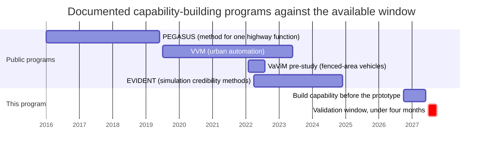

*Dates are approximate, taken from the published programme descriptions.*

#### 3. Failures, delays and unnecessary braking

The failure record argues against measuring an AEB validation campaign only by true-positive collision avoidance. False interventions and performance discontinuities are equally important, and they have kept regulators busy for years. None of the investigations below proves that inadequate pre-production validation caused the field problem; they establish that the problems reached large production fleets.

**Honda (NHTSA PE22-003, EA24-002, EA25-002).** PE22-003 opened on 21 February 2022 with 278 complaints (107 Accord, 171 CR-V) alleging inadvertent Collision Mitigation Braking System activation, six of them alleging a collision, "some with large speed changes, occurring with nothing obstructing the vehicle's path" [76]. In April 2024 NHTSA upgraded the case to engineering analysis EA24-002, covering 2,997,604 vehicles (2018 to 2022 Accord and Accord Hybrid, 2017 to 2022 CR-V and CR-V Hybrid) and 1,294 complaints of unintended activation [77, 78, 80]. Crash and injury counts differ by outlet: the ODI report as quoted by Carscoops cites "a total of 47 crashes and 93 injuries involving cars with unique VINs"; other outlets report 31 crashes and 50 injuries, 58 injuries in 50 or more incidents, or 112 injuries [78, 80]. A further investigation, EA25-002, added 295,125 Insight and Passport vehicles in January 2025 [77]. Honda's internal review concluded that some customers did not understand the system or its limits [78]. Secondary sources say no recall had been ordered as of 2026 [79]. **Independent (on-road evidence)** for the regulator record and press reporting [76, 77, 78, 81]; **Expert opinion (on-road evidence)** for law-firm commentary [79, 80].

**Nissan Rogue (NHTSA PE19-010).** An earlier defect petition in April 2019 covered 675,000 model-year 2017 and 2018 Rogues and 87 complaints; Nissan had released a software update in early 2019 and treated the matter as a service action, which the Center for Auto Safety criticized [83]. NHTSA then opened PE19-010 on 9 September 2019 over unintended AEB operation with no apparent obstacle; its opening record showed 843 non-duplicate complaints combining agency and manufacturer data, 14 alleged crashes and five alleged injuries [82]. The case shows that a function can work often enough to reach large-scale production and still contain a problematic corner of the environment, perception and decision space. Current status of PE19-010: not found. **Independent (on-road evidence)** [82, 83].

**Tesla (NHTSA PE22-002), the counterexample.** The investigation opened on 16 February 2022 with 354 complaints of unexpected braking in 2021 and 2022 Model 3 and Model Y vehicles, with complainants reporting random and sometimes repeated rapid deceleration (typically a 10 to 20 mph speed reduction at highway speed over one to three seconds, often in sunny conditions with road shadows); no crashes or injuries were listed at opening. NHTSA closed it on 29 June 2026. By then about 25,900 incident reports had been tallied across all sources for a population of 695,000 vehicles, with zero crashes, injuries or fatalities identified. Tesla released firmware updates in February and March 2022, after which reports fell to 45 in 2024, 19 in 2025 and 3 by early 2026. NHTSA concluded that the events "did not alter the vehicle's lateral positioning in their lanes and did not cause significant loss in distance between the subject and following vehicle to lead to a collision" [84]. A large number of complaints does not automatically establish a safety defect, and software updates can change the field picture quickly. **Independent (on-road evidence)** [84].

**Mazda, Fisker and others.** Mazda recalled vehicles for a similar problem in 2019; Fisker was investigated in 2024 [81, 85]. **Independent (on-road evidence)** (press reports) [81, 85].

**Daimler heavy trucks.** See question 1: PE23-010 (May 2023), the steel-trench-plate reproduction, and the October 2025 upgrade to EA25-006 with 24 crashes, 13 injuries and one fatality reported [17, 18, 19]. The maker disputed the representativeness of the test [18]. **Independent (on-road evidence)** [17, 19].

**FMVSS 127: an open dispute over whether high-speed AEB can avoid unacceptable false activations.** The final rule of 9 May 2024 requires AEB on all new light vehicles by 1 September 2029, with pedestrian AEB active between 10 and 73 km/h; it includes two false-activation tests (driving over a steel trench plate and passing between two parked vehicles) with limits on unintended braking, and requires detection of malfunctions and of performance degradation caused by sensor obstruction [86]. The Alliance for Automotive Innovation, Toyota and Volkswagen petitioned for reconsideration, raising false-positive risk among other points [88, 89]. NHTSA's response of 26 November 2024 called the false-positive risks "speculative" and noted that the rule "includes two false activation tests" [88]. The Alliance filed for judicial review on 17 January 2025, and the case has been held in abeyance since February 2025 [87]. **Independent (on-road evidence)** [86, 88, 89]; **Expert opinion** [87].

**Heavy trucks exposed performance cliffs and method-transfer failures.** NHTSA's heavy-vehicle research (question 1) found early systems that did not brake for a stopped lead vehicle, a steel-plate false-positive scenario that generated warnings, and a 2021 Cascadia that succeeded at 40 to 85 km/h but not below 40 km/h. Testing a few "representative" speeds and interpolating the rest is unsafe unless monotonic behavior has been demonstrated. NHTSA also had to alter light-vehicle procedures for heavy-vehicle stopping distances and test equipment, and met facility limits near 100 km/h [20]. This is the strongest empirical evidence found against copying an on-road passenger-car scenario library directly into construction or mining validation. **Independent (on-road evidence)** [20].

**Uber ATG (2018, NTSB).** The developer had deactivated the Volvo's factory forward collision warning and AEB during testing [90]. This is an organizational validation failure, not a sensor failure. **Independent (on-road evidence)** [90].

**Mining has the same nuisance-intervention problem.** University of Pretoria researchers reported in 2024 that false-positive collision-avoidance interventions in mining cause production losses, machine wear and operator resistance, and investigated adding vehicle-state information such as steering rate to improve collision prediction [36]. The Fortescue (February 2019) and BHP Jimblebar (2019) autonomous-truck collisions described under question 1 involved communications and traction failures and were followed up by the state regulator [38]. **Independent** [36, 38].

**Regulatory delay.** South Africa's collision-prevention rules took almost eight years from publication (27 February 2015) to commencement (21 December 2022), with industry concerns about "equipment supply, installation and maintenance" [29, 30]. **Independent** [29, 30].

**Why this matters off-road.** A "fail-safe" policy that brakes whenever perception confidence falls may look attractive in simulation, but in a loaded haul truck on a ramp, a loader reversing into a pile, a dozer near a berm or any machine on low-friction ground, a false full-brake command can itself create a hazard. Komatsu's own technical report says a rapid stop "can make the machine unstable" and requires its stop function to be off during trailer loading [52]. The specific hazards and allowable interventions are machine-dependent. **Expert opinion**, with the Komatsu statement as **Vendor** evidence [52].

#### 4. Time, team and skills to build a virtual validation capability

**No defensible published "typical" duration exists.** A statistically credible industry-wide figure for how many months and people an organization new to virtual driver-assistance validation needs was not found. Public case studies publish performance improvements while withholding staffing, baseline maturity, proprietary models, integration effort and how much old test infrastructure was reused. The closest transparent timing points are below.

| Public benchmark | Duration | What was achieved | Interpretation | Evidence |
|---|---|---|---|---|
| PEGASUS (Germany, 17 partners) | 1 January 2016 to 30 June 2019: 42 months, about 1,791 person-months, about EUR 34.5 million | Scenario database from field recordings, simulation, proving-ground and field method for one Level 3 highway function | Multi-year, multi-company effort bought a method, not an approval [10, 11] | **Independent (on-road evidence)** |
| VVM (PEGASUS family) | July 2019 to June 2023: four years, EUR 47 million volume | Verification and validation methods for urban Level 4 and 5; stated goal "significant shift from real tests to simulation" [12] | Second four-year cycle for the next domain | **Independent (on-road evidence)** |
| VaViM (Volvo Autonomous Solutions, Blekinge Institute of Technology) | February to August 2022: six months | State-of-the-art study, research questions, a feasibility model and simple comparative physical tests for virtual verification and validation of autonomous vehicles in fenced areas [91] | Six months sufficed for a pre-study, not an accepted capability | **Independent** |
| EVIDENT (SAFER, Vinnova) | April 2022 to December 2024: about 33 months | Research into credible virtual driver-assistance and automated-driving verification, correlation, and replacement or complementing of real recordings [92] | Credibility methodology is itself a multi-year problem when built rigorously | **Independent (on-road evidence)** |
| EVIDENT 2 (Vinnova) | Follow-on, record updated 10 June 2026 | Simulation credibility, physical correlation and eventual regulatory acceptance [93] | The work is still ongoing in 2026 | **Independent (on-road evidence)** |
| Anonymous Level 4 developer (Foretellix) | Six months claimed | Shift-left simulation process; coverage from 12 to 87 percent claimed [15] | Meaningful change in six months, but vendor-authored and staffing undisclosed | **Vendor (on-road evidence)** |
| Global car maker (HCLTech) | Build time not found | Incremental Level 3 validation in under a day and up to 75 percent lower test-design effort once operating [16] | Execution becomes fast after the platform is mature | **Vendor (on-road evidence)** |
| Euro NCAP Virtual Testing | Per-manufacturer build time not found | External acceptance requires physical-to-virtual correlation, a dossier, key performance indicators and random physical verification [1] | The schedule must include credibility work, not only simulation runtime | **Independent (on-road evidence)** |
| Auto-GCAS | Early 1980s to 2014 fielding | Nuisance-free automatic recovery; F-35 integration seven years early through reuse [72, 75] | Decades of foundation, then fast reuse | **Independent** and **Vendor** |
| ACAS X | Encounter models built over years from radar data [68, 71] | Millions of simulated encounters, "billions of flight hours" equivalent | Statistical evidence rested on pre-existing models | **Independent** |

**Team size: not found.** No public single-company figure for team size or build time was found, and public case studies rarely disclose whether their "team" includes tool suppliers, proving-ground staff, safety assessors, model owners and cloud or infrastructure engineers.

**Skills: clearer.** From the partner lists and outputs of PEGASUS and from what the accepted workflows require, the disciplines are (this is expert synthesis, not a published staffing prescription):

- Safety, requirements and scenario engineering: hazard analysis, machine operating modes, interaction taxonomy, coverage arguments, traceability from hazard to test; in PEGASUS, scenario databases were built from field recordings by fka [11].
- Perception and sensor-model specialists: camera, radar, lidar, ultrasonic and any GNSS, UWB, thermal or tag-based alternative each need a separate credibility argument; PEGASUS used sensor and environment simulation vendors (IPG, VIRES) [10, 11].
- Vehicle or machine dynamics and braking: mass and loading, tire-to-ground interaction, slopes, articulation, implements, hydraulic retarder and service-brake response, actuator latency.
- Simulation, model-, software- and hardware-in-the-loop engineering: closed-loop environment, controller interfaces, deterministic execution, fault injection, hardware timing.
- Test automation and data engineering: scenario parameterization, parallel execution, result oracles, reproducibility, regression management, configuration traceability.
- Physical-test and ground-truth engineering: synchronized truth sensors, soft targets, instrumentation, environmental characterization, virtual-to-physical correlation; test labs such as TÜV SÜD played this role in PEGASUS [10].
- Statistics and model credibility: uncertainty quantification, equivalence and correlation metrics, accelerated sampling, limits on extrapolation.
- Functional-safety and safety-argument specialists, plus OEM and supplier integration [10, 11].
- An independent safety or acceptance authority: someone organizationally able to reject the evidence when model credibility or coverage is insufficient. Euro NCAP's 2026 workflow is a template for the governance split: the developer qualifies and predicts; an independent organization selects verification cases and checks correlation [1].

**What the evidence implies for the schedule (expert judgment).** A four-month period should be treated as a final validation window, not a capability-construction window. Building the entire scenario system, sensor models, correlation methodology and test automation only after hardware arrives has no close public precedent among the cases found. A newcomer cannot build a fully credible toolchain covering more than 100 site types, all weather conditions and every sensor type by mid-2027. It can build a narrow one, scoped to the first release's envelope, if it starts in October 2026 and reuses commercial or open-source simulators rather than writing its own. The parts least dependent on final sensor selection can be built now: machine and site scenario taxonomy; parameterized job-site geometry; object classes; motion and operator-response models; test-oracle definitions; failure and nuisance-braking metrics; simulation execution and continuous integration; vehicle-dynamics interfaces; sensor-independent perception interfaces; data-logging schemas; and the physical-to-virtual correlation procedure. The architecture should be sensor-interface-neutral but not sensor-physics-neutral: final sensor models and correlation datasets become replaceable modules, which mirrors Euro NCAP's requirement to document simulation setup and sensor details before relying on virtual predictions [1]. The four months after hardware arrival then become: correlate actual sensors and braking hardware; discover model discrepancies; execute the already-defined virtual campaign; physically spot-check high-risk cells; investigate disagreements; assemble the safety evidence.

The precedents point to six concrete moves (expert judgment drawn from the cases above, not a published schedule):

- Narrow the first release's envelope now, following the market precedent: reverse travel, low speed (Volvo publishes 3 to 15 km/h), a brief brake pulse that hands control back to the operator, and exclusions for known false-activation situations (stockpiles, trailer loading, slopes) [43, 52]. Every dimension removed cuts the validation burden more than any tool will.
- Start shadow-mode evaluation on the warning-only fleet immediately (October 2026 to mid-2027): log every warning with sensor data and context, and replay them through candidate braking logic to estimate how often it would have braked unnecessarily per operating hour, by site type and by weather. No public case of an off-road maker doing this was found, but Liebherr, Caterpillar and John Deere already log warning events and GPS locations, so the data path exists [48, 50, 54]. It is the only way to hold field-representative false-positive evidence before the prototype arrives.
- Build the scenario catalogue around ISO 21815-3 risk areas and ISO 18497-2's four failure categories, in an open format so the simulator can be swapped; treat simulation as coverage of variants and combinations (machine model, sensor position, weather), not as the sole evidence [59, 96].
- Keep a deliberate physical campaign: false-positive tests (steel plates, dust clouds, berms, rain and snow on sensors), sensor-model correlation for each sensor type, and brake dynamics at maximum payload and on slopes. Plan the four months around confirming a prediction already made by shadow mode and simulation, not around tuning [20, 86].
- Decide early who accepts the evidence. For most markets that is the internal safety board under ISO 19014 and ISO 13849, plus customers; for South Africa, mines check against Regulation 8.10 and the MOSH requirements [29, 34]. Aligning with ISO 21815 lets customers audit the evidence [94].
- Lock the sensor choice by early 2027. Sensor models, shadow-mode data and false-positive behavior are all specific to the sensor; an unconfirmed sensor is the single largest schedule risk.

#### 5. Off-road makers already selling automatic braking or stopping

Public product literature proves that automatic intervention is commercially viable off-road. It also shows how narrow present operating envelopes are: reversing or rear-zone operation, low speed, brief brake pulses, or dependence on tags. Public documentation rarely states complete weather, visibility, road-surface, object-class or false-positive limits. All entries are vendor claims; no independent performance test of any of them was found.

| Maker and product | Launch | Machines | Intervention | Speed and direction | Objects and sensors | Published limits and exclusions | Not found |
|---|---|---|---|---|---|---|---|
| Volvo CE Collision Mitigation System [42, 43, 44, 45, 46, 47] | January 2023; new generation April 2025 | L110H to L260H and L200H High Lift wheel loaders; new L150, L180, L200 High Lift, L220, L260 | Service brakes for 2 to 3 s, then operator takes over | Reverse only, 3 to 15 km/h (2023); updated system alerts from 0.5 km/h in reverse (2025) | Any obstacle; radar (Radar Detect System required) | Slope memory to avoid stockpile activation; "not designed to ever replace safe operator behaviour" | Model-by-model upper speed; rain, snow, fog, dust limits; false-positive rate; minimum object size |
| Caterpillar Cat Detect Collision Mitigation System and wheel-loader AEB [48, 49, 50] | Wheel loaders: date not found; asphalt compactors announced 2026, "by midyear" | Medium wheel loaders (982 and related); asphalt compactors | AEB plus motion inhibit (stationary at least 2 s); People Detection | Wheel loaders reverse; compactors forward and reverse; speeds not found | People (cameras), objects (radar) | Camera "may not detect people ... lying down or crouching, or when cameras are impaired by low light conditions (dusk, dawn, overcast), inclement weather (snow, rain, fog)" | Speed envelope; target classes and sizes; adverse-weather qualification; nuisance-brake rate |
| Komatsu KomVision human detection and collision mitigation [51, 52, 53] | December 2019 (PC200-11, Japan); PC200i-12 December 2024 | Hydraulic excavators | Emergency stop via lock lever at travel or swing start; not during an ongoing swing | "Low-speed travel"; numbers not found | People (cameras, machine learning); people plus objects with radar on the -12 | False and missed detections depend "on the weather and surrounding conditions"; must be OFF during trailer loading because a rapid stop "can make the machine unstable" | Speed numbers; detection ranges |
| Liebherr brake assistant with active personnel detection [54] | January 2021 | L 526 to L 586 XPower wheel loaders | Hydrostatic slowing to standstill | Reverse (rear operating area); speed not found | People (earlier warning zone), walls, columns, vehicles; "smart sensors" | Not found | Speed range; weather and light envelope; detection probability; false-intervention rate |
| John Deere SmartDetect Assist [55, 56, 57] | Shown March 2023; "available today on select John Deere Utility Loaders" per press release of 18 February 2026 | Select utility loaders | Progressive slow and stop; momentary operator override | Mainly reverse; speed not found | People, structures, machines; cameras, stereo camera, radar | "does not replace operator responsibility" | Environmental limits |
| Hitachi Aerial Angle obstacle detection (no source document located; trade-press reporting) | 2017 reported (mining trucks) | Mining dump trucks, ZW-7 wheel loaders | Warning (trucks); automatic speed reduction on ZW-7 reported by trade press only | Not found | Moving objects; camera, millimeter-wave radar | Not found | Everything beyond the above |
| Hexagon Vehicle Intervention System (supplier, not machine OEM) [37] | Current generation 2026; earlier generation with more than 10,000 mine test hours | Surface-mining haulage | Propulsion inhibit; retarder and service-brake intervention; following-distance and overspeed functions | Not found | 4D radar in the 2024 product evolution; people, vehicles | Passed University of Pretoria TRL4 verification (March 2026) before integrated site testing | Speed range; weather envelope; object-size specification |
| Epiroc Titan CAS and CAS Interface [24, 25, 26, 27] | 2021 | Underground loaders and trucks | EMESRT Level 9 slow and stop | Not found | Tagged people and machines (low frequency, time-of-flight, GPS, AI cameras) | Requires everyone and every machine to be tagged | Speed; conditions |
| Sandvik Newtrax CAS [28] | Date not found | Underground | Slow to stop | Not found | People, light vehicles, equipment | Not found | Everything beyond the above |
| Toyota SEnS+ [61, 62] | August 2021 | Forklifts | Power cut-off slowing; no braking | Reverse | Pedestrians versus objects; stereo camera | Explicitly does not brake to a stop | Conditions |
| Linde Reverse Assist Radar [63, 64] | Date not found | Forklifts | Slows, can stop | Reverse | Radar; AI camera option recognizing work and protective clothing | Not found | Validation, field problems |
| Bell Equipment E-series ADTs [100] | Late 2020 (Pin 3) | Articulated dump trucks | Ready to integrate third-party PDS or CAS up to Level 9 via ISO 21815-2 gateway | Depends on supplier system | Depends on supplier system | Suppliers "can develop and test solutions virtually before integrating with a Bell ADT" on a laptop-based simulation | Any Bell-validated braking performance |

Not found in this research: Jungheinrich, Hyster-Yale, Develon, HD Hyundai, Sany, XCMG and other listed makers; any currently sold agricultural or forestry OEM system with documented object-triggered emergency braking and a public operating envelope.

The product evidence does not support an assumption that today's off-road AEB products already solve the full operational design domain the program targets. Volvo, Caterpillar and Liebherr descriptions concentrate on constrained rear and reverse interactions rather than arbitrary forward and reverse movement across more than 100 site configurations. The absence of published weather limits does not mean the systems cannot work in rain, dust or darkness; it means the public evidence is insufficient to claim validated performance there. **Vendor** literature throughout; the comparison is an inference from the published scopes.

#### 6. Standards bodies and industry groups on on-road simulation methods for off-road machines

**Not found:** no ISO/TC 127, CEN/TC 151, GMG, EMESRT, ICMM, AEF or VDMA study on applying OpenSCENARIO, ISO 34502 or the UNECE New Assessment/Test Method to off-road machines, and no standards-body report saying that road-vehicle simulation methodology has been demonstrated to transfer to mining or construction AEB. Any claim that on-road simulation credibility frameworks transfer to off-road machines is currently unproven.

**What exists on the off-road side.**

- ISO 21815-1:2022, general requirements for collision warning and avoidance on earth-moving machinery, with test procedures including false-positive tests [94]. **Independent**.
- ISO/TS 21815-2:2021, the communication interface between machine and detection system; the Epiroc CAS Interface and the Bell gateway refer to it [95]. **Independent**.
- ISO 21815-3:2023, risk areas and risk levels for forward and reverse motion (48 pages); it covers avoidance "by reducing speed, stopping, or inhibiting motion," not by steering [96]. VDMA's 2023 discussion of the part describes collision-risk areas and levels for machines moving forward and backward [97]. **Independent** [96]; **Expert opinion** [97].
- ISO 21815-4, risk areas and risk levels for swing and rotation motion. As of October 2026 the standards body's catalogue lists it at stage 60.00, "Under publication", with publication dated October 2026 (edition 1). It addresses rotational motion for earth-moving, underground mining and road-construction machinery, covers objects between ground level and cabin top, and states that it does not address "avoidance by automatic application of the braking or inhibit or automatic manoeuvring" [98]. **Independent (under publication)**.
- ISO 18497-4:2024, verification methods and validation principles for partially automated, semi-autonomous and autonomous agricultural machinery, with braking, steering and person or obstacle detection tests [58]; ISO 18497-2:2024 names four failure categories (failure to detect, late detection, incorrect classification, localization error) [59]. **Independent**.
- South African regulations 8.10.1.2(b) and 8.10.2.1(b) and the MOSH performance requirements and verification regime [29, 31, 33, 34]. **Independent** and **Expert opinion**.

All of these define what to test, risk zones and physical test procedures. None defines how much of the evidence may be virtual.

**What exists on the on-road side (on-road evidence).** UNECE's NATM treats simulation as one evidence pillar beside track testing, real-world testing and audit; TÜV SÜD summarizes European automated-driving regulation and ISO 34502 as requiring the virtual platform itself to be shown fit for purpose [9]; UNECE R171 admits virtual testing for hard-to-reproduce scenarios after a credibility evaluation [6]; Euro NCAP's 2026 Virtual Testing protocol requires correlation and random physical verification [1]. The institutional framework for road vehicles is substantially ahead of anything found for off-road machines.

**The nearest precedents.**

- VaViM (February to August 2022), Volvo Autonomous Solutions and Blekinge Institute of Technology, funded through Vinnova and Drive Sweden, studied validation of virtual models for autonomous vehicle systems operating in a fenced area. It reviewed methods from adjacent domains, built a feasibility model, planned simple comparative physical tests, and set a long-term goal of a workflow in which validated models and real tests are used side by side [91]. The conclusion supports using automotive-style credibility concepts off-road, but not assuming automotive sensor and environment models are automatically valid there. **Independent**.
- The University of Pretoria's mining collision-avoidance verification methodology reaches a similar practical answer from the other direction: controlled testing first, then a representative mine environment, with GPS ground truth on surface and lidar, cameras and automotive radar underground; the group has collaborated with mining organizations and an ISO working group [35]. **Independent**.
- Academic simulation work only: MineSim, a scenario-based simulation test system and benchmark for autonomous trucks in open-pit mines (2025) [99], and the University of Pretoria chapter that models South African mining collision-avoidance scenarios (in RoadRunner) and investigates collision prediction with steering-rate information [36]. **Independent**.

**What transfers and what does not (expert synthesis consistent with Euro NCAP, VaViM and the broader work).** Methods transfer: scenario-based requirements, parameterized test generation, closed-loop software- and hardware-in-the-loop, deterministic replay, risk-based sampling, regression automation, configuration management, model-credibility arguments, virtual-to-physical correlation and independent spot-checking. The physical content of the models does not transfer: machine dynamics, ground interaction, brake response, sensor location and occlusion, target signatures, site geometry and environmental phenomena. NHTSA's heavy-truck experience is the empirical warning: moving from light road vehicles to heavy road vehicles already required test adaptations for stopping distance and equipment [20]; moving from roads to deformable quarry surfaces, slopes, berms, piles, articulated frames, implements and airborne contamination is a larger change.

**Sensor choice changes the credibility plan.** Because the sensors are undecided, the program must be sensor-interface-neutral but not sensor-physics-neutral. The table states what must be demonstrated, not what any vendor can already do. **Expert opinion**.

| Sensor option | What virtual testing is particularly good for | Critical physical correlation that remains |
|---|---|---|
| Camera | Geometry, object and pose diversity, occlusion, illumination sweeps, algorithm regression, large synthetic scene sets | Photometric realism; glare; darkness; precipitation; dust or mud on the lens; motion blur; machine vibration; actual object appearance |
| Radar and 4D radar | Range and range-rate geometry, target trajectories, fusion logic, extensive nuisance-object sweeps | Target radar signatures, multipath, material and geometry effects, close-range behavior, installation effects, environmental clutter |
| Lidar | Geometry, point-cloud algorithms, occlusion, object-placement combinatorics | Surface reflectivity, rain, fog and dust attenuation, dirty optical windows, multipath and ghost returns, real scanner timing |
| Ultrasonic | Low-speed near-field geometry and control logic | Acoustic reflections from irregular materials, ground and implement reflections, temperature, wind and installation effects, transducer contamination |
| Thermal, UWB, GNSS or tag-based, infrastructure-assisted | Sensor fusion, deterministic location and identity scenarios | Site infrastructure failure modes, tag coverage, non-equipped objects, installation and maintenance assumptions |

Two industry signals support sensor diversity without proving it: Bosch's tram system pairs camera with radar and presents radar as adding detection in fog, rain and at night [66], and Hexagon's mining system moved to 4D radar in 2024 [37]. Neither is independent proof that radar alone closes the adverse-environment validation problem. Underground Level 9 systems that rely on everyone wearing a tag [25] pose a different validation problem from camera, radar or lidar perception. **Vendor** [25, 37, 66].

### Comparison tables

The table answers questions 1 and 2 as literally as the public record permits. Where a source does not disclose a value, the cell says "not found" rather than estimating. Sectors other than mining, construction, agriculture, forestry and port equipment are on-road, rail or aviation evidence.

| Case | Sector | Function type | What was validated | Methods | Time to build capability | Validation time once available | Physical testing that remained | Who accepted the evidence | Evidence |
|---|---|---|---|---|---|---|---|---|---|
| Euro NCAP 2026 Virtual Testing [1, 2, 3, 4] | Cars (on-road) | AEB, crash avoidance | Safe Driving and Crash Avoidance predictions | OEM model correlated with physical tests (ISO scores, KPIs); virtual prediction grids; Euro NCAP picks random cells for physical tests; real-world driving added | Not found per OEM | Not found | Qualification tests plus Euro NCAP's selected verification tests | Euro NCAP (consumer-assessment body, not a type-approval regulator) | **Independent** protocol; **Vendor** commentary |
| IDIADA and MathWorks demonstration (14 April 2026) [5] | Cars (on-road) | AEB | Virtual-to-physical correlation of frontal AEB | Closed-loop virtual sensors, vehicle dynamics, AEB controller; proving-ground tests; ISO 18571 correlation | Not found | Demonstration only | Proving-ground correlation retained | Test house and tool vendor; no vehicle rating shown | **Vendor** |
| UNECE R171 DCAS [6, 7, 8, 9] | Cars (on-road) | Level 2 assistance | Driver control assistance | Credibility-assessed simulation for hard-to-reproduce scenarios; physical tests default; NATM pillars | Not found | Not found | Default physical; virtual only for hard scenarios | Type-approval authorities | **Independent** regulation; **Vendor** explainers |
| PEGASUS and VVM [10, 11, 12] | Cars (on-road) | Level 3 and Level 4 automation | A method, not a product | Scenario database from field data, simulation, proving ground, field tests | 42 months (PEGASUS); 4 years (VVM) | Not applicable | Proving ground and field kept | Consortium; no approval | **Independent** project reports |
| Michigan accelerated evaluation (2016) [13, 14] | Automated road vehicles (on-road) | Rare crash and conflict evaluation | Statistical acceleration method | Importance sampling and reweighting; 300 to 100,000 acceleration (car following), 2,000 to 20,000 (lane change) | Research, not a production timeline | Far less simulated exposure | Model validation and sensor tests not eliminated | Academic; no regulator acceptance of a production AEB | **Independent** |
| Anonymous Level 4 developer (Foretellix) [15] | Automated road vehicles (on-road) | AV software | Scenario coverage and workflow | Simulation-led shift-left; coverage 12 to 87 percent claimed | Six months claimed | Not disclosed | Not disclosed | Internal or customer; customer unnamed | **Vendor** |
| Global car maker Level 3 (HCLTech) [16] | Cars (on-road) | Level 3 assistance software | Software-level validation | Virtualized SIL; keyword-driven automated tests; up to 75 percent lower test-design effort | Not found | Sub-day incremental validation claimed | Not disclosed | Internal OEM | **Vendor** |
| Honda CMBS investigations (PE22-003, EA24-002, EA25-002) [76, 77, 78, 79, 80] | Cars (on-road) | AEB | Not published | Not published | Not found | Not found | Not found | NHTSA investigation open; no recall as of 2026 (secondary) | **Independent** regulator; press |
| Nissan Rogue (PE19-010) [82, 83] | Cars (on-road) | AEB | Not published | Software update early 2019 as service action | Not found | Not found | Not found | NHTSA; status not found | **Independent** regulator; press |
| Tesla Model 3 and Y (PE22-002) [84] | Cars (on-road) | AEB and assistance braking | Not published | Firmware updates February and March 2022 | Not found | Not found | Not found | NHTSA closed 29 June 2026, no defect action | **Independent** regulator |
| Daimler Detroit Assurance (PE23-010, EA25-006) [17, 18, 19] | Trucks (on-road) | AEB | Not published | NHTSA reproduced false braking on a steel trench plate | Not found | Not found | Not found | NHTSA engineering analysis open (October 2025) | **Independent** regulator; press |
| NHTSA heavy-vehicle AEB research and 2023 proposal [20] | Trucks and buses (on-road) | FCW and AEB | Stopped, slower and decelerating lead vehicles; false positives | Light-vehicle procedures adapted for stopping distance and targets; track tests | Multi-year regulatory research | Multi-year | Track testing central | NHTSA and FMCSA | **Independent** |
| Daimler Truck Innovation Center India (2025) [21] | Trucks (on-road) | ADAS incl. AEB | Sensor fusion and AEB software | Standardized scenarios, virtual vehicle and sensors, metric-driven virtual tests | Not found | Not found | Not found | Internal engineering | **Vendor** |
| Komatsu FrontRunner; Fortescue and BHP incidents [22, 38] | Mining | Full autonomy | Not published | Not published | Since 2008 | Not found | Not found | Mine operator; WA regulator follow-up after 2019 collisions | Press; regulator statements |
| Wabtec Level 9 on Komatsu 730E and 860E (December 2021) [23] | Mining | Level 9 slow and stop | Controlled deceleration up to 30 km/h | Physical integration tests; detection zones adjusted for payload and grade | Not found | Not found | Primary | Internal and customer | **Vendor** |
| Epiroc CAS Interface (2021) [24, 25] | Mining (underground) | Level 9 interface | Third-party detection to slow or stop | Draft ISO 21815-2 interface; tags on all people and machines | Not found | Not found | Not found | Customer | **Vendor** |
| Hexagon Vehicle Intervention System and University of Pretoria (March 2026) [35, 37] | Mining (surface) | Level 9 intervention | Detection, tracking, warnings, diagnostics, intervention | Pretoria TRL4 verification, then integrated site tests; earlier generation more than 10,000 mine hours | Not found | TRL4 duration not found | Integrated site testing follows; legacy heavily mine-tested | Independent university gate; customers | **Independent** gate; **Vendor** figures |
| University of Pretoria collision-prediction research (2024) [36] | Mining | Reduction of false interventions | Collision prediction with steering rate | Simulation of mining CAS scenarios; peer-reviewed | Research | Not found | Representative-mine correlation in wider methodology | Peer review | **Independent** |
| South Africa trackless mobile machine regulations [29, 30, 31, 33, 34] | Mining | Mandated retard and automatic braking | Compliance against regulation and MOSH requirements | Industry performance requirements and verification regime | Published 2015, in force 21 December 2022 | Not applicable | Not applicable | DMRE and mines | **Independent** regulation |
| Volvo CE Collision Mitigation System (2023, 2025) [42, 43, 44, 45, 46, 47] | Construction | AEB (reverse) | Reverse collision mitigation, 3 to 15 km/h | In-house; not published | Not found | Not found | Not found | Internal | **Vendor** |
| Caterpillar wheel-loader AEB and Cat Detect [48, 49, 50] | Construction | AEB (reverse; compactors forward and reverse) | Reverse-path collision mitigation | Not published | Not found | Not found | Not found | Internal | **Vendor** |
| Komatsu KomVision stop control (2019, 2024) [51, 52, 53] | Construction | Automatic stop | Human detection at travel or swing start | Not published; technical report notes weather dependence | Not found | Not found | Not found | Internal | **Vendor** technical report |
| Liebherr brake assistant (2021) [54] | Construction | Slow to standstill (reverse) | Personnel detection in rear area | Not published | Not found | Not found | Not found | Internal | **Vendor** |
| John Deere SmartDetect Assist (2023, 2026) [55, 56, 57] | Construction | Progressive slow and stop | People, structures, machines | Not published | Not found | Not found | Not found | Internal | **Vendor** |
| Agriculture [58, 59, 60] | Agriculture | Requested analogue | Not found | ISO 18497-4:2024 defines V&V principles; no simulation-based acceptance case | Not found | Not found | Physical tests remain in reported work | Standard exists; case not found | **Independent** standard |
| Forestry | Forestry | Requested analogue | Not found | Not found | Not found | Not found | Not found | Not found | Not found |
| Forklifts: Toyota SEnS+, Linde Reverse Assist [61, 62, 63, 64] | Warehouse | Power cut-off slowing; radar slow and stop | Pedestrian versus object detection | Not published | Not found | Not found | Not found | Internal; no safety case with quantified physical reduction found | **Vendor** |
| Kalmar straddle carrier at Maher Terminals (June 2024) [65] | Port | Warning only | Area awareness, active obstacle detection | Operational deployment | Not found | Not found | Operational deployment | Customer | **Vendor** |
| Bosch tram collision assistance [66] | Rail | Warning and automatic braking | Vehicles, pedestrians, cyclists | Camera plus radar adapted from automotive | Not found | Not found | Not disclosed | Public-transport approval reported by 2016 | **Vendor** |
| ACAS X [68, 69, 70, 71] | Aviation | Advisory (pilot in loop) | Threat-resolution logic | Encounter-model Monte Carlo ("billions of flight hours"), pilot assessment | Years (encounter models from radar data) | Not found | Pilot and flight evaluation | RTCA, EUROCAE, aviation authorities | **Independent** |
| Auto-GCAS [72, 73, 74, 75] | Military aviation | Automatic intervention (not braking) | Nuisance-free terrain avoidance | Simulation and flight test; nuisance criteria | About three decades | F-35: seven years ahead of plan (vendor) | Extensive flight test | US Air Force and Joint Program Office | **Independent** and **Vendor** |
| Military ground vehicles [67] | Military ground | Collision warning and brake assist | Not found | Army solicitation for ruggedized sensors only | Not found | Not found | Not found | Not found | Government requirement statement |
| VaViM and EVIDENT [91, 92, 93] | Fenced-area and road vehicles | Credibility methods | Validation of virtual models | Literature study, feasibility model, comparative physical tests; correlation research | 6 months (pre-study); 33 months (EVIDENT); ongoing (EVIDENT 2) | Not applicable | Real tests used side by side with validated models | Funders; no approval | **Independent** |

### Where the evidence stands

#### Well established

- Unnecessary braking is a real, recurring, regulator-relevant failure mode on road vehicles, with open NHTSA engineering analyses against Honda (2,997,604 vehicles) and Daimler heavy trucks (24 crashes, 13 injuries, one fatality reported) and explicit false-activation tests in FMVSS 127 [19, 76, 77, 86]. Mining research reports the same nuisance-intervention problem [36].
- Regulators and assessment bodies that accept simulation require a credibility assessment plus physical correlation or spot checks; physical testing does not disappear. Euro NCAP retains correlation and random physical verification, UNECE R171 keeps physical tests as the default, VaViM envisages validated models and real tests side by side, and the University of Pretoria process progresses into representative-mine tests [1, 6, 35, 91].
- Large portions of development and regression testing can move from vehicles to model-, software- and hardware-in-the-loop, scenario parameterization gives much broader combinatorial coverage than physical testing, and statistical acceleration yields orders-of-magnitude exposure reductions for appropriately modeled rare on-road events [13, 14, 15, 16].
- Building a credible method took years in every documented program (PEGASUS 42 months, VVM four years, EVIDENT about 33 months, Auto-GCAS about three decades) [10, 12, 72, 92].
- Off-road makers ship narrow-envelope systems and publicly disclose camera weaknesses in weather and low light [48, 52].
- Off-road standards define risk zones and physical test procedures (ISO 21815, ISO 18497), not virtual-evidence shares [58, 94, 96].
- Heavy-truck test procedures could not simply be copied from passenger cars [20].

#### Uncertain

- How long a single newcomer needs to build the capability, and with what team: not found.
- How much physical testing off-road makers actually kept for their current products: not published.
- Whether sensor models for dust, snow, fog, mud, darkness and glare are credible enough to serve as evidence in off-road settings with a specified error bound: no off-road validation study found.
- How many physical tests can safely be removed for a family of dozens of machine variants once a common platform has been validated: the opportunity is likely large because many scenarios and software behaviors are common, but the magnitude is not found.
- Outcomes of the Honda and Daimler engineering analyses and the status of the Nissan investigation.
- Final status of the US heavy-vehicle AEB rule proposed in July 2023 [20].
- Whether the ISO 21815-4 text published in October 2026 matches the catalogue summary quoted here; the published text was not reviewed [98].

#### Where experts disagree

- Whether high-speed AEB can be built without unacceptable false activations: car makers (petitions and the January 2025 lawsuit over FMVSS 127) against NHTSA, which called the risk "speculative" [86, 87, 88].
- Whether a reproduced false activation reflects real-world risk: Daimler called NHTSA's steel-plate test unrepresentative; NHTSA upgraded the case anyway [18, 19].
- Whether a given encounter or scenario model is representative: European results suggested ACAS Xa induced more near mid-air collisions than TCAS, MIT Lincoln Laboratory did not see the same disparity, and sensor noise had not been assessed [70]. This is a warning for anyone relying on a single simulation toolchain.
- Whether customers misunderstood a system or the system misbehaved: Honda's internal review versus the complaint record [78].
- How much credibility simulation has earned: vendor material often presents simulation as replacing large amounts of physical testing; the formal evidence sources (Euro NCAP, TÜV SÜD, UNECE GRVA) frame it as a complementary pillar whose models must be qualified [1, 8, 9]. For this program the unresolved question is not "simulation or physical" but which physical tests give the most information for validating the simulation, and which residual risks cannot credibly be represented virtually.

### Blind spots

Issues the six questions did not ask about, grouped.

**Secondary hazards of braking.**

- The braking act can create a second hazard. Komatsu's report warns that rapid stops can destabilize the machine [52]; loaded machines on grades, low-friction surfaces, near edges, with elevated loads or articulated steering may need context-dependent intervention rather than a universal brake command. Payload, slope, rollover, operator injury and following vehicles all matter. A machine-specific hazard analysis is required before "stop as quickly as possible" becomes the test oracle. The NIOSH review makes the general point that new technology can introduce new hazards that need risk management [41].
- Load and implement state. A loader with an empty bucket and the same loader carrying a dense elevated load are not dynamically identical; haul-truck payload, articulated frame angle, attachments, tire condition and hydraulic temperature matter too. A common platform needs a principled parameterization of machine state rather than one digital twin per model.

**Operators and acceptance.**

- Operator interaction and override behavior. Automatic braking changes operator behavior: operators may rely on it, override it, fight it or disable and avoid it after nuisance interventions. Euro NCAP 2026 explicitly targets "annoying warnings or intrusive interventions" [2]; mining research reports operator resistance when false positives interrupt production [36]. Nuisance braking that leads to systems being switched off wipes out the safety benefit. A program focused only on detection probability and stopping distance misses this system-level risk.
- The acceptance authority should be identified now. A simulation campaign optimized for internal engineering confidence is not necessarily the dossier an independent safety board, mine customer or regulator will accept. Euro NCAP's process works because model qualification, required metrics and independent physical verification are defined before predictions are submitted [1].

**Statistics and coverage.**

- False positives need their own scenario-generating campaign. Testing only obstacle-present cases systematically favors aggressive intervention thresholds. The Nissan and Honda investigations, NHTSA's false-activation tests and the mining research all show the need for large sets of "looks dangerous but should not brake" situations [36, 76, 82, 86].
- Proving absence of hazardous braking is statistically harder than demonstrating a handful of successful stops. Millions of benign machine-object interactions may occur for every truly imminent collision. Accelerated rare-event methods are promising, but their published acceleration factors come from on-road traffic models, not an off-road perception stack [13, 14].
- Version and variant control. With many machine sizes and sensor mounting positions, the safety case must establish when evidence transfers from one variant to another; a change in sensor height, pitch, field of view, frame articulation or brake actuator can invalidate a correlation result. Euro NCAP's requirement to document simulation setup and sensor details illustrates the principle [1].

**Sensors and detection architecture.**

- Sensor self-diagnosis and degradation may matter as much as nominal perception. FMVSS 127 treats sensor obstruction and resulting performance degradation as conditions that must be detected and communicated, and NHTSA's discussion links sensor misalignment to false positives [86, 88]. Off-road contamination makes this more important, not less.
- Tag-based versus perception-based detection. Underground Level 9 systems rely on everyone wearing a tag [25]; that is a different validation problem from camera, radar or lidar perception, and a mixed fleet with non-equipped objects needs both arguments.
- Lock-in from the unconfirmed sensor. Sensor models, shadow-mode data and false-positive behavior are all sensor-specific, so the sensor decision gates most of the pre-prototype work.

**Regulation and conformity.**

- Regulatory divergence. South Africa mandates automatic braking; the US (MSHA) requires only a written program; EU acceptance runs through machinery conformity. One evidence package may not satisfy every market [29, 39].
- EU Machinery Regulation (EU) 2023/1230, applicable from January 2027: its treatment of safety components and machine-learning-based detection could affect conformity assessment. Detailed implications were not researched here.
- Software updates as a validation variable. The Tesla and Nissan records show field behavior changing materially after firmware or software updates [83, 84]; a validation plan that treats the mid-2027 build as final may not cover the update process.
- Investigations are slow and outcomes arrive years later. The Honda case has run since February 2022 and the Daimler case since May 2023 without resolution; a field problem discovered after launch will not be adjudicated within any product cycle, so the pre-launch false-positive evidence has to stand on its own.

**Coverage limits of this research.**

- Port, rail and military-ground cases, and several makers (Jungheinrich, Hyster-Yale, the Chinese and Korean OEMs), are reported as not found rather than confirmed absent.
- Almost all off-road product data are vendor claims; no independent off-road AEB performance test was found.
- Some figures come from secondary press (the Honda crash counts, Auto-GCAS save counts, the Hitachi ZW-7 speed reduction) and are flagged where they conflict.
- Comparison with the Wabtec and Hexagon mining systems in a surface quarry context, and any comparison of autonomy-stack validation (FrontRunner) with operator-assist braking, was not available.

### Sources

1. Euro NCAP. Safe Driving & Crash Avoidance Virtual Testing, Supporting Protocol, Version 1.00. March 2025. https://www.euroncap.com/media/85832/euro-ncap-supporting-protocol-safe-driving-crash-avoidance-virtual-testing-v10.pdf. **Independent (on-road evidence)**.
2. Euro NCAP. Euro NCAP announces 2026 protocol changes to tackle modern driving risks. Press release. 2025. https://www.euroncap.com/en/press-media/press-releases/euro-ncap-announces-2026-protocol-changes-to-tackle-modern-driving-risks/. **Independent (on-road evidence)**.
3. Euro NCAP. Assessment Protocol: Vulnerable Road User Protection, Version 1.1.4. Accessed October 2026. https://www.euroncap.com/media/79885/euro-ncap-assessment-protocol-vru-v114.pdf. **Independent (on-road evidence)**.
4. AVL. Euro NCAP 2026: What's Changing and How to Stay Compliant. Blog. 2025. https://www.avl.com/en/blog/euro-ncap-2026-whats-changing-and-how-stay-compliant. **Vendor (on-road evidence)**.
5. IDIADA and MathWorks. Euro NCAP 2026 Virtual Testing: Correlating Simulation and Proving Ground Results. Recorded webinar. 14 April 2026. **Vendor (on-road evidence)**.
6. Applied Intuition. Understanding DCAS and UN R171 standards. Blog. Accessed October 2026. https://www.appliedintuition.com/blog/navigating-dcas-regulations. **Vendor (on-road evidence)**.
7. dSPACE. Digital Homologation. Application story. Accessed October 2026. https://www.dspace.com/en/ltd/home/applicationfields/stories/digital-homologation.cfm. **Vendor (on-road evidence)**.
8. UNECE GRVA. Virtual testing in UN R152: Introduction. Informal document GRVA-18-55. January 2024. https://unece.org/sites/default/files/2024-01/GRVA-18-55e.pdf. **Independent (on-road evidence)**.
9. TÜV SÜD. Simulation Validation for Autonomous Vehicles. Accessed 2026. **Independent (on-road evidence)**.
10. Form, T. (PEGASUS consortium). PEGASUS Method for Assessment of Highly Automated Driving Function. Presentation, SIP-adus Workshop. 2018. https://en.sip-adus.go.jp/evt/workshop2018/file/PEGASUS_SIP-adus_Thomas_Form.pdf. **Independent (on-road evidence)**.
11. fka. The PEGASUS research project. Press release. Accessed October 2026. https://www.fka.de/en/coming-up/press-releases/288-pegasus-research-project.html. **Independent (on-road evidence)**.
12. Fraunhofer IESE. V&V Methods (PEGASUS Project Family): Verification and validation methods for highly automated vehicles in urban environments. Accessed October 2026. https://www.iese.fraunhofer.de/en/reference/v-v-methods-autonomous-driving.html. **Independent (on-road evidence)**.
13. Zhao, D., Peng, H. and colleagues (University of Michigan). Accelerated Evaluation of Automated Vehicles Safety in Lane-Change Scenarios Based on Importance Sampling Techniques. IEEE Transactions on Intelligent Transportation Systems 18(3). 2017 (online 2016). https://doi.org/10.1109/TITS.2016.2582208. **Independent (on-road evidence)**.
14. Zhao, D., Peng, H. and colleagues (University of Michigan). Accelerated Evaluation of Automated Vehicles in Car-Following Maneuvers. arXiv 1605.04965. 2016. https://arxiv.org/abs/1605.04965. **Independent (on-road evidence)**.
15. Foretellix. Level 4 autonomous vehicle shift-left case study (anonymous customer). Accessed 2026. **Vendor (on-road evidence)**.
16. HCLTech. Level 3 ADAS virtualized software-in-the-loop validation case study (global OEM). Accessed 2026. **Vendor (on-road evidence)**.
17. Land Line. Automatic emergency braking false activation reports raise concern. 2023. https://landline.media/opponents-to-aeb-mandate-point-to-false-activation-reports/. **Independent (on-road evidence)**.
18. Commercial Carrier Journal. NHTSA investigating 'false positive' automatic emergency braking activations. 2023. https://www.ccjdigital.com/regulations/equipment/article/15539661/nhtsa-investigating-false-positive-automatic-emergency-braking-activations. **Independent (on-road evidence)**.
19. The Brake Report. NHTSA Expands Probe into Daimler Trucks' Automatic Emergency Braking Errors. 27 October 2025. https://thebrakereport.com/nhtsa-expands-probe-into-daimler-trucks-automatic-emergency-braking-errors/. **Independent (on-road evidence)**.
20. NHTSA and FMCSA. Heavy Vehicle Automatic Emergency Braking; AEB Test Devices. Notice of proposed rulemaking, Federal Register. 6 July 2023. https://www.federalregister.gov/documents/2023/07/06/2023-13622/heavy-vehicle-automatic-emergency-braking-aeb-test-devices. **Independent (on-road evidence)**.
21. Daimler Truck Innovation Center India and MathWorks. Virtual Validation of ADAS Features in Commercial Vehicles Using RoadRunner. Presentation. 29 July 2025. **Vendor (on-road evidence)**.
22. Green Car Congress. Komatsu and Toyota to develop Autonomous Light Vehicle that will run on Komatsu's Autonomous Haulage System. 18 May 2023. https://www.greencarcongress.com/2023/05/20230518-komtoy.html. **Vendor**.
23. International Mining. Wabtec successfully tests Level 9 Collision Awareness System on Komatsu 730E and 860E trucks. 10 December 2021. https://im-mining.com/2021/12/10/wabtec-successfully-tests-level-9-collision-awareness-system-komatsu-730e-960e-trucks/. **Vendor**.
24. Epiroc. Groundbreaking safety improvement from Epiroc with Collision Avoidance System Interface. Newsroom. 2021. https://www.epiroc.com/en-us/newsroom/2021/groundbreaking-safety-improvement-with-collision-avoidance-system-interface. **Vendor**.
25. Epiroc. Collision Avoidance Interface. Product page. Accessed October 2026. https://www.epiroc.com/en-sa/innovation-and-technology/automation-and-information-management/automation-and-information-management-underground/collision-avoidance-interface. **Vendor**.
26. Epiroc. Titan collision avoidance. Product page. Accessed October 2026. https://www.epiroc.com/en-us/products/digital-solutions/safety-solutions/collision-avoidance. **Vendor**.
27. Safe To Work. Taking collision avoidance to the next level. Accessed October 2026. https://safetowork.com.au/taking-collision-avoidance-to-the-next-level/. **Vendor**.
28. Sandvik. Proximity detection and collision avoidance. Product page. Accessed October 2026. https://www.mining.sandvik/en/digital-solutions/safety-and-environment/proximity-detection-and-collision-avoidance/. **Vendor**.
29. ENSafrica. South Africa: Mine Health and Safety Regulations (commencement of regulations 8.10.1.2(b) and 8.10.2.1(b)). 22 December 2022. https://www.ensafrica.com/news/detail/6519/south-africa-mine-health-and-safety-regulatio. **Expert opinion**.
30. African Mining. South Africa leads the way in PDS technology. 1 March 2024. https://www.africanmining.co.za/2024/03/01/south-africa-leads-the-way-in-pds-technology/. **Independent**.
31. Minerals Council South Africa, MOSH. Collision Prevention Systems guideline application case study: Northern Cape Mine Managers Association. Accessed October 2026. https://www.mosh.co.za/all-categories/send/628-case-studies/2158-mosh-collision-prevention-systems-guideline-application-case-study-northern-cape-mine-managers-association-ncmma. **Expert opinion**.
32. Truck & Freight. The leap to Level 9: zero harm and maximum productivity with integrated CAS solutions. 2022. https://truckandfreight.co.za/the-leap-to-level-9-zero-harm-and-maximum-productivity-with-integrated-cas-solutions/. **Independent**.
33. Minerals Council South Africa, MOSH. Collision Prevention Systems: Report on Legacy Equipment. Accessed October 2026. https://www.mosh.co.za/all-categories?task=download.send&id=2161%3Acps-report-on-legacy-equipment&catid=477. **Expert opinion**.
34. Minerals Council South Africa, MOSH. Functional and Technical Performance Requirements for Surface Mine Collision Warning and Avoidance Devices. Accessed October 2026. https://www.mosh.co.za/all-categories?task=download.send&id=2157%3Asurface-cxd-ftpr&catid=477. **Expert opinion**.
35. University of Pretoria. UP's Vehicle Dynamics Group employs smart transportation technology for improved mine safety. 2020. https://www.up.ac.za/mechanical-and-aeronautical-engineering/news/post_2942026--ups-vehicle-dynamics-group-employs-smart-transportation-technology-for-improved-mine-safety-. **Independent**.
36. University of Pretoria researchers. Collision Prediction for a Mining Collision Avoidance System. Springer conference proceedings chapter. 2024. https://link.springer.com/chapter/10.1007/978-3-031-70392-8_107. **Independent**.
37. International Mining. Hexagon Vehicle Intervention System 'first & only' open-pit Level 9 solution to pass UP safety test. 25 March 2026. https://im-mining.com/2026/03/25/hexagon-vehicle-intervention-system-first-only-open-pit-level-9-solution-to-pass-up-safety-test/. **Vendor**.
38. Australasian Mine Safety Journal. WA regulator examining autonomous truck incident. 2019. https://www.amsj.com.au/wa-regulator-examining-autonomous-truck-incident/. **Independent**.
39. CTSI. Memo: MSHA Safety Program for Surface Mobile Equipment, 2024 Ruling. February 2024. https://www.ctsi.org/wp-content/uploads/2024/02/MSHA-Surface-Mobile-Equipment-Rule-2024-PDF.pdf. **Expert opinion**.
40. MSHA. Safety Program for Surface Mobile Equipment. Final rule, Federal Register. 20 December 2023. https://www.federalregister.gov/documents/2023/12/20/2023-27640/safety-program-for-surface-mobile-equipment. **Independent**.
41. Hrica, J. K., Bellanca, J. L., Benbourenane, I., Carr, J. L., Homer, J. and Stabryla, K. M. (NIOSH). A Rapid Review of Collision Avoidance and Warning Technologies for Mining Haul Trucks. Mining, Metallurgy & Exploration 39(4), 1357 to 1389 (open-access record in PubMed Central). Published online 17 June 2022, issue August 2022. https://pmc.ncbi.nlm.nih.gov/articles/PMC9490765/. **Independent**.
42. Equipment Journal. Volvo CE introduces automatic braking feature for wheel loaders. January 2023. https://www.equipmentjournal.com/tech-news/volvo-ce-introduces-automatic-braking-feature-for-wheel-loaders/. **Vendor**.
43. AsphaltPro Magazine. Volvo CE introduces Collision Mitigation System for jobsite safety. 2023. https://theasphaltpro.com/volvo-ce-introduces-collision-mitigation-system-for-jobsite-safety/. **Vendor**.
44. Equipment World. Volvo CE Collision Mitigation System for wheel loaders. 2023. https://www.equipmentworld.com/construction-equipment/heavy-equipment/wheel-loaders/article/15305538/volvo-ce-collision-mitigation-system-for-wheel-loaders. **Vendor**.
45. Mobility Engineering Technology. Volvo CE Targets Jobsite Safety with Collision Mitigation for Wheel Loaders. 2023. https://www.mobilityengineeringtech.com/component/content/article/47718-sae-ma-07090. **Vendor**.
46. Quarry Magazine. Volvo CE introduces collision mitigation system for wheel loaders. 2023. https://www.quarrymagazine.com/volvo-ce-introduces-collision-mitigation-system-for-wheel-loaders. **Vendor**.
47. Volvo Construction Equipment. Volvo launches new generation of wheel loaders. News release. 29 April 2025. https://www.volvoce.com/united-states/en-us/about-us/news/2025/volvo-launches-new-generation-of-wheel-loaders/. **Vendor**.
48. Caterpillar. Cat Detect: Collision Mitigation System. Product page. Accessed October 2026. https://www.cat.com/en_US/products/new/technology/detect/detect/128121.html. **Vendor**.
49. Caterpillar. 982 and related wheel-loader product literature (Automatic Emergency Braking, People Detection, Motion Inhibit). Accessed 2026. **Vendor**.
50. Equipment World. Cat Adds Collision Mitigation to Asphalt Rollers. 2026. https://www.equipmentworld.com/roadbuilding-equipment/compactors/article/15821770/cat-adds-collision-mitigation-to-asphalt-rollers. **Vendor**.
51. Robotics and Automation News. Komatsu integrates automated collision avoidance system as standard in its excavators. 8 June 2020. https://roboticsandautomationnews.com/2020/06/08/komatsu-integrates-automated-collision-avoidance-system-as-standard-in-its-excavators/32880/. **Vendor**.
52. Komatsu. Human detection and collision mitigation system for hydraulic excavators. Komatsu Technical Report 2021 (174E10). 2021. https://www.komatsu.jp/en/-/media/home/aboutus/innovation/technology/techreport/2021/en/174e10.pdf?rev=-1&hash=6D17EC82606D36D02FF60A0C94148BD6. **Vendor**.
53. Komatsu. Enhancing safety through products and solutions. Disclosure site. Accessed October 2026. https://komatsu.disclosure.site/en/themes/171. **Vendor**.
54. Liebherr. In case of imminent accident, new brake assistant for Liebherr wheel loaders reduces stopping distance. Press release. January 2021. https://www.liebherr.com/en-us/n/in-case-of-imminent-accident-new-brake-assistant-for-liebherr-wheel-loaders-reduces-stopping-distance-26118-3782185. **Vendor**.
55. Equipment World. John Deere releases SmartDetect technology for certain loaders. March 2023. https://www.equipmentworld.com/construction-equipment/heavy-equipment/wheel-loaders/article/15704555/john-deere-releases-smartdetect-technology-for-certain-loaders. **Vendor**.
56. Rock to Road. John Deere previews SmartGrade motor graders and SmartDetect Assist ahead of CONEXPO-CON/AGG 2026. 2026. https://www.rocktoroad.com/john-deere-previews-smartgrade-motor-graders-and-smartdetect-assist-ahead-of-conexpo-con-agg-2026/. **Vendor**.
57. Modern Construction News. John Deere SmartDetect Assist Enhances Jobsite Safety. 2026. https://modernconstructionnews.com/topics/construction-equipment/john-deere-smartdetect-assist-enhances-jobsite-safety/. **Vendor**.
58. ISO. ISO 18497-4:2024, Agricultural machinery and tractors: Safety of partially automated, semi-autonomous and autonomous machinery, Part 4: Verification methods and validation principles. 2024. https://cdn.standards.iteh.ai/samples/82688/9e77c86a5bb84b87859f194af2752999/ISO-18497-4-2024.pdf. **Independent**.
59. wideautomation. ISO 18497-2:2024: the new standard for obstacle protection in agricultural robots. 2024. https://www.wideautomation.com/en/iso-18497-22024-the-new-standard-for-obstacle-protection-in-agricultural-robots/. **Expert opinion**.
60. Toward an Agricultural Operational Design Domain: A Framework. arXiv 2511.02937. November 2025. https://arxiv.org/pdf/2511.02937. **Independent**.
61. Toyota Industries Corporation. TMHJ Launches "SEnS+" Operator Assist System That Detects and Distinguishes Pedestrians and Objects behind the Forklifts and Automatically Controls the Traveling Speed and Prevents the Truck from Moving Backward. Press release. 26 August 2021. https://www.toyota-industries.com/news/2021/08/26/005063/index.html. **Vendor**.
62. Southwest Toyota Lift. Toyota SEnS and SEnS+ Smart Environment Sensor. Accessed October 2026. https://swtoyotalift.com/toyota-sens/. **Vendor**.
63. Linde Material Handling. Pedestrian Safety. Landing page. Accessed October 2026. https://www.linde-mh.com/en/Landingpage/Pedestrian-Safety/. **Vendor**.
64. Logistics Business. Explosion-protected Electric Forklifts Get Intelligent. Accessed October 2026. https://logisticsbusiness.com/warehousing/safety/explosion-protected-electric-forklifts-get-intelligent/. **Vendor**.
65. Kalmar. Collision Warning System improves safety at Maher Terminals. Customer case. June 2024. **Vendor**.
66. Bosch. Forward Collision Warning and automatic braking for trams; ten-year retrospective. Accessed 2026. **Vendor**.
67. US Army SBIR. Ruggedized Sensors to Increase Driving Visibility and Vehicle Safety. Solicitation topic. Accessed 2026. **Independent**.
68. EUROCONTROL. European ACAS Xa CP1 validation report. Accessed October 2026 (via SKYbrary). https://skybrary.aero/sites/default/files/bookshelf/33311.pdf. **Independent**.
69. SESAR Joint Undertaking. SESAR Solution 11-A1 Contextual Note (after maturity gate). Accessed October 2026. https://www.sesarju.eu/sites/default/files/documents/solution/SESAR%20Solution%2011-A1%20Contextual%20Note%20after%20maturity%20gate.pdf. **Independent**.
70. RTCA SC-147 and EUROCAE WG-75. Plenary minutes, 10 March 2022 (RTCA Paper 168-22/SC147-833). March 2022. https://www.rtca.org/wp-content/uploads/2022/05/SC-147-Plenary-Minutes-20220310-FNL.pdf. **Independent**.
71. Collision Risk and Operational Impact of Speed Change Advisories as Aircraft Collision Avoidance Maneuvers. arXiv 2204.14250. 2022. https://arxiv.org/pdf/2204.14250. **Independent**.
72. Air & Space Forces Magazine. The Science of Avoidance. Accessed October 2026. https://www.airandspaceforces.com/article/the-science-of-avoidance/. **Independent**.
73. NASA. Automatic Ground Collision Avoidance System (Auto-GCAS) news release. 2007 (hosted 2017). https://www.nasa.gov/wp-content/uploads/2017/05/337112main_auto-gcas-nr-afps.pdf. **Independent**.
74. CBS News Los Angeles. NASA's Innovative Ground Collision Avoidance System Could Save Hundreds Every Year. Accessed October 2026. https://www.cbsnews.com/amp/losangeles/news/nasas-leading-edge-ground-collision-avoidance-system-could-save-hundreds-every-year. **Independent**.
75. Lockheed Martin. Life Saving Anti-Collision Software Integrated into First F-35s Seven Years Ahead of Schedule. Press release. 24 July 2019. https://news.lockheedmartin.com/2019-07-24-Life-Saving-Anti-Collision-Software-Integrated-into-First-F-35s-Seven-Years-Ahead-of-Schedule. **Vendor**.
76. NHTSA Office of Defects Investigation. ODI Resume, Investigation PE22-003 (Honda inadvertent automatic emergency braking). 21 February 2022. https://static.nhtsa.gov/odi/inv/2022/INOA-PE22003-5540.PDF. **Independent (on-road evidence)**.
77. S&P Global Mobility AutoTechInsight. NHTSA expands investigation into Honda vehicles over inadvertent automatic emergency braking systems. 2025. https://autotechinsight.spglobal.com/news/5280053/nhtsa-expands-investigation-into-honda-vehicles-over-inadvertent-automatic-emergency-braking-systems. **Independent (on-road evidence)**.
78. Carscoops. NHTSA Gets Serious About Phantom Braking Issue Now Affecting 3 Million Hondas. April 2024. https://www.carscoops.com/2024/04/nhtsa-gets-serious-about-phantom-braking-issue-now-affecting-3-million-hondas/. **Independent (on-road evidence)**.
79. Lemon My Vehicle. Honda Phantom Braking Lawsuit, 2026 Verdict Explained. 2026. https://lemonmyvehicle.com/blog/honda-phantom-braking-lawsuit/. **Expert opinion (on-road evidence)**.
80. Grossman Law Offices. NHTSA Upgrades Probe of Possible Honda E-Brake Defect Affecting Almost 3 Million Vehicles. 2025. https://www.injuryrelief.com/blog/nhtsa-upgrade-probe-honda-brake-defect/. **Expert opinion (on-road evidence)**.
81. Consumer Reports. NHTSA investigates Honda unexpected braking complaints. 2022. https://www.consumerreports.org/cars/car-recalls-defects/nhtsa-investigates-honda-unexpected-braking-complaints-a9281526240/. **Independent (on-road evidence)**.
82. NHTSA Office of Defects Investigation. ODI Resume, Investigation PE19-010 (Nissan Rogue false automatic emergency braking). 9 September 2019. **Independent (on-road evidence)**.
83. Consumer Reports. Nissan Rogue braking issue prompts NHTSA investigation. 12 April 2019. https://www.consumerreports.org/car-recalls-defects/nissan-rogue-braking-issue-prompts-nhtsa-investigation. **Independent (on-road evidence)**.
84. NHTSA Office of Defects Investigation. Closing Resume, Investigation PE22-002 (Tesla unexpected brake activation). 29 June 2026. https://static.nhtsa.gov/odi/inv/2022/INCLA-PE22002-25796.pdf. **Independent (on-road evidence)**.
85. Ars Technica (via Harvard TagTeam). Phantom braking lands troubled EV-maker Fisker in feds' crosshairs. 2024. https://tagteam.harvard.edu/hub_feeds/3382/feed_items/11014048/content. **Independent (on-road evidence)**.
86. NHTSA. Federal Motor Vehicle Safety Standards; Automatic Emergency Braking Systems for Light Vehicles (FMVSS 127). Final rule, Federal Register. 9 May 2024. https://www.federalregister.gov/documents/2024/05/09/2024-09054/federal-motor-vehicle-safety-standards-automatic-emergency-braking-systems-for-light-vehicles. **Independent (on-road evidence)**.
87. Nelson Mullins. The Road Ahead for FMVSS 127: Whither the Automatic Emergency Braking Mandate? Blog. 2025. https://www.nelsonmullins.com/insights/blogs/driving-forward-developments-in-transportation-law-and-innovation/all/the-road-ahead-for-fmvss-127-whither-the-automatic-emergency-braking-mandate. **Expert opinion (on-road evidence)**.
88. NHTSA. Federal Motor Vehicle Safety Standards; Automatic Emergency Braking Systems for Light Vehicles: response to petitions for reconsideration. Federal Register. 26 November 2024. https://www.federalregister.gov/documents/2024/11/26/2024-27349/federal-motor-vehicle-safety-standards-automatic-emergency-braking-systems-for-light-vehicles. **Independent (on-road evidence)**.
89. NHTSA. Federal Register, Vol. 90, No. 16, FMVSS 127 notice. 27 January 2025. https://www.govinfo.gov/content/pkg/FR-2025-01-27/pdf/2025-01832.pdf. **Independent (on-road evidence)**.
90. NTSB. Collision Between Vehicle Controlled by Developmental Automated Driving System and Pedestrian, Tempe, Arizona, 18 March 2018. Highway Accident Report HAR-19/03. 2019. https://www.ntsb.gov/investigations/AccidentReports/Reports/HAR1903.pdf. **Independent (on-road evidence)**.
91. Vinnova and Drive Sweden. VaViM: Validation of virtual models used for simulation of autonomous vehicle systems. Project record (Volvo Autonomous Solutions, Blekinge Institute of Technology). February to August 2022. https://www.vinnova.se/en/p/vavim---validation-of-virtual-models-used-for-simulation-of-autonomous-vehicle-systems/. **Independent**.
92. SAFER Vehicle and Traffic Safety Centre and Vinnova. EVIDENT. Project record. April 2022 to December 2024. https://www.saferresearch.com/index.php/projects/evident. **Independent (on-road evidence)**.
93. Vinnova. EVIDENT 2. Project record updated 10 June 2026. **Independent (on-road evidence)**.
94. ISO. ISO 21815-1:2022, Earth-moving machinery: Collision warning and avoidance, Part 1: General requirements. 2022. https://knowledge.bsigroup.com/products/earth-moving-machinery-collision-warning-and-avoidance-general-requirements. **Independent**.
95. ISO. ISO/TS 21815-2:2021, Earth-moving machinery: Collision warning and avoidance, Part 2: On-board J1939 communication interface. 2021. https://cdn.standards.iteh.ai/samples/77303/8fc47e4a16524524a12ed9f9606a50f2/ISO-TS-21815-2-2021.pdf. **Independent**.
96. ISO. ISO 21815-3:2023, Earth-moving machinery: Collision warning and avoidance, Part 3: Risk area and risk level for forward/reverse motion. 2023. https://www.iso.org/standard/77266.html. **Independent**.
97. VDMA. Discussion of ISO 21815-3 collision-risk areas and levels for earth-moving machinery. 2023. **Expert opinion**.
98. ISO. ISO 21815-4, Earth-moving machinery: Collision warning and avoidance, Part 4: Risk area and risk level for swing and rotation motion. Edition 1, stage 60.00 "Under publication", publication dated October 2026. https://www.iso.org/standard/81597.html. **Independent (under publication)**.
99. Chen et al. MineSim: A scenario-based simulation test system and benchmark for autonomous trucks in open-pit mines. Accident Analysis & Prevention. April 2025 (ResearchGate record). https://www.researchgate.net/publication/388360197_MineSim_A_scenario-based_simulation_test_system_and_benchmark_for_autonomous_trucks_in_open-pit_mines. **Independent**.
100. Engineering News (South Africa). Bell Equipment statement on E-series ADT readiness for proximity detection and collision avoidance systems up to Level 9 (Jeremiah Mokhomo). August 2023. **Vendor**.

## Chapter 3: Rules and acceptance criteria

_Which standards and regulations govern collision warning and automatic braking on heavy off-road machines, what counts as passing, and whether simulation is accepted as evidence._

### The research question

A manufacturer of heavy off-road machines for construction, mining and quarrying already sells a system that warns the operator when the machine gets too close to an object. It is now developing a system that also applies the brakes automatically if the operator does not react. Prototype hardware and software arrive in mid-2027, and validation must then finish in under four months, where past validation of comparable functions took three to four years of physical testing and per-model tuning. The system must work across more than 100 job-site types, more than 10 operating scenarios per machine, rain, snow, fog, dust, dusk, darkness and glare, and many machine models with different sizes and sensor positions. The sensor set is not fixed, so camera, radar, lidar, ultrasonic and other options all had to be covered.

The research set out to identify the standards, regulations and acceptance criteria that apply to collision warning and automatic braking on these machines, and what each accepts as evidence. It answered eight questions:

1. Which standards and regulations apply to collision warning and automatic braking on earth-moving, mining and construction machines in North America, the European Union, the United Kingdom, Australia, South Africa, South America and Asia, and for each, what is the scope, current edition, status, and performance and testing requirement?
2. Which functional safety requirements apply to a function that can command the brakes on these machines?
3. Are there rules, in force or expected by 2028, for safety functions that use machine learning?
4. What do these documents say about test methods: test objects, distances, speeds, conditions and pass criteria?
5. Do any of them accept simulation or virtual testing as evidence, and under what conditions?
6. How do on-road vehicle regulations and consumer rating programs define acceptance for automatic emergency braking and for virtual testing, and which parts could transfer to off-road machines?
7. Which requirements from customers or industry groups go beyond regulation, for example in mining?
8. Which numeric acceptance measures are used in practice (detection rate, false alarms per operating hour, unnecessary brake events, stopping margin), with published values where they exist?

The ground rules were neutrality toward vendors and technologies, and a stated evidence type for every important claim (standard or regulation text, official guidance, vendor claim, or expert opinion). Each standard and regulation was to carry its edition and date, with drafts and documents under revision flagged as such. Rules that apply only to on-road vehicles were to be marked, no rule was to be declared applicable to this system unless the source said so, and anything not found was to be reported as "not found" rather than guessed.

### About the evidence

This chapter draws on 98 sources, listed at the end of the chapter. Several hundred further documents were read during the research and are not cited. Evidence is labeled in bold after the claim or in the source entry as **Independent** (peer-reviewed study, standard or regulation text, official statistics, third-party test, government or agency report), **Vendor** (a supplier's own claim, product page, press release or white paper) or **Expert opinion** (practitioner, consultant or industry-group view without data). Findings proven only for road vehicles carry the marker **(on-road evidence)**, and standards that had not been issued by October 2026 carry **(draft)**, **(under publication)** or **(under revision)**. Where something was searched for and not found, the chapter says so rather than guessing. Points on which experts and stakeholders disagree are set out in the "Where the evidence stands" section.

### Key findings

- **ISO 21815 is the core off-road standard family, and it is still being completed.** ISO 21815-1:2022 (general requirements for detection, warnings, automatic intervention and test procedures), ISO/TS 21815-2:2021 (J1939 machine interface, confirmed December 2024) and ISO 21815-3:2023 (forward/reverse risk area and risk level) are published. Part 4 (swing and rotation) is under publication for October 2026 and expressly excludes automatic braking; Part 5 (other motions) is at proof stage for November 2026. These are standards, not law, and they become binding only through legislation, designation, contracts or the manufacturer's own conformity route. **Independent** [1, 2, 3, 4, 5]
- **ISO 16001:2017 is the only off-road standard found with hard detection and warning numbers.** It requires a detection time of 300 ms or less, an audible warning at least 3 dB above ambient, a flashing red light for the most severe warning, continuous self-checking, and no single-action disablement, with technology annexes for CCTV, radar, ultrasonic, transponder, electromagnetic transceiver, surround view and vision systems but none for lidar. It covers warning, not braking. **Independent** [6, 7]
- **Functional safety for a brake-commanding function is ISO 19014 (MPLr), not ISO 26262, and the whole series changes in October 2026.** ISO 15998 was withdrawn on 14 June 2022. Edition 2 of ISO 19014-1, -2, -3 and -4, and edition 1 of ISO 19014-5 (tables of performance levels, replacing ISO/TS 19014-5:2021), all reached stage 60.00 "under publication" in August 2026 with publication scheduled for October 2026. ISO 19014-2 explicitly excludes awareness systems that do not affect machine motion, so adding a brake command moves the system into its scope. Part 5's tabulated MPLr is intended to avoid a full safety analysis for every new model. **Independent** **(under publication)** [8, 9, 10, 11]
- **South Africa is the only jurisdiction found that legally requires automatic slow-down and braking.** Mine Health and Safety Regulations 8.10.1.2(b) and 8.10.2.1(b) commenced on 21 December 2022 (Government Gazette No. 47790, Notice 2908). Diesel-powered trackless mobile machines must detect, warn, retard to a safe speed and then brake automatically if the operator does not act, and the system must "fail to safe without human intervention". The regulation sets no detection percentage, distance, false-alarm limit or stopping-distance test. **Independent** [12, 13, 14]
- **The United States requires warnings and risk programs, not automatic braking.** OSHA 29 CFR 1926.601/602 and MSHA 30 CFR 56/57.14132 require reverse alarms or an observer; 30 CFR 77.410 accepts infrared, ultrasonic, radar or "other effective" detection with a sensing area large enough for a person to escape; 30 CFR 75.1732 (2015) requires proximity detection on continuous miners to stop the machine before contact, after the proposed 3 ft stop and 5 ft warning distances were dropped; and the 2024 Surface Mobile Equipment rule requires written safety programs that evaluate new technology, with 863 citations issued by April 2026. **Independent** [15, 16, 17, 18, 19, 20]
- **The EU Machinery Regulation (EU) 2023/1230 applies from 20 January 2027 and pulls machine-learning safety components into third-party assessment.** Annex I Part A lists "safety components with fully or partially self-evolving behaviour using machine learning approaches ensuring safety functions" and machinery embedding them; both need a notified body. Whether a frozen, non-learning trained model is "self-evolving" is disputed among commentators and not settled by the Commission. The harmonised-standards list under the new Regulation was still being prepared in 2026. **Independent**; interpretation **Expert opinion** [21, 22, 23, 24, 25]
- **The AI Act Digital Omnibus, Regulation (EU) 2026/1744, rewrote the machine-learning timeline.** Adopted 8 July 2026 and in force 27 July 2026, it amends the AI Act and the Machinery Regulation directly: Annex I high-risk obligations move to 2 August 2028, machinery products are taken out of direct AI Act high-risk classification, AI requirements for machinery are to come through delegated acts under the Machinery Regulation, and a "safety function" is defined as one that prevents or mitigates risks to health, safety or property. The machinery-specific delegated requirements had not been adopted by 1 October 2026. Machine-learning safety standards remain mostly draft: ISO/IEC TR 5469:2024 is guidance, ISO/IEC TS 22440-1/-2/-3 are committee drafts, and ISO/PAS 8800:2024 is road-vehicle only. **Independent** **(draft)** [26, 27, 28, 29, 30, 31]
- **No off-road document accepts simulation as compliance evidence; on-road regimes accept it only under strict credibility rules.** Nothing in ISO 21815, ISO 16001, ISO 3450, the South African regulation, OSHA/MSHA rules or Australian WHS rules lets simulation replace a prescribed physical test. UN R171 Annex 5 requires a credibility assessment of the simulation toolchain; the UNECE NATM frames simulation as one pillar alongside track and real-world tests; Euro NCAP's virtual-testing protocol (version 1.00, March 2025, in force January 2026) requires in-house virtual-versus-physical qualification, at least 75% of verification tests per scenario cluster meeting the qualification criteria, random physical spot checks, and it allows "perfect perception" to be assumed, which limits its value as a precedent for sensor robustness. **Independent** **(on-road evidence)** [32, 33, 34]
- **The most concrete numeric acceptance values for mining come from industry specifications, not law.** The Minerals Council South Africa (MOSH) surface collision-prevention specification requires a 200 m minimum detection range, range accuracy of 1.5 m or 10%, a 2.5 to 3.0 s warning before intervention, stop gaps of 1.0 to 4.0 m at 10 km/h or less and 15 m (plus or minus 5 m) above 10 km/h, fail-to-safe within 500 ms, and "no false interventions and false warnings" at the TRL4 gate. EMESRT PR-5A Rev 3.0 (September 2024) supplies the nine-layer control model and the surface interaction scenarios that mining customers use. **Independent** (industry-body specification) [35, 36, 37]
- **No published off-road value exists for false alarms per operating hour or unnecessary brake events per hour.** The research searched for them and found none. On-road, FMVSS 127 fails a false activation whose peak deceleration exceeds manual braking by 0.25 g or more, and UN R131 requires no warning and no braking when passing between two stationary cars 4.5 m apart at 50 km/h. These rates must therefore be set as program-level acceptance criteria, separately for advisory warnings, urgent warnings, speed reduction and full braking. **Independent** **(on-road evidence)** [38, 39]
- **The remaining regions have risk-based duties but no automatic-braking mandate.** Great Britain works under the Supply of Machinery (Safety) Regulations 2008 with the EN 474:2022 family designated in August 2026; Australia has model WHS regulation 215 (control collision risk so far as reasonably practicable), AS 21815.1:2023 as a modified adoption of ISO 21815-1, and NSW and Queensland regulator guidance; Brazil (NR-22, NR-12), Chile (DS 132) and Peru (DS 024-2016-EM) have general mining safety rules; India's DGMS circulars call for proximity warning or anti-collision devices under Coal Mines Regulations 2017 regulation 216(2) and fail-safe braking for tippers; China's Coal Mine Safety Regulations require a 50 m following distance underground; Japan, Korea, Indonesia and Canada: not found or not verified. **Independent** [40, 41, 42, 43, 44, 45, 46, 47]
- **For a four-month validation the defensible route is an analytical safety case plus targeted physical tests, with simulation presented under a credibility framework.** The sourced basis is ISO 21815-3's calculated CxS distance per model (using ISO 3450 brake data), ISO 16001 annex tests per sensor technology, ISO 19014 MPLr with Part 5 tables, and two separately analyzed safety functions: failure to intervene when needed, and intervention when it is unsafe or unnecessary. No off-road regulator has committed to accept virtual evidence, so simulation should be framed as coverage and design evidence, qualified against physical tests in the Euro NCAP or R171 Annex 5 manner. **Expert opinion** grounded in [48, 49, 11, 34]

### Detailed findings

#### 1. Applicable standards and regulations by region

A distinction runs through everything that follows. ISO, EN, AS and similar documents are standards: they become legally significant only through incorporation into legislation, harmonisation or designation, contracts, procurement specifications, or the manufacturer's chosen route to demonstrate the state of the art. OSHA and MSHA rules, EU regulations, South African mine regulations and national workplace-safety laws are law. Compliance with one does not prove compliance with the other, and no regulation anywhere was found that sets a complete numeric type-approval test for automatic braking on off-road machines. **Expert opinion** (legal-technical synthesis); the absence finding is **Independent** (review of the texts below).

##### International standards (ISO/TC 127, earth-moving machinery)

- **ISO 21815-1:2022, Collision warning and avoidance, Part 1: General requirements** (edition 1, January 2022, published). Scope: earth-moving machinery as defined in ISO 6165, mobile underground mining machinery per ISO 19296, and mobile road-construction machinery per ISO 22242. It "provides general requirements for detection of objects, warnings to the operator, automatic intervention control to avoid collision, and test procedures". It covers avoidance "by speed reduction or motion inhibit" but not by automatic steering, is technology-neutral (it does not select camera, radar, lidar or ultrasonic), and "is not applicable to collision warning and collision avoidance systems installed to the machine before the date of its publication". Its scope statement is the clearest match found for an OEM-fitted warning plus automatic-braking system on these machine types. The detailed test procedures sit in the paid text and were not reviewed. **Independent** (official abstract) [1]
- **ISO/TS 21815-2:2021, Part 2: On-board J1939 communication interface** (edition 1, published 14 July 2021; reviewed and confirmed 5 December 2024, stage 90.93). It defines the SAE J1939 messages through which a collision warning or avoidance device (CxD) asks the machine "to slow down, stop or prevent motion of the machine". The abstract states that the document "is not intended for plug-and-play implementation": machine and CxD manufacturers still have to agree integration details. The MOSH specification quotes its commands: "SLOW_DOWN"; "EMERGENCY-STOP", which is to "stop the machine motion as rapidly as possible" when "the CxD logic determines that a collision is imminent"; "CONTROLLED-STOP"; plus capability discovery and keep-alive messaging. **Independent** (official abstract; industry specification quoting the TS) [2, 35]
- **ISO 21815-3:2023, Part 3: Risk area and risk level for forward/reverse motion** (edition 1, 8 August 2023, 48 pages, published). It sets requirements for collision warning systems (CWS) and collision avoidance systems (CAS) for forward and reverse motion "by reducing speed, stopping, or inhibiting motion"; automatic steering is outside its concept. "The responsibility for safe operation of the machine remains with the machine operator." It is a type-C standard under ISO 12100 and normatively references ISO 3450 (brakes) and ISO 19296. Only the 2022 draft (DIS) text was reviewed in full; the published text may differ. **Independent** (official abstract; draft text) [3, 48]
- **ISO 21815-4, Part 4: Risk area and risk level for swing and rotation motion** (edition 1; project approved 28 September 2023; DIS registered 7 November 2024; FDIS approved 28 May 2026; stage 60.00 "under publication" since 4 September 2026; publication scheduled October 2026). It covers motion inhibition before rotation starts and "does not cover avoidance by automatic application of the braking". It should not be cited as a published standard until the October 2026 text appears. **Independent** **(under publication)** [4]
- **ISO/PRF 21815-5, Part 5: Risk area and risk level for other forms of motion** (edition 1; project approved 27 September 2024; DIS ballot closed 30 August 2025, with a BSI draft for comment dated 6 June 2025; FDIS approved 25 June 2026; proof stage 50.20 since 9 September 2026; publication scheduled November 2026). It covers articulation, four-wheel steering, towed trailers in reverse, differential or skid-steer turning, telescopic extension and retraction, and vertical (height or depth) motions, by speed reduction, stopping or motion inhibit; forward/reverse and rotation are left to Parts 3 and 4. **Independent** **(draft)** [5]
- **ISO 16001:2017, Object detection systems and visibility aids, Performance requirements and tests** (edition 2, November 2017; reviewed and confirmed 2023; current; also published as EN ISO 16001:2017 and adopted in Australia as AS ISO 16001:2020). It applies to machines per ISO 6165 and gives performance requirements and tests for object detection and visibility aids, including detection of personnel and operational reliability. It covers warning and visibility, not braking. Its numbers are in question 4. **Independent** [6, 7]
- **ISO 17757:2019, Autonomous and semi-autonomous machine system safety** (edition 2, July 2019; confirmed, stage 90.93). It applies to autonomous and semi-autonomous earth-moving and mining machines and their infrastructure, hardware and software. The abstract says function-specific automated features are outside its scope unless they are used as part of an autonomous or semi-autonomous machine system (ASAMS), so an isolated automatic-braking function on an operator-driven machine should not automatically be claimed to fall under it. Applicability to this system is therefore unclear and depends on how the machine is classified. **Independent** (official abstract and preview) [50, 51]
- **ISO 19014 series (functional safety)** and **ISO 3450:2011** (brake performance): see questions 2 and 4. Both are in the table at the end of the chapter. [9, 49]
- **ISO 20474-1:2017 and its machine-specific Parts 2 to 15** give baseline earth-moving machinery safety requirements. Collision avoidance is not their specialised purpose; they sit alongside ISO 21815 and ISO 19014 rather than serving as the acceptance standard for automatic braking. **Independent** (catalogue) [52]
- **ISO 19296:2018, Mining, Mobile machines working underground, Machine safety** gives general safety and foreseeable-misuse requirements for underground mobile machines; ISO 21815-1 references it for scope. It is not a stand-alone collision-avoidance performance protocol. **Independent** (abstract) [53]
- **ISO 13849-1:2023, Safety-related parts of control systems** (edition 4) is the generic machinery functional-safety method, including software. It does not itself assign the performance level required for this collision function; for ISO 6165 machines ISO 19014 is the sector-specific framework. **Independent** (abstract) [54]
- **Not verified:** ISO 10265, ISO 5006, ISO 14401 and ISO 15817, and whether GB/T adoptions of ISO 21815, ISO 16001, ISO 17757 or ISO 19014 exist in China: not found.

##### European Union

- **Machinery Directive 2006/42/EC** applies to machinery placed on the market until 19 January 2027.
- **Machinery Regulation (EU) 2023/1230** (adopted 14 June 2023) applies from 20 January 2027 and is the core market-access law for a machine introduced in mid-2027. It requires risk reduction, safe and reliable control systems and technical conformity evidence; it contains no automatic-braking object or speed matrix of the ISO 21815 kind. Annex I Part A lists "safety components with fully or partially self-evolving behaviour using machine learning approaches ensuring safety functions" and "machinery that has embedded systems with fully or partially self-evolving behaviour using machine learning approaches ensuring safety functions"; both require EU type-examination, unit verification or full quality assurance with a notified body. Annex II (safety components) now includes "software ensuring safety functions". Its essential requirements also address protection against corruption (cybersecurity) and autonomous mobile machinery; that detail was not reviewed. **Independent** (regulation text, read partly through secondary summaries) [21, 24, 25, 55, 56, 57]
- **Harmonised standards:** the Commission was still preparing the harmonised-standards list under the new Regulation in 2026, intending to carry over most standards cited under the Directive. Whether EN 474 or EN ISO 21815 will be harmonised under the Regulation was not verified; EN ISO 16001:2017 and EN ISO 19014-1 exist as European adoptions, and FprEN ISO 19014-1:2026 is in the CEN approval process. The presumption-of-conformity status of each standard should be rechecked at the 2027 declaration date. **Independent** (Commission guidance; catalogue entries) [22, 58]
- **AI Act (EU) 2024/1689 as amended by Regulation (EU) 2026/1744:** see question 3. [26]
- **On-road only:** the General Safety Regulation (EU) 2019/2144 and Regulation (EU) 2022/1426 apply to road vehicles, not off-road machines (contents not reviewed). The proposed EU regulation on non-road mobile machinery circulating on public roads: status not found.

##### United Kingdom

- Great Britain remains under the **Supply of Machinery (Safety) Regulations 2008 (SI 2008/1597)**, as amended; SI 2026/867 contains amendments that take effect on 20 January 2027. These impose general machinery essential health and safety requirements and conformity obligations. A dedicated off-road automatic-braking test regime was not found. **Independent** [40]
- **Designated standards:** the UK notice of 8 August 2026 (Notice 0139/26) lists the EN 474:2022 earth-moving machinery family (EN 474-1 and the machine-specific parts) as designated standards, which gives a presumption-of-conformity route but is not an automatic-braking performance matrix. **Independent** [41]
- Northern Ireland needs separate treatment under the Windsor Framework, since EU product law applies there; one GB declaration route should not be assumed to cover both. The Quarries Regulations 1999 and HSE, CPA, Strategic Forum and MPA guidance were not verified. **No UK collision-avoidance mandate was found.** **Expert opinion** (regulatory-planning caution)

##### United States

- **OSHA 29 CFR 1926.601(b)(4) and 1926.602(a)(9)(ii)** (construction) require a reverse signal alarm audible above surrounding noise, or an observer, when the rear view is obstructed. OSHA letters of interpretation accept alternatives: a camera can remove the "obstructed view" trigger if it truly provides the required clear view, and radar or doppler warning can satisfy the requirement where it gives adequate warning in time. No automatic-brake mandate. **Independent** (regulation and official interpretations) [15]
- **MSHA 30 CFR 77.410** (surface coal) requires, for front-end loaders, forklifts, tractors, graders, trucks and similar mobile equipment, either a reverse alarm or discriminating detection "using infrared, ultrasonic, radar, or another effective device"; the sensing area must give endangered persons adequate time to escape, and internal audible and visual plus external audible warnings are prescribed. Lidar is not named, so it should not be described as "approved", although it could fall under "another effective device". No automatic braking requirement. **Independent** [16]
- **MSHA 30 CFR 56.14132 and 57.14132** (metal and non-metal mines) require a reverse-activated alarm, specified alternatives, or an observer for self-propelled mobile equipment with an obstructed rear view; alarms must be audible above surrounding noise. **Independent** [17]
- **MSHA 30 CFR 75.1732**, proximity detection systems on continuous mining machines in underground coal mines (final rule 80 FR 2188, 15 January 2015). The rule is performance-based: the system must cause the machine to stop before contacting a miner and must give audible and visual warnings first. The 3 ft stop and 5 ft warning distances in the 2011 proposal were not adopted. **Independent** [18]
- **MSHA Safety Program for Surface Mobile Equipment** (final rule 88 FR, 20 December 2023; effective 19 January 2024; compliance from 17 July 2024). It requires mine-specific written safety programs identifying hazards and controls, and that operators "identify and evaluate currently available and newly emerging feasible technologies that can enhance safety". It does not mandate collision avoidance. Enforcement is active: 863 citations between July 2024 and April 2026. **Independent**; enforcement figure **Expert opinion** [19, 59, 20]
- A federal construction or mining rule requiring the machine itself to command the service brakes after an ignored warning was **not found**. Any MSHA proposal to extend proximity detection to other underground mobile machines: not verified.
- **On-road only:** FMVSS 127 (question 6).

##### Canada

- A single federal collision-avoidance or automatic-braking rule was **not found**. Mining and workplace requirements are provincial; provincial mining regulations and CSA M424 were not verified, so a market-release matrix should be completed province by province before claiming Canadian compliance. **Expert opinion** (absence finding and planning caution)

##### Australia

- **Model WHS Regulations, regulation 215 (powered mobile plant)** require, so far as reasonably practicable, control of the risk of collision with pedestrians and other mobile plant, and a warning device where collision is possible. The model regulations operate only once adopted by a state or territory; it prescribes no automatic braking, test speed or distance. The Model Code of Practice "Managing the risks of plant in the workplace" (June 2023 edition) is the official explanatory material. **Independent** [42]
- **AS 21815.1:2023** is Standards Australia's modified ("MOD") adoption of ISO 21815-1:2022, bringing the ISO framework into the Australian standards system; the content of the Australian modifications was not found in freely accessible material. **SA TS ISO 21815.2:2023** adopts the J1939 interface specification. **AS ISO 16001:2020** adopts ISO 16001:2017. None of these is law unless incorporated by a regulator or a contract. **Independent** (catalogue entries) [43, 60, 6]
- **NSW Resources Regulator:** a discussion paper on vehicle interaction controls (September 2023); the tripartite Adverse Vehicle Interaction Advisory Committee is developing a draft Technical Reference Guide for roads and other vehicle operating areas; a compliance priorities report on proximity awareness and collision avoidance in open-cut coal (July 2022); and a fact sheet on collisions involving remote-controlled equipment (May 2025). **Independent** **(draft)** for the guide [61, 62, 63]
- **Queensland RSHQ:** Guidance Note QGN 33 on autonomous mobile machinery in coal mines, which states it "is not a Recognised Standard". **Independent** [64]
- WA DEMIRS codes: not verified. **No prescriptive collision-avoidance mandate was found**; state and territory WHS adoption and mine-specific legislation must be checked for the destination site.

##### South Africa

- **Mine Health and Safety Act 29 of 1996, Regulations Chapter 8, Regulation 8.10** (promulgated 2015). Sub-regulations 8.10.1.2(b) (underground trackless mobile machines against pedestrians) and 8.10.2.1(b) (machine against machine where there is significant risk of collision) **commenced on 21 December 2022** by Government Gazette No. 47790, Notice 2908. They require automatic detection and an effective warning; that "in the event where no action is taken to prevent potential collision, further means shall be provided to retard the diesel powered trackless mobile machine to a safe speed where after the brakes... are automatically applied"; and that the system "must fail to safe without human intervention". This is the strongest explicit off-road automatic-braking mandate found anywhere, and it makes South African mine compliance a design input even if South Africa is not the launch market. **Independent** (regulation text, quoted via legal commentary) [12, 65, 13, 14]
- **Scope limits:** the wording covers "diesel powered trackless mobile machines" at mines where a risk assessment identifies the stipulated significant collision risk. Whether battery-electric machines fall within it is **unclear**. The regulation publishes no detection percentage, metres-to-object threshold, false-alarm limit or fixed stopping-distance test. **Independent**
- **Mandatory codes of practice:** official guidance for the compilation of mandatory codes of practice for trackless mobile machines expects mines to address braking systems and their testing, including recording results and, where appropriate, static and dynamic tests, so the mine's own code and commissioning process form a second acceptance layer. **Independent** [66]
- The industry implementation regime (Minerals Council South Africa and MOSH) is in question 7. SANS standards: not found.

##### South America

- There is no continent-wide machinery regime; Brazil, Chile and Peru use national workplace and mining regulation.
- **Brazil NR-22** (occupational safety and health in mining; last modified by Portaria MTE 105 of 29 January 2026) and **NR-12** (machinery safety) set general machine, mining, brake and operating requirements. An ISO 21815-style automatic-braking mandate with prescribed target or speed tests was **not found** in the reviewed text. **Independent** [44]
- **Chile, Decreto Supremo 132, Reglamento de Seguridad Minera** (promulgated 2002, published 7 February 2004, consolidated text with amendments to 2024). Broad mining safety and equipment controls; a dedicated automatic-braking performance or test standard was **not found**. SERNAGEOMIN guidance and Codelco standards: not verified. **Independent** [45]
- **Peru, DS 024-2016-EM** (mining occupational safety regulation). A general mobile-equipment risk framework; a dedicated collision-braking acceptance regime was **not found**. **Independent** [67]
- Colombia (Decreto 1886/2015) and Argentina: not verified. For all of these the answer for numeric items is "not found", not "not required".

##### Asia

- **China.** A peer-reviewed article in Meikuang Anquan (July 2023) states that the Coal Mine Safety Regulations require trackless rubber-tyred vehicles travelling in the same direction underground to keep at least a 50 m safe running distance; the regulation text itself was not reviewed. A dedicated, verified national automatic-braking acceptance rule for construction or mining machinery was **not found**, which is not a statement that no GB or GB/T standards are relevant. **Independent** (academic article citing the regulation) [47]
- **India.** Coal Mines Regulations 2017, regulation 216(2), is the hook: DGMS (Tech)(SOMA) Circular No. 03 of 2024 (21 August 2024) on preventing accidents with wheeled trackless transportation machinery in opencast coal mines calls for proper proximity-warning or anti-collision devices, and a 2025 DGMS technical circular refers to ensuring fail-safe braking before tippers are deployed. A Springer article (2025) cites a DGMS circular setting a 30 km/h maximum speed and proximity-warning requirements. The circulars are official guidance and enforcement material, not evidence that every Indian construction machine must have automatic braking; the circular texts were read only through secondary summaries, so confidence is low on details. **Independent** (official circulars via secondary sources) [46, 68, 69, 70]
- **Japan:** a dedicated national off-road automatic-braking rule was **not found**; general construction-machinery safety provisions apply and no mandate should be inferred from them. **Korea and Indonesia:** not verified.

#### 2. Functional safety for a function that can command the brakes

Once the system may issue a brake command it is no longer an "awareness system". ISO 19014-2 makes that boundary explicit: its scope covers machine-control systems that control motion or mitigate a hazard and excludes "awareness systems that do not impact machine motion (e.g. cameras and radar detectors)". A brake-commanding collision-avoidance function on an ISO 6165 machine therefore falls squarely into the ISO 19014 problem. **Independent** (official abstract) [10]

**The ISO 19014 series** (earth-moving machinery, functional safety) "can also be used to assess the functional safety requirements of other off-road mobile machinery". Its status on 1 October 2026, as listed in the ISO catalogue:

| Part | Subject | Published edition | Status of the next edition |
|---|---|---|---|
| ISO 19014-1 | Methodology (Machine Control System Safety Analysis, MCSSA) to determine safety-related parts of the control system and the required machine performance level, MPLr | 2018 (marked "to be revised") | Edition 2: FDIS registered 5 February 2026; voting closed 22 August 2026; stage 60.00 under publication; scheduled October 2026. FprEN ISO 19014-1:2026 in CEN approval. [71, 9, 58] |
| ISO 19014-2 | Hardware and architecture; achieved performance level (MPLa); excludes awareness-only systems | 2022 | Edition 2: stage 60.00 under publication since 22 August 2026; scheduled October 2026. [10] |
| ISO 19014-3 | Environmental performance and tests of electronic and electrical components in safety-related parts | 2018 | Edition 2: FDIS registered 5 February 2026; stage 60.00 since 22 August 2026; scheduled October 2026. [72] |
| ISO 19014-4 | Software and data transmission for safety-related parts | 2020 | Edition 2: FDIS registered 5 February 2026; stage 60.00 since 22 August 2026; scheduled October 2026. [73] |
| ISO 19014-5 | Tables of performance levels (MPLr) for common machine functions | ISO/TS 19014-5:2021 | Edition 1 as a full standard: final text received 5 February 2026; stage 60.00 since 22 August 2026; scheduled October 2026; replaces the TS. [11] |

**Independent** **(under publication)**. All five parts are therefore expected to change in October 2026, a few months before design verification is frozen. The validation plan should baseline the editions actually published at that point rather than mixing 2018, 2020, 2022 and 2026 clauses.

- **ISO 19014-5** is designed to let manufacturers apply tabulated MPLr values "without performing a full MCSSA for each new model", provided the typical use cases and assumptions behind the tables are met; the tables derive from the ISO 19014-1 method and include their derivation logic and assumptions. That bears directly on the per-model burden. Whether the tables contain an entry for collision avoidance or automatic braking was not reviewed; a **published MPLr value for this function was not found**. **Independent** (abstract) [11]
- The lifecycle for this function under the series is, in substance: a hazard and risk analysis of erroneous or missing braking and an MPLr assignment (Part 1 or Part 5 tables); architecture evaluation, component reliability and fault behavior giving an achieved MPLa (Part 2); environmental qualification of the safety-related electronics (Part 3); systematic software and data-transmission development (Part 4); and brake-plant capability under ISO 3450 where the machine is in its scope. **Independent** (scopes) [9, 10, 72, 73, 49]
- **Two safety functions, not one.** The analysis should separate "failure to intervene when intervention is required" from "intervention when intervention is unsafe or unnecessary". An unintended full brake application on a loaded haul truck or articulated dumper, on a grade or on a low-friction surface, can itself be hazardous; ISO 19014 addresses control-system hazard reduction and does not assume every brake demand is intrinsically safe. **Expert opinion** supported by the ISO 19014 scope
- **ISO 15998:2008 and ISO/TS 15998-2:2012 are withdrawn** (14 June 2022) and replaced by ISO 19014. ISO 16001:2017 still references ISO 15998 for environmental conditions but notes that "ISO 19014-3 can be used as an alternative". **Independent** [8, 74, 7]
- **ISO 17757:2019** requires that safety-related parts of control systems "comply with the appropriate functional safety performance" requirements, and notes that electronic commands control the brakes and steering on autonomous and semi-autonomous machines. Its applicability to an operator-driven machine with intervention is unclear (question 1). **Independent** (preview) [51]
- **ISO 13849-1:2023** remains relevant as the generic machinery method, especially for machines outside the earth-moving scope or subsystems developed under a generic framework, but it does not tell the manufacturer what performance level this collision function needs; that comes from the application-specific risk analysis or a type-C standard. For mining machines outside ISO 6165, ISO 19014 applicability should not simply be assumed; ISO 19296:2018 covers underground mobile machines and generic standards may apply by contract or jurisdiction. IEC 62061, IEC 61508 and ISO 25119 are further general alternatives whose status was not verified. **Independent** (abstracts); applicability remarks **Expert opinion** [54, 53]
- **ISO 26262 and ISO 21448 (SOTIF) are road-vehicle standards** and do not apply by scope; the MPL scale of ISO 19014 is not the ASIL scale. **Independent**; comparison **Expert opinion** [74]
- **Mining customer requirements.** The MOSH specification classifies collision prevention products as "safety systems" that must meet safety integrity, robustness and reliability requirements, requires a supplier FMECA to define critical faults, and requires fail-to-safe within 500 ms of detecting a critical failure. **Independent** (industry-body specification) [35, 36]
- **The brake plant must remain valid as a brake plant.** ISO 3450:2011 specifies minimum service, secondary and parking brake performance and tests for wheeled and high-speed rubber-tracked machines in its scope. Passing ISO 3450 does not prove that perception, classification, threat assessment or trigger logic work; an excellent perception system cannot compensate for a brake system that fails its own stopping requirements. **Independent**; decomposition **Expert opinion** [49]

#### 3. Rules for safety functions that use machine learning, in force or expected by 2028

**The European Union is the most consequential jurisdiction found.**

- **Machinery Regulation (EU) 2023/1230, binding from 20 January 2027.** Machine-learning based "self-evolving" safety components, and machinery embedding them, fall under Annex I Part A and require a notified body. **Independent** (regulation text via secondary summaries) [21, 23, 24]
- **The interpretation is disputed.** Inkog argues that "pre-trained models count. A model frozen before deployment is still 'self-evolving'... because the model was trained on data and could be retrained tomorrow." An Intertek blog of 25 September 2025 (seen in a search snippet only) says that "even 'static' ML models that have been adaptively trained but then fixed and deployed fall under this regulatory umbrella". Other commentators read the clause as applying only where behaviour can change in service. **Expert opinion** [23, 25, 56]
- Classification of a fixed, non-learning perception network therefore remains **unclear** until Commission guidance or the delegated acts settle it. A conservative plan budgets for notified-body involvement whenever machine learning performs a safety function in a product sold in the EU after 20 January 2027. **Expert opinion**
- **AI Act (EU) 2024/1689 as amended by Regulation (EU) 2026/1744 (Digital Omnibus on AI).** The amending regulation was adopted on 8 July 2026, published in the Official Journal on 24 July 2026 according to law-firm summaries, and entered into force on 27 July 2026; it amends the AI Act, the aviation regulation (EU) 2018/1139 and the Machinery Regulation (EU) 2023/1230 itself. Its effects, as reported by the regulation text and commentary: Annex I (product-embedded) high-risk obligations now apply from **2 August 2028**; Machinery Regulation products are removed from direct AI Act high-risk classification; the Commission is empowered to add AI health and safety requirements through delegated acts under the Machinery Regulation, with the machinery transition tied to 2 August 2028; and a "safety function" is clarified as one intended to prevent or mitigate risks to health, safety or property, so merely integrating AI into a product is not enough. The completed machinery-specific delegated technical requirements that would tell a manufacturer how to validate an ML-based collision-braking system had **not** been adopted by 1 October 2026. **Independent** (regulation text) and **Expert opinion** (law-firm and consultancy summaries) [26, 27, 28, 75, 76]
- A machine-learning perception or decision element cannot prudently be treated as "unregulated until 2028": the general machinery-safety obligation and the functional-safety case exist in 2027. What is uncertain is the additional AI-specific conformity layer that crystallises for machinery by 2028. **Expert opinion**

**Standards.**

- **ISO/IEC TR 5469:2024** (published January 2024) is guidance on AI and functional safety, not a requirements document. **Independent** (technical report) [29]
- **ISO/IEC CD TS 22440-1 (Requirements), -2 (Guidance) and -3 (Examples of application)** are committee drafts (CD registered 9 February 2026; comment period closed 11 April 2026), so publication much before 2027 or 2028 is unlikely. **Independent** **(draft)** [30, 77, 78]
- **ISO/PAS 8800:2024** (December 2024) tailors ISO 26262-4, -6 and -8 for AI in road vehicles; **road-vehicle scope only**. **Vendor** descriptions **(on-road evidence)** [79, 31]
- **Off-road and mining standards with machine-learning clauses: not found.** ISO 19014's accessible scope confirms software and safety-control requirements but establishes no separate "machine-learning perception" acceptance process, so training-set coverage, distribution shift, retraining, non-determinism, confidence calibration and ML change control must be treated as additional safety-case subjects rather than closed by ISO 19014 compliance. CEN/CENELEC JTC 21, ISO/IEC 42001, ISO/IEC 23894, ISO/IEC 24029, UL 4600 and the Korean AI Basic Act: not verified. **Independent** (scope) and **Expert opinion** [73]

**Other jurisdictions.** For the United Kingdom, United States, Australia, South Africa, Brazil, Chile, Peru, India, Japan and China, a dedicated off-road rule stating that an ML-based collision-avoidance function must meet a specified ML validation standard by 2028 was **not found**. This does not mean no AI legislation exists in those places; it means none was found that bears on this function. Existing machinery, mine, workplace and functional-safety obligations do not disappear because the algorithm is learned. **Independent** (absence finding)

#### 4. Test methods: objects, distances, speeds, conditions and pass criteria

The off-road documents split into two styles. The **ISO 21815 and ISO 16001 style** is a product-performance standard with controlled test procedures, defined risk concepts, object and detection requirements and specified machine behaviours. The **workplace and mining regulation style** is outcome based: detect or warn the relevant person in time, reduce the risk, and (in South Africa) intervene automatically if the operator fails to react. Neither style supplies the full validation space the system must cover (100-plus site types, 10-plus scenarios, rain, snow, fog, dust, dusk, darkness, glare, machine geometry, payload and sensor position). **Independent** (texts reviewed)

**ISO 16001:2017** (clauses 1 to 6 reviewed in preview; annex details not reviewed) [7]

- Test body: a "person or a standard measuring unit representative of a person", with dimensions varying by technology annex (B to I).
- Detection zone test: performed on the machine or a representative configuration.
- Pass criterion for detection: "Detection shall take place unambiguously with an uninterrupted sequence of the signal."
- False signals "should be minimized", including those "from weather conditions of fog, snow, rain, wind, dust"; this is a "should" with no number.
- Timing: "the ODS detection time shall not exceed 300 ms".
- Warnings: audible at least 3 dB above ambient at maximum governed speed with no load, preferably 500 to 3,400 Hz; visual warnings within a 120° arc in front of the operator, the most severe being a flashing red light; a green status light; haptic-only warnings are not allowed.
- Robustness: automatic activation and self-check at start-up; continuous monitoring for wire break, short circuit and signal faults; deactivation only by "two or more separate and distinct actions"; EMC to ISO 13766.
- Annexes: CCTV (B), radar (C), ultrasonic (D), ultrasonic transponder (E), electromagnetic transceiver (F), surround view (G), visual ODS (H) and morphological-recognition vision (I). **Lidar has no dedicated annex** in the 2017 contents.
- Exact target geometry and distances from the full normative text were not available in free material. **Independent**

**ISO 21815-3:2023** (2022 DIS text reviewed; the published text may differ) [48, 3]

- **CxS distance:** the "minimum distance for the system to complete detection, determination, action, and machine stopping distance, plus safe distance".
- **Safe distance:** a safe offset set by an authorised person plus measurement error.
- **Requirement:** "The CxS distance shall be large enough to allow a machine to stop to avoid a collision with an intended object."
- **Stopping distance definition:** machine stopping distance includes braking delay and excludes operator action time.
- **Detection zone:** "should be the same or larger than the collision risk area"; if smaller, the limitation shall be stated in the operator's manual.
- **Delays:** "The CxS manufacturer shall communicate the typical delays in their system."
- **Annexes:** worked calculations for surface (Annex C) and underground (Annex D) machines, path estimation (Annex E), configuration (Annex F) and limitations of use (normative Annex B).
- **False positives:** the standard notes that they "could create alarm fatigue". Test object specifications, speeds and trial counts for Part 3 were **not found** in the reviewed draft; the exact numeric public pass table is **not found**. **Independent**

**ISO 21815-1:2022.** The abstract confirms test procedures exist; the numerical values sit in the paid text and were **not found** in freely accessible material. **Independent** [1]

**ISO 3450:2011 (brakes)** [49, 80, 81]

- Scope: wheeled and high-speed rubber-tracked earth-moving machines; purpose-built underground mining machines are outside scope, but an annex gives modifications.
- Test speed, per a Dewesoft technical article: 32 km/h or 80% of maximum machine speed, whichever applies. Maximum service-brake stopping distances are formula-based by machine type, for example v²/44 + 0.1(32 - v) for rigid and articulated dumpers under 32 t. Treat these formulas as secondary until checked against the standard. **Vendor**
- NSW Department of Primary Industries published a proposed alternative grade-based formula for design and in-service testing, with a minimum net service-brake deceleration of 0.6 m/s² in service. **Independent** (proposal)

**South Africa Regulation 8.10.** Test objects are pedestrians and other diesel trackless mobile machines. No universal metres or km/h value appears in the regulation passages reviewed. Pass language is a sequence: automatic detection, warning, then if no operator action, retard toward a "safe speed", then automatic brake application, with fail-to-safe behaviour. No deceleration curve is prescribed. **Independent** [12, 14]

**US rules.** 30 CFR 77.410: person or object to the rear; no fixed metres or speed; the sensing area must give an endangered person adequate time to leave the danger zone; alarms audible above surrounding noise. OSHA 1926.601/602: worker in the backing path; no numeric range; alarm distinguishable above surrounding noise or an observer; alternative sensing is judged on whether it warns in time to avoid contact. 30 CFR 75.1732: stop before contact, warnings first, no numeric distance. **Independent** [16, 15, 18]

**Australia model WHS regulation 215.** Pedestrians and other powered mobile plant; no prescribed speed or distance; collision risk controlled so far as reasonably practicable; warning device where collision is possible. **Independent** [42]

**India DGMS guidance.** Mine mobile-equipment interactions; no standardised national test matrix found; proper proximity warning or anti-collision provision; fail-safe braking before deployment of relevant tippers. **Independent** [46, 69]

**MOSH surface collision-prevention specification (Rev 1)** [35]

- Scenario-based acceptance: following ("dovetail") on straight roads and curves; overtaking; head-on on straight roads and curves; T-junctions; multiple interactors; congested dump, pit, park and ramp areas; light vehicle against heavy equipment.
- Numeric stop gaps and following distances (question 8).
- Detection must hold with "no line-of-sight (e.g. blocked by infrastructure, curves, berms)", on a "blind rise", in "dust" and on "steep angles/inclines/declines".
- Independent verification is required at the TRL4 and TRL7 stage gates. **Independent** (industry-body specification)

**NIOSH RI 9654 (November 2000)** [82]

- Haul-truck tests in reverse at under 8 km/h on a 0.76 m grid with a person 178 to 191 cm tall.
- A point counted as "reliable" detection if the alarm came on in under 200 ms and consistently; a "sporadic" zone covered 10 to 100% detection.
- These are measurement definitions, not pass thresholds. **Independent**

**Sensor choice is never the acceptance criterion.** MSHA names infrared, ultrasonic, radar or another effective device; OSHA has accepted camera and radar approaches under conditions; ISO 21815 and ISO 16001 are performance oriented. **Independent**

**Weather, light and slope.** No quantified rain, fog, dust, glare or darkness test condition was found in the reviewed text of any off-road standard or regulation. ISO 19014-3 qualifies safety-related electronic components environmentally (vibration, temperature, electrical robustness), which is not the same as proving a camera, lidar or radar perception chain across visibility and weather combinations. A published off-road requirement of the form "warning must occur 2.0 s before braking" was likewise **not found** in legal texts; the only timing values are the MOSH 2.5 to 3.0 s and the on-road UN R131 0.8 s. **Independent** (absence finding) [72]

#### 5. Is simulation or virtual testing accepted as evidence?

**Off-road, mining and machinery documents: not found.** No provision was found in ISO 21815, ISO 16001, ISO 3450, the South African trackless mobile machinery regulation, US OSHA and MSHA rules or the Australian model WHS rules that lets simulation replace a prescribed physical performance test. ISO 21815-3 relies on calculation (worked CxS-distance examples), which supports analytical evidence for stopping-distance margins but is not simulation-based acceptance. ISO 16001 and ISO 3450 specify physical tests. The MOSH regime requires supplier verification plus independent physical verification at TRL stage gates, with "widespread testing" carried out by the University of Pretoria. **Independent** (texts reviewed; absence finding) [48, 7, 49, 35]

That does not make simulation inadmissible. Under functional safety, analytical evidence is intrinsic: hazard analysis, architecture assessment, software verification, reliability and fault reasoning, model-based tests and traceability all support the safety case, and EU machinery conformity rests on technical documentation of design, risk assessment and verification rather than on every conclusion being generated on a proving ground. What was not found is a rule allowing a manufacturer to say that an ISO 21815 physical test is satisfied solely because a simulation passed. The safest reading is: simulation is evidence of coverage and design correctness; correlated physical tests are evidence that the simulation represents the real machine; prescribed physical tests remain physical unless the applicable document says otherwise. **Expert opinion** grounded in ISO 19014 and the Machinery Regulation [73, 21]

**On-road precedents, all (on-road evidence):**

- **UN R171 (Driver Control Assistance Systems).** "The validation of the system may include the use of virtual testing... If virtual testing is performed, a credibility assessment as described in Annex 5 shall be provided to the Type Approval Authority." The manufacturer must "demonstrate the scope of the simulation tool, its validity for the scenario concerned as well as the validation performed for the simulation tool chain". A 02 series of amendments was under discussion at GRVA-24 in January 2026. **Independent** [32, 83]
- **UNECE New Assessment/Test Method (NATM).** A multi-pillar approach of audit, simulation and virtual testing, test track and real-world testing; its credibility framework covers simulation toolchain management, requirements, verification and validation. **Independent** [33]
- **UN R152 virtual-testing proposal.** A GRVA-18 paper (January 2024) criticised a virtual-testing proposal for R152 for not meeting the full NATM credibility framework: evidence of regulator caution. **Independent** [84]
- **Euro NCAP Safe Driving and Crash Avoidance Virtual Testing protocol** (version 1.00, March 2025; implemented January 2026). The OEM submits a simulation dossier; performs in-house qualification between virtual and physical tests using the "ISO score and defined KPIs calculated using the Euro NCAP scripts"; submits colour predictions for the scenario grid; Euro NCAP physically tests "randomly selected grid cells"; the virtual data are then validated, and re-simulation is possible if validation fails. The protocol requires representative vehicle properties, virtual sensor positions, opening angles and ranges matching the physical vehicle, function logic similar to the physical vehicle, target dimensions matching the physical targets, and environment models representing the physical-test conditions. At least **75% of Euro NCAP verification tests per scenario cluster** must satisfy the qualification criteria or the dossier is rejected for that cluster. The protocol explicitly allows **"perfect perception"** to be assumed in the simulation, and several of its ISO-score and KPI tolerances are in square brackets with a warning that bracketed values still need confirmation, so they should not be copied into an off-road acceptance specification as final thresholds. **Independent** (consumer protocol, not regulation) [34]
- **Share of evidence that may be virtual:** no fixed percentage was found in any source.

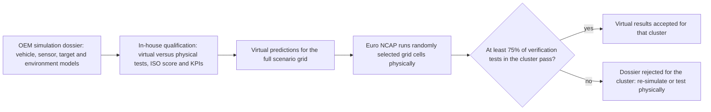

_Figure: acceptance flow of the Euro NCAP virtual-testing protocol (version 1.00, March 2025). It is an on-road consumer protocol; no off-road body has adopted an equivalent._ [34]

#### 6. On-road acceptance definitions and what could transfer

The following documents are **on-road only**. They do not regulate a quarry loader, haul truck, excavator or dozer because it has an automatic-braking function, and nothing should be declared applicable without an independent finding that the machine falls in their scope.

**Definitions** (regulation or protocol text unless noted; all **Independent** **(on-road evidence)**)

- **UN R131, heavy vehicles (M2, M3, N2, N3), 02 series** (in force 4 January 2023; published in EU OJ L 2025/1329). Emergency braking is a demand from the AEBS to the service-braking system. Warning at least 0.8 s before emergency braking; braking demand at least 4 m/s²; maximum impact speeds tabulated by vehicle category and test speed (for example 0 km/h impact up to 70 km/h for heavy hydraulic-brake trucks against a stationary target); child pedestrian target to ISO 19206-2 crossing at 5 km/h; a false-reaction test passing between two stationary cars 4.5 m apart at 50 km/h with no warning and no braking; failure warning within 10 s; no more than 10% failed runs per category in robustness testing. [39]
- **UN R152, light vehicles (M1, N1), Revision 2 / 02 series** (2024; EU OJ L 2024/2497). Car-to-car tests at 10 to 60 km/h, pedestrian tests at 20 to 60 km/h, and false-reaction scenarios in which the AEBS must not warn or brake. These values were not verified against the primary text. [85]
- **FMVSS No. 127, US light vehicles** (final rule 9 May 2024; response to petitions 26 November 2024; compliance from 1 September 2029; applies to passenger cars and multipurpose vehicles, trucks and buses up to 4,536 kg GVWR). No-contact avoidance of a lead vehicle up to 62 mph, pedestrian AEB in daylight and darkness, and forward-collision warning. A false activation (steel trench plate at 80 km/h, and a pass-through scenario) fails if peak deceleration exceeds manual braking by 0.25 g or more. On 23 March 2026 the Department of Transportation told the D.C. Circuit it is preparing a rulemaking to extend lead time by two years (a proposal, not adopted). [86, 38, 87, 88]
- **NHTSA New Car Assessment Program** (final decision notice signed November 2024, Federal Register 3 December 2024). Lead-vehicle stationary and moving tests start at 40 km/h and increase in 10 km/h steps to 80 km/h while no contact occurs; a contact ends that series. The lead-vehicle-decelerating family uses headways of 12 to 40 m and target decelerations of 0.3 to 0.5 g. These are consumer-assessment values, not law. [89]
- **Euro NCAP 2026 to 2028 protocols.** The 2026 update is described as the largest overhaul since 2009, adding robustness testing with variations in speed and offset, and virtual testing with spot checks; the 2026 protocols contain "more than 1,200 different test scenarios". Pedestrian targets follow ISO 19206-2:2018 and the bicyclist target ISO 19206-4:2020. The virtual-testing qualification matrices include stationary-target longitudinal cases at 10 to 50 km/h and turning cases combining host speeds of 10 to 25 km/h with target speeds of 30 to 80 km/h. For the head-on scenarios (CCFhos and CCFhol) an AB Dynamics engineer told Vehicle Dynamics International (16 January 2026) that "Euro NCAP considers a 20 km/h reduction in collision speed a pass" (**Vendor**). Euro NCAP is a consumer rating program, not a regulator; its score is not regulatory evidence for any machine. [90, 91, 34, 92]

**What could transfer** (**Expert opinion**, drawn from the documents above)

- Scenario-space architecture: parametric description by ego speed, target speed, relative heading, lateral overlap, target class, visibility and lighting, braking capability and intervention timing. For the off-road system the matrix becomes machine motion, object class, geometry, relative trajectory, payload, grade and friction, and sensor environment. [34, 89]
- Standardised human and vehicle surrogates as a principle (ISO 19206 family), but not the identical targets: off-road surrogates must represent persons in PPE, light vehicles under the nose of a haul truck, machines and fixed obstacles, with camera appearance, radar cross-section, lidar reflectivity and ultrasonic response matched to each sensing modality. [91]
- Explicit false-activation tests: trench-plate and pass-through equivalents for berms, windrows, dust plumes, parked machines and overhead structures. [38, 39]
- Outcome measures that are machine-independent physical quantities: no-contact, residual impact speed, remaining distance, time-to-collision at warning and at brake, and false-reaction outcomes; Euro NCAP's virtual protocol compares exactly these between physical and simulated runs. [34]
- Impact-speed or stop-gap acceptance tables by speed band. [39]
- Toolchain credibility frameworks (R171 Annex 5, NATM) and the predicted-performance-plus-random-physical-verification structure, which maps directly onto variant management across machine models: qualify the vehicle dynamics and brake model, the object and sensor model, and the perception and decision model separately; allow virtual evidence only inside the validated envelope; run randomly selected physical challenge tests; requalify after material software, sensor-position or machine changes. [32, 33, 34]

**What is unlikely to transfer** (**Expert opinion**)

- Road geometry, lane markings, traffic rules and driver assumptions: mines use haul-road rules, berms and site-specific right-of-way. An articulated dump truck reversing at a crusher, an excavator swinging beside a worker, a loader approaching a stockpile and a haul truck descending a grade have different collision kinematics from rear-end and crossing-pedestrian tests; ISO 21815's separate parts for forward/reverse, swing and other motions are themselves evidence that off-road motion types need different hazard models. [4, 5]
- Car and pedestrian targets alone, and road speed ranges: off-road speeds are mostly below 60 km/h but masses reach hundreds of tonnes.
- Dry, flat asphalt surfaces and comfort-oriented deceleration assumptions: gravel, mud, ice, grades of 10% or more, brake temperature, tyre or track interaction, payload transfer, articulated stability and rollover make ISO 3450 more relevant than any imported passenger-car deceleration target. [49]
- Articulated steering, attachments and raised bodies that change the footprint; brake thermal limits and retarders; dust, vibration and lens contamination.
- Perception conditions: a virtual method that may assume perfect perception cannot establish that a camera works in airborne dust or glare, that lidar remains adequate in heavy precipitation, or that radar resolves a worker next to a large metal structure; those need separate sensor and perception qualification. [34]
- The type-approval regime itself: off-road relies on manufacturer self-declaration, notified bodies or site acceptance, not vehicle type approval.

#### 7. Customer and industry requirements beyond regulation

Mining is where requirements most often exceed the legal minimum, because statutory intervention provisions (South Africa) and voluntary programs (EMESRT, ICMM) require heterogeneous fleets and third-party systems to work together.

- **EMESRT PR-5A Vehicle Interaction Systems** (Rev 3.0, September 2024; earlier Rev 1.0 April 2016 and Rev 2.0 August 2019). It defines the nine-layer model of vehicle interaction defensive controls, in which Level 7 is operator awareness, Level 8 advisory controls and Level 9 intervention controls, and sets out surface interaction scenarios as "storyboards"; according to MineSafeGlobal (seen in a search snippet only), PR-5A defines 24 surface vehicle interaction scenarios (**Expert opinion**). EMESRT and Wabtec material stresses that "Level 9 intervention is not a standalone product" but a machine-control capability. This is an industry risk-control philosophy, not law, and not proof that a product passes a mine's acceptance test. **Vendor** and **Expert opinion** (industry guidance via secondary sources) [37, 93, 94]
- **ICMM Innovation for Cleaner, Safer Vehicles (ICSV).** The goal was to "make collision avoidance technology available to mining companies by 2025", using EMESRT requirements; its Leading Sites programme emphasises a Level 1 to 7 baseline before Levels 8 and 9. **Expert opinion** (industry group) [95, 94]
- **Minerals Council South Africa / MOSH.** A user requirement specification (URS), the surface collision-prevention functional and technical performance requirements (F&TPR, Rev 1), an independent verification test specification, a requirements verification regime with TRL4 and TRL7 gates, and a fail-to-safe addendum. Requirements include a standardised Deutsch DT 12-pin connector, ISO/TS 21815-2 negotiation, and logging at 10 Hz during interventions with 7 days held on board and 3 months on a server. The approach is a common, member-differentiated compliance route rather than treating the Gazette wording as a complete engineering specification. **Independent** (industry-body specification) [35, 36]
- **South African mine codes of practice and Indian DGMS circulars** add a site or regulator acceptance layer on top of OEM testing: the South African guidance expects braking systems to be tested and results recorded; DGMS translates regulation 216(2) into expectations for proximity warning or anti-collision equipment and fail-safe braking before tippers are deployed. **Independent** [66, 46, 69]
- Customer and site requirements are typically more demanding where law stays qualitative: interoperability between OEMs and third-party systems, site mapping, warning semantics for operators and pedestrians, maintenance diagnostics and health monitoring, fault logging, machine-to-machine communication, commissioning tests, periodic re-testing, and proof that the installed system does not cause intolerable nuisance interventions. A single universal mining-industry threshold was **not found**; the specific value must come from each customer's procurement or code-of-practice documents. **Expert opinion**
- **Not found:** published requirement documents from individual miners (BHP, Rio Tinto, Anglo American, Glencore, Vale, Codelco, Newmont, Fortescue); insurer requirements; AEM, CECE and CPA positions. **GMG guidelines:** not verified.

#### 8. Numeric acceptance measures in practice

The central result is the gap between **scenario-level performance values**, of which a few exist, and **fleet-statistical KPIs** (detection rate in the field, false alarms per operating hour, unnecessary brake events per hour), of which none were found in any off-road standard or regulation.

| Measure | Published value | Source (edition or date) | Evidence |
|---|---|---|---|
| Detection latency | ODS detection time 300 ms or less | ISO 16001:2017, clause 4.5 [7] | **Independent** |
| Detection range | 200 m minimum (surface, machine to machine); 6 or more machines tracked | MOSH surface F&TPR Rev 1 [35] | **Independent** (industry specification) |
| Position accuracy | 1.5 m or 10%, whichever is greater | MOSH F&TPR Rev 1 [35] | **Independent** (industry specification) |
| Warning before intervention | 2.5 to 3.0 s | MOSH F&TPR Rev 1 [35] | **Independent** (industry specification) |
| Warning timing (on-road) | at least 0.8 s before emergency braking | UN R131 02 series [39] | **Independent** **(on-road evidence)** |
| Stop gap or stopping margin | 1.0 to 4.0 m at 10 km/h or less; 15 m plus or minus 5 m above 10 km/h | MOSH F&TPR Rev 1 [35] | **Independent** (industry specification) |
| Stopping margin (law) | "retard to a safe speed", then brake; no metre value | South Africa Reg. 8.10 [12] | **Independent** |
| Following distance underground (China) | 50 m or more, same direction | Coal Mine Safety Regulations, per Meikuang Anquan 2023 [47] | **Independent** |
| False alarms and false interventions | "No false interventions and false warnings" at TRL4; "no significant production loss" at TRL9 | MOSH F&TPR Rev 1 [35] | **Independent** (industry specification) |
| False alarms per operating hour (off-road) | **not found** | none | none |
| Unnecessary brake events per hour or per 1,000 h (off-road) | **not found** | none | none |
| False activation (on-road) | peak deceleration not more than 0.25 g above manual braking | FMVSS 127 (November 2024 amendment) [38] | **Independent** **(on-road evidence)** |
| False reaction (on-road) | no warning, no braking passing between two stationary cars 4.5 m apart at 50 km/h | UN R131 02 series [39] | **Independent** **(on-road evidence)** |
| Fail-to-safe response | within 500 ms of critical failure detection | MOSH F&TPR Rev 1 [35] | **Independent** (industry specification) |
| Detection probability or miss rate | **not found** (NIOSH "sporadic" zone is 10 to 100% detection; "reliable" is under 200 ms and consistent) | NIOSH RI 9654, 2000 [82] | **Independent** |
| Sensing range (US surface coal) | large enough for an endangered person to leave the danger zone; no metre value | 30 CFR 77.410 [16] | **Independent** |
| Warning audibility | distinguishable or audible above surrounding noise; no dB value in the cited clauses | OSHA 1926.601/602; 30 CFR 56/57.14132 [15, 17] | **Independent** |
| Availability or diagnostic coverage | **not found** | none | none |
| MPLr for collision avoidance | **not found** (ISO 19014-5 tables under publication; content not reviewed) | ISO 19014-5 [11] | **Independent** **(under publication)** |
| Proximity detection stop distance (US underground coal) | none numeric; 3 ft proposal not adopted | 30 CFR 75.1732, 2015 [18] | **Independent** |
| Model-versus-physical virtual-test acceptance | at least 75% of verification tests per cluster meet qualification criteria | Euro NCAP VT v1.00, 2025 [34] | **Independent** **(on-road evidence)** |
| Virtual-test ISO score and KPI tolerances | shown in square brackets; provisional | Euro NCAP VT v1.00 [34] | **Independent** **(on-road evidence)** |
| NCAP no-contact AEB | 40, 50, 60, 70, 80 km/h; contact ends the series | NHTSA NCAP decision, 2024 [89] | **Independent** **(on-road evidence)** |
| NCAP lead-vehicle-decelerating setup | headway 12 to 40 m; target deceleration 0.3 to 0.5 g | NHTSA NCAP decision, 2024 [89] | **Independent** **(on-road evidence)** |

The absence of false-alarm and unnecessary-brake rates is consequential: a system can pass a finite set of standards tests and still be unusable if it alarms every few minutes or brakes unexpectedly several times a shift. A program-level acceptance specification should therefore measure at least scenario-conditioned true-positive detection and intervention, dangerous misses, false warnings per operating hour, unnecessary interventions per operating hour, collision-avoidance rate, residual impact speed, minimum stopping margin, warning lead time, brake-command latency, availability, time in degraded mode and fault-detection coverage, with separate tolerances for advisory warnings, urgent warnings, speed-reduction commands and full brake interventions, since an unnecessary advisory is not equivalent to an unnecessary emergency stop of a loaded machine. None of these values should be presented as mandated by ISO unless the normative clause supplies them. **Expert opinion**

#### What this means for a four-month validation

The research converges on one shape of plan, which is a conclusion drawn from the sources rather than a requirement in any of them (**Expert opinion**):

1. Build the evidence plan around ISO 21815-3 (calculated CxS distance per model using ISO 3450 brake data and declared system delays), ISO 16001 annex tests for each candidate sensor technology, and ISO 19014 MPLr with the Part 5 tables, and track the October 2026 editions of all five ISO 19014 parts and ISO 21815-4 now. [48, 49, 7, 11, 4]
2. Analyse two safety functions, failure to intervene and unsafe or unnecessary intervention, and give each its own acceptance thresholds. [10]
3. If any machine learning performs the safety function and the product is sold in the EU after 20 January 2027, plan for notified-body engagement under Annex I Part A unless legal advice concludes otherwise, and expect machinery-specific AI requirements by 2 August 2028. [21, 26]
4. For mining customers, map requirements to the EMESRT PR-5A scenarios and the MOSH F&TPR numbers; they are the most concrete acceptance targets available. [37, 35]
5. Use simulation for coverage and design, present it with an R171 Annex 5 or NATM-style credibility package and a randomly sampled physical verification set in the Euro NCAP manner, and state plainly that no off-road authority has committed to accept it. Keep prescribed physical tests physical, and keep perception robustness in dust, snow, fog, glare and darkness on physical and recorded-sensor evidence. [32, 33, 34]

### Comparison tables

The standards and regulations are summarised in one table with name, region, status, what it covers and what it requires for testing. It is split into three parts with the same columns: standards, regulations and official guidance, and on-road references. Status is as of 1 October 2026 and, for ISO documents, as listed in the ISO catalogue.

#### Table 3.1: Standards (off-road unless marked)

| Name | Region | Status (edition, date) | What it covers | What it requires for testing | Evidence |
|---|---|---|---|---|---|
| ISO 21815-1:2022 | International | Published, ed. 1, January 2022 | CWS/CAS general requirements: detection, warning, automatic intervention by speed reduction or motion inhibit, test procedures; EMM, underground mining and road-construction machines | Test procedures in normative text (content not reviewed); technology-neutral | **Independent** [1] |
| ISO/TS 21815-2:2021 | International | Published TS, ed. 1, 14 July 2021; confirmed 5 December 2024 | J1939 interface: SLOW_DOWN, CONTROLLED-STOP, EMERGENCY-STOP, capability discovery, keep-alive; not plug-and-play | Interface conformance (not reviewed) | **Independent** [2] |
| ISO 21815-3:2023 | International | Published, ed. 1, 8 August 2023 | Forward/reverse risk area and risk level; CxS distance; type-C under ISO 12100 | Calculated CxS distance at least stopping need plus safe distance; manufacturer declares delays; worked examples in Annexes C and D | **Independent** [3, 48] |
| ISO 21815-4 | International | Under publication, stage 60.00; FDIS approved 28 May 2026; October 2026 | Swing and rotation; motion inhibit only; excludes automatic braking | Not reviewed | **Independent** **(under publication)** [4] |
| ISO/PRF 21815-5 | International | Proof stage 50.20; FDIS approved 25 June 2026; November 2026 | Articulation, four-wheel steer, towed trailer, skid turning, telescopic and vertical motions | Not reviewed | **Independent** **(draft)** [5] |
| ISO 16001:2017 | International (EN ISO in EU; AS ISO 16001:2020 in Australia) | Published, ed. 2, November 2017; confirmed 2023 | Object detection systems and visibility aids; warning only | Detection within 300 ms; unambiguous uninterrupted detection; audible 3 dB above ambient; flashing red for severest warning; self-check; two-action disablement; technology annexes B to I (no lidar) | **Independent** [6, 7] |
| ISO 17757:2019 | International | Published, ed. 2, July 2019; confirmed | Autonomous and semi-autonomous machine system safety; function-specific automation outside scope unless part of an ASAMS | Functional safety of safety-related control parts; applicability to this system unclear | **Independent** [50] |
| ISO 19014-1 | International (EN ISO) | Ed. 1 2018; ed. 2 under publication, October 2026 | MCSSA method; MPLr | Hazard and risk analysis; MPLr assignment | **Independent** **(under publication)** [71, 9] |
| ISO 19014-2 | International | Ed. 1 2022; ed. 2 under publication, October 2026 | Hardware and architecture; MPLa; excludes awareness-only systems | Architecture evaluation, component reliability, fault behaviour, diagnostics | **Independent** **(under publication)** [10] |
| ISO 19014-3 | International | Ed. 1 2018; ed. 2 under publication, October 2026 | Environmental performance of safety-related E/E components | Environmental tests (vibration, temperature, electrical); not a perception-weather matrix | **Independent** **(under publication)** [72] |
| ISO 19014-4 | International | Ed. 1 2020; ed. 2 under publication, October 2026 | Safety-related software and data transmission | Software development and signal-transmission verification | **Independent** **(under publication)** [73] |
| ISO 19014-5 | International | ISO/TS 19014-5:2021; ed. 1 IS under publication, October 2026 | Tables of MPLr for common machine functions | Apply tables when use-case assumptions hold, instead of a full MCSSA per model | **Independent** **(under publication)** [11] |
| ISO 15998:2008 | International | Withdrawn 14 June 2022 | Former machine-control-system functional safety | Replaced by ISO 19014 | **Independent** [8] |
| ISO 3450:2011 | International | Published, ed. 4, November 2011; confirmed | Service, secondary and parking brake performance, wheeled and high-speed rubber-tracked EMM | Stopping-distance tests at 32 km/h or 80% of maximum speed (per secondary source); formula-based limits by machine type | **Independent** [49, 80] |
| ISO 20474-1:2017 (Parts 2 to 15) | International | Published, current family | General and machine-specific EMM safety | Baseline safety requirements; not a collision-avoidance protocol | **Independent** [52] |
| ISO 19296:2018 | International | Published | Underground mobile mining machine safety | General safety; referenced by ISO 21815-1 | **Independent** [53] |
| ISO 13849-1:2023 | International | Published, ed. 4, 2023 | Generic safety-related parts of control systems | PL method; does not set the PL for this function | **Independent** [54] |
| EN 474 series:2022 | Europe and GB | Published; UK designated August 2026 | Earth-moving machinery safety (type-C) | Presumption of conformity where cited; no automatic-braking matrix | **Independent** [41] |
| AS 21815.1:2023 | Australia | Published; modified adoption of ISO 21815-1:2022 | Collision warning and avoidance on EMM | As ISO 21815-1, with Australian modifications (not found) | **Independent** [43] |
| SA TS ISO 21815.2:2023 | Australia | Published | J1939 CxD interface | As ISO/TS 21815-2 | **Independent** [60] |
| ISO/IEC TR 5469:2024 | International | Published, January 2024 | AI and functional safety (guidance) | None; guidance | **Independent** [29] |
| ISO/IEC TS 22440-1, -2, -3 | International | Committee drafts, CD registered 9 February 2026 | AI functional safety requirements, guidance, examples | Draft | **Independent** **(draft)** [30, 77, 78] |
| ISO/PAS 8800:2024 | International | Published, December 2024 | AI safety lifecycle for road vehicles (tailors ISO 26262) | AI lifecycle verification; **on-road only** | **Vendor** description **(on-road evidence)** [31] |
| EMESRT PR-5A | Global mining (industry) | Rev 3.0, September 2024 | Vehicle interaction Levels 7 to 9; surface scenario storyboards | Scenario storyboards; Level 9 as machine-control capability | **Vendor** and **Expert opinion** (via secondary sources) [37, 94] |
| MOSH Surface CxD F&TPR | South Africa mining (industry) | Rev 1 (undated; revises 2022 version) | Surface collision-prevention system performance | Scenario tests; 200 m range; 2.5 to 3.0 s warning; stop gaps; 500 ms fail-to-safe; independent TRL4 and TRL7 verification | **Independent** (industry specification) [35, 36] |

#### Table 3.2: Regulations and official guidance (off-road)

| Name | Region | Status (edition, date) | What it covers | What it requires for testing | Evidence |
|---|---|---|---|---|---|
| Machinery Directive 2006/42/EC | EU | Applies until 19 January 2027 | Machinery essential requirements | Conformity assessment; harmonised standards | **Independent** [21] |
| Machinery Regulation (EU) 2023/1230 | EU | Adopted 14 June 2023; applies 20 January 2027 | Essential requirements incl. ML safety components (Annex I Part A), software as safety component, cybersecurity, autonomous machines | Notified body for Annex I Part A; technical documentation of risk assessment and verification; harmonised list under preparation | **Independent** [21, 22] |
| AI Act (EU) 2024/1689 as amended by Regulation (EU) 2026/1744 | EU | Omnibus adopted 8 July 2026, in force 27 July 2026; Annex I high-risk from 2 August 2028 | High-risk AI; machinery routed to delegated acts under the Machinery Regulation; "safety function" defined | Via future delegated acts; none adopted by October 2026 | **Independent** [26, 27] |
| Supply of Machinery (Safety) Regulations 2008, SI 2008/1597 | Great Britain | In force; SI 2026/867 amendments from 20 January 2027 | Machinery essential requirements and conformity | Designated standards (EN 474:2022 family, Notice 0139/26, 8 August 2026); no automatic-braking regime | **Independent** [40, 41] |
| 29 CFR 1926.601(b)(4), 1926.602(a)(9)(ii) | US construction | In force | Reverse alarm or observer when rear view obstructed; camera and radar alternatives per interpretations | Alarm audible above surrounding noise; no numeric range; no automatic braking | **Independent** [15] |
| 30 CFR 77.410 | US surface coal | In force | Reverse alarm or discriminating detection (infrared, ultrasonic, radar, other effective device) | Sensing area large enough for escape; internal audible and visual, external audible warnings; no automatic braking | **Independent** [16] |
| 30 CFR 56.14132 and 57.14132 | US metal and non-metal mines | In force | Horns and backup alarms; alternatives or observer | Alarm above surrounding noise; no automatic braking | **Independent** [17] |
| 30 CFR 75.1732 | US underground coal | Final rule 15 January 2015 | Proximity detection on continuous mining machines | Performance-based: warn, then stop before contact; no numeric distance (3 ft and 5 ft not adopted) | **Independent** [18] |
| MSHA Safety Program for Surface Mobile Equipment | US mines | Final rule 20 December 2023; effective 19 January 2024; compliance 17 July 2024 | Written safety program; evaluate emerging technologies | None prescribed; 863 citations July 2024 to April 2026 | **Independent**; enforcement figure **Expert opinion** [19, 20] |
| Model WHS Regulations, reg. 215 | Australia (model law; adopted by states and territories) | In force where adopted; Code of Practice June 2023 | Powered mobile plant: control collision risk so far as reasonably practicable; warning device | None prescribed | **Independent** [42] |
| NSW Resources Regulator guidance | NSW, Australia | Discussion paper September 2023; draft Technical Reference Guide; compliance report July 2022; fact sheet May 2025 | Vehicle interaction controls in mines | None prescribed; guide is draft | **Independent** **(draft)** [61, 62, 63] |
| RSHQ QGN 33 | Queensland, Australia | Guidance note; "not a Recognised Standard" | Autonomous mobile machinery in coal mines | None prescribed | **Independent** [64] |
| MHSA Regulation 8.10 (8.10.1.2(b), 8.10.2.1(b)) | South Africa mines | Promulgated 2015; sub-regulations commenced 21 December 2022 (Gazette 47790) | Diesel trackless mobile machines: detect, warn, retard to safe speed, brake automatically; fail to safe without human intervention | None prescribed in law; mine codes of practice and MOSH regime used in practice | **Independent** [12, 13, 14, 66] |
| Brazil NR-22 and NR-12 | Brazil | NR-22 last modified 29 January 2026 | Mining and machinery occupational safety | General brake and operating requirements; no automatic-braking mandate found | **Independent** [44] |
| Chile DS 132 | Chile | Published 7 February 2004; consolidated to 2024 | Mining safety and equipment | No automatic-braking standard found | **Independent** [45] |
| Peru DS 024-2016-EM | Peru | In force | Mining occupational safety | No collision-braking acceptance regime found | **Independent** [67] |
| Coal Mines Regulations 2017 reg. 216(2) and DGMS circulars | India | Circular 03 of 2024 (21 August 2024); 2025 technical circular | Proximity warning or anti-collision devices; fail-safe braking before tipper deployment | No standardised national test matrix found | **Independent** (via secondary summaries) [46, 69] |
| Coal Mine Safety Regulations | China | In force (text not reviewed) | Underground trackless vehicle operation | 50 m same-direction following distance | **Independent** (academic article) [47] |
| Dedicated off-road automatic-braking rules: Canada, Japan, Korea, Indonesia, Colombia, Argentina | Various | Not found or not verified | None identified | None identified | none |

#### Table 3.3: On-road references (not applicable to off-road machines)

| Name | Region | Status (edition, date) | What it covers | What it requires for testing | Evidence |
|---|---|---|---|---|---|
| UN R131 | UNECE contracting parties | 02 series in force 4 January 2023; EU OJ L 2025/1329 | Heavy-vehicle AEBS | Impact-speed tables; warning at least 0.8 s; demand at least 4 m/s²; false-reaction pass-between test; 10% failed-run limit | **Independent** **(on-road evidence)** [39] |
| UN R152 | UNECE contracting parties | Revision 2 / 02 series, 2024; EU OJ L 2024/2497 | Light-vehicle AEBS | Car-to-car 10 to 60 km/h; pedestrian 20 to 60 km/h; false-reaction scenarios | **Independent** **(on-road evidence)** [85] |
| UN R171 | UNECE contracting parties | Original series published 2025; 02 series under discussion January 2026 | Driver control assistance systems; virtual testing with Annex 5 credibility assessment | Physical tests plus credible virtual tests | **Independent** **(on-road evidence)** [32, 83] |
| FMVSS No. 127 | US | Final 9 May 2024; amended 26 November 2024; compliance 1 September 2029; extension proposal in preparation 2026 | Light-vehicle AEB, pedestrian AEB and FCW up to 4,536 kg GVWR | Track tests to 62 mph; 0.25 g false-activation limit | **Independent** **(on-road evidence)** [86, 38, 88] |
| NHTSA NCAP ADAS decision | US (consumer) | Final decision November 2024 (FR 3 December 2024) | Consumer AEB rating | 40 to 80 km/h in 10 km/h steps; headway 12 to 40 m; 0.3 to 0.5 g | **Independent** **(on-road evidence)** [89] |
| Euro NCAP 2026 to 2028 protocols and Virtual Testing v1.00 | Europe (consumer) | In effect January 2026; VT protocol March 2025 | Crash avoidance incl. robustness and virtual testing; ISO 19206 targets | OEM qualification; random physical verification; 75% cluster criterion; perfect perception allowed | **Independent** **(on-road evidence)** [34, 91, 90] |

### Where the evidence stands

#### Well established

- ISO 21815-1:2022, ISO/TS 21815-2:2021, ISO 21815-3:2023 and ISO 16001:2017 are the published reference standards for collision warning and avoidance on earth-moving and underground mining machines, and they are performance standards, not law. **Independent** [1, 2, 3, 6]
- An automatic brake command makes functional safety materially relevant through ISO 19014, which has replaced ISO 15998, and the brake plant remains independently subject to ISO 3450. **Independent** [10, 8, 49]
- South Africa legally mandates automatic retardation and braking with fail-to-safe behaviour on diesel trackless mobile machines at mines, since 21 December 2022. **Independent** [12, 13, 14]
- The EU regime for a mid-2027 product is Regulation (EU) 2023/1230, applicable from 20 January 2027, and AI-specific machinery requirements are moving toward a 2 August 2028 milestone through Regulation (EU) 2026/1744. **Independent** [21, 26]
- On-road regimes accept virtual testing only with a credibility assessment and physical spot verification; the strongest explicit framework is Euro NCAP's, not any off-road document. **Independent** **(on-road evidence)** [32, 34, 96]
- US rules require warnings, detection and written safety programs, not automatic braking. **Independent** [15, 16, 19]

#### Uncertain

- The final content of ISO 19014-1 to -5 (October 2026 editions) and ISO 21815-4 and -5 (October and November 2026). Publication is scheduled but the texts were not available for review. [9, 4, 5]
- Whether a frozen machine-learning perception model is "self-evolving" under Annex I Part A of the Machinery Regulation, and the content and timing of the Commission's AI delegated acts under it. [23, 24, 26]
- The 2027 harmonised-standards landscape under the new Machinery Regulation; a standards-status checkpoint immediately before the EU declaration of conformity is needed. [22]
- The published text of ISO 21815-3: the DIS was reviewed, not the final edition. [48]
- Whether ISO 17757 applies to an operator-driven machine with automatic intervention. [50]
- Whether South African Regulation 8.10 reaches battery-electric machines, given its "diesel powered" wording. [14]
- The status of rules in Canada, Japan, Korea, Indonesia, Colombia and Argentina, and the Australian modifications in AS 21815.1:2023, none of which were verified. A Standards Australia catalogue entry for AS 21815.1:2023 itself was not located, although the sibling SA TS ISO 21815.2:2023 is listed on the Standards Australia store. [43, 60]
- The number of the UK designated-standards notice of 8 August 2026 listing the EN 474:2022 family, given as 0139/26, was not confirmed on the gov.uk notices page; a Notice 0132/26 for machinery appears in the same series. [41]
- The FMVSS 127 compliance date, given the extension rulemaking in preparation. [88]
- How much simulation is enough, how to demonstrate weather and site generalisation statistically, and what nuisance-braking rate is acceptable: no public authoritative off-road answer exists, so customer agreements and the manufacturer's safety case must fill the gap.

#### Where experts disagree

- **Machine-learning classification under the Machinery Regulation:** a capability-based reading (any trained model counts) versus a behaviour-based reading (only models that change in service count). **Expert opinion** [23, 25, 56]
- **Legitimacy of industry specifications:** a South African consultant's opinion piece questions whether the MOSH collision-prevention blueprint is valid unless mandated by the regulator. **Expert opinion** [97]
- **Misses versus nuisance interventions:** no source-attributable consensus exists on the acceptable trade-off; earlier intervention cuts collision risk but raises false braking, and on some machines an abrupt stop is itself hazardous. The balance depends on machine type, speed, payload, grade, articulation, nearby traffic and intervention level. **Expert opinion**
- **How stringent AEB tests should be, and per-trial versus statistical acceptance:** NHTSA's Final Regulatory Impact Analysis for FMVSS 127 estimates compliance costs at 354.06 million US dollars a year (2020 dollars: 282.20 million for software on all vehicles plus 71.86 million for hardware on 5% of vehicles), while a VBOX Automotive white paper contrasts this with an industry estimate of 63 billion US dollars, calling both "internally consistent" (seen in a search snippet only). Petitioners including the Alliance for Automotive Innovation and Volkswagen argued for compliance judged over multiple trials; NHTSA rejected this in its 26 November 2024 rule (Docket NHTSA-2023-0021), saying FMVSS 127 testing "is distinct from FMVSS No. 135 testing". The same per-trial versus statistical debate is likely off-road. **Independent** **(on-road evidence)** and **Vendor** [98, 86, 96]
- **Technology readiness:** South Africa's 2019 MRAC task team concluded collision-prevention technology was not mature, yet the clauses were brought into force in December 2022; EMESRT and ICMM material warns that unqualified Level 9 deployment can hurt production and accelerate brake wear. **Independent** (industry specification) and **Vendor** [35, 37]
- **Sensor sufficiency:** no reviewed off-road rule supports the claim that one modality is inherently sufficient; camera, radar, lidar and ultrasonic fail differently, and MSHA's technology-neutral wording is consistent with arguing against the hazard rather than by technology label. **Independent** [16]

### Blind spots

Issues the research questions did not ask about but which bear on the validation strategy.

**Hazards created by the intervention itself**

- Load spill, sliding or rollover on grades, loss of traction, jack-knifing or articulation effects, rear-end collisions with following machines, and operator injury from unexpectedly severe deceleration. "Stopped before the person" is not a complete safety result. The MOSH specification requires adjustment for "incline/decline/payload" and brake wear, and ISO 21815-3 excludes operator time from stopping distance. A hazard analysis of unintended braking is as important as one of missed detection. [35, 48]
- Payload, grade and brake state: empty and loaded mass, brake temperature, tyre or track condition, mud, loose gravel, snow and ice, and brake wear can dominate real stopping distance. A trigger calibrated on one proving-ground surface is not portable to every site; machine-specific brake performance, size, shape and attachments must be configurable, as MOSH requires. [35, 49]

**Sensing and perception robustness**

- Sensor contamination and degradation: dust caking, mud splash, water film, snow and ice, lens flare, radar blockage, vibration and misalignment, and sensor replacement. ISO 16001 (continuous self-checking) and MOSH (FMECA-defined critical faults leading to fail-to-safe within 500 ms) both treat degraded sensing as a fault, which in dust and snow trades directly against availability. ISO 19014-3 qualifies components environmentally but does not close the perception-performance question. [7, 35, 72]
- Lidar and machine-learning vision gaps in the test standards: ISO 16001 has no lidar annex, no off-road standard defines adverse-weather test conditions, and lidar is not named in the US detection rules. Evidence for these must be argued by the manufacturer. [7, 16]
- Object surrogates across modalities: an optically realistic dummy may have the wrong radar cross-section, a radar target the wrong lidar reflectance, a foam vehicle the wrong ultrasonic response. A multimodal system needs target specifications tied to each sensing modality. [91]
- Sensor-position variants: with many models and mounting heights, a "same algorithm" claim needs an equivalence argument. Euro NCAP's requirement that virtual sensors match physical position, field of view and range shows that changing the mount can invalidate the validated simulation envelope even when the software binary is unchanged. [34]

**Integration, override and site life**

- Interoperability: ISO/TS 21815-2 lets third-party CxDs command OEM machines and is explicitly not plug-and-play. An OEM system will likely need to accept external CxD commands and capability discovery at mine sites, including South African ones. [2, 35]
- Operator override and alarm fatigue: ISO 16001 forbids single-action disablement; MOSH defines emergency and maintenance overrides with time and speed limits and forbids routine override use; ISO 21815-3 warns of alarm fatigue from false positives. Alarm habituation, warning meaning, reaction time, predictable escalation and post-intervention restart all need validation; a system that trains operators to ignore frequent nuisance warnings undermines the layer it is meant to add. [7, 35, 48]
- Site commissioning and configurable parameters: the ISO 21815-3 safe offset distance is set "by the authorized person" at the worksite, so validation must cover configurable parameters and how integrators change them. [48]
- Maintenance and calibration acceptance: a field sensor can be knocked out of alignment or replaced without recalibration; diagnostics, calibration verification, service tooling, periodic inspection and detection of obstructed sensors need requirements.
- Market-access validation versus customer and site acceptance: passing machinery conformity assessment, ISO tests and functional-safety verification does not guarantee that a mine will authorise operation. South African codes of practice, Indian DGMS expectations, MSHA mine programs and private mining specifications form a second, site-specific gate. [66, 69, 19]

**Data, software and security**

- Event data recording: MOSH requires 10 Hz intervention logs, operator ID, firmware version and tamper resistance; no universal off-road logging format was found. The safety case should define which signals are retained around warnings and interventions (detections, tracks, confidence, time-to-collision, speed, brake command, actual deceleration, overrides, faults, environmental state), both to prove field KPIs and to reconstruct incidents. [35]
- Cybersecurity and network integrity: a brake request on J1939 is a safety and security interface; spoofing, stale messages, bus faults and incompatible third-party implementations must not create unsafe brake commands. The Machinery Regulation requires protection against corruption; MOSH's ISO/TS 21815-2 negotiation includes optional authentication; the Cyber Resilience Act (EU) 2024/2847 and IEC 62443 were not reviewed. [21, 35, 2]
- Software and machine-learning change control: a retrained perception network, new sensor firmware, a changed lens, a new radar mount, an altered brake controller or revised calibration can invalidate prior validation, and this matters more as EU AI and machinery requirements mature toward 2028. [26, 73]

**Reducing the per-model burden**

- ISO 19014-5 tabulated MPLr (October 2026), ISO 21815-3 calculation-based CxS distances with machine-specific brake and footprint parameters, and Euro NCAP-style predicted-performance submission with sampled physical verification together form the only sourced basis for similarity and variant arguments. No off-road regulator was found that formally accepts such arguments. [11, 48, 34]
- Every ISO document that matters here changes in late 2026: five ISO 19014 parts in October 2026, ISO 21815-4 in October 2026 and ISO 21815-5 in November 2026. The research questions did not ask how edition changes during the project should be handled; a standards-watch and re-baselining step before design freeze is needed.
- The research questions covered on-road regulation but not the EU proposal to regulate non-road mobile machinery circulating on public roads, whose status was not found; machines that travel on public roads between sites may face a second regime.
- None of the sources addresses how a product that must satisfy the South African intervention mandate, the EU Machinery Regulation and US warning-only rules at once should resolve conflicting default behaviours (for example, whether automatic braking can be disabled by configuration in a market that does not require it, and what that does to the EU safety case).

### Sources

1. ISO. ISO 21815-1:2022, Earth-moving machinery, Collision warning and avoidance, Part 1: General requirements (edition 1). ISO catalogue page. January 2022. https://committee.iso.org/standard/77302.html. **Independent**.
2. ISO. ISO/TS 21815-2:2021, Earth-moving machinery, Collision warning and avoidance, Part 2: On-board J1939 communication interface (edition 1; confirmed 5 December 2024). ISO catalogue page. 14 July 2021. https://www.iso.org/standard/77303.html. **Independent**.
3. ISO. ISO 21815-3:2023, Earth-moving machinery, Collision warning and avoidance, Part 3: Risk area and risk level for forward/reverse motion (edition 1, 48 pages). ISO catalogue page. 8 August 2023. https://www.iso.org/standard/77266.html. **Independent**.
4. ISO. ISO 21815-4, Earth-moving machinery, Collision warning and avoidance, Part 4: Risk area and risk level for swing and rotation motion (edition 1; stage 60.00, under publication; FDIS approved 28 May 2026; publication scheduled October 2026). ISO catalogue page. Accessed October 2026. https://www.iso.org/standard/81597.html. **Independent** **(under publication)**.
5. ISO. ISO/PRF 21815-5, Earth-moving machinery, Collision warning and avoidance, Part 5: Risk area and risk level for other forms of motion (edition 1; stage 50.20 proof; FDIS approved 25 June 2026; publication scheduled November 2026). ISO catalogue page. Accessed October 2026. https://www.iso.org/standard/89934.html. **Independent** **(draft)**.
6. ISO. ISO 16001:2017, Earth-moving machinery, Object detection systems and visibility aids, Performance requirements and tests (edition 2; reviewed and confirmed 2023). ISO catalogue page. November 2017. https://www.iso.org/standard/63688.html. **Independent**.
7. ISO. ISO 16001:2017 preview (clauses 1 to 6 and annex list). iTeh standards preview. 2017. https://cdn.standards.iteh.ai/samples/63688/8548462f69a045b99f742eca868dd9fb/ISO-16001-2017.pdf. **Independent**.
8. ISO. ISO 15998:2008, Earth-moving machinery, Machine-control systems (MCS) using electronic components, Performance criteria and tests for functional safety (withdrawn 14 June 2022). ISO catalogue page. 2008. https://www.iso.org/standard/28559.html. **Independent**.
9. ISO. ISO 19014-1 (edition 2), Earth-moving machinery, Functional safety, Part 1 (stage 60.00, under publication; FDIS registered 5 February 2026; voting closed 22 August 2026; publication scheduled October 2026; replaces ISO 19014-1:2018). ISO catalogue page. Accessed October 2026. https://www.iso.org/standard/87988.html. **Independent** **(under publication)**.
10. ISO. ISO 19014-2 (edition 2), Earth-moving machinery, Functional safety, Part 2: Design and evaluation of hardware and architecture requirements for safety-related parts of the control system (stage 60.00, under publication; publication scheduled October 2026; replaces ISO 19014-2:2022). ISO catalogue page. Accessed October 2026. https://www.iso.org/standard/87718.html. **Independent** **(under publication)**.
11. ISO. ISO 19014-5 (edition 1), Earth-moving machinery, Functional safety, Part 5: Tables of performance levels (stage 60.00, under publication; final text received 5 February 2026; publication scheduled October 2026; replaces ISO/TS 19014-5:2021). ISO catalogue page. Accessed October 2026. https://www.iso.org/standard/87719.html. **Independent** **(under publication)**.
12. Republic of South Africa, Department of Mineral Resources and Energy. Mine Health and Safety Act 29 of 1996: commencement of Regulations 8.10.1.2(b) and 8.10.2.1(b) relating to trackless mobile machinery, Government Gazette No. 47790, Notice 2908. 21 December 2022. **Independent**.
13. ENSafrica. South Africa: Mine Health and Safety Regulations, commencement of Regulations 8.10.1.2(b) and 8.10.2.1(b). Law-firm news. 2022. https://www.ensafrica.com/news/detail/6519/south-africa-mine-health-and-safety-regulatio. **Expert opinion**.
14. Shangoni Management Services. Mine Health and Safety Act 29 of 1996: commencement of the regulations relating to trackless mobile machinery. Consultancy note quoting the regulation text. 2022. https://shangoni.co.za/mine-health-and-safety-act-29-of-1996-commencement-of-the-regulations-relating-to-trackless-mobile-machinery/. **Expert opinion**.
15. US Occupational Safety and Health Administration. 29 CFR 1926.601(b)(4) and 1926.602(a)(9)(ii), motor vehicles and material handling equipment (reverse signal alarm or observer), with OSHA letters of interpretation on camera and radar alternatives. eCFR and OSHA interpretations. Accessed October 2026. **Independent**.
16. US Mine Safety and Health Administration. 30 CFR 77.410, Mobile equipment; automatic warning devices (surface coal mines). eCFR. Accessed October 2026. https://www.ecfr.gov/current/title-30/chapter-I/subchapter-O/part-77. **Independent**.
17. US Mine Safety and Health Administration. 30 CFR 56.14132 and 57.14132, Horns and backup alarms (metal and non-metal mines). eCFR. Accessed October 2026. https://www.ecfr.gov/current/title-30/chapter-I/subchapter-K/part-56/subpart-M. **Independent**.
18. US Mine Safety and Health Administration. Proximity detection systems for continuous mining machines in underground coal mines, final rule, 30 CFR 75.1732, 80 FR 2188. Federal Register (also on govinfo.gov). 15 January 2015. https://www.federalregister.gov/documents/2015/01/15/2015-00319/proximity-detection-systems-for-continuous-mining-machines-in-underground-coal-mines. **Independent**.
19. US Mine Safety and Health Administration. Safety program for surface mobile equipment, final rule, 88 FR (effective 19 January 2024; compliance 17 July 2024). Federal Register and MSHA final-rule page. 20 December 2023. https://www.federalregister.gov/documents/2023/12/20/2023-27640/safety-program-for-surface-mobile-equipment. **Independent**.
20. Ogletree Deakins. Trends in MSHA surface mobile equipment compliance. Law-firm blog. 2026. https://ogletree.com/insights-resources/blog-posts/trends-in-msha-surface-mobile-equipment-compliance/. **Expert opinion**.
21. European Parliament and Council. Regulation (EU) 2023/1230 of 14 June 2023 on machinery and repealing Directive 2006/42/EC and Council Directive 73/361/EEC. EUR-Lex. 14 June 2023. https://eur-lex.europa.eu/eli/reg/2023/1230/oj/eng. **Independent**.
22. European Commission. Guidance on the machinery transition (Directive 2006/42/EC to Regulation (EU) 2023/1230) and preparation of the harmonised standards list under the new Regulation. Commission web guidance. Accessed October 2026. **Independent**.
23. Inkog. EU Machinery Regulation 2023/1230: AI compliance before January 2027. Consultancy analysis. Accessed October 2026. https://inkog.io/labs/eu-machinery-regulation-ai-agents. **Expert opinion**.
24. Lexology. New Machinery Regulation: the most important changes and what companies need to do. Law-firm article. Accessed October 2026. https://www.lexology.com/library/detail.aspx?g=8d1ec33a-cecc-48da-9ee9-e7b15ff11190. **Expert opinion**.
25. SOPX. EU Machinery Regulation 2023/1230: OEM checklist for 2027. Consultancy article. Accessed October 2026. https://sopx.io/insights/eu-machinery-regulation-2023-1230/. **Expert opinion**.
26. European Parliament and Council. Regulation (EU) 2026/1744 of 8 July 2026 amending Regulations (EU) 2024/1689, (EU) 2018/1139 and (EU) 2023/1230 as regards the simplification of the implementation of harmonised rules on artificial intelligence (Digital Omnibus on AI); in force 27 July 2026. EUR-Lex. July 2026. https://eur-lex.europa.eu/eli/reg/2026/1744/oj/eng. **Independent**.
27. Gibson Dunn. EU AI Act Omnibus agreement: postponed high-risk deadlines and other key changes. Law-firm client alert. 2026. https://www.gibsondunn.com/eu-ai-act-omnibus-agreement-postponed-high-risk-deadlines-and-other-key-changes/. **Expert opinion**.
28. Cloud Security Alliance. EU AI Act's high-risk deadline: deferred, not cancelled (research note on Regulation (EU) 2026/1744). 2026. https://labs.cloudsecurityalliance.org/research/csa-research-note-eu-ai-act-high-risk-deadline-omnibus-20260/. **Expert opinion**.
29. IET. The application of artificial intelligence in functional safety (guide discussing ISO/IEC TR 5469:2024). Institution of Engineering and Technology. Accessed October 2026. https://electrical.theiet.org/media/ifbjt25i/the-application-of-artificial-intelligence-in-functional-safety-v9.pdf. **Expert opinion**.
30. ISO/IEC. ISO/IEC CD TS 22440-1, Artificial intelligence, Functional safety and AI systems, Part 1: Requirements (committee draft registered 9 February 2026). ISO catalogue page. Accessed October 2026. https://www.iso.org/standard/89535.html. **Independent** **(draft)**.
31. UL Solutions. Safety-related systems in road vehicles with artificial intelligence are addressed in ISO/PAS 8800:2024. Blog post. 2024. https://www.ul.com/sis/blog/safety-related-systems-road-vehicles-artificial-intelligence-are-addressed-isopas-88002024. **Vendor** **(on-road evidence)**.
32. UNECE. UN Regulation No. 171, Driver Control Assistance Systems (DCAS), original series (GE.24-23641). UNECE. March 2025. https://unece.org/sites/default/files/2025-03/R171e.pdf. **Independent** **(on-road evidence)**.
33. UNECE GRVA. GRVA-WS06-03/Rev.2, New Assessment/Test Method for automated driving (NATM), sixth GRVA workshop on ADS. March 2025. https://unece.org/sites/default/files/2025-03/GRVA-WS06-03r2e_0.pdf. **Independent** **(on-road evidence)**.
34. Euro NCAP. Safe Driving and Crash Avoidance: Virtual Testing, supporting protocol, version 1.00 (implementation January 2026). Euro NCAP. March 2025. https://cdn.euroncap.com/cars/assets/euro_ncap_supporting_protocol_safe_driving_crash_avoidance_virtual_testing_v10_bb5738fef8.pdf. **Independent** **(on-road evidence)**.
35. Minerals Council South Africa, MOSH Learning Hub. Functional and technical performance requirements for surface mine collision prevention systems (Surface CxD F&TPR), Rev 1 (revising the 2022 version). Industry-body specification. Undated, accessed October 2026. https://www.mosh.co.za/all-categories?task=download.send&id=2157%3Asurface-cxd-ftpr&catid=477. **Independent**.
36. Minerals Council South Africa, MOSH Learning Hub. Addendum to functional specification: CPS fail to safe without human intervention. Industry-body specification. Accessed October 2026. https://www.mosh.co.za/all-categories?task=download.send&id=2164:addendum-to-functional-specification-cps-fail-to-safe-whi&catid=477. **Independent**.
37. Wabtec. Key insights for the successful implementation of proximity detection and collision avoidance technology (white paper citing EMESRT PR-5A Rev 3.0, September 2024). Vendor white paper. Accessed October 2026. https://www.wabteccorp.com/Digital-Intelligence/Digital-Mine/White-Papers/Proximity-Detection-and-Collision-Avoidance-Technology. **Vendor**.
38. US National Highway Traffic Safety Administration. 49 CFR 571.127, Standard No. 127; Automatic emergency braking systems for light vehicles. eCFR. Accessed October 2026. https://www.ecfr.gov/current/title-49/subtitle-B/chapter-V/part-571/subpart-B/section-571.127. **Independent** **(on-road evidence)**.
39. UNECE. UN Regulation No. 131, Advanced Emergency Braking Systems (AEBS) for heavy vehicles, 02 series of amendments (in force 4 January 2023), as published in EU Official Journal L 2025/1329. EUR-Lex. 11 July 2025. https://eur-lex.europa.eu/legal-content/EN/TXT/PDF/?uri=OJ:L_202501329. **Independent** **(on-road evidence)**.
40. UK Government. The Supply of Machinery (Safety) Regulations 2008, SI 2008/1597 (as amended, including SI 2026/867 with effect from 20 January 2027). legislation.gov.uk. 2008, amended 2026. https://www.legislation.gov.uk/uksi/2008/1597. **Independent**.
41. UK Department for Business and Trade. Designated standards: machinery, notices of publication (Notice 0139/26 of 8 August 2026 listing the EN 474:2022 family). gov.uk. August 2026. https://www.gov.uk/guidance/designated-standards-new-or-amended-notices-of-publication. **Independent**.
42. Safe Work Australia. Model WHS Regulations (regulation 215, powered mobile plant) and Model Code of Practice: Managing the risks of plant in the workplace (June 2023 edition). Safe Work Australia. 2023. https://www.safeworkaustralia.gov.au/sites/default/files/2023-12/dec_2023_-_code_of_practice_-_managing_the_risks_of_plant_in_the_workplace.pdf. **Independent**.
43. Standards Australia. AS 21815.1:2023, Earth-moving machinery, Collision warning and avoidance, Part 1: General requirements (ISO 21815-1:2022, MOD). Standards Australia catalogue entry. 2023. **Independent**.
44. Brazil, Ministério do Trabalho e Emprego. NR-22, Segurança e Saúde Ocupacional na Mineração (last modified by Portaria MTE 105 of 29 January 2026), with NR-12. Official regulation page. January 2026. **Independent**.
45. Chile, Ministerio de Minería. Decreto Supremo 132, Reglamento de Seguridad Minera (promulgated 2002, published 7 February 2004, consolidated text with amendments to 2024). Biblioteca del Congreso Nacional, LeyChile. 2004, consolidated 2024. https://www.bcn.cl/leychile/navegar?idNorma=221064. **Independent**.
46. India, Directorate General of Mines Safety. DGMS (Tech)(SOMA) Circular No. 03 of 2024, prevention of accidents due to wheeled trackless transportation machinery in opencast coal mines (Coal Mines Regulations 2017, regulation 216(2)). Official circular. 21 August 2024. **Independent**.
47. Meikuang Anquan (Safety in Coal Mines). UWB-based safe distance for underground trackless rubber-tyred vehicles (article citing the Coal Mine Safety Regulations 50 m same-direction distance). DOAJ record. July 2023. https://doaj.org/article/2f7058f464cb4e0194c66489243614dd. **Independent**.
48. ISO. ISO/DIS 21815-3 preview (draft text of Part 3, clauses 1 to 6 and annex list). iTeh standards preview. 2022. https://cdn.standards.iteh.ai/samples/77266/09bfa2ad7d9c4426a42511f1facbd591/ISO-FDIS-21815-3.pdf. **Independent** **(draft)**.
49. ISO. ISO 3450:2011, Earth-moving machinery, Wheeled or high-speed rubber-tracked machines, Performance requirements and test procedures for brake systems (edition 4; confirmed). ISO catalogue page (also listed by CSA Group). November 2011. https://www.iso.org/standard/42076.html. **Independent**.
50. ISO. ISO 17757:2019, Earth-moving machinery and mining, Autonomous and semi-autonomous machine system safety (edition 2; confirmed, stage 90.93). ISO catalogue page (also listed by CSA Group). July 2019. https://www.iso.org/standard/76126.html. **Independent**.
51. ISO. ISO 17757:2019 preview (introduction and scope). iTeh standards preview. 2019. https://cdn.standards.iteh.ai/samples/76126/01f23b9df1bd4b9c9633dbe61ac694bd/ISO-17757-2019.pdf. **Independent**.
52. ISO. ISO 20474-1:2017, Earth-moving machinery, Safety, Part 1: General requirements (with machine-specific Parts 2 to 15). ISO catalogue entry. 2017. **Independent**.
53. ISO. ISO 19296:2018, Mining, Mobile machines working underground, Machine safety. ISO catalogue entry. 2018. **Independent**.
54. ISO. ISO 13849-1:2023, Safety of machinery, Safety-related parts of control systems, Part 1: General principles for design (edition 4). ISO catalogue page. 2023. https://www.iso.org/standard/73481.html. **Independent**.
55. ATIC. Regulation (EU) 2023/1230: the European new Machinery Regulation. Certification-body summary. Accessed October 2026. https://www.atic-ts.com/european-new-machiney-regulation/. **Expert opinion**.
56. CE Marking Authority. Introduction to the new EU Machinery Safety Regulation 2023/1230. Consultancy article. Accessed October 2026. https://www.cemarkingauthority.com/post/introduction-to-the-new-eu-machinery-safety-regulation-2023-1230. **Expert opinion**.
57. arXiv (preprint). Standards and Safety: an Overview. arXiv 2602.17173. February 2026. https://arxiv.org/pdf/2602.17173. **Independent**.
58. CEN. FprEN ISO 19014-1:2026, Earth-moving machinery, Functional safety, Part 1 (final draft European adoption). iTeh catalogue page. 2026. https://standards.iteh.ai/catalog/standards/cen/b6a52497-e060-47c7-b4de-4197b2a644cd/fpren-iso-19014-1. **Independent** **(draft)**.
59. MSHA Defense Report. MSHA releases final rule: safety program for surface mobile equipment. Law-firm blog. 6 February 2024. https://mshadefensereport.com/2024/02/06/msha-releases-final-rule-safety-program-for-surface-mobile-equipment/. **Expert opinion**.
60. Standards Australia. SA TS ISO 21815.2:2023, Earth-moving machinery, Collision warning and avoidance, Part 2: On-board J1939 communication interface. Standards Australia store. 2023. https://store.standards.org.au/product/sa-ts-iso-21815-2-2023. **Independent**.
61. NSW Resources Regulator. Mining vehicle interaction controls (discussion paper, September 2023, and Adverse Vehicle Interaction Advisory Committee draft Technical Reference Guide). Consultation page. Accessed October 2026. https://www.resources.nsw.gov.au/about-us/have-your-say/mining-vehicle-interaction-controls. **Independent** **(draft)**.
62. NSW Resources Regulator. Compliance priorities report: proximity awareness and collision avoidance (open-cut coal). July 2022. https://www.resources.nsw.gov.au/sites/default/files/2022-07/Compliance-priorities-report-proximity-awareness-and-collision-avoidance.pdf. **Independent**.
63. NSW Resources Regulator. Fact sheet: ROVOA, collision of remote-controlled equipment. May 2025. https://www.resources.nsw.gov.au/sites/default/files/2025-05/fact-sheet-rovoa-collision-of-remote-controlled-equipment.pdf. **Independent**.
64. Resources Safety and Health Queensland. Queensland Guidance Note QGN 33: Autonomous mobile machinery and vehicle introduction in coal mines. RSHQ. Accessed October 2026. https://www.rshq.qld.gov.au/__data/assets/pdf_file/0004/1595524/QGN33-Autonomous-...-machinery-...-in-coal-mines.pdf. **Independent**.
65. Implex Legal. Mine health and safety legal updates (Regulation 8.10 commencement). Legal commentary. Accessed October 2026. https://implex.co.za/mine-health-and-safety-legal-updates/. **Expert opinion**.
66. Republic of South Africa, Department of Mineral Resources and Energy. Guideline for the compilation of a mandatory code of practice for trackless mobile machines (braking systems, testing and records). Official mining guidance. Accessed October 2026. **Independent**.
67. Peru, Ministerio de Energía y Minas. Decreto Supremo 024-2016-EM, Reglamento de Seguridad y Salud Ocupacional en Minería. Official regulation. 2016. **Independent**.
68. Online Mining Exam. DGMS Circular 03 of 2024: a guide to TTM safety in opencast mines. Exam-preparation summary (low confidence). 2024. https://www.onlineminingexam.com/blog/dgms-tech-soma-circular-no-03-of-2024. **Expert opinion**.
69. India, Directorate General of Mines Safety. Technical circular (2025) on compliance including fail-safe braking before deployment of tippers in mines. Official circular. 2025. **Independent**.
70. Springer Nature (journal article). Smart driving assistance system for mining operations in foggy environments (cites a DGMS circular setting a 30 km/h limit and proximity-warning requirements). Springer journal, DOI 10.1007/s44291-025-00054-1. 2025. https://link.springer.com/article/10.1007/s44291-025-00054-1. **Independent**.
71. ISO. ISO 19014-1:2018, Earth-moving machinery, Functional safety, Part 1: Methodology to determine safety-related parts of the control system and performance requirements (edition 1; marked "to be revised"). ISO catalogue page. 2018. https://www.iso.org/standard/70715.html. **Independent**.
72. ISO. ISO 19014-3 (edition 2), Earth-moving machinery, Functional safety, Part 3: Environmental performance and test requirements of electronic and electrical components used in safety-related parts of the control system (stage 60.00, under publication; publication scheduled October 2026; replaces ISO 19014-3:2018). ISO catalogue page. Accessed October 2026. https://www.iso.org/standard/88622.html. **Independent** **(under publication)**.
73. ISO. ISO 19014-4 (edition 2), Earth-moving machinery, Functional safety, Part 4: Design and evaluation of software and data transmission for safety-related parts of the control system (stage 60.00, under publication; publication scheduled October 2026; replaces ISO 19014-4:2020). ISO catalogue page. Accessed October 2026. https://www.iso.org/standard/87720.html. **Independent** **(under publication)**.
74. GSAS India. ISO 19014 for ISO 26262 engineers: MPL is not ASIL. Blog post. Accessed October 2026. https://gsasindia.com/blog/iso-19014-earth-moving-functional-safety-mpl-vs-asil. **Expert opinion**.
75. Modulos. EU AI Act delayed: the Omnibus deal closed on 7 May 2026. Blog post. May 2026. https://www.modulos.ai/blog/eu-ai-act-omnibus-deal/. **Expert opinion**.
76. Winston Taylor. AI Act rules on high-risk AI delayed as AI Digital Omnibus agreed. Law-firm insight. 2026. https://www.winstontaylor.com/insights/ai-act-rules-on-high-risk-ai-delayed-as-ai-digital-omnibus-agreed. **Expert opinion**.
77. ISO/IEC. ISO/IEC CD TS 22440-2, Artificial intelligence, Functional safety and AI systems, Part 2: Guidance (committee draft). ISO catalogue page. Accessed October 2026. https://www.iso.org/standard/89536.html. **Independent** **(draft)**.
78. ISO/IEC. ISO/IEC CD TS 22440-3, Artificial intelligence, Functional safety and AI systems, Part 3: Examples of application (committee draft). ISO catalogue page. Accessed October 2026. https://www.iso.org/standard/89537.html. **Independent** **(draft)**.
79. TÜV Rheinland. ISO/PAS 8800: safety and artificial intelligence in road vehicles. Service page. Accessed October 2026. https://www.tuv.com/world/en/iso-pas-8800.html. **Vendor** **(on-road evidence)**.
80. Dewesoft. Dynamic brake testing of earth-moving machines. Technical blog article. Accessed October 2026. https://dewesoft.com/blog/dynamic-brake-testing-of-earth-moving-machines. **Vendor**.
81. NSW Department of Primary Industries (Mine Safety). ISO 3450: proposed new brake formula for grade-based design and in-service testing. Discussion document. Accessed October 2026. https://www.resources.nsw.gov.au/sites/default/files/documents/iso-3450-dpi-new-brake-formula.pdf. **Independent**.
82. NIOSH. Report of Investigations 9654: Collision warning systems on off-highway dump trucks, Phase 2 (haul-truck reverse detection tests). CDC Stacks. November 2000. https://stacks.cdc.gov/view/cdc/6404/cdc_6404_DS1.pdf. **Independent**.
83. UNECE GRVA, Task Force on ADAS. Informal document GRVA-24-17: proposal for the 02 series of amendments to UN Regulation No. 171. January 2026. https://unece.org/sites/default/files/2026-01/GRVA-24-17e.pdf. **Independent** **(on-road evidence)** **(draft)**.
84. UNECE GRVA. Informal document GRVA-18-55: virtual testing in UN R152, introduction. January 2024. https://unece.org/sites/default/files/2024-01/GRVA-18-55e.pdf. **Independent** **(on-road evidence)**.
85. UNECE. UN Regulation No. 152, Advanced Emergency Braking Systems (AEBS) for M1 and N1 vehicles, Revision 2 (02 series; also published as EU Official Journal L 2024/2497). UNECE. April 2024. https://unece.org/sites/default/files/2024-04/R152r2E.pdf. **Independent** **(on-road evidence)**.
86. US National Highway Traffic Safety Administration. Federal Motor Vehicle Safety Standards; Automatic Emergency Braking Systems for Light Vehicles (FMVSS No. 127), final rule of 9 May 2024 and response to petitions of 26 November 2024 (Docket NHTSA-2023-0021). Federal Register. 26 November 2024. https://www.federalregister.gov/documents/2024/11/26/2024-27349/federal-motor-vehicle-safety-standards-automatic-emergency-braking-systems-for-light-vehicles. **Independent** **(on-road evidence)**.
87. J. J. Keller. NHTSA final rule: Federal Motor Vehicle Safety Standards; automatic emergency braking systems for light vehicles. Compliance news. 2024. https://www.jjkeller.com/news/article/NHTSA-Final-Rule-Federal-Motor-Vehicle-Safety-Standards-Automatic-Emergency-Braking-Systems-for-Light-Vehicles_JJ131169-L-1736183985818. **Expert opinion** **(on-road evidence)**.
88. National Law Review. The road ahead for FMVSS 127: whither the automatic emergency braking mandate? Law-firm article. June 2026. https://natlawreview.com/article/road-ahead-fmvss-127-whither-automatic-emergency-braking-mandate. **Expert opinion** **(on-road evidence)**.
89. US National Highway Traffic Safety Administration. New Car Assessment Program final decision notice: advanced driver assistance systems and roadmap (signed November 2024; 89 FR, 3 December 2024). Federal Register. 3 December 2024. https://www.federalregister.gov/documents/2024/12/03/2024-27447/new-car-assessment-program-final-decision-notice-advanced-driver-assistance-systems-and-roadmap. **Independent** **(on-road evidence)**.
90. Euro NCAP. Euro NCAP announces 2026 protocol changes to tackle modern driving risks. Press release. Accessed October 2026. https://www.euroncap.com/press-media/euro-ncap-announces-2026-protocol-changes-to-tackle-modern-driving-risks/. **Independent** **(on-road evidence)**.
91. Euro NCAP. Test protocols 2026 to 2028 (crash avoidance, frontal and low-speed scenarios; targets to ISO 19206-2:2018 and ISO 19206-4:2020). Euro NCAP protocols page. Accessed October 2026. https://www.euroncap.com/protocols/. **Independent** **(on-road evidence)**.
92. Vehicle Dynamics International. Interview with Liam D'Souza (AB Dynamics) on Euro NCAP 2026 head-on scenarios. Trade press. 16 January 2026. **Vendor** **(on-road evidence)**.
93. arXiv (preprint). Toward an agricultural operational design domain: a framework. arXiv 2511.02937 (describes the EMESRT nine-layer control model). November 2025. https://arxiv.org/pdf/2511.02937. **Independent**.
94. EMESRT and ICMM. Vehicle interaction Leading Sites program: background, principles and success factors. Industry-body document. April 2024 (file dated 22 March 2024). https://www.emesrt.org/wp-content/uploads/20240322_ICMM_PrinciplesSuccessFactors.pdf. **Expert opinion**.
95. International Mining. ICMM looks to align mining industry on cleaner, safer vehicles (Innovation for Cleaner, Safer Vehicles). Trade press. 20 December 2019. https://im-mining.com/2019/12/20/icmm-looks-align-mining-industry-cleaner-safer-vehicles/. **Expert opinion**.
96. VBOX Automotive. Why Euro NCAP is shifting the rules of ADAS testing: expert insights from Wesley Hulshof. Vendor article and white paper. Accessed October 2026. https://www.vboxautomotive.co.uk/en/why-euro-ncap-is-shifting-the-rules-of-adas-testing-expert-insights-from-wesley-hulshof. **Vendor** **(on-road evidence)**.
97. SECDI. Opinion piece: TMM Regulation 8.10 compliance, is the MOSH CPS Blueprint only valid if mandated by the DMRE? Consultancy opinion. Accessed October 2026. https://secdi.co.za/opinion-piece-tmm-regulation-8-10-compliance-is-the-mosh-cps-blueprint-only-valid-if-mandated-by-the-dmre/. **Expert opinion**.
98. US National Highway Traffic Safety Administration. Final Regulatory Impact Analysis, FMVSS No. 127 Automatic Emergency Braking Systems for Light Vehicles. NHTSA. 2024. **Independent** **(on-road evidence)**.

## Chapter 4: Real accidents and operator behavior

_What accident records from several countries say about who gets hit by heavy off-road machines and how, how operators really respond to proximity warnings, and which new hazards automatic braking brings with it._

### The research question

A manufacturer of heavy off-road machines for construction, mining and quarrying already sells a system that warns the operator when the machine gets too close to an object. It is now developing a successor that also applies the brakes automatically if the operator does not react. The new system must work on many kinds of job site, in many weather and light conditions, and on many machine models. The research reported in this chapter set out to ground the validation plan in what actually goes wrong on job sites and in how operators behave around warning and intervention systems, as of October 2026.

The goal was to understand which collisions really happen with heavy off-road machines, how operators respond to warnings, and which new risks automatic braking creates. The research followed seven numbered questions:

1. What do accident and incident data say about collisions involving heavy mobile machines: who or what is hit, by which machine types, in which movement (reversing, driving forward, turning, swinging), at what speeds, on which kinds of site, and in which light and weather, using data from mine safety and workplace safety agencies in several countries?
2. Which situations cause the most deaths and serious injuries, and which cause the most property damage?
3. What is known about how operators respond to proximity warnings: reaction times, ignored alarms, alarm fatigue and switching systems off, and what false alarm rate operators accept?
4. Which normal work tasks look like a collision risk to a sensor, for example loading a truck, working beside a wall or a stockpile, or working close to ground crew?
5. Which new risks does automatic braking create on heavy machines: operator injury from a sudden stop, spilled loads, loss of stability on slopes, vehicles following behind, lost productivity, and over-reliance on the system?
6. How does operator behavior change once automatic braking exists?
7. How are human operators represented in simulation-based testing (reaction-time models, operator models), and how well are those models validated?

Ground rules applied throughout: the research was to stay neutral toward vendors, products and technologies. Each important claim was to be typed by its evidence (official statistics, peer-reviewed study, industry report, a vendor's own claim, or expert opinion) and each data source was to carry its date, country and industry. Findings that come from on-road driving rather than off-road machines were to be flagged as such. Conflicting findings were to be reported rather than smoothed over, and where something could not be found the research was to write "not found" instead of guessing a number.

### About the evidence

This chapter draws on 93 sources, listed at the end of the chapter. Several hundred further documents were read during the research and are not cited. Evidence is labeled in bold after the claim or in the source entry as **Independent** (peer-reviewed study, standard or regulation text, official statistics, third-party test, government or agency report), **Vendor** (a supplier's own claim, product page, press release or white paper) or **Expert opinion** (practitioner, consultant or industry-group view without data). Findings proven only for road vehicles carry the marker **(on-road evidence)**, and standards that had not been issued by October 2026 carry **(draft)**, **(under publication)** or **(under revision)**. Where something was searched for and not found, the chapter says so rather than guessing. Points on which experts and stakeholders disagree are set out in the "Where the evidence stands" section.

*Figure 4.1. A light vehicle and a person beside an ultra-class haul truck. The deadliest documented pattern is a large machine moving forward over a light vehicle or a person that the operator cannot see (section 2 of this chapter).*

### Key findings

- **Powered haulage is still a leading killer in mining.** In calendar 2025 it caused 13 of 33 US mining deaths (39%) and 426 of 4,792 nonfatal injuries (9%); the category covers shuttle cars, locomotives, front-end loaders and similar machines and is wider than object collisions, so it measures the importance of mobile-machine risk rather than the share that automatic braking could address. **Independent** (official statistics, USA, mining, 2025) [1].
- **The deadliest pattern is a large machine running over a light vehicle or a person it cannot see.** US surface-mine fatality reports from 2000 to mid-2006 contain 22 blind-area deaths; dump trucks were involved in 38% and front-end loaders in 33%, and 67% of victims were in the rear blind area of reversing equipment. Earlier data (1999 to 2003) show about five such deaths a year, 12% of all deaths at surface mines and quarries, with dump trucks involved in 58%. **Independent** (agency report and peer-reviewed study, USA, surface mining) [2, 3].
- **Large haul trucks kill mostly while moving forward, often just after starting off.** Of 54 US haul-truck deaths (January 2005 to June 2021), 21 involved berms, 13 were collisions with people or vehicles, 12 happened at dump points and 8 had other causes. Of the 13 collisions, 12 involved a forward-moving truck; four began with the truck starting to move while the victims were within 50 ft (15 m). Five victims were in light vehicles, three were pedestrians, three were in other haul trucks. **Independent** (agency analysis of official reports, USA, surface mining) [4].
- **"Reversing is the main fatal mode" is a population statement, not a universal one.** Cross-industry British guidance says nearly a quarter of workplace-transport deaths happen during reversing, and smaller trucks and loaders at quarries do back over people; very large haul trucks drive forward over light vehicles. A validation plan needs separate forward, reverse, start-from-rest, turning and swing scenarios rather than one generic proximity zone. **Independent** (official guidance and agency analyses, UK and USA) [5, 2, 4].
- **Most haul-truck deaths are not collisions with objects at all.** Berm and dump-point events account for 33 of the 54 haul-truck deaths; of the 12 dump-point cases, six were reverse-overs and six were ground failures, ten involved an absent or inadequate berm, and seven drivers were unbelted. A system that only detects vehicles and people addresses an important but incomplete part of the fatal-risk picture. **Independent** (USA, surface mining, 2005 to 2021) [4].
- **Collisions persist despite controls, and regulators say so.** The New South Wales regulator saw "no meaningful reduction" in reported vehicle interactions year on year (July 2023) and recorded 30 underground coal LHD and personnel-transport collisions in 12 months (July 2025); Queensland reports mobile plant collisions at the top of its high-potential incident list (2024) and warns that near misses are under-reported; South Africa recorded nine trackless-mobile-machine deaths in 2024, up from six. **Independent** and **Expert opinion** (regulator documents and secondary reporting, Australia and South Africa) [6, 7, 8, 9, 10].
- **Nuisance alarms are the best-documented field failure of warning systems.** On a Caterpillar 793B haul truck over seven days at a US copper mine (2004), radar alarmed in 94% of 618 reverse movements; of 580 alarms, 40% warranted action, 18% were false (no significant object) and 42% were nuisance alarms (a real object but no danger). The audible alarm was found switched off after shifts. Underground coal workers at seven mines reported unnecessary automatic shutdowns from once a day to 15 times per cut of coal; at one mine an emergency-stop override had become routine and had been activated 87 times by a worker before his fatal accident in June 2017. **Independent** (peer-reviewed field studies, USA, mining) [3, 11, 12].
- **Reaction times of machine operators to proximity warnings, and the false alarm rate they accept: not found.** Engineering documents borrow 0.5 to 1 s from road research or use a 2 s combined operator-plus-mechanical delay (22.2 m of travel at 40 km/h). An Australian coal-industry project lists "acceptable false alarm rate" as an open research question. On-road data are mixed: an 18% false alarm rate was linked to truck drivers ignoring or abandoning forward collision warning, while simulator studies with 20 to 33% false alarms still shortened brake reactions. **Independent** (regulator guidance, industry research report, peer-reviewed on-road studies) [13, 14, 15, 16, 17, 18].
- **Normal production work looks dangerous to a simple sensor.** Documented triggers include backing a truck to a rock pile for loading, bumping a dump berm as a bump stop, a dozer and haul truck sharing a tip head, a loader and a reversing truck at a stockpile, authorized ground crew approaching under communication procedures, the truck's own tyres, and interference from variable-frequency drives. South African guidance states that a fixed stop gap would make it impossible to load trucks at all. **Independent** and **Expert opinion** [3, 4, 19, 14, 20, 21].
- **Automatic braking turns a false positive into a machine-motion command, and the new risks are reported but not measured.** Underground workers report "jarring and jolting" stops while the US regulator says it knows of no injuries from them; mine leaders preferred systems that cut speed to a crawl before setting the brake. An unnamed manufacturer reported a 5 to 10% production loss with proximity detection active while two mine operators reported recovery to baseline. Spilled loads, slope instability and rear-end strikes caused by automatic braking: not found off-road; on-road, forward collision warning with automatic braking raised the rate of being struck from behind by 20%. **Independent** and **Expert opinion** [11, 22, 12, 23].
- **Behavior change after automatic braking is known only qualitatively off-road.** Workers stand in riskier positions, remove tags, request bypasses and describe a "false sense of security"; regulators worry about a "silver bullet" mindset and desensitization. On-road, rear automatic braking cut backing crashes by 78%, front systems cut rear-end striking crashes by 50%, 93% of drivers leave automatic braking enabled, and drivers who trust other vehicles' automatic braking brake later themselves. **Independent** and **Expert opinion** [11, 22, 6, 14, 24, 23, 25, 26].
- **No validated operator model for off-road machines exists.** Mining studies use fixed reaction delays, human-in-the-loop haul-truck simulators and software-in-the-loop virtual mines; validated reaction distributions by age, experience, fatigue, modality or alarm history were not found. On-road work shows that brake responses depend on the kinematics of the situation, that evidence-accumulation models fit braking data better than fixed delays, and that the estimated benefit of a warning system ranged from 53% to 96% depending on the driver model chosen. **Independent** (on-road evidence for the driver-response findings) [15, 14, 27, 28, 29].

### Detailed findings

#### 1. What accident and incident data say about collisions with heavy mobile machines

**A limitation that applies to every number below.** Accident databases record fatalities far better than property-only collisions, near misses, nuisance alarms or events that the operator prevented. Agencies use incompatible denominators and categories ("powered haulage", "transport and mining", "struck by moving vehicle"), so the figures from different countries must not be added into one international collision rate. Fatality patterns are comparatively robust; estimates of ordinary collision frequency and property damage are much weaker. Queensland's regulator warns that high-potential incidents, including "collision near misses in surface mines", are under-reported [9]. New Zealand's extractives regulator warned that its own quarterly incident data were incomplete because only a small fraction of quarry and alluvial operations had reported events in the preceding year [30]. **Independent**.

##### United States, mining (MSHA and NIOSH; official statistics and agency analyses)

- **Scale.** MSHA's Powered Haulage Safety page reports that in calendar 2025 powered haulage caused 13 of 33 mining fatalities (39%) and 426 of 4,792 nonfatal injuries (9%), involving equipment "such as shuttle cars, locomotives, front end loaders and more" [1]. By the time of the 19 December 2023 final-rule announcement, MSHA counted 40 mining deaths in 2023 (a year-to-date count at that date, not a final calendar-year total), 16 classified as machinery and 10 as powered haulage [31]. **Independent**.
- **Surface mobile equipment.** From January 2003 to December 2018 MSHA identified 109 fatalities and 1,543 nonfatal injuries involving surface mobile equipment at mines with six or more miners; mines with five or fewer miners had 10 such fatalities between 2013 and 2018 [32]. The final rule on written safety programs for surface mobile equipment (published 20 December 2023, effective 19 January 2024) cites 113 surface mobile equipment fatalities over a 10-year period [33, 34, 35]. **Independent** (rule text) and **Vendor** (summary).
- **Who is hit, and by which machine.** NIOSH Report of Investigations 9672 (Ruff, 2007), based on MSHA fatality reports from 2000 to mid-2006, counted 22 fatalities involving blind areas. "Equipment types with the highest number of fatal accidents were dump trucks (38%) followed by front-end loaders (33%)", and 67% of victims were "in the rear blind area of reversing equipment". These accidents "frequently involved large dump trucks that drove over a smaller vehicle... or a worker who was in a blind spot" [2]. The peer-reviewed companion paper (Ruff, 2006, Accident Analysis & Prevention) reported an average of five such fatalities a year at US surface mines and quarries during 1999 to 2003, 12% of all fatalities at those operations, with dump trucks making up 58% of the equipment involved [3]. NIOSH estimated in 2000 that an average of 13 mine workers a year were killed by being run over or pinned by mobile mining equipment [36]. These data predate current camera, radar and collision-avoidance technology and should not be read as a 2026 rate, but they confirm the persistent combination of very large blind zones and severe size mismatch. **Independent**.
- **Haul trucks specifically.** Bickson, DeGennaro, Girman and Homer (NIOSH, SME preprint 22-085, February 2022) analysed 54 MSHA fatality reports involving off-road rigid-frame or articulated haul trucks at surface coal and metal/non-metal mines from January 2005 to June 2021 [4]. **Independent** (agency analysis; CDC metadata records the conference paper as not peer reviewed). The findings:
  - 13 deaths involved pedestrians or vehicles, 21 were berm-related, 12 were dump-point-related and 8 had other causes.
  - Of the 13 collisions, five involved light vehicles (one a double fatality), three pedestrians, three other haul trucks and two "other" objects (a railroad car and a portable toilet).
  - "Of these 13 incidents, 12 involved a forward-moving haul truck that collided with a vehicle, pedestrian, or related object in its forward path. The other incident involved a haul truck that reversed into another haul truck."
  - Four of the 13 involved the haul truck starting to move while the victims were within 50 ft (about 15 m).
  - Ten of the 13 were judged relevant to collision warning and avoidance systems (CXS); nine of those ten involved forward motion and one a reverse manoeuvre. Among the five light-vehicle cases, two occurred when a stationary truck started forward, two when a parked light vehicle was in the path of a moving truck, and one was a head-on interaction. One further case was judged only potentially CXS-relevant because it involved loss of control under adverse weather-related road conditions. The remaining two, judged unrelated to CXS, "involved a stopped haul truck that unintentionally moved or rolled forward and crushed a person on the ground".
  - Two of the five light-vehicle deaths involved the haul truck driving over a parked pickup whose strobe light "was determined to be switched off"; in one of those the pickup was momentarily hidden by the haul truck's cab pillar; in another case the light vehicle's flag was "potentially impaired by a lack of adequate illumination".
  - An earlier MSHA analysis (2003 to 2017), quoted in the same paper, found that for haul trucks "fatal incidents typically occurred in the frontal and operator cab areas, and the victims were primarily light vehicle occupants".
  - Among the 21 berm-related deaths, loss of control accounted for nine, impairment for six, mechanical failure for three, and an absent or inadequate berm for two. The paper notes that descending grades steeper than 9% at excessive speed "place the retarder at a disadvantage".
  - Of the 12 dump-point deaths, six were reverse-overs and six were ground failures; in ten the berm was inadequate or absent; the driver was unbelted in seven, belted in two, and unknown in three. In two inadequate-berm cases drivers had been using the berm as a bump stop and "the constant pounding of the rear wheels of the haul truck pushed the berm back until it eventually became too close to the edge of the dump point".
- **Older US patterns.** An analysis of 133 haul-truck-related fatalities (USA, 1995 to 2010) found that drivers died mainly from loss of control, ground failures and two-vehicle collisions, while non-drivers died mainly from unexpected machine movement, falls from vehicles and being hit by other vehicles [37]. Kecojevic and Radomsky's study of loader and haul-truck fatalities (1995 to 2002), as summarized in the NIOSH paper, found rollovers and collisions with pedestrians to be the most common accident types, with mechanical failure and "failure to obey warning signals" as the most common root causes [4]. **Independent**.
- **Underground.** NIOSH analysed 39 fatalities in which a miner was struck or pinned by a continuous mining machine (1984 to 2015) and concluded that "32 of the 39 fatalities, or 82 percent, may have been prevented by both conventional and intelligent proximity systems" [38]. NIOSH's 2015 SME preprint on selective machine shutdown states that "an average of 1.2 fatalities occur per year in underground coal mines in the United States when a miner is struck or pinned by a remote-controlled continuous mining machine" [39]. A figure of roughly 240 injuries a year, quoted by a NIOSH researcher in trade press, could not be traced to a primary source. For underground mobile haulage (shuttle cars, scoops and similar machines), MSHA stated that proximity detection "could have prevented 42 fatalities on these machines from 1984 through 2014" [40], and NIOSH cites 179 nonfatal pinning, crushing and striking accidents over the same period [11]. A more recent MSHA safety alert reports six deaths and 61 lost-time injuries since 2020 from miners being struck by mobile equipment in underground production areas [41]. Underground speeds and geometry differ materially from surface haul roads, but the data strengthen the pedestrian-strike priority. **Independent**.

##### Australia, mining (official regulator data)

- **Queensland (Resources Safety and Health Queensland, RSHQ).** Guidance Note QGN 27 (2017) states that between 1998 and 2016, 26% of all mineral mine and quarry fatalities were attributable to collisions. It describes vehicle-to-vehicle, vehicle-to-person and vehicle-to-infrastructure interactions as important high-potential incident classes and uses "loader impacts pedestrian walking on roadway" as a worked critical-risk scenario [14]. An RSHQ alert recorded 48 mobile equipment collisions and near misses at open-cut coal mines between 1 January and 27 May 2017 [42]. Queensland incident material also reports fatal loader-pedestrian events and collisions between loaders or other heavy machines and light vehicles [14]. According to secondary reporting of RSHQ's July 2024 Quarterly Report, mobile plant collisions "continue to feature at the top of the list of high potential incidents", and the Deputy Chief Inspector named reliance on "positive communication" as the primary control as a particular concern [8]. **Independent** (regulator documents) and **Expert opinion** (secondary report).
- **New South Wales (Resources Regulator).** The regulator's discussion paper on vehicle interaction controls (July 2023) reports "no meaningful reduction in the number of incidents being reported year on year" and says there is "yet to be implementation of PD/CA technology in NSW mining that can [be] considered reliably capable of correctly discriminating between potentially hazardous or spurious conditions" [6]. Safety Bulletin SB25-05 (July 2025) records 30 collisions involving LHD units and personnel transports in underground coal mines in the previous 12 months, often with LHDs carrying large loads such as concrete kibbles [7]. The weekly incident summary for the week ending 13 March 2026 describes a haul truck operator who became disoriented at night and drove on the wrong side of the centre bund; both trucks made emergency stops about 15 m apart [43]. The regulator's investigation of the fatality at Snapper Mineral Sands Mine (12 August 2019; report released 2021) found that a light vehicle entered a tip-head area and was struck by a reversing dozer whose operator did not know the light vehicle was there; the light-vehicle driver died [44]. Secondary reporting of the regulator's July 2026 summaries describes a fatality at United Wambo open cut mine (a blast crew member struck by a mobile processing unit) and a dozer and a haul truck reversing toward each other on a "dark, dusty ramp" [45, 46]; these two items come from a secondary publisher and should be checked against the regulator's own text. **Independent** and **Expert opinion**.
- **National (Safe Work Australia).** The review of work-related truck fatalities for 2003 to 2012 recorded 11 vehicle-collision fatalities among workers in trucks operating away from public roads at mining workplaces. The report covers trucks only, not all mobile plant [47]. **Independent**.

##### New Zealand, mines and quarries (WorkSafe; official alert and statistics)

WorkSafe's August 2017 alert was triggered by "numerous" interactions involving heavy mobile plant, particularly large surface haul trucks. Its examples occurred during ordinary production: a D10 dozer reversed into the wheel assembly of a fully loaded 777 dump truck at a tip head; on a night shift a reversing truck clipped a dozer, damaging the truck's tyre and rim; and an underground loader's bucket caught the tub of a reversing dump truck during stockpile loading, tipping the loader onto its side [19]. In the extractives quarterly report for October to December 2019, vehicle- and plant-related notified events were 46% overturning, 27% unintended movement or brake failure, 11% mobile-plant collision with other plant, 4% berm breach and 12% burst tyre; this is a single quarter with acknowledged incomplete reporting and should not be read as a long-term national distribution [30]. **Independent**.

##### South Africa, mining (official statistics via industry body and press)

- In 2022 there were 49 mining fatalities, the lowest on record (74 in 2021). The "transport and mining" category (rail-bound equipment, trackless mobile machinery and winches) was the largest with 17 deaths, up from 16 in 2021; no "machinery" fatalities were recorded in 2022 against three in 2021 [48, 49, 50, 51]. The Mine Health and Safety Council reported trackless mobile machinery (TMM) at 17% of fatalities in January to June 2019, third after falls of ground (43%) [52]. **Independent** (DMRE statistics as compiled) and **Expert opinion** (press).
- In 2024 South Africa recorded 42 mining fatalities (55 in 2023). The Department of Mineral and Petroleum Resources reported 14 deaths in its "transportation and mining" category, about one third of the total, including nine TMM-related fatalities, up from six the year before [10, 53]. Published scenario detail is not sufficient to say how many of the nine would have been preventable by object-detection automatic braking. **Independent** (official statistics) and **Expert opinion** (press).
- A trade article attributes to the Minerals Council the statement that "only one TMM collision-related death" was recorded in 2022 and credits wider use of collision avoidance [54]. Because the 17 deaths in 2022 are the whole transport-and-mining category, not TMM collisions alone, this claim is not contradicted by the official figures, but it could not be verified in a primary source. **Expert opinion**.

##### United Kingdom, all industries and quarries (HSE; official statistics and guidance)

- In 2025/26, 126 workers were killed in Great Britain; "struck by moving vehicle" was the second most common kind of fatal accident with 24 deaths, after falls from height (31), and ahead of struck by moving object (21), trapped by something collapsing or overturning (18) and contact with moving machinery (10) [55]. In the 2024/25 release HSE put being struck by a moving vehicle at about 16% of fatal injuries, averaging around 21 deaths a year over the preceding five years [55]. Earlier years: 25 of 138 deaths (2023/24) and 14 of 124 (2024/25), the latter figure taken from a vendor summary of HSE data [56, 57]. HSE's workplace transport guidance states that "nearly a quarter of all deaths involving Workplace transport occur during reversing" and that "many other reversing accidents do not result in injury but cause costly damage to vehicles, equipment and premises" [5]. These are cross-industry figures, not specific to mines, quarries or construction earthmovers. **Independent** and **Vendor** (summary).
- HSE's quarry guidance (Hard Target, undated) states that "transport accounts for 40% of all accidents in quarries and 60% of all deaths" and that seat belts "would save 25% of all fatal accidents at quarries" [58]. **Independent**.

##### United States, construction (BLS data via CPWR and NIOSH; official statistics)

- Vehicles and mobile heavy equipment caused 7,681 construction deaths from 1992 to 2010, about 404 a year. At road construction sites most victims were workers on foot struck by vehicles or equipment, and 131 road-site deaths resulted from a vehicle or mobile equipment backing up [59]. **Independent**.
- In 2019 struck-by injuries caused 170 construction deaths (15.4% of the total) and nearly half (47.1%) involved transport vehicles [60, 61]. In 2020 struck-by incidents caused 150 deaths and 14,000 nonfatal injuries in construction, with $1.4 billion in direct workers' compensation costs for nonfatal claims [62]. **Independent**.
- At road construction sites (2005 to 2016), being struck by a vehicle or mobile equipment was the most common cause of death, and trucks were the top source [63]. **Independent**.

##### Other countries

- A peer-reviewed review compiles mobile equipment at 48.3% of mining fatalities in Ghana (2008 to 2017) and haulage equipment at 16% in Turkey (2004); this is a secondary compilation [64]. **Independent**.
- Chile (SERNAGEOMIN), Canada (Ontario, British Columbia), Germany (DGUV, BG BAU), the Nordic countries and EU-OSHA breakdowns of machine collisions by movement type: **not found**.

##### National statistics at a glance

| Country, industry | Agency and period | Figure | Source |
|---|---|---|---|
| USA, mining | MSHA, calendar 2025 | Powered haulage: 13 of 33 deaths (39%); 426 of 4,792 nonfatal injuries (9%) | [1] |
| USA, surface mining | MSHA, 2003 to 2018 | 109 deaths, 1,543 nonfatal injuries with surface mobile equipment (mines with 6+ miners) | [32] |
| USA, surface mining | NIOSH, 2005 to mid-2021 | 54 haul-truck deaths: 21 berm, 13 collision, 12 dump point, 8 other; 12 of 13 collisions forward-moving | [4] |
| USA, surface mining | NIOSH, 2000 to mid-2006 | 22 blind-area deaths; dump trucks 38%, loaders 33%; 67% in rear blind area of reversing equipment | [2] |
| USA, surface mining | NIOSH, 1999 to 2003 | About 5 blind-area deaths a year, 12% of fatalities; dump trucks 58% | [3] |
| USA, underground coal | NIOSH, 1984 to 2015 | 39 struck or pinned by continuous miners; 82% judged preventable by proximity systems | [38] |
| USA, underground | MSHA, 1984 to 2014; since 2020 | 42 deaths on mobile haulage judged preventable by PDS; 6 deaths and 61 lost-time injuries since 2020 | [40, 41] |
| USA, construction | BLS via CPWR, 1992 to 2010 | 7,681 deaths from vehicles and mobile equipment (about 404 a year); 131 backing deaths at road sites | [59] |
| USA, construction | BLS via CPWR and NIOSH, 2019 and 2020 | 170 struck-by deaths (2019), 47.1% by transport vehicles; 150 deaths and 14,000 injuries (2020) | [60, 62] |
| Australia, Queensland mines and quarries | RSHQ, 1998 to 2016 | 26% of fatalities attributable to collisions | [14] |
| Australia, Queensland open-cut coal | RSHQ, 1 Jan to 27 May 2017 | 48 mobile equipment collisions and near misses | [42] |
| Australia, NSW underground coal | Resources Regulator, 12 months to mid-2025 | 30 LHD and personnel-transport collisions | [7] |
| Australia, mining workplaces | Safe Work Australia, 2003 to 2012 | 11 truck-occupant deaths in vehicle collisions away from public roads | [47] |
| New Zealand, extractives | WorkSafe, Oct to Dec 2019 | Vehicle events: 46% overturning, 27% unintended movement or brake failure, 11% collision with other plant, 4% berm breach, 12% burst tyre | [30] |
| South Africa, mining | DMRE via Minerals Council, 2022 | 49 deaths; transport and mining 17 (16 in 2021) | [48, 50] |
| South Africa, mining | DMPR, 2024 | 42 deaths; transportation and mining 14; TMM 9 (6 in 2023) | [10, 53] |
| Great Britain, all industries | HSE, 2025/26 | 126 deaths; struck by moving vehicle 24 (second after falls from height, 31) | [55] |
| Great Britain, quarries | HSE, undated guidance | Transport: 40% of accidents, 60% of deaths | [58] |

##### Movement, speed, site, light and weather

- **Movement.** Backing dominates for smaller dump trucks and loaders at quarries and construction sites (67% of blind-area deaths, 2000 to 2006) [2, 65]. Forward travel and starting from rest dominate for large haul trucks (12 of 13 collision deaths, 2005 to 2021) [4]. British cross-industry data put nearly a quarter of workplace-transport deaths in reversing [5]. Reversing remains a major task phase (six reverse-overs at dump points; New Zealand's tip-head and stockpile incidents all involved reversing machines) [4, 19]. Swinging: pinning by continuous miners and articulated underground machines is well documented [38, 66]. Aggregate agency data that separate straight travel, turning and swing or rotation, and data on **excavator swing strikes on surface or construction sites: not found**. The existence of a separate ISO 21815 part for swing and rotation reflects the different geometry and risk model, not evidence about frequency [67]. **Independent**.
- **Speed.** No study gave a speed distribution for collisions: **not found**. The NIOSH 54-case review extracted speed and direction where the reports gave them but publishes no histogram. Clues exist: four haul-truck deaths happened as the truck started from rest (low speed), while berm deaths were associated with excessive speed on grades steeper than 9% [4]. Queensland guidance gives an illustrative stopping calculation in which a combined two-second operator-reaction-plus-mechanical-delay period at 40 km/h covers 22.2 m before braking distance is added; this is an engineering example, not a measured reaction time or a collision-speed distribution [14]. **Independent**.
- **Blind-area size.** The front-right blind area of a 50 t haul truck extends 18 m (60 ft) or more and grows with truck size [3]. **Independent**.
- **Light and weather.** The evidence is anecdotal only. Examples: two light-vehicle crushes with the vehicle's strobe switched off, one with inadequate scene lighting, one obstruction by a cab pillar and one loss of control in adverse weather (USA, 2005 to 2021) [4]; night disorientation on a haul road (NSW, March 2026) [43]; a "dark, dusty ramp" (NSW, July 2026, secondary) [46]; a night-shift tip-head contact (New Zealand, 2017) [19]; and dust hiding a light vehicle in South Africa, described by a CSIRO researcher [68]. Queensland guidance requires stopping and separation assumptions to cover wet, slippery and downhill conditions and treats area lighting and reduced speed in poor visibility as critical controls, and asks how a technology behaves in dust, snow and fog [14]. These are reasons to test weather and night robustness, not evidence that adverse conditions cause a particular share of collisions. **Systematic breakdowns of collisions by light or weather: not found.** **Independent** and **Expert opinion**.
- **Machine types.** Haul trucks have the clearest fatality evidence. Front-end loaders, dozers, continuous miners and other trackless mobile machines feature repeatedly, but internationally comparable, exposure-adjusted collision rates by machine type were **not found**; no reliable ranking of the form "wheel loaders have X times the collision rate of dozers" exists in the sources.
- **What is hit.** Four target classes recur across the stronger sources: pedestrians and ground crew; light vehicles; other heavy machines; and infrastructure or terrain (berms, edges, fixed structures). Light-vehicle occupants and pedestrians dominate the clearly collision-addressable fatal scenarios; heavy-to-heavy contacts appear repeatedly in high-potential and property-damage reports [4, 19, 7].

#### 2. Which situations cause the most deaths, serious injuries and property damage

**Deaths in surface mining**, in the order the fatality data support:

1. Large haul trucks running over light vehicles or people in front of them, often when starting from rest. Five of the 13 US haul-truck collision deaths (2005 to 2021) involved light vehicles and three involved pedestrians; the earlier MSHA analysis (2003 to 2017) found victims "primarily light vehicle occupants" [4]. **Independent**.
2. Smaller dump trucks and front-end loaders reversing over workers on foot or smaller vehicles (67% of 22 blind-area deaths, 2000 to 2006) [2, 65]. **Independent**.
3. Haul trucks going through berms or over dump edges. These are not object collisions, but they are the largest group of haul-truck deaths (33 of 54). Loss of control was the largest contributing factor among the 21 berm cases (nine), ten of the 12 dump-point cases involved an inadequate or absent berm, and seven of the 12 dump-point drivers were unbelted [4]. This class may require road-edge, geofence, speed and stability controls in addition to object detection. **Independent**.

**Deaths and serious injuries underground.** Miners struck or pinned by continuous miners, shuttle cars and scoops: 39 continuous-miner deaths (1984 to 2015), 42 mobile-haulage deaths and 179 nonfatal pinning, crushing and striking accidents (1984 to 2014), and six deaths and 61 lost-time injuries in production areas since 2020 [38, 40, 11, 41]. For serious nonfatal injury the published sources are much less granular than for deaths; the MSHA underground figures, for example, come without the speed and motion detail needed for braking design. **Independent**.

**Construction.** Workers on foot struck by trucks or backing equipment, above all at road construction sites (131 backing deaths; struck-by the most common cause of death 2005 to 2016) [59, 63]. **Independent**.

**Property damage.** Regulator data describe frequent collisions with damage but no injury: a grader and haul truck collision with "major damage to both machines" (NSW, secondary report) [69, 70]; a light vehicle "severely damaged" against a decline wall [70]; 30 underground coal LHD and personnel-transport collisions in 12 months (NSW, 2025) [7]; tyre, rim and structural damage and a loader rollover in heavy-to-heavy contacts (New Zealand, 2017) [19]. HSE notes that many non-injury reversing accidents cause costly damage to vehicles, equipment and premises [5]. But agencies do not publish property-only collision databases with exposure, repair cost, movement and machine class comparable to fatality data. **No source quantified property-damage cost or ranked damage by collision type: not found.** **Independent** and **Expert opinion**.

#### 3. How operators respond to proximity warnings

##### Alarm accuracy in the field (peer-reviewed, USA, surface copper mining, 2004 data, published 2006)

NIOSH tested a radar-based proximity warning system on a Caterpillar 793B haul truck (payload class above 200 t) for seven days of normal operation, including loading, hauling, dumping, parking and maintenance manoeuvres [3, 2]. Ruff's definitions matter for automatic braking:

- A **false** alarm occurred when the radar sensed no significant object in its zone; small ruts, rocks, foliage and dirt features were typical causes.
- A **nuisance** alarm was technically correct, the object existed, but there was no urgent danger because the operator knew about it and the task required the approach, for example backing toward a rock pile at a loading area.
- Detection of the dump-point berm was deliberately **not** classified as a nuisance even when the operator knew the berm was there, because overtravel could send the truck over a high embankment.

In 618 reverse movements an alarm sounded about 94% of the time. Of 580 alarms, 478 were technically true and 102 (18%) were false; but 243 of the 478 true alarms (42% of all alarms) were nuisance alarms, so only 235 (40%, or 41% by Ruff's rounding) warranted immediate action or extra caution. There were no missed detections [3]. Improving sensor precision alone would therefore not have removed most unwanted alerts; context interpretation was also needed. Drivers found the continuous audible warning annoying because most alarms did not signify danger, and researchers found the audible function disabled after shifts. NIOSH warned that operators may "lose confidence in the system and start to ignore alarms altogether" [3, 2]. The disabling observation is partly anecdotal rather than a controlled behavioral endpoint, but it is unusually direct off-road evidence of alarm disengagement. **Independent**.

##### Unnecessary interventions underground (peer-reviewed, USA, underground coal, 2019)

Two NIOSH studies published in Mining, Metallurgy & Exploration in 2019 describe how stop-capable proximity detection systems (PDS) on mobile haulage machines were received:

- Interviews with mineworkers at seven underground coal mines (Bellanca, Helton, McNinch and Swanson) found that mobile PDSs "unnecessarily shut down vehicles anywhere from once a day up to 15 times during a single cut of coal"; over 80% of workers said the systems made work more difficult; nearly 70% were concerned about "how and when the mobile PDS takes control"; and workers reported frustration from "nuisance trips and interference" [11]. **Independent**.
- A task-technology-fit study with leaders at two coal mines (Swanson and Bellanca) rated mobile PDS favorably on training and ease of use, system feedback, user authorization and experience, but less favorably on safety, compatibility, task completion and reliability; loading, troubleshooting, maintenance and inspections could become more difficult, and false alarms and compatibility problems were raised specifically. The same study discusses a June 2017 fatal accident in which a continuous-miner operator had disabled the machine's protection: the investigation found that emergency-stop override had become common practice at that mine and recorded 87 prior activations of the deceased worker's override [12]. This involves a continuous miner and wearable PDS underground, not a surface haul-truck warning system, but it shows why bypass resistance and task compatibility belong in the safety case for automatic braking. **Independent**.

##### Switching off and bypassing

MSHA's January 2017 Federal Register notice, summarizing comments and site visits, recorded mechanics removing their wearable tags to diagnose leaks in the red zone, requests for a "temporary bypass" feature, and zone redesigns that removed coverage at a hauler's rear corners [22]. The South African MOSH collision-prevention guideline (2022) warns that false slow-downs and stops can "disrupt production to a point where the systems must be switched off" [20]. The NSW collision avoidance forum (2022) listed "nuisance alarms... and inadequate human factors design in operator interfaces" among the challenges [6]. Regulators and industry bodies in the USA, Australia and South Africa therefore agree that alarm burden leads people to ignore, bypass or switch off systems. **Independent** and **Expert opinion**.

##### Alarm fatigue

Direct longitudinal mining studies that measure alarm fatigue physiologically, or that quantify the probability of ignoring the nth warning: **not found**. The field evidence shows the precursors and the outcomes: very high unnecessary-alarm exposure, annoyance, degraded trust, disablement and overriding [3, 11, 12]. A South African Mine Health and Safety Council research project rated vehicle-to-person systems partly by their ability to distinguish people who were close but safely positioned from people actually at risk [71]. **Independent**.

##### Reaction times of machine operators: not found

A representative, field-measured distribution of heavy-machine operators' reaction times to proximity warnings was **not found**. This is an important gap. The values that circulate are assumptions or illustrations:

- Design studies for haul-truck collision avoidance use 0.5 to 1 s, borrowed from road research (a Griffith University thesis citing Henry-Rogers, 1960) [13]. A CSIRO researcher cites an average driver reaction time of about one second [68]. **Independent** (thesis) and **Expert opinion**.
- Queensland's stopping-distance example uses two seconds for combined operator reaction and mechanical delay; it is not evidence that operators react in two seconds, nor a 95th- or 99.9th-percentile value [14]. **Independent** (guidance).
- The Australian coal-industry project on haul-truck proximity-advisory interfaces (ACARP C24028, University of Queensland, 2017, with follow-on work to 2019) used a modified haul-truck simulator and found that additional schematic information helped drivers reduce collision risk and braking force and shortened travel time, with smaller effects in a later experiment with fewer experienced truck drivers; its public abstract reports no warning-to-brake reaction time [15]. **Independent** (industry-funded university research).
- A 2026 study of haul truck operators, using smartwatch tests rather than real alarms, found reaction time slowed by about 30 ms between 2 and 5 AM [72]. **Independent**.
- Two construction studies concern workers on foot, not machine operators: a field experiment in Shanghai (72 workers, 5,391 warnings) reports no latency values in its abstract [73]; a virtual-reality highway work-zone study with 17 participants (USA, Sensors, 2023) found mean responses to wearable warnings of about 337 ms for vibrotactile, 443 ms for visual and 597 ms for audio presentation. These are useful for modality research, not for stopping-distance design [74]. **Independent**.

Mining engineering documents often use delay values that combine perception, decision, foot or hand movement and machine actuation; these should not be mistaken for measured human reaction distributions.

##### Accepted false alarm rate: not found for off-road machines

No study defines a false alarm rate that operators of off-road machines will accept. The ACARP project explicitly listed "acceptable false alarm rate" among the questions still requiring further research [15]. An 18% false-alarm rate caused problems in the 2006 field test, but it does not follow that 17% is acceptable or that 5% would be: nuisance rate, urgency, alarm modality, operating phase and consequence all matter [3]. On-road and other evidence, labeled as such, gives a mixed picture:

- *Trucks, forward collision warning (FCW).* A false alarm rate of 18% was linked to underuse of FCW in trucks; drivers ignored warnings (12%) or stopped using the system (11%) (studies summarized in Accident Analysis & Prevention, 2023) [16]. **Independent (on-road evidence)**.
- *Driving simulators.* Warnings with more than 20% false alarms can still shorten brake reaction times (Lees and Lee, 2007) [17]. A 2025 simulator study found that 33% false alarms did not produce a "cry wolf" effect but did cause unnecessary braking [18]. **Independent (on-road evidence)**.
- *Air traffic control (not driving).* 45% of conflict alerts were false, with no evidence of cry-wolf behavior (Wickens et al., 2009) [75]. **Independent**.
- *Naturalistic FCW (USA, NHTSA/Leidos).* False alerts were 12% when turning against 2% in lane-keeping, and drivers turned alert sensitivity down over time [76]. **Independent (on-road evidence)**.
- *False versus unnecessary.* Unnecessary alarms with a plausible cause hurt trust less than alarms with no visible cause (Lees and Lee, 2007; a 2026 study of timing errors and false alarms in road-hazard detection) [17, 77]. **Independent (on-road evidence)**.

A design implication follows: the useful metric is unlikely to be false positives per detection alone. For operator acceptance and for automatic braking, unnecessary warnings or interventions per operating hour, per loading cycle, per reverse manoeuvre and per legitimate close approach, stratified by task, are more informative. This is a synthesis from the evidence, not a published standard. **Expert opinion**.

#### 4. Normal work tasks that look like a collision risk to a sensor

- **Loading a truck.** Backing toward a rock pile at a loading area is the canonical nuisance detection: a real object, a slow and intended approach, and a driver who knows it is there [3]. The MOSH guideline (South Africa, 2022) states that with a fixed stop gap, "TMMs being loaded on a surface mine will not be able to come close enough to be loaded or the CPS will have to be switched off" [20]. New Zealand documented the dangerous version of the same interaction: an underground loader was loading from a stockpile as a dump truck reversed into position; the bucket caught the truck body and the loader overturned [19]. The algorithm must not conclude "object near rear = emergency brake" whenever a truck spots under a loader or beside a stockpile, yet it cannot suppress the whole loading zone, because a second truck, person or machine can enter the same space unexpectedly. **Independent** and **Expert opinion**.
- **Dump points and berms.** Radar detected berms reliably, and Ruff deliberately did not count berm detections as nuisance [3]. Drivers use dump berms as bump stops, which is considered safe practice, and in two fatal cases repeated bumping pushed the berm toward the edge; ten of 12 fatal dump-point cases involved an absent or inadequate berm [4]. A context-aware system therefore needs to distinguish an intended close approach to a protective edge reference from an innocuous pile or wall, and should not "learn away" repeated berm alarms. **Independent**.
- **Tip heads shared by dozers and trucks.** A dozer pushes or repairs material while loaded haul trucks approach, turn and reverse to dump; the operation requires machines to work near one another, and a change of intention quickly converts normal proximity into a collision trajectory (D10 dozer into a 777 wheel assembly; reversing truck clipping a dozer at night) [19]. **Independent**.
- **Walls, ribs and stockpiles.** Continuous-miner operators and helpers work close to the machine and the ribs, which is why NIOSH developed "intelligent" zones that block only dangerous motions [65, 38, 78]. MSHA's 2015 rule noted that some tasks require miners to be closer than 3 ft to the machine [79]. Published data quantifying how often a wall or stockpile produces nuisance alarms on surface machines: **not found**; the field evidence shows alarms from rock piles, berms, terrain irregularities and vegetation, and Queensland guidance asks whether a technology can distinguish people, vehicles, stationary objects and infrastructure and whether it understands traffic "context" [3, 14]. **Independent**.
- **Ground crew and maintenance.** Mechanics diagnosing leaks inside the red zone, continuous-miner operators tripping the PDS of a passing haulage vehicle [22, 11]. Queensland's guidance includes rules for authorized pedestrians approaching operating plant, requiring communication with the operator, confirmation of that communication and monitoring of the procedure [14]. Maintenance, inspection and spotting create legitimate proximity; a system that applies the same exclusion zone to a walking worker, an authorized spotter and an unintended intruder will either stop work frequently or need a carefully controlled task-and-mode concept. **Independent** and **Expert opinion**.
- **Parking, workshops and maintenance manoeuvres.** These were part of the seven-day operational sample: low-speed environments with deliberately small clearances and multiple fixed objects. They should be a separate validation scenario rather than a slower version of haul-road driving [3]. **Independent**.
- **Machine self-detection.** The truck's own rear tyres and protruding structures triggered false alarms [3, 2]. **Independent**.
- **Electromagnetic interference and cross-talk.** Variable-frequency drives caused nuisance shutdowns (MSHA request for information, 2010) [21]; cross-zone interference between machines was reported (MSHA, 2017) [22]; mine leaders reported interference involving variable-frequency drives, personal dust monitors, computers, survey lasers and steel-braided water lines, and compatibility problems with older mobile equipment [12]. Queensland guidance asks whether a collision system will interfere with other electronics and whether it is robust against deliberate operator interference [14]. **Independent**.
- **Swing and rotation.** Excavators, shovels and other rotating machines can strike a truck or person with the counterweight or working equipment without forward or reverse travel. ISO specifies rotation separately in ISO 21815-4 **(under publication)**, whose scope addresses rotational collision prevention primarily through motion inhibition before rotation rather than braking during rotation [67]. Agency statistics quantifying the share of serious collisions caused by swinging: **not found**. **Independent**.

#### 5. New risks that automatic braking creates on heavy machines

With a warning-only system, an unnecessary detection costs annoyance, distraction and perhaps a voluntary brake application. Once the system can intervene, a false or nuisance classification becomes a machine-motion command, so the same false positive turns from a human-factors problem into a human-factors and vehicle-dynamics hazard. The ISO 21815 series recognizes this by separating warning from intervention and by allowing speed reduction, stopping or motion inhibition rather than one universal response [80, 81]. The chain below summarizes how the documented field experience links unnecessary detections to loss of protection.

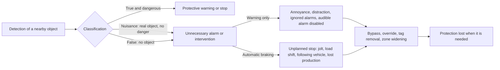

| Risk | Off-road evidence | On-road evidence | Status |
|---|---|---|---|
| Operator injury from a sudden stop | Underground coal workers report "a higher frequency of jarring and jolting incidents" and concern about "the forceful nature of these stops" [11]. Mine leaders described sudden stops with early PDS integrations and preferred an integration with a variable-frequency-drive machine that first reduced speed substantially, slowed to a crawl and only then set the brake, "not an abrupt stop" [12]. **Conflict:** MSHA (2017) is "not aware of any on-board operator injuries resulting from a proximity detection system decelerating and/or stopping a mobile machine" [22]. No injury threshold or safe jerk limit for haul trucks, loaders or dozers, and no validated occupant-injury curve for automatic-braking events: **not found**. | Not reviewed | Reported, not measured. Supports testing deceleration and jerk, not just stopping distance. **Independent** |
| Spilled or shifted loads | **Not found**: no quantified off-road data linking automatic braking to spilled payload, falling rock or load shift. The hazard is mechanically credible for loaded dumpers, loaders and machines with raised implements. Queensland already requires separation and stopping judgments to consider fully laden vehicles and worst road conditions [14]. | Not reviewed | Gap; a hazard-analysis and test item (laden and unladen, implement positions), not an established failure rate. **Independent** (guidance) |
| Loss of stability or control on slopes, stopping distance | MOSH guidance says braking performance depends on "gradient and side slope" and "braking system response time", and ISO/TS 21815-2 separates emergency stops from controlled stops [20, 82]. Queensland requires stopping-distance assumptions to cover the worst relevant combination of wet or slippery road, downhill grade, maximum speed, fully laden vehicle, poor tyre condition, fatigue or distraction and mechanical brake delay [14]. NIOSH links berm deaths to loss of control and to excessive speed on grades over 9% [4]. Direct evidence that automatic braking has caused a rollover or slope instability: **not found**. | Not reviewed | Recognized in guidance; quantified incidents not found. Whether a machine should apply full braking, staged braking, speed reduction or propulsion inhibit is machine- and condition-dependent and cannot be inferred from accident data alone. **Independent** and **Expert opinion** |
| A following vehicle striking the braked machine | **Not found** in mining sources. The risk is credible in convoys, queues and approach situations. | FCW with automatic emergency braking (AEB) raised the rate of being struck from behind by 20% in US insurance data (Cicchino, 2017) [23]. **Independent (on-road evidence)** | On-road only; belongs in scenario-based validation where site rules allow close following |
| Lost productivity | An unnamed machine manufacturer told MSHA (Federal Register, 9 January 2017) that field testing with US coal customers showed "measurable section production tonnage drops, within five to ten percent of normal production levels, when proximity detection is active on haulage equipment"; two mine operators said production returned to normal [22]. Mobile PDS was rated less favorably on task completion, reliability, safety and compatibility; loading, troubleshooting, maintenance and inspections became harder [12]. No defensible percentage penalty for surface automatic braking: **not found**. | Not reviewed | Conflicting stakeholder claims. Productivity is linked to safety behavior: a system that stops the machine dozens of times a shift creates an incentive to widen zones, disable alarms, override braking or develop informal workarounds. **Expert opinion** (stakeholder claims) |
| Over-reliance and reduced vigilance | NSW regulator: technology viewed as a "silver bullet" (2023) [6]. Queensland asks whether collision technology will "desensitize" operators or make them rely on it as the first line of control [14]. An MSHA commenter: miners "have taken higher risks because of a false sense of security" (2017) [22]. Mine leaders worried that training could foster over-reliance or misuse and said PDS should not become the sole safety mechanism; workers over-relied on PDS for machine-to-machine crush risks [12, 11]. Direct evidence that surface operators drive faster, accept smaller gaps or check mirrors less because braking is fitted: **not found**. | Drivers who trust other vehicles' AEB brake later themselves (simulator, Japan, 2020) [26]. **Independent (on-road evidence)** | Risk compensation is a credible hypothesis, not a measured effect for this application. **Expert opinion** and worker reports |
| Under-reliance and disuse | Poor performance and false warnings reduced trust; workers remove wearable components or disable or override systems they believe interfere with work [11, 12]. The design target is calibrated trust, not maximum trust; mining-specific validation of calibrated trust after deployment: **not found**. | Not reviewed | Documented that it can occur; frequency across sites not known. **Independent** |
| New positioning hazards | Workers standing nearer to cut ribs and to machines without PDS; more getting on and off machines; continuous-miner operators "walking backwards into the tailgate" of stopped haulage; escape routes blocked by machines that have been shut down; distraction from "thinking about the mobile PDS instead of concentrating on working safely" [11]. | Not reviewed | Worker reports. **Independent** (interview study) |
| System interference and integration | Interference from variable-frequency drives, dust monitors, computers, survey lasers and steel-braided water lines; compatibility problems with older machines [12, 21]. | Not reviewed | For a multi-model product, "sensor validated" is not "braking function validated": brake architecture, propulsion response, communication latency, mass, payload, tyre or track configuration, retarder behavior, implements and software integration all change the outcome. **Independent** and **Expert opinion** |

There is also a design tension between immediate stopping and controlled deceleration. An intervention must occur early enough to avoid contact, but underground experience shows that abrupt stopping makes the technology less acceptable and may introduce other risks. ISO 21815-1:2022 covers detection, operator warning, automatic intervention and test procedures, and ISO 21815-3:2023 covers forward and reverse risk areas with avoidance by speed reduction, stopping or inhibiting motion; the standards establish that intervention is now standardized at the functional level, not that field effectiveness or second-order hazards are quantified [80, 81, 12]. **Independent**.

#### 6. How operator behavior changes once automatic braking exists

**Off-road (qualitative only).** Underground coal workers change where they stand and how they work, remove tags, ask for bypasses, and report distraction [11, 22]. A Minerals Council South Africa study on "unintended consequences" of collision prevention systems, which flags operators assuming the system will act, is cited in trade press; the study itself was **not found** [83]. Four adaptations emerge from the mining evidence, with very different strength:

| Adaptation | Off-road evidence | Strength |
|---|---|---|
| Operators learn the warning and stop zones and change how they do close-proximity tasks | Mine-leader reports and task-fit studies; worker reports of new positions and more mounting and dismounting [12, 11] | Moderate; mainly underground mining |
| Operators override or disable functions that interfere with production | Fatal investigation with 87 override activations; audible alarm found disabled after shifts; tag removal and bypass requests [12, 3, 22] | Strong that it can occur; frequency across sites not known |
| Operators rely too much on the protection | Explicit regulator and mine-leader concern; MSHA commenter on "false sense of security" [6, 14, 22, 12] | Directly reported concern; longitudinal effect not quantified |
| Operators drive faster, follow closer or take more risk because the machine will brake | **Not found** in representative surface-mining data | Uncertain |

**Longitudinal or quantified off-road studies of behavior change: not found.** **Independent** and **Expert opinion**.

**On-road (USA and Japan, passenger cars; comparison only).** On-road drivers face different speeds, road rules, obstacle distributions, vehicle dynamics and task objectives, so these results are not evidence about mining operators; they show what has been measured where measurement exists:

- Rear automatic braking with camera and sensors cut backing crash involvement by 78%, against 42% for camera plus sensors without braking (IIHS, Cicchino, 2019) [24]. **Independent (on-road evidence)**.
- Front FCW plus AEB cut rear-end striking crashes by 50% (Cicchino, 2017) [23]. **Independent (on-road evidence)**.
- Drivers keep prevention systems switched on more than warning-only systems: 93% had AEB enabled, while lane departure systems were enabled less often (IIHS, Cox, Reagan and Cicchino, 2025) [25]. **Independent (on-road evidence)**.
- In a simulator study, drivers who trusted other vehicles' AEB braked later (Japan, Human Factors, 2020). This is negative behavioral adaptation by people who do not use the system, a possible parallel for ground crew around machines that brake automatically [26]. **Independent (on-road evidence)**.

#### 7. How human operators are represented in simulation-based testing, and how well those models are validated

"The operator" appears in testing in several distinct ways that should not be treated as equivalent.

- **Human-in-the-loop simulator.** The ACARP project placed drivers in a modified haul-truck simulator, presented potential collision scenarios and varied the information on the proximity-advisory interface. The richer schematic interface reduced collision risk and braking force and shortened travel time; effects were smaller in the experiment with fewer experienced truck drivers [15]. This is the strongest evidence found for testing the human-interface loop in a haul-truck-specific environment. Its limits are substantial: the public material does not establish that simulator responses reproduce the distribution of real responses under vibration, fatigue, dust, rain, darkness, radio traffic, production pressure and real consequences, and the difference with experienced drivers warns against a single generic "operator". **Independent** (industry-funded university research, Australia, open-cut coal, 2017 to 2019).
- **Fixed reaction-delay model.** The operator takes a specified time to recognize the warning and act; machine delay and braking distance are added. Haul-truck collision-avoidance design has used 0.5 to 1 s [13]; Queensland's official example uses two seconds for combined operator and mechanical delay (22.2 m at 40 km/h) [14]. Useful for deterministic safety envelopes, but often misread: the two seconds is an illustration, not a validated population distribution or a percentile. **Independent**.
- **Probabilistic reaction-time models.** A validated distribution for heavy off-road warnings covering perception, diagnosis, decision and braking: **not found**, and no validation stratified by age, experience, fatigue, workload, warning modality, cab layout, visibility or alarm history at a scale that would justify a universal stochastic operator model. A defensible simulation program should treat human delay as an uncertain parameter or family of distributions and run sensitivity analyses rather than present one "average reaction time" as validated. This is a methodological inference, not a standard's requirement. **Expert opinion**.
- **State-machine operator models.** A virtual operator can be represented as states such as unaware, warned, orient and verify, decide, then brake, steer or continue, with branching probabilities for ignoring, verifying a suspected false alarm and overriding. Mining evidence supports those states qualitatively (operators often check a camera after a radar alarm; nuisance alarms produce ignore and disable behavior) [2, 11], but a broadly validated parameter set for surface machines: **not found**.
- **Positioning and recreation models (underground).** NIOSH used simulations of human positioning and motion to design proximity zones around continuous miners [84, 38], and researchers recreated an underground fatality in simulation to test a video-based system (Safety Science, 2016) [66]. **Independent** and **Expert opinion** (trade report of agency work).
- **No-human or scripted-response testing.** Much validation deliberately removes operator variability and asks whether sensors detect a target, compute risk and issue the right warning or intervention at the right place. NIOSH made this an explicit research priority for surface haul trucks, arguing that robust testing is needed to prevent missed objects without excessive false positives [85, 86]. The 2020 roadmap also notes that South Africa mandated collision avoidance but "minimal validation testing has been conducted" [86]. A sensor can pass detection tests while the total human-machine system performs poorly. **Independent**.
- **Software-in-the-loop and virtual-mine testing.** NIOSH research into autonomous mining interaction models has evaluated simulation with tools such as CARLA and ROS, intending to reproduce a real mine environment and move from extensive simulation to small-scale and then physical testing. Human operators are absent or indirect; the validation target is interaction probability or automated-system behavior rather than human warning response [87]. **Independent**.
- **Standards-based risk areas.** ISO 21815-1 covers detection, warnings and intervention; Part 3 covers forward and reverse risk areas and slowing, stopping or inhibiting motion; Part 4 **(under publication)** addresses swing and rotation [80, 81, 67]. No human reaction model was found in the public previews. The standards give reproducible product tests but cannot say how a fatigued operator who has had twenty nuisance warnings in a shift reacts to the twenty-first. **Independent**.

**On-road modelling results (comparison only).** Markkula et al. (Accident Analysis & Prevention, 2016) showed that brake responses in naturalistic rear-end emergencies depend on the kinematics of the situation, such as how fast the gap is closing, which argues against a single fixed reaction time [27]. Evidence-accumulation models fitted to simulator data captured takeover braking better than fixed baseline reaction-time models (US DOT report; McDonald et al., 2019 review) [28, 88]. In a virtual assessment of a cyclist-overtaking FCW, estimated fatality reductions ranged from 53% to 96% depending on the driver response model, so the choice of driver model dominated the estimated benefit [29]. Validation of these models rests on simulator and naturalistic data from passenger-car drivers and does not transfer directly to operators of large machines. **Independent (on-road evidence)**.

**Overall validation judgment.** Sensor and object-detection validation is better developed than operator-behavior validation. Human-in-the-loop haul-truck simulator studies exist, regulator calculations account for reaction delay, and ISO standards structure warning and intervention tests. What is missing is a large naturalistic dataset linking warning event, operator attention state, reaction, control input, machine motion and outcome over months of production. **Such a published, cross-machine validation dataset: not found.** A simulation safety case should therefore keep at least three uncertainties separate: sensor uncertainty, operator-response uncertainty and machine-response uncertainty; collapsing them into one fixed time-to-collision threshold hides the variation that the accident and human-factors evidence says matters. **Expert opinion**.

### Comparison tables

#### The most important collision situations, ranked by harm and by frequency

The ranking is for design prioritization, not a global accident-rate league table. Harm rank follows fatality evidence; the frequency column reports the best available signal from official and agency sources, with fatal cases weighted heavily because property-only exposure data are inadequate. Counts from different jurisdictions are not added together, and a combined cross-country ranking could not be built because agencies use different categories.

| Harm rank | Situation | Typical machine and movement | Harm | Frequency signal | Why it matters for design | Evidence and source |
|---|---|---|---|---|---|---|
| 1 | Haul truck crushes a light vehicle in front of it | Large rigid or articulated haul truck; forward travel or start from rest | Fatal, sometimes multiple | 5 of 13 US haul-truck collision deaths, 2005 to 2021; victims "primarily light vehicle occupants" in 2003 to 2017 analysis; all five CXS-relevant light-vehicle cases involved forward movement | Severe mass mismatch; victims in front, not behind; two cases began with a parked light vehicle and a truck starting off | Agency analysis of official reports, USA [4] |
| 2 | Smaller truck or loader reverses over a worker on foot or a small vehicle | Dump trucks, front-end loaders, dozers; reverse | Fatal | 67% of 22 US blind-area deaths, 2000 to 2006; about 5 deaths a year 1999 to 2003; nearly a quarter of British workplace-transport deaths occur in reversing; Snapper dozer fatality (NSW, 2019) | The classic blind-area scenario that reverse sensing was built for; still frequent at quarries and construction sites | Agency reports and official statistics, USA, UK, Australia [2, 3, 5, 44] |
| 3 | Pedestrian or ground worker struck or pinned in other movements, including underground | Haul trucks starting off; continuous miners, shuttle cars, scoops, LHDs; forward, tramming, swing | Fatal or serious | 3 pedestrians in the US haul-truck collision sample; 39 continuous-miner deaths 1984 to 2015; 42 underground mobile-haulage deaths 1984 to 2014 and 179 nonfatal cases; 6 deaths and 61 lost-time injuries in US underground production areas since 2020; recurrent loader-pedestrian events in Queensland | Legitimate close work by ground crew makes zone design hard; wearable tags can be removed | Peer-reviewed and official, USA and Australia [4, 38, 40, 11, 41, 14] |
| 4 | Loss of control through a berm or road edge | Haul trucks; mostly forward on curves and grades | Fatal to driver | 21 of 54 US haul-truck deaths, the largest category; loss of control the largest contributor (9), impairment 6, mechanical failure 3 | Not an object collision; needs road-edge, geofence, speed and retarder controls as well as object sensing; grades over 9% at speed | Agency analysis, USA [4] |
| 5 | Reverse-over or ground failure at a dump point | Haul trucks; reverse spotting to an edge | Fatal to driver | 12 of 54 US haul-truck deaths; 6 reverse-over, 6 ground failure; 10 with inadequate or absent berm; 7 unbelted | A normal task that deliberately approaches the hazard; berm detections must not be treated as nuisance; seat belts and edge references matter | Agency analysis, USA [4] |
| 6 | Worker on foot struck at a road construction site | Trucks and backing equipment | Fatal | 131 backing deaths at US road sites (1992 to 2010); struck-by the most common cause of death 2005 to 2016; 170 construction struck-by deaths in 2019, 47.1% by transport vehicles | Construction sites mix public traffic, trucks and workers in confined zones; different geometry from haul roads | Official statistics, USA [59, 63, 60] |
| 7 | Heavy machine against heavy machine at tip heads, loading areas and haul roads | Haul trucks, dozers, graders, loaders; reverse, turn, close manoeuvring, forward on haul roads | Mostly property damage; potentially fatal (3 of 13 US haul-truck collision deaths were truck against truck) | Most frequent reported collision type in regulator data: 48 collisions and near misses in five months at Queensland open-cut coal mines (2017); "no meaningful reduction" in NSW (2023); New Zealand dozer against 777 and truck against dozer contacts (2017) | Large damage and rollover potential; machines are supposed to work close together, so intention matters more than distance | Regulator incident data, Australia and New Zealand; agency analysis, USA [42, 6, 19, 4] |
| 8 | LHD or personnel-transport collision underground | LHDs carrying bulky loads; personnel transports | Mostly damage and injury | 30 in 12 months in NSW underground coal (2025) | Bulky loads block the operator's view; confined roadways | Regulator bulletin, Australia [7] |
| 9 | Collision during an intentional loading or spotting approach | Truck spotting under a loader, shovel or beside a stockpile; slow reverse or forward | High if another vehicle or person intrudes; otherwise the main nuisance-alarm opportunity | Normal task occurs many times per shift; accident rate **not found**; a loader rollover during stockpile loading (New Zealand, 2017) | The algorithm must separate an intended approach from an intrusion into the same space | Peer-reviewed field study, USA; official alert, New Zealand [3, 19] |
| 10 | Contact with a fixed structure, wall, stockpile or infrastructure | Low-speed manoeuvring, reversing, side clearance; all machine types | Usually low personnel harm; potentially high property loss (light vehicle "severely damaged" against a decline wall) | Reliable frequency and cost data **not found**; listed as a high-potential class by Queensland | Sensors see real objects that are often supposed to be close | Regulator guidance, Australia; secondary report [14, 70] |
| 11 | Swing or rotation contact | Excavators, shovels, rotating upper structures | Potentially fatal | Frequency **not found**; agency statistics do not separate swing | Different geometry; ISO 21815-4 treats rotation separately and relies mainly on motion inhibition before rotation | Technical standard (under publication) [67] |

**Ranking by frequency.** The most frequently reported events are machine-to-machine and machine-to-light-vehicle near misses and damage collisions (NSW, Queensland, New Zealand). The most frequent fatal event types in US surface mining are berm and dump-edge events, then forward-travel crushes of light vehicles, then reversing over pedestrians. In the one New Zealand quarter with a published breakdown, plant-to-plant collisions were 11% of vehicle events, behind overturning (46%) and unintended movement or brake failure (27%) [30]. **Independent**.

### Where the evidence stands

#### Well established

- Mobile equipment and powered haulage are leading causes of mining deaths in the USA, South Africa and British quarries, and vehicles and mobile equipment are a leading cause of construction deaths in the USA [1, 48, 58, 59]. **Independent**.
- Blind areas and the size mismatch between large machines and light vehicles or people are the central factors in the deadliest collisions; a 50 t haul truck has a front-right blind area of 18 m or more [2, 3, 4]. **Independent**.
- Large haul trucks kill mostly while moving forward or starting off; smaller trucks and loaders mostly while reversing. Both must be covered [4, 2]. **Independent**.
- A large share of haul-truck deaths are berm and dump-edge events rather than object collisions [4]. **Independent**.
- Ordinary production requires legitimate close approaches (loading, dumping, tip heads, ground crew under procedures) [3, 19, 14, 20]. **Independent** and **Expert opinion**.
- Warning systems with poor contextual discrimination generate many unnecessary alarms, repeated unwanted alarms damage acceptance, and bypass or override is a real mining failure mode [3, 11, 12, 22, 20]. **Independent**.
- Stopping distance must account for payload, road condition, grade, brake response and machine configuration [14, 20]. **Independent** and **Expert opinion**.
- A collision system cannot be assumed to handle every site, machine and weather combination; Queensland asks how a technology behaves with people, vehicles, stationary objects and infrastructure and in dust, snow and fog, and NIOSH's roadmap names validation across mine conditions as an outstanding need [14, 86]. **Independent**.
- Experts agree more than they disagree on the need for site- and task-specific scenarios, context discrimination, low nuisance rates, explicit human-interface design, machine-specific stopping validation and layered controls rather than a single technological barrier; Queensland asks sites to enumerate foreseeable interaction scenarios and assess controls for each [14, 6, 86]. **Independent** and **Expert opinion**.

#### Uncertain

- Operators' reaction times to alarms in real machines, and any distribution by experience, fatigue, modality or alarm history. **Not found**.
- An acceptable false alarm rate for off-road machines. **Not found**; explicitly open in the ACARP research [15].
- Collision speeds; day and night shares; weather shares; exposure-adjusted collision rates by machine type or model; turning, swing and reversing shares worldwide. **Not found**.
- Property-damage costs by scenario. **Not found**.
- Injury thresholds for automated deceleration and jerk; the frequency of brake-induced load spills, rear-end impacts or slope instability off-road. **Not found**.
- Long-term behavioral adaptation and risk compensation after surface-machine automatic braking. **Not found**.
- The size of the effect of automatic braking on deaths in mining. South African results are not quantified in primary sources, and vendor claims of a "steep decline in powered mobile equipment accidents" are unverified [89]. **Vendor**.
- The absence of these numbers is itself a finding: they should be collected during pilot deployment rather than filled with assumed values from passenger cars.

#### Where experts disagree

- *Forward versus reverse.* 67% reversing (2000 to 2006, all surface equipment, 22 cases) [2] against 12 of 13 forward (2005 to 2021, haul trucks only) [4], and British cross-industry data that highlight reversing [5]. This is a population difference (machine type, site type, country), not a contradiction: warehouses, waste yards, construction sites, roadworks and mine haul roads have different traffic geometries and machine mixes.
- *Operator injury from stops.* Worker reports of jarring and jolting [11] against MSHA being unaware of any such injuries [22]. Unresolved; no measurement exists.
- *Productivity.* A 5 to 10% production loss reported to MSHA by an unnamed manufacturer against two operators' reports of recovery to baseline [22]. Unresolved stakeholder claims.
- *Alarm sensitivity.* A highly sensitive sensor minimizes missed detections but produces the nuisance burden seen in the field [3]; South African and Australian guidance stress context-aware discrimination [20, 14]. Neither "always alarm when close" nor aggressive suppression is supported across all tasks.
- *Immediate stop versus controlled deceleration.* Earlier intervention avoids contact, but abrupt stops reduce acceptance and may add risk; ISO allows speed reduction, stopping or motion inhibition rather than prescribing one [12, 81].
- *Cry-wolf effect.* Strong in some on-road truck FCW data [16], absent in air traffic control and some driving-simulator studies [75, 18]. All of this is non-mining evidence.
- *Role of technology.* NSW and NIOSH bowtie work favor lower-level controls (EMESRT Levels 1 to 6: site design, segregation, procedures) with collision systems (Levels 7 to 9) as backup [6, 4]; South Africa mandates Level 9 intervention by law (Mine Health and Safety Act regulation 8.10.1.2(b), gazetted 21 December 2022) [90, 91, 54]. **Independent** and **Expert opinion**.

### Blind spots

Issues the research questions did not ask about, grouped.

**Occupant protection and the stop itself**

- *Seat belts and sudden stops.* MSHA's Powered Haulage Safety page states that "MSHA engineers estimate that three to four miners' lives could be saved each year if adequate seat belts were provided and worn" [1]; seven of 12 dump-point victims were unbelted [4]; Queensland's worked collision controls include seat belts and securing loose objects in the cab [14]. Automatic braking raises the importance of restraint use, seat and suspension response, loose cab items and seat-belt interlocks.
- *Post-brake behavior.* Whether the brake stays latched, how the operator acknowledges and resets it, whether the machine can roll when released, what happens if the detected person remains hidden, and how restart is prevented from causing a second collision. No incident dataset answers these; they belong in the functional hazard analysis.
- *Uncontrolled movement and roll-away.* Two of 13 haul-truck collision deaths were stopped trucks that rolled forward [4]. Systems that act only when the machine is being driven may miss these.

**Brake system and fail-safe design**

- *Brake-system health and degraded performance.* Automatic intervention is only as good as the available brake, retarder and propulsion system. A safety case should include degraded braking, partial brake failure, thermal limits, laden downhill operation and detection of brake-system state. South African research has stressed in-service brake testing because degraded brakes contribute to runaway risk (MHSC, 2006) [92].
- *Fail-safe behavior.* South African law requires systems to "fail to safe without human intervention" [90, 91]; how a machine fails safe without causing a stop on a slope is not addressed in the sources found.

**Fleet, integration and people**

- *Mixed fleets, retrofit and interoperability.* ISO/TS 21815-2 defines a J1939 interface with commands for motion inhibit, emergency stop, controlled stop and slow-down, intended for independently integrated collision-avoidance devices; avoidance by automatic steering is explicitly out of scope [82]. Mine leaders reported compatibility problems with older machines [12]. Each brake and control integration should be treated as its own safety configuration.
- *Ground-crew behavior, wearable tags and untagged people.* Tags are part of the system, can snag or be removed, and an untagged contractor, visitor or worker is invisible to a tag-based system [11, 12].
- *Fatigue.* Reaction times slow at night (2 to 5 AM) [72].
- *Small mines and contractors*, where fatality counts are reported separately and coverage is weaker [32].
- *Liability.* ISO 21815-1 states that the technologies cannot achieve full collision warning or avoidance in every situation, so responsibility stays with the operator [80].

**Hazards outside the object-collision frame**

- *Edge and infrastructure hazards.* Powerline contacts by raised trays [93], edges and berms [4].

**Data and measurement**

- *Under-reporting of near misses* (Queensland, New Zealand) distorts frequency estimates [9, 30].
- *Near-miss and intervention logging.* Fatal accidents are too rare to tune a system after deployment. A development dataset should record every warning and intervention with machine state, load, grade, speed, target class, weather and light, operator response, whether braking was necessary, and task phase; NIOSH's roadmap names near-miss and data-driven research as important, and the 2006 radar study shows how operational video plus alarm logs separate false, nuisance and legitimate events [86, 3].
- *Per-task performance metrics.* A system can have an excellent overall false-positive rate and still be unusable if nearly every loading or dump cycle contains one unwanted intervention.
- *Exposure denominators.* None of the sources gives operating hours, kilometres or cycles alongside collision counts, so no rate per unit of exposure can be computed and no country or machine type can be compared on a like-for-like basis.
- *Construction equipment beyond mining.* The scenario-level evidence is almost entirely from mining haul trucks and underground machines. Excavators, telehandlers, compact loaders and articulated dump trucks on construction sites, which the product must also cover, have only aggregate struck-by statistics behind them.
- *Mixed manned and autonomous traffic.* None of the accident sources addresses interactions between manned machines with automatic braking and autonomous haulage, although NIOSH's virtual-mine work points that way [87].

**Software and security**

- *Cybersecurity, configuration control and software updates* become safety-relevant once software can command the brakes. No collision-incident statistics quantify this risk; it should be handled through the product's functional-safety and cybersecurity processes rather than assigned an accident frequency without evidence.

### Sources

1. MSHA (US Mine Safety and Health Administration). Powered Haulage Safety (statistics page, calendar 2025 data; seat-belt estimate). Accessed October 2026. https://www.msha.gov/safety-and-health/safety-and-health-initiatives/powered-haulage-safety. **Independent**.
2. Ruff T (NIOSH). Recommendations for Evaluating and Implementing Proximity Warning Systems on Surface Mining Equipment. Report of Investigations 9672, DHHS (NIOSH) Publication No. 2007-146 (analysis of MSHA fatality reports 2000 to mid-2006 and field tests). 2007. https://permanent.fdlp.gov/lps97050/2007-146.pdf. **Independent**.
3. Ruff TM. Evaluation of a radar-based proximity warning system for off-highway dump trucks. Accident Analysis & Prevention, 38(1), 92-98 (field data 2004, Caterpillar 793B haul truck, US surface copper mine). 2006. https://stacks.cdc.gov/view/cdc/221128/cdc_221128_DS1.pdf (also https://www.sciencedirect.com/science/article/abs/pii/S0001457505001259). **Independent**.
4. Bickson J, DeGennaro C, Girman M, Homer J (NIOSH). Analysis of U.S. Surface Mining Haul-Truck-Related Fatalities. SME Annual Conference, Salt Lake City, preprint 22-085 (analysis of 54 MSHA fatality reports, January 2005 to June 2021; CDC metadata records it as not peer reviewed). February 2022. https://stacks.cdc.gov/view/cdc/215487/cdc_215487_DS1.pdf. **Independent**.
5. HSE (Health and Safety Executive, Great Britain). Reversing (workplace transport factsheet). Accessed October 2026. https://www.hse.gov.uk/workplacetransport/factsheets/reversing.htm. **Independent**.
6. NSW Resources Regulator. Discussion paper: Vehicle interaction controls in NSW mines (including the 2022 collision avoidance forum). July 2023. https://www.resources.nsw.gov.au/sites/default/files/2023-07/discussion-paper-vehicle-interaction-controls-in-nsw-mines.pdf. **Independent**.
7. NSW Resources Regulator. Safety Bulletin SB25-05: Vehicle collisions in underground coal mines. July 2025. https://www.resources.nsw.gov.au/sites/default/files/2025-08/sb25-05-vehicle-collisions-underground-coal.pdf. **Independent**.
8. Mining.com.au. Queensland beefs up mine safety team (secondary report of the RSHQ July 2024 Quarterly Report). 2024. https://mining.com.au/queensland-beefs-up-mine-safety-team/. **Expert opinion**.
9. Resources Safety and Health Queensland. High Potential Incident under reporting (safety notice). Accessed October 2026. https://www.rshq.qld.gov.au/safety-notices/mines/high-potential-incident-under-reporting. **Independent**.
10. Department of Mineral and Petroleum Resources (South Africa). Mine health and safety statistics for calendar 2024 (fatalities by category, including transportation and mining and trackless mobile machinery), as released by the Minister. January 2025. **Independent**.
11. Bellanca JL, Helton J, McNinch M, Swanson LR (NIOSH). Mineworkers' Perceptions of Mobile Proximity Detection Systems. Mining, Metallurgy & Exploration (interviews at seven US underground coal mines). 2019. https://stacks.cdc.gov/view/cdc/227804/cdc_227804_DS1.pdf. **Independent**.
12. Swanson LR, Bellanca JL (NIOSH). If the Technology Fits: an Evaluation of Mobile Proximity Detection Systems in Underground Coal Mines. Mining, Metallurgy & Exploration, 36(4), 633-645 (task-technology-fit study with leaders at two US underground coal mines; discusses the June 2017 fatality). 2019. https://stacks.cdc.gov/view/cdc/110287/cdc_110287_DS1.pdf. **Independent**.
13. Griffith University (thesis). Collision Avoidance Systems for Mine Haul Trucks (design study using 0.5 to 1 s reaction time from road research). Accessed October 2026. https://research-repository.griffith.edu.au/server/api/core/bitstreams/e6b2c90f-7fa0-54b2-bd35-15141ed9ce36/content. **Independent**.
14. Resources Safety and Health Queensland. Queensland Guidance Note QGN 27: Collision prevention (mineral mines and quarries). 2017, current guidance. https://www.rshq.qld.gov.au/__data/assets/pdf_file/0007/1346821/qld-guidance-note-27.pdf. **Independent**.
15. Burgess-Limerick R (University of Queensland). Interface Design for Haul Truck Proximity Advisory Systems. ACARP (Australian Coal Association Research Program) project C24028 report, Australia, open-cut coal; follow-on work to 2019. 2017. https://www.acarp.com.au/abstracts.aspx?repId=C24028. **Independent**.
16. Optimization of Forward Collision Warning Algorithm Considering Truck Driver Response Behavior Characteristics. Accident Analysis & Prevention. 2023. https://www.sciencedirect.com/science/article/abs/pii/S0001457523004979. **Independent (on-road evidence)**.
17. Lees MN, Lee JD. The influence of distraction and driving context on driver response to imperfect collision warning systems. Ergonomics (driving simulator). 2007. https://www.researchgate.net/publication/6277579_The_influence_of_distraction_and_driving_context_on_driver_response_to_imperfect_collision_warning_systems. **Independent (on-road evidence)**.
18. Only an unreliable warning system is a good system (driving-simulator study of false alarm rates). Transportation Research Part F. 2025. https://www.sciencedirect.com/science/article/pii/S1369847825004012. **Independent (on-road evidence)**.
19. WorkSafe New Zealand. Safety alert (extractives): Vehicle collisions in mines and quarries. August 2017. https://www.worksafe.govt.nz/about-us/news-and-media/safety-alert-extractives-vehicle-collisions-in-mines-and-quarries/. **Independent**.
20. Minerals Council South Africa, MOSH Learning Hub. Collision Prevention Systems: Zone Functionality and Sensor Fusion report, revision 3 (industry technical guideline). 2022. https://www.mosh.co.za/component/jdownloads/send/477-cps-technical-documents/1805-12-cps-zone-functionality-and-sensor-fusion-report-rev-3-signed. **Expert opinion**.
21. Federal Register (MSHA). Proximity Detection Systems for Underground Mines (request for information). 1 February 2010. https://www.federalregister.gov/documents/2010/02/01/2010-1999/proximity-detection-systems-for-underground-mines. **Independent**.
22. Federal Register (MSHA). Proximity Detection Systems for Mobile Machines in Underground Mines (notice summarizing comments, stakeholder claims and site visits). 9 January 2017. https://www.federalregister.gov/documents/2017/01/09/2017-00105/proximity-detection-systems-for-mobile-machines-in-underground-mines. **Independent**.
23. Cicchino JB (IIHS). Effectiveness of forward collision warning and autonomous emergency braking systems in reducing front-to-rear crash rates. Accident Analysis & Prevention. 2017. https://iihs.org/topics/bibliography/ref/2111. **Independent (on-road evidence)**.
24. Cicchino JB (IIHS). Real-world effects of rear automatic braking and other backing assistance systems. Journal of Safety Research. 2019. https://www.iihs.org/research-areas/bibliography/ref/2150 (also https://www.sciencedirect.com/science/article/abs/pii/S0022437518303451). **Independent (on-road evidence)**.
25. Cox AE, Reagan IJ, Cicchino JB (IIHS). Drivers' use of front crash prevention, lane departure warning and prevention, and speed warning systems. 2025. https://www.iihs.org/research-areas/bibliography/ref/2314. **Independent (on-road evidence)**.
26. Trusting Other Vehicles' Automatic Emergency Braking Decreases Self-Protective Driving. Human Factors (driving simulator, Japan). 2020. https://pmc.ncbi.nlm.nih.gov/articles/PMC8274173/ (also https://pubmed.ncbi.nlm.nih.gov/32101470/). **Independent (on-road evidence)**.
27. Markkula G, Engström J, Lodin J, Bärgman J, Victor T. A farewell to brake reaction times? Kinematics-dependent brake response in naturalistic rear-end emergencies. Accident Analysis & Prevention, 95, 209-226. 2016. https://www.sciencedirect.com/science/article/abs/pii/S0001457516302366. **Independent (on-road evidence)**.
28. US Department of Transportation. Modeling Driver Behavior During Automated Vehicle Takeover (report on evidence-accumulation and reaction-time models). Accessed October 2026. https://rosap.ntl.bts.gov/view/dot/59881/dot_59881_DS1.pdf. **Independent (on-road evidence)**.
29. On the importance of driver models for the development and assessment of active safety: A new collision warning system to make overtaking cyclists safer. Accident Analysis & Prevention. 2021. https://www.sciencedirect.com/science/article/pii/S0001457521005443. **Independent (on-road evidence)**.
30. WorkSafe New Zealand (Extractives). Quarterly incident report, October to December 2019 (notified vehicle and plant events, with a warning on incomplete reporting). 2020. **Independent**.
31. US Department of Labor (MSHA). News release: US Department of Labor announces final rule to protect miners from surface mobile equipment-related accidents, injuries, fatalities. 19 December 2023. https://www.dol.gov/newsroom/releases/msha/msha20231219. **Independent**.
32. Federal Register (MSHA). Safety Program for Surface Mobile Equipment (proposed rule, with 2003 to 2018 fatality and injury counts). 9 September 2021. https://www.federalregister.gov/documents/2021/09/09/2021-18791/safety-program-for-surface-mobile-equipment. **Independent**.
33. MSHA. Final Rule: Safety Program for Surface Mobile Equipment (rule page). December 2023, effective 19 January 2024. https://www.msha.gov/final-rule-safety-program-surface-mobile-equipment. **Independent**.
34. Federal Register (MSHA). Safety Program for Surface Mobile Equipment (final rule). 20 December 2023. https://www.federalregister.gov/documents/2023/12/20/2023-27640/safety-program-for-surface-mobile-equipment. **Independent**.
35. Carroll Technologies Group. MSHA Powered-Haulage Regulations: All You Need to Know (vendor summary of the surface mobile equipment rule). Accessed October 2026. https://www.carrolltechnologiesgroup.com/msha-safety-regulations-latest-news-on-powered-haulage-changes/. **Vendor**.
36. NIOSH. Test Results of Collision Warning Systems for Surface Mining Dump Trucks. DHHS (NIOSH) Publication No. 2000-120. 2000. https://www.cdc.gov/niosh/publications/numbered/2000-120.html. **Independent**.
37. Patterns in Mining Haul Truck Accidents (conference paper analysing 133 US haul-truck-related fatalities, 1995 to 2010). Via ResearchGate. Accessed October 2026. https://www.researchgate.net/publication/273347819_Patterns_in_Mining_Haul_Truck_Accidents. **Independent**.
38. NIOSH researchers. Design of intelligent proximity detection zones to prevent striking and pinning fatalities around continuous mining machines (includes analysis of 39 fatalities, 1984 to 2015). Via PubMed Central. Accessed October 2026. https://pmc.ncbi.nlm.nih.gov/articles/PMC5472358/. **Independent**.
39. NIOSH. Proximity Detection with Selective Machine Shutdown. SME Annual Meeting preprint 15-083. February 2015. **Independent**.
40. US Department of Labor (MSHA). News release: MSHA announces public hearings on proposed rule for proximity detection systems on mobile mine machines (42 fatalities 1984 to 2014). 1 October 2015. https://www.dol.gov/newsroom/releases/msha/msha20151001. **Independent**.
41. MSHA. Mobile Equipment Safety Alert (struck-by deaths and lost-time injuries in underground production areas since 2020). Accessed October 2026. https://www.msha.gov/mobile-equipment-safety-alert. **Independent**.
42. Resources Safety and Health Queensland. Mobile equipment collisions (safety alert, open-cut coal, January to May 2017). 2017. https://www.rshq.qld.gov.au/safety-and-health-alerts/mines/mobile-equipment-collisions. **Independent**.
43. NSW Resources Regulator. Weekly incident summary, week ending 13 March 2026. March 2026. https://www.resources.nsw.gov.au/sites/default/files/2026-03/weekly-incident-summary-week-ending-13-march-2026.pdf. **Independent**.
44. NSW Resources Regulator. Report released following a fatality at Snapper Mineral Sands Mine (investigation of the 12 August 2019 dozer and light vehicle collision). 2021. https://www.resourcesregulator.nsw.gov.au/news-articles/report-released-following-a-fatality-at-snapper-mineral-sands-mine. **Independent**.
45. The Duty Holder (australianworkplacesafety.com.au). A blast crew member was fatally injured at a NSW open cut mine. Two weeks on, the public record is two sentences (secondary report of NSW Resources Regulator items). July 2026. https://australianworkplacesafety.com.au/nsw-mining-fatality-vehicle-interaction/. **Expert opinion**.
46. The Duty Holder (australianworkplacesafety.com.au). One week in NSW mining: 38 reportable incidents, and two of the three detailed were mobile plant on a collision course (secondary report). 17 July 2026. https://australianworkplacesafety.com.au/nsw-mining-weekly-incidents-17-july-2026/. **Expert opinion**.
47. Safe Work Australia. Work-related fatalities involving trucks, Australia, 2003 to 2012. May 2014. https://www.safeworkaustralia.gov.au/system/files/documents/1702/work-related-fatalities-involving-trucks.pdf. **Independent**.
48. Minerals Council South Africa. Safety in South Africa since democracy (fact sheet compiling DMRE fatality statistics). Accessed October 2026. https://www.mineralscouncil.org.za/component/jdownloads/?task=download.send&id=2055&catid=3&m=0. **Independent**.
49. News24. SA mining fatalities hit a record low in 2022. 31 January 2023. https://www.news24.com/business/companies/mining-fatalities-hit-a-record-low-in-2022-20230131. **Expert opinion**.
50. Mining Weekly. Mining fatalities reach a new low of 49; injuries, disease also decrease (report of the official 2022 figures by category). 31 January 2023. https://www.miningweekly.com/article/mining-fatalities-reach-a-new-low-of-49-injuries-diseases-also-decrease-2023-01-31. **Expert opinion**.
51. Engineering News. Trackless mobile machine safety is next big challenge, says Minerals Council South Africa. 27 February 2023. https://m.engineeringnews.co.za/print-version/trackless-mobile-machine-safety-is-next-big-challenge-says-minerals-council-south-africa-2023-02-27. **Expert opinion**.
52. Mine Health and Safety Council (South Africa). Trackless Mobile Machinery (TMMs) Workshop presentation (fatality shares January to June 2019). 11 September 2020. https://mhsc.org.za/sites/default/files/public/publications/TMMs%20Workshop%20Presentation%20-%20MHSC%20Tebogo%20Theksio.pdf. **Independent**.
53. Miningmx. Fatalities on South African mines fall to record low in 2024 (report of Department of Mineral and Petroleum Resources figures). January 2025. https://www.miningmx.com/news/markets/59588-mines-deaths-on-south-african-mines-fall-to-record-low/. **Expert opinion**.
54. Mining Business Africa. EMESRT Level 9 Controls for Trackless Mobile Machinery (trade article quoting the Minerals Council). Accessed October 2026. https://miningbusinessafrica.co.za/emesrt-level-9-controls-for-trackless-mobile-machinery/. **Expert opinion**.
55. HSE (Health and Safety Executive, Great Britain). Work-related fatal injuries in Great Britain (statistics overview; 2025/26 data published July 2026, earlier releases for 2023/24 and 2024/25). July 2026. https://www.hse.gov.uk/statistics/fatals-overview.htm. **Independent**.
56. DAC Beachcroft. HSE Statistics: Work-related fatal injuries in Great Britain 2024 (law-firm summary of the 2023/24 release). 2024. https://www.dacbeachcroft.com/en/What-we-think/HSE-Statistics-Work-related-fatal-injuries-in-Great-Britain-2024. **Expert opinion**.
57. ZoneSafe. HSE Workplace Fatalities 2024-2025 (vendor summary of the 2024/25 release). 2025. https://zonesafe.com/hse-workplace-fatalities-24-25/. **Vendor**.
58. HSE (Health and Safety Executive, Great Britain). Hard Target: Vehicles and edge protection (quarries guidance). Undated; accessed October 2026. https://www.hse.gov.uk/quarries/hardtarget/protection.htm. **Independent**.
59. CPWR (The Center for Construction Research and Training). The Construction Chart Book, page 46: Fatalities involving vehicles, heavy equipment, and road construction (BLS CFOI data, 1992 to 2010). Accessed October 2026. https://www.cpwr.com/wp-content/uploads/CB-page-46.pdf. **Independent**.
60. CPWR. Data Bulletin: Struck-by injuries in construction, 2019 data. April 2021. https://www.cpwr.com/wp-content/uploads/DataBulletin-April2021.pdf. **Independent**.
61. CPWR. Data Bulletin. February 2021. https://www.cpwr.com/wp-content/uploads/DataBulletin-February-2021.pdf. **Independent**.
62. NIOSH Science Blog. Struck-By Injuries in the Construction Sector: Common Hazards, Barriers, and Opportunities to Keep Workers Safe (2020 data). 2023. https://www.cdc.gov/niosh/bulletin/2023/struck-by-stand-down.html. **Independent**.
63. CPWR. Quarterly Data Report, second quarter 2018 (fatalities at road construction sites, 2005 to 2016). 2018. https://www.cpwr.com/wp-content/uploads/publications/Quarter2-QDR-2018.pdf. **Independent**.
64. The Future of Mine Safety: A Comprehensive Review of Anti-Collision Systems Based on Computer Vision in Underground Mines. Sensors (MDPI), 23(9), 4294 (secondary compilation of Ghana and Turkey figures). 2023. https://www.mdpi.com/1424-8220/23/9/4294. **Independent**.
65. NIOSH. HASARD (Hazardous Area Signalling and Ranging Device) proximity detection project page. Accessed October 2026. https://www.cdc.gov/niosh/mining/content/electricalandmachinesafety/proximity/hasard.html (archived copy at https://archive.cdc.gov/www_cdc_gov/niosh/mining/content/electricalandmachinesafety/proximity/hasard.html). **Independent**.
66. Using a case study fatality to depict the limits of proximity detection systems for articulating, underground machinery. Safety Science. 2016. https://www.sciencedirect.com/science/article/abs/pii/S0925753516000680. **Independent**.
67. ISO 21815-4. Earth-moving machinery, Collision warning and avoidance, Part 4: Risk area and risk level for swing and rotation motion. ISO, edition 1, under publication (stage 60.00, publication scheduled October 2026). https://www.iso.org/standard/81597.html. **Independent** (standard under publication, not yet issued).
68. Phys.org. Collision avoidance technology for mine haul trucks (statements by a CSIRO researcher). December 2007. https://phys.org/news/2007-12-collision-technology-haul-trucks.html. **Expert opinion**.
69. Australasian Mine Safety Journal. Rise in mining vehicle collisions sparks concerns for Regulator (secondary report of NSW Resources Regulator incidents). Accessed October 2026. https://www.amsj.com.au/rise-in-mining-vehicle-collisions-raises-concerns-for-regulator/. **Expert opinion**.
70. Safe To Work. NSW regulator flags collision communication concerns (secondary report of NSW Resources Regulator incidents). Accessed October 2026. https://safetowork.com.au/nsw-regulator-flags-collision-communication-concerns/. **Expert opinion**.
71. Mine Health and Safety Council (South Africa). SIM 130501: research report on vehicle-to-person proximity detection systems (underground mining). Mid-2010s. https://www.mhsc.org.za/sites/default/files/public/research_documents/SIM%20130501%20Report_0.pdf. **Independent**.
72. Predicting Fatigue of Haul Truck Operators Using Reaction Time (smartwatch reaction tests by time of day). Mining, Metallurgy & Exploration (Springer). 2026. https://link.springer.com/article/10.1007/s42461-025-01415-w. **Independent**.
73. A field experiment of workers' responses to proximity warnings of static safety hazards on construction sites (Shanghai, 72 workers, 5,391 warnings). Safety Science. 2016. https://www.sciencedirect.com/science/article/abs/pii/S0925753516000047. **Independent**.
74. Yang X, Roofigari-Esfahan N. Vibrotactile Alerting to Prevent Accidents in Highway Construction Work Zones: An Exploratory Study. Sensors (virtual-reality experiment, 17 participants, USA). 2023. https://www.researchgate.net/publication/371652042_Vibrotactile_Alerting_to_Prevent_Accidents_in_Highway_Construction_Work_Zones_An_Exploratory_Study (also https://pmc.ncbi.nlm.nih.gov/articles/PMC10302588/). **Independent**.
75. Wickens CD, Rice S, Keller D, Hutchins S, Hughes J, Clayton K. False Alerts in Air Traffic Control Conflict Alerting System: Is There a "Cry Wolf" Effect? Human Factors. 2009. https://journals.sagepub.com/doi/10.1177/0018720809344720. **Independent**.
76. NHTSA / Leidos. Indicators of Driver Adaptation to Forward Collision Warnings (naturalistic driving study). US Department of Transportation. Accessed October 2026. https://rosap.ntl.bts.gov/view/dot/41002/dot_41002_DS1.pdf. **Independent (on-road evidence)**.
77. Can unreliable auditory hazard warnings help the driver? The effect of timing errors and false alarms on road hazard detection in dynamic road scenes. Cognitive Research: Principles and Implications. 2026. https://link.springer.com/article/10.1186/s41235-026-00718-w. **Independent (on-road evidence)**.
78. NIOSH. Evaluation of an advanced proximity detection system for continuous mining machines. Via ResearchGate. Accessed October 2026. https://www.researchgate.net/publication/275971679_Evaluation_of_an_advanced_proximity_detection_system_for_continuous_mining_machines. **Independent**.
79. MSHA. Proximity Detection Systems for Continuous Mining Machines in Underground Coal Mines (final rule, 30 CFR Part 75). January 2015. https://files.dep.state.pa.us/mining/Deep%20Mine%20Safety/DMSPortalFiles/MiningAdvisoryCommittees/BCMS/2015/June%2023,%202015/MSHA%20Final%20Proximity%20Rule.pdf. **Independent**.
80. ISO 21815-1:2022. Earth-moving machinery, Collision warning and avoidance, Part 1: General requirements. ISO. 2022. https://www.iso.org/standard/77302.html. **Independent**.
81. ISO 21815-3:2023. Earth-moving machinery, Collision warning and avoidance, Part 3: forward and reverse motion (risk areas and risk levels; avoidance by speed reduction, stopping or inhibiting motion). ISO. 2023. https://www.iso.org/standard/77266.html. **Independent**.
82. ISO/TS 21815-2:2021. Earth-moving machinery, Collision warning and avoidance, Part 2: On-board J1939 communication interface. ISO. 2021. https://www.iso.org/standard/77303.html. **Independent**.
83. Mining Review Africa. Collision prevention systems: Human behaviour critical for zero harm (trade article citing a Minerals Council South Africa study on unintended consequences). Accessed October 2026. https://www.miningreview.com/magazine-article/collision-prevention-human-behaviour-critical-for-zero-harm/. **Expert opinion**.
84. OEM Off-Highway. Underground mining equipment proximity detection systems for continuous mining machines (trade article on NIOSH simulation work). Accessed October 2026. https://www.oemoffhighway.com/electronics/sensors/proximity-detection-safety-systems/article/10166326/underground-mining-equipment-proximity-detection-systems-continuous-mining-machines. **Expert opinion**.
85. NIOSH. Conference preprint on validation and testing of collision warning and avoidance systems (CXS) for surface mining haul trucks. SME Annual Conference. 2022. https://stacks.cdc.gov/view/cdc/215488/cdc_215488_DS1.pdf. **Independent**.
86. NIOSH. Haul Truck Research Roadmap Report 2020. 2020. https://archive.cdc.gov/www_cdc_gov/niosh/mining/strategicplan/HaulTruckRoadmap2020.html. **Independent**.
87. NIOSH. Research report on simulation of autonomous mining machine interactions using CARLA and ROS (virtual mine environment, progression from simulation to small-scale and physical testing). 2023 to 2024. **Independent**.
88. McDonald AD et al. Toward computational simulations of behavior during automated driving takeovers: a review of the empirical and modeling literatures. Human Factors. 2019. https://journals.sagepub.com/doi/10.1177/0018720819829572. **Independent (on-road evidence)**.
89. Nerospec OSCON. Enhance Vehicle Intervention Control with EMESRT Level 9 (product page). Accessed October 2026. https://oscon.nerospec.com/emesrt-level-9_vehicle-intervention-control/. **Vendor**.
90. International Mining. South Africa's DMRE puts Level 9 vehicle intervention for collision avoidance in mining into law (regulation 8.10.1.2(b), gazetted 21 December 2022). 11 January 2023. https://im-mining.com/2023/01/11/south-africas-dmre-puts-level-9-vehicle-intervention-for-collision-avoidance-in-mining-into-law/. **Expert opinion**.
91. Kumba Iron Ore, Sishen Mine. CPS technology readiness, Multi Disciplinary Task Team meeting presentation (via MOSH Learning Hub). 21 April 2023. https://www.mosh.co.za/all-categories?task=download.send&id=1941%3Acps-technology-readiness&catid=501. **Expert opinion**.
92. Mine Health and Safety Council (South Africa). Brake testing of trackless mobile mining machinery (research report on in-service brake verification and runaway prevention). 2006. https://mhsc.org.za/sites/default/files/public/research_documents/cc.pdf. **Independent**.
93. Resources Safety and Health Queensland. Mobile plant contacting energised overhead powerlines (safety alert). Accessed October 2026. https://www.rshq.qld.gov.au/safety-and-health-alerts/mines/mobile-plant-contacting-energised-overhead-powerlines. **Independent**.

---

## Part II: The building blocks

Chapters 5 to 11 cover the technical building blocks in the order a program would need them: creating virtual job sites, simulating sensors in bad weather and light, measuring the old system and comparing the new one fairly, modeling how heavy machines stop and when to brake, covering a very large test space and tuning without over-fitting, deciding when simulation can be trusted, and the market of tools, vendors and costs.

*Figure II. What a sensor sees: a lidar point cloud of a street intersection, colored by return intensity. Virtual validation has to reproduce not what a camera shows a person but what each sensor returns to the software.*

## Chapter 5: Creating virtual job sites

_Every documented way to build virtual 3D job sites for sensor and machine testing, from hand-built models and procedural rules to survey capture, machine-log reconstruction and neural or generative scenes, what each one costs in effort and gives in accuracy, what an environment needs beyond appearance, whether field recordings can be turned into test sites, how teams decide when they have enough sites, and which published off-road examples exist._

### The research question

A manufacturer of heavy off-road machines for construction, mining, quarrying and similar work already sells a system that warns the operator when the machine gets too close to an object. It is now developing a system that also applies the brakes automatically if the operator does not react. Prototype hardware and software will arrive in mid-2027, and validation must then finish in less than four months, where it used to take three to four years of mostly physical testing and tuning per machine model. The new system must work across more than 100 types of job site, more than 10 operating scenarios per machine, many weather and light conditions (rain, snow, fog, dust, dusk, darkness, glare) and many machine models with different sizes and sensor positions. The sensor types are not confirmed, so camera, radar, lidar, ultrasonic and other options all had to be covered.

The research set out to compare every method for creating virtual 3D environments of off-road job sites that can be used to test sensors and machine behaviour, including environments built from recordings the machines already make. It worked through six questions:

1. Which methods exist? The list had to include at least hand-built 3D models; rule-based (procedural) generation; drone or ground photogrammetry; lidar survey; reconstruction from video or sensor recordings made by the machine itself; neural and generative methods; reuse of existing site plans, terrain models, mine plans or building models; and ready-made asset libraries. Any method not on the list was to be added.
2. For each method: the required inputs, the effort per site, the cost level, the geometric accuracy, the visual realism, whether terrain and objects can be edited afterwards, whether views from new sensor positions and heights stay accurate, and the support for moving people and vehicles.
3. What does an environment need beyond appearance to be useful for testing, considering material properties for each sensor type, ground properties, collision geometry and labels?
4. Can recordings from machines in the field (video, sensor data, position and motion data) be turned into usable test environments, what recording quality is needed, and what makes the conversion fail?
5. How do teams decide how many environments are enough, and how do exact copies of real sites compare with a smaller set of representative site types that can be varied by parameters?
6. Which published examples exist for mining, construction, quarrying, agriculture or forestry?

The ground rules were strict. The research was to stay neutral across vendors, products and technologies and to cover commercial, open-source, academic and in-house options. Each important claim was to be labelled by its type of evidence (independent study, standard or third-party test; the vendor's own claim; or expert opinion), and each source was to be dated, with a preference for sources from 2023 or later for tools and products. Failures, limits and evidence against each approach were to be reported, not only successes. Anything proven only for on-road vehicles had to be flagged as such, and where nothing could be found the answer was to be "not found" rather than a guessed number, price or timeline.

### About the evidence

This chapter draws on 109 sources, listed at the end of the chapter. Several hundred further documents were read during the research and are not cited. Evidence is labeled in bold after the claim or in the source entry as **Independent** (peer-reviewed study, standard or regulation text, official statistics, third-party test, government or agency report), **Vendor** (a supplier's own claim, product page, press release or white paper) or **Expert opinion** (practitioner, consultant or industry-group view without data). Findings proven only for road vehicles carry the marker **(on-road evidence)**, and standards that had not been issued by October 2026 carry **(draft)**, **(under publication)** or **(under revision)**. Where something was searched for and not found, the chapter says so rather than guessing. Points on which experts and stakeholders disagree are set out in the "Where the evidence stands" section.

*Figure 5.1. A haul road in an open pit: pit walls, a berm, loose rock, dust, a service pipeline and a fixed light pole. Every element in this scene has to exist in a virtual site with the right geometry and the right material response for each sensor type.*

### Key findings

- **No single method can produce valid environments for camera, radar, lidar and ultrasonic testing across 100+ site types in the time available, and the evidence points to a hybrid "environment factory".** Reality capture (photogrammetry, lidar survey, machine-log reconstruction) is strongest for real geometry and clutter; hand-built and procedural methods are strongest for editability and systematic variation; neural reconstruction is strongest for appearance near the recorded viewpoints; existing site plans and asset libraries are fastest for building a broad portfolio. A practical programme builds a library of parameterised representative site types and anchors it to a small number of surveyed real sites that measure the simulation-to-reality gap. **Expert opinion**, supported by **Independent** examples [1, 2, 3, 4].
- **Neural reconstruction (NeRF, 3D Gaussian Splatting) degrades sharply away from the recorded path, and height changes are worse than sideways shifts.** On real on-road data, 3DGS falls from 22.99 dB PSNR in the recorded lane to 17.05 dB in the adjacent lane (Para-Lane, 2025); EUVS (ICCV 2025) reports an average PSNR loss of 24.6% for translation-type shifts; in MV² (August 2026), 3DGS trained on drone imagery scores 29.13 dB at drone height but 10.36 dB from a car. Off-road preprints (2026) report extra degradation from fine-detail terrain, vibration-induced calibration drift and moving vegetation. **Independent (on-road evidence)** [5, 6, 7, 8]; **Independent** [9, 10].
- **A photorealistic scene is not a valid sensor simulation.** Camera appearance, lidar response, radar propagation, ultrasonic response, ground mechanics, collision geometry, machine dynamics, weather and labels are separate layers of the simulation. Non-visual material response cannot be derived from an RGB texture; ASAM OpenMATERIAL 3D 1.0.0 (released 3 April 2025) and simulator asset specifications therefore require separate wavelength-specific material data for lidar, radar and camera. Ray-traced radar in one 2026 study produced about 12% of the real point density. Ultrasonic and thermal material datasets for job-site materials were not found. **Independent** [11, 12]; **Vendor** [13, 14].
- **Survey capture is the only family whose geometric accuracy can be measured against a standard.** ASPRS Positional Accuracy Standards (Edition 2, Version 2, 2024) cover photogrammetry, lidar, UAS and field survey, and the USGS Lidar Base Specification 2025 rev. A requires positional-accuracy reporting; lidar mapping with pose refinement reached 1.3 cm mean absolute error on road scenes. Photogrammetry fails predictably on textureless soil, reflections, glare, moving objects and pure camera rotation, and any capture records the site at one moment. **Independent** [4, 15, 16]; **Independent (on-road evidence)** [5].
- **Field recordings can become test environments, but usually not validation-ready ones in one step, and not for radar or ultrasonic.** Camera and lidar logs with accurate poses support replay and near-path novel-view simulation; closed-loop braking environments need explicit geometry, collision proxies, sensor materials, controllable actors and machine dynamics on top. Only 50 of 200 recorded MV² sequences passed pose-quality checks; Para-Lane found RTK/INS trajectories alone "insufficient" and added lidar mapping. Re-simulating a sensor type that was not recorded has no validated evidence. **Independent (on-road evidence)** [8, 5, 17]; **Expert opinion**.
- **Rule-based (procedural) generation has the strongest off-road track record.** It is used in agriculture (CropCraft: 9.9% average mIoU simulation-to-real gap), forestry (Boreal3D: 1,000 synthetic plots across four laser-scanning platforms), construction (procedural Blender and Unity datasets), general off-road autonomy (MAVS; a 2026 SAE digital-twin simulator) and military mobility. Its weakness is "model risk": rules that omit the real failure-generating structure produce broad-looking but worthless variety, and long-tail appearance stays weak. **Independent** [2, 18, 19, 3, 20].
- **Physics for the ground and the sensors is the critical path, not appearance.** Open-source off-road simulators exist (Project Chrono with deformable Bekker-Wong and granular soil; MAVS with validated tire-soil and lidar-vegetation models), but their own authors list sensor-model validation against real sensors as future work, deformable soil plus deformable tires produced "unrealistic training times" in one study, and no validation of simulated braking distance on gravel, mud, ice or slopes for heavy machines was found. **Independent** [21, 22, 23, 3].
- **No published method or standard sets a number of environments.** Sufficiency is argued through coverage of a defined operating domain and its parameters. The ISO 3450x scenario standards (ISO 34502:2022, 34503:2023, 34504:2024, 34505:2025) and the draft ISO/PAS 34506 on qualification of virtual test environments are road-vehicle standards; NIST combinatorial testing reduces parameter combinations but does not prove that low-order coverage suffices for collision avoidance; EMESRT PR-5A's surface vehicle-interaction scenarios (24 according to a 2019 trade article; 17 published surface storyboards according to EMESRT's 2024 Activity Report) give the mining industry a scenario list. **Independent (on-road evidence)** [24, 25, 26]; **Independent** [27]; **Expert opinion** [28].
- **Exact copies and parameterised "digital cousins" serve different purposes and the evidence supports using both.** No head-to-head study for perception or collision avoidance was found. Real captures preserve clutter, correlations and unknown unknowns and serve as reality anchors, regression sites and incident reconstructions; parameterised archetypes give rapid variation, new sensor poses and deliberate edge cases. Forestry researchers argue that "relying solely on digital twins is insufficient", while on-road reconstruction researchers call real recordings "indispensable" because synthetic scenes lack real sensor noise. **Independent** [1]; **Independent (on-road evidence)** [5].
- **Generative world models are the least established option for validation ground truth.** Generative novel-view methods scored 13.19 to 20.82 dB PSNR on Waymo data in a 2026 preprint, and the Waymo World Model (6 February 2026) is a vendor claim for on-road driving; no off-road qualification for metric geometry, radar, ultrasonic, soil or braking physics was found. **Independent (on-road evidence)** [29]; **Vendor (on-road evidence)** [30].
- **Effort and cost figures for building job-site environments were not found.** The only numbers are indirect: EUVS took "300+ hours" of manual selection and "800+ hours" of compute; per-scene Gaussian training takes "up to 4 hours"; a 23-million-Gaussian terrain scene ran at 17 FPS in Unreal Engine 5. No person-day or price figures exist for any method. **Independent** [7, 8, 31].
- **The standards for the function itself are maturing, but none sets rules for simulation evidence.** ISO 21815-1:2022 covers collision avoidance with test procedures, ISO/TS 21815-2:2021 the J1939 braking interface, ISO 21815-3:2023 forward and reverse risk areas; Part 4 (swing and rotation) is under publication for October 2026 and Part 5 (other forms of motion) is at proof stage for November 2026. The schedule therefore argues for building the environment and sensor-model pipeline from October 2026, before the prototype exists, and using the final four months to calibrate and run campaigns. **Independent** [32, 33, 34]; **Independent (draft)** [35, 36]; **Expert opinion**.

### Detailed findings

#### 1. Which methods exist

Eleven families were identified. The first eight are those named in the research question; the last three were added because they appear in the off-road literature and behave differently from the eight. The families overlap in practice: a quarry model might start from a mine plan and a digital terrain model, replace the active pit with a drone photogrammetry mesh, use terrestrial lidar around fixed plant, fill inaccessible areas by hand, populate the scene from an asset library and then use procedural rules to generate hundreds of variants. That combination matters more than the choice of any one authoring package. **Expert opinion**.

**1. Hand-built 3D models.** Artists or engineers build terrain, berms, trenches, buildings, conveyor structures, stockpiles and obstacles as explicit geometry in content-creation tools or game engines, from measurements, drawings, photographs and CAD references. Everything has a clean semantic identity and a collision surface, which makes the method ideal for targeted braking edge cases: a child-sized person partly behind a dump body, an object just outside a sensor field of view, a barrier at a crest, a truck approaching at a specified relative velocity. Its weakness is throughput, and a second, epistemic problem: visually convincing detail may only reflect how one person interpreted the site, and undocumented assumptions can become "truth". The Para-Lane authors describe hand-built synthetic scenes as needing "meticulous adjustments for artistic and coherent shading" and call the process "expensive". **Independent (on-road evidence)** [5]; **Expert opinion**. No independent benchmark of per-site manual modelling effort was found.

**2. Rule-based (procedural) generation.** Scripts or a generative grammar place terrain, benches, ramps, roads, berms, stockpiles, vegetation, structures, clutter, machines and people according to parameter ranges (pit width and depth, ramp curvature, bench height, stockpile distribution, road roughness, vegetation density, object populations, materials). Documented off-road examples:

- MAVS (Mississippi State University) automatically generates new off-road terrain with controllable roughness, ecosystem, haze and moonlight. **Independent** [3].
- CropCraft (Blender and Python, open source, November 2025) generates agricultural fields. **Independent** [2].
- AgriGen (Isaac Sim, September 2026) generates large agricultural scenes. **Independent** [37].
- A 2023 paper in Automation in Construction scripts Blender construction scenes procedurally with real lighting captured on two dates. **Independent** [19].
- A 2026 SAE technical paper describes a Unity-based off-road digital-twin simulator with procedural terrain, multiple cameras, lidar, GPS and IMU, dynamic weather and light, and failure annotations. **Independent** [20].
- Isaac Sim Replicator provides programmable domain randomisation of pose, scale, lighting and material appearance (2026 overview paper). **Vendor** [38].

Its critical limitation is model risk: parameter ranges that look broad are worthless if the rules omit the real failure-generating structure, and procedural scenes can create implausible combinations while missing correlations and rare structures that nobody encoded. **Expert opinion**.

**3. Drone or ground photogrammetry (structure from motion and multi-view stereo).** Overlapping, calibrated photographs or video are turned into camera poses and sparse geometry, then into dense point clouds, textured meshes and surfaces. Quarry examples exist: a UAV model of a quarry bench used for semi-automated rock-mass characterisation (2022, with non-RTK imagery), a quarry pit mesh "optimized to 50,000 polygons" for an augmented-reality application (2025), and a marble quarry mapped with UAV data as part of an integrated digital model (Drones, 2025). **Independent** [39, 40, 41]. Import of UAV orthomosaics into RoadRunner and CARLA has been shown for on-road maps (2021). **Independent (on-road evidence)** [42]. The official COLMAP guidance states the preconditions: good texture, similar illumination, substantial overlap, each object visible in at least three images, and genuinely different camera positions rather than pure rotation; it warns against textureless, high-dynamic-range and specular scenes. **Independent** [16].

**4. Lidar survey (terrestrial, mobile or airborne laser scanning).** Scanners on tripods, vehicles or aircraft produce direct, metric 3D samples with intensity, independent of image texture. Examples: the AutoDRIVE team built an off-road greensward twin from a single lidar run (2024); forestry twins use mobile laser scanning; Para-Lane shows that lidar mapping with pose refinement reduced map "thickness" error from 4.5 cm to 1.3 cm mean absolute error. **Independent** [43, 44]; **Independent (on-road evidence)** [5]. Unlike a label such as "high accuracy", survey lidar can be specified and checked against control points under current geospatial standards (ASPRS 2024; USGS Lidar Base Specification 2025 rev. A). **Independent** [4, 15].

**5. Reconstruction from the machine's own recordings (classical).** A camera, lidar, IMU and GNSS log from a working machine feeds structure from motion, lidar-inertial SLAM, point-cloud fusion and surfel or mesh generation (for example LiDARsim-style surfel meshing). The scene is then replayed with changes. Parallel Domain markets "systematic variations" of real captures. **Independent (on-road evidence)** [45]; **Vendor (on-road evidence)** [46]. This deserves to be treated as a method in its own right because a large installed fleet can become an acquisition system; its advantage is the marginal capture opportunity, not technical superiority. A forward-facing route log has an inherent visibility bias: the backs of stockpiles, the far side of parked machines, upper surfaces and areas the machine never traversed are unobserved, and a taller future sensor exposes exactly those gaps. **Expert opinion**.

**6. Neural reconstruction (NeRF, 3D Gaussian Splatting, neural lidar fields).** Multi-view images with poses, optionally with lidar, train a scene representation that reproduces view-dependent appearance better than textured meshes. Variants render lidar as well as cameras: SplatAD (CVPR 2025), GS-LiDAR (ICLR 2025), SaLF (2025) and LiDAR-EVS (March 2026). **Independent (on-road evidence)** [47, 48, 49, 17]. Hybrid scenes combine Gaussians for appearance with invisible collision meshes for physics (ISPRS 2024). **Independent** [31].

**7. Generative methods and world models.** Diffusion and video "world models" (StreetCrafter, FreeVS, Cosmos-type foundation models, the Waymo World Model) synthesise new views, continue recorded events into generated interactive camera and lidar sequences, or create rare scenarios from prompts. The aim is not to reproduce an observed site but to synthesise plausible unseen states. A 2026 preprint reports generative novel-view methods at 13.19 to 20.82 dB PSNR on Waymo data, which is low fidelity for safety testing. **Independent (on-road evidence)** [29]. Waymo's February 2026 announcement is a vendor claim for on-road driving. **Vendor (on-road evidence)** [30]. Generative models used to "re-weather" recorded video (adding rain, fog or night) are a sub-method; quantitative off-road validation of re-weathering was not found.

**8. Reuse of existing site data.** Mine plans, design surfaces, pit shells, bench lines, digital terrain models, LandXML, IFC or BIM models, plant CAD, GIS layers, block models and forest inventories give an explicit, editable, coordinate-correct skeleton far faster than visual recreation. A systematic review of surface-mining perception (2026) lists Hexagon, Trimble and Bentley iTwin digital-twin platforms as "operational in some tier-1 mines" but notes that they update "at operational timescales rather than perception timescales". **Independent** [50]. A forest digital twin built on the Cesium engine from remote sensing and inventory data is published (2023). **Independent** [44]. Public repositories such as OpenTopography distribute lidar, DEM and structure-from-motion terrain data. **Independent** [51]. The key caveat is configuration: a design model says what was intended, and the braking system meets what is physically there now. **Expert opinion**.

**9. Ready-made asset libraries.** Commercial marketplaces (CGTrader was used in academic Unreal Engine 4 work), engine stores (Unity prefabs; Epic's Fab), simulator-bundled assets and NVIDIA's "SimReady" packs supply rocks, vegetation, cones, containers, buildings, barriers, machines and rigged people. **Independent** [52]; **Vendor** [53, 54, 13]. Visual assets are not automatically simulation-ready: collision proxies, semantic labels and radar, lidar or acoustic properties can be absent, which is why NVIDIA separately specifies non-visual material metadata for sensor-ready assets. **Vendor** [13]. Licensing is discussed under blind spots.

**10. Added: "digital cousins" (statistically matched synthetic copies).** Forestry researchers argue that "relying solely on digital twins is insufficient" and generate synthetic plots that reproduce the statistical structure of real stands rather than copying them. The approach, introduced in a January 2025 preprint and published in Remote Sensing of Environment in August 2026 as Boreal3D (1,000 plots simulated for airborne, unmanned, mobile and terrestrial laser scanning), sits between exact twins and pure procedural generation. **Independent** [1, 18].

**11. Added: hybrid and multi-source construction.** Two forms were found. The first composites rendered or cut-out machines and workers onto real construction images (construction literature, 2020 to 2025). **Independent** [55, 56]. The second builds a multi-source digital twin: anchor terrain from lidar, textures from drone photogrammetry, fixed plant from engineering CAD, clutter from libraries, people and trucks from parameterised agents, hidden geometry from manual cleanup, and hundreds of variants from procedural rules, with Gaussians for appearance over invisible collision meshes where neural appearance is wanted. **Independent** [31]; **Expert opinion**. The cost is data engineering: common coordinates, semantic identifiers, materials, collision definitions, versioning and provenance, and registration errors, duplicate geometry and inconsistent levels of detail become configuration-management problems.

#### 2. Properties of each method

The comparison table at the end of the chapter summarises the eleven families against the eight properties set out in the research question. The evidence behind the table is set out here by property. Numeric effort and cost per site were not found for any method; the effort and cost ratings are relative engineering judgements, not market prices.

**Required inputs.** Hand-built models need measurements, drawings, photographs, CAD and modellers. Procedural generation needs a site grammar, parameter distributions and an asset library. Photogrammetry needs many overlapping calibrated images, preferably with surveyed control or check points. Lidar survey needs scanner stations or trajectories, positioning and control. Machine-log reconstruction needs synchronised cameras, lidar, IMU, odometry or GNSS and their calibration. Neural reconstruction needs multi-view imagery with accurate poses, optionally lidar, and training compute. Generative models need prompts, seed scenes and a trained foundation model. Reuse needs existing surfaces, alignments, IFC, CAD, GIS or elevation rasters. Asset libraries need the assets and their licences. **Expert opinion**, summarising the sources above.

**Geometric accuracy.**

- Lidar survey is the strongest and the only family that is directly assessable against survey standards. Para-Lane reports 1.3 cm mean absolute error after pose optimisation on road scenes. **Independent (on-road evidence)** [5]. ASPRS Edition 2 Version 2 (2024) and the USGS 2025 specification define how to report that accuracy. **Independent** [4, 15].
- The AutoDRIVE team claims a "sub-millimeter-level accurate" twin (mean 2.28e-4 m). That figure appears to be self-consistency against its own point cloud, not independent ground truth, so it should be treated with caution. **Independent** [43].
- Photogrammetry can be high and measurable, but it depends heavily on capture and control; one quarry study used non-RTK UAV imagery. **Independent** [39]. Occluded or sparsely observed surfaces are poor.
- Hand-built, procedural and reused-plan geometry is internally exact but only as true to a real site as its source measurements; design data may describe the intended rather than the as-built state.
- Neural representations should not automatically be treated as survey geometry; machine-log geometry is high along well-observed trajectories and variable elsewhere. **Expert opinion**, supported by the extrapolation benchmarks in section 4.

**Visual realism and validity from new viewpoints.** Neural methods are the most realistic on the recorded trajectory and the least robust off it. Procedural, hand-built and reused-plan scenes keep geometry exact from any viewpoint because the geometry is explicit, but they are less photo-realistic and their realism depends on asset and material quality. Photogrammetry gives very high realism for visible surfaces, but lighting is baked into the texture, so a new sun position or weather is wrong. Lidar alone gives low realism and needs texturing. The quantitative evidence on viewpoint change is in section 4. **Independent (on-road evidence)** [5, 6, 7, 8]; **Expert opinion**.

**Editability.**

- Explicit meshes (hand-built, procedural, survey-derived meshes, reused plans, asset-based scenes) are fully editable, and procedural scenes are editable by parameter. Point clouds are less convenient than the meshes derived from them.
- Industry teams prefer 3DGS over NeRF partly because implicit NeRF representations "lack of flexibility of editing and labeling" (Para-Lane, 2025). **Independent (on-road evidence)** [5].
- Editing frameworks for Gaussian scenes exist (an industrial-grade Gaussian-splatting sensor-simulation framework, March 2025), but editing terrain shape, for example cutting a new bench, has not been demonstrated. **Independent (on-road evidence)** [57].
- Generative scenes are edited through prompts, which is less direct than explicit meshes.

**Moving people and vehicles.**

- Procedural, hand-built and asset-based scenes support any scripted actor with controllable position, velocity, acceleration, orientation, shape, visibility, collision body and behaviour, which is what deterministic boundary-condition tests need. **Expert opinion**.
- Photogrammetry, lidar survey and classical log reconstruction do not supply controllable actors; moving objects in the capture are a reconstruction problem, and captured motion is not editable actor motion. Captured moving objects should be removed from the static reconstruction and replaced by separately controllable agents, otherwise the scene contains baked-in "ghost" people or vehicles. **Expert opinion**.
- Neural methods decompose dynamic actors (IDSplat, November 2025; OmniRe, 2024; SaLF), but most cross-lane benchmarks mask moving objects out of the evaluation (Para-Lane, EUVS), so dynamic-actor fidelity under viewpoint change is under-tested. **Independent (on-road evidence)** [58, 49, 5, 7].
- MV² shows that the handling of dynamic objects dominates quality: PVG car-to-scooter PSNR is 14.72 dB without masks, 21.24 dB with pseudo-masks and 24.29 dB with ground-truth dynamic masks (August 2026). **Independent (on-road evidence)** [8].

**Real-time performance (relevant to hardware-in-the-loop).** A 3DGS terrain scene in Unreal Engine 5 ran at 60 FPS for a single building but 17 FPS for a 23-million-Gaussian scene (ISPRS 2024). **Independent** [31]. AgriGen calls simulating fields with thousands of vegetation assets "computationally intractable on consumer grade hardware" (2026). **Independent** [37].

**Effort and cost.** The only figures found are indirect. Building the EUVS benchmark took "300+ hours" of manual selection and "800+ hours" of COLMAP compute. **Independent (on-road evidence)** [7]. Per-scene Gaussian training takes "up to 4 hours" (MV²). **Independent (on-road evidence)** [8]. Procedural generation has a high one-time setup and a low incremental cost per variant; hybrid twins have the highest integration setup and often the lowest incremental cost afterwards; machine-log reconstruction has a low marginal capture cost where logging already exists but moderate to high processing and cleanup. No person-day or price figures for job-site digital twins were found. **Expert opinion**.

#### 3. What an environment needs beyond appearance

A useful automatic-braking environment is a stack of connected models, not a 3D picture. Each sensor has to "see" the right physical quantity, and the machine has to interact with the ground and objects correctly. The standards for the function make this concrete: ISO 21815-3:2023 applies to forward and reverse collision warning and avoidance on earth-moving, mobile underground-mining and road-construction machinery and includes reducing speed, stopping and inhibiting motion; Part 4 (swing and rotation) is under publication for October 2026 and Part 5 (other forms of motion) is at proof stage for November 2026, so the landscape is still moving. **Independent** [34]; **Independent (draft)** [35, 36]. In the excerpts reviewed, none of the ISO 21815 parts or ISO 17757:2019 (confirmed 2024) sets rules for simulation-based evidence. **Independent** [32, 59].

**Geometry and coordinates.** The scene needs a stable world frame, a terrain surface, object meshes, collision proxies, traversable and non-traversable regions and controlled geometric tolerances. A visually smooth reconstruction that places a berm edge tens of centimetres from its intended position can corrupt a stopping-distance test. Geometric acceptance should use independent check points or source-control data wherever the test needs metric truth; ASPRS provides the formal framework for that evaluation. **Independent** [4]; **Expert opinion**.

**Collision geometry.** Neural scenes have no native collision surface. The ISPRS 2024 hybrid pipeline needed "invisible collision substrates beneath the Gaussian Splatting". Procedural, hand-built and mesh scenes provide collision meshes directly. **Independent** [31].

**Material properties per sensor.**

- Lidar needs wavelength-specific reflectance and bidirectional reflectance (BRDF), incidence-angle behaviour, absorption and scattering, retroreflection, plus beam layout, divergence, pulse and receiver properties, range limits, scan timing and atmosphere. ASAM OpenMATERIAL 3D 1.0.0 (released 3 April 2025) standardises surface material properties such as refractive index, roughness and permeability for lidar, radar and camera, with wavelength-dependent lookup tables; its page states that weather, lighting and other environmental conditions are "outside the scope for now". **Independent** [11]. A vendor tutorial notes that different lidar wavelengths (for example 1550 nm) need distinct material definitions and that the format carries licence metadata per material. **Vendor** [14]. An ASAM progress update states that volumetric properties are still under work and lists a version 1.1.0 under project P_2025_07 with a release planned for October 2026, covering "better support for conductivity modeling and converting measured reflectance into BRDF"; the standard's main page (accessed October 2026) lists only version 1.0.0. **Independent** [11]. NVIDIA's asset requirements state directly that non-visual material behaviour can be nonlinear in wavelength and cannot be extrapolated from a visual material. **Vendor** [13]. Ansys likewise exposes lidar material, BRDF and atmospheric parameters (2025 R1). **Vendor** [60]. A 2022 physical-lidar study used the ECOSTRESS spectral library at 850 nm and reported a mean depth error of 14.65 cm at 33 m against a real Ouster sensor, on indoor and outdoor objects rather than a job site. **Independent** [61].
- Radar needs permittivity and conductivity, conductive surfaces and coatings, roughness, moving-object velocity, multipath and higher-order reflections. Sim2Radar (February 2026) mapped materials to ITU-R P.2040-4 values at 77 GHz with a Fresnel ray tracer in Mitsuba 3 on five indoor scenes and still produced about 12% of the real point density (251 against 2,057 points per frame on average), because real radar includes diffuse scattering and higher-order multipath. **Independent** [12]. Physical radar simulation can narrow the gap for detection training (RadSimReal, CVPR 2024), on road data. **Independent (on-road evidence)** [62]. NVIDIA's radar schema uses operating wavelength in propagation, antenna and material response and allows deeper propagation trees that generate indirect paths and ghost detections. **Vendor** [63]. Around off-road machinery, large metal bodies, bucket surfaces, structures and guardrails produce behaviour that a "ray hits mesh equals detection" abstraction will not reproduce. **Expert opinion**. Evidence from dusty or wet off-road settings was not found.
- Camera needs physically based materials, spectral and optical response, roughness and specularity, transparent and retroreflective components, HDR sky and sun for glare and dusk, shadowing and atmospheric scattering, and at sensor level focal length, distortion, aperture, exposure, gain, noise, dynamic range, shutter type, motion blur, frame timing and contamination. Ansys requires physical sky and lights and surface optical properties for camera simulation; this establishes required inputs, not independent proof of accuracy. **Vendor** [60].
- Ultrasonic needs acoustic propagation rather than optical appearance: sound speed, surface absorption, reflection and scattering, transducer directivity, time of flight, multipath and environmental conditions. Omniverse documentation includes an ultrasonic sensor extension. **Vendor** [63]. No published material datasets for job-site materials (rock, wet clay, gravel, steel buckets, high-visibility clothing) and no off-road study establishing the material fidelity needed for ultrasonic validation were found: **not found**.
- Thermal cameras add emissivity, temperature and heat state; no job-site emissivity dataset was found. GNSS models may need satellite visibility and multipath; event cameras need illumination-change timing. Sensor contamination (mud, water, ice, dust, scratches, partial obstruction) is an independent state variable, not a scene texture. **Expert opinion**.

**Airborne particles and weather.** "Rain" is not one visual particle effect. A camera sees contrast loss, droplets and glare; lidar receives scatter returns and attenuation; radar behaves differently again; the ground becomes more slippery. Dust is a volumetric optical phenomenon, a source of lidar clutter, a sensor-cover contaminant and a change in surface mechanics at the same time. **Expert opinion**. Dust affects lidar measurably: mining lidar dust-filtering work (MDPI Sensors, 2025) built a public database from real and simulated dusty environments and synthesises dust from "a parameterized dust blueprint" with intensity post-processing guided by real mining lidar data. **Independent** [64]. MAVS models lidar in rain. **Independent** [65, 66]. The 2026 SAE off-road simulator models dynamic weather and light and weather-induced sensor blockage as sequence-level factors, without demonstrating that every modality is validated against a production sensor. **Independent** [20]. Validated radar or camera models for dust, snow and fog on off-road machines were not found.

**Ground properties.** For a braking function the ground is a mechanical system as well as scenery: it changes stopping distance and machine attitude, which changes sensor pose. A ground model can need friction, sinkage, cohesion, shear behaviour, compaction, rutting, moisture and local roughness.

- Chrono::Vehicle provides rigid and deformable terrain (the semi-empirical Soil Contact Model with Bekker-Wong pressure-sinkage), granular discrete-element and continuum models, and its documentation notes that deformable terrain relies on collision and contact rather than a friction value painted onto a visual surface. **Independent** [21, 67, 68].
- One 2024 study parameterised harder granular soil and cohesive clay-like soil, but running deformable soil and deformable tires together "yielded unrealistic training times", so the authors assumed rigid tires. **Independent** [23].
- MAVS uses "a validated tire-soil interaction model for sand and clay". **Independent** [3].
- Vegetation is not a rigid obstacle: MAVS added a fast vegetation-override resistance model from field measurements (GVSETS 2025). **Independent** [69].
- TERA (IEEE SIMPAR 2025) couples soil and terrain mechanics to an excavator model and compares track deformation and velocity on different terrains with a real excavator. **Independent** [70].
- Validation of simulated braking distance on gravel, mud, ice or slopes for heavy machines was **not found**. This matters directly for an automatic-braking function.

**Machine dynamics coupled to the environment.** The test loop needs the machine's dimensions, sensor mounting transforms, articulation and swing state, mass and inertia, powertrain, brake actuation delays and capability, tires or tracks, suspension and terrain interaction. A sensor-only simulation cannot establish collision avoidance if the virtual machine's deceleration and pitch on the relevant terrain are wrong; TERA's comparison with a physical excavator illustrates calibrating rather than assuming the dynamics. **Independent** [70]; **Expert opinion**.

**Moving actors with state and behaviour.** A pedestrian or haul truck needs controllable position, velocity, acceleration, orientation, shape, visibility, collision body and behaviour, and it must be possible to place it at an exact boundary condition and reproduce that deterministically. **Expert opinion**.

**Labels and ground truth.** Procedural and simulated scenes provide labels "automatically" (MAVS, Isaac Sim Replicator, Unity Perception, Blender pipelines), and forestry authors stress "100% accurate annotations". **Independent** [3, 71, 72, 1]; **Vendor** [38]. Useful truth channels include semantic and instance identifiers, per-pixel segmentation, depth, normals, 2D and 3D boxes, object poses, velocities, trajectories, visibility and occlusion, terrain class, material identifier, sensor mounting pose, contact, time-to-collision, braking trigger state and the ISO 21815 risk-area classification. Automatic labels are not automatically the right labels; the ontology has to be designed from the safety requirements. **Expert opinion**. Reconstructed scenes need segmentation, for example SAM followed by manual quality checks in Para-Lane. **Independent (on-road evidence)** [5].

**Interface standards.** ASAM OpenSCENARIO and OSI with OpenMATERIAL 3D are used in an open co-simulation demo with a physical lidar model. **Vendor** [73]. ASAM OpenDRIVE assumes road networks; its suitability for haul roads without lanes is a known gap, and MineSim notes that urban simulators "lack coverage of unstructured road environments in open-pit mining". **Independent** [74].

A useful acceptance concept follows: environment validity equals geometric validity plus sensor-response validity plus dynamic and ground validity plus scenario validity plus label and timing validity. This equation is **Expert opinion**, not a formal standard.

#### 4. Turning field recordings into test environments

**Partly.** Recordings work for camera and lidar replay and for novel-view simulation close to the recorded path, provided they were recorded with reconstruction in mind. They do not work for radar or ultrasonic re-simulation, for large viewpoint or height changes, or for adding weather, and a one-pass reconstruction can look excellent while becoming inaccurate as soon as a sensor moves substantially from the recording trajectory. **Independent (on-road evidence)** [5, 17]; **Expert opinion**.

**Conversion paths.** A camera-only log can be converted by structure from motion and multi-view stereo into poses, dense points and a textured mesh. Camera plus lidar makes metric geometry easier to constrain. Lidar plus IMU or GNSS, or lidar-inertial SLAM, gives a directly mapped point cloud. These outputs convert to explicit terrain and objects. Alternatively, logs and their poses train a NeRF or 3DGS representation, and neural lidar models learn ray-drop and intensity from the recordings (GS-LiDAR, ICLR 2025), so they reproduce the recorded sensor rather than a new sensor type; re-simulating a different sensor, for example radar from camera-only logs, has no validated evidence. **Independent (on-road evidence)** [48, 45].

The distinction that matters for this programme is between three quality levels. **Expert opinion**.

| Level | What recordings can provide | What is still missing |
|---|---|---|
| Replay | Original video and sensor streams and machine motion | Cannot change machine path, sensor position, actors or site state |
| Novel-view or perception simulation | Reconstructed geometry or neural scene; synthetic camera and lidar from nearby new viewpoints | Extrapolation accuracy, object editability and sensor-material fidelity may be incomplete |
| Closed-loop braking environment | Explicit geometry, terrain, objects, calibrated sensor model, dynamic agents, machine dynamics | Substantial conversion and calibration beyond ordinary reconstruction |

**Quantitative degradation with viewpoint change** (all on road or urban data). **Independent (on-road evidence)**.

| Benchmark (date, evidence type) | Shift | Result |
|---|---|---|
| XLD (June 2024, v3 2025, preprint, synthetic CARLA) | 0, 1, 2, 4 m lateral | 3DGS: 30.87, 23.26, 22.01, 19.17 dB PSNR; best at 4 m: EmerNeRF 24.80 dB [6] |
| Para-Lane (3DV 2025, real) | same, adjacent, second-adjacent lane | 3DGS: 22.99, 17.05, 16.26 dB; best (Scaffold-GS) 22.96, 17.59, 17.09 dB [5] |
| EUVS (ICCV 2025, real) | translation / rotation / both | average PSNR minus 24.6% / minus 25.6% / minus 30.6%; LPIPS up to plus 70% [7] |
| MV² (August 2026, preprint, real) | car to scooter; drone to car | 3DGS 24.22 to 16.78 dB; drone-trained 3DGS 29.13 to 10.36 dB [8] |
| LiDAR-EVS (March 2026, preprint) | 3 m lateral, lidar | Chamfer distance 48.6% and 47.2% lower than SplatAD (authors' claim; absolute values not extracted) [17] |

LiDAR-EVS describes single-traversal 3DGS as suffering from severe overfitting and poor generalisation on novel ego paths; VEGS (July 2024) exists for the same reason. These papers try to remedy the problem; they are not evidence that it has disappeared. **Independent (on-road evidence)** [17, 75]. Diffusion "repair" methods help but do not close the gap: on Para-Lane two-lane shifts the best reported score is 19.47 dB PSNR (ViewMorpher3D / SetDiff, January 2026) against about 23 dB on the recorded path. **Independent (on-road evidence)** [76, 77]. The height result is directly relevant to large machines whose sensors sit well above car height; a car-to-truck height study was not found.

**Recording quality needed** (from the setups that worked and from reconstruction guidance):

- Hardware-synchronised timestamps and retained calibration: camera intrinsics, all sensor-to-machine extrinsics and accurate timing. Para-Lane used 10 Hz 1920 by 1080 cameras and three 32-channel lidars, fused after motion compensation. For rolling or scanning sensors, per-frame timestamps may not suffice if the machine moves significantly during a scan. **Independent (on-road evidence)** [5]; **Expert opinion**.
- Accurate poses from the best available GNSS, INS or odometry; in GNSS-denied mines, retain the state-estimation inputs and solution. Para-Lane states that RTK/INS trajectories alone "are insufficient" for aligning frames and adds lidar mapping plus camera-to-lidar registration. **Independent (on-road evidence)** [5].
- Multiple passes, lateral coverage and, for future machines with different sensor heights, multiple positions, directions and heights. Training on two lanes and testing between them ("sandwich") beat extrapolation in Para-Lane; LiDAR-EVS identifies single-traversal training as the source of extrapolation failure. **Independent (on-road evidence)** [5, 17].
- Multiple cameras: in XLD three cameras reduced the drop substantially compared with one. **Independent (on-road evidence)** [6].
- Deliberate overlap and parallax rather than one drive through: COLMAP recommends good texture, similar illumination, high overlap, at least three observations per object and genuinely different camera positions, warns that pure rotation is inadequate, and notes that many near-identical frames do not replace viewpoints (it suggests downsampling video). **Independent** [16].
- Clear weather for the mapping run: Para-Lane selected "clear sunny days with uncongested road conditions". **Independent (on-road evidence)** [5].
- The rawest useful lidar representation (timestamps, point positions, return and intensity, sensor configuration) rather than a decimated visualisation cloud; for radar, richer detections or raw or intermediate measurements rather than a final tracked-object list, which has already discarded most of the environment information. **Expert opinion**.

**What makes it fail:**

- Poor calibration or synchronisation: several accurate sensors build an inaccurate scene if their transforms or timestamps are wrong. Calibration drift from vibration on rough terrain is documented off-road (ECU-GS, 2026). **Independent** [9].
- Pose failures: only 50 of 200 recorded MV² scenes satisfied the training-set threshold (maximum epipolar error below 30). **Independent (on-road evidence)** [8].
- Single forward-facing passes and insufficient parallax or coverage. **Independent** [16].
- Textureless or repetitive terrain: uniform soil, snow, tunnel walls or crop rows weaken visual correspondence, which makes lidar or surveyed control especially valuable. **Expert opinion**.
- Moving objects, including dynamic-mask errors: workers, machines, swinging booms and vegetation are reconstructed at incompatible positions unless the static background is separated from dynamic tracks. **Independent (on-road evidence)** [8].
- Fine-detail terrain, ego-motion jitter and moving vegetation (Ground4D, May 2026). **Independent** [10].
- Lighting changes between passes (EUVS), strong glare, shadow and reflective surfaces (COLMAP warns against high dynamic range and specularities). **Independent (on-road evidence)** [7]; **Independent** [16].
- Large height changes (MV²). **Independent (on-road evidence)** [8].
- Dust, snow, rain and fog in the recordings: desirable test phenomena but undesirable mapping observations, because transient returns and obscuration become mixed into the supposedly permanent site model. A workable split preserves the raw adverse-weather run for sensor replay and reconstructs the static site from cleaner data. No off-road study quantifying this was found. **Expert opinion**.
- Occlusion: a route-mounted sensor cannot recover surfaces it never saw; neural synthesis can fill them visually, but generated content should not silently become geometric truth. **Expert opinion**.
- Missing material truth: RGB footage cannot tell the simulator the radar or acoustic properties of a surface. **Vendor** [13].

The conversion pipeline that follows from this evidence is shown below. It is **Expert opinion** assembled from the cited reconstruction, geospatial and simulation sources, not a published standard.

One strategic consequence follows from the 2027 schedule: reconstruction-quality machine logs should be collected now, before the final sensor suite is confirmed. Cameras plus pose data and, where available, lidar create geometric site assets that can later be rendered through whichever 2027 sensor models are chosen. **Expert opinion**.

#### 5. How many environments are enough

**No published method or standard sets a number.** No off-road standard prescribing a required number of virtual job sites for an ISO 21815-type validation programme was found; ISO 21815-3 states requirements and scope, not "validate in N mines and N construction sites". **Independent** [34]. Teams argue sufficiency through coverage of a defined operating domain and its parameters, not through counts of sites. A numerical site target alone is weak because two hundred nearly identical dry open-pit roads give less safety coverage than a much smaller set that deliberately spans different geometry, materials, object states and environmental extremes. **Expert opinion**.

**On-road frameworks (standards, all scoped to road vehicles and Level 3 and higher automated driving).** ISO 34502:2022 provides the scenario-based safety evaluation framework and is scoped to road ADS and limited-access highways; ISO 34503:2023 specifies the operational design domain (ODD); ISO 34504:2024 categorises scenarios; ISO 34505:2025 "describes methods and criteria to evaluate test cases" (frequency, criticality, complexity and others), coverage of the operational domain and "optimization of sets of prioritized test cases", and includes a clause on the validity of simulation in virtual testing; ISO/PAS 34506 on qualification of virtual test environments was at draft PAS stage in October 2026. **Independent (on-road evidence)** [24, 78, 79, 25, 80]; **Independent (on-road evidence) (draft)** [26]. Transferring these to off-road machines is an engineering judgement, not established practice; this body of practice can inform an off-road programme but does not establish off-road sufficiency.

**Combinatorial reduction.** NIST's combinatorial-testing programme constructs smaller test suites that cover interactions among parameters instead of enumerating the full Cartesian product. The evidence is general software and systems testing; it does not prove that pairwise or any particular t-way strength is sufficient for collision avoidance, so safety-critical interactions must still come from hazard analysis, field failures and engineering knowledge. **Independent** [27]. A 2025 scenario-based safety-assurance demonstration generated scenario conditions "as orthogonal combinations of ODD parameters", so that each variation maps to a declared ODD dimension. **Independent (on-road evidence)** [81].

**Off-road and mining scenario sources.** EMESRT PR-5A defines surface vehicle-interaction scenarios (24 according to a 2019 trade article; EMESRT's 2024 Activity Report counts 17 surface scenario storyboards published in 2019) and nine levels of vehicle-interaction controls (Site Requirements, Segregation Controls, Operating Procedures, Authority to Operate, Fitness to Operate, Operating Compliance, Operator Awareness, Advisory Controls, Intervention Controls), with Level 9 meaning the system takes control from the operator. This gives a practical, sector-specific scenario taxonomy; no equivalent was found for general construction. **Expert opinion** [28, 82]; **Vendor** [83]. "Toward an Agricultural Operational Design Domain: A Framework" (November 2025) states that "PR-5A provides a replicable model for ODD definition and validation". **Independent** [84].

**A test-space decomposition for this application** (**Expert opinion**, consistent with scenario and combinatorial practice but not an ISO requirement): site structure, machine geometry, sensor configuration, operating manoeuvre, object class and size, relative trajectory, speed, visibility and occlusion, weather and light, surface and material, ground traction and deformation, sensor fault and contamination, and braking-system state. Expressed as ODD parameters for a job-site programme: site type (pit, quarry face, stockpile yard, road works, building site, forest, field); surface (gravel, mud, snow, ice, paved); slope; object classes (person standing, crouching or in high-visibility clothing; light vehicle; machine; infrastructure); weather and light; machine model and sensor pose.

**Exact copies versus parameterised representative types.** A head-to-head study for perception or collision avoidance was **not found**. The comparison below is **Expert opinion** drawn from the sources in this chapter.

| Question | Exact captured copies | Parameterised archetypes and "digital cousins" |
|---|---|---|
| Real-world clutter and correlations | Excellent: captures combinations engineers never think to specify | Only as good as the generation rules |
| Incident reconstruction | Excellent | Moderate unless tuned to reproduce the incident |
| Metric confidence | High when surveyed | High internally, but not proof of real-site prevalence |
| Rapid variation | Poor to moderate | Excellent |
| Different machine sizes and sensor poses | Possible, but capture holes appear | Excellent with explicit 3D geometry |
| Weather and material sweeps | Requires augmentation | Excellent |
| Rare edge cases | Must wait to capture or edit manually | Can be generated deliberately |
| Unknown unknowns | Better: real sites expose unexpected clutter and topology | Weak: a generator cannot create a category nobody encoded |
| Reproducibility | High once frozen and versioned | High when seeds and parameters are frozen |
| Best role | Reality anchors, regression sites, incident cases, simulator validation | Coverage expansion and controlled experiments |

Indirect evidence favours variety anchored by real sites:

- A MAVS-based study trained and tested lidar segmentation on scenes from the same versus a different ecosystem preset and showed that test environments outside the training distribution change results (2023). **Independent** [72].
- Forestry "digital cousins" researchers argue exact twins are insufficient and statistical matching scales better (2025 to 2026). **Independent** [1, 18].
- CropCraft found that combining "even a few real images with synthetic data improves generalization" (2025). **Independent** [2].
- A 2021 study of virtual versus physical testing of a small self-driving car found differences in transferability and cites earlier work reporting "low agreement between testing results across (two) simulation platforms". **Independent (on-road evidence)** [85]. This supports keeping real anchor sites to measure the gap.
- Off-road validation at scale: Samak et al. (GVSETS, August 2024) run digital-twin off-road validation on high-performance computing clusters because sequential parameter sweeps cannot explore large variability spaces under time constraints. This supports scaling methodology, not a number of scenarios. **Independent** [86].

**A portfolio architecture** (**Expert opinion**, with the supporting research above): captured anchor environments representing genuinely different mine, construction, quarry, agricultural and forestry geometries and difficult real sites; parameterised site families derived from those anchors and engineering knowledge; exact replicas of known critical incidents or near misses where data exist; targeted synthetic edge cases at decision boundaries; and physical proving-ground and field tests reserved for calibration, simulator qualification and final high-risk cases rather than basic tuning. Exact copies remain useful where a customer site has a specific known hazard layout. As planning assumptions rather than sourced figures, 15 to 30 parameterised archetypes and 3 to 5 lidar-plus-photogrammetry anchor sites with matched machine logs are one possible starting point; the counts are not evidence-based.

**Stop criterion.** Rather than a site count, four questions: requirement coverage (have all identified risk areas, object classes and machine motions been tested?); parameter-space coverage (have the selected interactions and boundaries been covered?); reality coverage (does the virtual distribution reproduce the geometric, sensor and ground characteristics measured in the field?); and residual model uncertainty (do simulator-to-physical discrepancies stay below the acceptance limits for each test assertion?). The last point means a simulator that predicts detection well but braking distance poorly can be valid for perception regression and invalid for a final collision or no-collision assertion. **Expert opinion**.

#### 6. Published examples by sector

**Mining.**

- MineSim: an open-source, scenario-based planning simulator and benchmark with real traffic scenarios from two open-pit mines (2025). **Independent** [74].
- PMS: an open-pit simulator with custom maps for loading and dumping sites (FusionPlanner, August 2023). **Independent** [87].
- A 4D millimetre-wave radar plus lidar non-line-of-sight perception study run in a real open-pit coal mine (Sensors, 2026). **Independent** [88].
- Lidar dust databases from real and simulated mining environments (2025). **Independent** [64].
- A mine-to-mill digital twin with Algoryx distributed particle simulation (April 2021). **Independent** [89].
- A systematic review of perception and dynamic-vision architectures in surface mining (2026). **Independent** [50].
- Komatsu describes job-site digital twins built from terrain and environment data (undated page). **Vendor** [90]. dSPACE advertises mining-truck environments with vehicle dynamics and physics-based sensor simulation. **Vendor** [91].
- In the sources reviewed, no recent independent study demonstrates an end-to-end, physically qualified virtual mine environment spanning camera, radar, lidar and ultrasonic fidelity, deformable terrain and production automatic-braking validation, and simulation-validated Level 9 collision-avoidance evidence from mining OEMs was not found publicly: **not found**.

**Construction and excavation.**

- TERA: an autonomous-excavator simulator based on Unity and AGX with configurable excavators and environments, ROS integration and terrain-machine interaction, evaluated for track deformation, velocity on different terrains and similarity against a real excavator (IEEE SIMPAR 2025, preprint December 2024). Directly off-road and construction-related, but not an ISO 21815 braking study. **Independent** [70].
- An Unreal-based synthetic data pipeline for an autonomous excavator's perception (2023). **Independent** [92].
- Procedural Blender construction datasets with real lighting for two dates (Automation in Construction, 2023). **Independent** [19].
- Unity Perception with 360-degree site imagery (2024). **Independent** [71].
- Excavator pose estimation with domain randomisation (Automation in Construction 134, 2022). **Independent** [93].
- Composited synthetic construction-equipment and worker images, including a 2025 study using a generative image platform. **Independent** [55, 56].
- All of these are camera-centric. Construction-site lidar or radar sensor-simulation validation was **not found**.

**Quarrying.** UAV photogrammetry of quarry pits and benches for geotechnical analysis and augmented reality (2022, 2025) and the integrated marble-quarry model (Drones, 2025) show that photogrammetric acquisition is practical at quarry scale. **Independent** [39, 40, 41]. Quarry environments used for sensor testing were **not found**.

**Agriculture.**

- CropCraft: 9.9% average mIoU simulation-to-real gap (10.6% on Real Montoldre, 9.2% on Real Steininger), November 2025. **Independent** [2].
- AgriGen on Isaac Sim (September 2026). **Independent** [37].
- A digital-twin-oriented training environment for a vineyard rover with sensor simulation, procedural map generation and agriculture-specific movement models (Sensors, June 2026). **Independent** [94].
- A 2024 comparison of simulation approaches for tracked and wheeled off-road vehicles with a four-wheel-steering robot carrying GNSS, IMU and visual sensors in a modelled vineyard. **Independent** [95].
- A strawberry-field digital twin with simulation-to-real fruit detection (AgriEngineering, 2025). **Independent** [96].
- Unreal Engine 5 photorealistic plant simulation (CVPR 2024 workshop). **Independent** [97].
- Agri-Sim greenhouse platform (August 2026). **Independent** [98].
- None of these proves applicability to heavy construction-machine braking.

**Forestry.**

- Lapland University of Applied Sciences simulator with digital twins of the Hirvas and Vindeln forest sites, forwarder and harvester models, lidar and weather controls (blog, undated). **Expert opinion** [99].
- Boreal3D: 1,000 synthetic plots across four laser-scanning platforms with physics-based lidar and exact structural ground truth (preprint January 2025; Remote Sensing of Environment 341, August 2026). **Independent** [1, 18].
- Forest digital twin on Cesium (2023). **Independent** [44].
- Experimental digital twins of harvesters and forwarders using GeoSLAM and CAN-bus logging (Zenodo, 2025). **Independent** [100].
- Field reconstruction from onboard sensing: visual-inertial SLAM with dense submaps under forest canopy (March 2024) and the DigiForest project's robot-based forest mapping and inventory. **Independent** [101, 102]. Published use of these as automatic-braking environment qualification was **not found**.

**Military and general off-road.**

- MAVS (Mississippi State University and ERDC): lidar in dense vegetation validated qualitatively (2018), rain model, negative-obstacle detection (2021), MATLAB integration (February 2024). **Independent** [103, 65]; **Vendor** [104].
- Project Chrono, including NATO mobility benchmarks. **Independent** [68, 105].
- The 2026 SAE multimodal off-road digital-twin simulator and the 2024 HPC-scale off-road validation work. **Independent** [20, 86].
- RELLIS-3D and ORAD-3D (2025) datasets used for off-road reconstruction (Ground4D). **Independent** [10].

### Comparison tables

The table sets the eleven method families against the properties set out in the research question. Ratings are relative judgements from the evidence in this chapter unless a number is given; numeric effort and cost per site were **not found** for any method, and no independent study normalises per-site cost across methods. "Valid" under new sensor positions means the geometry stays correct from any viewpoint because it is explicit; it does not mean the appearance or sensor response is validated.

| Method | Required inputs | Effort per site | Cost level | Geometric accuracy | Visual realism | Edit terrain and objects later | Validity from new sensor positions and heights | Moving people and vehicles | Main limits; off-road evidence |
|---|---|---|---|---|---|---|---|---|---|
| Hand-built 3D | Measurements, drawings, photos, CAD; modellers | High ("expensive"); figure not found | High (labour) | As designed; approximate to very high depending on source measurements; not tied to a real site unless surveyed | Medium to very high, artist-dependent | Full; everything can be parameterised | Valid (explicit geometry), if hidden geometry was modelled | Full, if agents are authored | Slow for many sites; modeller assumptions become undocumented "truth". Forestry twins (Lapland UAS) [5, 99] |
| Procedural (rule-based) | Site grammar, parameter ranges, asset library | High one-time setup; low per variant | Medium | Internally exact; plausible, not site-true unless calibrated | Medium to very high; long tail weak | Full, by parameter | Valid | Full; actor populations and trajectories generated | Model risk: rules omit real failure structure; implausible combinations. Strong off-road record: MAVS, CropCraft, AgriGen, construction datasets, SAE 2026 [3, 2, 37, 19, 20] |
| Photogrammetry (drone or ground) | Overlapping calibrated images; GCPs or RTK | Medium field plus processing; figure not found | Low to medium | Centimetre-level with control; measurable (ASPRS 2024); poor where occluded | Very high for visible surfaces; lighting baked in | Limited; mesh and texture cleanup | Geometry valid where observed; baked lighting wrong under new sun or weather | None in capture; insert assets | Needs texture, overlap, baseline; fails on textureless soil, glare, reflections, moving objects; one-moment snapshot. Quarry models 2022, 2025 [16, 4, 39, 40, 41] |
| Lidar survey (TLS, MLS, ALS) | Scans, stations or trajectories, control | Medium to high field; medium processing; figure not found | Medium to high (equipment) | Highest; directly assessable (ASPRS 2024, USGS 2025); 1.3 cm MAE on road scenes | Low alone; high after texturing | Point clouds inconvenient; derived meshes editable | Geometry valid where scanned; occluded surfaces absent | None; insert assets | Needs classification, meshing, colliders, materials. AutoDRIVE greensward, forest MLS [4, 15, 5, 43, 44] |
| Machine-log reconstruction (classical SLAM, SfM, meshing) | Synchronised machine cameras, lidar, IMU, GNSS; calibration | Medium; low marginal capture cost, moderate to high cleanup | Low data cost | High along the recorded route; variable elsewhere; noisy normals | Medium to high with cameras | Limited; after conversion to mesh or object scene | Degrades with offset; unseen surfaces missing | Replay only; captured motion not editable | Visibility bias of a forward route; capture geometry decides. Few off-road cases [45, 46] |
| Neural reconstruction (NeRF, 3DGS, neural lidar) | Multi-camera logs with accurate poses, optional lidar; GPU compute | "Up to 4 hours" training per scene; capture piggybacks on logs | Low to medium | Good near the path; not survey geometry | Highest near the path | Object insertion yes; terrain edits not shown | Poor: minus 5 to 7 dB one or two lanes over; drone to car 29.13 to 10.36 dB | Decomposition exists; under-tested under viewpoint change | Overfits single traversals; no native collision surface. Off-road: Ground4D, ECU-GS (2026 preprints) [5, 8, 17, 10, 9] |
| Generative world models | Video, text or conditions; trained foundation model | Low per clip; model training very high | High compute | Not metric; uncertain for validation truth | High-looking; can hallucinate | Via prompts | 13.19 to 20.82 dB PSNR on Waymo (2026) | Generated; behavioural diversity | Not qualified for radar, ultrasonic, soil or braking physics. Off-road: not found [29, 30] |
| Reuse of site plans, DTMs, BIM, mine plans, GIS | Existing surfaces, alignments, IFC, CAD, block models, rasters | Low to medium (conversion) | Low (data exists) | Design-level; may be out of date versus as-built | Low; needs materials and textures | Full | Valid | Insert assets | Needs current-state check, textures, materials, clutter, colliders. Mining twin platforms (2026 review); forest Cesium twin [50, 44, 51] |
| Ready-made asset libraries | Marketplace, engine or simulator assets; licences | Low per scene | Low to medium; licensing | Asset-dependent; not site-specific | Medium to high | Full | Valid | Yes (rigged or animated assets) | Visual assets lack colliders, labels, sensor materials; licence limits. Academic UE4 and Unity work [52, 53, 54, 13] |
| Digital cousins (statistically matched) | Real-site statistics plus generator | Medium | Medium | Statistically matched, not site-true | Medium | Full | Valid | Full | Captures distribution, not a specific site. Forestry: Boreal3D (2025, 2026) [1, 18] |
| Hybrid, multi-source twin | Any combination; common coordinates and material schema | Highest integration setup; lower per variant after | High setup | Survey-grade anchors with editable surroundings | Potentially highest | Full once converted to explicit components | Can be made valid by replacing reconstruction holes with explicit geometry | Full | Registration, duplicate geometry, inconsistent detail, provenance. ISPRS 2024 Gaussians over collision meshes [31] |

### Where the evidence stands

#### Well established

- Neural reconstructions degrade with lateral viewpoint change and collapse with large vertical change. The result is consistent across XLD, Para-Lane, EUVS and MV² (peer-reviewed and preprint), but all of it is on-road or urban. **Independent (on-road evidence)** [6, 5, 7, 8].
- Accurate camera-to-lidar calibration and accurate poses are preconditions for any reconstruction, and camera-only reconstruction needs overlap, texture and baseline and fails systematically in known imaging conditions. **Independent** [16, 9]; **Independent (on-road evidence)** [5].
- Reality capture produces metrically useful environments when acquisition and accuracy control are rigorous; photogrammetry and lidar both have mature accuracy frameworks (ASPRS 2024, USGS 2025). **Independent** [4, 15].
- Procedural simulation gives perfect labels and full editability, and mixing small amounts of real data improves transfer (agriculture, construction). **Independent** [2, 19, 1].
- Non-visual sensor behaviour cannot be inferred from visible colour; material properties must be wavelength- and band-specific for lidar and radar (ASAM OpenMATERIAL 3D, Sim2Radar, simulator asset specifications). **Independent** [11, 12]; **Vendor** [13].
- Off-road physics needs more than rigid visual terrain: mature open frameworks support deformable and granular terrain and contact, and excavation research couples them to machine dynamics. **Independent** [21, 70].
- Off-road collision avoidance has a directly relevant ISO framework: ISO 21815-3:2023 covers forward and reverse warning and avoidance through speed reduction, stopping and motion inhibition. **Independent** [34].

#### Uncertain

- Whether radar and ultrasonic simulation in cluttered, dusty, metallic job sites is good enough for validation evidence. Ray-traced radar reached about 12% of real point density in indoor scenes (Sim2Radar, 2026); ultrasonic material fidelity for off-road sites was not found. **Independent** [12].
- Braking-distance fidelity on loose and wet surfaces for heavy machines: not found.
- Whether generative weather augmentation preserves the physics a sensor would see; a "re-weathered" camera image need not match what lidar or radar would measure. **Expert opinion**.
- How large a sensor-placement change neural reconstruction can support. The field is improving quickly and recent papers target extrapolation precisely because it is a known weakness, but the evidence is on-road. **Independent (on-road evidence)** [17, 75].
- Whether generative world models can ever serve as safety ground truth. No off-road qualification shows that generated scenes preserve metric geometry, radar response, acoustics, surface mechanics and braking dynamics at once: **not found**. **Vendor (on-road evidence)** [30].
- How much virtual testing can replace physical testing for this function, and whether the road-vehicle ISO 3450x methods would be accepted for an earth-moving collision-avoidance function. No rule assigns a proportion of validation evidence to simulation. **Independent (on-road evidence)** [25, 26].
- The required fidelity depends on the assertion a test makes: an ideal geometric sensor may suffice to check a state-machine transition and be useless for detection probability in rain, so a single "simulator fidelity" score is misleading. **Expert opinion**.
- The number of exact sites needed to claim broad job-site coverage: **not found** in any relevant standard.
- The current edition of EMESRT PR-5A. The dated document found is version 2 of 2 September 2019; EMESRT's 2024 Activity Report states that PR-5A was "reviewed and updated" in September 2024 but gives no revision number. **Expert opinion** [82].

#### Where experts disagree

- **Twin versus cousin.** Para-Lane's authors call real recordings "indispensable" because synthetic scenes lack real sensor noise; forestry researchers call exact twins "insufficient" and argue statistically matched cousins scale better. Neither proves that procedural diversity captures every real long tail, and real replicas preserve correlations and unknown clutter that generators cannot invent. **Independent (on-road evidence)** [5]; **Independent** [1].
- **Physical versus learned realism.** A physics-first position wants measured BRDF, dielectric and soil parameters; a data-driven position argues that a learned sensor model reproducing the observed output distribution is sufficient. The learned approach is effective near the training distribution; the physical approach is easier to reason about when geometry and materials change substantially. The extrapolation failures above show why neither has an unconditional advantage. **Expert opinion**.
- **NeRF versus 3DGS.** Industry teams favour 3DGS for editability (Para-Lane, 2025), yet in XLD the NeRF-based EmerNeRF and UC-NeRF held up better than the 3DGS variant PVG at 4 m offsets. **Independent (on-road evidence)** [5, 6].
- **Generative world models for validation.** Proponents present them as "data machines" (a DriveDreamer4D-style claim); the benchmark numbers (13.19 to 20.82 dB PSNR) suggest they are not yet metric-faithful. **Independent (on-road evidence)** [29].
- **Photorealism as the fidelity metric.** For camera perception it may matter; for radar, braking dynamics and ultrasonic sensing it is almost irrelevant, so fidelity should be decomposed by the tested requirement rather than ranked by how convincing screenshots look. **Expert opinion**.
- **How aggressively to apply combinatorial reduction.** NIST provides strong general evidence that covering arrays shrink configuration spaces while keeping interaction coverage; safety engineers should not infer that low-order combinations are automatically sufficient for off-road collision avoidance. **Independent** [27].

### Blind spots

Issues the research questions did not ask about but which the evidence shows to matter, grouped.

**Regulatory acceptance of simulation evidence.**

- The ISO 21815 and ISO 17757 excerpts reviewed say nothing about simulation credibility. ISO/PAS 34506 on qualification of virtual test environments is a road-vehicle activity and still a draft. **Independent** [32, 59]; **Independent (on-road evidence) (draft)** [26].
- EU Machinery Regulation (EU) 2023/1230, ISO 16001, ISO 25119, ISO 18497, ISO 3691-4, ISO 21448, UL 4600, NASA-STD-7009 and the German SET Level and VVM projects were not verified in this research; their editions, application dates and any simulation clauses should be checked before relying on them.
- In South Africa, a gazette of 21 December 2022 brought Mine Health and Safety Act Chapter 8 regulations 8.10.1.2(b) and 8.10.2.1(b) into operation for surface and underground trackless mobile machinery, and reporting states that the system "must fail to safe without human intervention", which makes test evidence commercially material. **Expert opinion** [106, 107].

**Simulator qualification, uncertainty and tool agreement.**

- Before virtual pass or fail results can replace physical evidence, each model needs a stated validity domain and a correlation plan: measured sensor outputs, machine trajectories and braking outcomes against simulated ones over representative calibration conditions. **Expert opinion**.
- Sensor-model validation is the bottleneck. Chrono's 2020 sensor framework lists validation against real sensors as "future work"; vendor validations exist (Siemens Simcenter with XenomatiX lidar BSDF) but cover on-road targets. **Independent** [22]; **Vendor (on-road evidence)** [108].
- Numerical uncertainty and test margins: a simulated stop that clears an obstacle by a small margin is not a robust pass when geometry, friction, sensor timing and brake-model uncertainty are comparable to that margin; reports should carry tolerance alongside pass or fail. **Expert opinion**.
- Cross-tool agreement: low agreement between two simulators has been reported. **Independent (on-road evidence)** [85].

**Timing, latency and throughput.**

- Milliseconds in sensing, networking, fusion, decision logic and actuation move the stopping point; environment work focuses on pixels and polygons and overlooks timestamp behaviour, rolling scans, queues, jitter and dropped frames. **Expert opinion**.
- Hardware-in-the-loop needs a real-time budget: large neural scenes fall to 17 FPS. **Independent** [31].
- Compute cost: EUVS needed "800+ hours" of compute and "300+ hours" of manual selection; in a four-month window, tests per wall-clock hour matter more than real-time rendering, lower-fidelity models can screen the broad space, and off-road HPC research exists because serial sweeps become impractical. **Independent (on-road evidence)** [7]; **Independent** [86].

**Machine, sensor and actor realism not covered by the questions.**

- Sensor contamination (mud, condensation, snow, ice, dust build-up, scratches, partial occlusion, cleaning state) is not the same as selecting "fog" in the renderer. **Expert opinion**.
- Sensor-placement tolerance: installation tolerances, vibration, pitch and roll, suspension or track sinkage and misalignment should be swept, not only nominal mounting positions across machine models. **Expert opinion**.
- Human behaviour: pedestrians on mines and construction sites do not behave like urban crosswalk agents (visibility around large machines, intent, PPE, hand signals, approach to parked machinery). No validated off-road pedestrian-behaviour model for collision-avoidance testing was found: **not found**.
- Machine-to-machine occlusion and multi-machine interaction: non-line-of-sight occlusion by haul trucks reduced lidar visible-region recovery to 5.0% for an occluded truck in a 2026 mine study, so environments need multiple actors, not single-target tests, and the machine model and environment must be treated jointly. **Independent** [88].
- Swing and articulation hazards: ISO 21815-4 addresses swing by motion inhibition rather than automatic braking; excavator swing scenarios need upper-structure kinematics in the environment. **Independent (draft)** [35].
- False-positive safety and productivity: validation should cover unnecessary braking caused by dust, vegetation, the machine's own implements, berms, overhead objects, adjacent vehicles and benign clutter, because excess intervention creates secondary risk on grades or during loading. **Expert opinion**.
- Underground and GNSS-denied sites: ISO 21815 covers underground mining machinery, reconstruction pipelines that rely on RTK/INS fail there, and simulated longwall work exists (2026) but underground job-site environment evidence is thin. **Independent** [32, 109].

**Data, licences, versions and reproducibility.**

- Data rights, privacy and security: recordings on customer sites capture people and number plates (Para-Lane blurred faces and plates) and reveal proprietary layouts and practices; ownership, retention and export rules belong in contracts before large-scale ingestion. No off-road-specific guidance was found. **Independent (on-road evidence)** [5]; **Expert opinion**.
- Asset licensing: marketplace licences may prohibit redistribution or use in training; ASAM OpenMATERIAL 3D carries licence metadata per material. **Vendor** [14].
- Site change and version control: mine twins change daily but update at operational, not perception, timescales; every captured environment needs a capture date, coordinate reference, provenance and revision history, or "the quarry model" becomes ambiguous. **Independent** [50].
- Reproducibility: procedural and generative tests should freeze random seeds, generator versions, assets, material libraries and model weights, or a failure may not be replayable months later. **Expert opinion**.

**Further gaps.** Three further gaps follow from the evidence. First, no source quantifies how the number or diversity of environments relates to the number of failures found; the coverage arguments in section 5 are structural, not empirical. Second, machine scale is almost absent from the environment literature: the terramechanics, sensor-height and occlusion studies cited use light vehicles, robots or a single excavator, and no study was found that reconstructs or simulates a site from the 3 to 6 m sensor heights of large haul trucks and loaders. Third, no measurement campaign of job-site materials in any OpenMATERIAL-type format (rock, wet clay, gravel, steel, high-visibility fabric at lidar wavelengths and radar bands) was found, which means the material layer that both the standards and the vendors require would have to be created by the programme itself.

### Sources

1. Advancing the Understanding of Fine-Grained 3D Forest Structures using Digital Cousins and Simulation-to-Reality: Methods and Datasets (introduces Boreal3D). arXiv 2501.03637. January 2025. https://arxiv.org/pdf/2501.03637. **Independent**.
2. Bertoglio, R. et al. CropCraft: A Procedural World Generator for Robotic Simulation of Agricultural Tasks. arXiv 2511.02417. November 2025. https://arxiv.org/abs/2511.02417. **Independent**.
3. Mississippi State University, Center for Advanced Vehicular Systems. MAVS: MSU Autonomous Vehicle Simulator (capability page). Accessed October 2026. https://www.cavs.msstate.edu/capabilities/mavs.php. **Independent**.
4. ASPRS. Positional Accuracy Standards for Digital Geospatial Data, Edition 2, Version 2. American Society for Photogrammetry and Remote Sensing. 2024. https://asprs.org/Main/Main/Standards/Positional-Accuracy-Standards.aspx. **Independent**.
5. Para-Lane: Multi-Lane Dataset Registering Parallel Scans for Benchmarking Novel View Synthesis. International Conference on 3D Vision (3DV) 2025; arXiv 2502.15635. February 2025. https://arxiv.org/html/2502.15635. **Independent (on-road evidence)**.
6. XLD: A Cross-Lane Dataset for Benchmarking Novel Driving View Synthesis. arXiv 2406.18360 (v3 2025). June 2024. https://arxiv.org/html/2406.18360. **Independent (on-road evidence)**.
7. Extrapolated Urban View Synthesis Benchmark (EUVS). ICCV 2025; arXiv 2412.05256. December 2024. https://arxiv.org/html/2412.05256. **Independent (on-road evidence)**.
8. Dharavath, S. B. et al. MV²: Multi-View Multi-Vehicle Driving Dataset for Novel View Synthesis. arXiv 2608.12442v2. August 2026. https://arxiv.org/html/2608.12442v2. **Independent (on-road evidence)**.
9. Li, R., Tang, Y., Wang, Y., Zhang, Y. and Liu, C. ECU-GS: Off-Road Scene Reconstruction Using 3D Gaussian Splatting with Extrinsic Calibration Uncertainty. SSRN preprint. 2026. https://papers.ssrn.com/sol3/papers.cfm?abstract_id=6790220. **Independent**.
10. Ground4D: Spatially-Grounded Feedforward 4D Reconstruction for Unstructured Off-Road Scenes. arXiv 2605.04435. May 2026. https://arxiv.org/html/2605.04435v1. **Independent**.
11. ASAM e.V. ASAM OpenMATERIAL 3D (standard page; version 1.0.0 released 3 April 2025; lidar, radar and camera material properties). Accessed October 2026. https://www.asam.net/standards/detail/openmaterial/. **Independent**.
12. Sim2Radar: Toward Bridging the Radar Sim-to-Real Gap with VLM-Guided Scene Reconstruction. arXiv 2602.13314. February 2026. https://arxiv.org/pdf/2602.13314. **Independent**.
13. NVIDIA. Omniverse asset requirements 1.1.6: Non-visual sensor material attributes (material-base). Vendor technical documentation. Accessed October 2026. https://docs.omniverse.nvidia.com/kit/docs/asset-requirements/1.1.6/capabilities/nonvisual_sensors/nonvisual_materials/requirements/material-base.html. **Vendor**.
14. Persival GmbH. Tutorial #9: Introduction to ASAM OpenMATERIAL 3D Materials. Company blog. Accessed October 2026. https://www.persival.de/post/tutorial-9-introduction-to-asam-openmaterial-3d-materials. **Vendor**.
15. USGS National Geospatial Program. Lidar Base Specification 2025 rev. A. U.S. Geological Survey. June 2025. https://www.usgs.gov/ngp-standards-and-specifications/lidar-base-specification-online. **Independent**.
16. COLMAP. Tutorial (official structure-from-motion and multi-view stereo documentation; capture guidance and failure conditions). Accessed October 2026. https://colmap.github.io/tutorial.html. **Independent**.
17. Huang et al. LiDAR-EVS: Enhance Extrapolated View Synthesis for 3D Gaussian Splatting with Pseudo-LiDAR Supervision. arXiv 2603.14763 (project page https://lastbasket.github.io/LiDAR-EVS_page/). March 2026. https://arxiv.org/html/2603.14763. **Independent (on-road evidence)**.
18. A synthetic data generation framework for deep learning-based LiDAR forest structure analysis (Boreal3D, 1,000 plots, ALS, ULS, MLS and TLS). Remote Sensing of Environment 341. August 2026. https://www.sciencedirect.com/science/article/abs/pii/S0034425726002063. **Independent**.
19. Generating real-world-like labelled synthetic datasets for construction site applications. Automation in Construction. 2023. https://www.sciencedirect.com/science/article/pii/S0926580523001103. **Independent**.
20. Multimodal Digital-Twin Simulations for Off-Road Autonomous Vehicles. SAE Technical Paper 2026-01-7550. 2026. https://saemobilus.sae.org/papers/multimodal-digital-twin-simulations-off-road-autonomous-vehicles-2026-01-7550. **Independent**.
21. Project Chrono. Chrono::Vehicle terrain models (rigid and deformable terrain documentation). Accessed October 2026. https://api.projectchrono.org/vehicle_terrain.html. **Independent**.
22. Elmquist, A. et al. A Sensor Simulation Framework for Training and Testing Robots and Autonomous Vehicles (Chrono::Sensor). NSF Public Access Repository. 2020. https://par.nsf.gov/servlets/purl/10276949. **Independent**.
23. Reinforcement Learning Compensated Model Predictive Control for Off-road Driving on Unknown Deformable Terrain. arXiv 2408.09253. August 2024. https://arxiv.org/pdf/2408.09253. **Independent**.
24. ISO. ISO 34502:2022, Road vehicles, Test scenarios for automated driving systems, Scenario based safety evaluation framework. International Organization for Standardization. November 2022. https://www.iso.org/standard/78951.html. **Independent (on-road evidence)**.
25. ISO. ISO 34505:2025, Road vehicles, Test scenarios for automated driving systems, Scenario evaluation and test case generation. International Organization for Standardization. 2025. https://www.iso.org/standard/78954.html. **Independent (on-road evidence)**.
26. ISO. ISO/DPAS 34506, Road vehicles, Test scenarios for automated driving systems, Qualification of virtual test environments. International Organization for Standardization. Under development (draft PAS), accessed October 2026. https://www.iso.org/standard/89865.html. **Independent (on-road evidence) (draft)**.
27. NIST Computer Security Resource Center. Combinatorial Methods for Trust and Assurance (Automated Combinatorial Testing for Software). Program page. Accessed October 2026. https://csrc.nist.gov/projects/automated-combinatorial-testing-for-software. **Independent**.
28. Business IT (South Africa). Pioneering collision awareness technology for safer mining practices (reports EMESRT PR-5A's 24 surface vehicle-interaction scenarios and nine levels of control). 5 November 2019. https://www.business-it.co.za/pioneering-collision-awareness-technology-for-safer-mining-practices/. **Expert opinion**.
29. Effective Multi-sensor Conditioning for Street-view Novel-view Synthesis. arXiv 2606.01590. June 2026. https://arxiv.org/html/2606.01590. **Independent (on-road evidence)**.
30. Waymo. The Waymo World Model: a new frontier for autonomous driving simulation. Company blog. 6 February 2026. https://waymo.com/blog/2026/02/the-waymo-world-model-a-new-frontier-for-autonomous-driving-simulation/. **Vendor (on-road evidence)**.
31. Large-Scale 3D Terrain Reconstruction Using 3D Gaussian Splatting for Visualization and Simulation. ISPRS Archives XLVIII-2-2024. 2024. https://isprs-archives.copernicus.org/articles/XLVIII-2-2024/49/2024/isprs-archives-XLVIII-2-2024-49-2024.pdf. **Independent**.
32. ISO. ISO 21815-1:2022, Earth-moving machinery, Collision warning and avoidance, Part 1: General requirements. International Organization for Standardization. 2022. https://www.iso.org/standard/77302.html. **Independent**.
33. ISO. ISO/TS 21815-2:2021, Earth-moving machinery, Collision warning and avoidance, Part 2: On-board J1939 communication interface. International Organization for Standardization. 2021. https://www.iso.org/standard/77303.html. **Independent**.
34. ISO. ISO 21815-3:2023, Earth-moving machinery, Collision warning and avoidance, Part 3: Risk area and risk level for forward/reverse motion. International Organization for Standardization. August 2023. https://www.iso.org/standard/77266.html. **Independent**.
35. ISO. ISO 21815-4, Earth-moving machinery, Collision warning and avoidance, Part 4: Risk area and risk level for swing and rotation motion. International Organization for Standardization. Stage 60.00 "International Standard under publication" since 4 September 2026; publication expected October 2026. https://www.iso.org/standard/81597.html. **Independent (draft)**.
36. ISO. ISO/PRF 21815-5, Earth-moving machinery, Collision warning and avoidance, Part 5: Risk area and risk level for other forms of motion. International Organization for Standardization. Proof stage (50.20) since 9 September 2026; publication expected November 2026. https://www.iso.org/standard/89934.html. **Independent (draft)**.
37. AgriGen: Large-Scale Scene Generation Framework for Photorealistic Agricultural Robotics Simulation. arXiv 2609.25725. September 2026. https://arxiv.org/html/2609.25725. **Independent**.
38. NVIDIA Isaac Sim: Enabling Scalable, GPU-Accelerated Simulation for Robotics (overview paper). arXiv 2606.03551. June 2026. https://arxiv.org/pdf/2606.03551. **Vendor**.
39. 3D model generated from UAV photogrammetry and semi-automated rock mass characterization. Computers & Geosciences. 2022. https://www.sciencedirect.com/science/article/pii/S0098300422000796. **Independent**.
40. From photogrammetric modeling to augmented application of a quarry. Journal of Scientific Reports-C (DergiPark). 2025. https://dergipark.org.tr/en/pub/jsrc/article/1843757. **Independent**.
41. Yazdanpanah et al. Mapping, Modeling and Designing a Marble Quarry Using Integrated Electric Resistivity Tomography and Unmanned Aerial Vehicles. Drones 9(4): 266. 2025. https://www.mdpi.com/2504-446X/9/4/266. **Independent**.
42. 3D Orthomosaic From Unmanned Aerial Vehicle (UAV) Image Data For Real-World Environment 3D Map Creation: Autonomous Vehicles Simulation System. ACM (conference proceedings). 2021. https://dl.acm.org/doi/fullHtml/10.1145/3489088.3489129. **Independent (on-road evidence)**.
43. Digital Twins Meet the Koopman Operator: Data-Driven Learning for Robust Autonomy (AutoDRIVE off-road greensward twin from a single lidar run). arXiv 2409.10347. September 2024. https://arxiv.org/pdf/2409.10347. **Independent**.
44. Forest digital twin: A new tool for forest management practices based on Spatio-Temporal Data, 3D simulation Engine, and intelligent interactive environment. Computers and Electronics in Agriculture. 2023. https://www.sciencedirect.com/science/article/pii/S0168169923008049. **Independent**.
45. Yang, Z. et al. UniSim: A Neural Closed-Loop Sensor Simulator. CVPR 2023; arXiv 2308.01898. 2023. https://arxiv.org/pdf/2308.01898. **Independent (on-road evidence)**.
46. Parallel Domain. Testing for the Future: Advancing Perception Via Simulation. Company resource page. Accessed October 2026. https://paralleldomain.com/resources/testing-for-the-future-advancing-perception-through-simulation. **Vendor (on-road evidence)**.
47. Hess, G. et al. SplatAD: Real-Time Lidar and Camera Rendering with 3D Gaussian Splatting for Autonomous Driving. CVPR 2025; arXiv 2411.16816. 2025. https://arxiv.org/abs/2411.16816. **Independent (on-road evidence)**.
48. GS-LiDAR: Generating Realistic LiDAR Point Clouds with Panoramic Gaussian Splatting. ICLR 2025 (OpenReview). 2025. https://openreview.net/forum?id=RMaRBE9s2H. **Independent (on-road evidence)**.
49. SaLF: Sparse Local Fields for Multi-Sensor Rendering in Real-Time. arXiv 2507.18713. July 2025. https://arxiv.org/pdf/2507.18713. **Independent (on-road evidence)**.
50. Vehicle Autonomy to Ecosystem Intelligence: A Systematic Review of Dynamic Vision Architectures in Surface Mining Operations. PMC. 2026. https://pmc.ncbi.nlm.nih.gov/articles/PMC13364229/. **Independent**.
51. OpenTopography (NSF-supported facility). Open access to lidar, DEM, structure-from-motion and other topographic data. Accessed October 2026. https://www.opentopography.org/. **Independent**.
52. Using a Game Engine to Simulate Critical Incidents and Data Collection by Autonomous Drones. arXiv 1808.10784. August 2018. https://arxiv.org/pdf/1808.10784. **Independent**.
53. Unity Technologies. Prefabs (Unity 6 manual). Vendor documentation. 7 October 2025. https://docs.unity3d.com/6000.1/Documentation/Manual/Prefabs.html. **Vendor**.
54. Epic Games. Fab window in Unreal Engine. Vendor documentation. Accessed October 2026. https://dev.epicgames.com/documentation/unreal-engine/fab-window-in-unreal-engine. **Vendor**.
55. Synthetic Image Dataset Development for Vision-Based Construction Equipment Detection. ResearchGate. Accessed October 2026. https://www.researchgate.net/publication/363187755_Synthetic_Image_Dataset_Development_for_Vision-Based_Construction_Equipment_Detection. **Independent**.
56. Synthesizing Reality: Leveraging the Generative AI-Powered Platform Midjourney for Construction Worker Detection. arXiv 2507.13221. July 2025. https://arxiv.org/pdf/2507.13221. **Independent**.
57. Industrial-Grade Sensor Simulation via Gaussian Splatting: A Modular Framework for Scalable Editing and Full-Stack Validation. arXiv 2503.11731. March 2025. https://arxiv.org/html/2503.11731. **Independent (on-road evidence)**.
58. IDSplat: Instance-Decomposed 3D Gaussian Splatting for Driving Scenes. arXiv 2511.19235. November 2025. https://arxiv.org/html/2511.19235v1. **Independent (on-road evidence)**.
59. ISO. ISO 17757:2019, Earth-moving machinery and mining, Autonomous and semi-autonomous machine system safety. International Organization for Standardization. 2019, reviewed and confirmed 2024. https://www.iso.org/standard/76126.html. **Independent**.
60. Ansys. AVxcelerate Sensors 2025 R1: preparing the terrain and track for sensor simulation (physical sky and lights, per-geometry sensor materials). Vendor technical documentation. 2025. https://ansyshelp.ansys.com/public/views/secured/corp/v251/en/Optis_UG_VSS/Optis/shared/reusable_topics/tasks/T_UG_AVX_preparing_terrain_in_vrxp.html. **Vendor**.
61. Physical LiDAR Simulation in Real-Time Engine. arXiv 2208.10295. August 2022. https://arxiv.org/pdf/2208.10295. **Independent**.
62. Bialer, O. and Haitman, Y. RadSimReal: Bridging the Gap Between Synthetic and Real Data in Radar Object Detection With Simulation. CVPR 2024. 2024. https://openaccess.thecvf.com/content/CVPR2024/papers/Bialer_RadSimReal_Bridging_the_Gap_Between_Synthetic_and_Real_Data_in_CVPR_2024_paper.pdf. **Independent (on-road evidence)**.
63. NVIDIA. Omniverse materials and rendering documentation: sensors (camera, lidar, radar and ultrasonic extensions and radar propagation schema). Vendor technical documentation. Accessed October 2026. https://docs.omniverse.nvidia.com/materials-and-rendering/latest/sensors.html. **Vendor**.
64. Dust Filtering in LIDAR Point Clouds Using Deep Learning for Mining Applications. MDPI Sensors (preprint version at preprints.org). 2025. https://www.preprints.org/frontend/manuscript/d036a0ebc2da8bb61fc56bc1022f868a/download_pub. **Independent**.
65. An Analytic Model for Negative Obstacle Detection with Lidar and Numerical Validation Using Physics-Based Simulation. Sensors (PMC). 2021. https://pmc.ncbi.nlm.nih.gov/articles/PMC8125519. **Independent**.
66. Evaluating Tradeoffs for Swarm Reconnaissance With Autonomous Ground Vehicles. ASME Journal of Autonomous Vehicles and Systems 2(1). Accessed October 2026. https://asmedigitalcollection.asme.org/autonomousvehicles/article/2/1/011002/1141031/Evaluating-Tradeoffs-for-Swarm-Reconnaissance-With. **Independent**.
67. Serban, R. et al. Chrono::Vehicle: Template-Based Ground Vehicle Modeling and Simulation. ResearchGate. Accessed October 2026. https://www.researchgate.net/publication/326922176_ChronoVehicle_Template-Based_Ground_Vehicle_Modeling_and_Simulation. **Independent**.
68. ChronoLLM: Customizing Language Models for Physics-Based Simulation Code Generation (describes Project Chrono's BSD-3 licence, deformable soil and NATO mobility benchmarks). arXiv 2508.13975. August 2025. https://arxiv.org/html/2508.13975v1. **Independent**.
69. Simulating Off-Road Autonomous Navigation: Fast Simulation of Vegetation Override. NDIA Ground Vehicle Systems Engineering and Technology Symposium (GVSETS). 2025. https://ndia-mich.org/images/events/gvsets/2025/papers/dese/10%2010%20AM%20Simulating%20Off%20Road%20Autonomous%20Navigation%20Fast%20Simulation%20of%20Vegetation%20Override.pdf. **Independent**.
70. Aluckal et al. TERA: A Simulation Environment for Terrain Excavation Robot Autonomy. IEEE SIMPAR 2025; preprint arXiv 2501.01430 first posted December 2024. 2025. https://arxiv.org/html/2501.01430. **Independent**.
71. Utilizing 360-Degree Images for Synthetic Data Generation in Construction Scenarios. ResearchGate. 2024. https://www.researchgate.net/publication/378544606_Utilizing_360-Degree_Images_for_Synthetic_Data_Generation_in_Construction_Scenarios. **Independent**.
72. Analysis of LiDAR Configurations on Off-road Semantic Segmentation Performance. arXiv 2306.16551. June 2023. https://arxiv.org/pdf/2306.16551. **Independent**.
73. Persival GmbH. Standardized co-simulation demo: automotive co-simulation including a physical lidar model with standardized interfaces (ASAM OpenSCENARIO, OSI, OpenMATERIAL 3D). GitHub repository. Accessed October 2026. https://github.com/Persival-GmbH/standardized-co-simulation-demo. **Vendor**.
74. Chen et al. MineSim: A scenario-based simulation test system and benchmark for autonomous trucks in open-pit mines. Accident Analysis & Prevention. April 2025 (ResearchGate record). https://www.researchgate.net/publication/388360197_MineSim_A_scenario-based_simulation_test_system_and_benchmark_for_autonomous_trucks_in_open-pit_mines. **Independent**.
75. VEGS: View Extrapolation of Urban Scenes in 3D Gaussian Splatting using Learned Priors. arXiv 2407.02945. July 2024. https://arxiv.org/abs/2407.02945. **Independent (on-road evidence)**.
76. Enhancing Novel View Synthesis via Geometry Grounded Set Diffusion (ViewMorpher3D / SetDiff). arXiv 2601.07540. January 2026. https://arxiv.org/pdf/2601.07540. **Independent (on-road evidence)**.
77. Sota2. Novel view synthesis on Para-Lane, double lane transition (results leaderboard). Accessed October 2026. https://www.sota2.com/research/sota/novel-view-synthesis-on-para-lane-double-lane-transition. **Independent (on-road evidence)**.
78. ISO. ISO 34503:2023, Road vehicles, Test scenarios for automated driving systems, Specification for operational design domain. International Organization for Standardization (catalogue page at AFNOR). 2023. https://www.boutique.afnor.org/en-gb/standard/iso-345032023/road-vehicles-test-scenarios-for-automated-driving-systems-specification-fo/xs141676/349314. **Independent (on-road evidence)**.
79. ISO. ISO 34504:2024, Road vehicles, Test scenarios for automated driving systems, Scenario categorization. International Organization for Standardization (catalogue page at ANSI Webstore). 2024. https://webstore.ansi.org/standards/iso/iso345042024. **Independent (on-road evidence)**.
80. ISO. Standards catalogue, ICS 43.020 (Road vehicles in general), listing ISO 34501 to ISO 34505 and ISO/PAS 34506. International Organization for Standardization. Accessed October 2026. https://www.iso.org/ics/43.020.html. **Independent (on-road evidence)**.
81. Demonstrating a Scenario-Based Safety Assurance Framework in Practice. Vehicles 7(4): 124 (MDPI). 2025. https://www.mdpi.com/2624-8921/7/4/124. **Independent (on-road evidence)**.
82. Australasian Mine Safety Journal. EMESRT updates guidelines on minimising mining vehicle interactions (PR-5A version 2, document dated 2 September 2019). 2 October 2019. https://www.amsj.com.au/emerst-updates-guidelines-mining-equipment/. **Expert opinion**.
83. Mine Safe Global. EMESRT compliance for mining (lists the nine EMESRT vehicle-interaction control levels, Level 1 Site Requirements to Level 9 Intervention Controls). Company page. Accessed October 2026. https://minesafeglobal.com/mining-safety-certifications-compliance/emesrt/. **Vendor**.
84. Toward an Agricultural Operational Design Domain: A Framework. arXiv 2511.02937. November 2025. https://arxiv.org/abs/2511.02937. **Independent**.
85. Mind the Gap! A Study on the Transferability of Virtual vs Physical-world Testing of Autonomous Driving Systems. arXiv 2112.11255. December 2021. https://arxiv.org/pdf/2112.11255. **Independent (on-road evidence)**.
86. Samak, T. et al. Off-Road Autonomy Validation Using Scalable Digital Twin Simulations Within High-Performance Computing Clusters. GVSETS 2024; arXiv 2405.04743. August 2024. https://arxiv.org/html/2405.04743. **Independent**.
87. FusionPlanner: A Multi-task Motion Planner for Mining Trucks via Multi-sensor Fusion (introduces the PMS open-pit simulator). arXiv 2308.06931. August 2023. https://arxiv.org/pdf/2308.06931. **Independent**.
88. Non-Line-of-Sight Perception Method for Autonomous Haul Trucks in Open-Pit Mines Based on 4D mmWave Radar and LiDAR Fusion. Sensors 26: 4615. 2026. https://doi.org/10.3390/s26144615. **Independent**.
89. Digital twins with distributed particle simulation for mine-to-mill material tracking (Algoryx). arXiv 2104.09111. April 2021. https://arxiv.org/pdf/2104.09111. **Independent**.
90. Komatsu Ltd. How engineers test ideas before the work begins (digital twin brand page). Company page, undated. Accessed October 2026. https://www.komatsu.jp/en/aboutus/brandcommunication/digitaltwin. **Vendor**.
91. dSPACE. Video: Autonomous mining trucks (ASM vehicle dynamics with mining environments and sensor simulation). Company page. Accessed October 2026. https://www.dspace.com/en/inc/home/medien/videos/productvideos/video_asm-miningtrucks.cfm. **Vendor**.
92. Synthetic data generation for the continuous development and testing of autonomous construction machinery (Unreal-based pipeline for an autonomous excavator). ResearchGate. 2023. https://www.researchgate.net/publication/375487688_Synthetic_data_generation_for_the_continuous_development_and_testing_of_autonomous_construction_machinery. **Independent**.
93. Vision-based excavator pose estimation using synthetically generated datasets with domain randomization. Automation in Construction 134. 2022. https://www.sciencedirect.com/science/article/abs/pii/S0926580521005409. **Independent**.
94. Kusper et al. Digital-Twin-Oriented Virtual Training Environment for Agricultural Robot Navigation: A Vineyard Rover Case Study. Sensors. June 2026. https://pubmed.ncbi.nlm.nih.gov/42356739/. **Independent**.
95. Rana et al. Toward Digital Twin of Off-Road Vehicles Using Robot Simulation Frameworks. Zenodo record 17732446. 2024. https://zenodo.org/records/17732446. **Independent**.
96. From Simulation to Field Validation: A Digital Twin-Driven Sim2real Transfer Approach for Strawberry Fruit Detection and Sizing. AgriEngineering 7(3): 81. 2025. https://doi.org/10.3390/agriengineering7030081. **Independent**.
97. Li et al. Photorealistic Arm Robot Simulation for 3D Plant Reconstruction and Automatic Annotation. CVPR 2024 Workshop Vision for Agriculture. 2024. https://openaccess.thecvf.com/content/CVPR2024W/Vision4Ag/papers/Li_Photorealistic_Arm_Robot_Simulation_for_3D_Plant_Reconstruction_and_Automatic_CVPRW_2024_paper.pdf. **Independent**.
98. Agri-Sim: Agricultural Simulation Platform for Embodied Intelligence Evaluation in Greenhouse Robotics. arXiv 2608.29100. August 2026. https://arxiv.org/pdf/2608.29100. **Independent**.
99. Lapland University of Applied Sciences. Developing a simulator platform to advance autonomous systems in forestry usage. Blog article, undated. Accessed October 2026. https://lapinamk.fi/en/blogArticle/developing-a-simulator-platform-to-advance-autonomous-systems-in-forestry-usage/. **Expert opinion**.
100. Virtual Reality and Digital Twin for the Simulation of Forestry Operations (experimental digital twins of harvesters and forwarders using GeoSLAM and CAN-bus logging). Zenodo record 16731668. 2025. https://zenodo.org/records/16731668. **Independent**.
101. Laina et al. Scalable Autonomous Drone Flight in the Forest with Visual-Inertial SLAM and Dense Submaps Built without LiDAR. arXiv 2403.09596. March 2024. https://arxiv.org/abs/2403.09596. **Independent**.
102. DigiForest consortium. DigiForest: Digital Analytics and Robotics for Sustainable Forestry (EU project site). Accessed October 2026. https://digiforest.eu/. **Independent**.
103. Goodin, C. et al. Enabling Off-Road Autonomous Navigation: Simulation of LIDAR in Dense Vegetation. ResearchGate. 2018. https://www.researchgate.net/publication/327147432_Enabling_Off-Road_Autonomous_Navigation-Simulation_of_LIDAR_in_Dense_Vegetation. **Independent**.
104. MathWorks. Enabling Off-Road Simulation with MATLAB and MSU Autonomous Vehicle Simulator (MAVS). Autonomous Systems blog. 29 February 2024. https://blogs.mathworks.com/autonomous-systems/2024/02/29/enabling-off-road-simulation-with-matlab-and-msu-autonomous-vehicle-simulator-mavs/. **Vendor**.
105. Project Chrono. Project Chrono, an open-source physics engine (project site). Accessed October 2026. https://projectchrono.org/. **Independent**.
106. Mondaq (law-firm summary). South Africa: Mine Health and Safety Regulations, commencement of new regulations for trackless mobile machinery (Chapter 8, regulations 8.10.1.2(b) and 8.10.2.1(b), gazetted 21 December 2022). 2022. https://www.mondaq.com/southafrica/health--safety/1265268/mine-health-and-safety-regulations--commencement-of-new-regulations. **Expert opinion**.
107. International Mining. Report on the South African DMRE Level 9 collision-avoidance requirement for trackless mobile machinery (system "must fail to safe without human intervention"). 11 January 2023. **Expert opinion**.
108. Siemens Digital Industries Software. Validation of lidar simulation: partnering with XenomatiX. Simcenter blog. Accessed October 2026. https://blogs.sw.siemens.com/simcenter/validation-of-lidar-simulation/. **Vendor (on-road evidence)**.
109. Development and Validation of an Integrated LiDAR-Camera System for Real-Time Monitoring of Underground Longwall Operations. arXiv 2605.02516. May 2026. https://arxiv.org/pdf/2605.02516. **Independent**.

## Chapter 6: Simulating sensors, weather, and light

_How well today's methods can simulate cameras, radar, lidar, ultrasonic and thermal sensors on a heavy machine in rain, snow, fog, dust, mud, glare and darkness, and how that realism is proven._

### The research question

A manufacturer of heavy off-road machines for construction, mining and quarrying already sells a system that warns the operator when the machine gets too close to an object. It is now developing a system that also applies the brakes automatically if the operator does not react. Prototype hardware and software arrive in mid-2027, and validation must then finish in under four months, where earlier functions of this kind took three to four years of mostly physical testing and tuning per machine model. The function must work across more than 100 job-site types, more than 10 operating scenarios per machine, many weather and light conditions, and many machine models with different sizes and sensor positions. The sensor types are not yet confirmed.

The research set out to understand how well today's methods can simulate the sensors on such a machine under difficult weather, light and site conditions, and how that realism is proven. It answered seven questions:

1. How are cameras, radar, lidar, ultrasonic sensors and thermal cameras simulated today, comparing physics-based methods, simplified statistical models, models learned from data, and methods that feed artificial signals into real sensor hardware?
2. For each sensor type, how well can simulation reproduce rain, snow, fog, dust, mud or dirt on the sensor, low sun and glare, darkness, artificial site lighting, machine vibration, and cluttered or reflective surroundings such as metal structures, wet ground and piles of material?
3. Which published studies compare simulated sensor output with real measurements, and which effects are still reproduced poorly?
4. How is the realism of a sensor model measured and reported?
5. Which information from the sensor supplier is needed to build a good model, and what can be done if the supplier does not share it?
6. Can generative methods change the weather or lighting in recorded data in a way that is valid for testing, not only for training? What is the evidence for and against?
7. How much computing power and time do the different levels of realism need?

The research was to stay neutral across vendors, products and technologies, and to cover commercial, open-source, academic and in-house options. Each important claim was to be labeled by evidence type (independent study, standard or third-party test; the vendor's own claim; or expert opinion), every source was to be dated, with a preference for 2023 or later for tools and products, and failures and limits were to be reported alongside successes. Findings proven only for on-road vehicles were to be flagged as such, and anything not found was to be reported as "not found" rather than guessed.

### About the evidence

This chapter draws on 101 sources, listed at the end of the chapter. Several hundred further documents were read during the research and are not cited. Evidence is labeled in bold after the claim or in the source entry as **Independent** (peer-reviewed study, standard or regulation text, official statistics, third-party test, government or agency report), **Vendor** (a supplier's own claim, product page, press release or white paper) or **Expert opinion** (practitioner, consultant or industry-group view without data). Findings proven only for road vehicles carry the marker **(on-road evidence)**, and standards that had not been issued by October 2026 carry **(draft)**, **(under publication)** or **(under revision)**. Where something was searched for and not found, the chapter says so rather than guessing. Points on which experts and stakeholders disagree are set out in the "Where the evidence stands" section.

*Figure 6.1. Heavy snow: a wheel loader clearing an intersection during a blizzard. Snow and cold are the conditions that the mid-2027 validation window will not contain.*

*Figure 6.2. Darkness and artificial site lighting: night works with a wheeled loader, workers and a truck in close proximity. Glare, point light sources and reflective clothing are among the least validated effects in sensor simulation.*

### Key findings

- **Simulation can stand in for part of the physical sensor testing, not most of it.** Published studies validate individual effects on individual sensors, almost all on road vehicles or in laboratories. No public demonstration was found that covers a heavy machine, many machine geometries, more than 100 site types, severe weather and soiling, and closed-loop automatic braking together. ISO 21815 defines what collision warning and avoidance on earth-moving machines must do, including speed reduction and stopping, but says nothing about how to prove a simulation credible. **Independent** [1, 2]
- **Lidar in rain and fog is the best-validated case.** A ray-traced lidar model with Mie-theory rain and fog backscatter matched weather-chamber measurements well at low rain rates, with the mismatch growing as rain rate increased and depending strongly on the assumed drop-size distribution; a separate 2024 study validated lidar noise distributions in fog and rain. **Independent (on-road evidence)** [6, 8]
- **High-fidelity models can be very accurate in clear weather, but only with the full signal chain.** A ray-traced lidar model reached 1.7% mean absolute percentage error on time-domain amplitude and 8.5% and 9.3% on point count and mean intensity, and this held only when the complete signal-processing chain and the sensor's imperfections were modelled. **Independent (on-road evidence)** [7]
- **Radar realism depends on knowing the materials and the signal chain.** Ray tracing reproduces multipath, Doppler and material-dependent reflection, but electromagnetic material parameters at 77 GHz often have to be estimated from measurements and the full processing toolchain must be modelled. The closest heavy-machine evidence, a 2025 study with a radar on a wheel loader, reproduced a reflective hall only after manual material tuning, still missed real double reflections, and a detector trained on real radar data failed on most simulated cars partly because material properties had to be guessed. **Independent** [31, 32, 34]
- **Dust is the biggest off-road gap.** Lidar dust models exist, including a 2026 open-pit-mine framework tuned to real mining lidar data, but validation is limited; field work shows lidar behaves in four distinct ways in dust, which simple attenuation models do not capture. Measurements show radar is largely unaffected by airborne dust. **Independent** [19, 20, 21]
- **Soiling, vibration, glare and artificial lighting are simulated with heuristic overlays or not at all, and are rarely checked against measurements.** A tractor-mounted lidar's obstacle-positioning error rose by up to 27% with speed, and automotive lidar z-position and intensity drifted under road vibration, but no validated vibration-to-sensor-output model was found. **Independent** [29, 30]
- **Thermal and ultrasonic simulation have the weakest evidence.** One 2024 ultrasonic model validation (industry-authored) and qualitative or indoor thermal comparisons exist; no adverse-weather or off-road validation was found for either. **Independent** [70, 71, 72]
- **Hardware-in-the-loop stimulation tests the real sensor and its firmware but has physical limits:** echo count, minimum target distance, field of view, and little or no representation of volumetric weather, soiling or arbitrary multipath. One radar scene emulator claims 512 objects and a 1.5 m minimum distance. **Independent** [45]; **Vendor** [46]
- **There is no accepted realism score.** Common point-cloud metrics disagree with each other; in a November 2025 study, density-aware Chamfer distance correlated best with perception results, and real-versus-simulated scans averaged a DCD of 0.63 with only 21% segmentation mIoU. Image similarity can improve dramatically while a real-trained detector still fails to transfer, so validation must include task-level and closed-loop metrics. ASAM projects on simulation quality and high-fidelity sensor interfaces are still under way. **Independent** [31, 38, 78]; **Expert opinion** [91, 92]
- **Generative weather and lighting editing is plausible but not yet trustworthy as test evidence.** The best image editor in a 2026 benchmark had its edits accepted as realistic 94.8% of the time by a vision-language-model jury, against 26.3% for the best rule-based library, yet pre-training on synthetic fog gained at most 0.0117 mAP over a real-only baseline, a 2025 survey of 91 studies calls the field early-stage, and no standard treats such edits as physically equivalent sensor evidence. **Independent (on-road evidence)** [93, 94, 99]
- **Compute cost spans more than three orders of magnitude, and model preparation may cost more than rendering.** A CPU radar solver took 14 hours for a 12-second scenario while a GPU real-time solver takes about 12 ms per frame; a published GPU radar ray tracer needs 7.8 to 18.8 ms per polar image; diffusion weather models take about 20 s per image. Building physically meaningful site and material assets took more effort than rendering them in the one heavy-machine study found. **Vendor** [40]; **Independent** [31, 100]
- **The four-month window is realistic only if sensor models are built and validated before mid-2027.** The final window should be a confirmation and calibration phase, not the first model-building phase; this needs representative sensors and machines now, which is hard while the sensor type is unconfirmed. **Expert opinion**

### Detailed findings

#### 1. How each sensor type is simulated today

Four families of sensor model are in use. They form a continuum rather than competing alternatives, and the recent sensor-model validation literature and ASAM's project to define fidelity levels by sensor subcomponent both use this kind of classification [91].

| Family | What it does | Strengths | Documented weaknesses | Best role in this program |
|---|---|---|---|---|
| Physics-based, signal-level | Ray tracing or ray launching for lidar, radar and ultrasonic; physically based (radiometric) rendering for cameras and thermal cameras; full-wave or physical-optics solvers for radar; acoustic ray tracing for ultrasonic. Models material interaction, attenuation, multipath, optics and electronics. | Responds causally to changed geometry, materials, weather and sensor pose, so it can extrapolate to new machines and sensor positions. Interpretable. Validated for lidar rain and fog and for radar geometry. | Needs supplier internals and material data. Error grows in heavy precipitation. Costly at high fidelity. Dust and soiling are physically complex. Simplified physics can still give plausible but wrong output. | Qualification-quality tests of important sensor effects and selected corner cases. |
| Simplified, statistical or phenomenological | Starts from ideal geometry or detections and adds range and angle noise, missed detections, false positives, dropout, analytical attenuation laws (Beer-Lambert, Marshall-Palmer rain distributions, ITU-R attenuation), or image overlays. Object lists with detection probability. | Very fast; easy to parameterize from measurements. Good for logic and scenario coverage. | Does not generate emergent effects such as radar ghosts, optical flare or realistic partial occlusion unless explicitly encoded. An ideal model can look realistic at the tracking level yet show "the highest overall gap" at raw-data level [36]. Weak for edge cases. | Massive scenario sweeps and closed-loop function testing, once its validity domain is established. |
| Learned from data | GANs, diffusion models, neural rendering (NeRF, 3D Gaussian splatting), learned noise or measurement models, world models, or a learned real-to-synthetic transformation. | Photorealistic; re-simulates real logs; reproduces complex distributions that are hard to hand-model. | Tied to the training domain; interpolates correlations without preserving physics. Harsh weather often unsupported. Extrapolation to new viewpoints is weak. Hard to prove where it is valid. | Training data, replay editing, scenario variation, robustness testing, or a hybrid residual model around physics. |
| Hardware-in-the-loop stimulation | Radar target simulators and scene emulators, lidar target emulators, camera video or raw-data injection or screen stimulation, ultrasonic echo generators. A real production sensor receives an artificial RF, optical, infrared or acoustic signal, or data are injected at a defined electrical interface. | Exercises the real sensor, firmware, electronics and often the physical front end. Useful for proprietary black boxes. | Limits on target count, distance, field of view and dynamics. Weather and soiling mostly not reproducible. Injection after the front end bypasses whatever lies upstream. Expensive; one machine and sensor at a time. | Final sensor and ECU regression, timing tests and supplier-independent characterization. |

##### Lidar

Physics-based simulation is the most mature family for lidar. The common core is ray tracing with the actual scan pattern, beam divergence and timing, followed by a return-power and detection model; high-fidelity versions add wavelength-dependent surface reflectance, multiple returns, receiver threshold and dynamic range, background light, range and intensity noise and atmospheric propagation. Haider et al. built a tool-independent ray-traced lidar model with the scan pattern and full signal-processing chain, packaged as an ASAM OSI/FMI unit, validated at the time-domain and point-cloud levels (October 2022), and later extended it with Mie-theory rain and fog backscatter (August 2023) **Independent (on-road evidence)** [6, 7]. Rain, snow and fog are commonly modelled with Beer-Lambert attenuation, Mie-scattering-derived coefficients and probabilistic placement of droplets or flakes that create false or lost returns [6, 10]. MAVS (Mississippi State University) is an open off-road simulator with ray-traced lidar, camera and radar that interact with rain, dust, fog and snow; its 2020 paper states that "validation efforts for MAVS are ongoing" **Independent** [15, 16]. A vendor's current RTX implementation claims to account for transparent and reflective surfaces **Vendor** [48].

Physics-based augmentation of real recordings is a related approach: Hahner et al. (ICCV 2021) apply a physically derived fog model to clear-weather lidar scans, and LISA (2021) does the same for rain and snow **Independent (on-road evidence)** [9, 10]. Phenomenological models are usually tuned to chamber data: Teufel et al. (VTC 2022) fitted a fog model by adjusting clear-weather point clouds until they matched recordings from the CEREMA fog chamber **Independent (on-road evidence)** [11].

Learned methods include Gaussian-splatting simulators such as SplatAD (CVPR 2025), which model rolling shutter, lidar intensity and ray dropout in real time [24]. A comparable method, LiHi-GS (December 2024), states that it "does not support deformable objects and harsh weather conditions" [25], and extrapolated viewpoints remain "a significant challenge" (LiDAR-EVS, 2026) [26]. The viewpoint limit matters directly when sensor positions change between machine models. **Independent (on-road evidence)**

Hardware-in-the-loop for lidar uses target emulators (for example Fraunhofer IMS ATLAS, concept papers 2021 to 2022) that send delayed optical echoes back to the real sensor; published concepts address background light and interference [28]. Optical echo generation can exercise actual receiver hardware, but wide-field dynamic scene reproduction is less straightforward than digital point-cloud injection, and representing dense volumetric weather this way was not found. **Independent** [28]; **Expert opinion**

##### Radar

Low-fidelity radar models ray-cast from the sensor to geometry and return range and velocity plus statistical noise. More advanced methods trace broad beams with material-dependent reflection and transmission, multipath and Doppler; still higher fidelity simulates chirps or baseband signals or radar cubes and parts of the real signal-processing chain. Methods include ray tracing and shooting-and-bouncing-rays (SBR), Fourier tracing (Holder et al., 2019), and full-wave solvers for small scenes **Independent** [32, 33]. One study of a ray-tracing radar model concluded that "the complete signal processing toolchain and sensor-specific impairments of the RADAR sensor must be considered" **Independent (on-road evidence)** [33, 37]. A 77 GHz channel-measurement study had to estimate electromagnetic material parameters from measurements because reliable values for ray tracing at 77 GHz were lacking **Independent (on-road evidence)** [34].

RadaRays (IEEE Robotics and Automation Letters, 2025) shows why the fidelity distinction matters: a lidar-like one-hit radar model omitted multipath and material behaviour, whereas ray-traced material models produced far closer real and synthetic radar images. The same paper mounted a Navtech CIR radar on a wheel loader, which makes it the most directly relevant heavy-machine result found **Independent** [31]. A vendor's current RTX radar also uses material-dependent sensor properties and requires time-aware motion data for Doppler calculation **Vendor** [49]. Full electromagnetic solvers capture physics that a geometrical ray model approximates poorly, but full-wave simulation over an entire quarry or mine scene is impractical, so engineering simulators combine approximations, ray tracing and statistical electronics models; a published scene-scale compute benchmark between full-wave EM and modern real-time radar ray tracers was not found. **Expert opinion**

Data-driven radar models exist: measurement models learned with variational Gaussian mixtures beat a hand-designed model **Independent (on-road evidence)** [35]. Ngo et al. (2021) compared an ideal model, a data-driven model and a ray-tracing model across several fidelity levels. The ideal model gave a deceptively realistic tracking output but "the highest overall gap" once its raw point cloud was compared **Independent (on-road evidence)** [36]. The lesson is that checking only the final output can hide large errors at the raw-data level.

Radar is the clearest mature case for hardware-in-the-loop. Over-the-air target and scene emulators receive the sensor's transmitted signal and return controlled echoes with range, Doppler, attenuation or RCS and angle; commercial systems support multiple dynamic targets and closed-loop HIL **Vendor** [46, 47]. This retains far more of the production radar than feeding point detections onto CAN or Ethernet. The MDPI Vehicles paper (2021) notes that a target simulator "is physically limited by the number of echoes it can generate" and that long minimum distances are a problem because such a simulator "cannot simulate the target in proximity of a car" **Independent (on-road evidence)** [45]. Keysight's AD1012A product page claims up to 512 objects, a 1.5 m minimum distance, a contiguous horizontal field of view of plus or minus 70 degrees and vertical plus or minus 15 degrees, and ranges of 1.5 m to 300 m **Vendor** [46]. Short minimum range matters for slow, close-range machine braking. Vendor statements that such systems produce "realistic" or "full-scene" environments are vendor claims, not proof of equivalence to every mine or quarry multipath or weather condition.

##### Camera

At the simplest level, camera simulation uses an ideal pinhole camera with distortion and noise. Higher-fidelity models render physically based materials and lights, then add calibrated lens distortion, point-spread or MTF effects, vignetting, chromatic and spectral response, rolling or global shutter, exposure, gain, shot and read noise, saturation and the image-signal-processing chain. Path tracing handles indirect light and specular reflection more faithfully than simple raster rendering. Rendering is based on game engines or path tracing (open-source CARLA; commercial tools from several vendors). ASAM OpenMATERIAL 3D (version 1.0, 2025) standardizes properties such as refractive index, surface roughness, permeability and measured wavelength- and angle-dependent reflection so one asset can carry sensor-relevant properties **Independent** [90].

The main camera trap is that a visually convincing RGB image can still be physically wrong at the detector. Glare and low sun depend on the lens and cover window, internal ghost paths, coatings, aperture, sensor saturation and ISP; darkness depends on gain, noise and HDR; LED work lights can introduce spectra and temporal flicker that an ordinary RGB renderer does not represent. Public evidence validating all those effects jointly for construction or mining cameras was not found. **Expert opinion**

SynFog (2024) built a fog chamber and a one-to-one virtual twin of it in Blender and showed that simulated per-channel trends "consistently follow" real captures as fog density increases **Independent (on-road evidence)** [51]. Physics-based rain rendering on real images (Tremblay et al., 2020) degrades detection, segmentation and depth estimation as a function of rainfall rate **Independent (on-road evidence)** [52]. Learned methods include GANs, diffusion models and neural rendering (see question 6). NeuroNCAP (2024) reports a "minimal" real-to-sim gap for neural rendering of nuScenes logs in open loop: across 14 sequences, UniAD scored 0.490 NDS on real and 0.489 on rendered images, while VAD dropped from 0.449 to 0.413 **Independent (on-road evidence)** [57].

For hardware-in-the-loop, image injection into the camera's processing unit is offered by several vendors (for example Ansys AVxcelerate "HiL-ready image injection") **Vendor** [58], and over-the-air screen or projector stimulation is also used [59]. A screen or projector keeps optics and imager electronics in the loop; digital video injection bypasses the real optics, so lens flare, soiling on the real lens and the full high-dynamic-range response are not tested physically.

##### Ultrasonic

Most practical vehicle models use geometric acoustics: cast sound rays or cones, find reflecting surfaces, compute time of flight and echo amplitude, and model transducer directivity, ringing, thresholds, multiple and cross echoes and the temperature dependence of sound speed (SAE paper 2007; dSPACE ASM Ultrasonic Sensor Model) **Independent** [66]; **Vendor** [67]. A 2024 publication by IPG Automotive and Continental authors (Schmoll et al.) validated an ultrasonic model in CarMaker against a real Continental sensor; because of the authors' affiliations it is a published technical study rather than vendor-independent evidence, and the publicly accessible page does not give enough detail to establish performance under the weather and soiling matrix requested here **Independent (on-road evidence)** [70]. A conditional GAN for ultrasonic environment simulation was published in 2019 **Independent** [69]. Over-the-air acoustic stimulation of real ultrasonic sensors is commercially available **Vendor** [67, 68].

The weak points are diffuse or rough scattering from crushed rock or soil, sensor-face contamination, water films, wind and temperature gradients, and machine vibration coupling into the transducer or housing. No published sim-versus-real validation in rain, snow, wind, dust or mud was found.

##### Thermal (long-wave infrared, LWIR)

A physically based thermal simulation has two problems rather than one: it must predict the scene's radiance and the camera's response. The first needs material emissivity and reflectivity, temperatures, solar loading, convection, thermal inertia, atmospheric absorption and emission and often time history; the second needs bandpass, optics, detector response, NETD and noise, non-uniformity correction, integration and gain, and processing. Automotive thermal-modelling work (SPIE, 2023) applies atmospheric effects, imaging geometry and sensor response **Independent (on-road evidence)** [74]. Commercial signature tools such as MuSES describe themselves as "industry-standard" **Vendor** [73]. A 2026 complex-Fresnel model was compared with a real LWIR camera only qualitatively, with the authors attributing remaining differences to "the unknown spectral response" of the camera **Independent** [71]. A low-resolution thermal sensor simulator was validated against real data, but indoors (PeerJ, c. 2025) **Independent** [72]. Thermal scene simulation has a long aerospace and defence heritage, but no public 2023 to 2026 study was found that validates an automotive or off-road thermal-camera model against matched real data over rain, snow, fog, dust, mud on the window, solar loading, darkness, site lights and reflective machinery. That absence is an evidence gap, not evidence that the physics cannot be modelled.

##### Other sensing options

RFID, UWB tag and GNSS or V2X proximity systems are common in mining collision avoidance, and ISO/TS 21815-2:2021 (confirmed 2024) defines the on-board J1939 interface for such proximity-detection devices **Independent** [3]. They can be modelled with propagation and multipath models, but require tagged objects or people and answer a different sensing problem from general obstacle perception. They are typically simulated at the message or object-list level; no simulation-fidelity studies were found, and radio propagation around large metal machines is not validated in the sources found. Event cameras can be simulated by rendering temporal irradiance and applying event thresholds, noise and refractory behaviour, and recent sim-to-real work still reports a meaningful domain gap **Expert opinion**. Flash or indirect time-of-flight depth cameras combine camera-like optics with active ranging and need multipath and sensor-specific depth-noise models. For all these alternatives, public validation evidence in heavy construction or mining automatic braking was not found.

A neutral cross-technology benchmark comparing all hardware-in-the-loop stimulus methods (radar OTA, lidar echo generation, camera or infrared projection, acoustic stimulation) was not found.

#### 2. How well each condition can be reproduced, by sensor

The ratings below separate what a model can represent from what has been shown against measurements. Much of the strong literature is on-road or laboratory based; a "good" rating never means safe to use without validating the particular sensor on the particular machine. The full sensor-by-condition table is in the "Comparison tables" section.

##### Rain

- Lidar: good agreement at low to moderate rain rates. The mismatch grows at high rates and depends strongly on the assumed drop-size distribution; a Marshall-Palmer distribution did worse than the distribution measured in the NIED rain facility, which shows that a nominal "30 mm/h rain" parameter alone is insufficient **Independent (on-road evidence)** [6]. Yu, Li and Bi (Measurement, 2024) separately modelled and validated lidar noise distributions in fog and rain **Independent (on-road evidence)** [8].
- Radar: attenuation is well understood; measured 77 GHz snow attenuation "best agree[s] with the ITU-R recommendation" (2019) [42]. Rain clutter is harder: a rain-fog tunnel produced radar detections "at very short ranges for high rain intensities" (2017), which is directly relevant to short-range braking **Independent (on-road evidence)** [43]. A wet radome and wet surfaces can be modelled but are sensor-specific.
- Camera: rain volumes and wet surfaces are modelable, and rain streaks can be rendered with physics or GANs [52]; lens drops and ISP response are harder. In a 2026 benchmark, even real rain images were accepted as realistic only 93.3% of the time by a vision-language-model jury **Independent (on-road evidence)** [93].
- Ultrasonic: real rain effects exist, but detailed droplet and water-film simulation is poorly evidenced. Thermal: atmosphere, wet emissivity and cooling can be modelled, but scene temperature is difficult to get right. Validation for both: not found.
- Rain on a moving machine, with wind, spray from tyres and drops on the sensor cover, was not found validated for any sensor.

##### Snow

Lidar snow models exist (LISA; Teufel et al.) with weaker validation than fog, and published physically based work reports that synthetic snowfall and wet-ground effects can improve detection on real snowy data, mostly on automotive datasets **Independent (on-road evidence)** [10, 11]. Turbulent snow degraded all tested lidars in a 2019 chamber and field study [12]. Radar snow attenuation has been measured at 77 GHz (2019), but there is less direct public validation than for rain or fog [42]. Camera snow (flakes and accumulation) is rated as needing scene understanding in the 2026 editing benchmark, with little off-road evidence [93]. Ultrasonic snow: weak, not found. Thermal: snow temperature and emissivity are modelable, but validation of the dynamic state is scarce.

##### Fog

Fog is the best-reproduced condition for lidar (fog chambers at CEREMA, CARISSMA and JARI) and for cameras (SynFog), and the easiest condition for generative editing **Independent (on-road evidence)** [6, 11, 51, 93]. Attenuation and backscatter are well studied; severe fog remains hard. For cameras, volumetric optics are mature but the exact radiometry is sensor-specific. Radar is only mildly affected by ordinary optical fog, though moisture and multipath remain relevant. Ultrasonic propagation with temperature and humidity is modelable but weakly evidenced; infrared atmospheric transmission models exist for thermal cameras, without off-road validation. One caveat applies to all sensors: chamber lengths are limited (for example 30 m), so long-range behaviour is extrapolated [9, 11].

##### Dust

- Lidar: models exist. ALDUS (2021) treats dust as spherical homogeneous particles [20], and a 2026 CARLA framework for open-pit mines was tuned to real mining lidar data [19]. Field measurements show lidar can range to a target through dust with transmittance as low as 2% (retroreflective target) or 6% (low reflectivity), and that lidar shows four distinct behaviours in dust (JFR, 2017) [21]. Real dust clouds are non-uniform and fast-changing, and real mine-dust particle distributions are poorly validated. Dust-filtering work for off-road and mining lidar exists but addresses filtering rather than simulation [22, 23]. **Independent**
- Radar: largely unaffected by airborne dust in measurements (Ryde and Hillier, 2009, as cited in the 2017 JFR study) [21, 22]. This makes airborne-dust simulation simple for radar, but the radar's own clutter on machine structures still needs modelling, and dust that coats or wets the radome is a separate, poorly evidenced problem. **Independent**
- Camera: aerosol rendering is possible, but only heuristic haze overlays were found and quarry or mining validation is scarce. Thermal: particle size, composition and temperature matter; validation not found.

##### Mud or dirt on the sensor

- Camera: GAN-generated soiling learned from WoodScape (2019 onwards) and deterministic or rule-based overlays (WACV 2025; Occluded nuScenes, 2025) exist, but their realism is judged visually, not against measured optical transmission **Independent (on-road evidence)** [60, 61, 62, 63]. Physical soiling films, scattering and cleaning state are poorly validated.
- Lidar: mud on the cover was physically tested in a 2023 dynamic test method [29], but no validated simulation model was found; beam blockage and transmission can be modelled in principle.
- Radar: layer permittivity, thickness and radome interaction are hard; not found. Ultrasonic: quantitative mud-on-transducer simulation evidence not found. Thermal: not found.

##### Low sun and glare

Camera rendering engines can model sun geometry, flare and saturation, but lens ghosts, veiling glare, saturation and HDR/ISP behaviour are sensor-specific and no independent sim-versus-real comparison was found. Sunlight noise in lidar has been measured for model calibration (a 2022 stationary dataset) and listed as a modelled factor (Haider 2023); solar background and receiver saturation require the sensor's filter and threshold data **Independent (on-road evidence)** [6, 13]. Optical glare is irrelevant to radar and ultrasonic sensors. For thermal cameras, solar heating, infrared reflections and window stray light matter; thermal glare from sun-heated surfaces was not found.

##### Darkness

Night is the hardest condition for generative editing [93]. Physically based rendering can model darkness only if noise, exposure and ISP are calibrated. Lidar and radar are largely unaffected by darkness, subject to receiver background and noise. Thermal cameras need no visible light, but their contrast depends on temperature, and correct night-time thermal evolution is difficult to simulate; the only thermal validation found was indoors [72].

##### Artificial site lighting

Validated models of site floodlights, beacons and headlights on machines were not found. For cameras, spectral power, flicker or PWM and HDR behaviour matter. Ordinary visible lights have minor effect on lidar, but near-infrared or laser interference is sensor-specific and not found validated. Radar and ultrasonic are unaffected. For thermal cameras, lamps may matter through heat and infrared emission, and site thermal sources matter more.

##### Machine vibration

Measured effects exist. A tractor-mounted lidar's obstacle-positioning error increased by up to 27% with speed, and a stabilizer cut average error by 57%, from 382 mm to 161 mm (CSBE, c. 2013) **Independent** [30]. Automotive lidar z-position and intensity "drifted highly in response to road vibrations" (Sensors, 2023) **Independent (on-road evidence)** [29]. Simulation can apply measured pose disturbances, motion blur, rolling-shutter and timed-scan distortion to the sensor, but this needs the real machine's flex and vibration transfer function, and no validated vibration-to-sensor-output model was found for any sensor. For ultrasonic sensors, mounting, ringing and vibration coupling can dominate and are installation-specific.

##### Cluttered or reflective surroundings

Radar ray tracing captures multipath ("Fourier tracing ... can model multipath related sensing artifacts") but needs material parameters **Independent (on-road evidence)** [32]. Radar backscatter from wet and snow-covered surfaces has been measured at 77 GHz [44]. The RadaRays wheel-loader experiment is the strongest direct off-road evidence: thin metal pillars in a hall were highly reflective while walls behaved differently, and after hand-building the geometry and tuning materials the synthetic image closely resembled reality, but some real double reflections remained absent **Independent** [31]. Material piles, highwalls, large steel structures and the machine's own body (self-reflection) were not found validated in simulation for any sensor. Lidar on wet ground loses returns through specular reflection and creates mirror points; this is reported in field studies, but validated simulation was not found. Lidar reflectance, specular and wet surfaces and missed returns can be represented, but material and intensity calibration is demanding. For cameras, physically based rendering handles specular materials, but exact wet or dirty BRDFs and natural piles remain difficult. Ultrasonic models handle simple rigid surfaces [70] but rough, absorptive piles and complex multi-echo scenes are weakly evidenced. Low-emissivity metal reflects surrounding thermal radiation and wet surfaces change both temperature and emissivity, which complicates thermal simulation.

#### 3. Studies comparing simulated and real output, and what is still reproduced poorly

##### Lidar

- Haider et al. 2022: MAPE 1.7% on amplitude, 8.5% and 9.3% on point count and mean intensity, also compared against a commercial model **Independent (on-road evidence)** [7].
- Haider et al. 2023: rain and fog in the NIED and CARISSMA facilities; simulation and measurement "match very well at lower rain rates" [6].
- Yu, Li and Bi 2024: lidar noise distributions in fog and rain, Measurement journal [8].
- Hahner et al. 2021: fog simulation tested on real foggy data from the STF dataset [9].
- Teufel et al. 2022: CEREMA chamber [11].
- A 2022 Sensors stationary dataset built specifically "for stochastic modeling as well as model calibration and validation", with six months of rain, snow, fog and sunlight [13].
- A 2019 Applied Sciences chamber and field study of point-cloud sensors in adverse weather [12].
- CARLA rain lidar with intensity prediction (December 2023), evaluated on Waymo rain sequences [14].
- Off-road: Tallavajhula et al. (CMU, c. 2018) compared data-driven off-road lidar simulation with a real site [17]. MAVS-simulated versus real RELLIS-3D off-road data used for segmentation (2023) showed large domain-shift effects [18].
- Mining: the 2026 CARLA dust framework was tuned with real open-pit lidar data; whether it directly compares simulated and real point clouds was not confirmed [19].

##### Radar

- RadaRays (2025): real and synthetic radar images compared under mutual-information and structural-similarity metrics, radar odometry compared with real baselines, a wheel-loader hall experiment, and a detector-transfer test in which an R-CNN trained only on real RADIATE data failed to detect most cars in simulated images **Independent** [31].
- Validation of a commercial ray-tracing radar model against a Continental ARS-308 (c. 2023) [37].
- The double validation metric for radar (Elster et al., June 2024), with a static corner-reflector scenario replicated in simulation [38].
- Ngo et al. (2021), multi-layer sim-to-reality gap [36].
- 77 GHz urban channel measurement with ray-tracing validation in power, range, velocity and angle [34].
- A MIMO ray-tracing simulator checked against a high-resolution radar in a complex scene [33].

##### Camera

- SynFog fog chamber and virtual twin (2024) [51].
- Bijelic et al., benchmarking of image sensors in the CEREMA chamber (2019) [53].
- A camera-simulator noise model checked against a FLIR camera (TaCOS, 2024) [54].
- Southwest Research Institute (2024): photogrammetric virtual replicas of unstructured outdoor environments compared with real imagery using image entropy and structural texture similarity; the metrics agreed well and correlated with visual-odometry behaviour as simulated gamma was varied. This is third-party evidence in off-road-like natural environments, but it validates texture and gamma behaviour, not severe weather, glare, mud or night radiometry **Independent** [55, 56].
- The Instance Performance Difference metric (2024) [64].

##### Ultrasonic

Schmoll et al. (2024) is the only validation found, against a real Continental sensor in CarMaker, with industry authors and limited public detail [70]. Weather, soiling and vibration validation at heavy-equipment scale: not found.

##### Thermal

A qualitative LWIR sphere test (2026) [71] and an indoor low-resolution sensor (c. 2025) [72]. Nothing off-road or in adverse weather.

##### Programs

The UK CCAV-funded Sim4CAMSens program (2023 to 2025) reports laboratory, field and proving-ground tests of camera, radar and lidar across varied conditions for simulation qualification; the public summary does not give enough sensor-by-sensor, condition-by-condition error data to establish a universal fidelity level **Independent (on-road evidence)** [75].

##### Still reproduced poorly (well supported across sources)

- Heavy rain and precipitation clutter at short range.
- Non-uniform airborne dust and its time dynamics, and real mine-dust particle distributions.
- Lens and cover soiling, including how it accumulates, dries and is cleaned.
- Vibration-induced errors.
- Night and artificial lighting in learned methods.
- Extrapolated viewpoints in neural rendering.
- Multipath from large metal structures and material piles; double reflections even after material tuning.
- Thermal scenes in general.
- Long-range weather effects beyond chamber length.
- Combinations: dense dust plus wet or muddy covers, reflective metal plus wet ground, night work lights plus airborne particles.

A 2026 rainfall-credibility paper argues that a facility's nominal rain intensity should be converted to an "equivalent rainfall" along the sensing path [86]. Even physical test facilities therefore need their own credibility check, and a 2019 survey notes that chambers cannot fully replace real weather [76].

#### 4. How sensor-model realism is measured and reported

A sensor model should not receive a single global "validated" label. The defensible statement is: this version of this model has been shown, with these metrics and uncertainties, to reproduce these outputs of this sensor over this specified domain for this specified test purpose. The 2024 double validation metric paper describes sensor-model validation as comparison of synthetic and real sensor data over a specific region of the application parameter space **Independent (on-road evidence)** [38]; ASAM's high-fidelity and simulation-quality projects point in the same use-case-specific direction [91, 92]. Realism is therefore measured in layers.

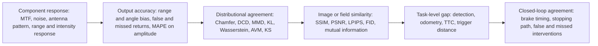

| Validation layer | Examples | Why it matters |
|---|---|---|
| Intrinsic or component response | Camera distortion, MTF or PSF, vignetting, radiometric response, noise and HDR; radar range, Doppler, angle and RCS response; lidar range, intensity and return probability; ultrasonic time of flight and amplitude; thermal MTF, NETD and radiometric response. | Tests whether the simulated instrument behaves like the real one before scene complexity is added. |
| Signal or detection level | MAPE of time-domain amplitude, point count and intensity; range error against the sensor's specified accuracy; RCS correlation; attenuation and SNR against rain rate or visibility [6, 7]. Range and angle bias, false and missed returns, detection probability, point density. | Directly tests the interface that perception consumes. |
| Distribution level | Point clouds: Chamfer, Hausdorff, Earth Mover's, Maximum Mean Discrepancy and Frechet distances [79]; density-aware Chamfer distance [78]; graph-based structural metrics [80]. Radar: KL divergence, Jensen-Shannon distance, Wasserstein distance, Kolmogorov-Smirnov tests, area validation metric, empirical CDFs with confidence intervals [38]. Learned evaluation metrics for radar (2021). | Needed where individual returns are stochastic and one-to-one sample matching is inappropriate. |
| Image or field similarity | PSNR, SSIM and LPIPS (need pixel-matched pairs); FID and KID (distribution level); mutual information; texture and entropy measures [55, 64, 65]. | Measures scene structure but can disagree with downstream task performance. |
| Perception and task level | Detection or tracking gap between real and simulated inputs (NeuroNCAP: VAD 0.449 NDS real versus 0.413 simulated; UniAD 0.490 versus 0.489) [57]; multi-layer aggregation into an overall gap [36]; the Instance Performance Difference metric [64]; odometry error; time-to-collision estimates; warning or braking trigger distance. | Determines whether simulation preserves what matters to the function. |
| Behaviour and closed loop | Behaviour or action similarity, for example matching brake values (Sim-on-Wheels, 2023) [81]; brake trigger timing, stopping trajectory, minimum clearance, false and missed interventions under matched real and simulated runs. | Ultimately relevant to the automatic-braking safety claim. |

Several findings show that the layers disagree with each other. In a November 2025 comparison by the National Research Council Canada, Western University and Transport Canada, density-aware Chamfer distance "was found to be the most correlated among the metrics with perception methods"; real and simulated scans averaged a DCD of 0.63 with a segmentation mIoU of 21% **Independent (on-road evidence)** [78]. Graph-based structural metrics were proposed in 2026 because scan-level metrics miss topology [80]. The 2024 Instance Performance Difference paper warns that mAP can mislead, because broader synthetic coverage can raise mAP even when the domains differ, and that FID does not target any specific perception algorithm [64]. A 2025 Scientific Reports study assessed the fidelity of synthetic adverse-weather images [65]. The radar double validation metric paper notes that conventional mean and RMSE errors do not by themselves accommodate the aleatory and epistemic uncertainty of stochastic radar detections; it evaluated KL divergence and Jensen-Shannon distance but dismissed them, and its "DVM Map" separates errors attributable to the environment model, propagation and signal processing rather than collapsing everything into one number [38]. RadaRays shows the sharpest divergence: the physics-based radar model improved mutual-information and structural-similarity scores dramatically relative to a lidar-like model and supported realistic odometry, yet a detector trained on real data still failed to transfer to the simulated images **Independent** [31]. Different realism metrics answer different questions, so task-level validation must accompany image similarity. The SwRI camera work likewise used both image statistics and a visual-odometry application rather than stopping at visual appearance [55].

Credibility frameworks give the layers a structure. UNECE's New Assessment/Test Method (NATM) credibility assessment framework, introduced for virtual testing under UN R152, requires evidence of accuracy, robustness, documentation, verification and validation, calibration and sensitivity analysis **Independent (on-road evidence)** [82, 84]. The UNECE DCAS regulation (ECE/TRANS/WP.29/2024/37) includes credibility principles for virtual toolchains [83]. A 2026 proposal adapts NASA-STD-7009 to automated-driving simulation [85]. These are on-road frameworks. In standardization, ASAM began the QSQ (Quantifying Simulation Quality) project to standardize machine-readable simulation-quality metrics with use-case-specific weighting [92], and a separate ASAM project is defining what "high fidelity" means for camera, radar and lidar by decomposing each into physical subcomponents [91]; both were still under way in 2026 **Expert opinion**.

Reporting practice has no common format across publications. Results are reported per metric and per scenario, few studies report uncertainty bands, and few define acceptance thresholds before testing. For this program, the credibility file should record at least: the sensor and firmware version; the machine and mounting configuration; which conditions were used for calibration and which were held out for validation; the reference instrumentation and its uncertainty; weather, lighting and material parameters; the metric and acceptance threshold; error and confidence intervals; known invalid regions; and any parameter tuning performed with the validation data. This is expert methodology, consistent with the published application-domain approach, and it prevents an apparently accurate model from being silently extrapolated to a different machine or sensor position **Expert opinion**.

#### 5. Supplier information needed, and what to do without it

The information that validated models actually used, and that the physics of each sensor demands, is listed below. Supplier data determine whether a model represents "a radar" or the actual production sensor.

| Sensor | Most valuable supplier information |
|---|---|
| Lidar | Scan pattern and beam geometry, timing; beam divergence; wavelength; transmit power and pulse shape; receiver aperture, filter bandwidth and detector model; detection threshold and dynamic range; the complete signal-processing chain including multi-echo logic; intensity calibration; range bias and noise versus signal level; ambient-light handling; interference suppression; noise and imperfection characteristics [6, 7]; protective-window properties. |
| Radar | Carrier band; waveform and chirp schedules and bandwidth; TX and RX element geometry and MIMO array layout; antenna patterns and polarization; receiver sensitivity, noise figure, dynamic range and AGC; phase noise and nonlinearity; ADC properties; beamforming; FFT, CFAR, detection and tracking logic; sensor-specific impairments [33]; radome RF properties; temperature and contamination effects; precise timing. |
| Camera | Lens geometry and distortion; PSF or MTF; aperture; optical and window transmission and coatings; spectral response, colour filter array and quantum efficiency; shutter and readout timing; pixel response and noise versus gain and temperature; HDR and exposure behaviour; saturation; auto-exposure and auto-white-balance; ISP functions such as denoising, sharpening and tone mapping; compression; flare and stray-light characterization. |
| Ultrasonic | Centre frequency and bandwidth; transmit burst; transducer directivity; ring-down and dead time; sensitivity and receiver thresholds; variable gain; cross-echo coding and scheduling; temperature compensation; housing and acoustic coupling. |
| Thermal | Spectral band and response (its absence explicitly limited the 2026 LWIR validation [71]); lens and window transmission; f-number, PSF or MTF; detector pixel and integration behaviour; NETD and noise; non-uniformity correction and calibration; gain modes; bad-pixel processing; radiometric versus non-radiometric output pipeline. |
| All sensors | Exact mounting pose and tolerances, mount stiffness and the machine's vibration transfer function; housing or cover materials, which matter for soiling and multipath; clock, synchronization and latency behaviour; heater, washer or air-knife state; firmware version; diagnostic and degradation modes; environmental qualification data. |

These requirements are expert synthesis from the physics that determine sensor output, anchored in what the validated lidar and radar models used **Expert opinion** [6, 7, 33]. ASAM OSI's SensorView configuration anticipates technology-specific configuration of ray-tracing engines and camera or lens generation, the high-fidelity project is decomposing camera, radar and lidar models into required physical subcomponents, and OpenMATERIAL addresses the other side of the interface, the physical properties of the scene [87, 90, 91]. The RadaRays detector failure occurred partly because the authors could not extract target material properties from the dataset and had to guess them; that example concerns scene materials rather than confidential sensor parameters, but it demonstrates the general principle that plausible default parameters can leave a consequential sim-to-real gap [31].

If the supplier will not share internals, five options are available:

1. **Ask for a black-box model.** Request an ASAM OSI/OSMP-packaged FMU (FMI 2.0) that hides the supplier's intellectual property [88]. Secure-exchange approaches for black-box FMUs in industrial settings exist (2024) [89].
2. **Characterize the sensor yourself (black-box system identification).** A campaign in controlled facilities and long-term stationary set-ups (the 2022 Sensors method [13]) can sweep calibrated targets, ranges, angles, velocities, reflectances or RCS values, lighting, temperature and selected weather and contamination conditions, fit empirical or probabilistic response models, and reserve conditions for independent validation rather than fitting. The resulting model must be declared valid only over the measured envelope **Expert opinion**.
3. **Estimate parameters inversely** from measurements, as was done for 77 GHz material parameters [34].
4. **Put the real sensor in the loop** (HIL or over-the-air) so its proprietary processing is exercised directly [45, 46, 47]. This does not remove the need to validate the stimulation equipment itself or to reproduce contamination and weather separately.
5. **Write model-delivery and validation-data requirements into the sourcing contract now.** The sensor type is still open, so this can be a selection criterion **Expert opinion**.

Two interface rules follow. For a supplier that provides only object lists, it is more defensible to validate a phenomenological model at that same object-list interface than to invent an unidentifiable raw-signal model. Conversely, if the braking function's perception consumes images, point clouds or radar cubes, validating only the supplier's final object list is insufficient; validation must be tied to the sensor-model interface the function actually uses **Expert opinion**.

#### 6. Can generative methods change weather or lighting validly for testing?

Yes for some kinds of testing; not yet as a general substitute for physically traceable sensor simulation.

##### Evidence for

- In a 2026 benchmark by Advai Ltd, the best generative image editor (Alibaba Qwen Image Edit Plus) had its weather and lighting edits accepted as realistic 94.8% of the time by a jury of three vision-language models, about 3.6 times the acceptance rate of the best rule-based library (imgaug, 26.3%); GPT-Image-1 scored 0.858, Gemini 2.5 Flash 0.902 and Flux Kontext 0.626. The authors conclude that "leading generative methods match or exceed real-image performance for most conditions" by that standard. This is a non-peer-reviewed preprint from a commercial firm **Independent (on-road evidence)** [93].
- Diffusion models increased coverage of operating conditions (the operational design domain) for system-level testing in a 2024 empirical study that explicitly examined semantic validity [95].
- Neural re-simulation shows small open-loop perception gaps (NeuroNCAP, 2024) [57], and neural scene reconstruction makes recorded environments editable in weather, lighting, viewpoint and actors without modelling every texture by hand, which has clear value for test discovery, stress cases, coverage gaps, sensitivity analysis and regression.
- Risk-guided diffusion can target high-risk weather samples (RADM, PeerJ) [96].
- Physics-informed generation is stronger than an aesthetic filter. PICWGAN (April 2026) combines geometric weather degradation with learned adverse-weather intensity, using real snow data from CADC, real rain data from Boreas and clear synthetic VoxelScape data; its physics terms include range, incidence angle, material reflectance from a spectral library, Mie-based scattering efficiencies and exponential attenuation, and it trained with 5,000 real and 5,000 simulated frames per weather domain and evaluated distributional realism and downstream detection **Independent (on-road evidence)** [98].
- Point-cloud recombination with robotic targets offers a systematic way to augment real lidar data for validation (2025) [101].

##### Evidence against

- The Advai study used 40 images, judged realism with vision-language models rather than humans ("validation against human studies remains an important direction"), did not evaluate control, and found night "remain[s] challenging": Flux Kontext's night edits were accepted only 17.6% of the time, and rule-based night edits 15.8% (imgaug) and 12.5% (albumentations) [93].
- Detectors trained only on synthetic fog do not close the sim-to-real gap; even pre-training on synthetic fog and then fine-tuning on real fog gained only "up to 0.0117 mAP beyond the real-only baseline" (Clear2Fog, Mohamed and Huang, University of Liverpool, 270,000 Waymo images, August 2026) **Independent (on-road evidence)** [94].
- A 2025 systematic survey of 91 studies on generative methods for testing automated driving systems describes the field as early-stage and reports suboptimal generations, poor generalization for underrepresented data, difficulty with complex or domain-specific tasks and high compute cost; most applications centre on scenario generation, transformation, reconstruction or augmentation rather than proving that a changed sensor stream equals what the physical sensor would have measured [99].
- The 2024 diffusion-testing study flags limited models and tasks as a threat to generalizability [95].
- Gaussian-splatting simulators do not support harsh weather (LiHi-GS) [25].
- A 2026 paper argues that world-model simulators need explicit "admissibility" checks before their verdicts can be trusted [97].
- A photorealistic generated image can violate exactly the quantities that sensor verification needs: absolute radiance, depth and occlusion geometry, glare energy, exposure and saturation behaviour, temporal consistency, raindrop trajectories, the relationship among camera, lidar and radar, material reflectance, and the causal relationship between weather severity and sensor SNR. Physics-informed generation reduces this problem but does not eliminate it **Expert opinion**.
- PICWGAN is a preprint and does not establish paired physical equivalence for an exact scene and weather event [98].
- No study was found that shows generative edits reproduce sensor-physical effects (lidar backscatter, radar clutter, real optical attenuation) or that edited data predict real detection rates at the confidence needed for a braking-function safety argument. No standard, regulator-endorsed method or broad independent evidence as of October 2026 treats ordinary GAN or diffusion weather or illumination editing as physically equivalent to matched real sensor measurements for safety-critical automatic-braking approval. Not found.
- No off-road evidence was found.

##### Three claims that must not be conflated

| Use of generated data | Current defensibility |
|---|---|
| Training augmentation | Strongest case. It need only improve generalization; physical identity is not required. |
| Robustness or metamorphic test (for example "does the detector remain stable when visibility or light is systematically degraded?") | Useful now, provided the transformation has documented constraints and the test claim is explicitly robustness to that transformation. |
| Physical-equivalence test (for example "this synthetic 40 m visibility fog frame proves the real camera and braking function meet the requirement at 40 m visibility") | Not established generally. Requires separate calibration and validation showing that the transformation reproduces the particular real sensor under that condition. |

Conclusion drawn from the evidence above: generative editing is credible for training, for finding failures and for widening coverage. It is not yet credible as stand-alone pass/fail validation evidence, especially for lidar and radar, at night and in dust. The most defensible hybrid uses generative methods to propose or diversify tests while anchoring the important physical dimensions with a physics model and real measurements. Generated rain, fog or dust should carry explicit physical labels such as "20 mm/h rain" or "50 m visibility" only when those labels have been calibrated against actual sensor data; otherwise it is better described as a domain perturbation **Expert opinion**.

#### 7. Computing power and time at different levels of realism

There is no universal "GPUs per sensor" answer, because runtime varies with geometry, ray count, resolution, reflections, weather particle count, sensor interface and hardware, and a neutral cross-vendor benchmark that holds those variables constant was not found. Published figures are examples, not planning constants.

| Fidelity level | Compute pattern | Published figures and limits |
|---|---|---|
| Ideal, object-level and statistical sensors | Low; geometry queries plus random-error and detection models. Suited to very large scenario sweeps. | Comparable cross-tool benchmark not found; the advantage follows from much lower complexity, not a published speed ratio. |
| Raster or PBR camera and basic ray-based lidar | GPU-friendly; often real time or faster, depending on resolution and scene complexity. | GPU lidar ray casting exceeds 10^8 points/s on light meshes (FGGS-LiDAR, 2025 preprint) [27]. Vendor RTX platforms use GPU ray tracing with material interaction [48], but no neutral benchmark applicable to this program was found. |
| High-fidelity radar ray tracing | GPU acceleration makes multipath and material simulation real time for some sensors and scenes. | A CPU SBR solver took 14 hours on a workstation for a 12-second scenario; the GPU real-time version takes about 12 ms per frame against a 30 fps target (Ansys/NVIDIA GTC 2020) **Vendor** [40]. GPU SBR runs above 160 fps for one single-channel radar and in real time for five radars or one 20-channel radar; general-purpose high-fidelity solvers "can take minutes or hours" per measurement cycle (Decker et al., 2021, peer-reviewed, vendor authors) [39]. Ansys AVxcelerate claims radar frame rates "greater than 30 frames per second" with no hardware stated **Vendor** [58]. RadaRays measured 7.8 to 18.8 ms per polar image on an RTX 2070 Super as initial rays rose from 80,000 to 400,000, against 25.8 to 78.5 ms on a Ryzen 7 3800X CPU (10.2 ms and 39.3 ms at 160,000 rays); these hold for that radar, model and scene only **Independent** [31]. |
| Full-wave or high-detail EM and acoustic simulation | Much more expensive than real-time geometric models; suited to component and material characterization or reduced scenes. | Physical-optics radar signature: about 616 ms per angular position on 8 supercomputer nodes with 4 AMD MI250X GPUs each, for an aircraft, not a vehicle (2026 preprint) [41]. Scene-scale off-road runtime benchmark not found; full-wave EM runtimes for automotive scenes not found. |
| Neural rendering and learned sensor surrogates | Inference is fast once trained; training and dataset construction move cost earlier. | SplatAD trains in about 1 hour per scene on one A100 and claims about an order of magnitude faster rendering than NeRF methods, whose baselines render 9.7 to 28.2 megapixels/s after 0.9 to 2.6 hours of training (CVPR 2025) [24]. Point-cloud recombination: about 1.8 s per point cloud on an RTX 4090 (2025) [101]. Mostly preprints on on-road data; not sufficient for program-level hardware sizing. |
| Diffusion-based weather editing | Slow per image. | 20.52 s per 640 by 432 image on one A40, against 0.88 s for a non-diffusion network (WeatherDiffusion, 2022/2023); these are weather-removal models used as a cost proxy [100]. The 2025 survey lists high compute cost as a limitation [99]. |
| Thermal scene plus heat-transfer simulation | Slow thermal-state calculation plus radiometric rendering; rendering may be fast while establishing correct temperatures is expensive. | Cross-tool runtime benchmark not found. |
| Real-sensor OTA and HIL | Closed-loop stimulus must meet real sensor and ECU timing; scene computation may be precomputed or real time. | Vendors offer real-time closed-loop radar HIL [46, 47]; neutral latency and scene-complexity benchmarks not found. |

Not found: frame rates for IPG CarMaker, NVIDIA DRIVE Sim/Omniverse, dSPACE AURELION, CARLA and MAVS; prices of any tool.

Two implications follow. First, real-time physics models are now available for HIL, while the highest-fidelity offline solvers and diffusion editing suit selective, high-value scenarios rather than sweeping more than 100 job sites by 10 scenarios by weather by machine models. Second, model preparation is a less obvious cost. In RadaRays, the reflective wheel-loader hall had to be modelled by hand with transparent walls, reflective pillars and chosen material properties, and automatically reconstructed meshes "contain artifacts that sometimes occlude the virtual scanner, leading to empty frames" and were too large to clean manually [31]. ASAM OpenMATERIAL 3D exists precisely because reusable geometry without sensor-relevant material properties is not sufficient for high-fidelity simulation [90]. For this program, acquiring and maintaining physically meaningful site and material assets may consume more engineering effort than rendering them, and compute capacity is unlikely to be the largest schedule risk; model identification, material and site characterization, validation measurements, sensor firmware changes, machine-specific mounting and vibration, and determining where a model is not valid are at least as important **Expert opinion**.

A credible architecture for the short final window is a fidelity ladder, not one universal simulator: very fast object and statistical models for exhaustive scenario-space and machine-variant sweeps; calibrated ray-traced and radiometric models for sensor-sensitive cases; learned models where they have held-out real-data evidence; and HIL and physical tests for sensor electronics, timing and the residual effects that are not convincingly modelled (dust, soiling, vibration, metal clutter, heavy rain). Before mid-2027, site geometry, material libraries, scenario definitions, machine kinematics, reference measurement methods, metrics, HIL interfaces and generic effect models can be completed; once the sensor selection is frozen, the remaining work is parameter identification plus held-out validation. Whether that suffices to meet the company's safety-release criteria cannot be established from public literature alone **Expert opinion**.

### Comparison tables

#### Simulation realism by sensor and condition

Legend. Reproduction: **G** = good agreement with measurements shown; **P** = partial or limited agreement; **W** = weak, heuristic, or modelable in principle but unvalidated; **NF** = no simulation or validation found; **n/a** = the condition does not affect this sensor physically. Evidence: **I** = independent peer-reviewed sim-versus-real comparison; **I-** = independent but small, qualitative, preprint or industry-authored; **V** = vendor's own claim; **E** = expert inference from related evidence. **ON** = on-road evidence only; **OFF** = some off-road evidence.

| Sensor | Rain | Snow | Fog | Dust | Mud or dirt on sensor | Low sun and glare | Darkness | Artificial site lighting | Machine vibration | Cluttered or reflective surroundings |
|---|---|---|---|---|---|---|---|---|---|---|
| Camera | P, I (ON) [52, 93] | P, I- (ON) [93] | P to G (trends follow real), I- (ON) [51] | W, E (haze overlays only) | W, I- (ON): judged visually, not by transmission [60, 61, 62, 63] | W (renderable), NF validation | P, I- (ON) [93] | W, NF validation | W (pose and blur applied), NF validation | P wet ground, I- (ON) [55]; metal and piles NF |
| Radar | P, I (ON): attenuation good, short-range clutter weaker [42, 43] | P, I (ON): attenuation measured [42] | G (minor effect), I (ON) | P to G airborne (minor effect measured), I (OFF) [21, 22]; coated radome W, NF | W, NF | n/a | n/a | n/a | W, NF validation | P, I (OFF hall with wheel loader; ON backscatter) [31, 32, 44]; double reflections missed |
| Lidar | G at low to moderate rate, P in heavy rain, I (ON) [6, 8] | P, I- (ON) [10, 11, 12] | G (P in dense fog), I (ON) [6, 9, 11] | W to P, I- (OFF) [19, 20, 21] | W, NF (physical test only [29]) | P, I- (ON): sunlight noise measured [13] | G (minor effect), E | G (minor effect), E; NIR interference NF | W, I (OFF measurement only) [29, 30] | W to P, I- (OFF terrain only) [17, 18]; wet ground and metal NF |
| Ultrasonic | W, NF | NF | W, NF | NF | NF | n/a | n/a | n/a | W, NF | P simple rigid surfaces, I- (ON) and V [67, 70]; piles W, NF |
| Thermal (LWIR) | W, NF | W, NF | W, NF | W, NF | NF | W, NF | P, I- (indoor) [72] | W, NF | W, NF | W, NF |
| Tag, UWB or GNSS proximity | NF | NF | NF | NF | NF | n/a | n/a | n/a | NF | NF |

Reading the table: no cell has strong independent evidence from mining or construction machines. "Good" cells come from weather facilities and on-road cars. The only direct heavy-machine sim-versus-real result is the radar wheel-loader experiment, and it documents a failure mode (missing double reflections) as well as a success.

### Where the evidence stands

#### Well established

- Physics-based lidar models with a full signal chain match real sensors closely in clear weather and in fog or light-to-moderate rain (multiple independent studies, 2021 to 2024) **Independent (on-road evidence)** [6, 7, 8, 9, 11].
- Radar is far less affected than lidar or cameras by fog and airborne dust (measurements, 2009 to 2019) [21, 22, 76, 77].
- Model fidelity depends on modelling sensor-specific signal processing and imperfections; an ideal object-level model can hide large raw-data gaps [7, 33, 36].
- Radar material interaction and multipath modelling substantially improve sim-to-real behaviour over simple one-hit ray casting, and scene materials matter enough that standardization now encodes sensor-relevant physical properties [31, 32, 90].
- Weather facilities (CEREMA, CARISSMA, NIED, JARI) are the main ground truth for weather models [6, 11, 76].
- Real and synthetic output must be compared at several levels, including distributions and downstream tasks, rather than judged visually [31, 36, 38, 78].
- Real-hardware HIL is a mature and important complement to software simulation, with known physical limits [45, 46, 47].
- ISO 21815 is the direct off-road standard framework: it applies to earth-moving, mobile underground-mining and road-construction machines and covers collision avoidance by reducing speed, stopping or inhibiting motion, which is more relevant to this function than on-road automated-driving standards [1, 2].

#### Uncertain

- Heavy-rain and short-range precipitation clutter fidelity for lidar and radar.
- Dust models in real mining dust, including self-generated dust coupled to machine speed, ground material and wind.
- Soiling, glare, artificial lighting and vibration models for every sensor.
- Thermal and ultrasonic models in any harsh condition.
- Whether metrics such as Chamfer distance, DCD or FID predict safety-relevant perception errors.
- Whether any on-road validation transfers to off-road machines with different sensor heights, ranges, backgrounds, vibration, attachments and articulated bodies; a heavy-off-road full-envelope proof was not found.
- Combinations such as dense dust plus wet or muddy covers, reflective metal plus wet ground, or night work lights plus airborne particles.
- How much sim-to-real agreement is "enough" for a braking safety claim; there is no mature rule, model validity is parameter-space specific, and the ASAM QSQ project is still being developed [38, 92].
- The final publication status of ISO 21815-4 and ISO 21815-5, which were under publication and at proof stage respectively in September 2026 [4, 5].

#### Where experts disagree

1. **Physics versus learned simulation.** Neural rendering advocates report minimal real-to-sim gaps (NeuroNCAP, 2024) [57]. Critics point to weak extrapolation and no harsh-weather support (LiHi-GS, LiDAR-EVS) [25, 26] and call for admissibility checks before trusting a world-model verdict (2026) [97]. The emerging compromise is physics-informed learning (PICWGAN) [98]; whether such hybrids are mature enough for safety credit rather than augmentation is unresolved.
2. **Generative editing as test evidence.** Vision-language-model jury studies say it matches real images [93]; training-transfer studies say a gap remains (Clear2Fog: at most 0.0117 mAP gained) [94]; the systematic survey calls the field early-stage [99].
3. **Which fidelity level matters.** Object-list proponents say object lists suffice for function testing; multi-layer studies show ideal models hide large raw-data gaps [36]. RadaRays adds a twist: sophisticated reflection modelling improved image-level similarity dramatically but did not improve radar odometry by a similar margin, so a simpler phenomenological model may suffice for one downstream function and fail for another, which argues against assuming that "highest physical fidelity" is always the most efficient test model [31].
4. **Raw fidelity versus task fidelity.** Some research evaluates pixel or radar-map similarity, some asks whether odometry or detection behaves correctly, and safety engineering ultimately cares whether the closed-loop function intervenes correctly; RadaRays shows these criteria can give different answers [31].
5. **Whether test facilities are themselves valid ground truth.** A 2019 survey says chambers cannot fully replace real weather [76]; a 2026 paper proposes equivalent-rainfall corrections to nominal chamber intensities [86].

### Blind spots

Issues the seven questions did not ask about, grouped:

**Function and vehicle dynamics**

- Perception and fusion software validity. Sensor realism matters only as far as it changes the decisions of the detection, tracking and braking logic; validation should be judged at the function level, for example false brakes and missed brakes.
- Braking and machine dynamics. Payload, grade, tyre or track interaction with mud, gravel and loose material, hydraulic brake response, drivetrain delay, slip, articulation and brake temperature change stopping distance. ISO 21815 covers speed reduction, stopping and motion inhibition, not steering away from objects [1, 2]. A perfect sensor simulation cannot validate the safety function if these models are wrong.
- False-positive braking. Unnecessary braking triggered by dust, rain clutter or the machine's own attachments is a safety and productivity issue; rain clutter at short range is documented for 77 GHz radar [43].
- Time synchronization and latency. A braking function can fail even when individual sensor values look realistic if timestamping, rolling or scanning acquisition, network delays, ECU scheduling or actuator latency are wrong; ASAM's high-fidelity project names bidirectional sensor-ECU behaviour as an open interface issue [91].

**The machine as its own environment**

- Self-occlusion and moving attachments. Booms, buckets and dump bodies enter the field of view; ISO 21815-3 notes that machine heights beyond the travel position are out of scope [2].
- Self-generated environment. A loader, haul truck or excavator creates its own dust, spray, shadows and vibration, and its payload alters reflections. Host-machine dust is coupled to machine speed, ground material and wind, so treating "dust" as a static fog volume may miss important correlations.
- Contamination dynamics and cleaning systems. How mud and water accumulate, move, dry or are removed by heating, washers, wipers or air knives matters more than a static "20% obscured" state; quantitative simulator validation of these processes for heavy machinery was not found.
- Sensor ageing, temperature, electromagnetic compatibility and interference between multiple radars or lidars on one machine or at one site.
- Cross-sensor consistency. A single synthetic scene must give camera, radar, lidar, thermal and ultrasonic sensors mutually consistent geometry and timing; validating each sensor separately does not prove the fused stack is correct.

**Data, assets and toolchain**

- Ground-truth data for job sites. No public mining or construction adverse-weather sensor dataset suited to model validation was found, apart from MINE4DRAD (4D radar, open pit) and real-dust lidar sets [23, 50].
- Digital-twin reconstruction error. Automatically reconstructed meshes contained artifacts severe enough to occlude the virtual radar and produce empty frames, and were too large to clean manually [31]. Reconstructing hundreds of job sites from scans does not automatically create simulation-ready truth.
- Firmware and model drift. A supplier can change firmware, thresholds or processing without changing the installation; a calibrated model needs configuration and version traceability and regression tests.
- Tool qualification, configuration management and reproducibility of the simulation toolchain itself.
- Scenario coverage versus sensor fidelity. Even a perfect model does not answer whether the test set contains the right pedestrian, vehicle, boulder, berm, structure, drop-off, machine-to-machine and occlusion cases and their frequency and severity combinations; the 100-plus site types and 10-plus scenarios per machine create a coverage problem separate from sensor physics.

**Standards, regulation and schedule**

- Regulatory and standards fit. Off-road standards (ISO 21815 series; ISO 16001, ISO 17757, ISO 19014, ISO 25119 and the EU Machinery Regulation 2023/1230) do not define simulation-credibility acceptance; their current versions and dates were not verified in this research except the ISO 21815 parts. Credibility frameworks (NATM, DCAS) are on-road and would have to be adapted [82, 83]. An ISO lidar test-method draft (ISO/DIS 13228:2026) is cited in 2026 literature [86].
- Schedule risk. Models must be validated before mid-2027, which needs representative sensors and machines now, while the sensor type is unconfirmed.
- Transfer of validity across mounting positions. No evidence was found on how a model validated at one sensor height and position transfers to the many machine models in scope; neural methods explicitly struggle with extrapolated viewpoints [26], and physics-based models can extrapolate in principle but the transfer was not shown.
- Facility access. Weather chambers (CEREMA, CARISSMA, NIED, JARI) and proving grounds are the main ground truth, yet the research did not examine their booking lead times, capacity or suitability for machines of this size, which bears directly on validating models before mid-2027.
- The existing warning system as a data source. The research did not consider using field data from the warning system already in service to characterize the sensors and the site conditions, although it is the one source of large-scale off-road sensor recordings the manufacturer already owns.

### Sources

1. International Organization for Standardization. ISO 21815-1:2022, Earth-moving machinery, Collision warning and avoidance, Part 1: General requirements. ISO. January 2022. https://www.iso.org/standard/77302.html. **Independent**.
2. International Organization for Standardization. ISO 21815-3:2023, Earth-moving machinery, Collision warning and avoidance, Part 3: Risk area and risk level for forward/reverse motion. ISO. 2023. https://www.iso.org/standard/77266.html. **Independent**.
3. International Organization for Standardization. ISO/TS 21815-2:2021 (confirmed 2024), Earth-moving machinery, Collision warning and avoidance, Part 2: On-board J1939 communication interface. ISO. 2021. https://www.iso.org/standard/77303.html. **Independent**.
4. International Organization for Standardization. ISO 21815-4, Earth-moving machinery, Collision warning and avoidance, Part 4: Risk area and risk level for swing and rotation motion. ISO. Under publication (stage 60.00), publication expected October 2026. https://www.iso.org/standard/81597.html. **Independent (under publication)**.
5. International Organization for Standardization. ISO/PRF 21815-5, Earth-moving machinery, Collision warning and avoidance, Part 5: Risk area and risk level for other forms of motion. ISO. Proof stage, FDIS ballot opened September 2026, publication expected November 2026. https://www.iso.org/standard/89934.html. **Independent (draft)**.
6. Haider, A. et al. A Methodology to Model the Rain and Fog Effect on the Performance of Automotive LiDAR Sensors. Sensors 23(15):6891. August 2023. https://www.mdpi.com/1424-8220/23/15/6891. **Independent (on-road evidence)**.
7. Haider, A. et al. Development of High-Fidelity Automotive LiDAR Sensor Model with Standardized Interfaces. Sensors 22(19):7556. October 2022. https://www.mdpi.com/1424-8220/22/19/7556. **Independent (on-road evidence)**.
8. Yu, Li and Bi. Modelling and validation of LiDAR noise distribution in fog and rain. Measurement. 2024. https://www.sciencedirect.com/science/article/pii/S0263224124003579. **Independent (on-road evidence)**.
9. Hahner, M. et al. Fog Simulation on Real LiDAR Point Clouds for 3D Object Detection in Adverse Weather. ICCV 2021. 2021. https://openaccess.thecvf.com/content/ICCV2021/papers/Hahner_Fog_Simulation_on_Real_LiDAR_Point_Clouds_for_3D_Object_ICCV_2021_paper.pdf. **Independent (on-road evidence)**.
10. Kilic, V. et al. Lidar Light Scattering Augmentation (LISA): Physics-based Simulation of Adverse Weather Conditions for 3D Object Detection. arXiv preprint. 2021. https://arxiv.org/pdf/2107.07004. **Independent (on-road evidence)**.
11. Teufel, S. et al. Simulating Realistic Rain, Snow, and Fog Variations for Comprehensive Performance Characterization of LiDAR Perception. IEEE Vehicular Technology Conference (VTC). 2022. https://www.embedded.uni-tuebingen.de/assets/publications/VTC2022_LiDAR_Weather_Simulation.pdf. **Independent (on-road evidence)**.
12. Testing and Validation of Automotive Point-Cloud Sensors in Adverse Weather Conditions. Applied Sciences 9(11):2341. 2019. https://doi.org/10.3390/app9112341. **Independent (on-road evidence)**.
13. Measuring the Influence of Environmental Conditions on Automotive Lidar Sensors. Sensors 22(14):5266. 2022. https://doi.org/10.3390/s22145266. **Independent (on-road evidence)**.
14. Realistic Rainy Weather Simulation for LiDARs in CARLA Simulator. arXiv preprint. December 2023. https://arxiv.org/abs/2312.12772. **Independent (on-road evidence)**.
15. Mississippi State University (Center for Advanced Vehicular Systems). Mississippi State University Autonomous Vehicle Simulation Library (MAVS). Ground Vehicle Systems Engineering and Technology Symposium (GVSETS). 2020. http://gvsets.ndia-mich.org/documents/MS2/2020/MS2_1130_Mississippi%20State%20University%20Autonomous%20Vehicle%20Simulation%20Library_Paper.pdf. **Independent**.
16. Goodin, C. MAVS-Examples: example applications and documentation for the MSU Autonomous Vehicle Simulator. GitHub. Accessed October 2026. https://github.com/CGoodin/MAVS-Examples. **Independent**.
17. Tallavajhula, A. et al. Off-Road Lidar Simulation with Data-Driven Terrain Primitives. Carnegie Mellon University Robotics Institute. c. 2018. https://www.ri.cmu.edu/app/uploads/2018/01/main-1.pdf. **Independent**.
18. Analysis of LiDAR Configurations on Off-road Semantic Segmentation Performance (MAVS versus RELLIS-3D). arXiv preprint. 2023. https://arxiv.org/pdf/2306.16551. **Independent**.
19. Zhao and Bi. A practical CARLA-based dust simulation framework for LiDAR perception in open-pit mines. Measurement Science and Technology. 2026. https://iopscience.iop.org/article/10.1088/1361-6501/ae70ce. **Independent**.
20. Modelling of LIDAR sensor disturbances by solid airborne particles (ALDUS). arXiv preprint. 2021. https://arxiv.org/pdf/2105.04193. **Independent**.
21. Phillips, T. G. et al. When the Dust Settles: The Four Behaviors of LiDAR in the Presence of Fine Airborne Particulates. Journal of Field Robotics. 2017. https://www.researchgate.net/publication/313582355. **Independent**.
22. Design of Dust-Filtering Algorithms for LiDAR Sensors Using Intensity and Range Information in Off-Road Vehicles. Sensors. 2022. https://pmc.ncbi.nlm.nih.gov/articles/PMC9185448/. **Independent**.
23. Dust Filtering in LIDAR Point Clouds Using Deep Learning for Mining Applications. ResearchGate. Accessed October 2026. https://www.researchgate.net/publication/396708139_Dust_Filtering_in_LIDAR_Point_Clouds_Using_Deep_Learning_for_Mining_Applications. **Independent**.
24. Hess, G. et al. SplatAD: Real-Time Lidar and Camera Rendering with 3D Gaussian Splatting for Autonomous Driving. CVPR 2025 (arXiv November 2024). 2025. https://arxiv.org/abs/2411.16816. **Independent (on-road evidence)**.
25. LiHi-GS: LiDAR-Supervised Gaussian Splatting for Highway Driving Scene Reconstruction. arXiv preprint. December 2024. https://arxiv.org/html/2412.15447v1. **Independent (on-road evidence)**.
26. LiDAR-EVS (lidar rendering from extrapolated viewpoints). arXiv preprint. 2026. https://arxiv.org/pdf/2603.14763. **Independent (on-road evidence)**.
27. FGGS-LiDAR: Ultra-Fast, GPU-Accelerated Simulation from General 3DGS Models to LiDAR. arXiv preprint. 2025. https://arxiv.org/pdf/2509.17390. **Independent (on-road evidence)**.
28. Fraunhofer IMS. ATLAS, Fraunhofer IMS LiDAR Target Emulator. Institute web page and concept papers. 2021 to 2022. https://www.ims.fraunhofer.de/en/Core-Competence/Smart-Sensor-Systems/Optical-Systems/3D-Sensing/atlas---fraunhofer-ims-lidar-target-emulator.html. **Vendor**.
29. An Automotive LiDAR Performance Test Method in Dynamic Driving Conditions. Sensors 23(8):3892. 2023. https://www.mdpi.com/1424-8220/23/8/3892. **Independent (on-road evidence)**.
30. Isolation of Vibrations Transmitted to a LIDAR Sensor Mounted on an Agricultural Vehicle to Improve Obstacle Detection. Canadian Biosystems Engineering 55. c. 2013. https://library.csbe-scgab.ca/docs/journal/55/C13155.pdf. **Independent**.
31. Mock, A., Magnusson, M. and Hertzberg, J. RadaRays: Real-time Simulation of Rotating FMCW Radar for Mobile Robotics via Hardware-accelerated Ray Tracing. IEEE Robotics and Automation Letters (accepted January 2025). 2025. https://arxiv.org/html/2310.03505v2. **Independent**.
32. Holder, M. et al. The Fourier Tracing Approach for Modeling Automotive Radar Sensors. 2019. https://www.researchgate.net/publication/334634233_The_Fourier_Tracing_Approach_for_Modeling_Automotive_Radar_Sensors. **Independent (on-road evidence)**.
33. A Realistic Radar Ray Tracing Simulator for Large MIMO-Arrays in Automotive Environments. IEEE. Accessed October 2026. https://ieeexplore.ieee.org/document/9533181/. **Independent (on-road evidence)**.
34. Channel Measurement and Ray-Tracing Simulation for 77 GHz Automotive Radar. TRID (Transport Research International Documentation). Date not confirmed; accessed October 2026. https://trid.trb.org/View/2211652. **Independent (on-road evidence)**.
35. Validation Framework for Generic Radar Sensor Models. ResearchGate. Accessed October 2026. https://www.researchgate.net/publication/358683601_Validation_Framework_for_Generic_Radar_Sensor_Models. **Independent (on-road evidence)**.
36. Ngo, A. et al. A Multi-Layered Approach for Measuring the Simulation-to-Reality Gap of Radar Perception for Autonomous Driving. arXiv preprint. 2021. https://arxiv.org/pdf/2106.08372. **Independent (on-road evidence)**.
37. Making Automotive Radar Sensor Validation Measurements Comparable. ResearchGate. c. 2023. https://www.researchgate.net/publication/374788391_Making_Automotive_Radar_Sensor_Validation_Measurements_Comparable. **Independent (on-road evidence)**.
38. Elster, L., Rosenberger, P., Holder, M., Mori, K., Staab, J. and Peters, S. Introducing the double validation metric for radar sensor models. Automotive and Engine Technology 9. June 2024. https://link.springer.com/article/10.1007/s41104-024-00143-5. **Independent (on-road evidence)**.
39. Decker, P. et al. Physics-Based, Real-Time MIMO Radar Simulation for Autonomous Driving. Springer book chapter (peer-reviewed; vendor authors). September 2021. https://link.springer.com/chapter/10.1007/978-3-658-34754-3_7. **Independent (on-road evidence)**.
40. Ansys and NVIDIA. Real Time, GPU-Accelerated Radar Modeling for Autonomous Vehicle Design. GTC 2020 presentation. 2020. https://developer.download.nvidia.com/video/gputechconf/gtc/2020/presentations/s21966-ultra-fast-radar-simulation-for-radar-system-design-and-automotive-applications.pdf. **Vendor**.
41. BVH-Accelerated Ray Tracing for High-Frequency Electromagnetic Backscattering (physical-optics radar signature on the LUMI supercomputer). arXiv preprint. 2026. https://arxiv.org/pdf/2604.09243. **Independent**.
42. Experimental Study on Low-THz Automotive Radar Signal Attenuation during Snowfall. 2019. https://www.researchgate.net/publication/333315421_Experimental_Study_on_Low-THz_Automotive_Radar_Signal_Attenuation_during_Snowfall. **Independent (on-road evidence)**.
43. Analysis of rain clutter detections in commercial 77 GHz automotive radar. 2017. https://www.researchgate.net/publication/323135471. **Independent (on-road evidence)**.
44. Radar Backscatter Measurements of Road Surfaces at 77 GHz. Date not confirmed; accessed October 2026. https://www.researchgate.net/publication/330586288_Radar_Backscatter_Measurements_of_Road_Surfaces_at_77_GHz. **Independent (on-road evidence)**.
45. Radar Target Simulation for Vehicle-in-the-Loop Testing. Vehicles 3(2):16. 2021. https://www.mdpi.com/2624-8921/3/2/16. **Independent (on-road evidence)**.
46. Keysight Technologies. AD1012A Radar Scene Emulator. Product page. Accessed October 2026. https://www.keysight.com/us/en/product/AD1012A/radar-scene-emulator.html. **Vendor**.
47. Rohde & Schwarz. Automotive radar validation. Product page. Accessed October 2026. https://www.rohde-schwarz.com/us/solutions/automotive-testing/automotive-radar/automotive-radar-validation/automotive-radar-validation_231760.html. **Vendor**.
48. NVIDIA. Isaac Sim RTX Sensors documentation (version 6.0.1). Accessed October 2026. https://docs.isaacsim.omniverse.nvidia.com/6.0.1/sensors/isaacsim_sensors_rtx.html. **Vendor**.
49. NVIDIA. Isaac Sim RTX Radar documentation (version 6.0.1). Accessed October 2026. https://docs.isaacsim.omniverse.nvidia.com/6.0.1/sensors/isaacsim_sensors_rtx_radar.html. **Vendor**.
50. 4D mmWave Radar in Adverse Environments for Autonomous Driving: A Survey (includes the MINE4DRAD open-pit dataset). arXiv preprint. 2025. https://arxiv.org/html/2503.24091v1. **Independent**.
51. SynFog: A Photo-realistic Synthetic Fog Dataset based on End-to-end Imaging Simulation for Advancing Real-World Defogging in Autonomous Driving. arXiv preprint. 2024. https://arxiv.org/pdf/2403.17094. **Independent (on-road evidence)**.
52. Tremblay, M. et al. Rain rendering for evaluating and improving robustness to bad weather. International Journal of Computer Vision (arXiv). 2020. https://arxiv.org/pdf/2009.03683. **Independent (on-road evidence)**.
53. Bijelic, M. et al. Benchmarking Image Sensors Under Adverse Weather Conditions for Autonomous Driving. arXiv. 2019. https://arxiv.org/pdf/1912.03238. **Independent (on-road evidence)**.
54. TaCOS: Task-Specific Camera Optimization with Simulation. arXiv preprint. 2024. https://arxiv.org/pdf/2404.11031. **Independent (on-road evidence)**.
55. Southwest Research Institute. Validating Simulated Camera Sensor Model Ability to Accurately Perceive Texture in Unstructured Outdoor Scenes. Internal research and development project 10-R6437. 2024. https://www.swri.org/what-we-do/internal-research-development/2024/defense-security/validating-simulated-camera-sensor-model-ability-accurately-perceive-texture-unstructured-outdoor-scenes-10-r6437. **Independent**.
56. Southwest Research Institute. SwRI tests automated vehicles in virtual off-road environments. Press release. 2024. https://www.swri.org/newsroom/press-releases/swri-tests-automated-vehicles-virtual-road-environments. **Expert opinion**.
57. NeuroNCAP: Photorealistic Closed-loop Safety Testing for Autonomous Driving. arXiv preprint. 2024. https://arxiv.org/pdf/2404.07762. **Independent (on-road evidence)**.
58. Ansys. Ansys AVxcelerate Sensors. Product page (release 26R1). Accessed October 2026. https://www.ansys.com/products/av-simulation/ansys-avxcelerate-sensors. **Vendor**.
59. Vehicle Hardware-In-the-Loop System for ADAS Virtual Testing. River Publishers, book chapter 11. Accessed October 2026. https://www.riverpublishers.com/pdf/ebook/chapter/RP_9788793519138C11.pdf. **Independent (on-road evidence)**.
60. SoilingNet: Soiling Detection on Automotive Surround-View Cameras (WoodScape). arXiv (industry-academic). 2019. https://arxiv.org/pdf/1905.01492. **Independent (on-road evidence)**.
61. Let's Get Dirty: GAN Based Data Augmentation for Camera Lens Soiling Detection in Autonomous Driving. ResearchGate. Accessed October 2026. https://www.researchgate.net/publication/352386081_Let's_Get_Dirty_GAN_Based_Data_Augmentation_for_Camera_Lens_Soiling_Detection_in_Autonomous_Driving. **Independent (on-road evidence)**.
62. Eberhardt et al. Clarity amidst Blur: A Deterministic Method for Synthetic Generation of soiled camera images. WACV 2025. 2025. https://www.openaccess.thecvf.com/content/WACV2025/papers/Eberhardt_Clarity_Amidst_Blur_A_Deterministic_Method_for_Synthetic_Generation_of_WACV_2025_paper.pdf. **Independent (on-road evidence)**.
63. Occluded nuScenes: A Multi-Sensor Dataset for Evaluating Perception Robustness in Automated Driving. arXiv preprint. 2025. https://arxiv.org/html/2510.18552. **Independent (on-road evidence)**.
64. Instance Performance Difference: A Metric to Measure the Sim-To-Real Gap in Camera Simulation. arXiv preprint. 2024. https://arxiv.org/pdf/2411.07375. **Independent (on-road evidence)**.
65. Fidelity assessment of synthetic images under adverse weather. Scientific Reports. 2025. https://www.nature.com/articles/s41598-025-15480-0. **Independent (on-road evidence)**.
66. SAE International. Ultrasonic Sensor Modeling for Automatic Parallel Parking Systems in Passenger Cars. SAE Technical Paper 2007-01-1103. 2007. https://saemobilus.sae.org/papers/ultrasonic-sensor-modeling-automatic-parallel-parking-systems-passenger-cars-2007-01-1103. **Independent (on-road evidence)**.
67. dSPACE. Simulation Model for Ultrasonic Sensors (ASM Ultrasonic Sensor Model). Engineers' insights page. Accessed October 2026. https://www.dspace.com/en/pub/home/news/engineers-insights/sim-model-ultrasonic-sensors.cfm. **Vendor**.
68. dSPACE. Mobile Test System for Sensors. Engineers' insights page. Accessed October 2026. https://www.dspace.com/en/inc/home/news/engineers-insights/mobile_test_system.cfm. **Vendor**.
69. Realistic Ultrasonic Environment Simulation Using Conditional Generative Adversarial Networks. arXiv preprint. 2019. https://arxiv.org/pdf/1902.09842. **Independent (on-road evidence)**.
70. Schmoll et al. Validation of an Ultrasonic Sensor Model for Application in a Simulation Platform. Springer (ATZ). 2024. Authors from IPG Automotive and Continental. https://link.springer.com/article/10.1007/s38314-024-1853-5. **Independent (on-road evidence)**.
71. A Unified Complex-Fresnel Model for Physically Based Long-Wave Infrared Imaging and Simulation. Journal of Imaging 12(1):33. 2026. https://doi.org/10.3390/jimaging12010033. **Independent**.
72. A configurable simulator for low-resolution infrared thermal sensors: accuracy assessment and practical applications in indoor environments. PeerJ Computer Science. c. 2025. https://peerj.com/articles/cs-3124/. **Independent**.
73. ThermoAnalytics. Synthetic EO/IR Datasets (MuSES). Product page. Accessed October 2026. https://www.thermoanalytics.com/services/synthetic-eo-ir-datasets/. **Vendor**.
74. Thermal modeling for autonomous vehicle simulations. Proceedings of SPIE 12549, paper 125490C. 2023. https://www.spiedigitallibrary.org/conference-proceedings-of-spie/12549/125490C/Thermal-modeling-for-autonomous-vehicle-simulations/10.1117/12.2663842.full. **Independent (on-road evidence)**.
75. Sim4CAMSens consortium (UK CCAV-funded). Sim4CAMSens project final report. 2025 (project 2023 to 2025). https://sim4camsens.org/blog/sim4camsens-project-final-report/. **Independent (on-road evidence)**.
76. Perception and Sensing for Autonomous Vehicles Under Adverse Weather Conditions: A Survey. arXiv. 2021, revised 2023. https://arxiv.org/pdf/2112.08936. **Independent (on-road evidence)**.
77. Ambient awareness for agricultural robotic vehicles. arXiv preprint. 2021. https://arxiv.org/pdf/2104.05270. **Independent**.
78. Ali, S. M., Rahman, T., Farhani, G., Zaki, M. H., Anctil, B. and Charlebois, D. Comprehensive Assessment of LiDAR Evaluation Metrics: A Comparative Study Using Simulated and Real Data. National Research Council Canada, Western University and Transport Canada; arXiv preprint. November 2025. https://arxiv.org/html/2511.02994v1. **Independent (on-road evidence)**.
79. High-Fidelity Digital Twins for Bridging the Sim2Real Gap in LiDAR-Based ITS Perception. arXiv preprint. 2025. https://arxiv.org/html/2509.02904. **Independent (on-road evidence)**.
80. Geometry vs Structure: Graph-Based Diagnostics for LiDAR Point-Cloud Simulation Fidelity. arXiv preprint. 2026. https://arxiv.org/abs/2609.16378v1. **Independent (on-road evidence)**.
81. Sim-on-Wheels: Physical World in the Loop Simulation for Self-Driving. arXiv preprint. 2023. https://arxiv.org/pdf/2306.08807. **Independent (on-road evidence)**.
82. UNECE Working Party on Automated/Autonomous and Connected Vehicles (GRVA). Virtual testing in UN R152: Introduction (GRVA-18-55e). January 2024. https://unece.org/sites/default/files/2024-01/GRVA-18-55e.pdf. **Independent (on-road evidence)**.
83. XILS Credibility Assessment and Scenario Representativeness Methodology Based on Geometric Similarity Analysis for Autonomous Driving Systems (cites the DCAS regulation ECE/TRANS/WP.29/2024/37). Applied Sciences 15(12):6545. 2025. https://www.mdpi.com/2076-3417/15/12/6545. **Independent (on-road evidence)**.
84. A Validation Methodology for Safety-Critical Virtual Testing. DiVA portal. Accessed October 2026. https://www.diva-portal.org/smash/get/diva2:1991623/FULLTEXT01.pdf. **Independent (on-road evidence)**.
85. Virtual Testing of Automated Driving Systems through Credible Simulations (adapting NASA-STD-7009). arXiv preprint, via Pith. 2026. https://pith.science/paper/2609.03760. **Independent (on-road evidence)**.
86. From Nominal Intensity to Equivalent Rainfall: A Path-Based Credibility Evaluation Framework for Simulated Rainfall in Autonomous-Driving Perception Tests. arXiv preprint. 2026. https://arxiv.org/pdf/2606.11989. **Independent (on-road evidence)**.
87. ASAM e.V. ASAM OSI (Open Simulation Interface) standard page and GitHub releases (v3.7.0, 15 July 2024; v3.8.0, 21 May 2025, latest). Accessed October 2026. https://www.asam.net/standards/detail/osi/ and https://github.com/OpenSimulationInterface/open-simulation-interface/releases. **Independent**.
88. ASAM e.V. ASAM OSI Sensor Model Packaging: Introduction. Accessed October 2026. https://opensimulationinterface.github.io/osi-antora-generator/asamosi/latest/sensor-model/misc/introduction.html. **Independent**.
89. Secure Exchange of Black-Box Simulation Models using FMI in the Industrial Context. 2024. https://www.researchgate.net/publication/378890714_Secure_Exchange_of_Black-Box_Simulation_Models_using_FMI_in_the_Industrial_Context. **Independent**.
90. ASAM e.V. ASAM OpenMATERIAL 3D, version 1.0. 2025. https://www.asam.net/standards/detail/openmaterial/. **Independent**.
91. ASAM e.V. Project P-2025-06: ASAM OSI for High-Fidelity Sensor Simulation. Standardization project, ongoing in 2026. https://www.asam.net/project-detail/p-2025-06-asam-osi-for-high-fidelity-sensor-simulation/. **Expert opinion**.
92. ASAM e.V. Project P-2025-04: ASAM QSQ, Quantifying Simulation Quality. Standardization project, ongoing in 2026. https://www.asam.net/project-detail/p-2025-04-asam-qsq-quantifying-simulation-quality/. **Expert opinion**.
93. Advai Ltd. Scalable Evaluation of the Realism of Synthetic Environmental Augmentations in Images. arXiv preprint (commercial firm, not peer-reviewed). 2026. https://arxiv.org/html/2603.04325. **Independent (on-road evidence)**.
94. Mohamed, M. A. and Huang, X. A Data Efficiency Study of Synthetic Fog for Object Detection Using the Clear2Fog Pipeline. University of Liverpool; arXiv preprint, version 3. August 2026. https://arxiv.org/html/2605.12608. **Independent (on-road evidence)**.
95. Efficient Domain Augmentation for Autonomous Driving Testing Using Diffusion Models. arXiv preprint. 2024. https://arxiv.org/html/2409.13661v1. **Independent (on-road evidence)**.
96. Risk-aware diffusion model for generating extreme weather scenarios and safety evaluation in autonomous driving (RADM). PeerJ Computer Science. Date not confirmed; accessed October 2026. https://peerj.com/articles/cs-3573/. **Independent (on-road evidence)**.
97. Validate the Dream Before You Trust Its Verdict. arXiv preprint. 2026. https://arxiv.org/pdf/2607.07196. **Independent (on-road evidence)**.
98. Anand, V., Lohani, B., Mishra, R. and Pandey, G. PICWGAN: physics-informed adverse-weather lidar generation. arXiv preprint. April 2026. https://arxiv.org/html/2604.01254v1. **Independent (on-road evidence)**.
99. Generative AI for Testing of Autonomous Driving Systems: A Survey. arXiv preprint (systematic survey of 91 studies). 2025. https://arxiv.org/html/2508.19882v1. **Independent (on-road evidence)**.
100. Restoring Vision in Adverse Weather Conditions with Patch-Based Denoising Diffusion Models (WeatherDiffusion). arXiv. 2022, revised 2023. https://arxiv.org/pdf/2207.14626. **Independent (on-road evidence)**.
101. Point Cloud Recombination: Systematic Real Data Augmentation Using Robotic Targets for LiDAR Perception Validation. arXiv preprint. 2025. https://arxiv.org/html/2505.02476v1. **Independent (on-road evidence)**.

## Chapter 7: Testing the old and the new system

_How to measure the existing detection and warning system as a baseline without driving the machine, how to compare the new braking system against it fairly when sensors, positions or software differ, and what has to be recorded now for any of this to be possible._

### The research question

A manufacturer of heavy off-road machines for construction, mining, quarrying and similar work already sells a system that warns the operator when the machine gets too close to an object. It is now developing a system that also applies the brakes automatically if the operator does not react. Prototype hardware and software will arrive in mid-2027 and validation must then finish in less than four months, where in the past it took three to four years of physical testing and tuning for each machine model. The new system must work across more than 100 types of job site, more than 10 operating scenarios per machine, many weather and light conditions (rain, snow, fog, dust, dusk, darkness, glare) and many machine models with different sizes and sensor positions. The sensor types are not confirmed, so camera, radar, lidar, ultrasonic and other options all had to be covered.

The research set out to learn how an existing object detection and warning system can be measured without driving the machine, and how a new system can be compared against it fairly. It worked through seven questions:

1. Which methods exist to test a detection and warning system away from the field, including replay of recorded sensor data, software-in-the-loop, hardware-in-the-loop, injecting signals into real sensors and vehicle-in-the-loop? What does each need, and what does each prove?
2. How is the true situation ("ground truth") established for recorded field data? Reference sensors, manual labeling, automatic labeling and surveyed test targets were to be compared.
3. How is a performance baseline built? Which measures are used (detection rate by distance and object type, false alarms per hour, warning timing), and how much data is needed?
4. How can a new system be compared with an old one when the sensors, the sensor positions or the software are different? What can be compared directly, and what cannot?
5. Once a system can brake, recorded data no longer match what happens next. How do teams handle this difference between replay testing and interactive (closed-loop) testing?
6. How do teams test a new system before its final hardware exists?
7. What must be recorded on the machine to make later replay possible, and what are the common mistakes?

The ground rules were strict. The research was to stay neutral across vendors, products and technologies and to cover commercial, open-source, academic and in-house options. Each important claim was to be labeled by its type of evidence (independent study, standard or third-party test; the vendor's own claim; or expert opinion), and each source was to be dated, with a preference for sources from 2023 or later for tools and products. Failures, limits and evidence against each approach were to be reported, not only successes. Anything proven only for on-road vehicles had to be flagged as such, and where nothing could be found the answer was to be "not found" rather than a guessed number, price or timeline.

### About the evidence

This chapter draws on 79 sources, listed at the end of the chapter. Several hundred further documents were read during the research and are not cited. Evidence is labeled in bold after the claim or in the source entry as **Independent** (peer-reviewed study, standard or regulation text, official statistics, third-party test, government or agency report), **Vendor** (a supplier's own claim, product page, press release or white paper) or **Expert opinion** (practitioner, consultant or industry-group view without data). Findings proven only for road vehicles carry the marker **(on-road evidence)**, and standards that had not been issued by October 2026 carry **(draft)**, **(under publication)** or **(under revision)**. Where something was searched for and not found, the chapter says so rather than guessing. Points on which experts and stakeholders disagree are set out in the "Where the evidence stands" section.

### Key findings

- **The off-road standards define what to test, not how much.** ISO 16001:2017 (object detection systems and visibility aids: test body, detection zone, detection time), ISO 21815-1:2022 (detection, operator warning, automatic intervention and test procedures for earth-moving, mobile underground mining and road-construction machinery), ISO/TS 21815-2:2021 (J1939 brake-request interface) and ISO 21815-3:2023 (risk area and risk level for forward and reverse motion, including speed reduction, stopping and motion inhibition) give the framework. ISO 21815-1 states that responsibility for safe operation remains with the operator. None of the standard texts reviewed sets sample sizes for detection or false-alarm statistics. **Independent** [1, 2, 3, 4].
- **Regulation is already here or arriving.** South Africa's Mine Health and Safety Regulations 8.10.1.2(b) and 8.10.2.1(b) took effect on 21 December 2022 and require that, if no action is taken, the machine be retarded to a safe speed after which the brakes are automatically applied, and that the system "fail to safe". The EU Machinery Regulation (EU) 2023/1230 applies from 20 January 2027 with new requirements for autonomous mobile machinery and self-evolving safety behaviour. **Independent**, **Expert opinion** [5, 6, 7, 8, 9, 10].
- **Replay of raw sensor logs against an independent ground truth is the established way to baseline the existing warning system off-field, and it is only as good as what was recorded.** It measures detection, false alarms and warning timing for the sensor set, mounting positions and scenarios that were actually recorded, and its fidelity is defined by the point at which data are re-injected: everything upstream of that point (lens, imager, antenna, contamination, vibration, glare) is not retested. Recording must therefore start now, in October 2026, not when the prototype arrives. **Vendor (on-road evidence)**, **Expert opinion** [11, 12].
- **Independent off-road field data are old and sparse.** The 2022 NIOSH rapid review of haul-truck collision systems found that only 13 of 99 metric instances tested detection reliability, that only 10% of 97 cases were avoidance (intervention) systems, and that only 8% of articles were above technology readiness level 7. The best hard false-alarm figure is still Ruff's 2006 NIOSH study of a radar system on a 260 t Caterpillar 793B: of 580 alarms over 618 reversals, 102 (18%) were false and 243 (42%) were nuisance alarms; only 235 (41%) required immediate action or extra caution. **Independent** [13, 14].
- **The one published independent verification regime for automatic slow-down and stop in mining shows high first-pass failure and long queues.** University of Pretoria testing under South Africa's MOSH regime reported pass rates of 62% for detection devices, 42% for machine-side systems and 83% for third-party interfaces across 189 tests (79% verification and 21% development tests), at 1.6 tests per week and with an 18-week lead time (October 2025). Every machine type, model and serial number with different braking characteristics must be verified separately, and the published stopping tests cover gradients of 1% or less, unloaded. **Independent** [15, 16, 17].
- **Automatic braking breaks open-loop replay at a definable point.** Recorded data remain valid evidence up to the first brake command the old run did not contain; after it, the recorded future is no longer the future the machine would have experienced. On-road research (CVPR 2024) showed that open-loop planning metrics could be matched using the vehicle's own state alone, a "misleading impression". Teams split the metrics: perception and trigger timing open-loop on logs, braking consequences in closed-loop simulation, hardware-in-the-loop and vehicle-in-the-loop, and selected stopping outcomes on a proving ground. **Independent (on-road evidence)** [18, 19, 20, 21].
- **Sensor stimulation hardware has hard physical limits that bite at close range.** Digital radar target simulators have a minimum simulated range set by latency (each 6.67 ns adds 1 m); a 2021 peer-reviewed review gives about 20 to 30 m and single-digit target counts for digital systems, while vendors claim 0.6 m and up to five objects. Camera monitor stimulation suffers from frame-sync and field-of-view problems; lidar stimulation, especially for solid-state lidar, is identified as a remaining gap; ultrasonic stimulation exists for automotive parking functions only. None of this reproduces terrain clutter, dust plumes or multipath from steel structures, and workers at 0.5 to 5 m behind a machine are exactly where digital radar simulators are weakest. **Independent (on-road evidence)**, **Vendor (on-road evidence)** [22, 23, 24, 25, 12, 20].
- **Ground truth must be independent of the system under test, and a hybrid is needed.** Using the production detector's own output as truth is circular. Surveyed targets anchor accuracy, a reference lidar plus RTK-GNSS/INS gives continuous distance and timing truth, auto-labeling with human audit covers volume, and the reference system needs its own uncertainty budget and a "truth unavailable" state. Auto-labels have matched or beaten single-pass human labels for lidar boxes on roads (3DAL 2021, DetZero 2023), but no off-road validation for workers or machines near heavy equipment was found. **Independent (on-road evidence)** [26, 27, 28, 29].
- **There is no universal "how much data" number; sample size follows the claim, and frames are not trials.** Demonstrating at least 95% detection with 95% confidence needs at least 59 consecutive successful encounters per stratum, 99% needs 299; showing fewer than 0.1 false alarms per hour needs at least 30 failure-free hours per condition. The unit of analysis is the independent encounter, not the sensor frame, because a ten-second encounter yields hundreds of correlated frames. Across 100+ site types, 10+ scenarios, seven or so conditions and many models the strata exceed 7,000 cells, so exhaustive field coverage is infeasible and stratified sampling plus simulation is unavoidable; RAND reached the same conclusion for road vehicles in 2016. **Independent** [30, 31, 32].
- **Old and new systems can be compared fairly only at the system-output level, in world or risk coordinates, ideally recorded in parallel on the same machine.** Warnings and interventions per hazard, missed hazards, false and nuisance alarms per hour and warning time-to-collision against a common ground truth and a common hazard zone (such as the ISO 21815-3 risk area) are comparable; raw detections, confidence scores and per-sensor range statistics are not when modality, mounting or processing changes. Old logs cannot be replayed into a system with new sensors or positions without synthesising data, and neural re-simulation degrades once the viewpoint moves 1 to 4 m from the recorded path (on-road evidence). **Independent**, **Expert opinion** [4, 33, 34].
- **Simulation credibility is a process, not a tool feature, and no regulator acceptance for off-road virtual evidence was found.** The prostep ivip and SET Level Credible Simulation Process (2021 to 2024) exists, but ASAM states that no standardized metrics exist for sensor-simulation quality and its QSQ project was still at proposal stage in September 2025. Adverse-environment sensor models (dust, snow, glare, wet lenses, tunnel multipath) must be experimentally correlated; no fidelity thresholds for off-road sensor models were found. **Expert opinion** [35, 36, 37].
- **Adding braking changes the safety-engineering scope, not just the metric.** ISO 19014-2:2022 excludes "awareness systems that do not impact machine motion (e.g. cameras and radar detectors)" from its scope; a system that brakes falls inside it, bringing brake-command integrity, faults, degraded modes and unintended activation into validation. MOSH warns that automatic slowing and stopping "if not executed safely, can have unintended consequences", and the University of Pretoria reports false-positive interventions causing production losses, wear and resistance to adoption. **Independent (under revision)**, **Independent** [38, 16, 39].

### Detailed findings

#### 1. Off-field test methods: what each needs and what each proves

A useful way to organize the methods is by the boundary of the real system under test. The farther outward that boundary moves, from software, to the electronic control unit (ECU), to the sensor, to the complete machine, the more real failure modes are included, but at the cost of complexity, speed, scalability and controllability. This layered approach matches hardware-in-the-loop and vehicle-in-the-loop practice in the automotive literature; the published vehicle-in-the-loop evidence is predominantly on-road. **Independent (on-road evidence)** [20]. The methods are described below in roughly that order; the comparison table at the end of the chapter summarizes them.

##### a) Open-loop replay (re-simulation) of recorded sensor data

- **What is real:** the production software and, optionally, the original sensor-processing ECU.
- **Needs:** raw or near-raw sensor streams (camera frames before lossy compression, radar detections or ideally ADC or radar-cube data, lidar point clouds, ultrasonic echo data), machine-state buses, exact original timing and time synchronisation, calibration and configuration, and an independent ground truth or expected output to score against. Commercial replay documentation stresses original data interfaces, synchronisation and timing. **Vendor (on-road evidence)** [11].
- **Proves:** detection rate, false-alarm rate and warning timing of the recorded sensor configuration in the recorded situations; repeatability; software and perception regression across versions; the old-system baseline; and an old-versus-new comparison when both systems accept genuinely equivalent inputs. It is the natural method for baselining the existing system.
- **Cannot prove:** the effect of any action, such as braking, steering or an operator reaction that differs from the recording; anything about sensor types or positions that were not recorded; new environmental conditions or failures that are not in the logs; and physical sensor effects when re-injection happens downstream of the sensor.
- **Evidence:** standard practice in automotive development. The open-loop failure mode for systems that act is documented by Li et al. (CVPR 2024). **Independent (on-road evidence)** [18]. Vendor implementation evidence is mature in automotive; direct heavy off-road replay evidence is sparse.

A critical distinction is that **replay fidelity is defined by the injection boundary**. Suppose the old camera produces a serialized image stream over a GMSL link and the recording captures those frames. Re-injecting them into the image ECU tests everything downstream of that point, but it does not retest the old lens, exposure control, imager, lens contamination, vibration or sun-glare response. Putting the real camera back in the loop with a monitor ("camera box") includes the optics again, but monitor contrast, optics and multi-camera geometry then become test limitations. dSPACE describes both the camera-box limitations and downstream raw-image injection. **Vendor (on-road evidence)** [12].

##### b) Semantic or object-list replay

- **What is real:** the decision, warning and braking logic downstream of perception.
- **Needs:** ground-truth or pre-recorded object lists in common coordinates, plus machine state. Can be run open-loop or closed-loop.
- **Proves:** decision thresholds, warning logic, threat assessment and brake-request logic independent of sensor modality. It is the cheapest way to sweep large scenario sets.
- **Cannot prove:** perception. It can hide sensor latency, occlusion, false detections and range or classification errors, because it assumes perception has already succeeded.
- **Evidence:** ASAM OSI (Open Simulation Interface) provides interfaces between environment, sensor, fusion and function models and discusses ground-truth interfaces; its ecosystem is a road-vehicle simulation ecosystem. **Independent (on-road evidence)** [21].

##### c) Software-in-the-loop (SIL)

- **What is real:** the target algorithms and software, usually compiled for a host PC rather than the final controller.
- **Needs:** a scenario or world model, an environment simulation with sensor models (ideal, phenomenological or physics-based) or semantic inputs, a machine dynamics model that includes braking, articulation and load, and a test oracle. Usually closed-loop for control tests.
- **Proves:** logic correctness, timing in simulated time, boundary exploration, requirements tests, very high-volume regression, and coverage of large scenario sets in closed loop (the machine reacts and the scene evolves). It is the right tool for sweeping the 100+ site types and 10+ scenarios parametrically.
- **Cannot prove:** real sensor physics in dust, snow or glare unless the sensor models are validated; timing, processor and I/O faults of the final ECU; actual brake hardware. It is only as credible as its models. ASAM states that "no standardized metrics exist" to assess sensor-simulation quality; its QSQ ("Quantifying Simulation Quality") project was still at proposal stage, with the proposal workshop held on 11 September 2025. **Expert opinion** [35].
- **Evidence:** ISO 18497-4:2024 (agricultural machinery) explicitly lists "Simulation" alongside measurement, test and analysis as verification methods and gives test objects for simulation in its Annex C; that is the closest off-road standard support found. **Independent** [40]. The independent vehicle-in-the-loop literature places SIL early in development as a virtual method for evaluating functions. **Independent (on-road evidence)** [20].

##### d) Hardware-in-the-loop (HIL) with data injection

- **What is real:** the final or representative ECU and its I/O, often running production software.
- **Needs:** a real-time simulator with deterministic timing; a machine-dynamics model; electrical I/O and sensor-interface emulation (camera RAW-data injection behind the imager, radar detection-level injection, recorded J1939 or CAN traffic); restbus models for the rest of the machine network; and the ISO/TS 21815-2 brake-request interface. **Independent** [3]. Closed-loop when actuator outputs feed the simulation.
- **Proves:** real-time behaviour of the production ECU, the target binary, communications and interface timing, diagnostic and fault behaviour, fail-to-safe behaviour, and decision and control logic under repeatable scenarios. MOSH requires, for example, that a disconnection between the detection device and the machine be detected within 500 ms and that the machine reply within 50 ms. **Independent** [17].
- **Cannot prove:** sensor front-end behaviour, because injection bypasses the optics, lens, imager and possibly the image signal processor; true machine and brake behaviour when these are entirely modeled.
- **Evidence:** vendor systems demonstrate multi-I/O, synchronized, closed-loop HIL with synthetic camera input and fault injection for automotive driver assistance. **Vendor (on-road evidence)** [41]. A vendor interview with IPG Automotive argues that RAW injection avoids the monitor-sync and field-of-view problems of camera boxes. **Vendor (on-road evidence)** [25].

##### e) Direct digital or raw signal injection as a distinct test

The research treated raw injection as a method in its own right because its value depends entirely on the insertion point. What is real is the ECU or sensor-processing electronics downstream of the injection point. It needs the exact electrical and protocol interface, a realistic raw stream, synchronisation and an interface adapter. It proves the processing chain downstream of the injection, bandwidth and timing behaviour, handling of corrupted frames and interface faults. It cannot prove whatever lies upstream: lens and imager, RF antenna and front end, lidar transmitter and receiver, or sensor contamination. Camera raw-image injection is commercially implemented; its limitations depend on the insertion point. **Vendor (on-road evidence)** [12, 25].

##### f) Over-the-air sensor stimulation (sensor-in-the-loop)

Here the actual camera, radar, lidar, ultrasonic or GNSS sensor plus the downstream system is real, and a controllable optical, RF or acoustic stimulus generated from the virtual scene is presented to the physical aperture.

- **Needs:** an anechoic or shielded setup or calibrated bench geometry, a target generator, calibration of the path loss, and real-time synchronisation with the scene. Usually closed-loop.
- **Proves:** that the complete real sensor, including front end and firmware, responds correctly to controlled targets. Useful for HIL regression and fault injection, and it includes more of the real sensing chain than injection.
- **Limits by modality:**
  - Radar. Digital target simulators have a minimum simulated range set by processing latency: each 6.67 ns of latency adds 1 m of apparent range. **Independent (on-road evidence)** [22]. Diewald, Kurz, Kannan et al. (KIT, IPG Automotive and PKTEC; Vehicles, 19 May 2021) give a typical minimum of about 20 to 30 m for digital systems and a "single digit number of targets", at a cost of "hundreds of thousands of dollars"; they note that analog simulators allow "a very low minimum simulatable target range". **Independent (on-road evidence)** [23]. Vendors claim much better: dSPACE's DARTS blog (11 September 2019) claims "0.6 meters to 3,600 meters" with 6 cm range resolution and "up to five real objects" in its test bench, and Keysight's E8719A data sheet lists 1 or 3 targets. **Vendor (on-road evidence)** [24, 42]. Rohde & Schwarz advertise closed-loop HIL and VIL operation with controllable range, angle and Doppler and multi-object generation. **Vendor (on-road evidence)** [43]. Angle simulation is often discrete, and small angular errors matter. **Independent (on-road evidence)** [44, 45]. These vendor statements establish commercial capability claims, not independently verified fidelity among rock faces, metal structures, haul roads, dust, multipath-heavy tunnels or large-machine geometries.
  - Camera. The display frame rate and phase of a monitor or projector are not synchronised with the camera, and wide field-of-view or 4K cameras are hard to cover. **Vendor (on-road evidence)** [25, 12].
  - Lidar. The 2024 peer-reviewed vehicle-in-the-loop survey identifies physical lidar signal generation, particularly for solid-state lidar, as a remaining gap and describes implementation as difficult and costly. **Independent (on-road evidence)** [20]. Specific lidar target-simulator limits: not found.
  - Ultrasonic. Commercial over-the-air acoustic stimulation exists for automotive parking functions. **Vendor (on-road evidence)** [46]. Independent evidence of ultrasonic HIL or VIL covering heavy off-road machinery: not found.
  - Other modalities (GNSS/INS, UWB or RF tags, RFID-like proximity systems, magnetic or infrastructure-aided systems). The same boundary principle applies: stimulate the physical radio or interface when testing the sensor, or inject position, range or tag measurements downstream when testing only fusion and decision software. NIOSH documents a history of evaluating radar and tag-based proximity systems on construction and mining equipment, but no current public heavy off-road standard prescribing a laboratory-injection architecture for these modalities was found. **Independent** [47].
- **General limits:** the stimulator itself becomes part of the test uncertainty, with its own limited field of view, dynamic range, target count, spectrum, angular accuracy and environmental fidelity. None of these devices reproduces terrain clutter, berms, dust plumes or multipath from steel structures at realistic fidelity.
- **Off-road relevance:** close-range hazards, such as workers at 0.5 to 5 m behind a machine, are exactly where digital radar simulators are weakest.

##### g) Vehicle-in-the-loop (VIL) and mixed reality

- **What is real:** the complete machine or a major physical subsystem with its controllers and actuators.
- **Needs:** a real machine on an enclosed safe test area, or a dynamometer, wheel-hub or actuation bench; a virtual environment; virtual targets injected into the sensor stream or ECU, or physical sensor stimulation; and feedback of the physical machine's state into the virtual world so that subsequent stimuli are regenerated. ASAM's requirements-based VIL methodology describes over-the-air stimulation of largely unmodified vehicles that includes the full physical sensor and software chain. **Expert opinion (on-road evidence)** [48].
- **Proves:** real braking dynamics, real actuator and controller delays, real latency and the real operator interface, without endangering people or real targets. It is the bridge between simulation and field.
- **Cannot prove:** sensor perception of the injected objects unless they are stimulated over the air. A bench may not reproduce soft soil, grades, tire or track sinkage, articulated or tracked dynamics, payload behaviour, vibration or dust and weather, and the size of heavy machines makes facilities difficult.
- **Evidence:** radar target simulation for VIL has been demonstrated on roads. **Independent (on-road evidence)** [23]. The 2024 survey reports limitations in road and testbench fidelity, physical signal generation, multi-target radar simulation, multi-camera systems and especially lidar stimulation, and did not identify a full-scale VIL platform ready for comprehensive industrial testing of automated vehicles at the time of publication. **Independent (on-road evidence)** [20]. Off-road VIL evaluations, and comprehensive VIL on production-scale haul trucks, wheel loaders, dozers or excavators: not found.

##### h) Proving-ground tests with physical targets (still needed)

- The complete machine, real sensors and the real environment are in the loop. It needs a safe proving area, instrumented or surveyed targets, independent truth and a machine operator or robotic driver. It is the end-to-end reality anchor for actual stopping behaviour and sensor-environment interaction, but it is expensive, has low coverage, cannot control weather, and hazardous edge cases are hard to execute.
- The MOSH verification regime proceeds from laboratory tests, to proving-ground tests at Gerotek, to a cordoned area of a mine. **Vendor** [49]. Its controller test "evaluates ... the effectiveness of automatic slowdown and stop interventions. This test is done on light vehicles in the controlled environment of a proving ground" (Verification Regime Rev 1, 11 October 2025). **Independent** [16].
- ISO 21815-1 explicitly includes test procedures for off-road collision warning and avoidance systems. **Independent** [2]. ISO 16001 defines a test body, detection zone and detection time. **Independent** [1]. UNECE R159 (on-road, moving-off information for trucks) is reported to use a 50 mm cylinder for visibility tests and vulnerable road users moving at 3 to 5 km/h; the cylinder detail was not confirmed against the regulation text. **Independent (on-road evidence)** [50, 51].

#### 2. Establishing ground truth for recorded field data

**What ground truth has to be.** Ground truth is an estimate of the external physical scene that is independent of the system being evaluated: object identity and class as required, 3D position and trajectory in a common world or machine frame, machine pose and velocity, and the timestamps needed to determine distances, risk-area transitions and warning timing. Reusing the production detector's own output as truth creates circular validation: objects the detector missed disappear from both the prediction and the "truth", and the baseline looks deceptively good. **Expert opinion**. The Waymo Open Dataset illustrates the elements a reproducible reference needs: synchronized lidar and camera data, calibration, vehicle poses, tracked 3D labels and refined object poses. That is on-road dataset practice, not off-road certification evidence. **Vendor (on-road evidence)** [29].

| Approach | Strengths | Weaknesses | Best use in this programme | Evidence |
|---|---|---|---|---|
| **Reference sensors** (high-resolution lidar plus RTK-GNSS/INS on the machine; tags or GNSS on targets) | Continuous and scalable; objective range, position and velocity for timing metrics; independent of the sensor under test; covers natural encounters | Must be more accurate and robust than the system under test; has its own blind spots and adverse-weather failures (dust affects lidar and camera, multipath affects radar); needs intrinsic, extrinsic and time calibration; unequipped objects (public, animals) need another method | Primary truth for the large real-world corpus, ideally multimodal | A 2023 agricultural study built a lidar benchmark with error "less than 0.03 m" and ">80% perception coverage in dusty environments". **Independent** [52] |
| **Manual labeling** | Handles any object class, including workers in PPE and partially occluded people; humans resolve context and semantic ambiguity | Slow and costly; inconsistent (Waymo's 3DAL study found "human labels do not have the consistency one may expect"); 3D depth is hard from camera alone; dust and occlusion create genuine ambiguity | Human verification, rare classes, ambiguous cases, quality audit | **Independent (on-road evidence)** [26] |
| **Automatic or offboard labeling** | Uses the whole sequence (past and future frames) and large offline models; scales to large datasets; DetZero (2023) and CTRL (2023) report auto-labels matching or exceeding average human labels for lidar vehicles; pre-annotation cut curb-labeling time by 50.99% (2023); lidar-derived labels trained a 4D radar network to performance comparable with manual labels (2024) | Needs human-labeled training data ("chicken-or-egg"); biased toward the classes and conditions it was trained on; systematic mistakes silently contaminate thousands of labels; a 2026 foundation-model labeler reached recall 0.88 to 0.98 but precision only 0.52 in crowded indoor scenes | Pre-labeling followed by stratified human audit and uncertainty flags; never an unaudited safety oracle | **Independent (on-road evidence)** [27, 53, 54, 28]; **Independent** [55]; not validated off-road |
| **Surveyed or instrumented test targets** (total station or RTK positions, dummies, ISO 16001 test body, ISO 18497-4 test objects, UNECE R159 targets) | Highest accuracy and control over geometry and nominal trajectory; repeatable; excellent timing and range reference; accepted by standards and regulators | Covers only staged scenarios; few per day; low ecological diversity; no natural behaviour; dummies may not reproduce the radar cross-section or thermal signature of real workers, rocks, machinery, piles or vegetation | Calibration of the whole measurement setup, boundary testing, range and timing accuracy, final controlled confirmation | **Independent** [1, 40]; **Independent (on-road evidence)** [50]; **Expert opinion** [51] |

**Reference sensors.** Reference sensing should combine complementary modalities and accurate pose estimation rather than declaring one sensor infallible. In a dust cloud the reference camera and reference lidar may both degrade; in highly reflective or multipath environments radar can be imperfect too. The reference system therefore needs its own uncertainty budget and an explicit "truth unavailable or ambiguous" state, so that dust, occlusion and reference-sensor failure are not forced into wrong labels. **Expert opinion**. Dust remains active research: peer-reviewed work covers dust filtering for lidar on off-road vehicles (Sensors, 2022), RGB-lidar fusion for de-dusting point clouds in construction (Automation in Construction, 2024) and lidar blockage and cleaning evaluation (Sensors, 2023, on-road). **Independent** [56, 57]; **Independent (on-road evidence)** [58]. Published validation of a reference stack across the full set of quarry and mining dust, snow, mud, darkness and large-machine occlusion conditions: not found.

**Manual labeling.** Manual labeling should not mean drawing boxes on a video. The label specification should define the object taxonomy, the reference point on each object, visibility and occlusion state, whether a partially hidden person counts as a detection opportunity, temporal continuity rules, uncertainty, and how disagreements between labelers are adjudicated. Whenever 3D distance or time-to-collision matters, labels should be based on calibrated 3D reference data rather than unaided monocular judgement. **Expert opinion**.

**Automatic labeling.** Automatic labeling is useful but should not be promoted automatically to "truth". The 2024 radar auto-labeling result is encouraging evidence that auto-labels can scale a dataset, but it is one on-road research setting and does not show that auto-labels are error-free. **Independent (on-road evidence)** [28]. The on-road offboard detectors (3DAL, DetZero, CTRL) all depend on human-labeled training data, and their off-road transfer to workers in PPE, machines and partially buried objects has not been demonstrated. **Independent (on-road evidence)** [26, 27, 53].

**Surveyed targets.** Surveyed targets are particularly valuable for checking that a warning boundary sits at the correct physical distance and for calibrating the whole measurement chain. ISO 21815-1 includes test procedures and ISO 21815-3 defines forward and reverse risk areas, but detailed procedures for every target geometry and every machine and application are not exposed in the public ISO abstracts, so universal target dimensions or test counts are not found and should not be invented. **Independent** [2, 4].

**A common coordinate system is essential.** Each sensor has its own frame, the machine has a body frame and the test site or reference system has a world frame; all transforms must be versioned with the data. Autoware's documentation gives a concrete open-source implementation of world, vehicle and per-sensor frames and states that accurate sensor-to-vehicle installation relationships are required to correlate sensors. That is generic robotics and on-road implementation evidence, not an off-road standard. **Expert opinion (on-road evidence)** [59].

**Recommendation: a hybrid.** Surveyed targets anchor accuracy and calibrate the other methods. A reference lidar plus GNSS gives continuous truth for distance and timing. Auto-labeling with human review covers volume. A human-audited subset measures label error. Ground-truth error propagates directly into measured metrics: a labeler that misses distant workers inflates apparent false alarms, and position error shifts measured warning distance. Label precision and recall from the audited subset should be reported alongside every metric. A known-geometry reference object, such as the reference vehicle used in "Drones as Annotators" (2026), gives an annotation-free sanity check. **Independent** [60]. Published cost and throughput figures for off-road labeling: not found.

#### 3. Building the performance baseline, and how much data it takes

**The unit of analysis is the encounter, not the frame.** An encounter is "machine A approached object B under scenario C while the object occupied or approached a defined risk region". Each encounter should carry its scenario factors: machine model and configuration, sensor mounting, object class, relative direction, speed, grade, surface, attachment and load state, weather, light, dust or visibility, and site archetype. ISO 21815-3 provides the strongest directly relevant normative anchor for defining forward and reverse risk areas, rather than choosing arbitrary sensor-centric range thresholds. **Independent** [4]; **Expert opinion**.

**Measures for the existing warning function (recommended set).**

- Detection performance: probability of detection per independent encounter (recall) by object class (worker standing, crouching or lying; light vehicle; other machine; static infrastructure), by distance band inside the ISO 21815-3 risk area, by bearing or zone around the machine, and by condition (dust, rain, snow, fog, dusk, dark, glare); first-detection distance and time; missed encounters; track persistence; and, where available, range and position error. Report curves or bins, not a single fleet-wide average that hides weak conditions.
- False and nuisance warnings per machine operating hour and per meaningful exposure unit, stratified by condition, and split into false (no object), nuisance (a real object but no collision risk, for example the machine's own tyres, berms or material piles) and correct. These are different engineering problems. NIOSH found false alarms from the truck's own tyres and protruding structures (NIOSH RI 9672, 2007). **Independent** [61]. In Ruff's 2006 study, 580 alarms over a 7-day, 618-reversal test split into 102 false, 243 nuisance and only 235 (41%) actionable. **Independent** [14].
- Warning timing: time-to-collision (TTC) or distance-to-collision at first warning, time to risk-boundary entry, detection latency from reference opportunity to system output (ISO 16001 "detection time"), warning latency to the operator interface, warning duration, chattering or repeated warnings, and the fractions that are late, early or absent. **Independent** [1].
- Availability and degradation: time in normal, degraded, inhibited and fault states, self-diagnosis and blockage-detection rate. An impressive detection rate measured only while "available" can hide operational unavailability.

**Measures for the future braking function.** Intervention rate and false-intervention rate per hour; brake-request time; actual hydraulic or electromechanical response time; deceleration onset and achieved deceleration; stopping distance versus the ISO 3450 or MOSH requirement; residual speed if contact would occur; minimum clearance; brake release behaviour; failures and undesired braking. These cannot be measured on the old warning-only system, so they should be evaluated against new safety requirements rather than treated as old-versus-new metrics. **Expert opinion**; automatic intervention is within the scope of ISO 21815-1. **Independent** [2].

**How much data: no universal number exists.** No current ISO, NIOSH or public research result was found that gives a fixed number of hours, objects or encounters sufficient to validate collision systems across heavy-machine applications. Sample size has to follow the claim: binomial confidence or power for detection and miss probabilities, exposure-based rates for false alarms, and uncertainty bounds on warning and intervention timing. NIST's statistical handbook makes sample size a function of the performance difference or confidence precision that must be resolved, and provides exact-binomial and Wilson intervals for cases where normal approximations fail (near 0 or 1, or with small samples). **Independent** [30]. The arithmetic that follows is standard.

- Detection, zero misses. Demonstrating a detection rate of at least p at 95% confidence with no misses needs n at least ln(0.05) / ln(p) consecutive successful encounters: 59 for 95%, 299 for 99% and 2,995 for 99.9%, per stratum. With some misses, Clopper-Pearson (exact) binomial intervals apply. If the test must distinguish an acceptable probability from an unacceptable one with chosen significance and power, standard binomial sample-size formulas make n a function of those quantities and the required separation. The minimum reporting unit is therefore the per-cell detection probability (successful encounters divided by valid opportunities in the cell) with a binomial confidence interval for every safety-critical cell or grouping, not one aggregate. **Independent** [30].
- False alarms. The exposure denominator is time or an operational exposure measure. Under the explicit assumption that false alarms form a homogeneous Poisson process, observing zero false alarms over T hours gives a one-sided upper bound on the rate of minus ln(alpha) divided by T; at 95% confidence that is about 3 / T, so showing fewer than 0.1 false alarms per hour needs at least 30 failure-free hours and fewer than 0.01 per hour needs 300 hours, per condition claimed. "We saw zero failures" means little without substantial exposure. The Poisson assumption must itself be checked: false alarms cluster by site, weather, machine, repeated obstacle geometry and sensor contamination.
- Frames are not trials. A ten-second encounter yields hundreds of highly correlated frames but is essentially one encounter for most safety claims. Treating frames as independent trials makes confidence intervals artificially narrow. Independent encounters, runs, shifts and sites should be the sampling units or clusters; frame-level measurements remain useful for timing and trajectories but must not inflate the effective sample size. NIST treats randomness and autocorrelation as conditions for ordinary uncertainty formulas to be valid. **Independent** [30].
- The on-road precedent. Kalra and Paddock's RAND report "Driving to Safety" (RR-1478, 12 April 2016) found it "would take hundreds of millions of miles and sometimes hundreds of billions of miles of test-driving to provide clear statistical evidence of autonomous vehicle safety", and that existing fleets would need "tens and sometimes hundreds of years" to drive them. **Independent (on-road evidence)** [31, 32]. The equivalent off-road conclusion is that rare-event safety cannot be shown by exposure; it must be argued through stratified testing, simulation and safety analysis.

**Interpretation for this programme.** The target strata (100+ site types, 10+ scenarios, about seven weather and light conditions, N machine models) easily exceed 7,000 cells; no programme can fill each with 59 to 299 physical trials. A full Cartesian product is not practical. The defensible alternative is a predefined coverage model: safety-critical scenario classes get direct statistical claims; less critical combinations are covered by justified equivalence, machine families or archetypes, parameter sweeps and simulation, followed by targeted physical confirmation at model boundaries. The field should be used for (a) natural-exposure false-alarm rates in representative site classes, which requires continuous, untriggered recording, and (b) staged detection trials in the highest-risk cells. The number of equivalence classes cannot responsibly be chosen before the machine families, hazard analysis and performance claims are defined. **Expert opinion**; no universal off-road prescription was found.

#### 4. Comparing the new system with the old one

**The central rule: compare at the highest common layer that still answers the safety question.** When sensor modality or placement differs, that layer is usually an independently measured external encounter, not the raw sensor stream. **Expert opinion**.

**Directly comparable:**

- System-level outputs against the same ground truth: warnings and interventions per hazard, missed hazards, false and nuisance alarms per hour under the same exposure, and warning timing relative to hazard entry, TTC or distance.
- Comparisons restricted to a common evaluation zone, such as the ISO 21815-3 risk area or a zone derived from the machine's stopping distance, not each sensor's native field of view. **Independent** [4].
- Paired results from parallel (shadow) recording: both systems on the same machine at the same time, so every hazard is seen by both. Paired tests such as McNemar's test on hazard-level hit-or-miss pairs are then valid. Separate deployments confound site, operator and weather.

**Not directly comparable:**

- Raw detection internals: radar detections versus camera boxes, confidence scores, resolution, per-sensor range accuracy, or per-frame precision and recall at incompatible representations.
- Coverage outside the overlap of the two fields of view.
- Behaviour in conditions only one system was recorded in.
- Proprietary internal risk scores, unless semantically calibrated.

The table below sets out what remains valid for each kind of change.

| Change from old to new | Valid direct comparison | Not directly comparable | Preferred experiment |
|---|---|---|---|
| Same sensors, same positions, same interface; software changes | Same recorded raw or interface data through both software versions; paired detection and warning results | Internal implementation details that changed meaning | Exact paired replay |
| Same sensor technology, different mounting or field of view | End-to-end detection and warning against common world ground truth | The old raw recording as if it came from the new position; raw range and field-of-view statistics | Simultaneous co-instrumented collection, or validated scene reconstruction plus position-specific sensor models |
| Different sensor modalities | Detection-opportunity outcome, first detection in world or risk coordinates, warning timing, false-alarm exposure | Raw measurements, confidence scales, resolution, per-frame metrics | Independent common ground truth; ideally old and new recorded simultaneously |
| Same perception, warning logic changes | Warning trigger relative to common risk geometry or TTC | Proprietary internal risk scores unless calibrated | Semantic or object-list replay plus paired end-to-end replay |
| Warning-only old system versus warning-plus-brake new system | Detection and the common warning-stage metrics | Braking and stopping outcome: the old system has no corresponding function | Compare common stages to the old baseline; assess the brake stage against requirements in closed loop |

**Normalize range to hazard geometry.** For machines of different lengths, widths, articulation geometry and sensor locations, range should be expressed as separation from the relevant machine swept envelope or as entry into a standardized risk region, not "metres from the sensor origin". Otherwise a sensor mounted 3 m farther forward appears to have a different warning range while the actual safety margin is identical. ISO 21815-3's risk-area and risk-level framework applies directly to earth-moving and underground mining machines. **Independent** [4].

**Separate perception from decision logic with a common semantic interface.** Both the old and the new threat-assessment logic can be fed identical objects with known positions and velocities to see whether their warning or brake decisions differ. ASAM OSI exists for exactly this exchange between environment, sensor, fusion and function models, but its ecosystem originates in road-vehicle simulation; using it on a quarry machine is an engineering adaptation, not off-road proof. **Independent (on-road evidence)** [21].

**Simultaneous collection is the strongest end-to-end experiment.** Place both candidate sensor suites on the same machine, preserve their intended mounting geometry as far as practical, and evaluate both against the same independent reference trajectory. That removes weather, actor behaviour and site state as confounders. Where simultaneous mounting materially alters visibility or electromagnetic or optical behaviour, that interference must itself be tested. **Expert opinion**.

**Old logs and new sensors.** Replaying old logs through new software is valid only if the new software uses the same sensors at the same positions. With new sensor types or positions, old logs cannot be replayed into the new system without synthesising data. Neural reconstruction of recorded scenes degrades as the viewpoint offset grows: the XLD benchmark (2024) found a "significant gap" for cross-lane views at 1 to 4 m offsets, and a 2025 review notes "low quality of novel view rendering when the camera offset is large". **Independent (on-road evidence)** [33, 34]. Re-rendered data for new mounting positions should be treated as a development aid, not validation evidence.

#### 5. The open-loop versus closed-loop gap once the system brakes

**The problem is documented.** Li et al. (CVPR 2024) showed that open-loop planning metrics on the nuScenes benchmark could be matched using the vehicle's own state alone, giving a "misleading impression" and "potentially biased conclusions drawn from existing benchmarks". **Independent (on-road evidence)** [18]. After a braking command, the recorded future of the scene and of the operator is no longer valid.

**The first-divergence point.** A replay has a natural boundary:

1. Before the new system commands braking, the recorded machine pose, object poses and sensor measurements are valid historical evidence.
2. At the first brake command that did not occur in the original run, the counterfactual machine begins to differ from the recorded one.
3. After that instant, feeding the original sensor record while pretending the virtual machine has slowed is physically inconsistent.

Recorded data can therefore validly answer "would the new system have detected the object and requested intervention before time t on this historical trajectory?". They cannot answer "would the machine actually have stopped safely, what would the subsequent sensor measurements have been, or would another participant have reacted?". **Expert opinion**, supported by the closed-loop VIL architecture in the literature [20].

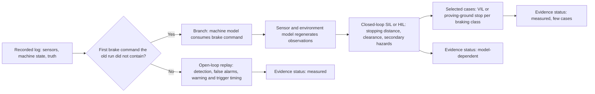

**How teams handle the gap (all documented on roads).**

1. *Split the metrics.* Perception and warning are evaluated open-loop on logs up to the decision point. The decision to brake is evaluated as "would have intervened at time t" on logs (counterfactual trigger analysis). Braking consequences are evaluated in closed-loop simulation or physical tests.
2. *Non-reactive pseudo-closed-loop benchmarks.* NAVSIM is "non-reactive" and scores short planned trajectories; "pseudo-simulation" (Cao et al., CoRL 2025) uses pre-generated 3D Gaussian Splatting views to approximate closed-loop evaluation. **Independent (on-road evidence)** [19].
3. *Branch from replay into simulation (log-to-simulation switch).* The historical prefix supplies a realistic initial world state. At the intervention point a machine-dynamics model consumes the real brake command and updates speed and pose, a sensor or environment model regenerates the next observations for the new state, and the new outputs feed the controller again, closing the loop with reactive agents. ASAM OSI's interfaces are intended for this class of model interconnection, and automotive HIL products implement the real-time ECU and I/O part. **Independent (on-road evidence)** [21]; **Vendor (on-road evidence)** [41].
4. *Neural closed-loop simulators* such as HUGSIM (December 2024). Their authors document lane distortion in extrapolated views. **Independent (on-road evidence)** [62].

**The weakness after branching.** Once the branch is taken, the evidence is only as trustworthy as the machine, terrain, target-behaviour and sensor models. The 2024 VIL survey identifies virtual-scenario and sensor-model fidelity and physical stimulus or testbench error as determinants of test accuracy. **Independent (on-road evidence)** [20]. This warning is more serious off-road, where tire or track to soil interaction, grade, payload, articulation, loose aggregate and dust are more variable than paved-road dynamics.

**Other actors.** A worker or another machine may react to the braking machine. Replaying the actor's historical trajectory after the intervention assumes the actor is unaffected. For genuinely interactive encounters, closed-loop actor or operator models or controlled physical tests are required. Published validated off-road behavioural models of workers and equipment operators across the stated site diversity: not found.

**The practical validation rule.** Three evidence classes should be kept apart so that simulation results do not silently acquire the status of measured field data:

- Recorded prefix up to the first intervention: high-confidence replay evidence, assuming faithful recording and injection.
- After the intervention: simulation, HIL or VIL evidence whose credibility depends on model validation.
- Selected stopping outcomes: controlled real-machine confirmation.

**Off-road specifics.** For a warning-plus-braking function the decision logic and brake actuation are much simpler than an automated-driving planner, so a pragmatic split is: open-loop replay for perception and trigger timing (when the system would have braked); closed-loop SIL and HIL with a validated machine brake model including load, slope and articulation; and VIL or proving-ground stops per machine braking class to validate the brake model. The physical stop parameters are model-specific. The MOSH surface F&TPR sets emergency-stop deceleration of 1.9 m/s² for machines with a top speed above 20 km/h and 1.0 m/s² for others, controlled-stop deceleration of 1.0 or 0.5 m/s², slow-down to below 10 km/h, no wheel lock and veer of at most 0.5 times the machine width, tested on gradients of 1% or less and, for closed-loop tests, unloaded. **Independent** [17]. Slope and loaded cases are therefore not covered by the published specification. A University of Pretoria paper (2024) notes that mining collision avoidance systems "tend to be very conservative" and suffer "false positive interventions leading to production losses, increased wear, and resistance to adopt". **Independent** [39].

#### 6. Testing before the final hardware exists

Most of the validation infrastructure does not need the final sensor or ECU, provided the interfaces are established early. The pre-hardware sequence below combines the practices found; the ordering is the research's own synthesis. **Expert opinion**.

**Build the reference corpus now, with surrogate sensors.** Instrument existing machines with synchronized logging of the production warning system plus independent reference sensors, and collect normal operations, not just staged hazards. Mount development sensors of the candidate types at the candidate positions on current machines, alongside the existing system, and record from now until mid-2027. This produces logs with the new geometry before the prototype arrives, establishes the old-system baseline and captures the environmental distribution (including a winter). It is the single most valuable pre-hardware action and follows from the parallel-recording logic in section 4. NIOSH's body of heavy-equipment work shows that collision-warning and proximity technology has long required equipment-specific evaluation, and ISO 21815 now supplies the system framework. **Independent** [47, 2].

**Freeze the semantic and electrical interface contracts early.** Define what a "detected object", warning state, brake request, diagnostic state and time reference mean independently of any sensor supplier. ASAM OSI illustrates the value of exchangeable interfaces between environment, sensor, fusion and function models, although it is road-vehicle-centric. **Independent (on-road evidence)** [21]. The ISO/TS 21815-2 J1939 interface is the off-road anchor for the brake request. **Independent** [3].

**Run SIL with the intended production logic or continuously replaceable prototypes.** Use ideal or semantic sensors first to debug threat assessment and braking-state logic, then progressively add realistic sensor error models for each candidate sensor type, validated against the surrogate recordings. Follow a documented credibility process: the prostep ivip Simulation Credibility paper (2024) and the SET Level Credible Simulation Process (2021) exist; ASAM QSQ is still emerging. **Expert opinion** [37, 36, 35]. The VIL literature places SIL early in development. **Independent (on-road evidence)** [20].

**Use a virtual ECU, development ECU or HIL surrogate while the final processor is absent.** The HIL rig, restbus simulation, power and I/O interfaces, fault-injection scripts and real-time plant models can be commissioned before production controllers arrive; when real ECUs arrive, only the surrogate boundary is replaced. Commercial HIL implementations demonstrate synthetic camera input, fault injection and synchronized multi-sensor and bus interfaces. **Vendor (on-road evidence)** [41]. Rehearse the brake request and fail-to-safe logic over ISO/TS 21815-2 on interim ECUs. MOSH's TRL4 laboratory phase tests exactly this set: "CxD Interface test - The ISO/TS 21815-2:2021 bench test. CxD Log Keeping Test. CxD Self-Diagnostic Test (FTSWHI). ICASA Type Approval or Spectrum License demonstration. EMC testing". **Independent** [16, 3].

**Develop sensor models, but do not confuse them with proof of sensor performance.** Supplier specifications, earlier-generation hardware and laboratory measurements can seed camera, radar, lidar and ultrasonic models. After prototype sensors arrive, those models must be calibrated and challenged against real measurements, especially in the adverse weather, light and contamination conditions that drive safety risk. VIL research warns that sensor-model and physical-stimulator fidelity determine results. **Independent (on-road evidence)** [20].

**Build digital twins of the machines.** Machine geometry, self-occlusion by bucket, boom or body, and the braking model allow coverage and blind zones per model to be computed before hardware arrives. ISO 5006 and ISO 16001 visibility-type methods and UNECE R159's small-cylinder method illustrate the geometric approach. **Independent** [1]; **Independent (on-road evidence)** [50]; **Expert opinion** [51].

**Prepare the replay adapters before sensor selection is final.** Build an internal canonical recording format that retains the original bytes or packets plus metadata, then implement sensor-specific decoding and injection plugins. ROS and Autoware provide open-source examples of bag replay and simulation; commercial platforms offer alternative replay and HIL architectures; an in-house system can implement the same principles. The evidence demonstrates architectural feasibility, not the suitability of any one product for this manufacturer. **Expert opinion (on-road evidence)** [59]; **Vendor (on-road evidence)** [11].

**Limits.** Pre-hardware results do not transfer automatically. Final optics, radome or window materials, mounting vibration and firmware can change performance. MOSH explicitly requires independent verification of "every TMM Type, Model and serial number where similar models have different braking characteristics". **Independent** [16].

**The scheduling implication.** The sub-four-month period after prototype arrival should be a confirmation period, not the point at which recording formats, ground truth, scenario definitions, HIL interfaces and metrics are invented. The historical three-to-four-year process can be compressed credibly only if most scenario development, baseline measurement, tool qualification and model preparation happen beforehand. By mid-2027 the company should ideally already hold a versioned scenario library, an independent ground-truth pipeline, the old-system baseline, replay adapters, a SIL and HIL test suite, a statistical acceptance plan and correlated machine-dynamics models, so that prototype arrival mainly substitutes real new hardware into an existing evidence pipeline. **Expert opinion**. No published evidence was found that off-road auto-braking validation has been compressed from years to months.

#### 7. What to record on the machine, and the common mistakes

**The principle.** The recording requirement is not "record every convenient CAN signal". It is: record enough information to reproduce the input at the boundary you intend to test, plus enough external information to score the result independently. Automotive replay platforms require data to be fed back as acquired with tight timing and synchronisation, and modern reference datasets preserve synchronized sensors, calibration and vehicle pose for the same reason. **Vendor (on-road evidence)** [11, 29].

**Minimum recording set.**

- **Sensor input at the earliest practical replayable interface, for every existing and candidate sensor.** Cameras: frames at native or lossless encoding, with resolution, format, bit depth, exposure, gain, HDR state, frame sequence and sensor health. Radar: the lowest level the supplier exposes (raw samples if technically and contractually accessible, otherwise detections, point cloud or object list), with configuration and antenna or sensor mode. Lidar: packets or returns with scan timing, intensity, multi-return and sensor configuration. Ultrasonic: range or echo information, or waveforms if available. Tag, GNSS or UWB systems: measurements, tag identities, channel and status information and synchronisation. If only an object list is recorded, later replay can test downstream fusion and decision software but cannot retrospectively test perception.
- **A common time base and evidence of synchronisation quality.** Hardware timestamps on a common clock (for example PTP), source timestamps and acquisition timestamps if different, clock domain, time-sync status and logged clock offsets, sequence counters, dropped-frame and dropped-packet counters, and resynchronisation events. **Vendor (on-road evidence)** [11].
- **All geometry and calibration.** Intrinsic and extrinsic calibration per run with checks for drift, mounting revision, machine dimensions, articulation and reference-frame conventions, calibration version and date, and any online calibration state. Without the transforms, sensors cannot be projected into a common frame later. Vibration and enclosures distort measurements: a 2026 lidar-camera system for underground longwall monitoring had to address "time offsets and enclosure-induced measurement distortions". **Independent** [63]; **Expert opinion (on-road evidence)** [59].
- **Machine state from CAN or J1939 at adequate rate and precision.** Speed, direction and gear, wheel or track speeds, steering or articulation angle, yaw rate, IMU, brake command and measured brake or hydraulic pressure, propulsion and traction commands, automation mode, engine state, payload, and where relevant boom, bucket, bed, forks, attachment or upper-structure swing position. The exact set is machine-dependent because the swept volume and braking dynamics change with configuration.
- **Operator inputs and HMI outputs.** Throttle, brake and steering inputs; every warning with its level, timestamp, audio, visual or haptic state and acknowledgement. Without these it is impossible to tell whether a warning was useful.
- **Every system output needed to reconstruct behaviour.** Detections and tracks if exposed, confidence and class, warning stage, warning-command timestamp, brake request, intervention state, inhibition, override, diagnostic and degraded state, and internal watchdog or fault information. For the new system, the ISO/TS 21815-2 messages. Record outputs close to the physical effect as well as at software command level: brake request and measured brake response. **Independent** [3].
- **Machine pose and independent reference streams.** RTK-GNSS/INS pose; reference lidar, cameras or radar as applicable; survey-system data; instrumented target positions, trajectories and IDs. Their calibrations, clocks and uncertainty estimates are part of the ground-truth record, not optional metadata. **Vendor (on-road evidence)** [29].
- **Environment and scenario context.** Measurable light, visibility and weather where possible, precipitation and dust state, surface, grade, site type and scenario tag, machine load and attachment state. A coarse human tag such as "rain" is useful but cannot substitute for measurable context once environmental sensitivity becomes a safety claim. ISO 19014-3 separately recognizes environmental performance testing of safety-related electrical and electronic components. **Independent (under revision)** [64].
- **Exact software and hardware provenance.** Software binary, version and commit, configuration and calibration files, ECU and sensor firmware, interface, DBC and message-schema versions, feature flags, machine configuration, checksums and logging-software version. ISO 19014-4 addresses software and signal-transmission requirements for safety-related machine control, so reproducible configuration control is more than a convenience once braking affects motion. **Independent (under revision)** [65]. The EU Machinery Regulation is reported to require recording of data on safety-related decisions and software versions for some machinery (secondary summary by an engineering consultancy). **Expert opinion** [66]. MOSH tests "log keeping" at TRL4. **Independent** [16].
- **Data-loss counters** and logging-system health, so that a damaged log is not mistaken for field behaviour.

**Common mistakes.** The replay failures below are predictable; each destroys a specific use of the data.

- Recording only object lists or processed detections. A new perception algorithm cannot be run because the raw camera, radar or lidar data are gone.
- Missing or stale calibration and mount geometry. The images and points exist but cannot be mapped reliably to machine or world coordinates.
- Unsynchronised clocks. An apparent "algorithm latency" of 100 to 300 ms can be a timestamp offset; even smaller errors reorder fast approach events and corrupt warning-timing metrics.
- Changing or lossy compression or decimation. The stored data are no longer what the ECU saw, and lossy video changes detector outputs.
- Unrecorded packet or frame loss, or logging overload. Replay faithfully reproduces a damaged log while engineers mistake the damage for field behaviour.
- Event-triggered recording only, or collecting almost exclusively staged hazards. This destroys the denominator for false alarms per hour and biases the detection rate toward events the old system noticed.
- Selection bias toward good weather, day shifts and cooperative sites.
- Missing operator and HMI data, so nobody can tell whether a warning was useful.
- Missing machine and actuator state. Detection can be replayed, but TTC, risk-zone entry and future braking cannot be reconstructed.
- Missing binary and configuration provenance. A result cannot be tied to an exact product state.
- No ground-truth plan at recording time: no reference sensors or target tags, or using the production detector to label itself, so missed objects vanish from both prediction and "truth".
- Not logging machine configuration (attachments, body or bucket position) that changes self-occlusion and the swept volume.
- Treating frames as independent trials, so statistical confidence is overstated.
- No "unknown truth" state, so dust, occlusion and reference-sensor failure are forced into wrong labels.
- Discovering at prototype arrival that the recorded format cannot be injected at the target interface or data rate.

The timing, synchronisation and input-interface risks are reflected directly in commercial replay requirements; the calibration and pose risks are reflected in current multi-sensor dataset and robotics practice. **Vendor (on-road evidence)** [11, 29]; **Expert opinion (on-road evidence)** [59]. The remainder are expert practice drawn from the statistical and systems-engineering implications of those requirements; specific off-road studies quantifying their impact were not found.

### Comparison tables

The table below compares the test methods: what is real in each, what it needs, whether it runs open- or closed-loop, what it proves, what it cannot prove or how it typically fails, its maturity for heavy off-road machines, and the evidence behind that rating.

| Method | What is real | What it needs | Loop | What it proves | What it cannot prove, typical failure | Off-road maturity | Evidence |
|---|---|---|---|---|---|---|---|
| Open-loop replay of raw logs | Production software, optionally sensor-processing ECU | Raw synced sensor logs, calibration, machine state, timing, ground truth | Open | Detection, false alarms, timing of the recorded configuration; regression; old-system baseline | Effect of braking; new sensor types or positions; conditions not in logs; upstream sensor physics; open-loop bias (CVPR 2024) | Medium: common in practice, little published off-road | **Independent (on-road evidence)** [18]; **Vendor (on-road evidence)** [11] |
| Semantic or object-list replay | Decision, warning and brake logic | Object lists in common coordinates, machine state | Open or closed | Thresholds, warning logic, brake-request logic independent of modality | Perception; hides latency, occlusion, false detections | Medium for logic, none for perception | **Independent (on-road evidence)** [21] |
| Software-in-the-loop | Target software on a host | Scenario and world model, sensor and machine models, oracle | Usually closed | Logic, closed-loop behaviour, large scenario sweeps | Real sensor physics unless models validated; ECU timing and I/O; no standardized sensor-sim quality metrics | Low to medium: ISO 18497-4 lists simulation (agricultural) | **Independent** [40]; **Expert opinion** [35] |
| HIL with data injection | Final or representative ECU and I/O | Real-time simulator, injection hardware, restbus, J1939 and ISO/TS 21815-2 bus | Closed when actuators feed back | ECU timing, interface timing, diagnostics, fail-to-safe (500 ms and 50 ms MOSH limits) | Optics, lens, imager, RF front end; real environment | Medium for interface tests (MOSH TRL4 lab phase) | **Independent** [17, 16]; **Vendor (on-road evidence)** [41, 25] |
| Over-the-air sensor stimulation | Real sensor plus downstream system | Target simulators (radar, camera, lidar, ultrasonic), shielded room, path-loss calibration | Usually closed | Full real sensor responds to controlled targets; fault injection | Clutter, dust, multipath, realistic scenes; radar minimum range (20 to 30 m digital per review, 0.6 m vendor claim); few targets; discrete angles; camera sync and FOV; lidar stimulation gap | Low for close-range off-road | **Independent (on-road evidence)** [23, 22, 20]; **Vendor (on-road evidence)** [24, 43, 46] |
| Vehicle-in-the-loop | Complete machine or major plant | Safe area or bench, virtual environment, target injection or stimulation, state feedback | Closed | Real braking, actuator delays, latency, HMI, no physical target at risk | Perception of injected objects unless OTA; soft soil, grade, sinkage, articulation, payload, dust on a bench | Low: no off-road evaluations found; no full-scale platform even on-road (2024 survey) | **Independent (on-road evidence)** [20, 23]; **Expert opinion (on-road evidence)** [48] |
| Neural re-simulation from logs (NeRF, 3DGS) | Recorded scene, re-rendered | Dense multi-sensor logs, GPU compute | Closed-ish near recorded path | Closed-loop-like evaluation near the recorded trajectory | Large viewpoint shifts, hence new mounting positions; artifacts at 1 to 4 m offset | Very low: on-road only | **Independent (on-road evidence)** [33, 62, 34, 19] |
| Proving ground with surveyed targets | Complete machine, real sensors, real environment | Test area, survey equipment, dummies or test bodies, operator or robot driver | Closed | Standard-conformant detection zone; stopping per machine model; reality anchor | Natural exposure, rare scenarios; weather uncontrolled; light vehicles used in MOSH controller test; gradient 1% or less; 18-week lab queue | High: ISO 16001, ISO 21815-1, MOSH, ISO 18497-4 | **Independent** [1, 2, 16, 15] |
| Shadow or parallel field recording | Both systems on the same machine, continuous logging | Time on machine, new system running passively, common ground truth | Open | Paired old-versus-new comparison; false-alarm rate per hour | Braking consequences while the new system is passive | Medium: expert practice | **Expert opinion**; statistical method |

### Where the evidence stands

#### Well established

- A directly relevant off-road standards family exists. ISO 21815-1 applies to earth-moving machinery, mobile underground mining machinery and road-construction machinery and covers object detection, warning, automatic intervention and testing; ISO 21815-3 applies risk areas and risk levels to forward and reverse motion and includes speed reduction, stopping and motion inhibition; ISO 16001 defines test body, detection zone and detection time. This is materially stronger evidence for the target application than borrowing passenger-car emergency-braking protocols. **Independent** [2, 4, 1].
- Replay, SIL, HIL, sensor-in-the-loop and VIL test different system boundaries and are complements, not substitutes. Published VIL work describes exactly this progression. **Independent (on-road evidence)** [20].
- Open-loop metrics cannot validate systems that act; closed-loop HIL and VIL explicitly update the simulated environment from the controller and machine response. **Independent (on-road evidence)** [18, 20, 21].
- A common independent truth layer is required for technology-neutral comparison. Once the sensor changes, "same raw input" ceases to be a valid end-to-end test; external object trajectories, risk geometry and exposure become the fair denominator. Synchronized reference sensors, calibration and common coordinate transforms are established multi-sensor practice. **Vendor (on-road evidence)** [29]; **Expert opinion (on-road evidence)** [59].
- False and nuisance alarms undermine operator trust. NIOSH documented 59% false or nuisance alarms in 2006 and 2007; the University of Pretoria reports production losses and resistance to adoption from false interventions in 2024; Queensland's regulator warns of a "false sense of protection" from idealised "clover leaf" detection zones. **Independent** [14, 61, 39, 67, 68].
- Braking verification must be per machine braking class (MOSH, 2025). **Independent** [16].
- Exposure-based demonstration of rare-event safety is infeasible (RAND, 2016, on-road), and sample size must follow the claim (NIST). **Independent (on-road evidence)** [31]; **Independent** [30].

#### Uncertain

- How much physical testing can safely be replaced by simulation. Automotive tool vendors emphasize laboratory coverage and repeatability, while the independent VIL literature identifies sensor-model, signal-generator and testbench errors as direct limitations. No independent evidence was found that a purely virtual or HIL programme can validate 100+ off-road site types, all relevant machines and all dust, weather and light conditions without substantial real-world correlation.
- Whether sensor simulation can be made credible for dust, snow, glare, wet lenses, mud splash, reflective rock, tunnel multipath and terrain clutter. A virtual "dust = heavy" parameter does not by itself correspond to mine dust particle distributions. No validated off-road sensor models and no fidelity thresholds were found. **Expert opinion** [35].
- Full-scale heavy-machine VIL maturity. Over-the-air camera, radar and ultrasonic stimulation examples are overwhelmingly road-vehicle systems, and the 2024 survey still identified significant gaps, especially lidar stimulation and complex target generation. **Independent (on-road evidence)** [20].
- Whether auto-labeling transfers to off-road classes (workers in PPE, machines, partially buried objects), and what audit rate and acceptance threshold are proper. No universal off-road prescription was found. **Independent (on-road evidence)** [27, 28].
- Whether results transfer across machine variants with different sizes and sensor positions. No published method was found.
- How regulators will accept virtual evidence for off-road machines. Not found for the EU Machinery Regulation or for MOSH.

#### Where experts disagree

- *Camera HIL: RAW-data injection versus over-the-air monitor or projector stimulation.* Injection advocates cite monitor sync and field-of-view problems; projector advocates claim the gap is closing. Both positions are vendor views. **Vendor (on-road evidence)** [25, 12].
- *Radar minimum simulated range.* The 2021 peer-reviewed review gives about 20 to 30 m for digital target simulators; vendors claim 0.6 m. This is partly a technology difference (digital versus analog or hybrid architectures), and the review itself notes that analog simulators reach very low minimum ranges. **Independent (on-road evidence)** [23]; **Vendor (on-road evidence)** [24].
- *Auto-labels versus humans.* DetZero and CTRL claim to surpass average human labels, while other authors stress dependence on human-labeled training data and the risk of silent systematic error. **Independent (on-road evidence)** [27, 53, 26].
- *Raw-sensor realism versus scalable semantic simulation.* Physical or raw sensor simulation catches perception errors but is expensive; semantic object injection enables huge coverage but assumes perception succeeded. Neither dominates. The defensible approach is to allocate each safety requirement to the lowest-cost test level that contains its failure mechanisms, then use higher-fidelity levels to correlate those models. **Expert opinion**.
- *How conservative intervention should be.* Regulators require fail-to-safe; the University of Pretoria and the industry report production losses and resistance due to false interventions. **Independent** [8, 39].
- *How much field time is needed after extensive simulation.* No fixed number applies independently of the required detection rate, tolerated false-alarm rate, scenario distribution and confidence target; statistical planning supports claim-driven sample sizes rather than mileage folklore. **Independent** [30].
- *How aggressively machine variants may be grouped into families.* Simulation and common software encourage equivalence classes; sensor mounting, machine envelope, payload, brake dynamics, articulation and occlusion can defeat them. A family claim should state which parameters are invariant and which are bounded by worst-case physical confirmation. **Expert opinion**.
- *Neural re-simulation.* Proponents (HUGSIM, pseudo-simulation) versus benchmark authors (XLD) who find large gaps for off-trajectory views. **Independent (on-road evidence)** [62, 19, 33].

### Blind spots

Issues the seven questions did not ask about, grouped by theme.

**Programme and schedule**

- Timeline evidence. No published evidence was found that off-road auto-braking validation has been compressed from years to months. In the one independent regime found, the third-party laboratory lead time alone is 18 weeks and growing, throughput is 1.6 tests per week, and first-pass rates are 42% to 83% by product type (October 2025). That argues for booking independent testing, and planning for at least one re-test, now. **Independent** [15].
- Tool qualification and simulation-model credibility need explicit ownership. A sophisticated HIL bench can produce highly repeatable wrong answers if the brake, terrain or sensor model is biased. Every model used to replace physical evidence needs versioning, calibration datasets, residual and error characterization, and a defined domain in which it is credible. **Independent (on-road evidence)** [20]; **Expert opinion** [37].
- Post-release field monitoring. MOSH TRL9 calls for statistical monitoring in production, with data "collected over an extended period (e.g., 3 months or 2000 hours)" covering reliability, maintainability, repair and support. No published TRL9 statistics were found. **Independent** [16].
- Data governance. Large synchronized raw camera, lidar and radar programmes create storage, retention, worker-imagery privacy, access-control and provenance obligations. Jurisdiction-specific requirements were not researched.
- Raw data volume and on-machine logging hardware. The research did not establish data rates, storage sizes or ruggedized logger requirements for continuous raw recording on a working machine, although continuous untriggered recording is what the false-alarm denominator requires. This is a sizing question the roadmap must answer early.
- Supplier access to raw data. Raw radar samples may be available only if technically and contractually accessible (see section 7). Whether sensor suppliers will expose pre-processing data, and under what contract terms, decides whether perception can ever be re-tested from logs; the research did not investigate it.

**Safety engineering**

- Functional safety and SOTIF. An automatic brake is a safety function. ISO 19014-2 excludes awareness-only camera and radar detectors from its scope but applies safety-control principles to systems that control motion, so the new system needs fault-oriented validation (ECU, power, bus, brake interface, diagnostics, erroneous activation and failure to activate) in addition to perception statistics. ISO 17757 (autonomous machine safety) and the SOTIF approach of ISO 21448 (on-road) were not verified in this research. **Independent (under revision)** [38].
- False braking is a safety hazard, not a nuisance metric. On a haul road, slope, loading area, articulated manoeuvre or near other equipment, an unexpected stop can cause load spill, tipping or a rear-end collision with following machines. MOSH warns that automatic slowing and stopping "if not executed safely, can have unintended consequences for the health and safety of TMM operators and other employees". The safety case needs both "failed to brake when necessary" and "braked when unsafe or unnecessary" hazards. **Independent** [16].
- Stopping physics may dominate once detection is adequate. Grade, loose gravel, mud, ice, tire or track state, payload, attachments, brake temperature, hydraulic pressure, articulation, turning and centre-of-gravity changes alter the safe intervention point. The validation matrix must include the machine-state factors that change attainable deceleration, not only sensor and weather factors; the published MOSH tests cover 1% gradient and unloaded machines only. **Independent** [17].
- Hazard mix. NIOSH's 2022 review found that 54% of 91 fatal haul-truck accidents (2005 to 2018) were vehicle-environment events (for example going over a high wall), versus 9% vehicle-vehicle and 15% pedestrian, yet 85% of research cases addressed vehicle-vehicle interactions. Object detection does not address the largest category. **Independent** [13].
- Sensor soiling, damage and calibration drift deserve their own test family. Dust deposited on a lens differs from airborne dust; a displaced mount differs from algorithm noise. Service replacement and calibration errors can dominate mature-field reliability and will not appear in pristine replay logs unless deliberately injected. **Independent** [56, 57]; **Independent (on-road evidence)** [58].
- Cybersecurity. ISO 19014-4 states that cybersecurity is out of its scope, so brake-command networks and sensor or data interfaces need separate security treatment; the EU Machinery Regulation adds protection against corruption (Annex III clause 1.1.9), and HIL injection ports must not remain open in production. **Independent (under revision)** [65]; **Vendor** [69].

**People and operations**

- Human interaction remains relevant with automatic braking. Warning interpretation, operator override, habituation, reaction before intervention, recovery after an automatic stop and trust in a system that produces nuisance alarms all change real-world risk. ISO 21815 describes the system as operator assistance that does not replace operator responsibility; ISO 16001 itself says "More study is needed to determine the effectiveness of a haptic signal"; EMESRT PR-5A (2019) names "mental overload, from warnings and alarms being overlooked, ignored or not heard". **Independent** [2, 1]; **Expert opinion** [70].
- Operator override. MOSH requires override to be "prevented from abuse" and monitored, limited to under 5 minutes and under 10 km/h. Field data on disabling were not found. **Independent** [17].
- Interoperability. MOSH reports that interoperability between detection devices from different suppliers "did not exist (and still do not)". **Independent** [71].

**Regulatory context and data**

- US context. MSHA's surface mobile equipment rule (effective 19 January 2024, enforced from 17 July 2024) requires written safety programmes that consider technology but does not mandate collision avoidance; MSHA issued 863 citations under it from July 2024 to April 2026. **Independent** [72, 73]; **Expert opinion** [74, 75].
- Datasets. Public construction datasets exist but are image-only and from fixed or aerial viewpoints, not machine-mounted multi-sensor rigs: MOCS has 41,668 images, 174 sites and 13 classes (2021); SODA has 19,846 images and 15 classes (2022); AIDCON is aerial (2024). Machine-mounted off-road datasets (RELLIS-3D, RUGD, GOOSE, TartanDrive) and open-source simulators (CARLA, Gazebo, Isaac Sim) were not verified in this research, and none was found validated for off-road collision warning. ISO 34502:2022 offers a scenario-based evaluation framework, but its scope is road vehicles on limited-access highways. **Independent** [76, 77, 78]; **Independent (on-road evidence)** [79].

The programme-level conclusion is to use the old fleet now as a data-generation and test-infrastructure asset, so that prototype arrival in mid-2027 substitutes real hardware into an evidence pipeline that already exists. **Expert opinion**.

### Sources

1. ISO. ISO 16001:2017, Earth-moving machinery, Object detection systems and visibility aids, Performance requirements and tests. International Organization for Standardization, Online Browsing Platform. November 2017. https://www.iso.org/obp/ui/en/#!iso:std:63688:en. **Independent**.
2. ISO. ISO 21815-1:2022, Earth-moving machinery, Collision warning and avoidance, Part 1: General requirements. International Organization for Standardization. January 2022. https://www.iso.org/standard/77302.html. **Independent**.
3. ISO. ISO/TS 21815-2:2021, Earth-moving machinery, Collision warning and avoidance, Part 2: On-board J1939 communication interface. International Organization for Standardization. 14 July 2021, reviewed and confirmed December 2024. https://www.iso.org/standard/77303.html. **Independent**.
4. ISO. ISO 21815-3:2023, Earth-moving machinery, Collision warning and avoidance, Part 3: Risk area and risk level for forward/reverse motion. International Organization for Standardization. August 2023. https://www.iso.org/standard/77266.html. **Independent**.
5. ENSafrica. South Africa: Mine Health and Safety Regulations (commencement of the trackless mobile machinery regulations). Law-firm note. 22 December 2022. https://www.ensafrica.com/news/detail/6519/south-africa-mine-health-and-safety-regulatio. **Expert opinion**.
6. Mondaq. Mine Health and Safety Regulations: commencement of new regulations (South Africa). Law-firm note. 2022. https://www.mondaq.com/southafrica/health--safety/1265268/mine-health-and-safety-regulations--commencement-of-new-regulations. **Expert opinion**.
7. Implex Legal. Mine Health and Safety Legal Updates. Accessed October 2026. https://implex.co.za/mine-health-and-safety-legal-updates/. **Expert opinion**.
8. Mining Weekly. Closing South Africa's Level 9 implementation gap: why technology alone will not deliver sustainable collision prevention performance. 26 August 2026. https://www.miningweekly.com/article/closing-south-africas-level-9-implementation-gap-why-technology-alone-will-not-deliver-sustainable-collision-prevention-performance-2026-08-26. **Expert opinion**.
9. EU-OSHA. Regulation (EU) 2023/1230 on machinery (legislation summary page). European Agency for Safety and Health at Work. 2023. https://osha.europa.eu/en/legislation/directive/regulation-20231230eu-machinery. **Independent**.
10. Physical AI Safety. EU Machinery Regulation 2023/1230: what changes on 20 January 2027 (primer). Blog. Accessed October 2026. https://physical-ai-safety.com/blog/eu-machinery-regulation-2027-primer. **Expert opinion**.
11. NI (National Instruments). Maximize Test Coverage with Your ADAS/AD Replay Test System. Solution page. Accessed October 2026. https://www.ni.com/en/solutions/transportation/adas-and-autonomous-driving-testing/adas-and-autonomous-driving-validation/replay-and-hil-system-ad.html. **Vendor (on-road evidence)**.
12. dSPACE. Closed-Loop HIL Testing of Camera Systems (camera box versus raw-image injection). Product page. Accessed October 2026. https://www.dspace.com/en/inc/home/applicationfields/portfolio/driver_assistance_systems/hil_simulation/closed_loop_hil_testing_camera.cfm. **Vendor (on-road evidence)**.
13. Hrica, J. K., Bellanca, J. L., Benbourenane, I., Carr, J. L., Homer, J. and Stabryla, K. M. (NIOSH). A Rapid Review of Collision Avoidance and Warning Technologies for Mining Haul Trucks. Mining, Metallurgy & Exploration. June 2022. https://stacks.cdc.gov/view/cdc/215557/cdc_215557_DS1.pdf. **Independent**.
14. Ruff, T. M. (NIOSH). Evaluation of a radar-based proximity warning system for off-highway dump trucks. Accident Analysis and Prevention 38(1). 2006. https://www.sciencedirect.com/science/article/abs/pii/S0001457505001259 (open-access copy: https://stacks.cdc.gov/view/cdc/221128/cdc_221128_DS1.pdf). **Independent**.
15. Hamersma, H. (University of Pretoria). CPS Testing (presentation to the MOSH CPS community). 24 October 2025. https://www.mosh.co.za/all-categories?task=download.send&id=2168%3A13-cps-testing-prof-herman-hamersma-up&catid=551. **Independent**.
16. MOSH (Minerals Council South Africa). Collision Prevention Systems Requirements Verification Regime, Rev 1. 11 October 2025. https://www.mosh.co.za/all-categories?task=download.send&id=2162%3Acps-requirements-verification-regime&catid=477. **Independent**.
17. MOSH (Minerals Council South Africa). Surface TMM Collision Prevention System Functional and Technical Performance Requirements (F&TPR), Rev 1. 2025. https://www.mosh.co.za/all-categories?task=download.send&id=2154%3Asurface-tmm-ftpr&catid=477. **Independent**.
18. Li, Z., Yu, Z., Lan, S., Li, J., Kautz, J., Lu, T. and Alvarez, J. M. Is Ego Status All You Need for Open-Loop End-to-End Autonomous Driving? CVPR 2024. 2024. https://openaccess.thecvf.com/content/CVPR2024/html/Li_Is_Ego_Status_All_You_Need_for_Open-Loop_End-to-End_Autonomous_CVPR_2024_paper.html. **Independent (on-road evidence)**.
19. Cao, W., Hallgarten, M. et al. Pseudo-Simulation for Autonomous Driving. CoRL 2025. 2025. https://www.cvlibs.net/publications/Cao2025CORL.pdf. **Independent (on-road evidence)**.
20. Cheng, J. et al. A Survey on Testbench-Based Vehicle-in-the-Loop Simulation Testing for Autonomous Vehicles: Architecture, Principle, and Equipment. Advanced Intelligent Systems. 2024. https://advanced.onlinelibrary.wiley.com/doi/10.1002/aisy.202300778. **Independent (on-road evidence)**.
21. ASAM. Project Proposal: ASAM OSI (Open Simulation Interface). 30 June 2022 (project period to April 2024). https://www.asam.net/index.php?eID=dumpFile&f=5010&t=f&token=5e490639948f7a5c878acfb8e6e0a3b4832c4131. **Independent (on-road evidence)**.
22. Latency mitigation in digital radar target simulation. Measurement (ScienceDirect). 2025. https://www.sciencedirect.com/science/article/abs/pii/S0263224125018123. **Independent (on-road evidence)**.
23. Diewald, A., Kurz, C., Kannan, P. V. et al. (KIT, IPG Automotive, PKTEC). Radar Target Simulation for Vehicle-in-the-Loop Testing. Vehicles 3(2). 19 May 2021. https://www.mdpi.com/2624-8921/3/2/16. **Independent (on-road evidence)**.
24. dSPACE. Over-the-Air Simulation of Echoes for Automotive Radar Sensors (DARTS). Engineers' insights blog. 11 September 2019. https://www.dspace.com/en/inc/home/news/engineers-insights/over-the-air-simulation.cfm. **Vendor (on-road evidence)**.
25. AutoSens (interview with IPG Automotive). RAW-Data Injection for ADAS Camera Validation and Homologation. Blog. Accessed October 2026. https://auto-sens.com/blog/raw-data-injection-for-adas-camera-testing/. **Vendor (on-road evidence)**.
26. Qi, C. R. et al. (Waymo). Offboard 3D Object Detection from Point Cloud Sequences (3DAL). CVPR 2021 (arXiv 2103.05073). 2021. https://arxiv.org/pdf/2103.05073. **Independent (on-road evidence)**.
27. Ma, T. et al. DetZero: Rethinking Offboard 3D Object Detection with Long-term Sequential Point Clouds. ICCV 2023 (arXiv 2306.06023). 2023. https://arxiv.org/pdf/2306.06023. **Independent (on-road evidence)**.
28. Efficient 4D Radar Data Auto-labeling Method using LiDAR-based Object Detection Network. arXiv 2407.04709 (preprint). 2024. https://arxiv.org/html/2407.04709v1. **Independent (on-road evidence)**.
29. Waymo. Waymo Open Dataset, Perception Dataset (documentation of synchronized sensors, calibration, vehicle poses and 3D labels). Dataset page updated March 2024. https://waymo.com/open/about/. **Vendor (on-road evidence)**.
30. NIST/SEMATECH. e-Handbook of Statistical Methods, sections 7.2.4.1 Confidence intervals for proportions and 7.2.4.2 Sample sizes required. National Institute of Standards and Technology. Revised through 2023 to 2024. https://itl.nist.gov/div898/handbook/prc/section2/prc241.htm and https://www.itl.nist.gov/div898/handbook/prc/section2/prc242.htm. **Independent**.
31. Kalra, N. and Paddock, S. M. (RAND Corporation). Driving to Safety: How Many Miles of Driving Would It Take to Demonstrate Autonomous Vehicle Reliability? Research Report RR-1478. 12 April 2016. https://www.rand.org/pubs/research_reports/RR1478.html. **Independent (on-road evidence)**.
32. RAND Corporation. Autonomous Vehicles Cannot Be Test-Driven Enough Miles to Demonstrate Their Safety; Alternative Testing Methods Needed. Press release. 12 April 2016. https://www.rand.org/news/press/2016/04/12.html. **Independent (on-road evidence)**.
33. XLD: A Cross-Lane Dataset for Benchmarking Novel Driving View Synthesis. arXiv 2406.18360 (preprint). 2024. https://arxiv.org/html/2406.18360. **Independent (on-road evidence)**.
34. Autonomous driving scenario generation based on neural radiance fields or 3D Gaussian splatting: State-of-the-art investigations, reviews, and perspectives. Review article, ScienceDirect. 2025. https://www.sciencedirect.com/science/article/pii/S1000934525000975. **Independent (on-road evidence)**.
35. ASAM. ASAM QSQ, Quantifying Simulation Quality (project proposal page; proposal workshop 11 September 2025). Accessed October 2026. https://www.asam.net/conferences-events/detail/asam-qsq/. **Expert opinion**.
36. SET Level consortium. Credible Simulation Process. August 2021 (framework page updated to 2024). https://setlevel.de/assets/forschungsergebnisse/Credible-Simulation-Process.pdf. **Expert opinion**.
37. prostep ivip. Simulation Credibility, Technical Paper V8.1. 2024. https://www.prostep.org/fileadmin/prod-download/TechnicalPaper_Simulation-Credibility_2024_V8.1_v2.pdf. **Expert opinion**.
38. ISO. ISO 19014-2:2022, Earth-moving machinery, Functional safety, Part 2: Design and evaluation of hardware and architecture requirements for safety-related parts of the control system. International Organization for Standardization. June 2022; edition 2 under publication (stage 60.00 since 22 August 2026), listed for October 2026 (https://www.iso.org/standard/87718.html). https://www.iso.org/standard/73568.html. **Independent (under revision)**.
39. Van Aswegen et al. (University of Pretoria). Collision prediction for a mining collision avoidance system. Springer conference chapter (also in the UP repository). 2024. https://link.springer.com/chapter/10.1007/978-3-031-70392-8_107. **Independent**.
40. ISO. ISO 18497-4:2024, Agricultural machinery and tractors, Safety of partially automated, semi-autonomous and autonomous machinery, Part 4: Verification methods and validation principles (sample pages, including Annex C test objects). International Organization for Standardization. July 2024. https://cdn.standards.iteh.ai/samples/82688/9e77c86a5bb84b87859f194af2752999/ISO-18497-4-2024.pdf. **Independent**.
41. NI (National Instruments). Maximize Test Coverage with Your ADAS/AD HIL Test System. Solution page. Accessed October 2026. https://www.ni.com/en/solutions/transportation/adas-and-autonomous-driving-testing/adas-and-autonomous-driving-validation/adas-hil.html. **Vendor (on-road evidence)**.
42. Keysight Technologies. E8719A/E8719B Radar Target Simulator data sheet. Accessed October 2026. https://www.trsrentelco.com/sites/default/files/resources-pdfs/Keysight_Technologies_E8719B_Data_Sheet.pdf. **Vendor (on-road evidence)**.
43. Rohde & Schwarz. Automotive radar validation (radar target simulation for HIL and VIL). Product page. Accessed October 2026. https://www.rohde-schwarz.com/us/solutions/automotive-testing/automotive-radar/automotive-radar-validation/automotive-radar-validation_231760.html. **Vendor (on-road evidence)**.
44. High-Precision Automotive Radar Target Simulation. Academic monograph, OAPEN Library. 2023. https://library.oapen.org/bitstream/id/bdc3b827-ab44-4784-a79f-881ebea9e2b0/high-precision-automotive-radar-target-simulation.pdf. **Independent (on-road evidence)**.
45. Arbitrary Angle of Arrival in Radar Target Simulation. arXiv 2106.12308 (preprint). 2021. https://arxiv.org/pdf/2106.12308. **Independent (on-road evidence)**.
46. dSPACE. Vehicle-in-the-Loop Testing (including over-the-air ultrasonic stimulation). Product page. Accessed October 2026. https://www.dspace.com/en/inc/home/applicationfields/foo/vehicle-in-the-loop-testing.cfm. **Vendor (on-road evidence)**.
47. CDC/NIOSH. Motor Vehicle Safety Resources: construction equipment visibility and proximity warning systems (resource index of NIOSH evaluations of tag, radar and off-highway dump-truck warning systems). Accessed October 2026. https://www.cdc.gov/niosh/motor-vehicle/resources/index.html. **Independent**.
48. ASAM. Requirements-based Vehicle-in-the-Loop Testing (methodology report). Accessed October 2026. https://report.asam.net/requirements-based-vehicle-in-the-loop-testing. **Expert opinion (on-road evidence)**.
49. International Mining. Komatsu South Africa says it is the first surface mining equipment OEM to achieve TRL4 certification. 21 August 2026. https://im-mining.com/2026/08/21/komatsu-south-africa-says-it-is-the-first-surface-mining-equipment-oem-to-achieve-trl4-certification/. **Vendor**.
50. UNECE. UN Regulation No. 159, Uniform provisions concerning the approval of motor vehicles with regard to the Moving Off Information System for the detection of pedestrians and cyclists. United Nations Economic Commission for Europe. 2021. https://unece.org/sites/default/files/2021-12/R159e.pdf. **Independent (on-road evidence)**.
51. University of California, Davis. Overview of Safety Standards and Practices (presentation to the California OSH Standards Board advisory committee, covering ISO 16001, ISO 18497 and UN R159 test bodies). Accessed October 2026. https://dir.ca.gov/oshsb/documents/UCD-Overview-of-Safety-Standards-and-Practices-Presentation-AC-2.pdf. **Expert opinion**.
52. LiDAR-based benchmark approach development and validation for unloading-on-the-go systems incorporating stereo camera-based perception. Biosystems Engineering (ScienceDirect). 2023. https://www.sciencedirect.com/science/article/abs/pii/S1537511023001708. **Independent**.
53. Fan, L. et al. Once Detected, Never Lost: Surpassing Human Performance in Offline LiDAR based 3D Object Detection (CTRL). arXiv 2304.12315 (preprint). 2023. https://www.alphaxiv.org/abs/2304.12315. **Independent (on-road evidence)**.
54. LiDAR-based curb detection for ground truth annotation in automated driving validation. arXiv 2312.00534 (preprint). 2023. https://arxiv.org/html/2312.00534v2. **Independent (on-road evidence)**.
55. IndoorCrowd: A Multi-Scene Dataset for Human Detection, Segmentation, and Tracking with an Automated Annotation Pipeline. arXiv 2604.02032 (preprint; indoor scenes). 2026. https://arxiv.org/pdf/2604.02032. **Independent**.
56. Dust filtering for LiDAR in off-road vehicles. Sensors (PMC). 2022. https://pmc.ncbi.nlm.nih.gov/articles/PMC9185448/. **Independent**.
57. RGB-LiDAR fusion dust de-filtering (construction site point clouds). Automation in Construction (ScienceDirect). 2024. https://www.sciencedirect.com/science/article/pii/S0926580524005867. **Independent**.
58. LiDAR blockage and cleaning evaluation. Sensors (PMC). 2023. https://www.ncbi.nlm.nih.gov/pmc/articles/PMC10007043/. **Independent (on-road evidence)**.
59. Autoware Foundation. Coordinate System (Autoware documentation on world, vehicle and sensor frames; open-source project documentation). 2025. https://docs.autoware.org/main/contributing/coding-guidelines/ros-nodes/coordinate-system/. **Expert opinion (on-road evidence)**.
60. Drones as Annotators: Amodal 3D Auto-Labeling for Ground LiDAR with Aerial Priors. arXiv 2609.06819 (preprint). 2026. https://arxiv.org/html/2609.06819v1. **Independent**.
61. NIOSH (Ruff, T. M.). Recommendations for Evaluating and Implementing Proximity Warning Systems on Surface Mining Equipment. Report of Investigations 9672, DHHS (NIOSH) Publication 2007-146. 2007. https://permanent.fdlp.gov/lps97050/2007-146.pdf. **Independent**.
62. HUGSIM: A Real-Time, Photo-Realistic and Closed-Loop Simulator for Autonomous Driving. arXiv 2412.01718 (preprint). December 2024. https://arxiv.org/html/2412.01718v1. **Independent (on-road evidence)**.
63. Development and Validation of an Integrated LiDAR-Camera System for Real-Time Monitoring of Underground Longwall Operations. arXiv 2605.02516 (preprint). 2026. https://arxiv.org/pdf/2605.02516. **Independent**.
64. ISO. ISO 19014-3:2018, Earth-moving machinery, Functional safety, Part 3: Environmental performance and test requirements of electronic and electrical components used in safety-related parts of the control system. International Organization for Standardization. September 2018; edition 2 under publication (stage 60.00), listed for October 2026 (https://www.iso.org/standard/88622.html). https://www.iso.org/standard/70717.html. **Independent (under revision)**.
65. ISO. ISO 19014-4:2020, Earth-moving machinery, Functional safety, Part 4: Design and evaluation of software and data transmission for safety-related parts of the control system. International Organization for Standardization. 8 July 2020; edition 2 under publication (stage 60.00 since 22 August 2026), listed for October 2026 (https://www.iso.org/standard/87720.html). https://www.iso.org/standard/70718.html. **Independent (under revision)**.
66. Bullitt Engineering. The New EU Machinery Regulation: What Manufacturers and System Integrators Need to Prepare by 20 January 2027. Consultancy article. Accessed October 2026. https://bullitt-engineering.com/en/the-new-eu-machinery-regulation-what-manufacturers-and-system-integrators-need-to-prepare-by-20-january-2027/. **Expert opinion**.
67. Resources Safety & Health Queensland. Proximity-detection systems: selecting the right one for your mine site (safety and health alert). Accessed October 2026. https://www.rshq.qld.gov.au/safety-and-health-alerts/mines/proximity-detection-systems-selecting-the-right-one-for-your-mine-site. **Independent**.
68. Resources Safety & Health Queensland. Queensland Guidance Note QGN 27: Collision prevention. Accessed October 2026. https://www.rshq.qld.gov.au/__data/assets/pdf_file/0007/1346821/qld-guidance-note-27.pdf. **Independent**.
69. Rockwell Automation. A Guide to the Machinery Regulation (EU) 2023/1230: Key changes and challenges. Publication OEM-SP123. Accessed October 2026. https://literature.rockwellautomation.com/idc/groups/literature/documents/sp/oem-sp123_-en-p.pdf. **Vendor**.
70. EMESRT (Earth Moving Equipment Safety Round Table). PR-5A Vehicle Interactions, version 2. 2 September 2019. https://api.riskmentor.com/api/context/611/File/Attachment?id=139332&mime=application/pdf&file=EMESRT+PR-5A+Vehicle+Interactions_v2_20190902.pdf&authToken=8A08E04F-9348-475C-8F2A-4E67131EC96C. **Expert opinion**.
71. MOSH (Minerals Council South Africa). CPS Report on Legacy Equipment. 11 October 2025. https://www.mosh.co.za/all-categories/send/477-cps-technical-documents/2161-cps-report-on-legacy-equipment. **Independent**.
72. MSHA. Safety Program for Surface Mobile Equipment, final rule. Federal Register. 20 December 2023. https://www.federalregister.gov/documents/2023/12/20/2023-27640/safety-program-for-surface-mobile-equipment. **Independent**.
73. MSHA. Surface Mobile Equipment Safety Program (compliance guidance). Mine Safety and Health Administration. Accessed October 2026. https://www.msha.gov/sites/default/files/Regulations/Surface%20Mobile%20Equipment%20Safety%20Program.pdf. **Independent**.
74. SafeMiners. Final Rule and Plan Templates for Surface Mobile Equipment Safety. Accessed October 2026. https://www.safeminers.com/final-rule-and-plan-templates-for-surface-mobile-equipment-safety/. **Expert opinion**.
75. Ogletree Deakins. Trends in MSHA Surface Mobile Equipment Compliance. Law-firm analysis. 2026. https://ogletree.com/insights-resources/blog-posts/trends-in-msha-surface-mobile-equipment-compliance/. **Expert opinion**.
76. An, X. et al. Dataset and benchmark for detecting moving objects in construction sites (MOCS). Automation in Construction. 2021. https://www.sciencedirect.com/science/article/abs/pii/S0926580520310621. **Independent**.
77. Duan, R. et al. SODA: Site Object Detection dAtaset for Deep Learning in Construction. arXiv 2202.09554 (preprint). 2022. https://arxiv.org/pdf/2202.09554. **Independent**.
78. AIDCON: An Aerial Image Dataset and Benchmark for Construction Machinery. Remote Sensing 16(17). 2024. https://www.mdpi.com/2072-4292/16/17/3295. **Independent**.
79. ISO. ISO 34502:2022, Road vehicles, Test scenarios for automated driving systems, Scenario based safety evaluation framework. International Organization for Standardization. November 2022. https://www.iso.org/standard/78951.html. **Independent (on-road evidence)**.

## Chapter 8: Machine motion and brake timing

_How heavy off-road machines actually stop, which models predict it well enough, and how the moment of automatic braking is decided, tested and tuned._

### The research question

A manufacturer of heavy off-road machines for construction, mining and quarrying already sells a system that warns the operator when the machine gets too close to an object. It is now developing a system that also applies the brakes automatically if the operator does not react. Prototype hardware and software arrive in mid-2027, and validation must then finish in under four months, where past validation of comparable functions took three to four years of physical testing and tuning per machine model. The system must work across more than 100 job-site types, more than 10 operating scenarios per machine, many weather and light conditions, and many machine models with different sizes and sensor positions. Because the machine types and brake systems are not yet confirmed, the research covered wheeled, tracked and articulated machines.

The goal was to understand how to model the braking of heavy off-road machines, and how to decide, test and tune the moment an automatic brake should act. The research set out to answer eight questions:

1. How braking on heavy off-road machines differs from road vehicles, considering mass, changing payload, slopes, loose or wet ground, wheels versus tracks, articulated steering, hydrostatic drives and brake-system delays, with published data.
2. Which level of machine and brake model is needed to predict stopping distance and stability with useful accuracy, comparing options from simple equations to multi-body and soil models with their accuracy and effort.
3. How such models are built and checked against real machines, which physical tests are needed, and how many.
4. Which logic decides when to warn and when to brake (time to collision, stopping-distance models, risk zones), how those thresholds are tuned for on-road vehicles, and what differs at off-road working speeds.
5. Which staged interventions are used: warning, slowing, partial braking, full stop, and preventing movement from standstill.
6. Which hazards the intervention itself can cause, and how limits on deceleration are set.
7. How a system recognizes that the operator is already reacting, so that it does not brake without need.
8. How simulation has been used to tune these thresholds before field testing, with examples and results.

The research was to stay neutral across vendors, products and technologies, and to cover commercial, open-source, academic and in-house options. Each important claim was to be labeled by evidence type (independent study, standard or third-party test; a vendor's own claim; or expert opinion), each source dated, and failures and limits reported alongside successes. Findings proven only for on-road vehicles were to be flagged as such, and where something could not be found the research was to write "not found" rather than guess numbers, prices or timelines.

### About the evidence

This chapter draws on 91 sources, listed at the end of the chapter. Several hundred further documents were read during the research and are not cited. Evidence is labeled in bold after the claim or in the source entry as **Independent** (peer-reviewed study, standard or regulation text, official statistics, third-party test, government or agency report), **Vendor** (a supplier's own claim, product page, press release or white paper) or **Expert opinion** (practitioner, consultant or industry-group view without data). Findings proven only for road vehicles carry the marker **(on-road evidence)**, and standards that had not been issued by October 2026 carry **(draft)**, **(under publication)** or **(under revision)**. Where something was searched for and not found, the chapter says so rather than guessing. Points on which experts and stakeholders disagree are set out in the "Where the evidence stands" section.

*Figure 8.1. An articulated hauler on a quarry road. Articulated steering, a moving payload and a deformable surface are the cases in which a simple braking model is not enough (section 2 of this chapter).*

### Key findings

- **Off-road braking differs from road braking in magnitude and in what dominates it, not in the physics.** In a friction-limited point-mass stop, mass cancels; what actually changes stopping on earth-moving machines is that brake torque is finite and thermally limited, payload moves the center of gravity and the axle or track loads, grades are severe, the ground deforms, and the drivetrain itself may brake. Regulators therefore specify off-road deceleration in fractions of a m/s² (a 0.60 m/s² in-service minimum in New South Wales guidance; a constant 9.66 ft/s², about 2.94 m/s², in the US MSHA Table M-1), against a braking demand of at least 5.0 m/s² for car automatic emergency braking under UN R152. **Independent** [1, 2, 3, 4, 5].
- **Latency is a first-order term at work-site speeds.** Published brake-response figures are under 0.3 s for a tracked-vehicle electro-hydraulic brake (2026), 0.41 s for a mining electric vehicle's brake-by-wire (2025), about 0.5 s for road air brakes (1989), and 0.5 s to 2.5 s system response time by weight class in the MSHA regulation; historic haul-truck work reported 1 s to 2 s of retarder lag. At 5 km/h to 15 km/h the latency term can be half or more of the stopping distance. Modern delay distributions for production wheel loaders, articulated haulers and haul trucks were not found. **Independent** [6, 7, 8, 2, 9].
- **Grade and payload shift available deceleration by the same order as the deceleration itself.** In the New South Wales formulas a 100 t rigid truck designed for a 20% grade but tested on 9% needs 1.79 m/s² on the test grade; the grade correction alone is about 1.04 m/s². A NIOSH stopping model found parameter combinations where a downhill grade exceeded brake capacity and the simulated machine did not stop; an on-road simulation (2015) showed a grade-blind trigger that worked at 0% grade and collided at 11% and 17%. **Independent** [1, 4, 10] **(on-road evidence for the 2015 study)**.
- **A calibrated point-mass model with measured latency, a brake build-up lag and a worst-case deceleration that depends on grade, payload and surface is the right core model for stopping distance.** Higher fidelity pays off in four places only: brake-actuation hydraulics (latency and its spread), articulated and high-center-of-gravity stability under hard braking, hydrostatic drives whose braking capacity varies with operating state, and soft or deformable ground. A 2026 simulation round robin showed that more complex vehicle models produced a 0.033 s and 0.314 m spread where point-mass models reproduced the prescribed profile exactly; complexity is not accuracy. **Independent** and **Expert opinion** [6, 11, 12] **(on-road evidence for the round robin)**.
- **The standards fix the architecture but not the numbers.** ISO 21815-1:2022 limits collision avoidance to speed reduction, stopping or motion inhibit, never automatic steering; ISO/TS 21815-2:2021 defines the J1939 commands to slow, stop or prevent motion; ISO 21815-3:2023 sizes the collision-risk area from detection, determination, action, machine stopping and a residual safe distance, places intervention at collision-risk level 4 or above, and forbids overriding stronger operator braking. Parts 4 and 5 (swing and rotation; articulation, skid steer, counter-rotation, trailers, telescopic and vertical motion) were still under publication or at proof stage in October 2026. No standard or peer-reviewed study gives tuned time-to-collision or deceleration values for off-road machines. **Independent** [13, 14, 15, 16, 17] **(draft for Parts 4 and 5)**.
- **A fixed time-to-collision threshold is a weak primary trigger at work-site speeds.** Near zero closing speed, time to collision becomes very large or numerically unstable even when a person is centimeters away; two machines at the same time to collision need radically different distances on grade or mud; turning, articulation and skid-steer motion can collide without longitudinal closing speed; and a stationary machine starting up has no time to collision at all. The published consensus, and the ISO 21815-3 structure, favor a stopping-distance and risk-zone formulation with time to collision as one input. **Independent** and **Expert opinion** [15, 18, 19].
- **The intervention ladder is warn, advise, slow, stop and inhibit motion from standstill.** EMESRT's nine-layer model names Level 7 (operator awareness), Level 8 (advisory controls) and Level 9 (intervention controls that slow and stop the vehicle), with PR-5A at Rev 3.0 dated September 2024; NIOSH's "intelligent" proximity detection adds selective disabling of only the hazardous motions. On-road automatic emergency braking stages warning, haptic brake jerk, partial braking and full braking. **Independent**, **Vendor** and **Expert opinion** [20, 21, 22, 23, 24] **(on-road evidence for the staging)**.
- **Nuisance interventions are the main documented field failure, and installed zones vary between sites.** False and nuisance alarms are described repeatedly as the main reason deployed proximity systems failed. In nine NIOSH underground field tests the stop zones of continuous miners differed between sites by 4.7 ft (1.4 m) on average and up to 11.7 ft (3.6 m), while repeat measurements at one site agreed within about ±5 in (±13 cm). Nuisance-intervention rate should be an acceptance metric equal in weight to missed interventions. **Independent** [25, 26, 27].
- **Mining evidence on intervention is thin and low-maturity.** NIOSH's peer-reviewed rapid review (Hrica et al., 2022) covered 64 articles from 2000 to 2020 and 97 haul-truck collision-system cases; 37% were warning systems and only 10% avoidance systems, most at low technology-readiness levels, and research targets vehicle-to-vehicle collisions while most haul-truck fatalities are vehicle-to-environment. **Independent** [27, 28].
- **No universal maximum automatic deceleration exists for earth-moving machines.** Road regulation sets floors, not ceilings. The published position is to command the minimum of the deceleration needed to avoid the collision and the dynamic limits from traction, roll and yaw stability, actual brake and thermal capability, and payload or attachment, ramped with a jerk limit, held after the stop, and released only on operator action where rollaway is possible (ISO 21815-3). Automatic braking can itself cause rollover, articulation instability, sliding at edges, load spill, secondary collisions and rollaway. **Independent** and **Expert opinion** [15, 29, 30, 31].
- **Operator-reaction detection is solved on the road by override rules and only sketched off-road.** UN R131 and R152 let a conscious action such as accelerator kick-down or steering interrupt automatic braking; ISO 21815-3 forbids overriding operator braking stronger than the system demand; a Hitachi mining-truck patent checks brake-pedal stroke after a second alarm. The physically meaningful cue is measured deceleration already exceeding what is required to stop short; a control movement alone is not proof of safety. **Independent** and **Expert opinion** [32, 3, 15, 19].
- **Simulation-tuned thresholds have been checked against field results on the road, never off-road.** Haus, Sherony and Gabler (2019) swept time-to-collision triggers and latencies against US pedestrian crash data; NIOSH's 2018 dynamic stopping model ran six variables at five values each but its authors said validation was still needed; the excavator VR study (2019) and the University of Pretoria collision-prediction work (2024) report simulation-only results. No published off-road case compares simulation-tuned thresholds with field results quantitatively. This gap is the programme's main risk. **Independent** [33, 4, 18, 34] **(on-road evidence for Haus et al.)**.

### Detailed findings

#### 1. How off-road braking differs from road vehicles

**The physics is the same; the dominant terms are not.** For a vehicle on a uniform surface the longitudinal equation is m·dv/dt = −F_brake − F_rolling − m·g·sin θ. If braking force were limited purely by a tire-ground coefficient proportional to normal load, the mass terms would largely cancel and a heavy machine would stop in the same distance as a light one. Real earth-moving machines break that idealization in several ways at once: brakes have finite torque and thermal capacity; payload changes axle or track loads and the center of gravity; the available ground shear is nonlinear in load and slip; rolling and sinkage resistance can be large; and the propulsion system may take part in deceleration. NIOSH's underground-haulage stopping formulation therefore models front and rear normal loads, weight transfer, brake torque, rolling resistance, grade, rotational inertia, and a brake torque that depends on actuation, velocity and temperature. **Independent** [4, 5].

##### Mass and payload

Published machine specifications show the range the model must cover. A Volvo A60 articulated hauler is listed at about 96,562 lb (44 t) empty and 217,706 lb (99 t) gross with a 60.6 short ton (55 t) payload; a Caterpillar 797F mining truck at 623,690 kg rated gross with a 363 t nominal payload; a Caterpillar D11 crawler dozer at about 106,614 kg operating weight. **Vendor** [35, 36, 37]. These are manufacturer specifications, not performance measurements, but they show that payload can exceed empty mass and that "one vehicle mass" is an inadequate plant parameter.

ISO 3450:2011 recognizes this directly: the machine test mass is the configuration having the most adverse effect on braking, and dumpers, self-propelled scrapers with semi-trailed units and towed trailers are tested including maximum specified payload. **Independent** [29]. Payload also shifts the center of gravity and the longitudinal load transfer, changes what brake torque individual wheels or tracks can transmit, and alters rollover and articulation margins; NIOSH's parameter-development work notes that center-of-gravity-related axle distances change with load. **Independent** [5].

In the New South Wales brake-formula guidance, the required level-ground deceleration rises with the design-grade function and with the ratio of rated to tested mass, so a machine type-tested below its rated mass must demonstrate proportionally more deceleration. **Independent** [1].

##### Deceleration levels and how regulators specify them

ISO 3450:2011 covers wheeled earth-moving machines and rubber-tracked machines with maximum speeds of at least 20 km/h. It defines stopping distance from the start of brake-control actuation to standstill, so the figure excludes operator reaction time but includes brake-system response time. Machines limited by design to under 6 km/h meet the safe-state requirement if any braking system stops them within the stated distances. The 2011 edition was reviewed and confirmed in 2022. **Independent** [29]. Crawler machines at 20 km/h or less fall under ISO 10265:2008, confirmed in 2025. **Independent** [38].

The New South Wales Resources Regulator's brake-formula guidance (undated; built on ISO 3450:1996 and AS 2958.1) proposes a minimum mean safe net deceleration of 0.60 m/s² for service brakes in service and 0.30 m/s² for secondary brakes, raised to 0.75 m/s² and 0.40 m/s² for type testing. Its worked examples: **Independent** [1, 39].

- A 100 t rigid dump truck (40 km/h, 20% design grade) tested on a 9% grade must reach at least 1.79 m/s² and stop within 34.4 m.
- A 25 t articulated dump truck at 50 km/h on level ground needs 3.13 m/s² and 30.82 m.
- A 60 t articulated dump truck tested at 50 t for a 13% site grade needs 2.24 m/s² and 42.25 m at 32 km/h.

All of these formulas assume traction and no skidding, and the document is a proposal rather than an adopted rule. **Independent** [1].

In the United States, in-service brake tests for surface metal and nonmetal mines under 30 CFR 56.14101 and its Table M-1 compute maximum stopping distances from a constant deceleration of 9.66 ft/s² (about 2.94 m/s²), plus a system response time that grows with weight class (0.5 s up to 36,000 lb; 1.0 s to 70,000 lb; 1.5 s to 140,000 lb; 2.0 s to 250,000 lb; 2.25 s to 400,000 lb; 2.5 s above 400,000 lb, about 181 t), plus a one-second operator response time. For example, equipment up to 36,000 lb must stop within 34 ft (10.4 m) from 10 mph (16 km/h) and within 89 ft (27.1 m) from 20 mph (32 km/h). The rule also requires brakes capable of stopping and holding the equipment with its typical load on the maximum grade it travels. **Independent** [2].

For comparison, UN Regulation No. 152 for car automatic emergency braking requires "a braking demand of at least 5.0 m/s² to the service braking system of the vehicle" (paragraphs 5.2.1.2 and 5.2.2.2). That is a demand, not a measured deceleration, and it is on-road. **Independent (on-road evidence)** [3].

A haul-road bunching patent from Caterpillar's field writes maximum deceleration as a = P/(v·m) − g·sin θ, making the power-limited (retarder) nature of large-truck braking explicit: available deceleration falls with speed and mass and is reduced further by downgrade. **Vendor** [40].

##### Slopes

Grade belongs in the trigger model, not in a late calibration correction. In the New South Wales 100 t example the extra grade term is g·(sin 20% − sin 9%), about 1.04 m/s², which is larger than the 0.75 m/s² net safe deceleration itself. **Independent** [1]. NIOSH's stopping-distance simulation varied grade as a principal sensitivity variable and reported combinations where a downhill grade was steep enough, relative to available brake force, that the modeled vehicle would not stop at all. **Independent** [4].

An on-road simulation study (International Journal of Applied Engineering Research, 2015) compared a grade-blind automatic-braking trigger with a grade-aware one. The grade-blind trigger avoided the collision at 0% grade and collided at 11% and 17%; including grade moved full-brake initiation earlier and avoided the modeled collisions. The study is simulation only and on-road, so it proves nothing about earth-moving machines, but the gravity term it exposes is directly relevant. **Independent (on-road evidence)** [10].

##### Loose, wet and deformable ground

Road-car automatic braking assumes a well-characterized tire-road interface. Earth-moving machines routinely work where the interface is itself part of the dynamics: loose aggregate, mud, soft soil, snow, wet clay and deep material change shear capacity, sinkage, rolling resistance, slip and directional response.

Bekker and Wong terramechanics, summarized in a US Army report, shows that tractive and braking force depend on soil type, contact area, load and slip, and that tracks keep more shear force than tires in soft soil. **Independent** [41]. A 2023 Journal of Terramechanics model covering all slip and skid states (slip ratio −1 to 0.9, slip angle 0° to 60°) predicted forces well in sand, but "a dependence of some tuning parameters on slip angle is observed", so the parameters do not transfer cleanly between conditions. **Independent** [42]. A 2026 terrain-deformation model shows soil building up in front of the wheel during braking, with drawbar pull growing more negative as slip becomes more negative. **Independent** [43]. All of this was tested on single-wheel rigs and sand, not full machines.

Open-source and commercial frameworks expose deformable-terrain models for this reason. Project Chrono supports rigid terrain, the semi-empirical Soil Contact Model (Bekker-Wong pressure-sinkage and shear parameters) and more expensive granular or deformable approaches; Altair's tracked-vehicle workflow models tracked machines over soft soil and can couple multibody simulation to granular EDEM models. These are tool capabilities, not proof that either predicts a specific machine's emergency stopping distance to a stated error. **Vendor** (open-source project documentation and commercial documentation) [44, 45].

Two negative results matter here. A generally applicable table of friction values for wet dirt, gravel or mud reliable enough to set automatic-braking thresholds across this product range: not found. Published full-machine braking distance on wet clay or loose gravel: not found. Effective braking capability therefore has to be measured or estimated as a machine, terrain and state distribution rather than selected from a handbook coefficient.

##### Wheels versus tracks

The brake standards separate them: ISO 3450 for wheeled and high-speed rubber-tracked machines, ISO 10265 for crawlers at 20 km/h or less. **Independent** [29, 38]. For wheeled machines the essential local states are wheel slip, normal load and the longitudinal and lateral tire forces. For crawlers, track-ground force is distributed over a long contact patch, and sinkage, grouser-soil shear, differential track speed, skid steering and counter-rotation matter. ISO/PRF 21815-5, at proof stage in October 2026 and expected in November 2026, names "differential speed, skid turning [and] counter rotation" as collision-relevant forms of motion to be handled by speed reduction, stopping or motion inhibit. **Independent (draft)** [17].

##### Articulated steering

An articulated dumper or loader cannot be reduced to a straight point mass for every maneuver. In a straight, low-severity stop that model may predict stopping distance adequately; while braking during steering, on a cross-slope, or at a large articulation angle, yaw, roll, load transfer and articulation dynamics can limit the usable deceleration.

The off-road evidence is academic and mostly scaled. Multibody models of articulated wheel loaders with 7 and 8 degrees of freedom, Fiala tire models and active braking treat roll instability as the critical mode; they were validated against a scaled wheel loader and then applied to a ZL50 machine (Li et al., Mathematical Problems in Engineering, 2016, two papers; a related lateral-stability paper, 2013). **Independent** [30, 46, 47]. For road tractor-semitrailers, jackknifing during braking on a downgrade was reproduced in an 8-degree-of-freedom simulation (JSAE Review, 2003), and a vendor's 22-degree-of-freedom articulated road-vehicle example addresses jackknife, oscillation and rollover. Both show that these states are dynamically important, but both are on-road. **Independent (on-road evidence)** [48]; **Vendor (on-road evidence)** [49]. Published data on jackknife or roll events during automatic braking of articulated off-road machines: not found.

ISO/PRF 21815-5 treats articulation movement explicitly, distinguishing articulation of a stationary machine from ordinary steering during travel, and also covers four-wheel steer and towed-trailer reverse motion. **Independent (draft)** [17].

##### Hydrostatic drives and retarders

Hydrostatic transmissions brake dynamically. When the swashplate returns toward neutral, the motor acts as a pump and slows the wheels (US patent 12157443); some compact loaders list this formally as the auxiliary brake (Yanmar V10 specification, 2017). The same patent notes that when the parking brake has to act as backup, stopping distance grows beyond the dynamic-braking value. **Vendor** [50, 51]. ISO 3450 defines a hydrostatic drive as a hydraulic drive to wheels or tracks that both propels and slows the machine, allows the service-brake function to involve the propel control, and distinguishes this from parking-brake capability: continuous "back throttling" is not a substitute for a parking brake. **Independent** [29].

Hydrostatic braking capacity depends on fluid viscosity, system pressure, pump speed and displacement, engine braking torque, and torque and volumetric efficiencies (tracked-vehicle hydrostatic studies). **Independent** [52, 53]. Bosch Rexroth-type patents regulate the hydrostatic motor per axle with dynamic axle-load estimation to prevent wheel lock. **Vendor** [54]. The modeling implication is that brake command to deceleration is not one actuator transfer function. It is a state-dependent blend of hydrostatic retarding, driveline effects, friction-brake application, engine or electric retardation and anti-lock or traction behavior, which changes with temperature and operating state. A hydrostatic model therefore needs pump and motor displacement, pressure limits, engine and pump speed and controller transitions rather than a pedal-to-torque gain, and the braking capacity must be modeled as a function, not a constant.

##### Brake-system delays

ISO 3450's stopping distance runs from brake-control actuation to standstill and so includes brake-system reaction while excluding operator reaction. ISO 21815 adds upstream time: object detection, confirmation and determination, collision-risk computation and intervention initiation all consume distance before deceleration builds. **Independent** [29, 15]. Published delay figures, all architecture-specific:

| System | Delay figure | Source type and date |
|---|---|---|
| Tracked-vehicle electro-hydraulic brake | Pressure response under 0.3 s | Peer-reviewed, Materials, 2026 [6] |
| Mining electric vehicle electro-hydraulic brake-by-wire | Design value reached in 0.41 s; 0.09 s faster with regenerative assist | Conference chapter, 2025 [7] |
| Road truck air brakes | About 0.5 s inherent delay | TRB Record 1208, 1989 **(on-road evidence)** [8] |
| US MSHA Table M-1 regulatory assumption | 0.5 s to 2.5 s system response by weight class, plus 1 s operator time | Regulation text [2] |
| Large haulage trucks, historic US mining study | About 2 s nominal operator reaction plus 1 s to 2 s additional lag for dynamic retarders; friction brakes behaved differently at low speed | Government report, historic [9] |

The historic retarder figures show that delay can dominate stopping distance; they are not valid design constants for a 2027 system. South African guidance for brake testing of trackless mining machinery measures response time from brake application to 10% g of retardation (MHSC SIM 040502; date not stated). **Independent** [55]. Measured response times for large wheel loaders, articulated dump trucks or haul trucks in a peer-reviewed source, and modern delay distributions across hydraulic, pneumatic, hydrostatic, wet-disc, electrically retarded and blended systems: not found. They must be measured.

#### 2. Which level of model fidelity is needed

**Assessment.** Stopping distance at off-road speeds is dominated by latency × speed plus v²/(2a) with a grade term. A calibrated point-mass model with a time-varying brake build-up (first-order lag or ramp) captures most of the variance, provided the deceleration input is a worst-case distribution across payload, grade and friction. This is **Expert opinion**, consistent with the fact that ISO 3450, MSHA Table M-1 and the New South Wales guidance all write stopping performance as kinematic formulas, and with ISO 3450's own use of mean deceleration derived from v²/(2s) as its summary metric. **Independent** [29, 2, 1]. A universal off-road prediction error for such equations: not found.

The important engineering distinction is between a model used to decide when to brake and a model used to prove the decision is safe. The runtime model should be small, identifiable and conservative. A richer offline model should challenge it where lateral stability, articulation, individual axle or track loading or deformable terrain matters. **Expert opinion**. Higher fidelity pays off in four places:

- the brake-actuation hydraulics, which set latency and its spread;
- articulated and high-center-of-gravity stability during hard braking on side slopes, which needs a multibody model;
- the hydrostatic drive, whose braking capacity varies with operating state;
- soft or deformable ground, which needs terramechanics.

**Evidence on accuracy and effort by model class:**

- **Point-mass transient models with measured delay and deceleration maps.** NIOSH implemented this class for underground haulage and found strong sensitivity to brake force, grade, initial speed, lag and rolling resistance; its 2018 paper said validation was still needed, so no error figure exists. **Independent** [4].
- **Lumped hydraulic brake models.** A 2026 digital model of a tracked vehicle's hydraulic braking system matched brake pressure to more than 96% and response time to more than 95% at 40% to 100% braking, each condition repeated three times. The sample is small and from one machine; temperature and wear effects were not shown. **Independent** [6].
- **Rigid full-vehicle models (3 to 8 degrees of freedom).** The articulated-loader models "reasonably agree" with scaled-model tests (2013, 2016). **Independent** [47, 30]. One Birmingham PhD (2021) on integrated control of articulated heavy vehicles left the brake system out of the model, implementing brake torque simply as a negative torque. **Independent** [56]. Published cross-platform off-road emergency-brake error for this class: not found.
- **Full multibody with contact and detailed hydraulic or hydrostatic plant.** A wheel-loader digging model in AGX Dynamics (Multibody System Dynamics, 2024; co-funded by Komatsu and Algoryx) had to use a tire-ground friction coefficient of 2.0 to close the gap to measurement, with remaining errors attributed to tire-pressure modeling and the flat-ground assumption. This shows the parameter fitting needed to make simulation match reality. **Independent** [12]. Commercial tools support these components, but a validated generic earthmover stopping-error benchmark across vendors: not found. More complexity can introduce more disagreement, not more accuracy.
- **Semi-empirical terramechanics (Bekker-Wong, Soil Contact Model).** Project Chrono's Soil Contact Model is described by its authors as fast as empirical models while giving fidelity "comparable" to discrete element methods (open-source; authors' claim in a peer-reviewed paper). **Independent** [57, 44]. Single-wheel studies report force errors under 10% in some conditions, but tuning parameters vary with slip angle (2023). **Independent** [42]. Universal brake-distance accuracy across wet and loose job-site soils: not found.
- **Discrete element, SPH or finite-element terrain with a multibody machine.** Available in research and commercial ecosystems, but evidence that this level is required for automatic-braking threshold prediction across production machines: not found. It is far too costly for exhaustive scenario sweeps, and uncertain soil inputs can overwhelm the fidelity.
- **Reduced-order or surrogate models fitted to high-fidelity simulation plus tests.** Common practice, extremely fast, but unsafe to extrapolate outside the trained validity domain; a published earth-moving benchmark proving transfer across a machine range: not found. **Expert opinion**.

**The round-robin warning.** A 2026 ESV simulation round robin (Wimmer et al.) had several teams model an on-road cyclist automatic-braking case with a prescribed 1.0 s time-to-collision trigger, 0.2 s actuator delay, 0.4 s build-up, 1 g nominal maximum deceleration and 0.9 tire-road friction. Three of five implementations used point-mass dynamics and reproduced the imposed deceleration profile by construction; the more complex vehicle models formed the extremes of a 0.033 s and 0.314 m spread in the brake-only test, and baseline positional differences were substantially larger before the setup was harmonized. Complexity introduced physically meaningful differences rather than making the implementations agree. **Independent (on-road evidence)** [11].

**A pragmatic architecture.** The brake-trigger distance can be written as

D_trigger = D_detect/determine + v·T_machine-action + D_stop(v, m, θ, surface, T_brake, drive state, steering or articulation) + D_safety,

which is the ISO 21815-3 structure with D_stop supplied by a correlated machine model rather than one fixed deceleration. **Independent** for the structure [15]; **Expert opinion** for the parameterization. The same quantities appear in the mandatory and optional components of a collision-system distance budget:

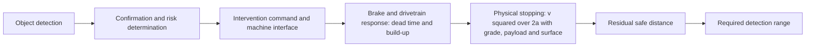

#### 3. How models are built and checked, and how many physical tests are needed

**Typical practice in the evidence.** Build component models (valve, accumulator, cylinder volume), fit them to bench pressure traces, then check full-machine behavior (2026 tracked brake study). **Independent** [6]. Validate stability models on scaled vehicles (wheel-loader studies). **Independent** [30, 47]. Fit uncertain contact parameters such as friction or cornering stiffness on unpaved ground by comparing simulation and experiment (2013 slope and obstacle loader model). **Independent** [58]. A patented commercial-vehicle approach compares road-test events with simulation and "finely adjusts" the virtual brake model until the two match (US patent 11104321). **Vendor (on-road evidence)** [59].

**Machine families, not serial numbers.** The fastest defensible strategy is to identify a small number of physics-based machine families before the 2027 hardware arrives rather than build a separate model for every model designation. Useful family discriminators are: wheeled versus crawler (tire-force model versus track, soil and shear dynamics; different ISO brake standard); rigid versus articulated (extra articulation, yaw and roll states); friction-brake dominant versus hydrostatic or retarder blended (different command-to-deceleration dynamics and failure cases); loaded-haul machine versus nearly fixed-mass machine (payload and center-of-gravity variability); high-speed haulage versus low-speed work machine (kinetic-energy braking versus fixed delays and geometry); hard-surface versus deformable-terrain mission. **Expert opinion**. NIOSH demonstrated the clustering idea in a related mining application: it assembled parameters for 145 underground haulage vehicles in five categories (including load-haul-dumps, shuttle cars, roof bolters and haul trucks) and used statistical methods to select representative vehicle parameter sets for dynamic models. That does not establish the right number of families for any manufacturer, but it shows that representative parameterized classes are a published alternative to modeling every machine separately. **Independent** [5].

**Field test metrics in the literature.** NIOSH's 2015 to 2018 shuttle-car proximity project plan listed stopping distance, deceleration rate, detection range, environmental effects, detection accuracy and repeatability as metrics, alongside "dynamic simulations of machine stopping distance" (2016 proximity partnership meeting). **Independent** [60]. The modeling side of that work was published as Jobes and Carr's dynamic modeling system (ASME IMECE, November 2018) for rubber-tired shuttle cars, scoops and battery haulers; the field-validation results were not found. **Independent** [4].

**Physical tests that are actually needed.** The objective of prototype tests is parameter identification and independent falsification, not replication of every virtual scenario. The test types the evidence supports: **Expert opinion**, anchored where noted.

- *Mass, geometry and load-state characterization.* Machine mass, axle or track loads, payload range, center-of-gravity geometry, tire radii or track geometry, brake distribution, articulation geometry and sensor positions, repeated at load configurations that move the center of gravity. ISO 3450's adverse-configuration test-mass provisions are the baseline. **Independent** [29].
- *Brake-actuator identification.* Controlled service-brake commands with time-stamped command, valve, pressure or current response, brake-torque proxy if available, longitudinal acceleration, wheel or track speeds and vehicle speed, to identify dead time, rise time, gain, saturation, hysteresis and release time. This must be done for the automated brake path, not just the pedal path. Measure latency to 10% g as in the South African guidance. **Independent** [55].
- *Propulsion and retarder identification.* On hydrostatic or electrically retarded machines, characterize deceleration from propel release, neutral request, retarder request and service brake individually and in their production blend. A service-brake model that ignores hydrostatic slowing can produce both early and late triggers depending on operating state. **Independent** for the hydrostatic braking role [29].
- *Straight-line stopping tests.* Forward and reverse, several speeds, payload states, brake-temperature states, representative grades and terrain classes. Measure both distance from the collision-system command and distance from actual brake-force onset; conflating them hides latency.
- *Stability tests.* Braking with steering or articulation, on cross-slope, at relevant payload states, recording roll rate and angle, yaw rate, lateral acceleration, articulation angle and rate, individual wheel or track speeds and brake pressures. ISO 3450 includes controllability requirements for certain combined brake and steer systems, so stopping distance is not the only outcome. **Independent** [29].
- *Crawler and soft-ground identification.* Track speed, ground speed, slip, sinkage or rut state and stopping response across a deliberately selected set of terrain states. Site-wide soil modeling is unnecessary if these tests identify a conservative "available longitudinal deceleration versus state" envelope; detailed terramechanics is needed only where simple envelopes fail to transfer.
- *Hot-brake, downhill and repeated-stop testing.* Brake torque depends on temperature; the US Bureau of Mines haul-road design manual warned that its stopping curves were primarily mathematical rather than field results and that constant-braking calculations cannot capture heat build-up and fade. **Independent** (historic) [61].
- *Hold and restart tests.* Complete stop, brake hold, release, rollback or roll-forward on grade, and motion inhibition from standstill. ISO 21815-3 warns that discontinuing an intervention must not create rollaway and recommends an operator action such as applying the parking brake before collision-system braking is released. **Independent** [15].
- *End-to-end latency tests.* Inject a known synthetic or physical object event and timestamp detection, confirmation, risk decision, brake request, machine-interface receipt, actuator response and measurable deceleration; ISO 21815-3 treats these as separate portions of the collision-system distance. **Independent** [15].

**How many tests.** No standard or study gives a required number of physical tests for calibrating a model for collision-avoidance timing: not found. Neither ISO 3450 nor ISO 10265 nor the public collision-avoidance literature gives a defensible number of calibration stops that guarantees prediction across 100-plus site types, several brake architectures and all the stated weather conditions; the ISO brake standards are machine performance standards, not statistical model-transfer standards. ISO 3450 prescribes its own brake tests, for example repeated service-brake applications in the fade sequence. **Independent** [29, 39, 38]. The 2026 tracked brake study used three repetitions per condition. **Independent** [6].

Two complementary answers were given, both **Expert opinion**:

- *A sequential design of experiments with a quantitative stop criterion.* Use low-risk experiments that maximally excite the parameters being estimated; fit the model to a designated calibration set; freeze parameters; challenge the frozen model on independent combinations not used in fitting, especially downhill, low-traction, high-payload, hot-brake and turning or cross-slope boundaries; add tests only where prediction intervals are too wide, residuals are systematically biased, or the case lies outside the validated domain. This turns "have we run N tests?" into "is the error bound on the safety-relevant quantity small enough at every declared operating boundary?". Never use the same stop to both tune and claim validation: a model can interpolate its calibration cases well and still fail on the first downhill or different-load condition.
- *An indicative matrix per machine family* (wheeled rigid, articulated, tracked) and per brake or drive architecture: a static latency sweep of command to pressure to 10% g, at least 10 repetitions across oil temperatures; straight-line stops at three speeds × two payloads × level and maximum design grade, three repetitions each; one surface-friction matrix of hard, loose and wet surfaces at low speed; for articulated machines, stops at the articulation limit and on a side slope. That comes to roughly 60 to 100 instrumented runs per family, achievable in the window only if families share instrumentation.

NIOSH's 2018 dynamic stopping tool illustrates the intended simulation role: it varied six input variables at five values each in its sensitivity mode (30 simulation rows) and analyzed brake force, grade, initial speed, lag and rolling resistance; the authors proposed that, once validated, such a model could reduce subsequent field testing, and did not claim it already replaced validation. **Independent** [4].

#### 4. Decision logic: when to warn and when to brake

**On-road logic.** Modern road regulations and consumer tests specify scenario performance, not one mandatory internal time-to-collision threshold. The US FMVSS No. 127 final rule (May 2024) defines automatic emergency braking as braking automatically if the driver has not done so, or supplementing insufficient driver braking; the algorithm remains the manufacturer's design choice. **Independent (on-road evidence)** [62]. Within that freedom, the published logic families are:

- Time-to-collision thresholds staged by phase (warning, partial braking, full braking), for example in an open-source openpilot-based study that assumed a 2.5 s driver reaction time (arXiv, 2023). **Independent (on-road evidence)** [63].
- Time-to-brake logic that delays activation until the distance to collision equals the required stopping distance, with extra gating conditions ("no ego acceleration", "no time-to-evade") to suppress false positives (arXiv, 2025, analyzing real crash reconstructions). **Independent (on-road evidence)** [64].
- Look-up-table time-to-collision thresholds adapted to the target's acceleration (US patent 11724673). **Vendor (on-road evidence)** [65].

Tuning trades avoidance against latency. Haus, Sherony and Gabler (2019) showed how the share of US pedestrian crashes avoided depends on both the time-to-collision trigger and the system latency. **Independent (on-road evidence)** [33, 66]. Automated braking has been reported at about 170 ms sensing plus 50 ms detection error, against about 700 ms for humans (Hamberg et al., 2015, as reported in a 2021 review). **Independent (on-road evidence)** [66]. Regulatory tests then constrain the result: UN R152 includes false-activation scenarios, such as driving between two stationary vehicles without a warning or braking; NHTSA's heavy-vehicle test procedures use stationary-vehicle false-positive scenarios and a −0.05 g onset threshold to detect when braking begins. **Independent (on-road evidence)** [3, 67]. A 2026 round robin standardized a 1.0 s time-to-collision trigger to compare simulation tools; that was a research test definition, not an appropriate earth-moving threshold. **Independent (on-road evidence)** [11].

The transferable lesson from road practice is the process: simulate and test a family of conflict scenarios, tune detection and intervention to maximize avoidance while controlling nuisance interventions, and evaluate the full sensor-to-actuator path. The thresholds themselves cannot be copied, because ground, grade, geometry, speeds, articulation and intended close-proximity work differ.

**Off-road logic.** ISO 21815-3:2023 sizes a collision-risk area from machine kinematics. Its collision-system distance must cover object detection, confirmation and determination, action, machine stopping and a final safe distance; the detection distance "shall be large enough to allow a machine to stop", and the risk area may be reduced using current speed, turning angle, physical or virtual barriers and the projected or expected path. Collision-system action is placed at collision-risk level 4 or above, with a warning permitted before it. This is a stopping-distance and risk-zone model, not a pure time-to-collision model, and the standard leaves the machine-specific numbers to manufacturer and integrator information. **Independent** [15]. Other off-road examples:

- An excavator safety algorithm predicted the swing-and-boom working area kinematically and used time to collision and a warning index to switch between safe, warning and emergency-braking modes, evaluated in virtual reality (Journal of Mechanical Science and Technology, 2019; simulation only). **Independent** [18].
- A Hitachi patent for electric mining trucks uses two time-to-collision limits; the second includes a margin m1 of "1 to 3 seconds or so" for operator reaction (US patent 10710587). **Vendor** [19].
- Early mine haul-truck work derived detection ranges of 15 m to the sides (people), 50 m to the rear and 100 m to the front from a 0.5 s reaction time plus braking (Griffith University thesis, 2005). **Independent** [68].

A practical implementation of the ISO structure is a margin M = R − (D_perception + D_decision + D_action + D_stop,pred + D_safe), where R is the predicted path distance to the collision point. Positive M means margin remains; a progressively negative or rapidly falling margin raises the collision-risk level. D_stop,pred should be an uncertainty-bounded prediction, not v²/(2µg), with inputs including grade, current speed, estimated load state, surface or traction state, brake and drive state, brake temperature or degraded state where available, direction, and steering or articulation state where it limits usable deceleration. **Expert opinion**, consistent with the standard.

**Why time to collision is weaker here.** Time to collision (relative distance divided by closing speed) works for simple constant-velocity road scenarios and many research systems use it. For this application:

- Near zero relative speed it becomes very large or numerically unstable even when the machine is centimeters from a person or structure, and it jumps to infinity and back during maneuvering, stop-start loading and reversing.
- Two machines at the same time to collision can need radically different distances because of grade or surface.
- Detection and actuator delays are time terms while physical braking distance has a strong v² component.
- Machine motion is not straight-line: articulation, swing, and counter-rotation of tracks can create a collision without longitudinal closing speed.
- A stationary machine presents a start-up collision hazard for which time to collision is undefined.
- Pedestrians are often legitimately close to the machine.

These are physical and mathematical consequences; ISO's choice of distance and risk areas, and its inclusion of motion inhibit, aligns with them. **Expert opinion** supported by the standard [15]. Distance-and-zone logic based on predicted swept volume and stopping envelope is therefore more robust than time to collision alone, with time to collision retained for faster haul traffic and as a diagnostic input. No head-to-head off-road study was found.

**What is different at low speed.** At 3 km/h to 15 km/h the v² term is small, but sensor-confirmation time, controller delay, hydraulic or pneumatic response, brake build-up, object-localization error, safe clearance and start-up blind-zone hazards remain, so fixed-distance terms dominate the trigger. This produces a seemingly paradoxical result: very low-speed work may need a comparatively large warning zone in units of stopping distances while still having a short absolute zone in meters, particularly around the machine's blind corners, while reversing, at start-up, and when people enter the path from the side. ISO 21815-3 therefore permits risk-area reduction when real-time kinematics and expected path are known, instead of prescribing one large static box around every machine. **Independent** [15]; **Expert opinion** for the low-speed reasoning.

**Assumed reaction times vary widely in the sources:** 0.5 s (Griffith, 2005); about 1 s (CSIRO, 2007; the MSHA Table M-1 operator term); 1 s to 3 s margins (Hitachi patent); about 2 s (historic US Bureau of Mines haulage work); 2.5 s (AASHTO and MUTCD for road design, and the 2023 openpilot study). **Independent** and **Vendor** [68, 69, 2, 19, 9, 70, 63].

#### 5. Staged interventions

**The frameworks.** EMESRT's Vehicle Interaction nine-layer control model defines Level 7 (operator awareness), Level 8 (advisory controls) and Level 9 (intervention controls that "automatically slow down and stop the vehicle"), and stresses that the upper levels depend on a strong Level 1 to 7 baseline for normal operations and on real-time human decision making. Its performance requirement PR-5A is at Rev 3.0, dated September 2024 (as cited in a Wabtec white paper). **Expert opinion** (industry body) [20, 21]; **Vendor** for the product descriptions [22, 71]. The number of surface vehicle-interaction scenarios is reported as 24 in a 2019 trade article describing PR-5A, while EMESRT's own 2024 activity report counts 17 surface scenario storyboards published in 2019; the two figures count different things (scenarios defined in PR-5A against published storyboards). The same report confirms that PR-5A was reviewed and updated in September 2024 without stating a revision number.

ISO 21815-1:2022 limits interventions to speed reduction, stopping or motion inhibit, not steering. **Independent** [13]. ISO/TS 21815-2:2021 defines J1939 commands to "slow down, stop or prevent motion of the machine", including prevention of movement from standstill, and allows the machine to report that an action "may be overridden"; it states explicitly that it is not plug-and-play and that additional machine and collision-system integration details are required. **Independent** [14]. ISO 21815-3 requires distinguishable warning levels, accounts for operator action time, permits slowing and braking, and places collision-system action at collision-risk level 4 or above. **Independent** [15]. The forthcoming Parts 4 and 5 extend the same ladder to swing and rotation and to articulation, four-wheel steer, trailers, skid steer and counter-rotation, telescopic and vertical motion. **Independent (draft)** [16, 17].

NIOSH's intelligent proximity detection adds selective function disablement: it blocks only the motions that could pin a worker rather than shutting the machine down, so that workers keep "greater freedom to position themselves to see visual cues or avoid other hazards". **Independent** [23, 72, 73, 74].

On-road automatic emergency braking stages warning, then a haptic brake jerk, then partial braking, then full braking. The UNECE heavy-vehicle discussion notes that decelerations above 4 m/s² during the warning phase are not prohibited "for very short durations", as a haptic cue. **Independent (on-road evidence)** [24].

**The ladder as it applies to earth-moving machines:**

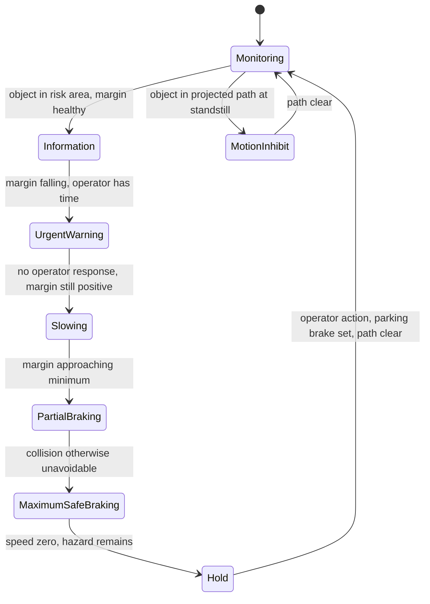

- *Information or low-level warning:* object present, stopping margin healthy; visual or spatial indication; low nuisance cost but can overload the operator if frequent.
- *Urgent warning:* collision risk rising while operator action still has adequate margin; distinct audible, visual or haptic warning; preserves operator authority, but human reaction is variable and warning fatigue is real.
- *Automatic slowing:* operator does not reduce risk, substantial margin remains; reduce propel request, retarder or hydrostatic slowing, or light brake; smooth and reduces energy before the emergency phase, but may give insufficient deceleration downhill and the drivetrain response varies.
- *Partial service braking:* predicted safe margin approaching minimum; controlled deceleration below stability and traction limits; gives the operator time and reduces abrupt load transfer, but may extend time inside the hazard zone and create conflict with following machines.
- *Maximum safe collision-mitigation braking:* collision otherwise unavoidable within the conservative stopping envelope; maximum braking consistent with the current stability and control constraint; risks rollover, articulation instability, payload shift and sliding. No off-road universal deceleration value was found.
- *Stopped-state hold:* machine at zero speed while the hazard remains; maintain brake or hold; prevents creep into the obstacle, but release can cause rollback or roll-forward.
- *Motion inhibit from standstill:* object already in the projected path before launch; reject or limit the propel or articulation command; solves the hazard that time to collision cannot represent, but nuisance inhibits disrupt close-proximity tasks. Fielded underground on continuous miners.
- *Selective function disable:* position-dependent zone logic that disables only hazardous motions (NIOSH intelligent proximity detection); adds complexity and depends on zone accuracy.

The transition between partial and full intervention should not be calibrated by range alone. It should depend on the remaining stopping margin and its uncertainty: a well-localized rigid wall on dry hard-packed ground is different from a partially occluded person near a machine on downhill mud, even at identical nominal distance. **Expert opinion**.

#### 6. Hazards from the intervention and how deceleration limits are set

A collision-avoidance system moves the machine from an awareness function to a motion-control safety function. The second edition of ISO 19014-2 applies to machine control systems that control motion or mitigate a hazard, while awareness-only systems such as cameras and radar detectors are excluded; ISO 19014-5 provides performance-level tables for safety-control functions. Both were shown by ISO as under publication in October 2026, so their final status should be rechecked before design freeze. **Independent (draft)** [75, 76].

**Hazards documented or implied by the sources:**

- *Rollover or unload instability.* Abrupt longitudinal deceleration transfers load; on a cross-slope or during steering this combines with lateral load transfer. High-center-of-gravity payloads, partially loaded bodies, suspended tools and uneven ground worsen it. Overloading makes machinery less stable and less able to steer and brake. **Expert opinion** (general safety guidance; not separately sourced). Li et al. model active braking as an influence on wheel-loader roll. **Independent** [30, 46].
- *Articulation and yaw instability.* Braking alters front-unit and rear-unit yaw and articulation dynamics; direct quantitative automatic-braking data for off-road articulated haulers: not found. The need to account for articulation is reflected in ISO/PRF 21815-5's dedicated treatment of articulation-related collision movement. **Independent (draft)** [17].
- *Loss of directional control or run-away on grade or loose ground.* Using the available ground shear fully for longitudinal braking leaves less lateral capability for steering, so "brake as hard as physically possible" is unsafe in some turning and cross-slope cases. The New South Wales formulas explicitly assume no skidding, and ISO 3450 includes controllability requirements during braking. **Independent** [1, 29].
- *Payload movement, spill or tool movement.* The binding limit can be set by the load or attachment before traction is exhausted: a rock-filled dumper, a lifted loader bucket and an unloaded dozer need different envelopes. Published data and universal limits for such configurations: not found.
- *Sliding or ground failure near edges.* At a dump edge or excavation, braking loads add to already marginal ground support. NIOSH mining research has included braking inertial forces in slope-edge stability analysis (specific source not found). **Expert opinion**.
- *Operator injury from sudden stops.* MSHA engineers estimate that "three to four miners' lives could be saved each year if adequate seat belts were provided and worn", which is also why restraint matters for an automatic stop. **Independent** [77].
- *Secondary collisions and rear-end conflicts from false positives.* Unexpected automatic deceleration can create conflict with following plant or cause an operator to lose control. In the US heavy-vehicle automatic-braking rulemaking record (July 2023 proposal), commenters raised concern about false or unexpected braking creating dangerous situations. **Independent (on-road evidence)** [31].
- *Rollaway after intervention.* ISO 21815-3 recommends requiring an operator action, such as applying the parking brake, before automatic brake release where needed to prevent rollaway. **Independent** [15].
- *Production loss and operator disabling of the system after nuisance stops.* Repeatedly described as the main reason deployed proximity systems failed. **Vendor** (patent background) and **Independent** [25, 27].

**How deceleration limits are set.** On the road, regulators set minimum performance, not maximums; UN R152's 5.0 m/s² braking demand is a floor. **Independent (on-road evidence)** [3]. For off-road machines no published maximum automatic-braking deceleration was found, and ISO 21815 leaves the intervention profile to the machine manufacturer through the interface. A universal safe deceleration value across wheeled, tracked, articulated, empty, loaded, level, downhill and cross-slope machines: not found. A standard or peer-reviewed comfort or stability limit for automatic braking of earth-moving machines: not found.

The published position (**Expert opinion**) is to command, per machine and per moment, the minimum of several limits:

a_command = min(a_collision-need, a_traction, a_stability, a_machine, a_load/attachment),

where a_collision-need is the deceleration required to preserve the target clearance; a_traction = µ_min·g·cos θ − g·sin θ from the current surface and tire or track capability; a_stability comes from the roll, pitch, yaw and articulation state, with payload, from the multibody analysis; a_machine from actual brake and drive capability and thermal state; and a_load/attachment from payload-shift or implement constraints, with an operator-restraint limit alongside. Ramp the deceleration up gradually (a jerk limit), never release the brake on a downgrade, finish in a parking-brake or hold state so the machine cannot roll away, and when the deceleration needed to avoid the collision exceeds the safe envelope, still apply the maximum safe mitigation and report that avoidance is no longer physically guaranteed rather than silently assuming the commanded deceleration will be achieved.

#### 7. Recognizing that the operator is already reacting

**On-road regulation and tests.** UN R131 and UN R152 let the driver interrupt the warning and the emergency braking by "a conscious action like an accelerator kick-down or a swerving". **Independent (on-road evidence)** [32, 3]. On-road logic also delays braking until the "last possible moment" to cut false positives. **Independent (on-road evidence)** [64]. Test protocols monitor brake-pedal force to confirm whether the driver applied the brakes (AAA, 2024). **Independent (on-road evidence)** [78]. Some logic delays braking until steering avoidance is no longer possible, or brakes earlier when steering avoidance is blocked (US patent 11427166). **Vendor (on-road evidence)** [79].

**Off-road.** The strongest directly applicable requirement is in ISO 21815-3: the collision-avoidance system must not override operator braking when the operator's braking is greater than the system's braking demand, and intentional operator control may be permitted to override an automatic intervention where appropriate. **Independent** [15]. The Hitachi mining-truck patent checks brake-pedal stroke after the second alarm to decide that "an avoidance action has been performed"; its first alarm switches off once time to collision recovers above the first limit. **Vendor** [19]. University of Pretoria work (2024) samples plausible steering-rate trajectories (Gaussian) to predict collisions and cut false brake interventions on mining vehicles, with simulation-only "initial results". **Independent** [34].

**Signals a production system should fuse** (**Expert opinion**; no off-road validation found):

| Operator or machine signal | Interpretation | Gating principle |
|---|---|---|
| Brake pedal or lever demand, brake pressure, requested brake torque | Direct braking action | Credit according to actual achieved or predicted deceleration, not switch status |
| Hydrostatic swashplate, propel or travel lever returned toward neutral | Operator requesting slowing | Credit only if the machine is actually losing speed fast enough |
| Retarder or inching pedal request | Active deceleration | Include the measured retarder response and delay |
| Steering or articulation command and rate | Possible evasive path change | Suppress braking only if predicted collision risk is demonstrably falling; steering alone is not proof of safety |
| Accelerator or propel demand released | Early reaction | Weak evidence; a downhill machine can accelerate after throttle release |
| Direction-lever change or reversal request | Potential avoidance | Account for hydrostatic or transmission delay and the danger of a new collision in the opposite direction |
| Measured longitudinal deceleration | Physical confirmation of response | Strong signal, but delayed relative to intent |
| Predicted path moving away from the object | Avoidance becoming effective | Strong cross-check for steering or articulation responses |

The last of the braking cues is the most physically meaningful: if a_measured ≥ a_required plus a margin, suppress the intervention. The core design rule that follows: do not suppress automatic intervention merely because an operator control moved; suppress or reduce it when the operator's action produces a collision-avoidance trajectory at least as safe as the automatic action. This avoids a common failure in which a startled operator briefly releases the accelerator or touches the brake, the automatic system stands down, and the remaining stopping margin keeps collapsing. After an automatic stop, the control state should use hysteresis and an explicit release condition; on slopes, do not release collision-system braking because the detected object disappears for one sensor frame. **Expert opinion**, anchored in ISO 21815-3's rollaway provision [15].

#### 8. Simulation used to tune thresholds before field testing

**On-road examples with results. All on-road only.**

- Haus, Sherony and Gabler (Traffic Injury Prevention, 2019) combined US pedestrian crash data with theoretical automatic-braking systems over a grid of time-to-collision triggers and latencies and estimated crash avoidance and fatality-risk reduction for each combination (retrospective simulation, peer-reviewed). **Independent (on-road evidence)** [33, 66].
- A 2025 arXiv study analyzed a V2X-enhanced partial-brake plus automatic-braking system against real-world crash reconstructions (preprint, not peer-reviewed). **Independent (on-road evidence)** [64].
- The 2015 grade-aware study is valuable as a failure example: a trigger based on surface condition but not grade worked at 0% grade and collided at 11% and 17%; including grade shifted full-brake initiation earlier and avoided the modeled collisions. The lesson is not its numbers but that a trigger can look correct on a level proving ground and be structurally wrong on grade. **Independent (on-road evidence)** [10].
- The 2026 ESV round robin (above) showed that even with a prescribed 1.0 s trigger, 0.2 s delay, 0.4 s build-up, 1 g and µ = 0.9, tools disagreed by 0.033 s and 0.314 m in the brake-only test, with larger baseline differences before harmonization. The simulator itself needs verification: a common scenario description does not guarantee equivalent initial conditions, reference points, time-to-collision definitions, tire behavior or actuator implementation. **Independent (on-road evidence)** [11].

**Off-road examples.**

- *NIOSH stopping-distance modeling (the closest public precedent).* NIOSH built a dynamic model because proximity systems designed around slow crawler mining machines were being considered for faster rubber-tired underground haulage, raising concern that existing detection zones might not cover the stopping distance. The model allowed changes in brake force, grade, initial speed, lag and rolling resistance. Its sensitivity work showed that more brake force shortened predicted stopping distance; initial speed strongly affected distance; brake-system lag changed stopping distance even at underground speeds; grade materially changed outcomes; and for some combinations the downhill force exceeded braking capability and the machine did not stop. The authors envisioned using the model to reduce field tests after validation, and did not present it as field-validated (ASME IMECE, November 2018). **Independent** [4].
- *Parameter reduction across machine classes.* The companion NIOSH work collected data for 145 underground haulage machines in five categories and statistically selected representative parameter sets (2016). **Independent** [5].
- *Standards-based virtual configuration.* ISO 21815-3 embeds model-based thinking in its risk-zone framework: its informative annexes include examples for configuring collision-system parameters from machine stopping performance, so using a correlated stopping model to configure risk zones is aligned with the standard rather than an alternative to it. **Independent** [15].
- *Excavator virtual-reality evaluation* of time-to-collision-based safe, warning and emergency-braking modes in a "sticking" scenario (2019). Simulation only; no field comparison reported. **Independent** [18].
- *University of Pretoria kinematic-sampling collision prediction* (Springer Lecture Notes in Mechanical Engineering, October 2024). Simulation-only initial results. **Independent** [34].
- *Griffith University (2005)* used Monte Carlo simulation plus field demonstration of a Doppler-radar system and reported 75 m detection of light vehicles. It is a detection study, not a brake-threshold study. **Independent** [68].
- *NIOSH continuous-miner intelligent proximity zones* were designed from retrospective analysis of MSHA fatality reports (1984 to 2014) rather than physics simulation; of 39 fatalities with published investigation reports, 32 (82%) were judged preventable under the zone configurations studied. **Independent** [23, 72].
- *University of Pretoria's staged test protocol* runs from laboratory-scale technology-readiness tests with brake robots and high-precision GPS to mine-like single-interaction tests, now extending underground. **Independent** and **Expert opinion** [80, 81]. A March 2026 press release says Hexagon's Vehicle Intervention System passed its TRL4 test there, without numbers. **Vendor** [82].

**Mismatches and failures.** No published off-road example compares simulation-tuned thresholds with field results quantitatively: not found. The nearest warning signs are the site-to-site stop-zone variation of up to 11.7 ft (3.6 m) in NIOSH's nine underground field tests, against ±5 in (±13 cm) repeatability at one site, and the friction coefficient of 2.0 needed in wheel-loader sim-to-real work. **Independent** [26, 83, 12]. NIOSH's 2022 review found that most literature evidence sits at low maturity (components and prototypes in laboratory or relevant environments) with much less evidence for complete systems in operational environments despite commercial availability. **Independent** [27].

**Sensor simulation limits everything above.** Volvo Autonomous Solutions and ESI built a real-time lidar dust-cloud disturbance model compared against experiments (arXiv, 2021; co-authored by the vendor). **Vendor** [84]. A Mie-theory rain and fog lidar model was packaged as an Open Simulation Interface functional mock-up unit (Sensors, 2023). **Independent (on-road evidence)** [85]. On-road field measurements in 30 mm/h to 40 mm/h rain and in fog with visibility under 50 m showed aluminium and steel targets not observed at 20 m to 30 m, while retroreflective targets kept at least 74% of their clear-weather point count (Sensors, 2023). **Independent (on-road evidence)** [86]. Validated simulation of snow, glare or darkness for off-road machine sensors: not found. Published off-road false-positive and false-negative rates for complete automatic-braking systems under rain, snow, fog, dust, darkness and glare: not found.

**Implementation options.** No vendor should be treated as the validation authority; the question is whether an implementation reproduces the required physics and can itself be verified. Project Chrono offers an open-source route with vehicle, rigid-terrain, deformable-terrain and tracked-vehicle capability. **Vendor** (open-source project documentation) [44]. Altair MotionSolve and MotionView publish tracked-machine soft-soil workflows and EDEM coupling. **Vendor** [45]. Siemens Simcenter Amesim provides multidomain mechanical, hydraulic, pneumatic and electrical modeling; its publicly cited articulated example is road-oriented. **Vendor (on-road evidence)** [49]. IPG TruckMaker provides commercial-vehicle dynamics, sensor models, scenario tooling and hardware-in-the-loop facilities oriented to road trucks rather than deformable terrain. **Vendor (on-road evidence)** [87]. Rigid multibody with contact is also offered by Adams and RecurDyn, and lumped hydraulics by Amesim, Simscape and Modelica tools. An in-house reduced-order model remains a strong option for the production decision layer because it makes equations, uncertainty bounds and validity limits auditable, and FMI co-simulation can connect it to commercial high-fidelity components. No public evidence establishes one toolchain as superior; an apples-to-apples benchmark of stopping-distance accuracy across these tools on the same production machines: not found. **Expert opinion**.

**What this implies for the validation programme** (**Expert opinion**; no published case proves the four-month schedule):

1. *Before the hardware arrives (now to the first quarter of 2027), freeze the decision architecture.* Primary trigger: predicted swept volume against a stopping-distance envelope, s = v·(t_sense + t_actuate) + v²/(2·a_worst), with a_worst depending on grade, payload and surface. Secondary layers: time to collision for haul-speed traffic, and operator-reaction suppression when a_measured ≥ a_required. Map the stages to ISO/TS 21815-2 commands. Define the acceptance metrics, the machine-family schema, the scenario taxonomy, the parameter database, the instrumentation and validation metrics, the synthetic terrain and grade matrix, the operator-reaction state machine, the perception-error interface, automated test execution, the Monte Carlo engine and the traceability framework, so that prototype testing identifies and confirms parameters rather than starting model development. Use existing machines before 2027 to learn distributions of grade response, rolling resistance, brake delays, load effects and stability limits as priors, even where their brake hardware differs.
2. *Build layered models per machine family rather than one "ultimate" digital twin:* a fast threshold model (longitudinal plus delay plus empirical brake and terrain) for very large parameter sweeps; a stability challenge model (yaw, roll, wheel or track loads, articulation) to derive dynamic deceleration caps; a high-fidelity selected-case model (multibody, hydraulic, hydrostatic and, where justified, soft soil) for the edge cases that invalidate the simpler model; perception and sensor simulation run separately but feeding detection delay, range and error distributions into the braking simulation; then hardware- and software-in-the-loop, replacing simulated decision and machine interfaces progressively with production hardware. Do not model the 100-plus sites physically; factor them into the variables that change stopping (longitudinal and cross slope, surface class and state, sinkage and shear strength, payload and center of gravity, speed, turn or articulation state, brake temperature and health, propulsion state, visibility and perception latency, object geometry and path) and parameterize soil by friction class.
3. *Pre-book the physical anchor campaign for the first six weeks after hardware delivery* using the test matrix in question 3; measure latency to 10% g and stop on grades where the ISO 3450 and New South Wales methods apply. The campaign answers three questions: are this machine's parameters inside the family model, are the predicted bounds conservative, and where does the model fail.
4. *Run scenario sweeps* across site class × scenario × weather and light × model variant, with sensor degradation injected from validated models where they exist, and report missed-intervention and nuisance-intervention rates together as acceptance metrics.
5. *Shadow-mode field validation for the remaining weeks:* log would-be interventions without actuating, as the Epiroc Titan product page suggests running evaluation before enforcing Level 9, and use the logs to measure nuisance rates before enabling braking. **Vendor** [22].
6. *Accept that sim-to-field transfer is unproven.* Set explicit pass criteria for model calibration (for example predicted versus measured stopping distance within a stated margin on all anchor runs) and stop to recalibrate if they fail. Treat the virtual model as a test-selection and uncertainty-propagation machine, not as proof by itself.

### Comparison tables

#### Table 1: Modeling options

| Option | What it predicts | Published accuracy evidence | Effort and data | Best use here | Off-road validation status and main limits |
|---|---|---|---|---|---|
| Energy or constant-deceleration equation, s = v²/(2a), plus grade and mass-ratio terms | Stopping distance, required detection distance | Basis of ISO 3450 (mean deceleration from v²/2s), MSHA Table M-1 and the New South Wales formulas; universal off-road prediction error not found [29, 2, 1] | Very low; hours per model | Sanity checks, requirements, conservative envelopes | Used in regulation for haul and articulated trucks; not validated statistically for automatic braking; misses delay, build-up, payload distribution, variable traction, stability; assumes no skid |
| Point-mass transient model with measured latency, build-up lag and deceleration maps (grade, payload, surface, drive state) | Stopping distance, deceleration profile; the online trigger quantity | NIOSH implemented this class and found strong sensitivity to brake force, grade, speed, lag and rolling resistance; validation still pending, so no error figure [4] | Low to moderate; needs measured latency and deceleration per family | Primary runtime stopping-distance predictor and large Monte Carlo sweeps | Published for underground haulage; cannot predict roll, yaw or articulation instability |
| Point-mass plus lumped brake hydraulics (Amesim, Simscape, Modelica, in-house) | Latency, pressure build-up and its spread | Pressure more than 96% and response time more than 95% accurate on one tracked vehicle, three repeats per condition (2026) [6] | Days to weeks; bench pressure traces | Latency identification and its distribution | One tracked-vehicle study and one mining EV brake-by-wire study [7]; temperature and wear effects not shown |
| Hydrostatic drivetrain model (displacement, pressure limits, pump speed, controller transitions) | Dynamic braking capacity versus operating state | Influencing factors identified experimentally on tracked hydrostatic vehicles [52, 53] | Weeks | Blended command-to-deceleration behavior | Limited, older studies; strong dependence on viscosity, engine braking and controls |
| Rigid full-vehicle multibody, 3 to 8 degrees of freedom, Fiala or Magic Formula tires | Roll, yaw, jackknife and pitch stability under braking; load transfer | "Reasonably agree" on scaled articulated loaders (2013, 2016) [47, 30]; road jackknife reproduced in 8 degrees of freedom (2003) [48] **(on-road evidence)** | Moderate; weeks | Stability gating, braking while turning or on cross-slope, deriving deceleration caps | Scaled models and one ZL50 application; tire parameters on unpaved ground must be fitted; one PhD left brakes out [56] |
| Full multibody with contact and detailed plant (commercial: AGX, Adams, RecurDyn, Simcenter; open-source: Chrono) | Full machine dynamics, actuator and failure analysis, real-time co-simulation | Loader digging sim-to-real needed friction 2.0 (2024) [12]; round robin: complex models spread 0.033 s and 0.314 m where point-mass models agreed [11] **(on-road evidence)** | High; months; parameter-heavy | Design exploration, difficult transitions, reduced-order envelope creation | Digging tasks, not braking; vendor capability only for braking; more complexity can mean more disagreement |
| Semi-empirical terramechanics (Bekker-Wong, Soil Contact Model in Chrono, Altair soft soil) | Braking force and sinkage on soft soil | Under 10% force error in some single-wheel studies; tuning varies with slip angle (2023) [42, 43]; SCM "comparable" to DEM per its authors [57] | High; weeks plus soil tests | Low-traction and sinkage envelope; crawler and soft-ground cases | Single-wheel rigs and sand; soil parameters vary across and within sites and over time; calibration can dominate |
| DEM, SPH or FEM terrain plus multibody machine | Granular flow, rutting, localized soil failure | High fidelity, very slow; evidence that it is required for threshold prediction not found [44, 45] | Very high; high-performance computing | Selected limit cases: berms, deep aggregate, severe track-soil interaction | Research only; unusable for scenario sweeps; uncertain soil inputs overwhelm fidelity |
| Reduced-order or surrogate model fitted to high-fidelity simulation and tests | Whatever the training data represent; very fast | Common practice; earth-moving transfer benchmark not found | Moderate once source models exist | Millions of threshold and uncertainty evaluations | Unsafe extrapolation outside the trained domain |
| Sensor models (physics-based lidar, radar, camera with weather) | Detection range, dropouts, detection delay distributions | Rain and fog lidar model versus measurement (2023) [85, 86] **(on-road evidence)**; dust model with a mining OEM (2021) [84] | Weeks to months | Feeding detection delay, range and error into the braking simulation | Dust model is off-road; snow, glare and darkness weakly validated or not found |

#### Table 2: Intervention strategies

| Stage | Trigger logic (typical) | Actuation | Evidence base | Key risks and limits | Off-road status |
|---|---|---|---|---|---|
| Information or awareness warning (EMESRT Level 7; ISO 21815 warning) | Object in risk area, margin healthy; time to collision or zone | Visual, audible, spatial indication | Widely fielded; 37% of reviewed haul-truck systems were warning-type (NIOSH, 2022) [27, 20, 13] | Nuisance alarms leading to distrust, fatigue or disabling [25] | Mature |
| Urgent or advisory warning (Level 8) | Escalating risk; operator not yet reacting | Distinct audible, visual or haptic cue; haptic brake jerk above 4 m/s² for very short durations on road [24] **(on-road evidence)** | ISO 21815-3 requires distinguishable warning levels and accounts for operator action time [15] | Startle; variable human reaction; warning fatigue | Defined in frameworks; little data |
| Automatic slowing or speed limit | Predicted stopping envelope approaches object; margin still positive | Throttle cut, transmission, retarder, hydrostatic swashplate toward neutral, light brake | ISO/TS 21815-2 "slow down" command [14]; ISO 21815-3 permits slowing [15] | Production loss; insufficient deceleration downhill; drivetrain response varies | Interface standardized; tuning data not found |
| Partial service braking | Margin approaching minimum; time-to-brake or time-to-collision threshold on road | Controlled service-brake ramp below stability and traction limits | On-road phased automatic braking [64] **(on-road evidence)**; standard permits braking, staging is a design choice [15] | Extends time in hazard zone; following-machine conflict; abrupt load transfer | Not found for off-road |
| Full stop or maximum safe mitigation braking | Distance to object about equal to stopping distance plus margin; collision otherwise unavoidable | Service brake at the dynamic deceleration cap, then hold or parking brake | EMESRT Level 9 descriptions [22, 71] **Vendor**; ISO 21815 ladder [15] | Rollover or jackknife (articulated), load shift, sliding at edges, operator injury [30] | Vendor claims; independent off-road data and universal deceleration value not found |
| Stopped-state hold | Speed zero while hazard remains | Maintain brake or hold | ISO 21815-3 rollaway provision [15] | Release can cause rollback or roll-forward | Standard requirement; implementation data not found |
| Motion inhibit from standstill | Person or object in start-up zone or projected path | Interlock on travel, swing or articulation command | ISO/TS 21815-2 "prevent motion" [14]; ISO/PRF 21815-5 for other motions [17] **(draft)**; NIOSH proximity detection [23] | Blocking legitimate close-proximity work | Fielded underground on continuous miners |
| Selective function disable | Position-dependent zone logic | Disable only the hazardous motions | NIOSH intelligent proximity detection [72, 74, 83] | Complexity; zone accuracy varies by site (up to 11.7 ft between sites) [26] | Underground coal |

### Where the evidence stands

#### Well established

- Off-road stopping performance is specified kinematically, from brake-control actuation to standstill, with system response included and operator reaction excluded, and with payload and adverse configuration prescribed in the test (ISO 3450, ISO 10265, MSHA Table M-1, New South Wales guidance). **Independent** [29, 38, 2, 1].
- Grade and mass corrections are essential; grade, initial speed, brake force, brake lag and rolling or terrain resistance all materially affect off-road stopping, as NIOSH's stopping model demonstrates. **Independent** [4, 1].
- Service, secondary and parking braking functions need distinct treatment, and a hydrostatic drive may slow the machine but cannot replace a parking brake. **Independent** [29].
- The ISO 21815 ladder is warn, slow, stop and inhibit motion, with no automatic steering; an intervention system should reason in terms of detection, determination, action, stopping and safe clearance. **Independent** [13, 14, 15].
- A system that commands machine motion for safety needs a stronger functional-safety treatment than a warning-only system; the revised ISO 19014 distinguishes motion-controlling safety-control systems from awareness systems. **Independent (draft)** [75, 76].
- Nuisance alarms undermine acceptance, and technology alone is "not a silver bullet" (ICMM Innovation for Cleaner, Safer Vehicles). **Independent** and **Expert opinion** [25, 88].

#### Uncertain

- Actual latency distributions for production brake systems on large wheeled and articulated machines, across hydraulic, pneumatic, hydrostatic, wet-disc, electrically retarded and blended architectures: not found.
- Deceleration on wet clay, loose gravel or mud; any universal terrain braking parameters: not found. Ground state varies on scales smaller than a site and over minutes with water, traffic and material disturbance.
- A safe maximum automatic deceleration for articulated machines, or any universal maximum for earth-moving machinery: not found.
- An accepted physical-test count for validating a transferred brake model across machine families: not found.
- Whether simulation-tuned thresholds transfer to the field off-road: not found.
- Validity of sensor simulation in snow, glare and darkness for off-road machines, and published off-road false-positive and false-negative rates under adverse weather: not found.
- A public benchmark of stopping-distance accuracy for Project Chrono, Altair, Simcenter, IPG or an in-house model on the same production earth-moving machines: not found.
- Operational maturity. NIOSH's 2022 review found most evidence at low maturity, with little scientific evidence for complete systems in operational environments. **Independent** [27].
- The exact revision number of EMESRT PR-5A after its September 2024 update (Rev 3.0 is a vendor citation; EMESRT's 2024 activity report confirms the update without a number); the 24-scenario and 17-storyboard figures count different things (see Section 5).
- The optimum conservatism trade-off. An extremely conservative trigger reduces collision risk in nominal simulations but creates frequent unnecessary braking, alarm fatigue, productivity loss and intervention-created hazards; operational evidence defining the optimum for earth-moving automatic braking is thin.

#### Where experts disagree

1. *Time to collision versus stopping-distance zones as the primary trigger.* Road practice favors time to collision and time to brake; ISO 21815-3 frames risk areas sized by stopping ability; probabilistic risk scores are also used in research. There is no universal agreement on one metric. The strongest technical case for this application is a hybrid stopping-margin and risk-zone method with time to collision as a supplemental feature. **Expert opinion** [15, 64].
2. *Whether the highest-fidelity model is the best production threshold model.* The 2026 round robin shows detailed models can produce more variation than prescribed point-mass models; the correct fidelity is the lowest model that predicts every safety-relevant output within a validated uncertainty envelope. **Independent (on-road evidence)** and **Expert opinion** [11].
3. *Whether Level 9 intervention should be enforced immediately.* Epiroc's Titan page claims "full level 7, 8 and 9" capability with EMESRT PR-5A as a guideline yet recommends running evaluation "without immediately enforcing level-9 intervention"; South African practice, by contrast, pushes Level 9 mandates. **Vendor** [22]; **Expert opinion** [71].
4. *Assumed reaction times* range from 0.5 s to 2.5 s across sources (see question 4). [68, 69, 19, 70].
5. *Whether intervention research targets the right problem.* NIOSH (2022) notes most system literature addresses vehicle-to-vehicle collisions while most haul-truck fatalities are vehicle-to-environment, such as driving through a berm; NIOSH's 2020 roadmap found loss of control the most common initiating event (33 of 91 fatal accidents). **Independent** [27, 28].

### Blind spots

Issues the eight questions did not ask about:

- **Functional safety and integrity level.** An automatic brake is a safety function under the ISO 19014 series and ISO 13849, with ISO 21448 for perception limits. The required performance level drives architecture and validation effort as much as threshold tuning does. ISO/TS 21815-2 places the collision-avoidance device outside the machine controller and states that it is not plug-and-play. **Independent (draft)** [75, 76, 14].
- **Perception performance may dominate braking-model accuracy.** ISO's distance budget starts at detection. If dust, fog, darkness, glare, mud on a sensor, self-occlusion, vibration or poor mounting cut reliable detection range below the required stopping distance, no brake model can recover the lost margin. [15]
- **Sensor position and machine geometry need a geometric model, not just recalibration.** Different lengths, widths, articulation centers, body structures and blind zones alter both detection coverage and the collision envelope; a transferable system needs machine geometry as configuration data.
- **Attachments and changing geometry.** Buckets, forks, blades, booms, dump bodies and trailers change swept volume and center of gravity. ISO 21815-4's 2026 scope has limitations related to machine and tool height, so not every attachment hazard is covered by the collision standard. **Independent (draft)** [16].
- **Object class and collision severity.** Braking policy should not treat a person, another haul truck, a cone, a berm, a rock pile and vegetation identically; the false-positive cost and required clearance differ, and the permissible semantics need safety requirements before threshold tuning begins.
- **Multi-object scenes.** Avoiding the nearest detected object can create a second conflict, especially during steering or articulation; a scalar nearest-range trigger is inadequate in crowded work zones.
- **Brake fade, wear, faults and stored-energy state.** Heat, wear and accumulator charge change deceleration and latency over a shift; NIOSH's roadmap found fatal accidents where vehicles failed to stop "despite there being some combination of brakes available". ISO 3450 includes service, secondary and stored-energy provisions, and the automatic system should not assume nominal service-brake performance after a detected degradation; in-service monitoring such as accumulator charge time (US patent 10210676) is one approach. **Independent** [28, 29]; **Vendor** [89].
- **Downhill and loss-of-control cases**, where the hazard is not an object in the path, and post-stop behavior (rollaway, automatic restart, operator override, direction change, loss of object detection after the machine pitches under braking), which deserve their own hazard analysis. [15, 28]
- **Interaction with following traffic and site traffic rules**, which belong to EMESRT Levels 1 to 6. [20]
- **Human factors.** Operators may come to rely on the system (risk compensation), and alarm fatigue can lead to tampering or disabling.
- **Regulatory gaps.** The MSHA surface mobile equipment rule (effective 19 January 2024, enforced from 17 July 2024) requires written safety programs but does not mandate collision avoidance; Australian and South African requirements differ. **Independent** [90, 91].
- **Cybersecurity and integrity of the J1939 interface.** [14]
- **Simulation traceability is itself a validation item.** The 2026 round robin showed divergent outcomes under a common scenario specification; every virtual test needs versioned machine parameters, coordinate definitions, object reference points, initial conditions, time-step and solver assumptions and trigger definitions. **Independent (on-road evidence)** [11].
- **Data logging from fielded warning systems** is the cheapest source of real scenario distributions (approach speeds, false-alarm rates) for the 100-plus site types.
- **Brake-system variants within a family.** Validation is organized by machine family above, but the research did not examine how a family model is re-qualified when a supplier changes a brake valve, pump or control software mid-programme; the test-count question reappears at every such change.
- **Unit and definition consistency across sources.** The sources mix braking demand (UN R152), mean deceleration from v²/2s (ISO 3450), constant deceleration with separate response times (MSHA), and net safe deceleration on grade (New South Wales). A programme that pools them into one envelope must first convert them to one definition of stopping distance and one time origin.

### Sources

1. NSW Resources Regulator (Department of Primary Industries). New brake formula based on ISO 3450: proposed minimum safe net deceleration and stopping-distance formulas for mobile plant (built on ISO 3450:1996 and AS 2958.1). New South Wales Government. Undated proposal document; accessed October 2026. https://www.resources.nsw.gov.au/sites/default/files/documents/iso-3450-dpi-new-brake-formula.pdf. **Independent**.
2. MSHA. 30 CFR 56.14101, Brakes, including Table M-1 service brake performance (surface metal and nonmetal mines). Electronic Code of Federal Regulations, current text. Accessed October 2026. https://www.ecfr.gov/current/title-30/chapter-I/subchapter-K/part-56/subpart-M/subject-group-ECFR4ab5d0ad53bb2fd/section-56.14101. **Independent**.
3. UNECE. UN Regulation No. 152, Uniform provisions concerning the approval of motor vehicles with regard to the Advanced Emergency Braking System (AEBS) for M1 and N1 vehicles, Amendment 1 (consolidated text). United Nations Economic Commission for Europe. 2020. https://unece.org/fileadmin/DAM/trans/main/wp29/wp29regs/2020/R152am1e.pdf. **Independent (on-road evidence)**.
4. Jobes, C. C. and Carr, J. L. (NIOSH). Dynamic Modeling System to Determine Stopping Distances of Mobile Underground Coal Equipment. Proceedings of the ASME 2018 International Mechanical Engineering Congress and Exposition (IMECE2018), Volume 4A. November 2018. https://stacks.cdc.gov/view/cdc/227811. **Independent**.
5. Jobes, C. C., Bissert, P., Mahmoudian, N. and Li, B. (NIOSH and Michigan Technological University). Development of Parameters for Dynamic Modeling of Underground Haulage Vehicles. 2016. https://stacks.cdc.gov/view/cdc/228469. **Independent**.
6. Research and Optimization of a Digital Model of a Tracked Vehicle Hydraulic Braking System. Materials 19(8), article 1620. 2026. https://doi.org/10.3390/ma19081620 (open copies: https://pmc.ncbi.nlm.nih.gov/articles/PMC13117693/ and https://pubmed.ncbi.nlm.nih.gov/42073784/). **Independent**.
7. Experimental Study on Electro-Hydraulic Cooperative Braking by Wire Safety Performance of Mining Electric Vehicles. Springer conference chapter. 2025. https://link.springer.com/chapter/10.1007/978-981-96-5527-4_60. **Independent**.
8. Transportation Research Board. Stopping Sight Distance Design for Large Trucks. Transportation Research Record 1208. 1989. https://onlinepubs.trb.org/Onlinepubs/trr/1989/1208/1208-005.pdf. **Independent (on-road evidence)**.
9. US Bureau of Mines/NIOSH. Mining haulage equipment visibility and braking study (operator reaction and retarder lag observations for large haulage equipment). Historic government report, CDC republication. Accessed October 2026. https://stacks.cdc.gov/view/cdc/206987. **Independent**.
10. Grade-aware automatic emergency braking simulation study (road-grade term in the AEB trigger). International Journal of Applied Engineering Research 10(19). 2015. https://www.ripublication.com/ijaer10/ijaerv10n19_42.pdf. **Independent (on-road evidence)**.
11. Wimmer, P. et al. Virtual automatic emergency braking round robin: multi-tool simulation of a cyclist AEB scenario (ESV paper 26-0104). Proceedings of the 28th International Technical Conference on the Enhanced Safety of Vehicles (ESV), NHTSA. 2026. https://static.nhtsa.gov/esv/pdf/ESV/Proceedings/28/ESV26_104.pdf. **Independent (on-road evidence)**.
12. Examining the simulation-to-reality gap of a wheel loader digging in deformable terrain (AGX Dynamics; co-funded by Komatsu and Algoryx). Multibody System Dynamics. 2024 (preprint arXiv 2310.05765, 2023). https://link.springer.com/article/10.1007/s11044-024-10005-5 (preprint: https://arxiv.org/pdf/2310.05765). **Independent**.
13. ISO. ISO 21815-1:2022, Earth-moving machinery, Collision warning and avoidance, Part 1: General requirements. International Organization for Standardization. January 2022. https://www.iso.org/standard/77302.html (sample pages: https://cdn.standards.iteh.ai/samples/77302/f1d344788b2f410c84afc741608a7839/ISO-21815-1-2022.pdf). **Independent**.
14. ISO. ISO/TS 21815-2:2021, Earth-moving machinery, Collision warning and avoidance, Part 2: On-board J1939 communication interface. International Organization for Standardization. 2021. https://www.iso.org/standard/77303.html (sample pages: https://cdn.standards.iteh.ai/samples/77303/8fc47e4a16524524a12ed9f9606a50f2/ISO-TS-21815-2-2021.pdf). **Independent**.
15. ISO. ISO 21815-3:2023, Earth-moving machinery, Collision warning and avoidance, Part 3: Risk area and risk level for forward/reverse motion. International Organization for Standardization. August 2023 (edition 1; final-draft sample pages: https://cdn.standards.iteh.ai/samples/77266/09bfa2ad7d9c4426a42511f1facbd591/ISO-FDIS-21815-3.pdf). https://www.iso.org/standard/77266.html. **Independent**.
16. ISO. ISO 21815-4, Earth-moving machinery, Collision warning and avoidance, Part 4: Risk area and risk level for swing and rotation motion. International Organization for Standardization. Under publication as of October 2026. https://www.iso.org/standard/81597.html. **Independent (draft)**.
17. ISO. ISO/PRF 21815-5, Earth-moving machinery, Collision warning and avoidance, Part 5: Risk area and risk level for other forms of motion. International Organization for Standardization. Proof stage, publication expected November 2026 (status as of October 2026). https://www.iso.org/standard/89934.html. **Independent (draft)**.
18. Development and evaluation of advanced safety algorithms for excavators using virtual reality. Journal of Mechanical Science and Technology. 2019. https://link.springer.com/article/10.1007/s12206-019-0239-8. **Independent**.
19. Hitachi Construction Machinery. US Patent 10,710,587, Electrically-driven mining vehicle and brake operation guiding method in electrically-driven mining vehicle. USPTO. Granted 2020. https://image-ppubs.uspto.gov/dirsearch-public/print/downloadPdf/10710587. **Vendor**.
20. EMESRT (Earth Moving Equipment Safety Round Table). Vehicle Interaction Improvement: about this industry project (nine layers of defence model). Accessed October 2026. https://emesrt.org/vehicle-interaction-improvement/. **Expert opinion**.
21. Wabtec. Key Insights for the Successful Implementation of Proximity Detection (white paper citing EMESRT PR-5A Rev 3.0, September 2024). 2024. https://www.wabteccorp.com/Digital-Intelligence/Digital-Mine/White-Papers/Proximity-Detection-and-Collision-Avoidance-Technology. **Vendor**.
22. Epiroc. Titan collision avoidance system (product page). Accessed October 2026. https://www.epiroc.com/en-id/products/digital-solutions/safety-solutions/collision-avoidance. **Vendor**.
23. Bissert, P. T., Carr, J. L., DuCarme, J. P. and Smith, A. K. (NIOSH). Design of Intelligent Proximity Detection Zones to Prevent Striking and Pinning Fatalities Around Continuous Mining Machines. Transactions of the Society for Mining, Metallurgy, and Exploration 340, 75 to 81. 2016. https://stacks.cdc.gov/view/cdc/46803/cdc_46803_DS1.pdf. **Independent**.
24. UNECE AEBS-HDV informal working group (ETSC and DVR). Comments to the draft skeleton of UN Regulation No. 131, informal document AEBS-HDV-08-08 (haptic warning decelerations above 4 m/s² for very short durations). United Nations Economic Commission for Europe. Accessed October 2026. https://wiki.unece.org/download/attachments/140711251/AEBS-HDV-08-08%20(ETSC-DVR)%20Comments%20to%20draft%20skeleton.pdf?api=v2. **Independent (on-road evidence)**.
25. US Patent 8,847,780. Proximity detection system and method and collision avoidance system and method using proximity detection. USPTO. Granted 2014. https://image-ppubs.uspto.gov/dirsearch-public/print/downloadPdf/8847780. **Vendor**.
26. NIOSH. Performance Summary of Continuous Mining Machine Proximity Detection Systems. Proceedings of ASME IMECE 2016, paper V012T16A024. November 2016. https://asmedigitalcollection.asme.org/IMECE/proceedings-abstract/IMECE2016/50664/V012T16A024/258181 (open copy: https://stacks.cdc.gov/view/cdc/228341). **Independent**.
27. Hrica, J. K., Bellanca, J. L., Benbourenane, I., Carr, J. L., Homer, J. and Stabryla, K. M. (NIOSH). A Rapid Review of Collision Avoidance and Warning Technologies for Mining Haul Trucks. Mining, Metallurgy & Exploration 39(4), 1357 to 1389. Published online 17 June 2022, issue dated August 2022. https://stacks.cdc.gov/view/cdc/215557 (publisher: https://doi.org/10.1007/s42461-022-00633-w; also indexed at https://onemine.org/documents/a-rapid-review-of-collision-avoidance-and-warning-technologies-for-mining-haul-trucks-mining-metallurgy-exploration-). **Independent**.
28. NIOSH. Haul Truck Research Roadmap Report 2020. CDC/NIOSH Mining Program (archived page). 2020. https://archive.cdc.gov/www_cdc_gov/niosh/mining/strategicplan/HaulTruckRoadmap2020.html. **Independent**.
29. ISO. ISO 3450:2011, Earth-moving machinery, Wheeled or high-speed rubber-tracked machines, Performance requirements and test procedures for brake systems. International Organization for Standardization. November 2011; reviewed and confirmed 2022. https://www.iso.org/standard/42076.html (sample pages: https://cdn.standards.iteh.ai/samples/42076/b8ba6ae95e3d4125b5831a0e9b742628/ISO-3450-2011.pdf). **Independent**.
30. Li, X. et al. Study on Roll Instability Mechanism and Stability Index of Articulated Steering Vehicles. Mathematical Problems in Engineering, article 7816503. 2016. https://onlinelibrary.wiley.com/doi/10.1155/2016/7816503. **Independent**.
31. NHTSA and FMCSA. Heavy Vehicle Automatic Emergency Braking; AEB Test Devices, notice of proposed rulemaking. Federal Register. 6 July 2023. https://www.federalregister.gov/documents/2023/07/06/2023-13622/heavy-vehicle-automatic-emergency-braking-aeb-test-devices. **Independent (on-road evidence)**.
32. UNECE AEBS-HDV informal working group (ETSC and DVR). Comments to the consolidated skeleton of UN Regulation No. 131 (Advanced Emergency Braking Systems for heavy-duty vehicles), informal document AEBS-HDV-07-04, reproducing the regulation's override and interruption provisions. United Nations Economic Commission for Europe. Accessed October 2026. https://wiki.unece.org/download/attachments/140707598/AEBS-HDV-07-04%20(ETSC-DVR)%20Comments-only%20to%20the%20Consolidated%20skeleton.pdf?api=v2. **Independent (on-road evidence)**.
33. Haus, S. H., Sherony, R. and Gabler, H. C. Estimated benefit of automated emergency braking systems for vehicle-pedestrian crashes in the United States. Traffic Injury Prevention 20(sup1). 2019. https://doi.org/10.1080/15389588.2019.1602729. **Independent (on-road evidence)**.
34. University of Pretoria, Vehicle Dynamics Group. Collision prediction for a mining collision avoidance system. Springer Lecture Notes in Mechanical Engineering; University of Pretoria repository. October 2024. https://repository.up.ac.za/items/38362242-ead9-4edb-8092-2e4b0e94750d. **Independent**.
35. Volvo Construction Equipment. A60 articulated hauler specifications (about 55 t payload, 99 t gross). Product page. Accessed October 2026. https://www.volvoce.com/united-states/en-us/products/articulated-haulers/a60/. **Vendor**.
36. Caterpillar. 797F Mining Truck specifications (363 t nominal payload, 623,690 kg rated gross machine weight). Product page. Accessed October 2026. https://www.cat.com/en_US/products/new/equipment/off-highway-trucks/mining-trucks/18093014.html. **Vendor**.
37. Caterpillar. D11 Dozer specifications (about 106,614 kg operating weight). Product page. Accessed October 2026. https://www.cat.com/en_US/products/new/equipment/dozers/large-dozers/15969853.html. **Vendor**.
38. ISO. ISO 10265:2008, Earth-moving machinery, Crawler machines, Performance requirements and test procedures for braking systems. International Organization for Standardization. February 2008; reviewed and confirmed 2025. https://www.iso.org/standard/39809.html. **Independent**.
39. ISO. ISO 3450:1996, Earth-moving machinery, Braking systems of rubber-tyred machines, Systems and performance requirements and test procedures (third edition, superseded by ISO 3450:2011). International Organization for Standardization. April 1996. https://cdn.standards.iteh.ai/samples/20731/1f8d9fdd767b4ec6afcd5e753ced32ba/ISO-3450-1996.pdf. **Independent**.
40. US Patent 12,437,633. Methods and systems for operating vehicles to reduce bunching (haul-road deceleration model). USPTO. Granted 2025. https://image-ppubs.uspto.gov/dirsearch-public/print/downloadPdf/12437633. **Vendor**.
41. Laughery, S. et al. (US Army). Bekker's Terramechanics Model for Off-Road Vehicle Research. Defense Technical Information Center, report ADA457955. Accessed October 2026. https://apps.dtic.mil/sti/tr/pdf/ADA457955.pdf (copy: https://www.academia.edu/56690951/Bekkers_Terramechanics_Model_for_Off_Road_Vehicle_Research). **Independent**.
42. A terramechanics model for high slip angle and skid with prediction of wheel-soil interaction geometry. Journal of Terramechanics. 2023. https://www.sciencedirect.com/science/article/abs/pii/S0022489823000691. **Independent**.
43. Application of a terrain-deformation-based terramechanics model for wheel mobility modes: driving, braking, and lateral slip. Journal of Terramechanics. 2026. https://www.sciencedirect.com/science/article/pii/S0022489826000522. **Independent**.
44. Project Chrono. Chrono::Vehicle terrain models (rigid, CRG, SCM deformable and granular terrain), development documentation. Open-source project. Accessed October 2026. https://api.projectchrono.org/development/vehicle_terrain.html. **Vendor**.
45. Altair. MotionView/MotionSolve tutorial: Tracked Vehicle Modeling (soft soil and EDEM coupling). Altair documentation. Accessed October 2026. https://help.altair.com/hwdesktop/hwx/topics/tutorials/mv/tut_mv_7031_tracked_vehicle_modeling_mvx.htm. **Vendor**.
46. Li, X. et al. Control Methods for Roll Instability of Articulated Steering Vehicles. Mathematical Problems in Engineering, article 8041816. 2016. https://onlinelibrary.wiley.com/doi/10.1155/2016/8041816. **Independent**.
47. Research on lateral stability and rollover mechanism of articulated wheel loader. Mathematical and Computer Modelling of Dynamical Systems. 2013. https://www.tandfonline.com/doi/full/10.1080/13873954.2013.825871. **Independent**.
48. A study on the braking stability of articulated heavy vehicles. JSAE Review. 2003. https://www.sciencedirect.com/science/article/abs/pii/S0389430403000079. **Independent (on-road evidence)**.
49. Siemens Digital Industries Software. E-trailers and truck stability (Simcenter Amesim 22-degree-of-freedom articulated road-vehicle example). Simcenter blog. Accessed October 2026. https://blogs.sw.siemens.com/simcenter/e-trailers-and-truck-stability/. **Vendor (on-road evidence)**.
50. US Patent 12,157,443. Auxiliary brake system for outdoor grounds maintenance vehicles having hydrostatic traction drive systems. USPTO. Granted 2024. https://image-ppubs.uspto.gov/dirsearch-public/print/downloadPdf/12157443. **Vendor**.
51. Yanmar. V10 wheel loader specification sheet (hydrostatic drive listed as auxiliary brake). June 2017. https://www.yanmar.com/media/news/2017/06/Yanmar-V10-Spec-Sheet-US.pdf. **Vendor**.
52. Hydrostatic Braking Revisited. Technical paper (ResearchGate copy). Accessed October 2026. https://www.researchgate.net/publication/288828344_Hydrostatic_Braking_Revisited. **Independent**.
53. Li et al. Study on Braking Capacity of Hydrostatic Transmission Vehicle (tracked vehicle). Journal article (ResearchGate copy). Accessed October 2026. https://researchgate.net/publication/251889360_Study_on_Braking_Capacity_of_Hydrostatic_Transmission_Vehicle. **Independent**.
54. US Patent 8,112,211. Method and device for hydrostatically braking a vehicle. USPTO. Granted 2012. https://image-ppubs.uspto.gov/dirsearch-public/print/downloadPdf/8112211. **Vendor**.
55. Mine Health and Safety Council (South Africa). SIM 040502: Brake testing of trackless mobile mining equipment (research report). MHSC. Undated; accessed October 2026. https://mhsc.org.za/sites/default/files/public/research_documents/SIM%20040502%20Brake%20testing%20of%20trackless%20mobile%20equipment%20Report.pdf. **Independent**.
56. Hafez, M. Investigation of integrated control of articulated heavy vehicles. PhD thesis, University of Birmingham. 2021. https://etheses.bham.ac.uk/id/eprint/11495/1/Hafez2021PhD.pdf. **Independent (on-road evidence)**.
57. Deformable soil with adaptive level of detail for tracked and wheeled vehicles (Project Chrono Soil Contact Model). Journal article (ResearchGate copy). Accessed October 2026. https://www.researchgate.net/publication/326904884_Deformable_soil_with_adaptive_level_of_detail_for_tracked_and_wheeled_vehicles. **Independent**.
58. Dynamic model and validation of an articulated steering wheel loader on slopes and over obstacles. Journal article (ResearchGate copy). 2013. https://www.researchgate.net/publication/263061445_Dynamic_model_and_validation_of_an_articulated_steering_wheel_loader_on_slopes_and_over_obstacles. **Independent**.
59. US Patent 11,104,321. Method for putting into operation a brake system with predefined approval specifications and system for putting into operation a brake system with predefined approval specifications. USPTO. Granted 2021. https://image-ppubs.uspto.gov/dirsearch-public/print/downloadPdf/11104321. **Vendor (on-road evidence)**.
60. MSHA and NIOSH. 2016 Proximity Detection Partnership Meeting (presentation, docket MSHA-2014-0019-0126, including the shuttle-car proximity project plan). Regulations.gov. 2016. https://downloads.regulations.gov/MSHA-2014-0019-0126/content.pdf. **Independent**.
61. US Bureau of Mines. Design of Surface Mine Haulage Roads: A Manual (Information Circular 8758). Historic government manual, republished by CDC/NIOSH. 1977. https://stacks.cdc.gov/view/cdc/8915. **Independent**.
62. NHTSA. Federal Motor Vehicle Safety Standards: Automatic Emergency Braking Systems for Light Vehicles (FMVSS No. 127), final rule. Federal Register. 9 May 2024. https://www.federalregister.gov/documents/2024/05/09/2024-09054/federal-motor-vehicle-safety-standards-automatic-emergency-braking-systems-for-light-vehicles. **Independent (on-road evidence)**.
63. Runtime Stealthy Perception Attacks against DNN-based Adaptive Cruise Control Systems (openpilot-based study with staged TTC thresholds). arXiv 2307.08939 (preprint). 2023. https://arxiv.org/pdf/2307.08939. **Independent (on-road evidence)**.
64. Analyzing the performance of a V2X-enhanced braking system in real-world crash situations. arXiv 2506.10535 (preprint, not peer-reviewed). June 2025. https://arxiv.org/pdf/2506.10535. **Independent (on-road evidence)**.
65. US Patent 11,724,673. Automatic emergency braking using a time-to-collision threshold based on target acceleration. USPTO. Granted 2023. https://image-ppubs.uspto.gov/dirsearch-public/print/downloadPdf/11724673. **Vendor (on-road evidence)**.
66. A Review of Autonomous Road Vehicle Integrated Approaches to an Emergency Obstacle Avoidance Maneuver. arXiv 2105.09446 (preprint). 2021. https://arxiv.org/pdf/2105.09446. **Independent (on-road evidence)**.
67. NHTSA. Test Track Procedures for Heavy-Vehicle Forward Collision Warning and Automatic Emergency Braking Systems. US Department of Transportation, ROSA P repository. Accessed October 2026. https://rosap.ntl.bts.gov/view/dot/42186/dot_42186_DS1.pdf. **Independent (on-road evidence)**.
68. Griffith University (PhD thesis). Collision Avoidance Systems for Mine Haul Trucks and Unambiguous Dynamic Real Time Single Object Detection. 2005. https://www.academia.edu/58997953/Collision_Avoidance_Systems_for_Mine_Haul_Trucks_and_Unambiguous_Dynamic_Real_Time_Single_Object_Detection (figure copy: https://www.researchgate.net/figure/Haul-Truck-Visibility-from-the-Drivers-Cab_fig2_268442181). **Independent**.
69. Phys.org (reporting CSIRO). Collision avoidance technology for mine haul trucks. December 2007. https://phys.org/news/2007-12-collision-technology-haul-trucks.html. **Expert opinion**.
70. FHWA. Manual on Uniform Traffic Control Devices, 11th edition, Chapter 2C (warning signs; perception-response time). US Federal Highway Administration. December 2023. https://mutcd.fhwa.dot.gov/pdfs/11th_Edition/Chapter2c.pdf. **Independent (on-road evidence)**.
71. Mining Business Africa. Sensor-Based Intelligent Mining Operation: Level 9 Collision Avoidance Systems, the leap to Level 9. Issuu, January to February 2023 issue. https://issuu.com/miningbusinessafrica/docs/mba_jan_-_feb_2023_digital_magazine/s/18309449. **Expert opinion**.
72. NIOSH. Proximity Detection Zones: Designs to Prevent Fatalities Around Continuous Mining Machines. Journal article, PubMed Central PMC4982554. 2016. https://pmc.ncbi.nlm.nih.gov/articles/PMC4982554/. **Independent**.
73. CDC/NIOSH. Mining and Machinery Struck-by Injuries: Proximity Detection (mining topic page). Accessed October 2026. https://www.cdc.gov/niosh/mining/topics/ProximityDetection.html. **Independent**.
74. CDC/NIOSH. Intelligent Proximity Detection (Mining Feature, archived). Accessed October 2026. https://archive.cdc.gov/www_cdc_gov/niosh/mining/Features/proximity.html. **Independent**.
75. ISO. ISO 19014-2 (second edition), Earth-moving machinery, Functional safety, Part 2: Design and evaluation of hardware and architecture requirements for safety-related parts of the control system. International Organization for Standardization. Under publication as of October 2026. https://www.iso.org/standard/87718.html. **Independent (draft)**.
76. ISO. ISO 19014-5, Earth-moving machinery, Functional safety, Part 5: Tables of performance levels. International Organization for Standardization. Under publication as of October 2026. https://www.iso.org/standard/87719.html. **Independent (draft)**.
77. MSHA. Powered Haulage Safety (safety and health initiative page, including seat-belt estimate). Mine Safety and Health Administration. Accessed October 2026. https://www.msha.gov/safety-and-health/safety-and-health-initiatives/powered-haulage-safety. **Independent**.
78. AAA. Progression of Automatic Emergency Braking Technology (full research report). American Automobile Association. October 2024. https://newsroom.aaa.com/wp-content/uploads/2024/10/REVISED-10-17-24-Full-Research-Report-Progression-AEB-Technology.pdf. **Independent (on-road evidence)**.
79. US Patent 11,427,166. Adaptive AEB system considering steerable path and control method thereof. USPTO. Granted 2022. https://image-ppubs.uspto.gov/dirsearch-public/print/downloadPdf/11427166. **Vendor (on-road evidence)**.
80. Mining Magazine. Collision avoidance test going underground (University of Pretoria test programme). Accessed October 2026. https://www.miningmagazine.com/fleets/news/1400701/collision-avoidance-test-underground. **Expert opinion**.
81. University of Pretoria. UP's Vehicle Dynamics Group employs smart transportation technology for improved mine safety (news item on the staged test protocol). Accessed October 2026. https://www.up.ac.za/mechanical-and-aeronautical-engineering/news/post_2942026--ups-vehicle-dynamics-group-employs-smart-transportation-technology-for-improved-mine-safety-. **Expert opinion**.
82. Global Mining Review. Hexagon Vehicle Intervention System first and only open-pit Level 9 solution to pass University of Pretoria safety test (press release). 26 March 2026. https://www.globalminingreview.com/mining/26032026/hexagon-vehicle-intervention-system-first-and-only-open-pit-level-9-solution-to-pass-university-of-pretoria-safety-test/. **Vendor**.
83. NIOSH. Evaluation of an advanced proximity detection system for continuous mining machines. Conference paper (ResearchGate copy). Accessed October 2026. https://www.researchgate.net/publication/275971679_Evaluation_of_an_advanced_proximity_detection_system_for_continuous_mining_machines. **Independent**.
84. Volvo Autonomous Solutions and ESI Group. Modelling of LIDAR sensor disturbances by solid airborne particles. arXiv 2105.04193 (preprint). 2021. https://arxiv.org/pdf/2105.04193. **Vendor**.
85. A Methodology to Model the Rain and Fog Effect on the Performance of Automotive LiDAR Sensors. Sensors (MDPI), PubMed Central PMC10422612. 2023. https://www.ncbi.nlm.nih.gov/pmc/articles/PMC10422612/. **Independent (on-road evidence)**.
86. Empirical Analysis of Autonomous Vehicle's LiDAR Detection Performance Degradation for Actual Road Driving in Rain and Fog. Sensors 23(6), 2972. 2023. https://doi.org/10.3390/s23062972. **Independent (on-road evidence)**.
87. IPG Automotive. Commercial vehicles: TruckMaker vehicle dynamics, sensor simulation, ADAS scenarios and HIL (solution page). Accessed October 2026. https://www.ipg-automotive.com/solutions/industries/commercial-vehicles. **Vendor (on-road evidence)**.
88. ICMM. Innovation for Cleaner, Safer Vehicles (ICSV) programme page. International Council on Mining and Metals. Accessed October 2026. https://www.icmm.com/icsv. **Expert opinion**.
89. US Patent 10,210,676. Systems, apparatuses, and methods for monitoring pressure in a hydraulic system (accumulator charge monitoring). USPTO. Granted 2019. https://image-ppubs.uspto.gov/dirsearch-public/print/downloadPdf/10210676. **Vendor**.
90. MSHA. Surface Mobile Equipment Safety Program (compliance guidance). Mine Safety and Health Administration. Accessed October 2026. https://www.msha.gov/sites/default/files/Regulations/Surface%20Mobile%20Equipment%20Safety%20Program.pdf. **Independent**.
91. MSHA. Final Rule: Safety Program for Surface Mobile Equipment. Mine Safety and Health Administration. Effective 19 January 2024; enforced from 17 July 2024. https://www.msha.gov/final-rule-safety-program-surface-mobile-equipment. **Independent**.

## Chapter 9: Covering the combinations and tuning

_How to test a very large space of site, weather, light, machine and sensor combinations with a limited number of runs, what can honestly be claimed from the results, and how to use them to tune the system without over-fitting._

### The research question

A manufacturer of heavy off-road machines for construction, mining and quarrying already sells a system that warns the operator when the machine gets too close to an object. It is now developing a system that also applies the brakes automatically if the operator does not react. Prototype hardware and software will arrive in mid-2027, and validation must then finish in less than four months, where the same kind of function previously took three to four years of mostly physical testing and per-model tuning. The system must work across more than 100 job-site types, more than ten operating scenarios per machine, many weather and light conditions (rain, snow, fog, dust, dusk, darkness, glare) and many machine models with different sizes and sensor positions; the sensor types (camera, radar, lidar, ultrasonic and others) are not yet fixed.

The research set out to find the best methods to cover a very large test space with a limited number of tests, to make sound statistical claims from those tests, and to use the results to tune the system. It worked through nine questions:

1. How can a test space that combines site types, operating scenarios, weather, light, machine models, sensor positions, speeds and object types be structured? How do scenario catalogs, operating-domain definitions and parameterised scenario families compare?
2. Which methods choose the combinations to test? How do design of experiments, combinatorial testing, random sampling, failure-seeking search and rare-event methods compare, and what can each claim and not claim?
3. How many tests are enough? Which statistical claims can be made about detection rates and false alarm rates, and how much data do they need?
4. How do teams keep failure-seeking tests separate from estimates of real-world performance?
5. How are test results used to tune thresholds, zones and filters against several goals at once (few missed detections, few false alarms, few unnecessary brake events), and how is over-fitting to the test set avoided?
6. How can settings tuned for one machine model be transferred to other models with different sizes and sensor positions, or tuned automatically for them?
7. If detection uses machine learning, what is the evidence on training with simulated or generated data, and what are the risks?
8. How are thousands of test runs managed (versions, traceability from requirement to result, repeat testing after each change)?
9. Which scenario description languages and standards exist, and how well do they fit off-road work without roads or lanes?

The ground rules were neutrality (no vendor, product or technology favoured; commercial, open-source, academic and in-house options all covered), an evidence type stated for each important claim (independent study or standard, vendor claim, or expert opinion), a date for each source with a preference for 2023 or later for tools and products, and explicit reporting of failures, limits and evidence against each approach. Findings proven only for on-road vehicles were to be flagged as such, and where something could not be found the research was to write "not found" rather than guess numbers, prices or timelines.

### About the evidence

This chapter draws on 92 sources, listed at the end of the chapter. Several hundred further documents were read during the research and are not cited. Evidence is labeled in bold after the claim or in the source entry as **Independent** (peer-reviewed study, standard or regulation text, official statistics, third-party test, government or agency report), **Vendor** (a supplier's own claim, product page, press release or white paper) or **Expert opinion** (practitioner, consultant or industry-group view without data). Findings proven only for road vehicles carry the marker **(on-road evidence)**, and standards that had not been issued by October 2026 carry **(draft)**, **(under publication)** or **(under revision)**. Where something was searched for and not found, the chapter says so rather than guessing. Points on which experts and stakeholders disagree are set out in the "Where the evidence stands" section.

### Key findings

- **Structure the space in three layers, not as one Cartesian matrix.** An operating-domain taxonomy sets the boundaries, a scenario catalog guarantees that known fatal-accident patterns are always tested, and parameterised scenario families (functional, logical, concrete) with a probability distribution over their parameters feed sampling, search and estimation. The off-road anchors are ISO 21815 and the EMESRT PR-5A storyboards; ISO 34501 to 34505 and ASAM OpenODD are on-road templates whose structure transfers but whose content does not. **Independent** for the standards, **Expert opinion** for the layering [1, 2, 6, 9, 10, 12].
- **No single selection method does every job.** Combinatorial (t-way) designs guarantee discrete coverage, space-filling designs cover continuous parameters and train surrogates, falsification and adaptive search find failures, importance sampling estimates small probabilities only when the field distribution is known, and a frozen stratified random sample is the only basis for a release rate claim. **Independent** (statistics and NIST methodology); demonstrations mostly **(on-road evidence)** [25, 26, 29, 30, 34].
- **The statistics are the binding constraint.** With zero misses allowed, demonstrating a miss rate of at most 1% at 95% one-sided confidence needs 299 independent trials per claimed population; at most 0.1% needs 2,995; at most 0.01% needs 29,956. At 99% confidence the figures are 459, 4,603 and 46,050. A 1% claim in each of 20 critical strata therefore needs about 6,000 zero-miss trials, which is only feasible in simulation or hardware-in-the-loop. **Independent** (exact binomial mathematics) [25].
- **False alarms need exposure hours, not staged targets.** With zero events in T representative operating hours, the 95% upper bound on the event rate is about 3/T (exactly 2.996/T): 300 hours with no unnecessary brake supports "fewer than 1 per 100 hours", 3,000 hours supports "fewer than 1 per 1,000 hours". Clustered alarms (every bucket pass, every dust cloud) violate the Poisson assumption and need block or overdispersed models. **Independent** (Poisson mathematics); clustering caution is **Expert opinion** [25].
- **Field exposure alone cannot demonstrate rare-event performance.** RAND's Driving to Safety analysis (Kalra and Paddock, April 2016) found that 275 million failure-free miles were needed to show, at 95% confidence, a fatality rate no worse than 1.09 per 100 million miles, and about 11 billion miles to show a 20% improvement with 80% power. The logic transfers to off-road machines; the numbers do not, because the off-road claim is about per-encounter detection and intervention, which can be staged and simulated. **Independent (on-road evidence)** [35, 36].
- **Keep three campaign classes apart.** Discovery tests (combinatorial, screening, falsification, adversarial) answer "can we break it"; a frozen, pre-registered, stratified estimation sample answers "how often does it succeed in a defined population"; deterministic requirement and regression tests answer "did this change break a required behaviour". The failure fraction of a discovery campaign must never be reported as a field failure rate, and the audit set must not become another tuning set. **Independent** (ISO 34505, ISO/IEC/IEEE 29119, statistical theory) and **Expert opinion** for the governance [12, 43, 44].
- **Tune as a constrained multi-objective problem.** Make missed or late interventions a hard constraint, then optimise false warnings, unnecessary brakes and productivity loss, keeping the Pareto front visible so the trade-off is a documented safety-policy decision rather than a hidden weight. Response-surface designs suit a few smooth parameters; evolutionary and Bayesian multi-objective methods suit expensive closed-loop evaluation but weaken beyond about 20 parameters or with discontinuous responses. **Independent** (NIST methodology, peer-reviewed optimisation research); application is **Expert opinion** [25, 45, 46].
- **Avoid over-fitting with grouped splits and a frozen test set.** Hold out whole sites, weather episodes, machine models or scenario families rather than random frames; keep a tuning, validation and untouched audit split; limit queries to the frozen set; report tuned-set and frozen-set performance side by side. **Independent** (statistical and machine-learning methodology) [44].
- **Transfer settings across models through physics, not copied constants.** ISO 21815-3:2023 links collision-risk areas to machine kinematics and dimensions and defines the avoidance distance through detection, decision and action time, stopping distance and a safety distance. Expressing zones as functions of speed, latency, braking deceleration (mass, slope, surface), sensor pose and machine envelope turns per-model tuning into per-model measurement; hierarchical (partial-pooling) models and transfer Bayesian optimisation handle the residuals. No published ISO rule that "testing N representative machines validates the family" was found. **Independent** for the standard; the method is **Expert opinion** with **Independent** supporting studies [2, 48, 49].
- **Synthetic data augments training; it has not been shown to replace real validation data.** Construction and mining studies (2023 to 2026) report gains from mixing synthetic and real images, a persistent gap when training on synthetic data alone, a "materiality gap" for PPE, and degradation of state-of-the-art lidar detectors in real dust. On-road studies show the same pattern. A peer-reviewed demonstration that synthetic-only training or validation establishes collision-avoidance reliability for heavy off-road machines was not found. **Independent**; on-road items marked [52, 53, 54, 57, 58, 59, 60].
- **Scenario languages assume roads.** ASAM OpenSCENARIO DSL 2.2.0 (March 2026), OpenSCENARIO XML 1.4.0 and OpenDRIVE 1.9.0 (2026) are built around a road-traffic domain model; ASAM's own off-road concept work identified missing concepts for deformable terrain, particles, vegetation, heavy-machine manipulation and sensor degradation. Scenic (an open-source probabilistic language with native 3D geometry) fits pits, stockpiles and loading areas better but is not a standard. No off-road scenario standard was found in development that could arrive before mid-2027. **Independent (on-road evidence)** for the standards; **Expert opinion** for the off-road gap work [69, 70, 71, 75, 78].
- **Regulatory timing matters.** The EU Machinery Regulation 2023/1230 applies from 20 January 2027, before the prototype arrives, and lists safety components with self-evolving machine-learning behaviour in Annex I Part A (notified-body assessment). The Digital Omnibus on AI, Regulation (EU) 2026/1744 (in force 27 July 2026), moves machinery to a sectoral approach with AI-specific requirements to follow by delegated act. Whether a trained-then-frozen detector counts as "self-evolving" is disputed. **Independent** for the regulation text; **Expert opinion** for the commentary [81, 82, 83, 84, 85].

### Detailed findings

#### 1. Structuring the test space

The two layers that most teams confuse are the operating domain and the scenario catalog; the published evidence treats them, together with parameterised scenario families, as three different objects that solve three different problems and should be used together.

##### Layer 1: an operating-domain taxonomy

The operating domain (ODD in road-vehicle terminology) answers the question "under what environmental and operating conditions is the safety claim intended to hold?" It lists every condition the system may meet, with explicit in-domain and out-of-domain boundaries. ISO 34503:2023 gives a hierarchical way to specify an ODD for automated road vehicles, and ASAM OpenODD 1.0.0 (released 3 April 2025) gives a technology-independent data model for operating-domain taxonomies in machine-readable formats (YAML, CSV) with restrictive and permissive definitions. Both are useful architectural patterns; their normative scope is automated road vehicles, and their default attributes (lanes, junctions) dominate. **Independent (on-road evidence)** [9, 10, 74].

Off-road taxonomies exist only as academic proposals. ODD-UM (a 2022 conference paper) adapts BSI PAS 1883 and ISO 17757:2019 to underground mining; a 2024 Springer paper proposes elevating ODD concepts for unstructured environments; and an agricultural ODD framework (arXiv preprint, November 2025) reviews EMESRT PR-5A as an off-road ODD approach. None is a standard. **Independent** [14, 15, 16, 17].

A taxonomy adapted from ISO 34503 and OpenODD (on-road) and from ODD-UM and EMESRT (off-road) would have roughly these branches:

| Domain branch | Representative attributes |
|---|---|
| Site and scenery | Open pit, quarry face, earthworks, road construction, urban building site, underground heading, stockpile, loading pad or dig face, dump point, haul route, workshop or yard, parking, intersection, demolition; terrain roughness, slope, berms, walls, drop-offs, ruts, mud, material piles, structures |
| Machine operating state | Forward, reverse, turning or articulating, swing or rotation (as in the ISO 21815 parts 3 to 5), loaded or unloaded, implement position, towing or trailer state, gear, speed, acceleration |
| Machine geometry | Footprint, articulation angle, turning radius, swept volume, sensor height, offset, yaw and pitch, occluding machine structures, mass and load state |
| Objects | Worker (posture, PPE or hi-vis or not, partially occluded), adult or child surrogate where applicable, light vehicle, heavy vehicle, another machine, barrier, wall, pile, rock or boulder, attachment, low or partially buried object; dimensions, pose, motion, reflectance or material |
| Relative interaction | Crossing, following, overtaking-like motion, emerging from occlusion, stationary obstacle, backing toward an object, object approaching the machine, object leaving the path |
| Weather and air | Clear, rain rate, snow, fog visibility, airborne dust concentration (natural, vehicle-generated, blasting, excavation), spray, mud or contamination on sensors |
| Illumination | Solar elevation and azimuth, direct low-sun glare, shade transitions, dusk, darkness with or without site lighting, work lights, other machines' headlights |
| Surface and braking | Grade, cross-slope, loose gravel, mud, snow or ice where allowed, compaction, tyre or track state, payload |
| Sensor state | Modality, hardware version, extrinsics, contamination, heating or cleaning status, degraded or fault state, interference |
| Human and system state | Operator warning acknowledged or not, reaction time, inhibited modes, service-brake state, latency and network state |

Table adapted from the taxonomy logic of ISO 34503, OpenODD, ODD-UM and the ISO 21815 parts [2, 4, 5, 9, 10, 14]. **Expert opinion** for the arrangement.

The decisive design choice is to treat these dimensions as attributes rather than as 100+ unrelated site labels. Two nominally different quarries may share the same safety-relevant attributes (rough open terrain, dusty air, bright sun, high metal clutter, an 8% grade and frequent worker and vehicle crossings). Attribute-based representation lets testing cover equivalence classes and interactions instead of repeating site names. **Expert opinion.**

##### Layer 2: a scenario catalog (functional, logical, concrete)

The catalog is the traceable inventory. Each entry identifies the hazardous interaction, its requirement or hazard source, the applicable domain tags, the expected behaviour and the ID of the parameter family it belongs to. ISO 34504:2024 formalises scenario categorisation with tags, and ISO 34505:2025 (June 2025) specifies that the resulting test cases carry identifiers, objectives, inputs, steps, test platform and expected results. Both are road-vehicle standards whose information structure transfers; their off-road adequacy has not been established. **Independent (on-road evidence)** [11, 12].

The catalog follows the three-level abstraction adopted from the PEGASUS project into ISO 34501 to 34505: functional scenarios in words (for example the EMESRT storyboard "vehicle reversing towards a person"), logical scenarios with parameter ranges (person distance 0 to 30 m, approach angle, machine speed 0 to 15 km/h, dust density) and concrete scenarios with fixed values. The hierarchy is well established in automated-driving research, although the original work and most validation experience are on-road. **Independent (on-road evidence)** [19, 20].

For the off-road content, the directly applicable safety standards anchor the catalog. ISO 21815-1:2022 (January 2022) applies to earth-moving machinery, mobile underground mining machinery and road-construction machinery and explicitly includes object detection, warning and automatic intervention through speed reduction or motion inhibition. ISO 21815-3:2023 (August 2023) defines the risk area and risk level for forward and reverse motion. ISO 16001:2017 (November 2017, confirmed 2023) sets performance and test requirements for object-detection systems and visibility aids, including a detection time of at most 300 ms. Part 4 (swing and rotation) is "under publication" with an expected date of October 2026, and Part 5 (other motions such as articulation and reversing trailers) is at the final proof stage with planned publication in November 2026; both define risk areas for motions these machines have and should be tracked during the project. **Independent**; Parts 4 and 5 **(draft)** [1, 2, 3, 4, 5]. None of these standards sets statistical sample sizes or simulation-credibility rules.

The EMESRT PR-5A performance requirement (Revision 3.0, September 2024) and its scenario storyboards supply the mining hazard content. Surface storyboards were first developed in 2019 by a member company; underground storyboards were launched in May 2024. They are traceable to known fatal-accident patterns and easy for regulators and customers to understand, but their coverage is limited to what experts thought of, they say nothing about frequency, and they are not machine-readable. **Expert opinion** (industry-body guidance) [6, 7, 8].

##### Layer 3: parameterised scenario families

Instead of storing 10,000 copies of "reverse toward worker", the catalog stores one logical family, for example: "Machine reverses toward an initially visible or occluded human-shaped object while the operator does not brake." Its variables include speed, initial distance, lateral offset, person trajectory, machine yaw or articulation, slope, load, sensor installation, illumination, visibility, detection confidence, system latency, braking friction and random seed. A concrete test is one chosen vector of these values. Each family carries a parameter space plus a probability distribution over it, taken from field data or expert estimates; that distribution is what makes rate estimation possible later. **Expert opinion**, consistent with the on-road scenario literature [19, 20].

Three further rules follow from the published evidence:

- Encode constraints and conditional factors explicitly, because many combinations of the full Cartesian product are impossible or meaningless. Underground operation has no direct-sun glare; a skid-steer and an articulated hauler have different kinematic variables; an ultrasonic-only configuration should not inherit camera exposure parameters. **Expert opinion.**
- Keep sensor independence by separating a common phenomenological layer (object geometry, material, relative motion, environmental visibility) from modality-specific nuisance variables. Recent reviews confirm that camera, lidar, radar and ultrasonic sensors have different failure mechanisms and that adverse weather does not affect them uniformly; the reviews are mostly road-vehicle and unmanned-ground-vehicle work rather than production heavy machinery. **Independent (on-road evidence)** [23, 24].
- Encode the ISO 21815 risk-area definitions (forward and reverse in Part 3, swing in Part 4, articulation and other motions in Part 5) as geometric parameters of each family, so that they scale per machine model (see Section 6). **Expert opinion**, grounded in the standard [2, 4, 5].

Parameter dependencies are easy to get wrong: dust correlates with dry, windy, high-traffic conditions, and a distribution that ignores this will misweight the strata. The only off-road scenario library found in the literature, a 2022 paper on off-road testing scenario design with a separate terrain layer, was built for intelligent off-road vehicles, not for collision avoidance. **Independent** [18].

##### Comparison of the three approaches

| Approach | Strength | Weakness | Off-road evidence |
|---|---|---|---|
| Scenario catalog (EMESRT storyboards, NIOSH test protocols) | Traceable to known fatal-accident patterns; understandable for regulators and customers | Coverage limited to what experts thought of; says nothing about frequency; not machine-readable | EMESRT surface storyboards (2019) and underground storyboards (May 2024); PR-5A Rev 3.0 (September 2024) [6, 7, 8]; NIOSH evaluation recommendations (2007) [21]. **Expert opinion** and **Independent** |
| Operating-domain definition (ISO 34503, BSI PAS 1883, ASAM OpenODD 1.0.0) | Defines the boundaries and therefore what "coverage" means; machine-readable formats | On-road attributes dominate; off-road taxonomies are immature | ODD-UM (2022), unstructured-environment ODD concepts (2024), agricultural ODD framework (November 2025); all academic, none a standard [14, 16, 17]. **Independent** |
| Parameterised families (logical scenarios plus distributions) | Enable design of experiments, search and statistical estimation over continuous parameters | Require defensible distributions; parameter dependencies easy to get wrong | Off-road scenario library with terrain layer (2022) for intelligent vehicles, not for collision avoidance [18]. **Independent** |

##### Off-road specifics that on-road taxonomies do not handle

- There are no lanes, so position and path must be expressed in world or machine coordinates.
- Sensor height and pitch change with slope.
- The ego machine's own dust plume and tyres are false-alarm sources: NIOSH found that trucks' own tyres caused radar false alarms at Phelps Dodge Morenci [21, 22]. **Independent.**
- Partially buried or low-contrast objects.
- Shared human-machine zones at the dig face and in workshops.

#### 2. Methods that choose the combinations, and what each can claim

The published evidence supports a portfolio, because "coverage" has several incompatible meanings: coverage of discrete configurations, coverage of continuous parameter space, discovery of failures, and estimation of field rates. No single method delivers all four. **Independent** (NIST methodology and peer-reviewed automated-driving research; most demonstrations are on-road) [25, 26, 30, 34].

##### Design of experiments (DOE)

Design of experiments is strongest when the objective is to estimate which factors and interactions materially affect detection distance, stopping margin or false alarms. Fractional factorial designs cut the number of runs sharply but intentionally alias higher-order effects; screening designs identify influential factors; response-surface designs then characterise curvature in a smaller influential subspace; D-optimal designs are useful when constraints make standard factorial grids impossible, at the cost of orthogonality. The NIST/SEMATECH e-Handbook of Statistical Methods documents each of these designs. **Independent** [25].

- Can claim: main effects and low-order interactions of parameters on a continuous response (for example detection range against dust density and illumination); good space-filling coverage for training surrogate models.
- Cannot claim: failure probability in the field, because the design points are not weighted by real-world frequency; detection of narrow failure regions between design points. A fractional factorial showing no main effect for fog cannot rule out a localised non-linear failure at one particular combination of fog density, glare and sensor contamination. Validity depends on the response model and alias assumptions.
- Evidence: classical statistics. No off-road collision-avoidance study using DOE was found.

Space-filling schemes (Latin hypercube, Sobol and other quasi-random designs) distribute virtual experiments across continuous parameters more evenly than naive random draws and are useful for surrogate modelling and exploration. Space filling is not probability sampling: a uniformly covered parameter box is not representative of an actual quarry population, and such designs treat unrealistic regions equally unless constraints and distributions are added. **Expert opinion** (statistical synthesis).

##### Combinatorial (t-way) testing and covering arrays

A strength-t covering array guarantees that every combination of values of any t factors appears in at least one test. It is efficient for large discrete configuration spaces such as site type by weather by light by object type by machine model. NIST's combinatorial testing program found that "most software bugs and failures are caused by one or two parameters, with progressively fewer by three or more", up to about six, and reports fault detection equal to exhaustive testing with a 20 to 700 times reduction in test-set size; its ACTS covering-array generator is public domain, and open-source generators such as PICT and commercial test-design tools do the same job. **Independent** [26].

- Can claim: every t-tuple of discrete factor values has been exercised at least once.
- Cannot claim: anything about continuous parameter regions, about rates, or about failures that need more than t interacting factors. The empirical "interaction rule" comes from software studies, not from physical perception in dust, fog and glare, so it is not evidence that pairwise or 3-way coverage is sufficient for camera, radar or lidar failures caused by coupled weather, contamination, geometry and signal processing. The transfer is unproven.

##### Random, stratified and probability-weighted sampling

Random or probability-weighted sampling is the method that supports straightforward estimates of real operational performance, provided the sampling population and probabilities represent intended operation. Stratification is usually preferable: deliberately ensure enough samples from important machine, site and weather strata, then weight the strata back to their operational prevalence. **Independent** (standard statistical inference) [25].

- Can claim: unbiased estimates of detection and false-alarm rates for the assumed scenario distribution, with classical confidence intervals; per-stratum claims and lower variance with stratification.
- Cannot claim: anything valid if the distribution is wrong. Pure Monte Carlo is extremely inefficient for rare dangerous events; the rare-event limitation is documented in the peer-reviewed accelerated-evaluation literature [34].

##### Failure-seeking search (falsification)

Falsification, evolutionary search, Bayesian optimisation, fuzzing and Adaptive Stress Testing turn test selection into an optimisation problem: minimise time-to-collision, stopping margin, detection confidence or another robustness measure until failures appear. Tools include S-TaLiRo, Breach and VerifAI; surrogate-guided search and reinforcement-learning adversaries belong to the same family. Adaptive Stress Testing has demonstrated the idea in automated-driving simulations by seeking the most likely failure trajectories. VerifAI with Scenic reported up to a 5 times speed-up from parallel multi-objective falsification (2021). **Independent (on-road evidence)**, with aerospace benchmarks in the falsification tools [27, 28, 29].

- Can claim: existence and reproducibility of counterexamples, failure boundaries and worst cases inside the simulated parameter space.
- Cannot claim: failure rates. Search concentrates on failures, so the counts are biased by design; not finding a failure is not proof of absence. Search can also exploit simulator artefacts, and an objective tuned to one failure type may miss a qualitatively different one.

##### Rare-event methods

Importance sampling, cross-entropy methods, subset simulation, multilevel splitting, accelerated evaluation and naturalistic-and-adversarial environments deliberately oversample dangerous conditions while still estimating the naturalistic rate, provided each observation can be reweighted by the ratio between the real-world distribution and the accelerated sampling distribution. The accelerated-evaluation work of Zhao, Huang, Peng and colleagues (IEEE Transactions on Intelligent Transportation Systems, 2017) showed very large acceleration for lane-change conflict estimation. Dense deep reinforcement learning (D2RL; Feng et al., Nature, 22 March 2023) reported evaluation "10^3 to 10^5 times faster" while remaining unbiased, on highway and urban test tracks with an augmented-reality environment; a 2026 Nature Communications paper from the same line of work applies dense learning to break through safety-performance stagnation. All of this depends on a naturalistic behaviour model learned from large on-road datasets. **Independent (on-road evidence)** [30, 31, 32, 33, 34].

- Can claim: unbiased estimates of small failure probabilities with far fewer runs, if the likelihood ratio between proposal and true distribution is known and the proposal covers the failure region.
- Cannot claim: anything robust when the naturalistic distribution is unknown or high-dimensional (the weights become unstable and their variance can be huge), and nothing about failure modes outside the simulation's scope, for example sensor physics that the simulation does not reproduce. A poorly modelled quarry operation cannot be rescued mathematically by importance sampling. Subset simulation and multilevel splitting come from structural reliability and are weak for discontinuous perception responses; no collision-avoidance application was found.
- Off-road status: proven on-road only. No off-road naturalistic interaction dataset of comparable scale was found.

##### Adaptive and Bayesian test selection

Active-learning or Bayesian test selection learns decision boundaries efficiently under an assumed surrogate and acquisition model. Because the sampling is intentionally biased, a naive binomial confidence interval from adaptively selected tests is invalid, and the surrogate's uncertainty estimate can itself be wrong. **Independent** (general methodology) [28].

##### Position

Combinatorial testing gives guaranteed discrete coverage. Space-filling DOE gives continuous coverage and surrogate training data. Falsification hunts for failures. Importance sampling should be used only where a defensible field distribution exists; otherwise classify it as discovery. Stratified random sampling on a frozen set is the only basis for the release rate claim. Do not try to make one design perform all three jobs. Table A in the comparison section sets the claims and non-claims side by side.

#### 3. How many tests are enough

There is no universal test count. The sample size follows from the exact claim, the confidence level, the observational unit, the population definition, the permitted number of failures and the sampling design. The program should state its claims before collecting the final evidence. **Independent** (statistical methodology) [25].

##### Detection: per-trial binomial claims

Define a trial as one independent approach event, not one frame. A 10-second encounter producing 300 camera frames is one correlated encounter, not 300 detection opportunities; scoring by frame inflates the apparent sample size and makes confidence intervals grossly overconfident. **Independent** (standard statistical principle), **Expert opinion** for the application to perception testing.

For an independent Bernoulli detection opportunity with zero misses, an exact one-sided claim follows from (1 - q)^n <= alpha, where q is the maximum miss probability, 1 - alpha the desired confidence and n the number of independent opportunities. Solving gives n = ln(alpha) / ln(1 - q), the zero-failure special case of exact binomial inference. **Independent** [25].

| Claim | Failures allowed | Trials needed at 95% one-sided confidence | Trials needed at 99% one-sided confidence |
|---|---|---|---|
| Miss rate at most 5% (detection at least 95%) | 0 | 59 | 90 |
| Miss rate at most 1% (detection at least 99%) | 0 | 299 (rule of three: about 300) | 459 |
| Miss rate at most 1% | 1 | about 474 | not given |
| Miss rate at most 1% | 2 | about 630 | not given |
| Miss rate at most 0.1% (detection at least 99.9%) | 0 | 2,995 | 4,603 |
| Miss rate at most 0.01% (detection at least 99.99%) | 0 | 29,956 | 46,050 |

Rows with zero failures are exact binomial values; the rows with one or two failures use the Poisson or Clopper-Pearson approximation. **Independent** [25].

These numbers do not mean that 2,995 physical runs are enough for the whole product family. They mean that 2,995 independent opportunities drawn from one clearly defined target population with zero misses support that one aggregate 99.9%/95% statement. If a contractual or safety requirement demands separate 99.9% claims for rain, darkness, dust, each machine family and each scenario type, each claim needs its own adequate evidence or a justified statistical pooling model. A claim of at most 1% misses in each of 20 critical strata needs about 6,000 independent zero-miss trials, which is only feasible in simulation or hardware-in-the-loop; physical tests then serve to validate the simulation in each stratum and to give an independent, smaller-sample confirmation, for example 59 trials per stratum for a detection bound of at least 95%. **Independent** mathematics, **Expert opinion** for the allocation.

If misses occur, use an exact binomial (Clopper-Pearson) interval or another pre-declared binomial interval rather than continuing until a desirable percentage appears. Clopper-Pearson is exact and conservative and is the safe default for regulators; the Wilson interval is less conservative and better behaved at moderate n. **Independent** [25].

A second distinction is estimation precision versus demonstrating a threshold. A generic 95% proportion estimate with worst-case variance needs about 9,604 independent observations for plus or minus 1 percentage point and about 38,415 for plus or minus 0.5 point. Near 99% the variance is smaller, and exact interval design should be used instead of the worst-case approximation. **Independent** (standard binomial sample-size mathematics).

##### Bayesian and sequential methods

Bayesian beta-binomial analysis lets prior evidence (for example simulation results) be combined formally with physical tests. Expect challenge to the prior and use conservative Bayesian methods. The sensitivity is large: a conservative Bayesian analysis of autonomous-vehicle road testing (Zhao, Robu, Flynn, Salako and Strigini, ISSRE 2019) found that a strong prior (90% prior confidence) cuts RAND's 275 million fatality-free miles to 69 million, while a weak prior raises it to 476 million. **Independent (on-road evidence)** [37].

Sequential probability ratio tests allow stopping early when the evidence is clearly good or clearly bad, which is attractive in a four-month window, but the stopping rules must be fixed in advance. **Independent** (statistical methodology); application is **Expert opinion**.

##### False alarms and unnecessary brake events: exposure, not staged targets

False alarms need a different denominator. Good choices are false warnings per operating hour, unnecessary automatic brakes per operating hour, false interventions per mission or work cycle, and false alarms per object-free encounter. **Expert opinion.**

For a homogeneous Poisson process with zero events in exposure T, the one-sided upper bound on the rate is lambda_U = -ln(alpha) / T. At 95% confidence, -ln(0.05) = 2.996, so the bound is about 3/T: zero unnecessary brakes in about 300 representative operating hours supports a rate below 1 per 100 hours, and zero in about 3,000 hours supports below 1 per 1,000 hours. With two events in T hours the 95% bound becomes about 6.3/T. These hours must be representative operation (shadow mode on customer sites is the usual route), not staged tests. **Independent** (reliability mathematics) [25].

Mining and construction false alarms often cluster and are non-stationary: every bucket pass or dust cloud may generate repeated alarms, which violates the homogeneous-Poisson assumption. In that case use work-cycle or site blocks, overdispersed count models, hierarchical models or block bootstrap methods, and check the Poisson assumption before relying on 3/T. **Expert opinion.**

##### Weighting strata to a field rate

An overall field rate is the sum over strata of w_i times p_i, where w_i is the exposure share of stratum i. The uncertainty in w_i (how often is there dense dust at dusk?) must be reported alongside the rate. Exposure data for off-road sites were not found in public sources; customer telematics, existing warning-system logs or site studies are the only routes. **Expert opinion.**

##### The RAND argument and what transfers

RAND's Driving to Safety report (Kalra and Paddock, RR-1478-RC, April 2016) found that autonomous vehicles "would have to be driven hundreds of millions of miles and sometimes hundreds of billions of miles" to demonstrate reliability: 275 million failure-free miles to show, at 95% confidence, a fatality rate no worse than the human 1.09 per 100 million miles, and about 11 billion miles to show a 20% improvement with 95% confidence and 80% power. **Independent (on-road evidence)** [35, 36]. The logic transfers to off-road machines: field exposure alone cannot demonstrate rare-event performance, so per-stratum claims at low miss rates require simulation volume plus a credibility argument. The specific numbers do not transfer, because the off-road claim concerns per-encounter detection and intervention, which can be staged and simulated, not a fatality rate per mile.

##### Combining simulation and physical evidence

Multi-fidelity analysis and Bayesian updating are established in principle. Regulatory acceptance requires a documented credibility assessment of the simulation toolchain. The UNECE New Assessment/Test Method (NATM) master document (2022) states that its credibility framework "will define the envelope in which the virtual tool can be used"; a 2025 academic validation methodology for safety-critical virtual testing addresses the same problem from the research side. **Independent (on-road evidence)** [38, 41]. No off-road regulator acceptance of simulation-based rate claims was found.

A statistically meaningful claim therefore reads, for example: "For reverse low-speed worker encounters sampled according to distribution P over the declared operating domain, the one-sided 95% lower confidence bound on successful stopping is at least X." A statement such as "we ran 20,000 scenarios with 99.8% success" is not meaningful unless the scenario population and the selection mechanism are specified. **Expert opinion.**

#### 4. Keeping failure-seeking tests separate from performance estimates

Established practice in ISO 34505:2025 test-case evaluation, the NATM multi-pillar approach and the academic falsification literature converges on three campaign classes with separate purposes, separate data and separate governance. **Independent (on-road evidence)** for the standards; **Expert opinion** for the synthesis [12, 38, 39].

1. **Discovery or challenge testing** contains combinatorial designs, DOE screening, boundary testing, adversarial perturbations, falsification, Adaptive Stress Testing, corner-case replay and searches around known failures. It answers "can we break it, and where are the weak regions?" Its failure percentage must never be reported as an operational failure rate; label the pool "not for rate estimation".
2. **Performance-estimation testing** is a frozen, stratified random sample drawn from the declared operating-domain distribution before tuning starts, with a fixed seed and content hash stored in the test-management system. The weighting and estimators are frozen before results are inspected. It answers "how often does it succeed or nuisance-trigger in a defined operational population?"
3. **Requirement and regression testing** contains deterministic pass/fail cases tied to individual safety and functional requirements. It answers "did this software or calibration change break a required behaviour?" It is rerun continually and is neither a random population estimate nor a failure-seeking sample. ISO/IEC/IEEE 29119 separates test processes, design techniques and documentation, and ISO 34505 requires structured test-case identifiers, objectives, inputs, platform and expected results. **Independent** [12, 43].

Four further rules complete the separation:

- **Found failures become scenario knowledge, not data points.** A failure found by search becomes a new logical scenario or a permanent regression test. Its frequency is estimated separately, by sampling or by importance sampling with known weights. An importance-sampled campaign belongs in the estimation lane only when the operational density and the accelerated density are both known well enough to compute correct likelihood weights; otherwise it is discovery.
- **The audit set must not become another tuning set.** Every time engineers inspect a final-set failure and change a threshold in response, information leaks from the audit set into development. Either keep a genuinely untouched reserve or retire and replace contaminated audit cases.
- **Access control.** The tuning team sees only aggregate pass/fail at release gates, not per-case estimation results. This is the principle of the reusable holdout in adaptive data analysis (Dwork et al., Science, 2015). **Independent** [44].
- **Pre-registration.** Acceptance criteria, strata, confidence levels and stopping rules are fixed in the test plan before hardware arrives. **Expert opinion.**

#### 5. Tuning thresholds, zones and filters against several goals, without over-fitting

##### Formulate as constrained multi-objective optimisation

The decision variables are detection confidence thresholds, warning and brake zone dimensions per speed, track-confirmation filters (N-of-M frames), persistence and debounce times, time-to-collision triggers and filter constants. The outcomes are (i) missed or late interventions, (ii) false warnings per hour, (iii) unnecessary brake events per hour, (iv) intervention timing (early or late braking) and (v) productivity loss (time stopped). Do not begin by adding all outcomes into one weighted scalar cost; the safety objectives have different meanings. The published guidance supports a hierarchy. **Expert opinion**, supported by the optimisation literature [25, 45, 46].

1. Impose hard safety constraints first: minimum stopping margin, maximum permitted miss probability (for example zero misses in critical scenarios), maximum intervention latency, required coverage of particular hazardous scenarios.
2. Within the feasible region, optimise false warning and intervention rates, comfort, productivity loss and early or late braking.
3. Preserve a Pareto frontier so engineering and safety authorities can see exactly what is traded.

##### Methods

- **DOE followed by response-surface methodology** suits a modest number of continuous settings (warning distance offsets, persistence times, confidence thresholds, filter constants). It gives interpretable main effects, interactions and curvature. The NIST handbook describes response-surface designs as tools for fitting local models and optimising a process after influential factors have been identified, and documents desirability functions for combining several responses; the apparent optimum of a desirability function depends on subjective weight choices. **Independent** [25].
- **Pareto front, NSGA-II and other evolutionary methods** (Deb et al., 2002) are robust and simple to parallelise over simulation, make trade-offs explicit instead of hiding them in one score, but need many evaluations and leave a policy decision over which Pareto point is acceptable. **Independent** [45].
- **Multi-objective and "safe" Bayesian optimisation** selects the next trial from a surrogate model and its uncertainty, which is sample-efficient when each evaluation is expensive (HIL, physical). Multi-objective variants (for example hypervolume-improvement and Pareto-front batch methods, 2024) seek the frontier rather than one point; safe variants constrain exploration. Weaknesses are surrogate-model error, poor scaling beyond roughly 20 parameters, difficulty around discontinuities, adaptive bias, and the danger that an apparently safe surrogate extrapolation is wrong. **Independent** (peer-reviewed optimisation research; general engineering rather than off-road braking) [46].
- **ROC, DET or precision-recall operating-point selection** is right for the detector threshold alone, at the perception layer. It ignores the downstream braking logic and timing, so it must be followed by closed-loop evaluation: did the machine detect, decide, intervene and stop with adequate margin, and what unnecessary interventions did that choice produce? ISO 21815-3's collision-avoidance distance explicitly spans detection, decision and action time, stopping distance and safety distance, which supports this system-level view. **Independent** [2].
- **Cost-weighted single objectives** need explicit costs for a miss against a nuisance brake. That is a safety-policy decision and should be documented, not hidden in weights; sensitivity analysis on the weights is mandatory. Constraint-based formulations ("minimise nuisance subject to miss rate at most the bound") are easier to defend. **Expert opinion.**
- **Robust or worst-case optimisation** optimises the worst stratum or a high percentile rather than the average, so that a setting does not trade good average performance for a weak dust-at-night stratum. If several settings perform similarly, prefer the one in a broad stable operating region over a knife-edge optimum that fails after a small sensor misalignment, brake-temperature shift or dust change. **Expert opinion.**

##### Avoiding over-fitting

- Use grouped data partitions, not random frame splits. Hold out entire sites, weather episodes, machine IDs or scenario families. Adjacent frames from the same run appearing in both tuning and validation sets create severe leakage.
- Keep a three-way split: development or tuning set, validation or confirmation set, and an untouched audit (frozen test) set. For machine-learning model and hyperparameter selection, nested cross-validation is the recognised way to remove the optimistic bias of repeated model selection; the engineering analogue is the three-way split. **Independent** (statistical and machine-learning methodology) [44].
- Use nested validation across site types (leave-one-site-type-out) to test generalisation to unseen sites.
- Limit how often the frozen test set is queried; freeze it at a version and refresh it only for a new release with a new frozen set.
- Report tuned-set and frozen-set performance side by side; a large gap signals over-fitting.

##### Human factors as a tuning objective

Too many false alarms drive operators to ignore or disable warnings, which makes the nuisance rate a safety objective and not only a comfort one. **Independent** [47]. In a Preco Preview radar trial on a Caterpillar 793B at Phelps Dodge Morenci, NIOSH (Ruff) reported that "Occasional false alarms did occur, but not frequently enough to cause the system to be ignored", and that nuisance alarms from objects the driver already knew about also occurred. **Independent** [22]. ISO 16001 requires that the warning cannot be disabled by a single action. **Independent** [3].

#### 6. Transferring settings across machine models

##### Physics- and geometry-based parameterisation

The strongest transfer mechanism found is to parameterise the system in physical coordinates and normalised quantities rather than copying raw threshold numbers. ISO 21815-3:2023 states that collision-risk regions depend on physical kinematics (speed, turning radius, angle and machine dimensions), that real-time machine kinematics can refine them, and that the collision-avoidance distance comprises detection, determination and action time, machine stopping distance and a safety distance. It also treats configurable assumptions such as machine model, velocity and slope as information that must be controlled and communicated, which supports versioned machine-specific configuration over hidden calibration edits. **Independent** [2].

A common engineering model, consistent with the standard's component structure but not a verbatim ISO equation, is:

required detection distance = v (t_detect + t_decision + t_actuation) + v^2 / (2 a_brake(mass, slope, surface)) + machine-envelope offset + margin,

where t_detect is capped at 300 ms by ISO 16001 [3], a_brake comes from braking tests such as those defined in ISO 3450 (current edition not verified), and the sensor field of view is projected from the mounting pose to the ground plane. **Expert opinion** grounded in the standards [2, 3].

Each machine model then supplies configuration data instead of tuned constants:

- footprint and swept volume against steering, articulation and swing state;
- sensor-to-machine coordinate transforms and field-of-view and occlusion maps;
- speed-dependent stopping curves by grade, load and surface class;
- sensing, control and actuation latency distributions;
- uncertainty margins for sensor error, calibration and brake variability.

Sensor observations are transformed to a common machine coordinate frame, and a single collision logic operates on the predicted swept volume and the object trajectory. What changes per model is primarily physical configuration, not dozens of manually re-tuned constants; the per-model work becomes measurement (mass, brake deceleration, sensor pose, machine envelope). The ISO 21815 risk-area concepts are already defined relative to machine motion. **Expert opinion** [2].

##### Partial pooling, archetypes and transfer optimisation

For residual differences that physics does not capture, hierarchical (partial-pooling) models estimate a population-level response plus per-model deviations, borrowing information when machines behave similarly while retaining uncertainty for sparsely tested models. Bull et al. demonstrated hierarchical Bayesian modelling for knowledge transfer across engineering fleets (Computer-Aided Civil and Infrastructure Engineering, 2023). It does not prove that a loader and an excavator are exchangeable; similarity still has to be justified from physics and data. **Independent** [48].

A practical machine-family strategy defines archetypes by the features that affect collision behaviour (kinematics, mass and braking regime, footprint, sensor arrangement), not marketing model names; selects representative and boundary machines from each archetype; seeds a new model from its archetype; runs a small D-optimal calibration set; then executes model-specific boundary and confirmation tests. **Expert opinion.**

Transfer, multi-fidelity and multi-task Bayesian optimisation and meta-learning use the tuned model as a prior and search only residual parameters per new model. Lübsen, Hespe and Eichler (L4DC 2024) work toward safe multi-task Bayesian optimisation; negative transfer is possible when source and target machines differ substantially, and safe multi-task optimisation remains research rather than established heavy-machinery practice. No off-road collision-avoidance application was found. **Independent** [49].

##### Viewpoint changes, sensor placement and variant management

- **Domain adaptation for viewpoint changes.** The mining-specific synthetic dataset SimMining-3D (2024) was built because sensor height and viewpoint changes on mine benches degrade 3D detection. Expect retraining or adaptation for new mounting heights, not only threshold changes. **Independent** [50].
- **Sensor placement.** Simulate coverage (blind-spot maps) per model before building. NIOSH (Ruff) found that a single rear radar missed people near the rear tyres of a haul truck, and that two antennas mounted about 1.8 m apart with beams crossed at an inward angle of about 20 degrees improved detection near the tyres. Placement is a primary source of model-to-model difference. **Independent** [22].
- **Product-line and variant management.** Manage a common core plus a per-model calibration dataset under configuration control, with feature-model or variant tools (commercial, open-source or in-house). Every calibration value needs a trace to its measurement or derivation. **Expert opinion.**

A published ISO rule saying that "testing these N representative machines statistically validates all models in an earth-moving-machine family" was not found. A product-family argument must therefore document explicitly why shared evidence is valid and preserve some confirmation evidence for every safety-relevant hardware or configuration variant.

#### 7. Machine-learning detection and simulated or generated training data

The evidence supports augmentation, not substitution. Two separate literatures, construction and mining on one side and on-road automated driving on the other, reach the same conclusion.

##### Evidence from construction, mining and industrial detection

| Study | Domain | Finding | Type and date |
|---|---|---|---|
| Kim et al. (Blender-rendered synthetic workers), as summarised in the 2025 Midjourney paper | Construction worker detection | Synthetic images reduced the real-image need by 50% while improving detector performance by 16% | **Independent** (2023), via secondary summary [52] |
| DALL-E 3 synthetic images for YOLOv8 (Winter Simulation Conference, 2025) | Construction objects | Best result with 1,500 real plus 1,500 synthetic images; synthetic-only models showed a performance gap | **Independent** (2025) [53] |
| Midjourney-based worker images (arXiv July 2025; ASCE proceedings) | Construction workers | 12,000 synthetic images from 3,000 prompts; the reality gap remains a concern | **Independent** (2025; the proceedings date was not confirmed) [52] |
| Fixed-budget real-synthetic mixing for PPE detection (Buildings, 2026) | Construction PPE | The value of synthetic supplementation depends on the detector family; reports a "materiality gap" failure category | **Independent** (2026) [54] |
| Procedural real-world-like synthetic datasets (Automation in Construction, 2023) | Construction machinery and workers | Real lighting by date improved realism; mixed per-class results | **Independent** (2023) [55] |
| Synthetic images plus deep active learning (2024) | Industrial object detection | Data-efficient training; synthetic data best used as augmentation | **Independent** (2024) [56] |
| SimMining-3D (2024) | Mining 3D detection | Synthetic lidar with sensor-height variation to address viewpoint domain shift | **Independent** (2024) [50] |
| LiDARDustX (arXiv, 28 May 2025) | Open-pit mines and quarries | 30,000 lidar frames from a mining truck with six lidar types; more than 80% dusty frames; state-of-the-art models degrade in dust | **Independent** (2025) [57] |

##### Evidence from on-road automated driving

- Ge et al. (ICCV 2025) found improved closed-loop route-completion performance when synthetic data was added to real training data for end-to-end driving. This is the authors' result for automated driving, not proof for mining or construction perception. **Independent (on-road evidence)** [58].
- Lambertenghi and Stocco (ICST 2024) studied image-to-image reality-gap mitigation and found that its effect varied by perception task, that conventional visual-quality metrics did not reliably correspond to system behaviour, and that generated transformations can introduce artefacts. **Independent (on-road evidence)** [59].
- Duc et al. (arXiv, May 2025) measured the domain gap between real and synthetic point clouds, found measurable gaps, and reported useful performance at a 50/50 real-synthetic mixture in their setup; that ratio is not a general optimum and should not be transferred numerically to other sensors or environments. **Independent (on-road evidence)** [60].
- A 2026 survey of simulation, synthetic data and sim-to-real transfer in automated driving emphasises both the scalability benefits and the continuing transfer and validation challenges. **Independent (on-road evidence)** [61].
- Dense deep reinforcement learning (Nature, 2023) accelerates testing by 10^3 to 10^5 times but is proven on-road only (Section 2) [30].

##### Simulation fidelity is itself unfinished

Standards work shows that high-fidelity sensor simulation is not a solved problem. ASAM's 2025 high-fidelity Open Simulation Interface (OSI) project states that existing OSI abstractions do not sufficiently represent some physical phenomena, citing spectral irradiance for camera simulation and raw waveform data for radar, and explicitly considers camera, radar, lidar and possibly ultrasound. ASAM OpenMATERIAL 3D 1.0.0 (April 2025) standardises 3D assets and material properties for sensor-perception simulation, which may help represent off-road objects and materials. **Independent** (standards-body technical work, not normative) [62, 63].

For radar and ultrasonic sensors in dust, rain and snow, physically based simulation of off-road clutter (spoil piles, tyres, rock faces) with validated accuracy was not found in published sources; treat radar and ultrasonic simulation as low credibility until validated against the company's own measurements. For lidar, the fog, snow and dust simulation work is mostly on-road; LiDARDustX shows that real dust is the off-road gap [57]. **Expert opinion** on the credibility ranking.

##### Risks

- The network learns renderer- or simulator-specific artefacts.
- Simulated weather does not match real particle physics; dust and fog optics, sensor noise, material reflectance and radar cross-section are wrong.
- Object geometry is unrealistically clean; contamination and vibration are missing; correlations between variables are unrealistic.
- Generative models (GAN, diffusion, world models) produce plausible but physically wrong scenes.
- Validation is contaminated when the same generator or assets are used for both training and testing.
- Camera photorealism alone is insufficient; radar, lidar and ultrasonic simulation each need modality-appropriate physical correlation.

##### Independence rule and data lineage

Validation and estimation data must be real or physically independent of the training-data generator: different assets, sites, people and generator, documented in a data-lineage record. This is consistent with the data-centric lifecycle in ISO/PAS 8800:2024 (road vehicles; December 2024) and with recent safety-integrity frameworks for automated driving. **Independent (on-road evidence)** and **Expert opinion** (third-party summary) [64, 65].

The recommended loop is real-data-anchored: real off-road logs feed environmental and sensor distributions and assets; targeted gaps are synthesised; the detector is trained or augmented; it is tested on untouched real data; residual domain gaps are identified; targeted real data are collected. **Expert opinion.**

A peer-reviewed study establishing that synthetic-only training or validation provides field-level collision-avoidance reliability across heavy construction and mining machinery, multiple sensor modalities and adverse off-road conditions was not found.

#### 8. Managing thousands of test runs

Treat every executed run as a reproducible experiment with an immutable provenance manifest.

##### Traceability chain

Hazard, then safety requirement, then functional performance requirement (for example an EMESRT PR-5A objective or an ISO 21815 risk level), then logical scenario, then test case, then run, then result, then evidence item in the safety case. ISO 34505 defines the test-case attributes (unified identifiers, objectives, inputs, steps, platforms, expected results) [12]. The minimum manifest stored with each run is:

requirement ID, hazard ID, scenario-family ID and version, concrete parameter vector, operating-domain tags, machine configuration, sensor hardware, extrinsics and calibration, software build or commit, calibration or parameter-set hash, simulator, test-rig or model version, random seed, environmental measurements, execution timestamp, raw-data IDs and checksums, oracle or metric version, verdict, deviations and issues.

##### Versioning

Everything that can change a result gets an immutable identifier recorded with the run: software build, parameter or calibration set, machine-learning model weights and training-data manifest, simulator version, sensor-model version, terrain and map assets, scenario file, random seed, HIL rig configuration. Use content hashes, as common data- and model-versioning tools do (open-source or commercial). **Expert opinion.**

##### Standards and formats

- ISO/IEC/IEEE 29119-3:2021 defines test-documentation structures (test plan, design, case and completion reports) and Part 4:2021 defines test-design techniques. They are generic software and systems testing with no collision-avoidance content. **Independent** [43].
- ASAM MDF 4.3.0 (September 2025) is a standardised binary format for measured and calculated signals, bus traffic and sensor data, with metadata and synchronisation. It is one neutral option; other structured or in-house formats satisfy the same architecture if provenance and long-term readability are controlled. **Independent** (standards body) [66].
- ASAM ATX represents test projects, specifications, test-case metadata, parameter values, suites, reports and results. ASAM is also developing a broader TestSpecification concept linking specification, implementation and execution; as of October 2026 it is developing infrastructure, not a mature universal solution. **Independent** (standards body) [67, 68].

A neutral implementation can be commercial, open-source or in-house: a commercial ALM or requirements platform for requirements, hazards, approvals and traceability; open-source version control and CI plus a database and object store for scenarios, configurations, automation and artefacts; an in-house campaign service that generates runs, schedules simulators, HIL and physical benches, and computes coverage and verdicts. The important property is a stable machine-readable data model with immutable IDs, not the brand. **Expert opinion.**

##### Regression after each change

- Build a change-impact graph. A change to sensor extrinsics selects scenarios covering that sensor's field boundaries and occlusions; a brake-model change selects stopping-margin scenarios; a perception-model change selects perception regressions and all downstream braking scenarios that depend on detections; a radar-filter change triggers all radar-dominant strata.
- Run a fast "smoke" subset of software-in-the-loop runs on every commit; a small mandatory safety regression set on every eligible build; larger virtual campaigns overnight or at release gates; HIL and physical confirmation selected by risk.
- Run the full frozen estimation set only at release candidates, and never continuously rerun it and optimise to its failures. Regression and audit datasets have different governance roles.
- Keep all past found failures as permanent regression tests.

##### X-in-the-loop pipeline and simulation credibility

Model-in-the-loop and software-in-the-loop for volume (thousands of runs per night on cloud or on-premise compute), HIL for timing and real ECU behaviour, machine-in-the-loop or vehicle-in-the-loop with augmented reality for closed-loop braking, and proving ground for anchors, all under CI/CD with automatic evaluation against pass criteria. **Expert opinion.**

The UNECE NATM guidelines (ECE/TRANS/WP.29/2022/58, 2022) define a credibility-assessment framework covering management, data and model validation, and the expertise of the team. The UNECE GRVA paper on virtual testing for UN Regulation 152 (automatic emergency braking, January 2024) argued that the R152 proposal "does not address all the above aspects of a credible virtual testing capability", a warning that even on-road regulators have not settled the details. A 2025 scenario-based safety-assurance framework demonstration (Skoglund et al., Vehicles) shows how such a framework is applied in practice. **Independent (on-road evidence)** [39, 40, 42].

#### 9. Scenario description languages and standards, and their fit for off-road work

There is no single off-road scenario language that covers this problem. ISO 21815 is the most directly relevant safety and test standard family, but it is not a scenario-description language [1, 2, 4, 5].

| Language or standard | Status and date | Fit for off-road work (no roads or lanes) |
|---|---|---|
| ASAM OpenSCENARIO XML | 1.4.0 (2026; reported June 2026 in a secondary listing) [70, 72] | Poor to moderate: precise, synchronised manoeuvres for road vehicles, pedestrians and traffic participants, tied to road networks; entities can be placed in world coordinates, but terrain and slopes come from external assets. **Independent (on-road evidence)** |
| ASAM OpenSCENARIO DSL | 2.2.0, 19 March 2026 [69] | Moderate: abstract and logical scenarios, parameter variation and KPIs are first-class concepts and suit scenario families; the domain model is on-road; tool support for the DSL is limited (2026 preprint on compiling OpenSCENARIO 2.1 for CARLA) [73]. **Independent (on-road evidence)** |
| ASAM OpenDRIVE | 1.9.0, May 2026 [71, 72] | Poor: describes road networks, lane geometry, road marks and road objects; haul roads and structured site roads can be modelled, dig faces, stockpiles and free terrain cannot without additional representations. **Independent (on-road evidence)** |
| ASAM OpenCRG | Road-surface elevation grids (status not verified) | Moderate for haul-road surfaces; not for open terrain |
| ASAM OpenODD | 1.0.0, 3 April 2025 [10] | Moderate: technology-independent model, custom taxonomies, restrictive and permissive definitions; default attributes on-road, so an off-road taxonomy must be authored and governed by the manufacturer or the industry. A 2025 preprint formalises ODDs in the Pkl language [74]. **Independent (on-road evidence)** |
| ASAM OpenLABEL, OpenXOntology, OSI, FMI/SSP | Not verified in the research | OSI (sensor and ground-truth interfaces) and FMI/SSP (model co-simulation) are domain-neutral and transfer well; OpenLABEL is useful for dataset annotation. ASAM's 2025 high-fidelity OSI project is extending sensor interfaces [62] |
| ASAM OpenX overall | ASAM's website describes the OpenX standards as "currently in maintenance mode" (2026) [69]; an "ASAM OpenX in Off-Road Applications" concept project is listed as active (accessed October 2026) [78] | Slower evolution of the core formats; off-road extensions unlikely before mid-2027 |
| Scenic 3 | Peer-reviewed, CAV 2023 [75]; open-source documentation [77] | Good: 3D geometry, occlusion-aware visibility, probabilistic placement without lanes, simulator-agnostic; integrates with VerifAI for falsification [29, 76]; demonstrated beyond road vehicles (robotics, a Mars-rover-over-rocks example). Not an ISO or ASAM standard; mappings to requirements, rigs and exchange formats fall on the adopter. **Independent** and **Vendor** (project documentation) |
| GeoScenario, CommonRoad | Not verified in the research | Poor: built around road lanelets and traffic |
| ISO 34501 to 34505 | 34502:2022; 34503:2023; 34504:2024; 34505 published June 2025 [9, 11, 12, 13] | Process applies; content is for Level 3 and higher road automated-driving systems. **Independent (on-road evidence)** |
| EMESRT PR-5A and storyboards | Rev 3.0, September 2024 [6, 7, 8] | Good for content (mining hazards); not machine-readable. **Expert opinion** |
| ODD-UM; unstructured-environment ODD; agricultural ODD framework | 2022; 2024; November 2025 preprint [14, 16, 17] | Good concepts; not standards. **Independent** |
| ISO 18497-1 to -4:2024 | Published July 2024 [79, 80] | Agricultural: Part 2 covers obstacle protection systems; Part 4 covers verification methods and validation principles. A close cousin of the function under study. **Independent** |

ASAM's own off-road work confirms the gap. The OpenX off-road workshop (2023) and the follow-on concept project consider construction, mining, agriculture, defence and consumer recreation; they identify two use cases, mobility ("vehicles are moving across diverse and challenging terrains, including uneven surfaces, slopes, and obstacles") and manipulation ("excavation, lifting, loading, transportation, and deposition of materials"), and name missing concepts for soft and particle terrain, deformable terrain, vegetation, heavy-machinery manipulation and sensor degradation. The correct reading is not that OpenX is unusable but that extensions or a manufacturer-owned domain model will be necessary. **Expert opinion** (standards-body workshop; not normative) [78].

##### Position

Encode the catalog in a domain-neutral, version-controlled form: Scenic, or an in-house YAML schema with an OpenODD-style taxonomy, owned and governed by the manufacturer. Use a parameterised scenario DSL or equivalent internal schema for behaviour, suitable 3D terrain and material formats for site geometry (OpenMATERIAL 3D where it helps), OpenDRIVE for structured haul-road elements where useful, and OSI and FMI/SSP for sensor and model interfaces, with adapter layers to simulation, HIL and physical automation. Export to OpenSCENARIO for tools that need it. Do not bet on an off-road standard arriving before mid-2027; none was found in development that could. **Expert opinion.**

### Comparison tables

#### Table A: Test selection methods

| Method | Best use in this program | What it can legitimately claim | What it cannot legitimately claim | Important failure modes and limits | Typical tooling (neutral) | Evidence base and off-road status |
|---|---|---|---|---|---|---|
| Full factorial DOE | Small number of important factors and levels; physical confirmation | Main effects and interactions over the tested levels, without aliasing | Real-world prevalence unless levels are weighted to operational frequency | Run count grows exponentially | Statistics packages (commercial and open-source) | **Independent** (NIST methodology) [25]; no off-road collision-avoidance study found |
| Fractional factorial and screening DOE | Identify influential factors before prototypes; reduce physical runs | Main effects and selected interactions subject to the alias structure | Absence of unmodelled higher-order or non-linear failures; narrow failure regions | Aliasing and confounding; categorical constraints complicate the design | Statistics packages | **Independent** [25]; none off-road |
| Response-surface and D-optimal DOE | Fine tuning of thresholds and zones; constrained physical design spaces | Local response models, curvature and optimum regions under model assumptions | Global corner-case coverage; operational probabilities | Poor for discontinuous behaviour; D-optimal estimates can be correlated | Statistics packages | **Independent** [25]; none off-road |
| Latin hypercube, Sobol, quasi-Monte Carlo (space-filling) | Continuous-space coverage; surrogate training; broad exploration | Even geometric spread through the chosen parameter region | Rates (unweighted); worst case; operational frequency | Treats unrealistic regions equally unless constraints and distributions are added | Open-source libraries; in-house | **Expert opinion** (statistical synthesis); generic |
| Covering arrays (t-way combinatorial) | Machine by sensor by weather by scenario configuration coverage | Every t-tuple of discrete values tested at least once | Interactions above t; continuous regions; rates | "Most bugs are low-order" evidence comes from software | NIST ACTS, PICT, commercial test-design tools | **Independent** (NIST research) [26]; transfer to perception unproven |
| Simple or stratified random sample | Release estimation of detection, false-alarm and nuisance-brake rates | Unbiased or known-weight estimates with classical confidence intervals, for the declared distribution | Validity if the distribution is wrong; efficient discovery of very rare failures | Rare events need enormous exposure; operational distribution may be uncertain | Any | **Independent** (established statistics) [25] |
| Falsification (S-TaLiRo, Breach, VerifAI, Bayesian optimisation, surrogate-guided, evolutionary) | Finding failures, weakest stopping margins and boundaries | Existence and reproducibility of counterexamples; worst cases within the simulation | Rates; absence of failures | Can exploit simulator artefacts; the objective may miss qualitatively different failures | Academic open-source; commercial scenario-search tools | **Independent (on-road evidence)**, plus aerospace benchmarks [28, 29] |
| Adaptive Stress Testing and RL adversaries | Sequential multi-agent failures | Most likely failure paths | Rates unless re-weighted | Depends on the agent and environment model | Academic toolkits; in-house | **Independent (on-road evidence)** and aviation [27] |
| Importance sampling, cross-entropy, accelerated evaluation | Small-probability estimation of rare events | Unbiased small rates if the likelihood ratio is known and the proposal covers the failure region | Robustness in high dimensions; unmodelled physics; a trustworthy rate when the naturalistic distribution is poorly known | High model dependence; potentially huge weight variance | In-house; academic | **Independent (on-road evidence)** [34] |
| Subset simulation and multilevel splitting | Very small probabilities in structural reliability | Rate estimates via conditional levels | Discontinuous perception responses (weak) | Reliability-engineering origin | Academic | **Independent**; no collision-avoidance evidence found |
| Naturalistic-adversarial environments and dense RL (D2RL) | Accelerated unbiased evaluation | 10^3 to 10^5 times acceleration (reported) | Anything without a large naturalistic dataset | Needs a learned naturalistic behaviour model | Academic open-source code | **Independent (on-road evidence)** (Nature 2023) [30, 31, 32, 33] |
| Adaptive or active-learning and Bayesian test selection | Learn decision boundaries efficiently | Efficient characterisation under the assumed surrogate and acquisition model | Naive binomial confidence intervals from adaptively selected tests; population prevalence | Sampling is intentionally biased; surrogate uncertainty can be wrong | Open-source optimisation libraries | **Independent** (general methodology) [28] |

Recommended combination: combinatorial and DOE designs for coverage and understanding; falsification and adversarial search for discovery; a separate random or stratified sample, or a correctly weighted rare-event campaign, for the statistical field-performance claim. One design cannot perform all three jobs.

#### Table B: Tuning methods

| Tuning method | Best suited to | Strengths | Weaknesses and limits | Over-fitting risk and how to control it | Off-road evidence |
|---|---|---|---|---|---|
| Physics- and kinematics-based parameterisation (transfer) | Collision zones and intervention distance across machine models | Interpretable; per-model work becomes measurement; transfers geometry and stopping physics naturally | Needs good braking, latency and uncertainty models; perception failures are not purely physical | Low if parameters are measured independently; validate residuals on held-out machines and conditions | Consistent with the ISO 21815-3 risk-area and avoidance-distance concepts [2]; no published validation found |
| DOE plus response-surface optimisation | A handful of continuous thresholds, timing and filter constants | Efficient and interpretable interactions and curvature | Local smooth approximation can miss discontinuities | Replication, lack-of-fit checks, confirmation points outside the fitted optimum | **Independent** (NIST methodology) [25]; none specific |
| ROC, DET or precision-recall operating point | The detector threshold alone | Simple and transparent; standard for detectors | Ignores closed-loop timing and braking; single objective | Moderate; choose on a validation split and follow with closed-loop evaluation | Generic machine learning; none specific |
| Cost-weighted or desirability aggregate objective | Mature problems where the business and safety trade-off is explicitly accepted | Easy to optimise and automate; one operating point | Weights hide the safety trade-off and can mask deterioration in one metric | High; treat safety limits as constraints before aggregation, run sensitivity analysis on weights, test on the frozen set | **Independent** (NIST desirability methodology) [25]; none specific |
| Constraint-based (minimise nuisance subject to miss rate at most a bound) | Defensible safety framing of the same problem | Keeps the safety policy explicit | Needs a reliable miss estimate inside the loop | Moderate; bound checked on the frozen set | None found |
| Pareto, NSGA-II and other evolutionary methods | Misses against false alarms against unnecessary braking against stopping margin | Full trade-off view; parallel over simulation | Many evaluations; leaves a policy decision over the acceptable Pareto point | Higher (many configurations tried); nested validation; select the final point with pre-declared safety constraints and confirm on an independent set | **Independent** [45]; generic engineering; none specific |
| Multi-objective and safe Bayesian optimisation | Expensive HIL or physical tuning; non-linear black-box response | Sample-efficient sequential selection; seeks the frontier | Weak beyond about 20 parameters or with discontinuous responses; surrogate error; adaptive bias | Moderate; hard safety envelope; hold out site types; never use the search sample for prevalence claims | **Independent** [46]; generic; none specific |
| Robust or worst-case (min-max over strata) | Protecting weak strata such as dust at night | Avoids trading average performance for a weak stratum; prefers stable operating regions | Conservative; may raise the nuisance rate | Lower; still needs held-out strata | None found |
| Hierarchical or partial-pooling calibration | Related machine families with sparse model-specific data | Shares information while quantifying model deviations | Negative transfer if machines are not exchangeable | Group by physical similarity; model family uncertainty; hold out whole machine models | **Independent** (engineering-fleet study) [48]; no off-road collision-avoidance application |
| Transfer, multi-fidelity and multi-task Bayesian optimisation, meta-learning | Fewer runs per new model | Reuses the tuned model as a prior; searches only residuals | Negative transfer if models differ greatly; safe multi-task optimisation is still research | Moderate; validate per model on the frozen set | **Independent** [49]; none off-road |
| Direct per-model manual tuning | Unique machines or an immature physics model | Simple and understandable | Recreates the historical multi-year problem; susceptible to engineer and test-set over-fit | Restrict to residual calibration after the common physics model, not full logic duplication | **Expert opinion** |

### A campaign architecture for the four-month window

No published evidence was found of any off-road program compressing collision-avoidance validation from three or four years to under four months. The window is credible only if most of the work happens before the hardware arrives, and the program then takes the shape described below. **Expert opinion**, grounded in the standards and statistics above.

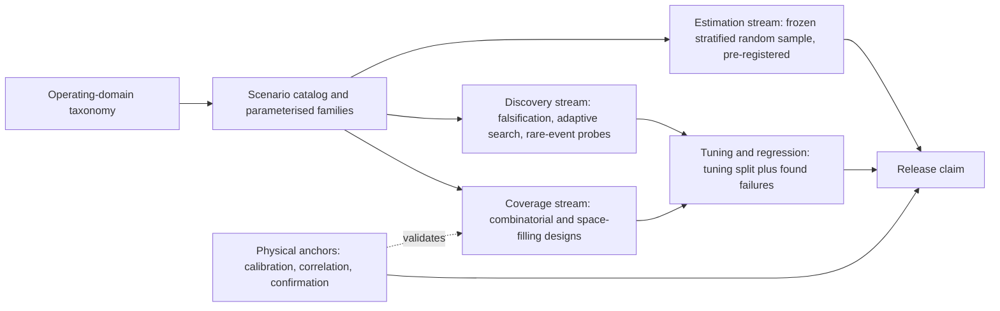

The three streams never share data: tuning runs only on the coverage and discovery streams plus a tuning split; the release claim is computed only on the frozen estimation sample plus the physical anchors, with full traceability and automatic regression on every change.

**Before prototype hardware arrives (October 2026 to mid-2027):**

- Freeze a machine-readable requirement, hazard and scenario hierarchy; build the off-road operating-domain taxonomy and logical scenario families; write the pre-registered statistical test plan (claims, strata, confidence levels, stopping rules); engage a notified body early (Section "Where the evidence stands").
- Start shadow-mode field logging on the existing warning-only system now. Ingest years of warning-system logs where available and classify them into encounter types, nuisance alarms, site and environment strata and machine configurations. These logs estimate the operational distribution independently of the new brake controller, which is the weighting basis the later rate claims need, and they are the only source of real exposure and false-alarm data.
- Measure or obtain braking curves, latencies, footprints, articulation and swing envelopes and sensor-location drawings from current machines. ISO 21815-3 makes these the inputs to the avoidance distance and risk region [2]; none requires the final perception prototype.
- Pre-build a simulator-independent scenario library, a campaign generator and automated verdict functions. Verdicts should include more than "collision or no collision": first valid detection, time-to-collision at detection, intervention time, stopping margin, closest approach, false-warning duration, unnecessary braking, deceleration and jerk where relevant, sensor degradation state and the operator-warning sequence.
- Build paired simulation-to-real correlation tests. Every high-value simulator phenomenon (dust, fog, glare, wet surfaces, reflective objects, sensor occlusion) gets a smaller physical reference set; simulation is credible only in the dimensions where these paired tests show adequate agreement. Validate sensor models on existing machines using the current warning system's sensors; set up HIL rigs; dry-run the tuning pipeline on the warning-only system.

**After prototype arrival (mid-2027 plus about 16 weeks), an iterative funnel:**

1. Initial integration: deterministic smoke tests and safety-envelope verification before any large automated campaign.
2. Calibration: modest DOE or D-optimal tests to estimate sensor, latency and braking residuals and to initialise common parameters.
3. Broad virtual campaign: combinatorial coverage and DOE across the logical space, including every machine configuration available virtually.
4. Failure search: falsification and adversarial search concentrated around stopping boundaries, partial visibility, high closure rate, edge of field of view, sensor degradation and transitions between conditions.
5. Physical confirmation: reproduce important virtual failures and representative boundaries physically; update simulator discrepancy models rather than silently tuning the simulation to match every result.
6. Frozen tuning: select the final common and model-specific calibration from development and confirmation data, then freeze it.
7. Statistical audit: run the pre-declared probability-based sample without tuning. This produces the detection and false-intervention confidence claims.
8. Regression: after any late correction, rerun impact-selected virtual and HIL regression plus the affected physical confirmation cases. A late change that alters a safety-relevant decision threshold triggers a new independent statistical confirmation for the affected claim, not merely a rerun of the failures that caused the change.

**Machine coverage hierarchy:** all models virtually; all materially different hardware and configurations on HIL or bench where possible; representative and boundary archetypes physically; a small confirmation on every released model and configuration. How much physical evidence can be shared across models is safety-case-specific; a standardised off-road statistical rule for eliminating model-specific confirmation was not found.

**A test for every physical run:** does this run estimate a population rate, identify a model parameter, validate simulation fidelity, confirm a boundary, or satisfy a deterministic requirement? Runs with no defined evidentiary role should not consume the four-month window.

### Where the evidence stands

#### Well established

- **Zero-failure, binomial and Poisson sample-size mathematics.** Exact binomial inference, Clopper-Pearson intervals, Poisson upper bounds for event rates, design of experiments and response surfaces are mature statistical techniques, not automotive-specific, and apply directly provided their assumptions (independence, representative sampling, homogeneous rates) are respected. **Independent** [25].
- **Field exposure alone cannot demonstrate rare-event performance.** RAND (2016) established this for road vehicles and the logic is general. **Independent (on-road evidence)** [35].
- **Falsification and adaptive-search results cannot be used as rate estimates.** Probability estimates require representative probability sampling or mathematically correct weighting. This is consensus in the statistical and rare-event literature [34].
- **Collision warning and avoidance for earth-moving machinery has a dedicated ISO framework.** ISO 21815-1 (principles and general requirements), ISO 21815-3 (forward and reverse risk areas and automatic intervention), ISO 16001 (object detection and visibility aids) and the ISO 19014 functional-safety series (with revised parts progressing in 2026). **Independent** [1, 2, 3, 51].
- **Machine geometry and braking physics determine collision-zone and intervention design.** A common physical parameterisation is therefore a more defensible cross-model basis than independent distance tables. **Independent** [2].
- **Scenario-based structure is mature for road vehicles.** Functional, logical and concrete scenario abstraction, ODD taxonomies, scenario catalogs and parameterised generation have a sequence of ISO 3450x standards and ASAM OpenX specifications; the structure is reusable, the road and lane content is not. **Independent (on-road evidence)** [9, 10, 11, 12, 13].
- **Mixing synthetic with real training data generally beats real-only training in data-poor construction settings; synthetic-only training leaves a gap.** Multiple peer-reviewed studies, 2023 to 2026. **Independent** [53, 54, 56].
- **Regulatory dates.** The Machinery Regulation applies from 20 January 2027; the Digital Omnibus on AI entered into force on 27 July 2026. **Independent** [81, 83].

#### Uncertain

- **How much simulation evidence regulators and notified bodies will accept for off-road collision avoidance.** No off-road precedent was found; even the on-road UN R152 virtual-testing discussion was unsettled in January 2024 [40].
- **Credibility of radar and ultrasonic simulation in dust, snow and rain around off-road clutter.** Not found. High-fidelity simulation of all candidate sensor modalities is actively developing, and ASAM is extending interfaces because some phenomena are not represented [62].
- **Field exposure distributions for off-road strata.** Not found publicly. Without good field telemetry any aggregate "real-world" detection-rate claim has an uncertain weighting basis; estimating the distribution from the warning-system fleet should start now.
- **Whether the combinatorial "interaction rule" carries over to perception failures.** NIST's evidence that low-order interactions explain most software bugs is not proof that pairwise or 3-way coverage catches camera, radar or lidar failures from coupled weather, contamination, geometry and signal processing; supplement t-way designs with physics-guided interaction hypotheses and search [26].
- **How much evidence can be pooled across machine models.** Hierarchical models give a principled mechanism, but exchangeability must be shown from physics and data; no universal family-transfer rule was found [48].
- **The final machinery-specific AI requirements under the Omnibus.** Delegated acts are expected by 2 August 2028 according to secondary legal commentary; until then, harmonised AI Act standards may give a presumption of conformity under the Machinery Regulation (Eurogip, August 2026; not verified on EUR-Lex) [85].
- **Scenario-language standardisation for off-road work remains incomplete.** ASAM's off-road work identified terrain, heavy-machine behaviour and sensor-modelling gaps; the conclusion is that extensions or a manufacturer domain model will be necessary, not that OpenX is unusable [78].

#### Where experts disagree

- **Whether a trained-then-frozen machine-learning detector is "self-evolving"** under Annex I Part A of Regulation 2023/1230, which would trigger notified-body assessment. Commentators differ, and some read any machine-learning safety function as in scope. A notified-body opinion should be obtained early [82, 85].
- **Bayesian priors from simulation.** Proponents report large reductions in physical testing; critics note that the result is highly sensitive to the prior (69 million to 476 million miles depending on prior strength in the conservative Bayesian road-testing analysis) [37].
- **Scenario-based against mileage- or exposure-based validation as the primary argument.** On-road regulators (NATM) use a multi-pillar mix; the weighting is contested [38, 42].
- **How aggressively rare-event acceleration can replace naturalistic exposure.** Importance sampling is sound when the distributions are modelled accurately, but determining them for open-ended safety-critical interactions is itself hard; strong acceleration shown for a narrow on-road cut-in model cannot be extrapolated to a quarry with workers, rocks, articulated machines, dust and changing terrain [30, 34].
- **How much real data a safety claim still needs when synthetic data is used.** Experts disagree less about whether synthetic data helps than about the residual real-data requirement; no defensible universal synthetic-to-real ratio exists [54, 60].
- **Generative world models as a validation tool versus a training tool only.**

### Blind spots

Issues that the nine questions did not ask about but that the research judged important:

**Timeline and program**

- No published off-road program has compressed collision-avoidance validation from three or four years to under four months. The only route found is front-loading (Section "A campaign architecture"); start shadow-mode logging on the existing warning system now.
- Post-market monitoring and data drift. Site practices, sensor hardware, firmware, attachments and environmental distributions change after release. A monitoring mechanism should map field near-misses, interventions and false brakes back into the scenario taxonomy and trigger targeted regression; the four-month campaign is the start of a living safety-evidence base, not a one-time dataset. NATM in-service monitoring and the MSHA surface mobile equipment rule (annual program updates) require this in spirit [38, 88].
- The compute or HIL throughput needed to reach the stated volumes (about 6,000 zero-miss trials for 20 strata plus hundreds of exposure hours) has not been quantified. The architecture assumes "thousands of runs per night"; the budget for that capacity and for the paired physical correlation sets should be fixed before mid-2027.

**The braking and dynamics chain**

- Detection is only half the function. Brake latency, brake temperature, loaded against unloaded mass, downhill grades, surface friction, tyre and track condition, hydraulic state and articulation dominate stopping distance; a system with perfect detection can still violate the stopping distance. ISO 21815-3 incorporates stopping distance in the avoidance-distance concept [2]. Under ISO 19014 (functional safety for earth-moving machinery) and ISO 13849 or IEC 62061, the intervention path needs a performance-level or integrity assignment and fault testing (editions not verified) [51].
- Automatic braking creates its own hazards: load spill, rear-end impact from following machines, operator injury from sudden stops, an unnecessary stop on a grade, beneath a suspended load, in front of another moving haul unit, during an unstable articulation state or while manipulating material, and rollover. The hazard analysis must test unsafe interventions, not only missed ones. ISO 21815-1 limits avoidance to speed reduction or motion inhibit, with the operator remaining responsible [1].
- A "no false brakes" metric creates the wrong incentive: suppressing nuisance interventions can increase late or missed braking, while optimising detection alone can make a system that repeatedly stops production. Joint safety and productivity acceptance criteria and explicit Pareto trade-offs are needed.

**Sensors and ground truth**

- Sensor blockage and degradation need explicit requirements: mud, dust accumulation, snow and ice, water films, vibration-induced misalignment and physical damage produce slow degradation rather than clean failure, and "sensor unavailable" and "sensor confidently wrong" are different safety cases. NIOSH (Ruff) reported one radar antenna failing from vibration after about six months of continuous use; ISO 16001 requires continuous self-checking; recent surveys catalogue the failure modes across camera, lidar, radar and ultrasonic sensors (mostly road vehicles) [3, 22, 23].
- Simulation credibility must be quantified per phenomenon. A camera model may correlate well in clear daylight and poorly under glare; a lidar model may reproduce range but not dust backscatter; a radar model may reproduce point targets but not multipath around metal structures. Maintain a credibility matrix linking each virtual claim to paired physical correlation evidence [62].
- Ground truth deserves its own validation. Target position, machine pose, speed, brake onset and closest approach need measurement uncertainty substantially smaller than the acceptance margins, with calibrated reference chains and uncertainty budgets; otherwise verdict errors dominate system differences.
- The object taxonomy should be risk-based, not only perception-class-based. Braking depends on vulnerability, motion uncertainty, collision severity and whether the object is in the swept path, not on whether a network says "person", "vehicle" or "object". ISO 21815-3 emphasises intended objects in the collision-risk area and acknowledges both false positives and false negatives [2].

**People and operations**

- Operator behaviour changes after automation is introduced: reliance, reaction times and override behaviour under a warning-only system may differ from those under automatic braking, so distributions collected from today's fleet may not fully predict future human-system interaction. Over-reliance and warning fatigue are covered in the EMESRT Human Factors in Design Guide (August 2024) [86]. An off-road study quantifying the change for this kind of system was not found.
- Retrofit and interoperability: ISO/TS 21815-2:2021 defines a J1939 interface for third-party collision-avoidance intervention, and mines may mix the manufacturer's system with tag-based systems [87].

**Statistics and governance**

- Multiple testing quietly inflates confidence. If hundreds of machine, weather and scenario cells are each checked at 95% confidence, some pass or fail by chance. Predefine the primary claims and apply simultaneous-confidence or multiplicity methods where many claims must hold together.
- Cybersecurity of the safety function is a new essential requirement under Regulation 2023/1230, and ISO 19014-4 leaves cybersecurity outside its scope, so it must be covered separately; unintended command paths become more consequential once the system can command the brakes [51, 82].
- A sensor-type decision taken late can invalidate the pre-registered statistical plan. If the modality mix changes after the strata and sample sizes are frozen, the strata that depend on sensor physics (dust, glare, rain) must be re-derived and the frozen sample re-drawn, which costs calendar time inside the four-month window.
- The chapter relies on ISO 16001's 300 ms detection-time limit for the physics parameterisation; the figure comes from the standard's public preview (clause 4.5, "the ODS detection time shall not exceed 300 ms", as quoted in Chapter 3) and was not verified against the full purchased text. Confirm it against the purchased standard before using it in the safety case.

**Jurisdictions**

- The US MSHA surface mobile equipment rule (Subpart T; final rule published December 2023, effective 19 January 2024) requires written safety programs that evaluate technologies but does not mandate collision avoidance on surface equipment [88, 89, 90, 91]. MSHA's Powered Haulage Safety page reports that in 2025 powered haulage caused 13 of the 33 US mining deaths (39%) and 426 of the 4,792 non-fatal injuries (9%) [92]. Australian state-specific collision-avoidance requirements were not found in this research and should be checked before relying on any claim.

### Sources

1. ISO. ISO 21815-1:2022, Earth-moving machinery, Collision warning and avoidance, Part 1: General requirements. International Organization for Standardization. January 2022. https://www.iso.org/standard/77302.html. **Independent**.
2. ISO. ISO 21815-3:2023, Earth-moving machinery, Collision warning and avoidance, Part 3: Risk area and risk level for forward/reverse motion. International Organization for Standardization. August 2023. https://www.iso.org/standard/77266.html (also https://www.sis.se/en/produkter/materials-handling-equipment/earthmoving-machinery/iso-21815-32023/). **Independent**.
3. ISO. ISO 16001:2017, Earth-moving machinery, Object detection systems and visibility aids, Performance requirements and tests. International Organization for Standardization. 20 November 2017, confirmed 2023. https://www.iso.org/standard/63688.html (preview: https://cdn.standards.iteh.ai/samples/63688/8548462f69a045b99f742eca868dd9fb/ISO-16001-2017.pdf). **Independent**.
4. ISO. ISO 21815-4, Earth-moving machinery, Collision warning and avoidance, Part 4: Risk area and risk level for swing and rotation motion. International Organization for Standardization. Under publication (stage 60.00), expected October 2026; accessed October 2026. https://www.iso.org/standard/81597.html. **Independent (draft)**.
5. ISO. ISO/PRF 21815-5, Earth-moving machinery, Collision warning and avoidance, Part 5: Other motions. International Organization for Standardization. Final proof stage, planned publication November 2026. https://www.iso.org/standard/89934.html. **Independent (draft)**.
6. Wabtec. Key Insights for the Successful Implementation of Proximity Detection (white paper citing EMESRT PR-5A Revision 3.0, September 2024). Wabtec Digital Mine. Accessed October 2026. https://www.wabteccorp.com/Digital-Intelligence/Digital-Mine/White-Papers/Proximity-Detection-and-Collision-Avoidance-Technology. **Vendor**.
7. EMESRT. EMESRT 2024 Activity Report. Earth Moving Equipment Safety Round Table. 2024. https://www.emesrt.org/wp-content/uploads/EMESRT_2024_ActivityReport.pdf. **Expert opinion**.
8. EMESRT. Underground scenario storyboards ready for industry use. Earth Moving Equipment Safety Round Table. 16 May 2024. https://emesrt.org/underground-scenario-storyboards-ready-for-industry-use/. **Expert opinion**.
9. ISO. ISO 34503:2023, Road vehicles, Test scenarios for automated driving systems, Specification for operational design domain. International Organization for Standardization. 2023. https://www.iso.org/standard/78952.html. **Independent (on-road evidence)**.
10. ASAM e.V. ASAM OpenODD 1.0.0. Association for Standardization of Automation and Measuring Systems. 3 April 2025. https://www.asam.net/standards/detail/openodd/. **Independent (on-road evidence)**.
11. ISO. ISO 34504:2024, Road vehicles, Test scenarios for automated driving systems, Scenario categorization. International Organization for Standardization. 2024. https://www.iso.org/standard/78953.html. **Independent (on-road evidence)**.
12. ISO. ISO 34505:2025, Road vehicles, Test scenarios for automated driving systems, Scenario evaluation and test case generation. International Organization for Standardization. June 2025. https://www.iso.org/standard/78954.html (preview: https://cdn.standards.iteh.ai/samples/iso/iso-34505-2025/a717560d520746898f0b5e025bf55df6/iso-34505-2025.pdf). **Independent (on-road evidence)**.
13. ISO. ISO 34502:2022, Road vehicles, Test scenarios for automated driving systems, Scenario based safety evaluation framework. International Organization for Standardization. 2022. https://www.iso.org/standard/78951.html. **Independent (on-road evidence)**.
14. Castellanos Ardila, J. P., et al. A Context-Specific Operational Design Domain for Underground Mining (ODD-UM). Conference paper. 2022. https://researchgate.net/publication/362913333_A_Context-Specific_Operational_Design_Domain_for_Underground_Mining_ODD-UM. **Independent**.
15. ISO. ISO 17757:2019, Earth-moving machinery and mining, Autonomous and semi-autonomous machine system safety. International Organization for Standardization. 2019, confirmed December 2024. https://www.iso.org/standard/76126.html. **Independent**.
16. Toward an Agricultural Operational Design Domain: A Framework. arXiv preprint 2511.02937. November 2025. https://arxiv.org/pdf/2511.02937. **Independent**.
17. Towards conceptually elevating ODD concepts for unstructured environments. Springer (book chapter). 2024. https://link.springer.com/chapter/10.1007/978-3-031-71142-8_13. **Independent**.
18. Off-road testing scenario design and library generation for intelligent vehicles. ScienceDirect (journal article). 2022. https://www.sciencedirect.com/science/article/pii/S2773153722000135. **Independent**.
19. Review of functional testing scenario-library generation for automated driving (functional, logical and concrete scenario hierarchy). Academic review. Accessed October 2026. **Independent (on-road evidence)**.
20. Neurohr, C., and Möhlmann, E. Scenario-based verification and validation of automated transportation systems (overview). 2022/2023. **Independent (on-road evidence)**.
21. NIOSH (Ruff, T. M.). Report of Investigations 9672: Recommendations for Evaluating and Implementing Proximity Warning Systems on Surface Mining Equipment. US Department of Health and Human Services, CDC/NIOSH. 2007. https://permanent.fdlp.gov/lps97050/2007-146.pdf. **Independent**.
22. Ruff, T. M. Advances in Proximity Detection Technologies for Surface Mining Equipment. NIOSH Spokane Research Laboratory. Circa 2004. https://stacks.cdc.gov/view/cdc/9029/cdc_9029_DS1.pdf. **Independent**.
23. A Survey on Sensor Failures in Autonomous Vehicles (camera, radar, lidar, ultrasonic failure modes). Review article. 2024. **Independent (on-road evidence)**.
24. Systematic review of radar in unmanned ground vehicles. Review article. 2024. **Independent**.
25. NIST/SEMATECH. e-Handbook of Statistical Methods (screening, fractional factorial, response-surface and optimal designs; desirability functions; binomial confidence intervals; reliability and zero-failure bounds). National Institute of Standards and Technology. Accessed October 2026. https://www.itl.nist.gov/div898/handbook/. **Independent**.
26. NIST. Automated Combinatorial Testing for Software (ACTS) program page, including the empirical interaction findings. National Institute of Standards and Technology, Computer Security Resource Center. Accessed October 2026. https://csrc.nist.gov/projects/automated-combinatorial-testing-for-software. **Independent**.
27. Adaptive Stress Testing literature, including automated-vehicle applications (sequential search and reinforcement learning to find likely failure trajectories). Academic research, various dates. **Independent (on-road evidence)**.
28. Bayesian-optimization falsification research for learning-enabled and control systems. Academic research. 2024. **Independent**.
29. Viswanadha, K., et al. Parallel and Multi-Objective Falsification with Scenic and VerifAI. International Conference on Runtime Verification (RV). 2021. https://arxiv.org/pdf/2107.04164 (also https://people.eecs.berkeley.edu/~sseshia/pubdir/verifai-rv21.pdf). **Independent (on-road evidence)**.
30. Feng, S., et al. Dense reinforcement learning for safety validation of autonomous vehicles. Nature 615, 620-627. 22 March 2023. https://www.nature.com/articles/s41586-023-05732-2. **Independent (on-road evidence)**.
31. Feng, S., et al. Dense reinforcement learning for safety validation of autonomous vehicles (workshop version). CVPR 2024 Agents4AD workshop. 2024. https://agents4ad.github.io/assets/cvpr2024/papers/5.pdf. **Independent (on-road evidence)**.
32. Michigan Traffic Lab. Dense-Deep-Reinforcement-Learning code repository. GitHub. Accessed October 2026. https://github.com/michigan-traffic-lab/Dense-Deep-Reinforcement-Learning. **Independent (on-road evidence)**.
33. Breaking through safety performance stagnation with dense learning. Nature Communications. 2026. https://www.nature.com/articles/s41467-026-69761-x. **Independent (on-road evidence)**.
34. Zhao, D., Lam, H., Peng, H., et al. Accelerated Evaluation of Automated Vehicles Safety in Lane-Change Scenarios Based on Importance Sampling Techniques. IEEE Transactions on Intelligent Transportation Systems 18(3). 2017 (online 2016). https://doi.org/10.1109/TITS.2016.2582208. **Independent (on-road evidence)**.
35. Kalra, N., and Paddock, S. M. Driving to Safety: How Many Miles of Driving Would It Take to Demonstrate Autonomous Vehicle Reliability? RAND Corporation, RR-1478-RC. April 2016. https://www.rand.org/pubs/research_reports/RR1478.html (PDF: https://www.rand.org/content/dam/rand/pubs/research_reports/RR1400/RR1478/RAND_RR1478.pdf). **Independent (on-road evidence)**.
36. US Department of Transportation. Autonomous Vehicle Literature Review. National Transportation Library (ROSA P). Accessed October 2026. https://rosap.ntl.bts.gov/view/dot/67860/dot_67860_DS2.pdf. **Independent (on-road evidence)**.
37. Zhao, X., Robu, V., Flynn, D., Salako, K., and Strigini, L. Assessing the Safety and Reliability of Autonomous Vehicles from Road Testing. IEEE International Symposium on Software Reliability Engineering (ISSRE); arXiv 1908.06540. 2019. https://arxiv.org/abs/1908.06540. **Independent (on-road evidence)**.
38. UNECE. New Assessment/Test Method for Automated Driving (NATM) master document, WP.29-187-08. United Nations Economic Commission for Europe. 2022. https://unece.org/sites/default/files/2022-05/WP.29-187-08e.pdf. **Independent (on-road evidence)**.
39. UNECE. NATM Guidelines for Validating Automated Driving Systems, ECE/TRANS/WP.29/2022/58. United Nations Economic Commission for Europe. 2022. https://unece.org/sites/default/files/2024-02/ECE_TRANS_WP.29_2022_58e.pdf. **Independent (on-road evidence)**.
40. UNECE GRVA. Virtual testing in UN R152, informal document GRVA-18-55. United Nations Economic Commission for Europe. January 2024. https://unece.org/sites/default/files/2024-01/GRVA-18-55e.pdf. **Independent (on-road evidence)**.
41. A Validation Methodology for Safety-Critical Virtual Testing. DiVA (academic thesis or report). 2025. https://www.diva-portal.org/smash/get/diva2:1991623/FULLTEXT01.pdf. **Independent**.
42. Skoglund, M., et al. Demonstrating a Scenario-Based Safety Assurance Framework in Practice. Vehicles 7(4), 124. 29 October 2025. https://doi.org/10.3390/vehicles7040124. **Independent (on-road evidence)**.
43. ISO/IEC/IEEE. ISO/IEC/IEEE 29119-3:2021, Software and systems engineering, Software testing, Part 3: Test documentation; and ISO/IEC/IEEE 29119-4:2021, Part 4: Test techniques. 2021. https://www.iso.org/standard/79429.html. **Independent**.
44. Dwork, C., et al. The reusable holdout: preserving validity in adaptive data analysis. Science. 2015. **Independent**.
45. Deb, K., et al. A fast and elitist multiobjective genetic algorithm: NSGA-II. IEEE Transactions on Evolutionary Computation. 2002. **Independent**.
46. Pareto-front batch multi-objective Bayesian optimization for expensive black-box problems. Peer-reviewed methodology paper. 2024. **Independent**.
47. Automatic intrusion detection and warning method in the hoisting scenario integrating BIM and GPS. ScienceDirect (journal article). 2025. https://www.sciencedirect.com/science/article/pii/S1110016825011706. **Independent**.
48. Bull, L. A., et al. Hierarchical Bayesian modeling for knowledge transfer across engineering fleets via multitask learning. Computer-Aided Civil and Infrastructure Engineering. 2023. https://onlinelibrary.wiley.com/doi/full/10.1111/mice.12901. **Independent**.
49. Lübsen, J., Hespe, C., and Eichler, A. Towards safe multi-task Bayesian optimization. Proceedings of Machine Learning Research 242 (L4DC 2024). 2024. https://proceedings.mlr.press/v242/lubsen24a.html. **Independent**.
50. SimMining-3D: Altitude-Aware 3D Object Detection in Complex Mining Environments: A Novel Dataset and ROS-Based Automatic Annotation Pipeline. Springer (conference proceedings). 2024. https://link.springer.com/chapter/10.1007/978-981-99-8388-9_5. **Independent**.
51. ISO. ISO 19014 series, Earth-moving machinery, Functional safety (current editions 2018, 2022 and 2020; edition 2 of Parts 1 to 4 and edition 1 of Part 5 under publication, stage 60.00, listed for October 2026). International Organization for Standardization. 2018 to 2022; new editions October 2026. https://www.iso.org/standard/87988.html. **Independent (under revision)**.
52. Synthesizing Reality: Leveraging the Generative AI-Powered Platform Midjourney for Construction Worker Detection. arXiv 2507.13221 (July 2025) and ASCE proceedings (2025, exact date not confirmed). https://arxiv.org/pdf/2507.13221 (also https://ascelibrary.org/doi/10.1061/9780784486139.097). **Independent**.
53. DALL-E 3 synthetic images for construction object detection with YOLOv8. Proceedings of the 2025 Winter Simulation Conference. 2025. https://www.informs-sim.org/wsc25papers/con152.pdf. **Independent**.
54. A Fixed-Budget Study of Real-Synthetic Data Mixing for PPE Detection in Construction. Buildings 16(10), 2034. 2026. https://www.mdpi.com/2075-5309/16/10/2034. **Independent**.
55. Generating real-world-like labelled synthetic datasets for construction site applications. Automation in Construction. 2023. https://www.sciencedirect.com/science/article/pii/S0926580523001103. **Independent**.
56. Combining Synthetic Images and Deep Active Learning: Data-Efficient Training of an Industrial Object Detection Model. Journal article (PubMed Central). 2024. https://www.ncbi.nlm.nih.gov/pmc/articles/PMC11154516/. **Independent**.
57. Yang, Z., et al. LiDARDustX: A LiDAR Dataset for Dusty Unstructured Road Environments. arXiv 2505.21914. 28 May 2025. https://arxiv.org/abs/2505.21914 (review: https://www.themoonlight.io/en/review/lidardustx-a-lidar-dataset-for-dusty-unstructured-road-environments). **Independent**.
58. Ge, J., et al. Unraveling the Effects of Synthetic Data on End-to-End Autonomous Driving. ICCV 2025; arXiv 2503.18108. 2025. https://arxiv.org/abs/2503.18108. **Independent (on-road evidence)**.
59. Lambertenghi, S. C., and Stocco, A. Assessing Quality Metrics for Neural Reality Gap Input Mitigation in Autonomous Driving Testing. IEEE International Conference on Software Testing (ICST); arXiv 2404.18577. 2024. https://arxiv.org/abs/2404.18577. **Independent (on-road evidence)**.
60. Duc, N. H., et al. Mind the Domain Gap: Measuring the Domain Gap Between Real-World and Synthetic Point Clouds for Automated Driving Development. arXiv 2505.17959. May 2025. https://arxiv.org/abs/2505.17959. **Independent (on-road evidence)**.
61. Survey of simulation, synthetic data and sim-to-real transfer for autonomous driving. Academic survey preprint. 2026. **Independent (on-road evidence)**.
62. ASAM e.V. Open Simulation Interface (OSI) and the high-fidelity sensor-simulation project (camera, radar, lidar, possibly ultrasound). Association for Standardization of Automation and Measuring Systems. 2025 to 2026. https://www.asam.net/standards/detail/osi/. **Independent (on-road evidence)**.
63. ASAM e.V. ASAM OpenMATERIAL 3D 1.0.0. Association for Standardization of Automation and Measuring Systems. April 2025. https://www.asam.net/standards/detail/openmaterial/. **Independent**.
64. UL Solutions. Safety-Related Systems in Road Vehicles with Artificial Intelligence Are Addressed in ISO/PAS 8800:2024. UL Solutions blog. December 2024. https://www.ul.com/sis/blog/safety-related-systems-road-vehicles-artificial-intelligence-are-addressed-isopas-88002024. **Expert opinion (on-road evidence)**.
65. Safety integrity framework for automated driving. arXiv 2503.20544. 2025. https://arxiv.org/pdf/2503.20544. **Independent (on-road evidence)**.
66. ASAM e.V. ASAM MDF 4.3.0 (Measurement Data Format). Association for Standardization of Automation and Measuring Systems. September 2025. https://www.asam.net/standards/detail/mdf/. **Independent**.
67. ASAM e.V. ASAM ATX (Automotive Test Exchange Format). Association for Standardization of Automation and Measuring Systems. Accessed October 2026. https://www.asam.net/standards/detail/atx/. **Independent**.
68. ASAM e.V. ASAM TestSpecification project (concept linking test specification, implementation and execution). Association for Standardization of Automation and Measuring Systems. 2026 (in development). **Independent**.
69. ASAM e.V. ASAM OpenSCENARIO DSL 2.2.0 (page also carries the OpenX "maintenance mode" statement). Association for Standardization of Automation and Measuring Systems. 19 March 2026. https://www.asam.net/standards/detail/openscenario-dsl/. **Independent (on-road evidence)**.
70. ASAM e.V. ASAM OpenSCENARIO XML 1.4.0. Association for Standardization of Automation and Measuring Systems. 2026. https://www.asam.net/standards/detail/openscenario-xml/. **Independent (on-road evidence)**.
71. ASAM e.V. ASAM OpenDRIVE 1.9.0. Association for Standardization of Automation and Measuring Systems. May 2026. https://www.asam.net/standards/detail/opendrive/. **Independent (on-road evidence)**.
72. ASCS e.V. ASAM OpenX standards reference library (version listing: OpenDRIVE 1.9.0, OpenSCENARIO XML 1.4.0). GitHub. 2026. https://github.com/ASCS-eV/asam-openx-standards. **Expert opinion**.
73. Compiling OpenSCENARIO 2.1 for Scenario-Based Testing in CARLA. arXiv 2604.16452. 2026. https://arxiv.org/pdf/2604.16452. **Independent (on-road evidence)**.
74. Formalizing Operational Design Domains with the Pkl Language. arXiv 2509.02221. September 2025. https://arxiv.org/pdf/2509.02221. **Independent (on-road evidence)**.
75. Vin, E., et al. 3D Environment Modeling for Falsification and Beyond with Scenic 3.0. Computer Aided Verification (CAV). 2023. https://link.springer.com/chapter/10.1007/978-3-031-37706-8_13. **Independent**.
76. A Scenario-Based Platform for Testing Autonomous Vehicle Behavior Prediction Models in Simulation. arXiv 2110.14870. 2021. https://arxiv.org/pdf/2110.14870. **Independent (on-road evidence)**.
77. Scenic project. Scenic programming language documentation (probabilistic scene and scenario modelling; robotics and Mars-rover examples). Open-source project documentation. Accessed October 2026. **Vendor**.
78. ASAM e.V. ASAM OpenX in Off-Road Applications (2023 workshop and follow-on concept project: construction, mining, agriculture, defence, recreation; mobility and manipulation use cases). Association for Standardization of Automation and Measuring Systems. Accessed October 2026. https://www.asam.net/standards/asam-openx-in-offroad-applications/. **Expert opinion**.
79. ISO. ISO 18497-1:2024, Agricultural machinery and tractors, Safety of partially automated, semi-autonomous and autonomous machinery, Part 1: Machine design principles and vocabulary (and Parts 2 to 4). International Organization for Standardization. 31 July 2024. https://www.iso.org/standard/82684.html (CEN catalogue: https://standards.iteh.ai/catalog/standards/cen/d68609be-e3bf-4442-942e-d0b8f438a7cc/en-iso-18497-1-2024; preview: https://cdn.standards.iteh.ai/samples/82684/3961a5f873f740e6af76cc19c884caa2/ISO-18497-1-2024.pdf). **Independent**.
80. Wide Automation. ISO 18497-2:2024: the new standard for obstacle protection in agricultural robots. Company article. Accessed October 2026. https://www.wideautomation.com/en/iso-18497-22024-the-new-standard-for-obstacle-protection-in-agricultural-robots/. **Vendor**.
81. European Union. Regulation (EU) 2023/1230 of the European Parliament and of the Council of 14 June 2023 on machinery (applies from 20 January 2027). EUR-Lex. 14 June 2023. https://eur-lex.europa.eu/eli/reg/2023/1230/oj. **Independent**.
82. SOPX. EU Machinery Regulation 2023/1230: OEM Checklist for 2027 (Annex I Part A wording). 2026. https://sopx.io/insights/eu-machinery-regulation-2023-1230/. **Expert opinion**.
83. European Union. Regulation (EU) 2026/1744 of the European Parliament and of the Council of 8 July 2026 amending Regulations (EU) 2024/1689, (EU) 2018/1139 and (EU) 2023/1230 (Digital Omnibus on AI). EUR-Lex. 8 July 2026, in force 27 July 2026. https://eur-lex.europa.eu/eli/reg/2026/1744/oj/eng. **Independent**.
84. ERTICO. Digital Omnibus on AI Enters into Force: What It Means for the Mobility Sector. 2026. https://ertico.com/digital-omnibus-on-ai-enters-into-force-what-it-means-for-the-mobility-sector. **Expert opinion**.
85. Eurogip. Machinery Regulation 2023/1230: What the Digital Omnibus on AI Changes. 6 August 2026. https://eurogip.fr/en/machinery-regulation-2023-1230-what-the-digital-omnibus-on-ai-changes/. **Expert opinion**.
86. EMESRT. Human Factors in Design Guide. Earth Moving Equipment Safety Round Table. August 2024. https://www.emesrt.org/wp-content/uploads/HumanFactorsDesignGuide.pdf. **Expert opinion**.
87. ISO. ISO/TS 21815-2:2021, Earth-moving machinery, Collision warning and avoidance, Part 2: On-board J1939 communication interface. International Organization for Standardization. July 2021, confirmed 2024. https://www.iso.org/standard/77303.html. **Independent**.
88. Pit & Quarry. Detailing MSHA's recent mobile equipment rule. Trade press. 2024. https://www.pitandquarry.com/detailing-mshas-recent-mobile-equipment-rule/. **Expert opinion**.
89. US Department of Labor. US Department of Labor announces final rule to protect miners from surface mobile equipment-related accidents, injuries, fatalities. MSHA news release. 19 December 2023. https://www.dol.gov/newsroom/releases/msha/msha20231219. **Independent**.
90. Occupational Health & Safety. MSHA Announces Rule Protecting Miners from Accidents Tied to Surface Mobile Equipment. 22 December 2023. https://ohsonline.com/articles/2023/12/22/msha-announces-rule-protecting-miners-from-accidents-tied-to-surface-mobile-equipment.aspx?admgarea=news. **Expert opinion**.
91. HSE Blog. Surface Mining Safety: Risks, MSHA Rules and Best Practices. Accessed October 2026. https://www.hseblog.com/surface-mining-safety/. **Expert opinion**.
92. MSHA. Powered Haulage Safety (2025 fatality and injury statistics). US Mine Safety and Health Administration. Accessed October 2026. https://www.msha.gov/safety-and-health/safety-and-health-initiatives/powered-haulage-safety. **Independent**.

## Chapter 10: When simulation can be trusted

_What makes simulation results acceptable as evidence for a safety decision on an automatic-braking function for heavy off-road machines, how agreement between simulation and physical tests is measured, and how much physical testing has to remain._

### The research question

A manufacturer of heavy off-road machines for construction, mining, quarrying and similar work already sells a system that warns the operator when the machine gets too close to an object. It is now developing a system that also applies the brakes automatically if the operator does not react. Prototype hardware and software will arrive in mid-2027, and validation must then finish in less than four months, where in the past it took three to four years of physical testing and tuning for each machine model. The new system must work across more than 100 types of job site, more than 10 operating scenarios per machine, many weather and light conditions (rain, snow, fog, dust, dusk, darkness, glare) and many machine models with different sizes and sensor positions. The organization has not used simulation for this kind of validation before.

The research set out to learn what makes simulation results acceptable as evidence for a safety decision, and how much physical testing must remain. It worked through eight questions:

1. Which frameworks exist, in any industry, for judging whether simulation results can be trusted for a safety decision, covering automotive, aerospace, medical devices, nuclear and rail, and what does each require?
2. How is agreement between simulation and physical tests measured, with metrics, tolerances and worked examples?
3. How do teams decide which physical tests to keep and which to replace, with published examples of the split and of how much physical testing was actually reduced?
4. How is a validated model extended to another machine model or another sensor position without repeating all the work?
5. Can an existing system with a long field history be used as a reference to check the simulation itself, and is this an accepted practice?
6. In which documented cases did simulation give false confidence, and what went wrong?
7. How should the limits of a simulation's validity be recorded and explained to decision makers?
8. What would an internal safety board or an outside assessor expect to see before relying on simulation evidence?

The ground rules were strict. The research was to stay neutral across vendors, products and technologies and to cover commercial, open-source, academic and in-house options. Each important claim was to be labeled by its type of evidence (independent study, standard or third-party test; the vendor's own claim; or expert opinion), and each source was to be dated. Failures, limits and evidence against each approach were to be reported, not only successes. Anything proven only for on-road vehicles had to be flagged as such, and where nothing could be found the answer was to be "not found" rather than a guessed number, price or timeline.

### About the evidence

This chapter draws on 97 sources, listed at the end of the chapter. Several hundred further documents were read during the research and are not cited. Evidence is labeled in bold after the claim or in the source entry as **Independent** (peer-reviewed study, standard or regulation text, official statistics, third-party test, government or agency report), **Vendor** (a supplier's own claim, product page, press release or white paper) or **Expert opinion** (practitioner, consultant or industry-group view without data). Findings proven only for road vehicles carry the marker **(on-road evidence)**, and standards that had not been issued by October 2026 carry **(draft)**, **(under publication)** or **(under revision)**. Where something was searched for and not found, the chapter says so rather than guessing. Points on which experts and stakeholders disagree are set out in the "Where the evidence stands" section.

### Key findings

- **Every industry checked has a framework for judging simulation credibility, and they agree on the core.** Each asks for a defined question and context of use, credibility effort scaled to the risk of a wrong decision, code and solution verification, validation against physical data, quantified uncertainty, independent review and a documented validity envelope. Examples are NASA-STD-7009B (approved 5 March 2024), ASME V&V 40-2018 with the FDA's final guidance of November 2023, FAA AC 20-146A (June 2018), NRC Regulatory Guide 1.203 (December 2005), EU Implementing Regulation 2022/1426 Annex III Part 4 (August 2022), the UNECE New Assessment/Test Method (2022 and 2023), UN Regulation No. 171 and EN 14363:2016+A2:2022. **Independent** [1, 2, 3, 4, 5, 6, 7, 8, 9].
- **No framework prescribes a universal physical-test percentage or a universal simulation-to-test tolerance.** The recurring requirement is physical anchoring: baseline physical tests validate the model, simulation fills the interior of the validated domain, and physical confirmation stays at the boundaries and after influential changes. The FAA's 10% agreement criteria for aircraft seats are explicitly application-specific, and FDA and V&V 40 set thresholds from model risk rather than a fixed number. **Independent** [4, 2, 1].
- **No standard for off-road machines was found that accepts simulation in place of physical tests for collision avoidance or automatic braking.** ISO 21815-1:2022 clause 6, ISO 17757:2019 (braking tests via ISO 3450) and ISO 19014 describe physical test procedures, and ISO 21815-4 (under publication, listed for October 2026) expressly excludes avoidance by automatic brake application. The full paid texts could not be checked, so "not found" does not mean "prohibited". **Independent** [10, 11, 12, 13].
- **The closest regulatory precedent is on-road only.** Supplements to UN Regulation No. 152 (car and van AEBS) permitting virtual testing as an alternative to some physical tests were adopted by WP.29 in 2025. A 30% minimum of physical tests appears in a technical-service working document (AEBS-16-03, UTAC CERAM) and in a vendor's reading of the proposal, while the WP.29 text of 28 August 2025 leaves the number of physical confirmation tests to agreement between manufacturer and authority; the United Kingdom (January 2024) and the Russian Federation (November 2025) argued for more physical verification. **Independent (on-road evidence)**, **Vendor (on-road evidence)**, **Expert opinion (on-road evidence)** [14, 15, 16, 17, 18, 19].
- **Agreement is measured with several metrics at once, never one number.** Scalar error on a safety quantity, time-history error (Sprague-Geers type), the area validation metric between cumulative distributions, distribution statistics over many comparisons (EN 14363 practice: at least 24 comparisons from at least 12 track sections) and MAPE for sensor-signal models are all in use. An FAA worked example shows why one metric is not enough: a peak that differed from test by only 0.3% had a time-history error of 60.4%. **Independent** [4, 20, 21, 22].
- **Sensor models in degraded weather agree with measurements only where the simulated and real conditions match.** A peer-reviewed lidar rain and fog model matched well when rain distributions were the same, but the mismatch grew as fog visibility fell; a fog-chamber test found that at 10 m visibility all lidars but one failed to see a target at 10.5 m. A lidar dust model for mining exists, but a validated radar or camera dust model with a reported error metric was not found. **Independent (on-road evidence)** [22, 23, 24].
- **Published, quantified reductions in physical testing are rare, and none was found for off-road safety functions.** The FAA seat guidance defines what may be replaced but publishes no percentage; rail practice does the same; BMW stated on 6 February 2026 that German authorities recognize virtual crash tests after a TÜV SÜD audit, without a percentage (vendor claim). A UTAC working document proposed removing 10% of repeated AEBS runs; a small-scale academic study avoided 66% of physical tests. **Independent**, **Vendor (on-road evidence)** [4, 25, 26, 27].
- **Transfer to another machine model or sensor position is "validation-domain extension by similarity plus bridging evidence", not inheritance.** Rail (EN 14363 Annex U and the European Union Agency for Railways' guidance), aerospace (FAA similarity rules) and nuclear (EMDAP scaling analysis) all formalize it. The practical form is a parameterized family model validated at the corners of the envelope, with a documented delta and targeted bridge tests for each new variant. No published off-road example of variant transfer was found. **Independent** [9, 28, 4, 5].
- **Field history from the existing warning system can validate inputs and submodels, not the new closed-loop braking chain.** Aerospace accepts service history for similar systems when differences are justified, and replaying logged data is common on-road practice, but logs are open-loop, censored by operator reactions and biased toward normal operation. "Proven in use" under ISO 26262-8 clause 14 is a route for reusing an element, not for validating a simulator, and no standard or assessor statement accepting a legacy system's field history as the reference for validating a simulator was found. **Independent**, **Expert opinion** [29, 30, 31].
- **The canonical false-confidence case is Columbia's Crater model, and the lesson is extrapolation.** The debris was estimated at about 400 times (an early briefing said 640 times) the size in the model's test database, the model's conservative bias was assumed to persist outside that domain, and its out-of-envelope output was reinterpreted by judgment. Independent AEB tests also show performance cliffs at night that daytime protocols did not reveal: 0% pedestrian avoidance at night in 2019, 60% in 2025. **Independent** [32, 33, 34, 35, 36].
- **Decision makers and assessors expect a fixed reporting set and a declared envelope.** NASA-STD-7009 requires a best estimate, an uncertainty statement, a factor-by-factor credibility assessment, explicit caveats on use outside the validated envelope and the risk of acting on the result; EU 2022/1426 requires the credibility assessment to "define the envelope in which the virtual tool can be used". Calibration data, validation data and withheld confirmation data must be kept separate, and failed validation cases must stay in the record. **Independent** [37, 6, 4].
- **The four-month window is only feasible if the credibility work is finished before the prototype arrives.** The context-of-use definitions, parameterized machine-family model, scenario catalogue, sensor characterization, field-data ingestion, acceptance metrics, uncertainty budget, physical-test design and agreement with the assessor must be mature by mid-2027, so that the four months are a confirmation and discrepancy-resolution campaign rather than the first iteration of simulation methodology. No standard guarantees that a first-time simulation organization can meet that schedule. **Expert opinion**.

### Detailed findings

#### 1. Frameworks for judging whether simulation can be trusted

The frameworks differ in vocabulary, but they share one structure: define the intended use, identify the risk of a wrong decision, build verification and validation evidence, characterize uncertainty, determine applicability, subject the evidence to independent or regulatory review, and constrain the decision to the demonstrated validity domain. **Independent** [1, 2, 5].

```mermaid
flowchart LR
    A[Define the safety decision and context of use] --> B[Rate model risk: influence x consequence]
    B --> C[Set credibility goals and acceptance criteria in advance]
    C --> D[Verify code and solution]
    D --> E[Validate against independent physical data]
    E --> F[Quantify uncertainty and sensitivity]
    F --> G[Declare the validity envelope]
    G --> H[Independent review]
    H --> I[Decision constrained to the envelope, with caveats]
```

##### Aerospace and space

**NASA-STD-7009B, Standard for Models and Simulations** (approved 5 March 2024; government standard). It contains mandatory requirements covering the development, use and credibility assessment of models and simulations, including verification, validation and uncertainty quantification. The credibility effort must be proportional to the risk of making a wrong decision based on the model, as set by a criticality assessment. Its Credibility Assessment Scale rates factors from 0 to 4; at Level 4 for validation, all outputs "compare favorably" with real-world system data across the full operating range in the real environment. The current factors address data pedigree, implementation and solution verification, validation, technical review and management, input pedigree, uncertainty, robustness and appropriateness for the intended use, and the standard states that overall credibility cannot simply be measured by one scalar. **Independent** [1]. The original 2008 scale used eight factors in three groups: development (verification, validation), operations (input pedigree, uncertainty, robustness and sensitivity) and supporting evidence (use history, management, people qualifications); secondary sources describe the overall score as equal to the lowest factor score. **Independent** [34, 38]. The companion handbook, NASA-HDBK-7009B (final 3 February 2026), cautions against converting the factors into a single total credibility score; adequacy is decided in relation to decision criticality. **Independent** [39]. Reports to decision makers must include the best estimate, a statement of uncertainty, the credibility assessment, explicit caveats (for example use outside the model's assumptions or limits) and the risks of accepting the results; this wording is from NASA-STD-7009A Change 1. **Independent** [37]. The standard is a governance template, not an FAA certification rule and not off-road regulation.

**FAA Advisory Circular 20-146A, Dynamic Seat Certification by Analysis** (29 June 2018; regulator guidance). This is the clearest published example of simulation actually used as compliance evidence. Computer models must be validated by dynamic tests; model-specific validation parameters and criteria are agreed in the certification plan; agreement must cover the parameters material to the compliance decision; modeling assumptions must be documented; and extrapolation is limited to conditions sufficiently similar to the physical validation. Two statements matter most for this project: **calibration is not validation**, and a computational model cannot be validated merely by agreement with another validated model. **Independent** [4]. Its numerical tolerances belong to seat structures and should not be copied to perception or braking.

**FAA AC 25.1309-1B (system design and analysis, current edition cited 2024) and AC 00-72 (airborne electronic hardware design assurance, 7 October 2022).** These accept satisfactory service history as evidence for sufficiently similar systems when differences are identified and justified, and accept tool or service history as one contributor to confidence in development tools when version, operational environment, maturity and usage are similar. **Independent** [29, 40]. They are discussed under question 5.

**Not verified in this research:** AIAA G-077, ASME V&V 10 and V&V 20, DO-178C with DO-330 tool qualification, FAA and EASA "certification by analysis" policy beyond AC 20-146A, and FDA in-silico trials (VICTRE). As general background, DO-330 qualifies tools whose output is relied on without further verification; it does not address whether a physics model is valid.

##### Medical devices

**FDA, Assessing the Credibility of Computational Modeling and Simulation in Medical Device Submissions** (final guidance; Federal Register notice 17 November 2023; docket FDA-2021-D-0980; regulatory guidance). It sets out a risk-informed framework built on the FDA-recognized **ASME V&V 40-2018**, Assessing Credibility of Computational Modeling through Verification and Validation: Application to Medical Devices. **Independent** [2, 41, 3, 42]. The critical move is to begin with the decision rather than the simulator: define the **question of interest** and the **context of use** (what output the model supplies and how it is used in the decision), then rate **model risk** as the combination of model influence and decision consequence, then set credibility goals prospectively at a level commensurate with that risk, then collect evidence and make a post-study adequacy assessment. The guidance describes a nine-step process and eight categories of credibility evidence. **Independent** [2, 43, 44]. It applies only to physics-based or mechanistic models, not data-driven ones. **Independent** [2]. This matters if the perception stack is machine-learned: the guidance would cover the vehicle-dynamics and brake models but not a neural-network detector. There is no universal minimum of physical, bench or clinical evidence; the amount depends on risk and context of use, and credibility applies to the stated context of use, not to "the model" for every future application.

Applied to this program, "simulation validates automatic braking" is too broad a context of use. A defensible set of claims would distinguish whether simulation is used to establish sensor range, object classification behavior, decision timing, brake-system response, stopping distance, collision speed reduction, nuisance intervention rate or overall residual collision risk; each claim can need different physical evidence and different validity limits. **Expert opinion**.

##### Nuclear

**US NRC Regulatory Guide 1.203, Transient and Accident Analysis Methods** (Revision 0, December 2005; regulatory guide). It defines the Evaluation Model Development and Assessment Process (EMDAP): four elements broken into 20 steps. **Independent** [5, 45].

- Element 1, requirements: figures of merit, plus a **Phenomena Identification and Ranking Table (PIRT)** that "should be credible and scrutable". [5, 45]
- Element 2, assessment base: assessment objectives with acceptance criteria, scaling analysis and similarity criteria, and selection of experiments guided by the PIRT; separate-effects tests isolate specific phenomena and integral-effects tests exercise the coupled system response. [45, 46]
- Element 3, developing the evaluation model.
- Element 4, assessing adequacy, including scalability evaluations (Step 19) and an adequacy decision that considers scale distortion, experimental uncertainty, code and model uncertainty and applicability. [47]
- A graded approach lets low-ranked phenomena receive less emphasis. [5]
- NRC still applies the process to new reactor designs; its 2025 safety evaluation of a TerraPower topical report and the related 2024 audit plan are examples. [48, 49]

Predictions outside the assessment matrix or physical scale require explicit scaling and applicability justification and uncertainty treatment; experimental databases remain fundamental, and scale distortion and test uncertainty must be addressed rather than hidden in a global "correlation". **Independent** [5]. ASME's VVUQ program, including VVUQ 30.1-2024 on scaling methodologies, codifies related practice. **Independent** [50]. **CSAU, BEPU and the IAEA deterministic safety analysis guides** were not individually verified. An academic review (arXiv, 2020; peer-review status unclear) describes CSAU and EMDAP as emphasizing scaling to resolve lack of data, and criticizes how they treat subjective evidence (PIRT ranking, data applicability, choice of metric) "implicitly", which makes validation less transparent. **Independent** [51].

The EMDAP approach is particularly relevant to an automatic-braking system. Rather than attempting thousands of full-machine tests, the manufacturer can separate sensor propagation and occlusion, perception and detection, latency, control logic, hydraulic or electric brake dynamics, tire or track interaction, machine mass and grade effects and operator interaction, then reserve a smaller number of full-system tests for coupled behavior. This is an application of the nuclear logic, not a nuclear requirement for earth-moving machinery. **Expert opinion**.

##### Automotive (on-road)

**EU Implementing Regulation 2022/1426** (5 August 2022, in force 15 September 2022, consolidated version 24 March 2026; law). It covers the type approval of automated driving systems in fully automated vehicles. Annex III Part 4 sets the "principles for credibility assessment for using virtual toolchain in ADS validation". It requires documentation of each model's validation method and acceptance thresholds; validation data and scenarios that "sufficiently reflect the ODD"; a criticality assessment; a characterization of the variability of results; and it states that "the outcome of the current credibility assessment shall define the envelope in which the virtual tool can be used". **Independent (on-road evidence)** [6].

**UNECE New Assessment/Test Method for Automated Driving (NATM)** (ECE/TRANS/WP.29/2022/58; updated master document WP.29-189-07, March 2023; guideline). It has five pillars: audit and assessment, virtual testing, track testing, real-world testing and in-service monitoring. Its credibility framework covers description of the toolchain; scope; modeling assumptions and limits; criticality; verification; validation; and management, people and data quality. Virtual testing is one part of a wider assessment, not a simulation-only approval regime, and virtual-toolchain credibility has to be demonstrated for its intended scope. **Independent (on-road evidence)** [7, 18, 52].

**UN Regulation No. 171 (Driver Control Assistance Systems; regulatory text published 2024 to 2025)** incorporates principles for credibility assessment when a virtual toolchain is used. **Independent (on-road evidence)** [8].

**UN Regulation No. 152 (car and van AEBS).** Supplements adopted by WP.29 in 2025 permit virtual testing as an alternative to some physical tests. **Independent (on-road evidence)** [14, 53]. The proposal text has two "pillars": validation of the virtual method by comparison with physical results, then use of virtual results for approval. [54] The WP.29 text of 28 August 2025 (ECE/TRANS/WP.29/2025/141) states that confirmatory validation "shall include physical tests", in a number "defined in agreement between" manufacturer and authority. [15] A vendor commentary (February 2025) reports that "at least 30% of the required tests must still be conducted physically, with at least one test for each scenario variant relevant to approval"; the same 30% figure appears in the France/UTAC CERAM working document AEBS-16-03 ("Virtual validation 11 variables (SUT+Target), 3 Metrics: IAPE, Double th, interval + 30% Physical tests"). **Vendor (on-road evidence)**, **Expert opinion (on-road evidence)** [17, 16]. The 30% figure should not be treated as settled for the adopted text, and should not be transferred to off-road machines without justification. Dissent: in January 2024 the United Kingdom submitted expert document GRVA-18-55 arguing that the R152 proposal "does not address all the aspects of a credible virtual testing capability" and that "Physical Testing appears only to be required for the final toolchain... Physical Testing should be used and evidenced for all the components of the toolchain". In November 2025 the Russian Federation proposed mandatory physical testing to verify the virtual model. Both are regulator-level expert positions. **Expert opinion (on-road evidence)** [18, 19].

**ISO 34502:2022, ISO 34503:2023, ISO 34504:2024 and ISO 34505:2025** provide vocabulary and methods for scenario-based safety evaluation of automated driving systems, operational design domain specification, scenario categorization and test-case generation. They solve the coverage problem more than the model-credibility problem and establish no physical-to-virtual ratio. ISO/PAS 34506, intended for qualification of virtual test environments, was still under development in October 2026 and should not be treated as a finished standard. **Independent (on-road evidence)**, **(draft)** for ISO/PAS 34506 [55]. None of these demonstrates validity for mines, quarries, earthworks, deformable surfaces, machine articulation, dense dust, unusual object geometries or the vibration and contamination conditions of heavy mobile machinery.

**German research projects.** The SET Level "Credible Simulation Process" (August 2021; industry-led research output) embeds simulation credibility within the product development process, and related work proposes carrying credibility information with Modelica models. **Expert opinion** [56, 57]. "M&S SPICE" (INCOSE International Symposium 2023; peer-reviewed proceedings) derives the credibility needed from the criticality of the simulation task and assesses how capable the process is. **Independent** [58]. VVM and PEGASUS were not individually verified.

**ISO 26262, ISO 21448 (SOTIF), UL 4600, ASAM standards and Euro NCAP virtual testing** were not verified in this research. ISO 26262-8:2018 clause 11 (confidence in software tools) and clause 14 (proven in use) were confirmed only from the table of contents and secondary sources. **Independent** [31, 59]. UL 4600 (Standard for Safety for the Evaluation of Autonomous Products) is in its third edition (17 March 2023); its content on simulation credibility was not examined. [60]

##### Rail

**EN 14363:2016+A2:2022, Railway applications, Testing and Simulation for the acceptance of running characteristics of railway vehicles** (standard). Informative Annex T covers simulation of on-track tests and Annex U covers extension of acceptance. **Independent** [9]. The European Union Agency for Railways' running-dynamics clarification document covers model validation reports, extension of the range of test conditions and assessment of modified vehicles using a validated model, and its WAG TSI application guide (GUI/WAG TSI/2023) documents the use of EN 14363 physical procedures or simulations with validated models for running-dynamics evidence. **Independent** [28, 61]. The peer-reviewed DynoTRAIN work that underpins the methodology compared several vehicle models, several software tools, measurements from multiple vehicles and countries and more than 1,000 simulations, and developed objective validation metrics because checking large numbers of plots by engineering judgment was not scalable. **Independent** [21, 62]. Actual running tests validate the model; validated simulation can then be used for defined acceptance cases. Wheel-rail dynamics are far more deterministic than perception in dust, rain, glare or snow, so the strength of the precedent is the family-transfer and test-reduction mechanism, not the physics.

**EN 50126, EN 50128, EN 50129 and EN 50716** were not verified in this research. EN 50716:2023 (railway software development, listed by the standards catalogue as the successor to EN 50128) is the current railway software standard. [63]

##### Defense and general

MIL-STD-3022 and DoDI 5000.61 were not verified. The Sandia Predictive Capability Maturity Model (Oberkampf et al., 2007) is cited in the literature as a decision model for VVUQ maturity but was not separately verified. **Independent** [51]. NAFEMS, a professional body, publishes conference papers on simulation credibility for automated vehicles (for example 2021); these are expert opinion. **Expert opinion** [64].

##### Off-road machines (directly applicable)

- **ISO 21815-1:2022** (January 2022) covers "detection of objects, warnings to the operator, automatic intervention control to avoid collision, and test procedures". Clause 6 specifies physical tests: test environment, surface, machine conditions, test objects, a performance test with pass/fail criteria and a false-positive test. It notes that "algorithms are not yet mature and well understood". **Independent** [10].
- **ISO 21815-3:2023** (August 2023) covers forward and reverse motion, with avoidance only "by reducing speed, stopping, or inhibiting motion". Annex D gives example stopping-distance calculations, which are calculations rather than a validation method. **Independent** [65].
- **ISO 21815-4** (swing and rotation motion) was at stage 60.00 "under publication" on the ISO catalogue in October 2026, with a listed publication date of October 2026. It explicitly "does not cover avoidance by automatic application of the braking or inhibit or automatic manoeuvring", and states that responsibility for safe operation remains with the operator. **Independent** [13]. **ISO/TS 21815-2:2021** defines the on-board J1939 collision-avoidance interface. **Independent** [66].
- **ISO 17757:2019** (autonomous and semi-autonomous machine system safety): braking and steering tests are physical, run in both manual and autonomous mode under ISO 3450 and ISO 10265. **Independent** [11].
- **ISO 19014** (functional safety): Part 2 (2022) requires the safety function's performance under expected environmental conditions to be "demonstrated and documented"; Part 3 (2018) covers environmental performance and test requirements of components; Part 4 (software verification and validation) is under revision at the DIS stage; a revised Part 1 is listed for publication on 22 November 2026. **Independent**, **(under revision)** for Parts 1 and 4 [12, 67, 68, 69].
- **No clause permitting simulation as a substitute for these physical tests was found.** The full paid texts could not be checked, so this is "not found", not "prohibited". A direct equivalent of V&V 40, NASA-STD-7009 or the UNECE virtual-toolchain credibility principles for automatic braking on earth-moving machines was not found.
- **ISO 16001, ISO 3450 details, ISO 25119 and ISO 18497:** content on simulation not verified.
- **EMESRT PR-5A** (reviewed and updated September 2024 according to EMESRT's 2024 Activity Report; cited as Revision 3.0 by secondary sources; industry guideline) defines a nine-level vehicle interaction control model, where Level 9 is intervention that automatically slows and stops the machine, and the surface vehicle interaction scenarios (24 according to a 2019 trade article; 17 published surface storyboards according to EMESRT) with Functional Performance Scenario Storyboards. These storyboards are the natural seed for a scenario catalogue. **Expert opinion** [70, 71, 72, 73]. ICMM ICSV, GMG and Australian state regulator specifics were not verified.
- **MSHA:** the Safety Program for Surface Mobile Equipment final rule was published 20 December 2023 and took effect 19 January 2024. It requires a written program and that operators "evaluate whether to adopt" new technologies; it does not mandate collision avoidance. The proximity-detection rule for underground mobile machines proposed in 2015 has no final rule found. **Independent** [74, 75, 76].
- **EU Machinery Regulation (EU) 2023/1230** applies from 20 January 2027, per EU-OSHA and BAuA, so the prototype arrives under the new regulation rather than the Machinery Directive. **Independent** [77, 78].

Two conclusions follow from the comparison. First, no framework says that a solver, simulation platform, digital twin or commercial package is intrinsically "validated"; credibility belongs to a model, configuration, use and evidence combination. Second, the frameworks are tool-ownership neutral: commercial, open-source and in-house software can all support a safety case if verification, configuration control, data pedigree, uncertainty, validation and applicability are demonstrated. A brand name does not remove those obligations and open-source availability does not by itself prove them. **Independent** (synthesis of the standards above) [1, 2, 6].

#### 2. Measuring agreement between simulation and physical tests

A useful validation program separates at least four kinds of agreement: scalar-output agreement, time-history agreement, uncertainty-aware agreement and distributional agreement. The metrics in published use are summarized in the table and then explained with worked examples.

| Metric | What it compares | Where it is used | Typical form of acceptance | Sources |
|---|---|---|---|---|
| Relative error on a scalar | One safety quantity (peak load, stopping distance, detection range) | FAA seat certification, EU 2022/1426 manufacturer thresholds | Percentage criterion agreed in advance (FAA example: 10%) | [4, 6] |
| Sprague-Geers time-history error | Magnitude and phase of a whole time trace | FAA seat certification | Percentage criterion (FAA example: 10%) | [4] |
| Mean absolute percentage error (MAPE) | Signal amplitude, range, point-cloud quantities | Lidar sensor models | Reported, not thresholded | [22, 79] |
| Area validation metric | Cumulative distributions of simulated and measured outputs | V&V research, uncertainty frameworks | Area in units of the quantity, added as model-form uncertainty | [20, 80] |
| Comparison sets of deviations | Means and standard deviations over many sections or runs | EN 14363 rail acceptance | Validation limits on the set of deviations (at least 24 comparisons from at least 12 sections) | [21, 9] |
| Curve-comparison correlation rate | Peak time, peak value, curve shape, error combined | UTAC AEBS proposal (technical service) | "Final correlation rate" against a requirement | [26] |
| Time- and frequency-domain correlation | Trajectories (for example cosine similarity of power spectral density) | On-road virtual-physical platforms | Research use | [81] |
| Confidence-adjusted limit | Measured variability against a regulatory maximum | FAA seat certification | Prediction must stay below the limit minus a confidence margin | [4] |

##### Scalar-output agreement

The basic relative error is the absolute difference between simulation and experiment divided by the experimental value. FAA AC 20-146A uses 10% agreement criteria for several aircraft-seat quantities, including critical floor reaction loads, structural deformation, restraint loads and several injury outputs, while allowing other model-specific criteria to be agreed with the certification authority. **Independent** [4]. Those numbers belong to that application and should not be copied as a generic 10% tolerance for off-road braking.

Worked example (FAA): a measured load peak of 1,315 lb and a simulated peak of 1,360 lb give (1360 minus 1315) divided by 1315, that is 3.42% peak error. The same comparison has a Sprague-Geers time-history error of 7.2%. Both are within the FAA example's 10% guideline. **Independent** [4].

##### Time-history agreement

Two systems can produce the same peak deceleration but reach it at very different times; for automatic braking that can change the collision outcome. The FAA's second worked example is the important one: the simulated and measured peaks differ by only 0.3%, which would look excellent under a peak-only metric, but the time-history comparison error is 60.4%. **Independent** [4]. For the proposed machine this argues for validating the whole causal timing chain, not only minimum stopping distance: detection time, decision time, brake command time, pressure build-up, deceleration history a(t), speed history v(t) and position history x(t). Distance-to-object and relative-speed histories should be compared as well, particularly near the collision or no-collision boundary. **Expert opinion**.

##### Uncertainty-aware agreement

The question is whether an observed discrepancy is meaningful after experimental and numerical uncertainty are considered. FDA cautions that validation thresholds have to be justified for the decision, V&V 40 does not set a universal acceptance error, and NASA and nuclear practice require uncertainty characterization rather than treating test data as error-free truth. **Independent** [2, 1, 5].

Worked example (FAA): for lumbar load, the regulatory maximum is 1,500 lb and the measured test variability is about 42 lb standard deviation. The guidance gives about 1,430 lb as the level needed for 95% confidence that the underlying load stays below the limit; the arithmetic is 1500 minus 1.645 times 42, which is about 1,431 lb. Predicting 1,490 lb is therefore not enough just because 1,490 is below 1,500: uncertainty consumes part of the margin. **Independent** [4].

**The area validation metric** (Ferson, Oberkampf and Ginzburg 2008; Roy and Oberkampf 2011; peer-reviewed) is the area between the cumulative distribution of simulated outputs and that of measured outputs, expressed in the units of the quantity of interest, for example metres of stopping distance. **Independent** [20, 82, 83]. Worked logic: run N physical stops at a validation condition and M simulated stops with input uncertainty propagated; plot both empirical cumulative distributions; the area between them is the model-form uncertainty at that point. [84] That uncertainty is then extrapolated, for example by regression, to conditions that were not tested, and the extrapolated value is added to the prediction as an extra uncertainty margin. [20, 82] Criticism (peer-reviewed): the metric can mislead. More experimental scatter makes the area smaller and the model look "more valid", and it can over- or under-compensate when epistemic and aleatory uncertainty are mixed. **Independent** [80, 85].

##### Distributional agreement

Repeated nominally identical perception trials differ because of dust density, target reflectivity, lighting, rain rate, sensor contamination and stochastic software effects, so agreement must be judged on distributions, not single traces. Rail validation is the established analogue: for each quantity, at least 24 simulation-versus-measurement comparisons are made, drawn from at least 12 track sections covering all four test zones, and statistics such as means and standard deviations across sections are evaluated. Three validation methods were compared in that trial (EN 14363 values, engineering judgment and formal validation metrics), and the proposed method sets validation limits on the set of deviations. **Independent** [21].

##### Tolerances

- No published tolerance specific to an off-road automatic-braking stopping-distance model was found, and no exact numerical tolerances for off-road AEB were found in the reviewed standards.
- EU 2022/1426 requires manufacturers to set and document their own acceptance thresholds per model; UN R152 leaves validity thresholds to the manufacturer's documented method with authority agreement. **Independent (on-road evidence)** [6, 54].
- In practice the tolerance has to be derived from the safety margin and the measurement uncertainty. Example: if the ISO 21815-3 risk area leaves X metres of margin, the model-form uncertainty plus numerical and input uncertainty must be demonstrably smaller than X. This is a design principle, not a published number. **Expert opinion**.
- A model accuracy criterion is not a system safety criterion. A simulator can be demonstrably imperfect yet conservative enough for a particular decision, or have low average error while being dangerously optimistic around the collision boundary. FDA's threshold logic and the FAA's treatment of safety margins both support decision-oriented rather than goodness-of-fit-oriented validation. **Independent** [2, 4].

Recommended validation quantities for this application (recommended metrics, not published off-road thresholds): detection probability and false-negative rate by condition, false-positive or unnecessary-braking rate, range and relative-speed error distributions, intervention-time error, brake-pressure and deceleration histories, stopping-distance error, residual impact-speed error, and the frequency of model residuals near decision boundaries. **Expert opinion**.

##### What the sensor evidence shows

All of the following is from **on-road sensors and on-road chamber or test-track settings**.

- A lidar rain and fog model (Haider et al., Sensors 23(15):6891, August 2023; peer-reviewed) was validated at time-domain and point-cloud level. Results "match well... if the simulated and real rain distributions are the same", but "as the visibility distance decreases due to fog, the simulated and real measured signal attenuation mismatch increases". The point-cloud detection-rate validation used the mean of 154 measurements on a 3%-reflective plate at 15.3 m. A deviation figure of under 7.5% was noted for the model, but the operating range that figure covers was not confirmed. **Independent (on-road evidence)** [22].
- A clear-weather automotive lidar model (Sensors 22(19):7556, 2022) reports MAPE of 1.7% on signal amplitude and distance error under 2 cm. **Independent (on-road evidence)** [79].
- A fog-chamber test (Applied Sciences 9(11):2341, 2019) found that at 10 m meteorological visibility, all lidars but one failed to see a target at 10.5 m. Real sensors show threshold effects; a simulation calibrated in moderate conditions will miss them unless it was validated near the cliff. **Independent (on-road evidence)** [23].
- **Dust.** The ALDUS lidar dust model (arXiv 2105.04193, 2021) was validated by reproducing a controlled experiment in the PROSIVIC simulator; whether it reports a numeric error was not confirmed. **Independent** [24]. Dust *filtering* for off-road lidar reaches F1 = 97.55 (Sensors 2022), and deep-learning dust filtering for mining point clouds has been published, but these score a filter, not the fidelity of a sensor model. **Independent** [86, 87]. A validated radar or camera dust model with an error metric: **not found**.

#### 3. Deciding which physical tests to keep and which to replace

##### Decision logic in the frameworks

- **NASA-STD-7009B and ASME V&V 40:** physical testing is kept where model risk is high (high influence on the decision combined with severe consequences) and where validation evidence is weakest. **Independent** [1, 3].
- **NRC EMDAP:** the PIRT ranks phenomena; highly ranked phenomena need integral and separate-effects test data, low-ranked ones get reduced emphasis. **Independent** [5, 49].
- **FAA AC 20-146A:** a baseline seat must be supported by dynamic testing. Once the model has shown acceptable agreement, eligible modifications within the defined family may be substantiated by simulation instead of another dynamic-test series. Changes that alter major load-transfer paths, failure mechanisms, materials or seat-to-track interactions require new physical evidence. **Independent** [4].
- **EU 2022/1426 and NATM:** physical tests both validate the toolchain and confirm the system; virtual testing covers the operational design domain inside the validated envelope. **Independent (on-road evidence)** [6, 7].
- **UN R152 (on-road):** the adopted approach keeps physical confirmatory tests, their number agreed with the authority. [15] A vendor reads the proposal as a minimum of 30% physical tests with at least one per scenario variant, and the UTAC CERAM working document AEBS-16-03 carries the same "+ 30% Physical tests" figure. **Vendor (on-road evidence)**, **Expert opinion (on-road evidence)** [17, 16]. An earlier UTAC proposal (informal document AEBS-12-07, "Validation Method: Virtual Testing"; technical-service presentation) stated that of "10 tests repeated each scenario", 10% "can be taken away", and that "virtual validation can be applied in a validity domain". **Expert opinion (on-road evidence)** [26].
- **Rail:** the model is physically validated through stationary and on-track measurements; simulation may then extend the assessed range of conditions, support modified-vehicle approval or make comparisons against an approved reference configuration. **Independent** [28, 9, 21].

Across these, the split follows **information value and extrapolation risk**, not a percentage of the historical physical matrix. Physical tests are the strongest candidates to keep when they establish a new phenomenon, validate the ends of the intended domain, expose coupled failure mechanisms, verify conditions where the safety margin is smallest, test new sensor placement or physics, validate weather and contamination models, or investigate a discrepancy between simulation and earlier physical tests. Simulation is strongest for replacement or expansion when the case is interpolation within a physically anchored domain, a parameter sweep around a validated configuration, repeated scenario variations that exercise the same validated physics, or a closely related product variant whose differences can be bounded. **Expert opinion** (synthesis of the frameworks above).

##### Published, quantified reductions

| Case | Industry | What was published | Percentage of physical tests removed | Evidence |
|---|---|---|---|---|
| FAA AC 20-146A seat certification by analysis (2018) | Aerospace | Which tests may be replaced after baseline dynamic tests | Not published | **Independent** [4] |
| EN 14363 / DynoTRAIN (2014 to 2022) | Rail | Mechanism for extending acceptance by validated simulation; more than 1,000 simulation comparisons in the validation study | Not published across actual certifications | **Independent** [21, 62] |
| BMW "hybrid homologation" (6 February 2026) | Automotive | KBA recognition of virtual crash tests after a TÜV SÜD audit; about 90,000 crash simulations in developing the latest 7 Series; "a whole series of crash tests" replaced | Not disclosed | **Vendor (on-road evidence)** [25] |
| UTAC AEBS-12-07 (UNECE IWG AEBS) | Automotive AEBS | Of 10 repeated runs per scenario, 10% "can be taken away" within a validity domain | 10% of repeats (proposal) | **Expert opinion (on-road evidence)** [26] |
| UTAC CERAM AEBS-16-03 and vendor reading of UN R152 | Automotive AEBS | Virtual validation plus 30% physical tests | 70% (proposal; not confirmed in adopted text) | **Expert opinion (on-road evidence)**, **Vendor (on-road evidence)** [16, 17] |
| "Mind the Gap" (arXiv 2112.11255, 2021; small-scale self-driving cars) | Academic | Physical tests "safely avoided" for 40 of 61 configurations (66%); 44 of 86 configurations (51%) needed no further real-world tests | 51% to 66% (lab scale) | **Independent** [27] |
| Mining, construction, quarrying or agriculture safety functions | Off-road | Not found | Not found | |

The scarcity of percentages is itself a finding. The literature supports substitution mechanisms, but a statement such as "simulation normally removes 80% of physical safety tests" would not be supported by the sources reviewed, and a defensible physical-test percentage for this program cannot be specified today. A 2025 review (arXiv 2506.10363, preprint) adds that re-simulating field-test data is "common industry practice" in ADAS and ADS development but that reuse works only for data that do not need to be recorded on the final hardware setup, and that vehicle dynamics and vibration can affect sensor data. **Independent (on-road evidence)** [30]. The academic 66% figure comes from small-scale vehicles and is not representative of full-scale heavy machines.

A better planning unit than a percentage is the **physical anchor**. One anchor may validate sensor performance in a specific environmental class; another the brake dynamics at a mass and grade extreme; another a full-system coupled intervention at the safety boundary. The simulation then populates the interior of the validated parameter region. How many anchors are needed depends on nonlinearity, uncertainty, machine-family variation and safety margin; no off-road numerical minimum was found. **Expert opinion**.

##### A recommended split for this project

This is a reasoned position derived from the frameworks, not a published template. **Expert opinion**.

Keep physically:

1. Brake performance and stopping distance per machine class across load, slope and surface extremes. ISO 3450 and ISO 17757 tests are physical, and brake behavior has the highest decision consequence. [11]
2. ISO 21815-1 clause 6 performance and false-positive tests per scenario class. [10]
3. Sensor characterization at each mounting-geometry extreme and in each degraded-visibility class, especially dust, darkness and glare, where models are least validated.
4. End-to-end confirmation runs chosen by the assessor, including at least one per EMESRT scenario family, and integral tests of the closed loop at the collision or no-collision boundary.

Replace or densify with simulation:

- the combinatorial sweep across job-site layouts, approach angles, speeds and object types;
- weather intensities between validated anchor points;
- machine variants of intermediate size;
- fault injection and degraded-mode cases.

#### 4. Extending a validated model to another machine model or sensor position

The accepted concept is **validation-domain extension by similarity plus targeted bridging evidence**, not "Model A was validated, therefore Model B is validated".

- **Rail precedent.** EN 14363 Annex U allows extension of acceptance for vehicles of the same basic design. [9] The European Union Agency for Railways' guidance describes a further route: once a vehicle has been tested and its model validated, the model is modified to represent the changed vehicle and the simulation output is used to assess it; extending the range of test conditions by simulation is also permitted, as is comparison with an already approved reference vehicle. **Independent** [28, 21]. This is the closest formal analogue to "delta validation".
- **Aerospace precedent.** A validated seat model can support variations while the relevant physics remain similar; substantial changes to material mechanisms, structural load transfer or interfaces invalidate that extension and require new tests. **Independent** [4].
- **Nuclear precedent.** EMDAP requires scaling analysis, similarity criteria and scalability evaluations (Step 19) to show that data from test facilities apply to the full-size plant. **Independent** [5, 47, 46].
- **Medical devices.** Credibility is tied to a specific context of use; a new device variant needs an applicability argument that the validation evidence still covers it. **Independent** [2].
- **Published off-road examples of variant transfer: not found.** A published off-road standard stating a universally acceptable sensor-position transfer distance or angle was also not found.

##### Recommended practice for a machine family

The practical analogue is a **parameterized family model** rather than 20 unrelated models. The transfer-relevant parameter set would include at least machine geometry and articulation, gross mass, inertia and payload, wheel or track and braking dynamics, grade capability, sensor type and firmware, mounting height, angle and occlusion, body-induced vibration, sensor-to-brake latency and the environmental variables that affect perception. **Expert opinion**.

For every transition from machine A to machine B, the safety case should answer three questions:

| Transfer question | Evidence expected |
|---|---|
| What changed? | A configuration-controlled delta between geometry, dynamics, sensor installation, software, calibration and environment. |
| Can that change affect a validated phenomenon or safety output? | Sensitivity analysis, engineering analysis and uncertainty propagation. |
| What bridging evidence closes the gap? | None for demonstrably irrelevant differences; targeted component or system tests for influential differences; new full-system anchors where new physics or boundary conditions appear. |

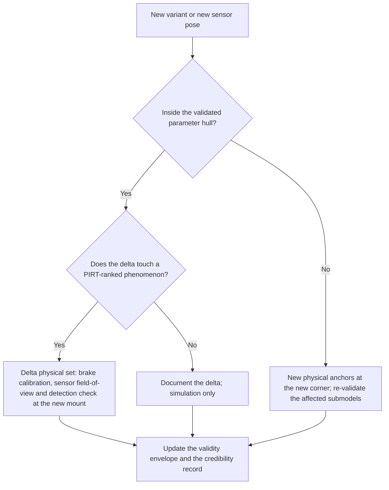

The concrete steps are: parameterize machine geometry, mass, brake model and sensor pose; validate at the corners of the envelope (smallest and largest machine, lowest and highest mount, widest yaw offset, shortest and longest wheelbase or articulation geometry, lowest and highest mass, least and most favorable brake response, and any other parameter that sensitivity analysis shows governs the safety output); for each new variant, show it lies inside the validated parameter hull and then run a reduced "delta" physical set of brake calibration plus a sensor field-of-view and detection check at the new mount; re-validate fully only if a variant falls outside the hull or introduces a new phenomenon in the PIRT, for example a new sensor type or articulated steering. The claim that the selected extremes truly bound all intermediate machines must itself be demonstrated, because geometry, articulation, sensor occlusion and brake dynamics can create non-monotonic effects. **Expert opinion**, consistent with the nuclear scaling and FAA similarity principles [5, 4].

A sensor relocation deserves particular caution. Even with unchanged hardware and perception software, mounting position changes occlusion, angle of incidence, ground returns, vibration, range geometry, rain, snow and dust contamination patterns, and the apparent motion of objects during articulation. Sensor pose should therefore be treated as a model input with an explicit validated range, and a move outside that range should trigger bridge testing. **Expert opinion**.

#### 5. Using the existing warning system's field history as a reference

**Yes, as part of the evidence; no, not as a validation of the new automatic-braking function.** The practice is accepted only in specific forms.

##### Accepted forms

- **Service history for similar systems (aerospace).** FAA AC 25.1309-1B states that for systems sufficiently similar in relevant attributes, satisfactory service history can be acceptable evidence for certain compliance arguments, provided the applicant identifies the differences and explains why the reference history applies. FAA AC 00-72 accepts tool or service history as one contributor to confidence in development tools when similarity of version, operational environment, maturity and usage is substantiated. **Independent** [29, 40].
- **Replay of logged data (on-road).** Replaying or re-simulating logged sensor data is common industry practice in ADAS and ADS development, with the reuse limits noted under question 3. **Independent (on-road evidence)** [30].
- **Real-world data as a required ingredient.** EU 2022/1426 requires the validation dataset to "sufficiently reflect the ODD", and EMDAP's assessment base is built from relevant physical data. **Independent** [6, 5].
- **Direct validation data for sensor and perception models.** If the new system reuses the warning system's sensors and mounting, the logs are direct validation data for those models, provided they hold usable ground truth and cover the conditions in question.

The warning fleet's history can therefore anchor the frequency and geometry of encountered objects, real detections and missed detections where reliably captured, weather and environment distributions, site topology, sensor contamination, nuisance-warning patterns, operator response timing, machine speeds and approach trajectories. It can also serve as an independent replay set that was not used to tune the simulation. **Expert opinion**.

##### What it is not

"Proven in use" (ISO 26262-8:2018 clause 14; IEC 61508) is a route to claim compliance for a *reused element*. It requires that the element's definition and conditions of use be identical, or highly similar, to its use in the field, plus a justified service period. **Independent** [31, 59, 88, 89]. The ISO 26262 formula is based on a 70% confidence level; IEC 61508 practice uses higher confidence. **Expert opinion** [90]. It does not validate a simulator, and adding automatic braking changes the item, so the warning system's history does not transfer to the braking function.

##### Three traps

1. **Exposure must be known.** "Few recorded incidents in ten million operating hours" says little about detector performance unless the denominator of relevant encounters and the recording completeness are known.
2. **Field history is censored and open-loop.** An existing warning may cause the operator to brake, so the data contain few natural examples of what would have happened without intervention, and logs cannot show how machine and operator would have behaved once braking intervenes. The logs are biased toward normal operation, and the near-misses where the warning was ignored, the most valuable records, are often not logged with ground truth.
3. **The system boundary changes.** The warning product has field evidence for perception and operator notification; it has none for automatic command timing, brake-pressure build-up, friction interaction, machine stability during intervention or unintended-braking hazards. The chain detection, decision, brake command, brake dynamics, stopping outcome has never been exercised in the field.

The appropriate claim is therefore "field history validates selected inputs and submodels and supports the representativeness of the scenario distribution", not "field history validates the automatic-braking simulator". **Expert opinion**. A standard or assessor statement explicitly accepting a legacy system's field history as the reference for validating a simulator, or an earth-moving-machine authority accepting a warning-system fleet history as the principal validation basis for an automatic-braking simulation: **not found**.

#### 6. Documented cases where simulation gave false confidence

##### Columbia, STS-107 (February 2003)

Following the foam strike in January 2003, engineers used the empirical Crater impact model to assess tile damage. The Columbia Accident Investigation Board (August 2003) found (F6.3-10) that the assessment used "an impact simulation that was well outside Crater's test database" and that the analyst was inexperienced, and (F6.3-11) that Crater predicted penetration deeper than the tile, but engineers "used their judgment" to conclude the damage would not penetrate. **Independent** [32, 33]. The estimated debris was hundreds of times larger than the data used to calibrate the model; the briefing first cited 640 times and later analysis said about 400 times. [32, 34] Crater had tended to overpredict penetration in the small-impact calibration data and was regarded as conservative there; that conservative bias was extrapolated to the much larger strike, and the in-flight assessment reported no safety-of-flight issue. Columbia was lost on re-entry on 1 February 2003. **Independent** [34, 32]. The Board also criticized the briefing slides for misrepresenting key information, including vague wording such as "significant" and "significantly". [32] Dissent (former Shuttle program manager Wayne Hale, 2011 blog): Crater actually predicted unsafe damage, and the failure was management overriding it. **Expert opinion** [91].

The lesson is not simply "the simulation was inaccurate". A model's demonstrated behavior inside its validation domain was carried far outside that domain, its historically conservative bias was assumed to remain conservative after extrapolation, and the out-of-envelope result was then reinterpreted by judgment. Both a model used outside its envelope and human reinterpretation of out-of-envelope results are failure modes. The case directly drove the creation of NASA-STD-7009, and NASA's credibility material uses it to illustrate giving a model decision weight beyond its credibility. **Independent** [92, 34]. Mapped onto this project: a perception simulation that is conservative in light dust cannot be assumed conservative in dense dust; a brake model conservative on dry compacted soil cannot be assumed conservative on an icy grade; a sensor model validated at one installation height cannot be assumed conservative after a large pose change. Conservatism itself has a validity domain. **Expert opinion**.

##### Metric-driven false confidence (FAA seat certification)

The FAA guidance provides a smaller, non-accident example. One validation comparison has only 0.3% peak error but 60.4% time-history error; a team validating only the peak would have judged the model excellent while missing a major temporal disagreement. In another case, a head-injury model satisfied the specified validation comparisons but showed a non-conservative tendency, so the FAA limited its future use to cases with an expected HIC below 840 rather than allowing use up to the regulatory HIC limit of 1,000. Passing a validation check did not create unlimited predictive authority. **Independent** [4].

##### Protocol-bounded evidence (independent AEB tests, on-road)

AAA's third-party tests show performance cliffs at night that standard daytime protocols did not reveal. In October 2019, none of four vehicles avoided a pedestrian target at night at 25 mph. **Independent (on-road evidence)** [35]. In the study published 16 October 2025, AAA and the Automobile Club of Southern California Automotive Research Center tested a 2024 Honda Accord, 2025 Toyota Camry, 2025 Chevrolet Malibu and 2025 Tesla Model 3 at 25 mph (40 km/h): "Nighttime PAEB impact avoidance improved from 0% in 2019 to 60% in 2025", that is roughly 40% failures under "ideal conditions"; the Camry avoided impact in all its night runs and the Malibu scored lowest. High-visibility clothing caused a complete loss of detection in some systems. **Independent (on-road evidence)** [36, 93, 94]. These conditions were under-represented in consumer test protocols. The case shows that protocol-based evidence, physical or virtual, gives false confidence outside the protocol's envelope.

##### Mining

NIOSH Report of Investigations 9652 (Publication 2000-120, T. M. Ruff, Spokane Research Laboratory, May 2000) states that "an average of 13 mine workers are killed each year by being run over or pinned by mobile mining equipment", and found that "none of the sensors had been previously applied to the specific problem of rigid-frame surface mining trucks"; testing used a 50-ton dump truck. **Independent** [95]. A 2022 peer-reviewed review states that "the mining environment is far less controlled and forgiving than a parking lot or empty field" and that more validation testing "is critical". **Independent** [96]. Specific fatality investigations in which a simulation-validated collision avoidance system failed: **not found**.

##### Not found, and not verified

- **Rail:** a documented accident in which an EN 14363-validated simulation itself created false confidence: not found.
- **Medical devices:** a well-documented public accident attributable to a model that passed the V&V 40 process: not found.
- **Off-road automatic braking:** a published case in which a formally validated simulation supported a safety approval later shown to be unsafe: not found.
- **Nuclear:** many hazard assumptions and plant models have been revised after operating experience and accidents, but a clean case matching "a simulation accepted under the cited framework directly produced false confidence" was not found; forcing Fukushima into that category without a clearer causal record would be misleading.
- **Ariane 5 flight 501, Sleipner A and the 737 MAX MCAS** are widely cited cases of reused or unvalidated assumptions, but primary sources were not reviewed in this research, so specifics are not verified here. The 1996 Ariane 501 Inquiry Board report and the official 737 MAX investigations should be retrieved before these are cited internally.

#### 7. Recording and explaining the limits of validity

The model should have an explicit **credibility and applicability envelope**, analogous to an operational design domain but for the simulation itself. Three layers of published practice combine:

- **The NASA-STD-7009 reporting set:** best estimate; uncertainty; credibility score per factor, with the threshold required for each factor declared in advance; caveats, including any use outside the model's assumptions; and the risk of accepting the result, plus the achieved credibility-factor levels, supporting evidence, assessor independence, rationale and limitations. **Independent** [37, 1].
- **The FDA context-of-use statement:** the exact decision, the model output and the allowed role of that output. **Independent** [2].
- **The EU 2022/1426 envelope requirement** ("define the envelope") and the FAA restriction against unsupported extrapolation. **Independent** [6, 4].

A decision-maker-facing validity record for this program would contain the following; the table is a synthesis of the cross-industry requirements. **Expert opinion**.

| Dimension | What to record |
|---|---|
| Machine | Models and variants covered; mass and payload range; dimensions; articulation and steering architecture; braking-system configuration. |
| Sensor | Hardware, firmware, calibration, installation coordinates and orientation, allowed mounting tolerances, occlusion assumptions. |
| Software | Perception and control versions, configuration parameters, compiler and build identifiers where safety relevant. |
| Objects | Validated object classes, sizes, materials and reflectivity where relevant, static or moving behavior; explicitly excluded objects. |
| Environment | Surface types, grades, rain, snow, fog and dust ranges (meteorological visibility, rain rate, dust optical density), illuminance, glare, darkness, contamination and temperature. |
| Dynamics | Speed and relative-speed ranges, acceleration and deceleration, brake delay and build-up, friction domain. |
| Scenario | Maneuvers and encounter geometries covered and not covered. |
| Evidence density | Where physical validation points exist versus where results are interpolated or extrapolated. |
| Uncertainty | Measurement, parameter, numerical, stochastic and model-form uncertainty, and the resulting safety margin. |
| Known discrepancies | Biases, unexplained residuals, non-conservative cases, workarounds and restrictions. |
| Change triggers | Which product, software or environment changes invalidate or require re-evaluation of the evidence. |

Further rules of practice:

- **Mark every result as interpolated (inside the validated hull) or extrapolated**, and never present an extrapolated result without an extra uncertainty margin, for example an extrapolated area validation metric. [20]
- **Show a map, not a score.** The board should not receive only "the model is 95% accurate" or a green dashboard; NASA cautions that credibility is multidimensional and decision-specific. The better executive view is a map of **validated**, **conditionally supported or interpolated** and **unsupported or extrapolated** regions, with the physical evidence underneath each. **Independent** [1, 39].
- **Use plain charts and words, not slides that bury caveats.** The Columbia Board's criticism of the briefing slides is the reference case. [32]
- **Represent the argument in a structured form**, such as Goal Structuring Notation; SET Level and NAFEMS work propose a "credibility argument" for assessors. **Expert opinion** [56, 64].
- **Preserve failed validation cases.** Removing a scenario from the validation report after the model has been tuned to it destroys information about model-form weakness. The report should distinguish calibration data, validation data and genuinely withheld confirmation data; the FAA's distinction between calibration and validation supports this separation. **Independent** [4].

#### 8. What an internal safety board or outside assessor expects to see

Synthesized from NASA-STD-7009B, ASME V&V 40 and the FDA guidance, EMDAP, FAA AC 20-146A, EU 2022/1426, NATM and UN R152, an assessor-quality package contains substantially more than simulator results. **Independent** (the frameworks) [1, 2, 5, 4, 6, 7].

| Evidence package item | Why the assessor needs it |
|---|---|
| The safety decision and the simulation's context of use, with a model-risk or criticality rating | Prevents evidence validated for one purpose being reused for a stronger claim. FDA makes this foundational. |
| Safety requirements and traceability | Every claimed simulation output traces to the requirement or hazard it supports and to the final pass/fail argument under the Machinery Regulation and ISO 19014 performance levels. |
| A scenario catalogue traced to the hazard analysis and to EMESRT and ISO 21815 scenarios, with a PIRT-like ranking of phenomena (brake fade, dust attenuation, glare, mount vibration) | Shows the virtual matrix represents the relevant site, environment and operating population rather than easy cases. UNECE and ISO scenario methods help here. |
| Model architecture and assumptions | Shows which physical phenomena are represented, simplified, empirical or omitted. EMDAP is especially strong on phenomena identification. |
| Software and model verification, plus toolchain configuration management | Demonstrates that equations and logic are implemented and solved correctly rather than correlated after tuning. Tool confidence would fall under ISO 26262-8 clause 11 or ISO 19014-4 software verification and validation. |
| Input and data pedigree | Establishes provenance and uncertainty of sensor properties, object data, environment data, machine parameters and site distributions. NASA treats these as explicit credibility factors. |
| A prospective validation plan with pre-declared metrics and acceptance thresholds | Prevents changing the metric or tolerance after seeing inconvenient results. FDA calls for prospective credibility goals. |
| Independent physical validation data covering the ODD | Avoids circular validation. FAA rejects validating a model merely by comparison with another validated model. |
| Multi-metric correlation evidence | Peak, timing, waveform, distribution and outcome metrics tied to the safety mechanism, as the FAA examples illustrate. |
| Uncertainty and sensitivity analysis and a documented validity envelope | Shows which variables dominate the outcome and whether safety margin remains after uncertainty. |
| Applicability and transfer analysis | Shows which machine variants and sensor poses fall inside the evidence domain and which require bridge tests. |
| A list of physical confirmatory tests, some chosen by the assessor or by the risk analysis rather than by convenience, and their results | The physical anchor layer every regulator-level scheme keeps. |
| Failed tests and discrepancy disposition | Demonstrates that mismatches were investigated rather than tuned away. |
| Configuration and change control | Ensures that a later software, sensor, solver or machine change does not silently inherit obsolete validation. |
| A record of qualified people and independent review | High-criticality decisions should not depend solely on the model developers' judgment; NASA and rail practice recognize review and independence. |
| A plan for in-service monitoring that feeds back into the model | NATM's fifth pillar, and the only route to close the dust and glare model gaps over time. |
| A residual-risk statement and limitations | Board members need to know precisely what the simulation evidence does not establish. |

For this schedule, a board should be especially skeptical of validation evidence produced only after the mid-2027 prototype is available if the same four-month period was also used to discover model parameters and tune the model. An assessor is likely to ask which data were used for model construction and calibration, which remained independent for validation, whether acceptance criteria were set before looking at results, and whether any test failures caused the validity domain to be narrowed. **Expert opinion**, grounded in the FAA and FDA calibration-versus-validation principles [4, 2].

The strongest possible argument is therefore not "simulation replaced physical testing". It is: physical testing established the truth anchors and boundaries; independent validation showed that the simulation predicts the safety-relevant quantities with quantified uncertainty inside those boundaries; the model was then used to cover the otherwise infeasible combinatorial interior; targeted physical confirmation remained at high-risk boundaries and after influential changes. That pattern is recognizable across FAA certification by analysis, rail virtual acceptance, nuclear evaluation-model validation, FDA V&V 40 and UNECE automated-driving assessment. **Independent** (pattern across the frameworks) [4, 9, 5, 2, 7].

### Comparison tables

#### Credibility frameworks across industries

| Framework (date) | Domain | Evidence type | Risk scaling | Validation against physical data | Validity envelope and transfer rule | Physical evidence that remains | Relevance to off-road automatic braking |
|---|---|---|---|---|---|---|---|
| NASA-STD-7009B (5 March 2024) with NASA-HDBK-7009B (February 2026) [1, 39] | Space and aeronautics | Government standard | Yes; criticality assessment sets required credibility | Yes; Credibility Assessment Scale 0 to 4, Level 4 requires comparison with the real system across its range | Caveats on use outside limits required; credibility is decision-specific; no single scalar score | Not prescribed numerically; decision authority judges adequacy | Governance template for an internal board; not a certification rule. Not proven off-road |
| ASME V&V 40-2018 and FDA guidance (November 2023) [3, 2] | Medical devices | Consensus standard and regulator guidance | Yes; model risk = model influence x decision consequence | Yes; eight categories of credibility evidence; prospective goals | Credibility applies to a stated context of use; new use needs new or stronger evidence | No universal minimum; case by case | Most transferable reasoning framework; physics-based models only. Not proven off-road |
| FAA AC 20-146A (29 June 2018) [4] | Civil aircraft seats | Regulator guidance | Implicit; criteria agreed in certification plan | Yes; baseline dynamic tests; 10% example criteria; calibration is not validation; no model-to-model validation | Extrapolation limited to similar conditions; material or load-path changes trigger new tests | Baseline physical dynamic tests always | Clearest "physical anchor plus virtual variants" precedent; tolerances not transferable. Not proven off-road |
| NRC RG 1.203 EMDAP (December 2005) [5] | Nuclear | Regulatory guide | Graded approach via PIRT | Assessment base of separate-effects and integral-effects experiments | Scaling and applicability analysis (Step 19) for use beyond the test matrix | Experiments for highly ranked phenomena | Best model for phenomena ranking, uncertainty and validation-matrix discipline. Not proven off-road |
| EU 2022/1426 Annex III Part 4 (August 2022; consolidated March 2026) [6] | Automated vehicles | Law | Yes; criticality assessment | Yes; documented method and thresholds; data reflecting the ODD; variability characterized | "Define the envelope in which the virtual tool can be used" | Physical pillars retained | Directly relevant functionally; on-road only |
| UNECE NATM (2022; master document March 2023) [7] | Automated driving | Guideline | Yes | Yes; toolchain credibility: scope, assumptions, verification, validation, data quality | Credibility demonstrated for intended scope | Five pillars include track testing, real-world testing and in-service monitoring | Multi-pillar structure is a good template; on-road only |
| UN R171 (2024 to 2025) [8] | Driver control assistance | Regulation | Yes (credibility principles) | Yes | Toolchain scope | Not a simulation-only regime | On-road only |
| UN R152 virtual testing supplements (adopted 2025) [15, 16, 17] | Car and van AEBS | Regulation | Implicit | Pillar 1: comparison of virtual with physical results | Validity domain description | Yes; number agreed with authority (30% in a working document and a vendor reading) | Closest functional precedent; on-road only |
| ISO 34502 to 34505 (2022 to 2025); ISO/PAS 34506 (draft) [55] | Automated driving scenarios | Consensus standards | Not addressed | Not addressed (coverage, not credibility) | Scenario coverage must reflect the ODD | No ratio defined | Useful for structuring site, weather and behavior combinations; on-road only |
| SET Level Credible Simulation Process (2021); M&S SPICE (2023) [56, 58] | Automotive research | Research and industry | Yes; from criticality of the simulation task | Process level | Credibility documentation | Not specified | Process template only. Not proven off-road |
| EN 14363:2016+A2:2022 with ERA guidance and DynoTRAIN [9, 28, 21] | Rail running dynamics | Standard and regulatory guidance | No formal risk scaling | Comparison sets (at least 24 comparisons from at least 12 sections); more than 1,000 simulations in the validation study | Extension of test conditions; modified vehicles; comparison with approved reference vehicle (Annex T and U) | Yes; running tests for the reference vehicle | Strongest family-transfer and test-reduction precedent; physics far more deterministic than perception |
| ISO 21815-1 and -3 (2022, 2023); ISO 21815-4 (under publication, October 2026) [10, 65, 13] | Earth-moving and mining machines | Standards | Risk levels and areas | Physical test procedures (clause 6 performance and false-positive tests) | Annex B limitations of use; Part 4 excludes automatic braking | Yes; physical tests | Directly applicable, but no simulation provision found |
| ISO 17757:2019; ISO 19014 series [11, 12, 68] | Earth-moving machines | Standards | Performance levels | Physical brake and environment tests; Part 4 under revision | Not found | Yes | Directly applicable, but no simulation provision found |
| AIAA G-077, ASME V&V 10 and 20, DO-330, EN 50126 to 50129 and EN 50716, MIL-STD-3022, DoDI 5000.61, Sandia PCMM, UL 4600, ISO 21448 [60, 63, 51] | Various | Standards and guides | Not verified | Not verified | Not verified | Not verified | Not verified in this research |

### Where the evidence stands

#### Well established

- Credibility must be scaled to the risk of a wrong decision, and it is conditional on intended use. "This simulator is validated" is an incomplete safety statement; the defensible claim is "version X of this model, using these inputs, has sufficient evidence for decision Y inside domain Z". **Independent** [1, 2].
- Verification and validation are different activities, and calibration against a test is not demonstration of predictive capability on independent data. The FAA states this explicitly; ASME, NASA and NRC make the same separation. **Independent** [4, 3, 5].
- Validation must be against independent physical data from inside the intended envelope. Model-to-model comparison can help debugging but is not accepted as validation. **Independent** [4, 6].
- Extrapolation is where credibility deteriorates fastest, and it needs an explicit margin. Columbia is the stark demonstration; the FAA limits use to conditions similar to the validation. **Independent** [32, 4, 20].
- Reports to decision makers must carry uncertainty and caveats, and no single scalar score represents credibility. **Independent** [37, 39].
- No universal simulation-to-test tolerance exists, and no universal percentage of remaining physical tests was found. Mature frameworks decide the allocation from model influence, decision consequence, applicability and uncertainty; claims that a particular percentage is inherently sufficient are not supported. **Independent** [4, 2].
- Some physical confirmation always remains in every regulator-level scheme found. **Independent** [15, 6, 4, 9].
- Field results show threshold effects in degraded visibility: fog in the chamber tests, darkness in the AAA tests. **Independent (on-road evidence)** [23, 35, 36].

#### Uncertain

- How large the physical fraction should be. The UN R152 number is left to agreement and has been read as 30% by a vendor and in a working document; no off-road number exists. [15, 17, 16]
- How faithfully dust, snow, fog, darkness and glare can be simulated for the exact radar, camera and lidar units that will be used. This depends on the sensing modality, sensor internals, rendering or propagation models and empirical data; no framework turns photorealism into proof of sensor fidelity, and the environmental models must themselves be validated. [22, 24]
- Whether a small set of machine configurations can provably bound all machine models. Possible in principle when sensitivity and monotonicity are established, but geometry, articulation, sensor occlusion and brake dynamics may create non-monotonic effects; no allowable family size or number of anchor machines was found.
- The amount of real field exposure needed to substantiate rare false-negative or unintended-braking probabilities. Large simulated sample counts do not remove model-form uncertainty; credibility of rare-event estimates depends on input-distribution validity and tail modeling.
- Whether an off-road notified body or assessor will accept simulation under the Machinery Regulation for this function. No guidance was found. [77, 78]
- What the paid texts of ISO 21815, ISO 17757 and ISO 19014 say about simulation.

#### Where experts disagree

- **Whether the UN R152 virtual testing provisions are credible enough.** The United Kingdom's GRVA-18-55 (January 2024) argued that physical testing "should be used and evidenced for all the components of the toolchain", and the Russian Federation (November 2025) argued for mandatory physical verification of the virtual model; industry associations proposed the provisions. **Expert opinion (on-road evidence)** [18, 19].
- **The UN R152 physical-test share.** The 30% figure in the UTAC CERAM working document and the vendor commentary cannot be reconciled with the adopted WP.29 text, which leaves the number of physical confirmatory tests to agreement between manufacturer and authority; the adopted text governs. [16, 17, 15]
- **How far similarity and analysis may replace large physical tests.** The FAA Transport Airplane Crashworthiness and Ditching Working Group record (15 December 2017) includes a DLR dissent arguing that similarity and design-review approaches could be unsafe for some composite crash structures and that at least one large structural test should remain. Proponents emphasize validated-family reuse and efficiency; skeptics emphasize apparently minor design details that change failure mechanisms. **Independent** [97].
- **Whether the area validation metric is a sound acceptance criterion**, given that more experimental scatter can make a model look better. **Independent** [80, 85].
- **Whether Columbia was a model-validity failure** (the Board's view) **or a management override of a correct warning** (Hale). [32, 91]
- **How to aggregate credibility.** NASA deliberately avoids a single score; engineering organizations often want dashboards or maturity scores. For a safety board the NASA position is more defensible: preserve the dimensions and their evidence rather than let a high score in one area compensate invisibly for weak validation in another. [39]
- **How far PIRT-style subjective ranking is acceptable** without explicit treatment of the subjectivity. **Independent** [51].

### Blind spots

Issues that matter to the four-month campaign but that the eight questions did not ask about, grouped by theme.

**The system boundary and the closed loop**

- The simulation must be validated at the same system boundary as the safety claim. Validating the perception subsystem and the brake plant independently does not prove their closed-loop combination is safe; latency, asynchronous sampling, message delays, actuator saturation, control-state transitions and operator behavior can create emergent failures. Integral full-system tests remain important after submodels are validated, which parallels EMDAP's use of both separate-effects and integral-effects evidence. [5]
- If the system acts through a third-party J1939 interface (ISO/TS 21815-2), the validation scope must include end-to-end integration latency. [66]
- Cybersecurity and fault injection are separate from nominal simulation accuracy. A high-fidelity nominal model says nothing about corrupted messages, sensor dropout, timing faults, bus congestion, frozen values or actuator faults; those need explicit fault testing.

**Hazards created by the function itself**

- False-positive braking is itself a safety hazard: load shift, rollover on slopes, machine instability near an edge, rear-end impacts from following haul trucks, or hazards during a maneuver. The ISO 21815-1 false-positive test exists for this reason, and the simulation matrix needs hazardous-unintended-intervention cases as well as failure-to-intervene cases; no off-road standard prescribing the balance was found. [10]
- Operator behavior changes when warnings become interventions. Adaptation, over-reliance, override behavior, nuisance-brake response and mode confusion are not represented by a vehicle and environment simulator; ISO 21815-3 states that responsibility stays with the operator. Human-in-the-loop evidence may be required for claims involving operator response. [65]
- Brake-system variability (wear, temperature, ISO 3450 conditions) makes the physical brake model probably the highest-risk model in the chain.

**Coverage, statistics and uncertainty**

- Scenario coverage and model credibility are separate problems. A perfectly validated simulator can still support a weak safety case if the virtual scenarios omit important hazards, and millions of scenarios do not help if the simulator is wrong in the relevant conditions. [7]
- Site representativeness must be auditable. "100+ job-site types" is not a coverage argument until a taxonomy connects site characteristics to the physical variables that affect sensing and stopping: geometry, surface and friction, grade, object populations, visibility, dust generation, traffic patterns, machine interaction and operating speed. Otherwise the number of simulated sites becomes a vanity metric. The ISO 345xx scenario work is a structural analogy but remains on-road. [55]
- Rare events and epistemic uncertainty need separate treatment. Ten million simulated runs may estimate variability within the model very precisely while saying almost nothing about an omitted phenomenon; the board should distinguish aleatory from epistemic (model-form) uncertainty, as NASA and nuclear practice do. [1, 5]
- Machine-learned perception falls outside the FDA and V&V 40 scope, which covers physics-based models only; data-driven components need separate assurance. [2]

**Measurement, independence and configuration**

- Measurement-system uncertainty can become the limiting factor. Ground truth for object pose, relative speed, intervention timing, wheel or track slip and stopping distance must be more precise than the discrepancy being measured; the FAA notes that validation requirements should reflect measurement capability. [4]
- Test independence must be designed, not declared. If every physical case is used to tune sensor, friction and brake parameters, no untouched evidence remains to demonstrate predictive performance; calibration, validation and final confirmation datasets should be preallocated before prototype testing begins.
- Simulation tool qualification and configuration control: a credible model run on an unqualified or uncontrolled toolchain is not evidence.
- Version management may invalidate evidence faster than testing can be performed. Sensor firmware, perception software, braking calibration, machine ECU versions and simulator versions should be frozen for validation or governed through a defined impact-analysis process; FAA tool-history guidance similarly ties history to the relevant version and environment. [40]

**Regulation, assessment and schedule**

- Regulatory timing: the EU Machinery Regulation applies from 20 January 2027, before the prototype arrives. MSHA does not mandate collision avoidance; South African requirements are framed at EMESRT Level 9 according to industry sources. [78, 74, 72, 73]
- In-service monitoring after release is a NATM pillar and the only route to close the dust and glare model gaps over time. [7]
- Schedule risk: three to four years of past practice compressed into four months is plausible only if the assessment base, scenario catalogue, sensor characterization, uncertainty budget and agreement with the assessor are finished before mid-2027. Starting in October 2026 leaves about eight months. Between now and prototype arrival the organization can define the credibility framework, build environment and machine-family models, ingest field data from the warning fleet, quantify test-equipment uncertainty, run model-verification exercises, establish scenario taxonomies, perform sensitivity studies with preliminary plant models, negotiate evidence expectations with the board or assessor and pre-register acceptance criteria.
- Degraded-visibility physical anchors cannot be scheduled. Natural fog, snow, dense dust and low sun at the right intensity may simply not occur during a four-month window, so the physical anchors in those classes need controlled means (fog or rain chambers, artificial dust generation, night sessions) planned and booked before mid-2027, or the validity envelope will exclude exactly the conditions the system must handle.
- The research did not find who, under the Machinery Regulation, would act as the outside assessor for a simulation-based argument on this function, or what competence a notified body would need to judge it. The frameworks all assume a competent counterpart (NASA people-qualification factor, FAA certification plan, FDA reviewer); an early agreement on who that counterpart is, and on their review criteria, is itself a prerequisite for the schedule.
- Field logs from the warning fleet are only usable as validation data if their ground truth, consent and data-rights status allow it; the technical limits of the logs are discussed under question 5, but whether the manufacturer may use customer-site recordings for this purpose was not examined.

### Sources

1. NASA. NASA-STD-7009B, Standard for Models and Simulations. NASA Technical Standards Program. Approved 5 March 2024. https://standards.nasa.gov/sites/default/files/standards/NASA/B/1/NASA-STD-7009B-Final-3-5-2024.pdf. **Independent**.
2. US Food and Drug Administration. Assessing the Credibility of Computational Modeling and Simulation in Medical Device Submissions: Guidance for Industry and Food and Drug Administration Staff (final). November 2023. https://www.fda.gov/regulatory-information/search-fda-guidance-documents/assessing-credibility-computational-modeling-and-simulation-medical-device-submissions. **Independent**.
3. ASME. V&V 40-2018, Assessing Credibility of Computational Modeling through Verification and Validation: Application to Medical Devices. American Society of Mechanical Engineers, VVUQ standards portal. 2018. https://www.asme.org/codes-standards/publications-information/verification-validation-uncertainty. **Independent**.
4. Federal Aviation Administration. Advisory Circular AC 20-146A, Dynamic Seat Certification by Analysis. 29 June 2018. https://www.faa.gov/documentLibrary/media/Advisory_Circular/AC_20-146A.pdf. **Independent**.
5. US Nuclear Regulatory Commission. Regulatory Guide 1.203, Transient and Accident Analysis Methods, Revision 0 (Evaluation Model Development and Assessment Process). December 2005. https://www.nrc.gov/docs/ML0535/ML053500170.pdf. **Independent**.
6. European Commission. Commission Implementing Regulation (EU) 2022/1426 on uniform procedures and technical specifications for the type-approval of the automated driving system of fully automated vehicles (Annex III Part 4: principles for credibility assessment for using virtual toolchains). Official Journal of the European Union. 5 August 2022; consolidated version 24 March 2026. https://eur-lex.europa.eu/eli/reg_impl/2022/1426/oj/eng (consolidated text: https://eur-lex.europa.eu/legal-content/en/ALL/?uri=CELEX%3A02022R1426-20260324). **Independent (on-road evidence)**.
7. UNECE World Forum for Harmonization of Vehicle Regulations (WP.29). New Assessment/Test Method for Automated Driving (NATM), Master Document, WP.29-189-07 (first version ECE/TRANS/WP.29/2022/58). March 2023. https://unece.org/sites/default/files/2023-03/WP.29-189-07e.pdf. **Independent (on-road evidence)**.
8. UNECE. UN Regulation No. 171, Uniform provisions concerning the approval of vehicles with regard to Driver Control Assistance Systems (including principles for credibility assessment of virtual toolchains). 2024 to 2025. https://unece.org/sites/default/files/2025-03/R171e.pdf. **Independent (on-road evidence)**.
9. CEN. EN 14363:2016+A2:2022, Railway applications, Testing and Simulation for the acceptance of running characteristics of railway vehicles, Running behaviour and stationary tests (Annex T, simulation of on-track tests; Annex U, extension of acceptance). European Committee for Standardization. 2022. https://standards.iteh.ai/catalog/standards/cen/956a9f88-bf27-482e-aa3f-350137391858/en-14363-2016a2-2022. **Independent**.
10. ISO. ISO 21815-1:2022, Earth-moving machinery, Collision warning and avoidance, Part 1: General requirements (clause 6, test procedures). International Organization for Standardization. January 2022. https://www.iso.org/standard/77302.html. **Independent**.
11. ISO. ISO 17757:2019, Earth-moving machinery and mining, Autonomous and semi-autonomous machine system safety. International Organization for Standardization. 2019. https://standards.iteh.ai/catalog/standards/iso/83b063e6-ac4f-41e5-905e-863bbc181247/iso-17757-2019. **Independent**.
12. ISO. ISO 19014-2:2022, Earth-moving machinery, Functional safety, Part 2: Design and evaluation of hardware and architecture requirements for safety-related parts of the control system (sample pages). International Organization for Standardization. 2022. https://cdn.standards.iteh.ai/samples/73568/16e1aca6de46425ea69989a92c777166/ISO-19014-2-2022.pdf. **Independent**.
13. ISO. ISO 21815-4, Earth-moving machinery, Collision warning and avoidance, Part 4: Risk area and risk level for swing/rotation motion (catalogue page; stage 60.00, under publication; listed publication date October 2026). International Organization for Standardization. October 2026. https://www.iso.org/standard/81597.html. **Independent**.
14. GlobalAutoRegs. UN Regulation No. 152, Advanced Emergency Braking Systems for M1 and N1 vehicles: regulation page with amendment history. Accessed October 2026. https://globalautoregs.com/rules/238?series=0. **Independent (on-road evidence)**.
15. UNECE WP.29. ECE/TRANS/WP.29/2025/141, Proposal for a supplement to UN Regulation No. 152 (virtual testing; physical confirmatory tests in a number agreed between manufacturer and authority). 28 August 2025. https://unece.org/sites/default/files/2025-10/ECE-TRANS-WP.29-2025-141e.pdf. **Independent (on-road evidence)**.
16. UTAC CERAM (France). AEBS-16-03, UTAC CERAM virtual testing method: use case application. Informal working document, UNECE Informal Working Group on AEBS, 16th session. Accessed October 2026. https://wiki.unece.org/download/attachments/128419397/AEBS-16-03%20(F)%20Methodology_UTACCERAM_usecase.pdf?api=v2. **Expert opinion (on-road evidence)**.
17. Foretellix. Virtual Testing Gains Regulatory Ground: How AEBS Regulation Sets the Stage for Industry-Wide Transformation. Company blog. February 2025. https://www.foretellix.com/aebs-regulation/. **Vendor (on-road evidence)**.
18. United Kingdom (expert submission to GRVA). GRVA-18-55, Virtual testing in UN R152: Introduction. UNECE Working Party on Automated/Autonomous and Connected Vehicles, 18th session. January 2024. https://unece.org/sites/default/files/2024-01/GRVA-18-55e.pdf. **Expert opinion (on-road evidence)**.
19. Russian Federation (expert submission to GRVA). Proposal for amendments to UN Regulation No. 152 concerning mandatory physical testing to verify the virtual model. UNECE WP.29/GRVA. November 2025. Document symbol and link not found. **Expert opinion (on-road evidence)**.
20. Roy, C. J. and Oberkampf, W. L. A comprehensive framework for verification, validation, and uncertainty quantification in scientific computing. Computer Methods in Applied Mechanics and Engineering 200(25-28):2131-2144. 2011. http://ftp.demec.ufpr.br/disciplinas/TM798/Artigos_seminarios/roy_oberkampf_2011-verification.pdf. **Independent**.
21. Polach, O., Böttcher, A., Vannucci, D. et al. Validation of simulation models in the context of railway vehicle acceptance (DynoTRAIN). Proceedings of the Institution of Mechanical Engineers, Part F: Journal of Rail and Rapid Transit 229(6), published online 2014. 2015. https://journals.sagepub.com/doi/10.1177/0954409714554275. **Independent**.
22. Haider, A. et al. (Technical University of Munich). A Methodology to Model the Rain and Fog Effect on the Performance of Automotive LiDAR Sensors. Sensors 23(15):6891. August 2023. https://www.ncbi.nlm.nih.gov/pmc/articles/PMC10422612/. **Independent (on-road evidence)**.
23. Jokela, M., Kutila, M. and Pyykönen, P. Testing and Validation of Automotive Point-Cloud Sensors in Adverse Weather Conditions. Applied Sciences 9(11):2341. 2019. https://doi.org/10.3390/app9112341. **Independent (on-road evidence)**.
24. Modelling of LIDAR sensor disturbances by solid airborne particles (ALDUS model, validated against a controlled experiment in the PROSIVIC simulator). arXiv 2105.04193 (preprint). 2021. https://arxiv.org/pdf/2105.04193. **Independent**.
25. BMW Group. Hybrid homologation: virtual crash tests recognized by the German Federal Motor Transport Authority (KBA) after a TÜV SÜD audit. Company news release. 6 February 2026. https://www.bmwgroup.com/en/news/general/2026/hybrid-homologation.html. **Vendor (on-road evidence)**.
26. UTAC. AEBS-12-07, Validation Method: Virtual Testing. Informal working document, UNECE Informal Working Group on AEBS, 12th session. Accessed October 2026. https://wiki.unece.org/download/attachments/101554586/AEBS-12-07%20(UTAC)%20Virtual%20testing%20AEBS.pdf?api=v2. **Expert opinion (on-road evidence)**.
27. Mind the Gap! A Study on the Transferability of Virtual vs Physical-world Testing of Autonomous Driving Systems (small-scale vehicles). arXiv 2112.11255 (preprint). December 2021. https://arxiv.org/pdf/2112.11255. **Independent**.
28. European Railway Agency (now European Union Agency for Railways), Interoperability Unit. Running dynamics: application of EN 14363:2005, modifications and clarifications. Document posted November 2022. https://www.era.europa.eu/system/files/2022-11/Running%20dynamics,%20application%20of%20EN%2014363_2005%20%E2%80%93%20modifications%20and%20clarifications.pdf.pdf. **Independent**.
29. Federal Aviation Administration. Advisory Circular AC 25.1309-1B, System Design and Analysis. 2024. https://www.faa.gov/documentLibrary/media/Advisory_Circular/AC_25.1309-1B.pdf. **Independent**.
30. Towards more efficient quantitative safety validation of residual risk for assisted and automated driving. arXiv 2506.10363 (preprint). June 2025. https://arxiv.org/pdf/2506.10363. **Independent (on-road evidence)**.
31. ISO. ISO 26262-8:2018, Road vehicles, Functional safety, Part 8: Supporting processes (clause 11, confidence in software tools; clause 14, proven in use). International Organization for Standardization. December 2018. https://www.iso.org/standard/68390.html. **Independent (on-road evidence)**.
32. Columbia Accident Investigation Board. Report Volume I. NASA (NTRS record 20030093634). August 2003. https://ntrs.nasa.gov/citations/20030093634. **Independent**.
33. Spaceflight Now. Columbia Accident Investigation Board: complete list of findings and recommendations (reproducing findings F6.3-10 and F6.3-11). 2003. https://spaceflightnow.com/columbia/report/allfindings.html. **Independent**.
34. Blattnig, S. R. et al. (NASA Langley Research Center). NASA Standard for Models and Simulations: Philosophy and Requirements Overview (includes the Columbia Crater case). AIAA Aerospace Sciences Meeting. 2009. https://www.researchgate.net/publication/258207261_NASA_Standard_for_Models_and_Simulations_Philosophy_and_Requirements_Overview. **Independent**.
35. AAA. AAA Warns Pedestrian Detection Systems Don't Work When Needed Most. AAA Newsroom. October 2019. https://newsroom.aaa.com/2019/10/aaa-warns-pedestrian-detection-systems-dont-work-when-needed-most/. **Independent (on-road evidence)**.
36. AAA. Pedestrian detection tech improves, but still unreliable at night (2025 pedestrian AEB study with the Automobile Club of Southern California Automotive Research Center). 16 October 2025. https://www.ace.aaa.com/automotive/advocacy/pedestrian-detection-study-2025.html. **Independent (on-road evidence)**.
37. NASA. NASA-STD-7009A with Change 1, Standard for Models and Simulations (reporting requirements to decision makers). NASA Technical Standards Program. Revision A 2016, with Change 1. https://standards.nasa.gov/sites/default/files/standards/NASA/w/CHANGE-1/1/nasa_std_7009a_change_1.pdf. **Independent**.
38. Green, L. L. et al. (NASA). NASA Standard for Models and Simulations: Credibility Assessment Scale. NASA Technical Reports Server, document 20090005963. 2009. https://ntrs.nasa.gov/api/citations/20090005963/downloads/20090005963.pdf. **Independent**.
39. NASA. NASA-HDBK-7009B, Handbook for Models and Simulations: An Implementation Guide for NASA-STD-7009B. NASA Technical Standards Program. Final 3 February 2026. https://standards.nasa.gov/system/files/tmp/NASA-HDBK-7009B_Final%2002-03-2026.pdf. **Independent**.
40. Federal Aviation Administration. Advisory Circular AC 00-72, Best Practices for Airborne Electronic Hardware Design Assurance. 7 October 2022. https://www.faa.gov/documentLibrary/media/Advisory_Circular/AC_00-72.pdf. **Independent**.
41. Federal Register. Assessing the Credibility of Computational Modeling and Simulation in Medical Device Submissions; Guidance for Industry and Food and Drug Administration Staff; Availability (docket FDA-2021-D-0980). 17 November 2023. https://www.federalregister.gov/documents/2023/11/17/2023-25470/assessing-the-credibility-of-computational-modeling-and-simulation-in-medical-device-submissions. **Independent**.
42. Interagency Modeling and Analysis Group (IMAG) wiki, NIBIB. FDA Guidance: Credibility of Computational Modeling and Simulation (resource page). Accessed October 2026. https://www.imagwiki.nibib.nih.gov/resources/publications/fda-guidance-credibility-computational-modeling-simulation. **Independent**.
43. StarFish Medical. FDA Guidance on Computational Modeling and Simulation in Medical Device Submissions (summary of the nine-step process). Consultancy article. Accessed October 2026. https://starfishmedical.com/resource/fda-guidance-on-cms-in-medical-device-submissions/. **Expert opinion**.
44. Thornton Tomasetti. FDA Unveils Transformative Guidance for Computational Modeling in Medical Device Submissions. Consultancy news article. 2023. https://www.thorntontomasetti.com/news/fda-guidance-computational-modeling-medical-device-submissions. **Expert opinion**.
45. US Nuclear Regulatory Commission. Draft Regulatory Guide DG-1120, Transient and Accident Analysis Methods (draft preceding RG 1.203). December 2002. https://www.nrc.gov/docs/ML0301/ML030160652.pdf. **Independent**.
46. US Nuclear Regulatory Commission. Review document applying the EMDAP assessment-base and adequacy criteria (ADAMS accession ML23086C082). 2023. https://www.nrc.gov/docs/ML2308/ML23086C082.pdf. **Independent**.
47. US Nuclear Regulatory Commission. Final Safety Evaluation of a topical report applying the EMDAP, including the Step 19 scalability evaluation (ADAMS accession ML16236A175). 2016. https://www.nrc.gov/docs/ML1623/ML16236A175.pdf. **Independent**.
48. US Nuclear Regulatory Commission. TerraPower, LLC: Final Safety Evaluation of Topical Report (EMDAP-based methodology; ADAMS accession ML25106A043). 2025. https://www.nrc.gov/docs/ML2510/ML25106A043.pdf. **Independent**.
49. US Nuclear Regulatory Commission. Audit Plan, TerraPower Design Basis Accident analysis methodology (public; ADAMS accession ML24064A195). 2024. https://www.nrc.gov/docs/ML2406/ML24064A195.pdf. **Independent**.
50. ASME. VVUQ standards program, including VVUQ 30.1-2024 on scaling methodologies for nuclear thermal-fluids applications. American Society of Mechanical Engineers. 2024. https://www.asme.org/codes-standards/vvuq-standards. **Independent**.
51. Predictive Capability Maturity Quantification using Bayesian Network (review of CSAU, EMDAP and the Sandia PCMM). arXiv 2010.03373 (preprint). 2020. https://arxiv.org/pdf/2010.03373. **Independent**.
52. Virtual Verification and Validation of Autonomous Vehicles: Toolchain and Workflow. IntechOpen book chapter. Accessed October 2026. https://www.intechopen.com/chapters/1206671. **Expert opinion (on-road evidence)**.
53. GlobalAutoRegs. GRVA working documents, 2024 (including the UN R152 virtual testing proposals). Accessed October 2026. https://globalautoregs.com/groups/7?show=documents&year=2024. **Independent (on-road evidence)**.
54. UNECE GRVA. ECE/TRANS/WP.29/GRVA/2024/19, Proposal for a supplement to UN Regulation No. 152 introducing virtual testing (two-pillar approach). April 2024. https://unece.org/sites/default/files/2024-04/ECE-TRANS-WP.29-GRVA-2024-19e.pdf. **Independent (on-road evidence)**.
55. ISO. ISO 34502:2022, Road vehicles, Test scenarios for automated driving systems, Scenario based safety evaluation framework (series continued by ISO 34503:2023, ISO 34504:2024, ISO 34505:2025 and ISO/PAS 34506, under development). International Organization for Standardization. 2022 to 2025. https://www.iso.org/standard/78951.html (ISO 34505:2025: https://www.iso.org/standard/78954.html). **Independent (on-road evidence)**.
56. SET Level consortium (Heinkel, H.-M. and Steinkirchner, K.). Credible Simulation Process. August 2021. https://setlevel.de/assets/forschungsergebnisse/Credible-Simulation-Process.pdf. **Expert opinion**.
57. Towards Modelica Models with Credibility Information. Electronics 11(17):2728. 2022. https://doi.org/10.3390/electronics11172728. **Independent**.
58. Eichenseer, M. et al. Modeling & Simulation SPICE: Assessing the Capability of Credible Simulation Processes. INCOSE International Symposium (Wiley). 2023. https://incose.onlinelibrary.wiley.com/doi/10.1002/iis2.13029. **Independent**.
59. Embitel and HEICON. Webinar: ISO 26262: Re-use of Software (slides covering proven in use and tool confidence). Accessed October 2026. https://www.embitel.com/wp-content/uploads/pdf/Embitel_HEICON_Webinar_Re-use_SW_ISO_26262_V1.0_English.pdf. **Expert opinion**.
60. UL Standards & Engagement. UL 4600, Standard for Safety for the Evaluation of Autonomous Products, 3rd edition. 17 March 2023. https://www.shopulstandards.com/ProductDetail.aspx?productId=UL4600_3_S_20230317. **Independent**.
61. European Union Agency for Railways. Application Guide GUI/WAG TSI/2023 (freight wagons; running-dynamics evidence by EN 14363 tests or simulation with a validated model). December 2023. https://www.era.europa.eu/system/files/2023-12/WAG_TSI_Guide.pdf?t=1711020857. **Independent**.
62. European Commission, CORDIS. DynoTRAIN, Railway vehicle dynamics and track interactions: total regulatory acceptance for the interoperable network (project 234079), final reporting. Accessed October 2026. https://cordis.europa.eu/project/id/234079/reporting. **Independent**.
63. CENELEC. EN 50716:2023, Railway applications, Requirements for software development (successor to EN 50128). 2023. https://standards.iteh.ai/catalog/standards/clc/32d1d924-9bfd-477e-adf4-de6e3358be77/en-50716-2023. **Independent**.
64. NAFEMS. Simulation Credibility for Virtual Validation of Automated Vehicle Systems (NAFEMS World Congress 2021, paper NWC21-576). 2021. https://www.nafems.org/publications/resource_center/nwc21-576-c/. **Expert opinion**.
65. ISO. ISO 21815-3:2023, Earth-moving machinery, Collision warning and avoidance, Part 3: Risk area and risk level for forward/reverse motion (Annex D, stopping-distance calculations). International Organization for Standardization. August 2023. https://www.iso.org/standard/77266.html (preview pages: https://webstore.ansi.org/preview-pages/ISO/preview_ISO+21815-3-2023.pdf). **Independent**.
66. ISO. ISO/TS 21815-2:2021, Earth-moving machinery, Collision warning and avoidance, Part 2: On-board J1939 communication interface. International Organization for Standardization. 2021. https://www.iso.org/standard/77303.html. **Independent**.
67. ISO. BS EN ISO 19014-3:2018, Earth-moving machinery, Functional safety, Part 3: Environmental performance and test requirements of electronic and electrical components used in safety-related parts of the control system. BSI Knowledge catalogue. 2018. https://knowledge.bsigroup.com/products/earth-moving-machinery-functional-safety-environmental-performance-and-test-requirements-of-electronic-and-electrical-components-used-in-safety-related-parts-of-the-control-system. **Independent**.
68. ISO. ISO 19014-4 (edition 2), Earth-moving machinery, Functional safety, Part 4: Design and evaluation of software and data transmission for safety-related parts of the control system (stage 60.00, under publication; listed for October 2026; replaces ISO 19014-4:2020). International Organization for Standardization. Accessed October 2026. https://www.iso.org/standard/87720.html. **Independent (under publication)**.
69. CEN and ISO. FprEN ISO 19014-1, Earth-moving machinery, Functional safety, Part 1 (final draft; listed for publication 22 November 2026). Accessed October 2026. https://standards.iteh.ai/catalog/standards/cen/b6a52497-e060-47c7-b4de-4197b2a644cd/fpren-iso-19014-1. **Independent (draft)**.
70. Wabtec. Key Insights for the Successful Implementation of Proximity Detection (white paper describing the EMESRT control levels). Accessed October 2026. https://www.wabteccorp.com/Digital-Intelligence/Digital-Mine/White-Papers/Proximity-Detection-and-Collision-Avoidance-Technology. **Vendor**.
71. Toward an Agricultural Operational Design Domain: A Framework (cites EMESRT PR-5A Revision 3.0, September 2024). arXiv 2511.02937 (preprint). November 2025. https://arxiv.org/pdf/2511.02937. **Independent**.
72. Business IT (South Africa). Pioneering collision awareness technology for safer mining practices. Trade article. 5 November 2019. https://www.business-it.co.za/pioneering-collision-awareness-technology-for-safer-mining-practices/. **Expert opinion**.
73. MineSafe Global. EMESRT Compliance for Mining (explanation of the nine control levels). Vendor page. Accessed October 2026. https://minesafeglobal.com/mining-safety-certifications-compliance/emesrt/. **Vendor**.
74. Mine Safety and Health Administration. Surface Mobile Equipment Safety Program (final rule overview). 2024. https://www.msha.gov/sites/default/files/Regulations/Surface%20Mobile%20Equipment%20Safety%20Program.pdf. **Independent**.
75. Jackson Kelly PLLC. MSHA Final Rule on Safety Program for Surface Mobile Equipment. Law-firm alert. December 2023. https://www.jacksonkelly.com/workplace-safety-and-health-news-alert/msha-final-rule-on-safety-program-for-surface-mobile-equipment/. **Expert opinion**.
76. Federal Register. Proximity Detection Systems for Mobile Machines in Underground Mines (MSHA proposed rule, docket actions). 9 January 2017. https://www.federalregister.gov/documents/2017/01/09/2017-00105/proximity-detection-systems-for-mobile-machines-in-underground-mines. **Independent**.
77. BAuA (German Federal Institute for Occupational Safety and Health). Machinery: the new European Machinery Regulation. Accessed October 2026. https://www.baua.de/EN/Topics/Work-design/Machine-and-operational-safety/Machinery/Machinery-Directive-Revision. **Independent**.
78. EU-OSHA. Regulation (EU) 2023/1230 on machinery (legislation summary page). European Agency for Safety and Health at Work. 2023. https://osha.europa.eu/en/legislation/directive/regulation-20231230eu-machinery. **Independent**.
79. Development of High-Fidelity Automotive LiDAR Sensor Model with Standardized Interfaces. Sensors 22(19):7556. 2022. https://www.ncbi.nlm.nih.gov/pmc/articles/PMC9572647/. **Independent (on-road evidence)**.
80. White, K. Area Validation Metric for Applications with Mixed Uncertainty. DATAWorks 2019 (Defense and Aerospace Test and Analysis Workshop). 2019. https://testscience.org/wp-content/uploads/formidable/13/White_DATAWorks2019.pdf. **Independent**.
81. VP-AutoTest: A Virtual-Physical Fusion Autonomous Driving Testing Platform. arXiv 2512.07507 (preprint). December 2025. https://arxiv.org/pdf/2512.07507. **Independent (on-road evidence)**.
82. US Patent 12,456,065, Method for determining simulation data (area validation metric used for model-form uncertainty). US Patent and Trademark Office. Accessed October 2026. https://image-ppubs.uspto.gov/dirsearch-public/print/downloadPdf/12456065. **Vendor**.
83. Uncertainty Quantification in Case of Imperfect Models: A Review. arXiv 2012.09449 (preprint). 2020. https://arxiv.org/pdf/2012.09449. **Independent**.
84. US Patent 11,720,542, Method for assessing validation points for a simulation model. US Patent and Trademark Office. Accessed October 2026. https://image-ppubs.uspto.gov/dirsearch-public/print/downloadPdf/11720542. **Vendor**.
85. Optimal Design of Validation Experiments for the Prediction of Quantities of Interest. Peer-reviewed article (ResearchGate record 369183910). 2023. https://www.researchgate.net/publication/369183910_Optimal_Design_of_Validation_Experiments_for_the_Prediction_of_Quantities_of_Interest. **Independent**.
86. Design of Dust-Filtering Algorithms for LiDAR Sensors Using Intensity and Range Information in Off-Road Vehicles. Sensors (PMC9185448). 2022. https://pmc.ncbi.nlm.nih.gov/articles/PMC9185448/. **Independent**.
87. Dust Filtering in LIDAR Point Clouds Using Deep Learning for Mining Applications. ResearchGate record 396708139. 2025. https://www.researchgate.net/publication/396708139_Dust_Filtering_in_LIDAR_Point_Clouds_Using_Deep_Learning_for_Mining_Applications. **Independent**.
88. HEICON Ulm. Reuse scenarios in ISO 26262 (part 1). Consultancy blog. Accessed October 2026. https://heicon-ulm.de/en/reuse-scenarios-in-iso-26262-part-1/. **Expert opinion**.
89. HEICON Ulm. Reuse scenarios in ISO 26262 (part 2). Consultancy blog. Accessed October 2026. https://heicon-ulm.de/en/reuse-scenarios-in-iso-26262-part-2/. **Expert opinion**.
90. Analog Devices EngineerZone. The Math Behind Proven in Use. Engineering blog. Accessed October 2026. https://ez.analog.com/ez-blogs/b/engineerzone-spotlight/posts/the-math-behind-proven-in-use. **Expert opinion**.
91. Hale, W. A Not-So-Simple Truth. Personal blog of a former Space Shuttle program manager. 12 March 2011. https://waynehale.wordpress.com/2011/03/12/a-not-so-simple-truth/. **Expert opinion**.
92. MIT OpenCourseWare, ESD.864 Modeling and Assessment for Policy. The Columbia Incident and NASA's Standard for Modeling and Simulation (lecture notes). Spring 2013. https://ocw.mit.edu/courses/ids-410j-modeling-and-assessment-for-policy-spring-2013/9ebed76cb732ee0b6b760e58108750f0_MITESD_864S13_NASA_Colbia.pdf. **Expert opinion**.
93. AAA Northeast. Pedestrian safety testing (magazine article on the 2025 AAA study, including the high-visibility clothing result). 2025. https://magazine.northeast.aaa.com/?p=228137. **Independent (on-road evidence)**.
94. Streetsblog USA. 'Embarrassment': Pedestrian Automatic Emergency Braking Still Flawed at Night. 17 October 2025. https://usa.streetsblog.org/2025/10/17/embarrassment-pedestrian-automatic-emergency-braking-still-flawed-at-night. **Expert opinion (on-road evidence)**.
95. Ruff, T. M. (NIOSH Spokane Research Laboratory). Test Results of Collision Warning Systems for Surface Mining Dump Trucks. Report of Investigations 9652, DHHS (NIOSH) Publication 2000-120. May 2000. https://www.cdc.gov/niosh/publications/numbered/2000-120.html. **Independent**.
96. Hrica, J. K., Bellanca, J. L., Benbourenane, I., Carr, J. L., Homer, J. and Stabryla, K. M. (NIOSH). A Rapid Review of Collision Avoidance and Warning Technologies for Mining Haul Trucks. Mining, Metallurgy & Exploration (PMC9490765). 2022. https://pmc.ncbi.nlm.nih.gov/articles/PMC9490765/. **Independent**.
97. FAA Aviation Rulemaking Advisory Committee, Transport Airplane Crashworthiness and Ditching Working Group. Final Recommendation Report (including the DLR dissent on similarity and analysis in place of large structural tests). 15 December 2017. https://www.faa.gov/sites/faa.gov/files/2025-04/ARAC-TACDWG_Recommendations.pdf. **Independent**.

## Chapter 11: Tools, vendors, and cost

_A neutral map of the simulation tools, open-source projects and service providers available for virtual testing of driver-assistance and autonomy functions on heavy off-road machines, what each is proven to do, what the market will and will not say about prices, and what it costs in compute, people and risk to build this capability._

### The research question

A manufacturer of heavy off-road machines for construction, mining, quarrying and similar work already sells a system that warns the operator when the machine gets too close to an object. It is now developing a system that also applies the brakes automatically if the operator does not react. Prototype hardware and software will arrive in mid-2027, and validation must then finish in less than four months, where in the past validating this kind of function took three to four years of physical testing and tuning for each machine model. The function must work across more than 100 types of job site, more than 10 operating scenarios per machine, many weather and light conditions (rain, snow, fog, dust, dusk, darkness, glare), and many machine models with different sizes and sensor positions. The sensor types are not confirmed, so camera, radar, lidar, ultrasonic and other options all had to be covered. The organization has no virtual testing capability today.

The research set out to produce a neutral map of the tools and service providers for virtual testing of driver-assistance and autonomy functions, and to learn what it costs to build this capability. It worked through eight questions:

1. Map the current market by category: complete simulation platforms, sensor simulation, vehicle and machine dynamics, terrain and soil models, environment creation and reconstruction, scenario generation and test management, data replay and hardware-in-the-loop systems, and cloud execution, covering commercial products, open-source projects and research tools.
2. For each tool: what it does, whether off-road and heavy-machine support is demonstrated or only claimed, sensor types supported, interfaces and standards, license model, public pricing if any, maturity, known users, and the date of the latest release.
3. Which tools were built for, or adapted to, mining, construction, agriculture or forestry?
4. Which tools are commonly combined into one tool chain, and how much integration work does that take?
5. What is the evidence on building in-house, buying, or working with a partner, comparing total cost, time to a first useful result, and the team size and skills needed?
6. Which engineering service companies and research institutes offer this work as a service?
7. Which computing resources are needed, and what do they cost?
8. What are the risks: dependence on one supplier, fast-changing tools, data security, and license limits?

The research was to stay neutral, favoring no vendor, product or technology, and to give open-source, commercial, academic and in-house options the same depth. Each important claim was to be labeled by evidence type (independent study, standard or third-party test or documented customer use; the vendor's own claim; or expert opinion), with marketing claims marked clearly. Every source was to be dated, with sources from 2024 or later preferred for product features, releases and prices. Failures, limits and evidence against each tool were to be reported, tools proven only for on-road vehicles were to be flagged, and anything not found was to be written as "not found" rather than guessed, including prices and timelines.

### About the evidence

This chapter draws on 154 sources, listed at the end of the chapter. Several hundred further documents were read during the research and are not cited. Evidence is labeled in bold after the claim or in the source entry as **Independent** (peer-reviewed study, standard or regulation text, official statistics, third-party test, government or agency report), **Vendor** (a supplier's own claim, product page, press release or white paper) or **Expert opinion** (practitioner, consultant or industry-group view without data). Findings proven only for road vehicles carry the marker **(on-road evidence)**, and standards that had not been issued by October 2026 carry **(draft)**, **(under publication)** or **(under revision)**. Where something was searched for and not found, the chapter says so rather than guessing. Points on which experts and stakeholders disagree are set out in the "Where the evidence stands" section.

### Key findings

- **No single tool, open-source or commercial, has public evidence of validating automatic braking for earth-moving or mining machines across many job-site types and all-weather sensing.** The market is modular: on-road ADAS tool chains with strong sensor and scenario tooling (dSPACE AURELION and SIMPHERA, Cadence VTD, Synopsys AVxcelerate, Siemens Simcenter Prescan, Applied Intuition, Foretellix, CARLA) sit beside heavy-machine physics tools with strong terrain and hydraulics but thin sensor and scenario tooling (Mevea, Algoryx AGX Dynamics, CM Labs Vortex, Project Chrono, Simcenter EDEM, Fraunhofer Demify). **Expert opinion**, from the evidence in [1, 2, 3, 4, 5].
- **Only a few suppliers publicly position for construction or mining sensing, and most of that is claimed rather than independently demonstrated.** MathWorks' Offroad Autonomy Library (R2026b) ships excavator, backhoe and haul-truck examples; Applied Intuition has a documented Komatsu partnership (September 2025) covering collision avoidance on staffed sites; Cognata markets a construction and mining use case; IPG Automotive targets construction, agriculture and mining with its off-highway stack. Independent validation of any of them for automatic braking on heavy machines was not found. **Vendor** [1, 2, 3, 6]; **Independent** [7].
- **Heavy-machine physics vendors are mature in dynamics and demonstrated off-road, but their sensor physics is not independently validated in weather.** A peer-reviewed 2025 paper calibrated an AGX Dynamics wheel-loader digital twin, including terrain parameters, against a physical machine; Mevea has documented crane-automation twins and a 2026 tractor digital twin; AGX for Unity added a reverse auto-brake example using a lidar module in April 2025. **Independent** [8, 9]; **Vendor** [10, 11].
- **Open source is viable for a low-license-cost core but is not the lowest total cost.** CARLA 0.10.0 (December 2024, Unreal Engine 5.5) includes a mining earth-mover asset; CARLA 0.9.16 (September 2025) added neural reconstruction; NVIDIA Isaac Sim is Apache 2.0 licensed with RTX lidar and radar and reached 6.1 in September 2026; Project Chrono 10.0.0 (27 March 2026) offers wheeled, tracked and articulated vehicles on deformable terrain; Gazebo Jetty is an LTS release supported to 2031. Someone must still build and maintain the coupling, assets, scenario database and validation evidence. **Vendor** [12, 13, 14, 15, 16].
- **Public prices are almost entirely absent.** Nearly every commercial tool is quote-only. The only dated price points found are an unofficial January 2024 copy of a MathWorks price list, a USD 20 per month non-commercial education license for Duality Falcon, a listed NI PXIe controller at about USD 5,200, and cloud GPU rates. Any budget must be built from vendor quotations, not from published benchmarks. **Vendor** [17, 18, 19]; **Independent** [20, 21].
- **Compute is cheap relative to engineering labor, and the real-time factor decides what it buys.** Third-party trackers put an AWS g6e.xlarge (one NVIDIA L40S) at about USD 1.861 per hour on demand in us-east-1, and Google lists a one-L4 g2-standard-32 at about USD 1.734 per hour; ten such GPUs running continuously for a four-month campaign cost on the order of USD 54,000 and deliver at most about 29,000 GPU-hours, which caps how many scenario variants can run at full sensor fidelity. **Independent** [20, 22, 21]; **Vendor** [23]; **Expert opinion** on the arithmetic.
- **No public study gives team size, timeline or total cost for an off-highway build-versus-buy decision.** No 2024 to 2026 benchmark was found; the closest evidence is qualitative vendor case material (Volvo CE reporting fewer prototypes and shorter lead time). US Bureau of Labor Statistics May 2025 median wages (for example USD 135,980 for software developers, USD 104,110 for mechanical engineers) plus a 31.5% benefits share give a labor floor of roughly USD 150,000 to 260,000 per specialist per year, which is why "free" software can still produce a seven-figure annual program. **Vendor** [24]; **Independent** [25, 26].
- **Standards give interfaces, not simulation acceptance rules.** ISO/TS 21815-2:2021 defines the J1939 command path (stop, slow down, motion inhibit) that a HIL bench can emulate, and its introduction states that collision-avoidance algorithms "are not yet mature and well understood". No public text in ISO 21815, ISO 17757 or ISO 19014 was found that says when simulation evidence is acceptable. ISO 19014-1 Edition 2 is under publication in October 2026. **Independent** [27, 28, 29].
- **Simulation credibility frameworks exist but are on-road and pre-standard.** The SET Level Credible Simulation Process, the IAMTS four-step correlation process, the UNECE NATM credibility assessment, ASAM OpenMATERIAL 3D 1.0.0 (3 April 2025), the ASAM QSQ project (2025) and the ASAM OSI high-fidelity sensor project (April 2025 to March 2027) are the main references; ASAM itself states that no standardized metrics exist to assess simulation quality, particularly for sensor simulation. **Independent (on-road evidence)** [30, 31, 32]; **Expert opinion** [33, 34].
- **Consolidation is reshaping supplier risk.** Synopsys closed its roughly USD 35 billion acquisition of Ansys on 17 July 2025; Cadence completed its purchase of Hexagon's Design & Engineering business, which includes Virtual Test Drive, on 23 February 2026 for total consideration of about USD 3.1 billion; Hexagon spun off Octave in May 2026; Applied Intuition is both a tool vendor and an autonomy-stack supplier to Komatsu. **Independent** [35, 36]; **Vendor** [37, 38, 39].
- **Open standards reduce but do not remove integration work, and no benchmark of integration effort exists.** FMI (about 250 supporting tools by mid-2025), ASAM OSI, OpenSCENARIO, OpenDRIVE, OpenUSD and ROS 2 are the glue; OpenDRIVE assumes roads, so job sites without lane geometry fit poorly, and the hard parts are shared time steps between deformable terrain and a sensor renderer, consistent material properties, and a machine model per variant with correct sensor mounting and vibration. Chrono's own developers report that common handling tire models silently do not work on deformable terrain. **Independent** [40]; **Expert opinion** [41].
- **The decisive risk is credibility, not tool choice.** Without correlation data from physical measurements on the chosen sensors and machines, simulation results may not be accepted by the manufacturer's own safety case or by customers and regulators. A hybrid approach, owning the scenario catalog, operating-domain definition and correlation data in-house while licensing or co-developing machine physics and using a partner for the first correlated sensor model, is the most defensible option for an organization starting from zero nine months before hardware. **Expert opinion**, consistent with [42, 43].

### Detailed findings

#### 1. The market by category

The market is best understood as layers rather than as mutually exclusive products. A "complete platform" usually still relies on a separate vehicle model, controller, ECU, asset pipeline or HIL system; conversely, a specialist physics engine can be technically superior in one layer while being a poor substitute for a validation-management platform. The tools are sorted into the eight categories of the research question; many tools appear in more than one.

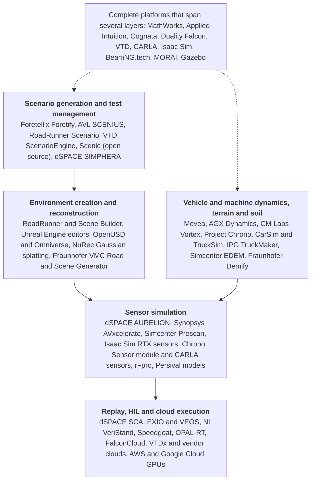

- **Complete and near-complete platforms.** MathWorks MATLAB/Simulink with the Offroad Autonomy Library and RoadRunner; Applied Intuition; Cognata; Duality AI Falcon; Cadence (formerly Hexagon) Virtual Test Drive (VTD) and VTDx; IPG Automotive CarMaker/TruckMaker and its off-highway stack; dSPACE AURELION with SIMPHERA; Siemens Simcenter Prescan; CARLA (open source); NVIDIA Isaac Sim (open source); Project Chrono (open source, also a dynamics engine); BeamNG.tech; MORAI; rFpro; Gazebo (open source).
- **Sensor simulation.** dSPACE AURELION; Synopsys (formerly Ansys) AVxcelerate Sensors; Simcenter Prescan sensor models; NVIDIA RTX sensors in Isaac Sim; Chrono::Sensor; CARLA sensors; rFpro's camera pipeline; Persival (sensor models as a service).
- **Vehicle and machine dynamics, and terrain and soil.** Mevea; Algoryx AGX Dynamics (with AGX Terrain, Tire, Tracks, Hydraulics, Granular); CM Labs Vortex Studio; Project Chrono (SCM, CRM and DEM terrain); CarSim/TruckSim (Applied Intuition); Simcenter EDEM; Fraunhofer ITWM IPS Demify; MSC/Cadence Adams; MathWorks Vehicle Dynamics Blockset and Simscape.
- **Environment creation and reconstruction.** RoadRunner, RoadRunner Scene Builder; Unreal Engine ecosystems (Falcon Editor, CARLA, MathWorks); NVIDIA NuRec Gaussian splatting; OpenUSD and Omniverse tooling; Fraunhofer ITWM VMC Road & Scene-Generator; ASAM OpenMATERIAL 3D as the material standard.
- **Scenario generation and test management.** ASAM OpenSCENARIO and OpenDRIVE; Foretellix Foretify; AVL SCENIUS; RoadRunner Scenario; VTD 2025.2 ScenarioEngine; dSPACE SIMPHERA; Scenic (open source); Applied Intuition's scenario tooling.
- **Data replay and hardware-in-the-loop.** dSPACE SCALEXIO, VEOS and AURELION; NI VeriStand with PXI and CompactRIO; Speedgoat and Simulink Real-Time; OPAL-RT (4DV-SIM, OP5707XG2); IPG MIL/SIL/HIL and vehicle-in-the-loop; Mevea HIL; Vortex HIL; Applied Intuition HIL; RoadRunner and Automated Driving Toolbox scenario reconstruction and replay; vendor data platforms (Applied Intuition, Foretellix).
- **Cloud execution.** FalconCloud; VTDx (cloud-native VTD); AURELION cloud; Applied Intuition and MORAI large-scale cloud simulation; generic GPU cloud (AWS G6e with L40S, Google Cloud G2 with L4).

#### 2. Each tool: function, off-road support, sensors, interfaces, license, price, maturity, users and latest release

"Demonstrated off-road" means a documented customer use, a peer-reviewed study, a government program or a public example shipped with the tool; "claimed off-road" means a vendor statement without such evidence. Where a feature or price was not found, the entry says so.

##### A. Complete and near-complete simulation platforms

**MathWorks MATLAB/Simulink, Robotics System Toolbox Offroad Autonomy Library and RoadRunner (commercial).** The Offroad Autonomy Library support package targets "construction, mining, and agriculture applications" with Unreal Engine scenes. Its documentation (R2026b) lists an MPPI off-road planner (since R2024b), articulated-steering kinematics (since R2025a), an off-road vehicle library loader (since R2026b), traversability analysis, and examples including an autonomous excavator, a backhoe loading a dump truck, and an open-pit haul-truck reference application. **Vendor** [1, 44]. The off-road package exposes camera, lidar and INS in Unreal scenes; the broader MathWorks stack supports radar, ultrasonic, GNSS and IMU models, but radar and ultrasonic inside the off-road package specifically were not found. **Vendor** [45]. Interfaces: Simulink, ROS, gRPC for RoadRunner, OpenDRIVE and OpenSCENARIO import and export, USD, FBX and glTF, and FMI via partner tools such as Mevea. **Vendor** [46, 47]. License: annual or perpetual per product; RoadRunner "does not require MATLAB or Simulink". **Vendor** [48, 49]. Public price: MathWorks shows prices only interactively through a quote and price-list workflow; an unofficial January 2024 copy of an international price list shows MATLAB 980/3,920, Simulink 1,480/5,920, RoadRunner 4,680/9,360 and RoadRunner Scenario 3,400/13,600 (presumed USD annual/perpetual; indicative only, unofficial source). **Vendor** [48, 17]. Known off-road user: Volvo Construction Equipment built a real-time human-in-the-loop excavator simulator with Simulink and Simscape (user story, undated). **Vendor** [24]. Off-road status: demonstrated as shipped examples and reference applications; RoadRunner itself remains road-scene oriented, high-fidelity soil deformation and sensor degradation need other models or custom work, and independent validation of the complete stack for automatic braking was not found. **Vendor** [1]; **Expert opinion** on the limits.

**Applied Intuition (commercial).** Offers a full ADAS and autonomy tool chain (scenario, sensor and vehicle-dynamics simulation, HIL, large-scale cloud execution and what the vendor calls neural simulation) plus an off-road autonomy stack launched on 17 June 2024 and an "SDS for Mining & Construction" that the vendor describes as spanning "360-degree situational awareness in human-operated vehicles to full autonomy" (marketing language). **Vendor** [2, 50, 51, 52]. Documented customer use: a multi-year Komatsu partnership announced on 9 September 2025 covering Vehicle OS, autonomous haulage and collision-avoidance systems for staffed sites; Komatsu told International Mining that the firms "will be developing EMESRT control level 9 collision avoidance systems to improve safety for fully staffed operations". **Independent** [7, 53]; **Vendor** [39]. The vendor states it is trusted by 18 of the top 20 automakers. **Vendor** [52]. It owns CarSim and TruckSim through its March 2022 acquisition of Mechanical Simulation. **Vendor** [54, 55]. A detailed public sensor-modality and interface matrix, a numbered release with date, and license or price were not found. Claims of large acceleration (months to days, internal productivity multipliers) are vendor and customer marketing, not third-party benchmarks, and sensor-model validation evidence for dust, snow or soil was not found. Because the company sells both tools and an autonomy stack (to Komatsu and, in trucking, to HUMAIN in Saudi Arabia), there is a potential competitive conflict for a manufacturer developing its own perception and braking function. **Expert opinion** [56, 57].

**Cognata (commercial).** Markets a large-scale ADAS and AV simulation platform with digital twins, scenes, sensors and scenario execution, and a dedicated off-road use case for "mining robots and construction automated machines" describing slopes, boulders, dust, vegetation, darkness and heavy-machine blind spots, with construction-site assets. It claims to compress machine-learning training time "to mere months" (marketing). Camera, radar, lidar and thermal are explicitly marketed; custom sensors and assets are offered. **Vendor** [3]. Named current mining or construction customers, independent correlation results, a numbered release and a price were not found. The company remained independent as of 2025 (partnerships with Ansys and Microsoft, January 2025). **Expert opinion** [58].

**Duality AI Falcon (commercial).** A digital-twin simulator on Unreal Engine with the Falcon Editor and a web-accessed FalconCloud. DARPA named "Duality Robotics and Intel-Federal" as the two primes for the RACER-SIM program (January 2022; Phase 1 budget reported as approximately USD 6 million), with Duality, partnered with Neya Systems, tasked with building an 80 km² (20 km by 4 km) off-road environment; NASA JPL contracted Duality for RACER Phase II in September 2024. **Independent** (documented government use) [59, 60, 61]. The focus is high-speed military off-road, not construction or mining. **Expert opinion**. An EDU license costs USD 20 per month (non-commercial, launched 20 November 2024); the commercial price was not found. **Vendor** [18, 62, 63, 64].

**Cadence (formerly Hexagon) Virtual Test Drive, VTD and VTDx (commercial).** A long-standing on-road ADAS platform covering road networks, scenarios, vehicle dynamics, traffic, sensor perception and SIL, DIL and HIL; VTDx is the cloud-oriented variant. **Vendor** [65, 66]. VTD 2025.1 added Unreal Engine 5 rendering; VTD 2025.2 (released 1 October 2025) added an OpenSCENARIO-native ScenarioEngine; VTD 2026.1 was released on 10 April 2026 and Cadence's third-party software notices list VTD 2026.2. **Vendor** [67, 68, 69]. Ownership: Cadence completed its purchase of Hexagon's Design & Engineering business on 23 February 2026 and now lists VTD among its own tools, so VTD did move to Cadence. **Vendor** [70, 37]; **Independent** [36]. Price not found. Off-road: on-road proven only; the current positioning is automotive and robotics, and no heavy-machinery evidence was found. The ownership change adds lifecycle and roadmap transition risk. **Expert opinion**.

**IPG Automotive CarMaker, TruckMaker and off-highway stack (commercial).** Closed-loop vehicle, driver, environment and sensor simulation for MIL, SIL, HIL and vehicle-in-the-loop. IPG explicitly targets construction, agriculture and mining; its off-highway material includes vehicle and attachment testing, vehicle-in-the-loop with real tractors, and a documented lidar accident-prevention application with Linde. Camera, radar, lidar and other environment sensors, actuator and ECU coupling. **Vendor** [6]. The companion CarMaker product reached version 15.0 in 2025; a TruckMaker-specific latest release date and a public price were not found. **Vendor**. It fits rigid-vehicle and system dynamics well; high-fidelity deformable soil and particle interaction is not its main role, and independent evidence covering severe dust, snow or glare for heavy machines was not found. **Expert opinion**.

**dSPACE AURELION with SIMPHERA (commercial).** AURELION supplies real-time photorealistic camera, ray-traced radar and lidar, infrared camera, ultrasonic models, rolling-shutter and other sensor effects, with a material database, in the cloud or locally, for SIL and HIL; SIMPHERA orchestrates scenario-based testing at scale and both integrate with the dSPACE HIL ecosystem (SCALEXIO, VEOS, ASM, ModelDesk). **Vendor** [71, 72]. Version 25.3 added lidar beam divergence and integrated Hesai lidar models; it requires a maintenance contract valid until 31 August 2025 or later. AURELION 26.2 was released on 15 July 2026 and SIMPHERA 26.2 on 9 July 2026. **Vendor** [73, 74, 75, 76]. Price not found. Off-road: on-road proven; no public evidence validates quarry or mining terrain, material or weather fidelity, and terrain physics must come from elsewhere. **Expert opinion**.

**Siemens Simcenter Prescan (commercial).** ADAS and AV environment, traffic, scenario and sensor simulation with camera, radar, lidar and ultrasonic models, reflective material properties, lighting and weather, radar phenomena, OpenSCENARIO support and Python and MATLAB APIs. The latest release surfaced is Prescan 2606 (2026); the exact release date and price were not found. **Vendor** [77]. Off-road heavy-machine proof was not found; translating road-centric scene semantics and material libraries to quarries and mines is non-trivial. **Expert opinion**.

**CARLA (open source, MIT-licensed code).** Two release lines are current. Release 0.10.0 (19 December 2024) migrated to Unreal Engine 5.5 with Chaos physics, native ROS 2 support, remodeled towns and vehicles, and added a "mining earth mover (provided by Synkrotron)" vehicle asset. **Vendor** [12]. Release 0.9.16 (16 September 2025, Unreal Engine 4 line) added NVIDIA Cosmos Transfer1 integration, Neural Reconstruction Engine (NuRec) support, SimReady OpenUSD and MDL converters, V2X sensors and left-hand-traffic maps. **Vendor** [13]. Sensors: RGB, depth and semantic cameras, lidar, radar, GNSS and IMU; Python API. The UE5 build requires Ubuntu 22.04 or Windows 11, at least an NVIDIA RTX 3000-series GPU with 16 GB VRAM and 130 GB of disk. **Vendor** [78]. Limitations: the map-layers API is not supported in 0.10.0 (user report); towns are urban; physics improvements funded with Neya Systems were planned for 2025; public issues show installation, content and version friction, so a frozen, qualified build is advisable. **Expert opinion** [79]; **Vendor** [80]. AVL coupled CARLA with its VSM vehicle dynamics and a soft-soil tire model to test an autonomous tractor (April 2023, cited as an integration precedent only). **Vendor** [81]. Off-road status: an asset exists; native deformable terrain or soil physics does not.

**NVIDIA Isaac Sim (open source, Apache 2.0 since 5.0).** General robotics simulation with RTX lidar, RTX radar, cameras, RGB-D, IMU and contact sensors, PhysX-based range sensors including a simplified ultrasonic sensor, OpenUSD sensor schemas, synthetic-data annotators, ROS 2 integration and neural (NuRec, 3D Gaussian splatting) rendering. **Vendor** [82, 83, 84, 85]. The asset library lists 25 RTX lidar models, some "certified" by sensor manufacturers, but only one RTX radar model. **Vendor** [86, 87]. Version 6.1 reached general availability on 15 September 2026 (hot-reloading in containers, Newton physics improvements, ROS 2 Control integration, experimental system identification). **Vendor** [14]. License: the core is Apache 2.0 and free for internal R&D; redistribution with Omniverse Kit requires NVIDIA AI Enterprise (price not found); NVIDIA staff on the developer forum have described free use for teams of up to two people; some assets, materials and Omniverse components carry additional terms. **Vendor** [88, 89, 90]. Limits: 5.0 deprecated camera-prim RTX workflows and removed annotators; recent release notes and forums show RTX lidar and radar crashes and fixes and users reporting severe frame-rate loss in multi-sensor scenes, so performance and modality fidelity are qualification items. **Vendor** [83, 91]. Construction or mining validation was not found.

**Project Chrono and Chrono::Vehicle (open source, BSD-3).** Multibody and multiphysics dynamics; wheeled, tracked and articulated vehicles; rigid and deformable terrain (SCM Bekker-Wong, CRM continuum SPH, DEM); Chrono::Sensor with OptiX ray tracing for camera, lidar, SPAD, GPS and IMU with lens distortion, noise and lag. **Vendor** [5, 92]; **Independent** [93]. Release 10.0.0 on 27 March 2026. **Vendor** [15]. Users listed by the project include US Army ground-vehicle organizations, NREL and JPL. **Vendor** [5]. Limits reported by its developers: Pacejka, TMeasy and Fiala handling tire models do not work with deformable terrain (only rigid or FEA tires and tracked vehicles do); the higher-fidelity CRM terrain runs "anywhere from 50 to 200" times slower than real time and needs an NVIDIA GPU, a vendor-specific dependency the community itself has raised. **Expert opinion** [41]. It is not a turnkey test-management product.

**BeamNG.tech (commercial B2B license).** Real-time soft-body vehicle physics with programmable camera, lidar, radar, ultrasonic and IMU sensors and a Python API; version 0.39 on 20 August 2026; a 2026 community integration with Autoware and ROS 2 exists. Off-road driving is feasible, but the vehicle model is automotive-scale, not a purpose-built excavator, dozer or haul truck with deformable soil; public B2B price and independent heavy-machine correlation were not found. **Vendor** [94].

**MORAI (commercial).** Digital-twin driving simulation with scenario libraries and cloud execution; camera, lidar, radar, GPS and IMU; OpenSCENARIO 1.x. Current projects span automotive, trucking, Seoul digital twins and unmanned ground and defense work; mining or construction use, deformable terrain, a numbered release and a price were not found (a third-party listing says contact for price). **Vendor** [95].

**rFpro (commercial).** High-fidelity driving simulation with a particularly detailed camera pipeline; 2026 material (29 April 2026) describes full CMOS and ISP modeling and physical validation work. Automotive and motorsport focus; off-road heavy-machine evidence, ultrasonic support, a numbered release and a price were not found. **Vendor** [96].

**Gazebo (open source, Apache 2.0).** Robotics simulator with physics, rendering, camera, lidar, IMU and plugin-defined sensors and ROS 2 integration. Gazebo Jetty LTS was released in September 2025 and is supported to 2031; Gazebo Sim 10.5.0 followed on 29 July 2026. **Vendor** [16, 97]. It is an integration framework; automotive-grade radar, weather and material modeling and enterprise validation management need extensions, and heavy-machine automatic-braking proof was not found. **Expert opinion**.

##### B. Sensor simulation

**Synopsys (formerly Ansys) AVxcelerate Sensors (commercial).** Physics-oriented camera, lidar, radar and thermal simulation for SIL and HIL, with documented co-simulation with CarMaker and CARLA; the 2026 R1 release is current. Ownership moved to Synopsys on 17 July 2025 in a roughly USD 35 billion deal, and Synopsys planned the first combined capabilities for the first half of 2026. **Vendor** [98, 99]; **Independent** [35, 100]. Continental is a documented automotive collaborator, which is not evidence for off-road performance. Quote-only; off-road evidence not found. **Expert opinion**.

**dSPACE AURELION** and **Simcenter Prescan sensor models**: see the platform entries above; both cover camera, lidar, radar and ultrasonic (AURELION also infrared), both are quote-only, and neither has public off-road validation. **Vendor** [75, 77].

**NVIDIA RTX sensors, Chrono::Sensor and CARLA sensors (open source).** Rendering-based cameras plus RTX lidar and radar in Isaac Sim; OptiX ray-traced camera, lidar and SPAD in Chrono::Sensor; camera, lidar, radar and semantic sensors in CARLA. Physics-based ultrasonic simulation in these tools was not found; Isaac Sim's ultrasonic sensor is a PhysX ray-cast range model, not an acoustic model. **Vendor** [84, 12]; **Independent** [93].

**rFpro sensor stack:** detailed image-sensor, optics and ISP workflows, on-road only in the evidence reviewed. **Vendor** [96].

**Persival (commercial services and models).** Builds sensor models to ASAM OSI, packaged as FMUs, and runs an "Avelon" validation workflow correlating simulated and real sensor output, including weather test benches; it is a driver behind ASAM OpenMATERIAL 3D. Price and off-road evidence not found. **Vendor** [101].

A critical distinction across this category is sensor presence versus sensor credibility. A checkbox for "radar supported" may mean anything from ideal object lists to geometric ray casting, phenomenological detections or raw signal simulation, and for automatic braking those levels are not interchangeable. Qualification should record, for every sensor model, its input and output abstraction level, modeled failure mechanisms, environmental and material dependencies, calibration parameters, evidence against physical measurements, determinism and computational cost. **Expert opinion**.

##### C and D. Vehicle and machine dynamics; terrain and soil

**Mevea (commercial; spin-off of Lappeenranta University, 2005).** Real-time multibody dynamics, hydraulics, powertrain, "accurate, dynamic soil simulation" with buckets, tracks and tires, sensors, HIL I/O, and co-simulation with Simulink via TCP/IP or FMI. **Vendor** [47, 102]. The company claims "over 100 simulator models to more than 50 customers". **Vendor** [103]. Documented use: Siemens SIMOCRANE crane-automation digital twins (2023); an academic tractor digital twin with CAN control (2026). **Vendor** [11]; **Independent** [9]. Its October 2026 seminar covers verification and validation cases from Prinoth, Oamk and IAAPS; it also sells modelling services and training simulators for mining. **Vendor** [102, 104]. Price and latest release not found.

**Algoryx AGX Dynamics (commercial).** Modules AGX Terrain (soil deformation with wheels, tracks, blades and buckets; terrain paging), AGX Tire (preconfigured excavator and wheel-loader tires), Tracks, Hydraulics, Drivetrain and Granular (NDEM); plugins for Unity and Unreal; documentation at 2.41. **Vendor** [4, 105, 106, 107]. Independent evidence: a peer-reviewed 2025 paper calibrated an AGX wheel-loader digital twin against a physical wheel loader, including terrain parameters. **Independent** [8]. AGX Dynamics for Unity 5.3.0 (4 April 2025) added a reverse auto-brake example using a new lidar module; 5.5.1 (20 January 2026) fixed an auto-brake bug. **Vendor** [10]. License: yearly subscription per seat with Basic, Custom and Premium tiers at "price upon request"; separate runtime, OEM and academic licenses. **Vendor** [108].

**CM Labs Vortex Studio (commercial).** Real-time multibody physics for off-road vehicles, cables and earthmoving; the vendor claims "engineering-grade tracked vehicle simulation" and "sensor-grade simulation" (marketing); HIL with real controls and PLCs. **Vendor** [109, 110, 111]. Documented use is mainly operator training (for example OETIO and CONEXPO training showcases). **Vendor** [112, 113]. Autonomy-validation customers were not found; the latest documentation found is 2024.3; price not published. **Expert opinion** [114].

**Project Chrono** (see above): SCM, CRM and DEM terrain; recent research reports GPU-scalable deformable terrain validated against experiments and DEM-style methods, but CRM is too expensive for every regression case and is best used selectively to derive and calibrate lower-order terrain models. **Independent** [93]; **Expert opinion** [41].

**CarSim and TruckSim (Applied Intuition).** The CarSim site lists a 2022 press release on expanding into off-road, agricultural, construction, mining and military applications; current off-road depth was not verified. **Vendor** [115].

**Siemens Simcenter EDEM (commercial).** Discrete-element modeling of bulk material including soil, ore, coal and granular material, which can couple with vehicle and multibody simulation; directly relevant to mining, quarry and earth interaction. DEM is computationally expensive and is not a perception or ADAS simulator; public price and latest release date not found. **Vendor** [116].

**Fraunhofer ITWM IPS Demify (research and service software).** DEM-oriented simulation of soil-tool interaction for heavy machinery and vehicles with CPU and GPU and Python-oriented workflows. The ecosystem is smaller than general commercial suites; sensor simulation and test management must be added; commercial licensing, pricing and a numbered release were not found. **Vendor** [117].

**MSC/Cadence Adams.** High-end multibody dynamics with contact and flexible bodies; can model machine mechanisms but is not an environment or sensor simulator; off-road autonomy proof, price and current release date not found. **Expert opinion**.

**MathWorks Vehicle Dynamics Blockset, Simscape and off-road kinematics.** Dynamics and controller models including articulated steering, closed-loop in Simulink (R2026b); high-detail soil deformation is not a primary strength. **Vendor** [1].

For this program, soil modeling should be multi-fidelity rather than universal: use high-detail DEM or deformable-terrain simulation to understand stopping-distance sensitivity to soil, slope, payload and tire or track interaction; fit simpler parameterized models for the large scenario regression; keep targeted physical tests to confirm the parameter envelopes. **Expert opinion**.

##### E. Environment creation and reconstruction

- **RoadRunner, RoadRunner Scene Builder and RoadRunner Scenario (MathWorks).** Build and edit 3D environments, import GIS, HD maps and point clouds, reconstruct scenes from recorded data, and parameterize scenarios; export to CARLA, dSPACE ASM, IPG CarMaker and others; OpenDRIVE, OpenSCENARIO, USD, FBX and glTF. The base editor remains road-oriented; work-site semantics need custom assets and data structures. **Vendor** [46, 118, 119].
- **Unreal Engine ecosystems** (Falcon Editor, CARLA, MathWorks) and **NVIDIA NuRec Gaussian splatting**, integrated in Isaac Sim and CARLA 0.9.16. **Vendor** [85, 13].
- **OpenUSD and Omniverse tooling.** Domain-neutral scene, material and asset representation that can hold mines and construction sites; sensor-material semantics and portability between simulators need governance. **Expert opinion**.
- **Fraunhofer ITWM VMC Road & Scene-Generator.** Creates 3D scenes for camera, lidar and radar simulation from fused real data sources, using the REDAR measurement vehicle; heavy-machine deployment detail was not found on the page reviewed. **Vendor** [120].
- **ASAM OpenMATERIAL 3D 1.0.0 (3 April 2025)** standardizes material properties for lidar, radar and camera simulation; it explicitly excludes raindrops or dirt on the sensor housing. **Independent** [32].

##### F. Scenario generation and test management

- **ASAM OpenSCENARIO XML and OpenDRIVE** are supported by VTD, the dSPACE tool chain, CARLA, RoadRunner, Prescan, MORAI and others. OpenDRIVE assumes roads; off-road job sites without lane geometry fit poorly, and ASAM's own OSI extensions for high-fidelity sensor simulation are still under standardization from April 2025 to March 2027, so interface versioning is a project risk. **Independent** [121]; **Expert opinion** [34].
- **Foretellix Foretify (commercial).** Coverage-driven scenario generation with constrained random variation and large-scale validation management, using an OpenSCENARIO DSL and integrations with external simulators; Series C closed at USD 85 million in December 2023; integration with NVIDIA DRIVE announced. **Vendor** [122, 123, 124]. Mining relevance is documented through a March 2021 partnership with Volvo Autonomous Solutions to adapt Foretellix's verification system for confined-area applications such as mines and quarries, and the vendor also sells a "Level-4 Mining V-Suite". **Independent** (customer press release) [125]; **Vendor** for the V-Suite. It is not itself a machine or soil physics engine; price and version date not found.
- **AVL SCENIUS (commercial).** Scenario lifecycle from requirements through creation, planning, execution and reporting, designed as part of an open scenario-based V&V tool chain; a heavy-machine deployment, price and release were not found. **Vendor** [126].
- **Scenic (open source).** A probabilistic scenario language connecting to multiple simulators; programmable semantics make it technically adaptable to job sites, but no mining or construction deployment was found and enterprise test governance is thinner than commercial tools. **Vendor** [127].
- **dSPACE SIMPHERA, VTD 2025.2 ScenarioEngine, RoadRunner Scenario, Applied Intuition.** See the platform entries. **Vendor** [76, 67, 119].

##### G. Data replay and hardware-in-the-loop

- **dSPACE SCALEXIO, VEOS and AURELION.** ECU and HIL execution with virtual sensors; a strong route from SIL to HIL, but sensor injection is sensor- and ECU-specific: camera video, radar targets, Ethernet streams and raw stimulation are materially different engineering problems. Full-system price not found. **Vendor** [71]; **Expert opinion**.
- **NI VeriStand with PXI and CompactRIO.** Real-time testing, plant models, logging and HIL I/O; one PXIe-8842 controller is publicly listed around USD 5,200, but that is only a controller, not a bench. **Vendor** [19].
- **Speedgoat and Simulink Real-Time.** Turnkey real-time targets tightly coupled to Simulink; the Pulse platform was announced on 15 May 2025; price not found. **Vendor** [128].
- **OPAL-RT.** 4DV-SIM for autonomous and off-highway vehicles (named users include Safran, Valeo, Michelin and Milrem Robotics) and OP5707XG2 CPU/FPGA real-time systems; quote only. **Vendor** [129, 130].
- **IPG Automotive.** Off-highway MIL, SIL and HIL and vehicle-in-the-loop with real tractors. **Vendor** [6].
- **Mevea HIL, Vortex HIL, Applied Intuition HIL.** **Vendor** [102, 109, 51].
- **RoadRunner and Automated Driving Toolbox reconstruction and replay.** Reconstructs scenarios from camera, lidar, GPS and IMU logs and replays saved scenarios; quality is bounded by tracking and map reconstruction accuracy. **Vendor** [118].
- **Vendor data platforms (Applied Intuition, Foretellix)** ingest logs, derive scenarios and manage regression; raw-data compatibility must be checked against the eventual sensors. **Vendor** [51, 122].
- **ISO/TS 21815-2:2021** defines the J1939 interface, for example propulsion set-points (braking, throttle, speed) and motion inhibit, that a HIL bench can emulate between the collision-avoidance device and the machine. **Independent** [27].

##### H. Cloud execution

Vendor clouds include FalconCloud, VTDx, AURELION cloud, Applied Intuition and MORAI large-scale simulation. **Vendor** [63, 66, 71, 95]. Generic GPU cloud pricing is covered under question 7.

#### 3. Tools built for, or adapted to, mining, construction, agriculture or forestry

The products with the clearest current off-road or heavy-machinery relevance fall into three groups: machine and terrain physics tools built for mobile machinery (Mevea, AGX Dynamics, Vortex Studio, Project Chrono, Simcenter EDEM, Fraunhofer Demify); ADAS validation platforms adapted from road vehicles with explicit off-road packages (MathWorks' Offroad Autonomy Library, IPG's off-highway stack, Applied Intuition, Cognata, AVL's off-road engineering); and research or military programs (Duality Falcon, Fraunhofer ITWM, SwRI). Some are independently demonstrated and some are vendor adaptations. **Expert opinion**.

| Tool | Domain | Built for or adapted | Evidence and label |
|---|---|---|---|
| Mevea | Construction, mining, ports, forestry; tractor research | Built for mobile machinery | Siemens crane twins, 2026 tractor paper. **Vendor** [11]; **Independent** [9] |
| AGX Dynamics | Earth-moving, mining, forestry cranes | Built for machinery physics | 2025 wheel-loader calibration paper. **Independent** [8] |
| CM Labs Vortex | Construction, cranes, earthmoving, material handling | Built for heavy-equipment simulation and training | Training customers documented; autonomy use claimed. **Vendor** [112, 109] |
| Project Chrono | Military off-road, planetary, wheeled and tracked vehicles | Built for off-road mobility research | US Army, NREL, JPL users listed by project. **Vendor** [5]; **Independent** [93] |
| Simcenter EDEM | Mining, quarry, bulk material | Built for granular material | Product scope. **Vendor** [116] |
| Fraunhofer Demify | Heavy machinery soil-tool interaction | Built for machinery DEM | Institute material. **Vendor** [117] |
| MathWorks Offroad Autonomy Library | Construction, mining, agriculture | Adapted (new support package, R2024b to R2026b) | Shipped examples. **Vendor** [1] |
| IPG TruckMaker and off-highway stack | Construction, agriculture, mining | Adapted from on-road | Linde lidar application, tractor VIL. **Vendor** [6] |
| Applied Intuition | Mining, construction, agriculture | Adapted from on-road | Komatsu partnership. **Independent** [7] |
| Cognata | Construction, mining | Adapted from on-road | Use-case page only. **Vendor** [3] |
| AVL GOAS and off-road engineering | Agriculture, forestry, construction, mining | Adapted from on-road | Tractor demonstrations. **Vendor** [131, 132] |
| Duality Falcon | Military off-road | Adapted digital-twin platform | DARPA RACER-Sim, NASA JPL. **Independent** [60] |
| CARLA | Mining earth-mover asset only | Adapted (asset) | Release notes. **Vendor** [12] |
| Foretellix | Mines and quarries (confined areas) | Adapted from on-road | Volvo Autonomous Solutions partnership, 2021. **Independent** [125] |
| Fraunhofer ITWM (InVerS, RODOS, VMC) | Construction-site digital twins, commercial vehicles, excavator loads | Research projects | Institute pages. **Vendor** [133, 134, 120] |
| Fraunhofer IVI | Agricultural and construction machinery testing | Research | Institute page. **Vendor** [135] |
| SwRI | Military, space, agriculture off-road autonomy | Research | Press releases. **Vendor** [136, 137] |
| OPAL-RT 4DV-SIM | Off-highway, defense (Milrem Robotics) | Adapted from on-road | Named users. **Vendor** [129] |

#### 4. Common tool chains and integration effort

**Documented combinations.** Several pairings are explicitly supported rather than theoretically possible: Simulink with Mevea over FMI or TCP/IP; Simulink with Unreal through the Offroad Autonomy Library; RoadRunner exporting environments to CARLA, dSPACE ASM and IPG CarMaker; CARLA with AVL VSM and a soft-soil tire model through Model.CONNECT; AGX Dynamics inside Unity or Unreal; the dSPACE chain of ASM, AURELION, VEOS and ModelDesk; AVxcelerate Sensors co-simulating with CarMaker and CARLA; Persival sensor models as OSI FMUs inside any co-simulation host; Duality Falcon with the Neya autonomy stack in DARPA RACER-Sim; ROS 2 with Gazebo; BeamNG with Autoware and ROS 2; Fraunhofer IESE's FERAL demonstrator combining CARLA with other engineering components through connectors; and an industry demonstration by Keysight, ESTECO, IPG and TNO combining scenario simulation, CarMaker vehicle simulation, HIL radar emulation and probabilistic analysis. **Vendor** [47, 44, 46, 81, 106, 107, 71, 98, 101, 61, 94, 138].

**The glue.** FMI is one of the most important generic mechanisms: by mid-2025 the Modelica Association reported around 250 FMI-supporting tools, with extensive co-simulation support. ASAM OSI, OpenSCENARIO and OpenDRIVE provide the environment, scenario and interface axis; ROS 2 is common for robotics software; OpenUSD is strong for scenes and assets. **Independent** [40, 121].

**What integration actually involves.** The hard parts are usually not opening a socket or parsing an OpenSCENARIO file. They are aligning coordinate systems, time bases and clocks; making the dynamics engine's pose feed exactly the sensor renderer's pose at a shared time step; matching scene materials to radar, lidar and camera properties across renderers; representing articulated machine bodies and attachments; propagating vibration and mounting tolerances; synchronizing ECU timing; maintaining deterministic replay; mapping scenario parameters into each simulator; and proving that a software upgrade has not changed the expected output. Off-road soil state, piles, berms, ruts, loose material, work-zone semantics and sensor-relevant material properties often need custom representations because the open formats grew up on roads. The Chrono developers' statement that common handling tire models do not work on deformable terrain shows how "plugging together" tools can silently break physics. **Expert opinion** [41].

**Quantified effort.** No credible, general-purpose independent benchmark giving engineer-weeks per tool connection was found; integration time is therefore not found rather than estimated. The relative ranking below is an expert assessment, not a schedule. **Expert opinion**.

| Integration type | Relative effort | Why |
|---|---|---|
| Same-vendor environment, scenario and dynamics modules | Lower | Shared data model, support and version qualification reduce glue code |
| RoadRunner, OpenX, FMI or ROS-linked components | Medium | Standard transport and schema exist, but material, actor, dynamics and timing semantics still need calibration |
| Separate high-fidelity sensor renderer plus third-party vehicle dynamics plus deformable soil plus HIL | High | Multiple clocks, coordinate frames, real-time constraints, material models, ECU interfaces and correlation datasets must agree |
| Raw-signal sensor HIL | Highest | Needs physical, electrical, radio or video stimulation as well as software synchronization; often sensor-specific |

The ASAM project on OSI for high-fidelity sensor simulation runs to March 2027, which means the industry is still refining the standardized interfaces at exactly the time this program will be integrating its first tool chain. **Expert opinion** [34].

#### 5. Build in-house, buy, or partner

**The evidence gap.** No independent 2024 to 2026 benchmark was found that credibly states the total cost, team headcount or time to first useful result for standing up a heavy off-road ADAS simulation capability from zero. Vendor case studies report large productivity gains (Applied Intuition's Komatsu-related account and cycle-time claims; NI's HIL deployment cases; Volvo CE's "number of prototypes reduced" and "reduced lead time", with physical prototypes costing "millions of dollars and months"), but these are not controlled cross-vendor measurements. **Vendor** [39, 19, 24]. The comparison below therefore separates evidence from judgment. **Expert opinion**.

| Option | Acquisition cost | Internal labor | Time to first useful result | Long-term control | Team and skills | Main weakness |
|---|---|---|---|---|---|---|
| Build in-house on open source (CARLA or Isaac Sim or Gazebo, Chrono, ROS 2) | Low license cost; hardware and cloud remain | Highest: environment, sensors, machine models, automation, correlation, DevOps and maintenance are all internal | Benchmark not found; early prototypes can be quick, safety-credible capability is a much larger task | Highest ownership of source and models | Simulation software engineers, rendering and Unreal, multibody and terramechanics, sensor physics, test automation, safety engineers | No vendor support; the organization owns all credibility evidence; key-person dependence; fast-moving upstream |
| Buy an integrated commercial stack | Exact cost not public; quotation required | Lower integration burden, but domain modeling and correlation remain substantial | Benchmark not found; faster for on-road-like elements, heavy-machine content still needed | Medium: configuration and data can be owned, the core platform cannot | Tool specialists, scenario engineers, safety | Off-road gaps, supplier and license dependence, cloud and parallel-seat costs, roadmap risk |
| Buy specialist tools and integrate internally | Multiple licenses plus engineering effort | Medium to high | Benchmark not found | High architectural flexibility | Co-simulation architects plus tool specialists | Interface and version complexity |
| Partner-led implementation | Service fees plus software and hardware; totals not public | Transfers near-term burden outside | Benchmark not found; potentially fastest | Depends on contract and knowledge transfer | Smaller internal core to own requirements and acceptance | Knowledge and models stay with the partner; data-sharing risk; permanent dependency |
| Hybrid: internal owner plus partner plus commercial or open-source tools | Mixed | Keeps an internal core while buying peak expertise | Benchmark not found | Usually the best balance of retained knowledge and outside specialization | Internal owners of ODD, scenario catalog, acceptance criteria and correlation data | Needs unusually clear interface, asset and data ownership clauses |

**Skills that must be acquired at once.** A manufacturer with no current virtual-testing capability must stand up several distinct domains simultaneously: simulation architecture and co-simulation; heavy-machine dynamics; tires, tracks, soil and braking; camera, radar, lidar and ultrasonic modeling; Unreal, OpenUSD and 3D asset engineering; scenario and V&V automation; data engineering; cloud and CI; ECU and HIL; statistics and coverage; functional safety and safety of the intended functionality. There is no defensible public evidence mapping these to a specific number of full-time staff, so headcount remains not found; several skills may sit in one person, while others need teams at industrial scale. **Expert opinion**.

**A labor anchor.** US Bureau of Labor Statistics May 2025 median wages were about USD 135,980 for software developers, 104,300 for software QA analysts and testers, 104,110 for mechanical engineers, 120,630 for electrical engineers, 161,740 for computer hardware engineers, 140,300 for computer and information research scientists and 175,140 for computer and IT managers; in June 2026, benefits were about 31.5% of total compensation for private full-time workers. **Independent** [25, 26]. Dividing wage by 0.685 (wages being about 68.5% of compensation) gives approximate employer-cost equivalents of roughly USD 199,000 per software developer, 152,000 per QA engineer or mechanical engineer, 176,000 per electrical engineer, 236,000 per hardware engineer, 205,000 per research scientist and 256,000 per IT manager per year, excluding overhead, facilities, recruiting, bonuses, contractors and licenses. This is a planning conversion, not an occupation-specific forecast, and it is why "free" simulation software can still produce a seven-figure annual engineering program once several specialist years are involved. **Expert opinion**.

**Position.** Given no internal capability and a nine-month runway before hardware, the hybrid is the most defensible choice: license or co-develop the heavy-machine physics, use a partner to accelerate the first correlated sensor model, select sensor simulation only after the sensor short-list is known, and keep the operating-domain definition, scenario catalog, acceptance criteria and correlation data in-house so that the evidence remains the manufacturer's own. For any partner procurement, the contract should require delivery of editable machine models, scene and source assets, parameter provenance, correlation datasets, test definitions, CI scripts, simulator version manifests, known-limitation registers and interface specifications, not only test reports; otherwise outsourcing solves the 2027 deadline while creating a larger long-term dependency. **Expert opinion**.

#### 6. Engineering service companies and research institutes

| Organization | Offering relevant to this project | Off-road evidence | Label |
|---|---|---|---|
| AVL | Generic Off-Road Automation System (GOAS) with "shift-left" simulation, demonstrated on a retrofitted tractor with ARTI-Robots; VSM vehicle models (claimed correlation "up to 97%"); scenario-based ADAS and AD development, V&V and tool-chain integration; SCENIUS | Explicit agriculture, forestry, construction and mining work; lidar, radar, camera, GPS and IMU on tractor demonstrations | **Vendor** [131, 132, 43, 126] |
| IPG Automotive | Consulting and engineering around CarMaker, TruckMaker and the off-highway stack; off-highway MIL, SIL, HIL and vehicle-in-the-loop | Direct off-highway relevance | **Vendor** [6] |
| OPAL-RT | 4DV-SIM and real-time HIL for off-highway and autonomous vehicles | Named off-highway and defense users | **Vendor** [129] |
| Mevea | Modelling services, digital twins and simulators | Mining, construction, ports, forestry | **Vendor** [104] |
| MathWorks Consulting | Model-based design services around the Offroad Autonomy Library | Via the MathWorks examples | **Vendor** [1] |
| Persival | Credible sensor-model development and validation (OSI FMUs, weather benches) | Not found | **Vendor** [101] |
| Speedgoat engineering services | Real-time and HIL integration around Simulink Real-Time | General HIL, not off-road specific | **Vendor** [128] |
| FEV.io | Scenario- and model-based systems engineering and virtual ADAS/AD validation | Cited case study is automotive; heavy off-road proof not found | **Vendor** [139] |
| EDAG, Bertrandt | Autonomous-driving development, simulation and virtual validation services | Heavy off-road proof not found | **Vendor** (not assessed in depth) |
| Fraunhofer ITWM | InVerS construction-site digital twins integrating "sensor data acquisition to alerting machine operators" in simulation; RODOS human-in-the-loop simulator; VMC real-data environments; Demify soil DEM | Direct heavy-machinery relevance | **Vendor** [133, 134, 120, 117] |
| Fraunhofer IVI | Testing for agricultural and construction machinery | Direct | **Vendor** [135] |
| Fraunhofer IESE | FERAL modular co-simulation, fault injection and driving-simulator integration; demonstrator combines CARLA with other components | Automotive demonstration; off-road adaptation not found | **Expert opinion** (no primary page located) |
| VTT Technical Research Centre of Finland | Sensor simulation, synthetic datasets, digital twins and pilots for autonomy, including non-road mobile machinery | Direct non-road relevance | **Vendor** [140] |
| TNO | Scenario-based testing, virtual validation, vehicle dynamics and ADAS evaluation; collaborations with AVL and the Keysight, IPG and ESTECO chain | Mostly road automotive | **Vendor** [138] |
| TÜV SÜD | Independent simulation and model validation and assessment, including VIVALDI-style simulator credibility work | Road regulatory context, but relevant to a defensible validation process | **Vendor** [141] |
| Southwest Research Institute | Off-road SIL scene tool and camera-vision autonomy tools for military, space and agriculture clients | Off-road, not construction or mining | **Vendor** [136, 137] |

The following were not assessed, so their status is "not found" rather than "do not offer": IAV, Capgemini Engineering, RISE, CSIRO, and open-source scenario tools other than Scenic (for example esmini). No public contract values or delivery timelines were found for any provider. **Expert opinion**.

#### 7. Computing resources and cost

**Workload shape.** There is no single GPU requirement because the workloads differ by orders of magnitude. **Expert opinion**.

| Workload | Typical compute character | Suitable architecture |
|---|---|---|
| Logic and object-list braking tests | CPU-dominant, very high parallelism | Commodity servers or cloud containers |
| Rigid vehicle dynamics | CPU; often faster than real time | CPU workers; some tools support GPU |
| Camera photorealism | GPU-heavy; VRAM and ray tracing matter | RTX-class workstation or cloud GPUs |
| Lidar | GPU ray-tracing load can be substantial | GPU workers |
| Physics-oriented radar | Potentially very GPU- and compute-intensive | High-end GPU or specialist simulator |
| Ultrasonic | Usually modest, but the environment and material model matters | CPU or GPU depending on product |
| DEM and granular soil | Highly compute-intensive; GPU acceleration valuable; Chrono CRM 50 to 200 times slower than real time | Dedicated GPU or HPC workers |
| HIL | Deterministic real time matters more than throughput | Local real-time CPU, FPGA and I/O system |
| Campaign orchestration and results | CPU, database and storage heavy | Kubernetes, batch, cloud or HPC plus object storage |

**Workstation minimums.** CARLA on Unreal Engine 5 needs an NVIDIA RTX 3000-series GPU or better, at least 16 GB VRAM and 130 GB of disk; Chrono CRM terrain needs an NVIDIA GPU. **Vendor** [78]; **Expert opinion** [41]. Workstation-class GPUs with 96 GB of memory exist (NVIDIA RTX PRO 6000 Blackwell), but on-premises GPU server prices were not found. **Vendor**.

**Cloud reference prices.** AWS G6e instances offer up to eight NVIDIA L40S GPUs with 48 GB each, up to 192 vCPUs, 1.536 TB of RAM and 400 Gbps networking. **Vendor** [142]. Third-party trackers for us-east-1 Linux on-demand (2026) list g6e.xlarge (one L40S, 4 vCPU, 32 GiB) at USD 1.861 per hour, g6e.4xlarge at 3.004, g6e.12xlarge (four L40S) at 10.493 and g6e.48xlarge (eight L40S) at 30.131; a one-year EC2 Instance Savings Plan brings g6e.xlarge to about 1.17 per hour; spot prices fluctuate widely (one tracker showed 0.427, another 1.8348). **Independent** [20, 22, 143, 21]. Google lists g2-standard-32 (one NVIDIA L4, 32 vCPU, 128 GiB) at about USD 1.734 per hour, and its documentation notes location and capacity constraints for GPU families. **Vendor** [23]. AWS advertises Spot discounts of up to 90% against on-demand, which suits checkpointable statistical regression but not deterministic HIL or irreplaceable long jobs. **Vendor** [142]; **Expert opinion**. Regional prices should be rechecked at purchase.

| Wall-clock GPU use | Google g2-standard-32 at USD 1.7344/h | AWS g6e.xlarge at about USD 1.861/h |
|---|---|---|
| 1,000 GPU-hours | about USD 1,734 | about USD 1,861 |
| 10,000 GPU-hours | about USD 17,344 | about USD 18,610 |
| 100,000 GPU-hours | about USD 173,438 | about USD 186,100 |

These exclude software licenses, storage, network egress, orchestration and support. **Expert opinion** (arithmetic from the published rates).

**Illustrative campaign arithmetic.** Ten g6e.xlarge instances running 24 hours a day for 122 days (2,928 hours) cost about USD 54,490 on demand and deliver at most about 29,000 GPU-hours. Sensor-realistic runs are typically near real time per GPU, so a four-month window bounds throughput and caps how many of the 100-plus sites times 10-plus scenarios times weather times machine variants can be run at full sensor fidelity, forcing a tiered strategy (low-fidelity sweeps, high fidelity on critical cases). **Expert opinion**.

**The real-time factor decides everything.** Cost per simulated hour equals cloud price per wall-clock hour divided by the simulation's real-time factor: a simulator running at 10 times real time costs one tenth as much per simulated hour as one at real time, and one at 0.1 times real time costs ten times as much. No generic real-time factor should be assumed; it must be benchmarked with the actual machine geometry, sensor count, resolution and rate, weather and terrain. Isaac Sim users report severe frame-rate loss in some multi-sensor scenes, which reinforces the need for workload-specific benchmarking. **Expert opinion** [14].

#### 8. Risks

| Risk | Why it matters here | Evidence | Mitigation |
|---|---|---|---|
| Single-supplier dependence and consolidation | Proprietary scenarios, assets, sensor materials and test databases make migration expensive; product ownership can change mid-program | Ansys to Synopsys (closed 17 July 2025, about USD 35 billion; China approved conditionally with stipulations on customer contracts); Hexagon D&E including VTD to Cadence (closed 23 February 2026; Hexagon cited approximately EUR 2.7 billion in cash and Cadence stock for a business that contributed about EUR 265 million of 2024 revenue; Cadence's 10-Q records total consideration of USD 3,101,008 thousand); Hexagon's Octave spin-off (May 2026); Applied Intuition as both tool vendor and autonomy-stack supplier to Komatsu. **Independent** [35, 144, 36]; **Vendor** [99, 145, 70, 37, 38, 39, 57] | Keep canonical machine and site data outside vendor formats; require ASAM OSI, OpenSCENARIO, FMI and OpenUSD export and exit clauses for ownership changes; contractual data and model ownership |
| Fast-changing software | Evidence produced on one version may need re-qualification after updates | Isaac Sim 5.0 deprecated camera-prim RTX workflows and removed annotators, then reached 6.1 in September 2026; CARLA switched engines (UE4 to UE5) and some APIs are unsupported; AURELION versions require valid maintenance; dSPACE has announced end-of-life schedules for some legacy integration technology. **Vendor** [83, 91, 14, 12, 73]; **Expert opinion** [79] | Freeze a validated tool-chain version per release; containerize; regression-test simulator upgrades before adopting them |
| Open-source dependency churn | Open source avoids license lock-in but brings GPU, library and version dependencies | Chrono's community highlights NVIDIA-specific dependencies in high-performance modules. **Expert opinion** [41] | Reproducible builds, internal competence, tracking of upstream branches and security patches |
| Commercial license limits | Parallel cloud execution, build servers, HIL nodes, subcontractor access and geography are often licensed separately and terms are not public | Isaac Sim free use is for internal R&D, redistribution needs NVIDIA AI Enterprise, and NVIDIA staff described free use for teams of up to two; Duality EDU is non-commercial; RoadRunner academic licenses are not available for concurrent use; AGX runtime and OEM licenses are separate. **Vendor** [88, 89, 90, 18, 49, 108] | Price peak concurrent workers, CI and cloud rights, subcontractors, HIL and disaster-recovery environments in the RFP, not only desktop seats |
| Mixed open and proprietary licensing | A core can be open source while assets and materials carry other terms | Isaac Sim assets and Omniverse components. **Vendor** [88] | Software bill of materials plus asset and license review |
| Data security and export control | High-resolution site scans, mine layouts, machine CAD, calibration files and safety performance data are commercially sensitive; cloud execution exposes IP | Vendor cloud terms were not reviewed (not found); export control and data residency were not researched. **Expert opinion** | On-premises or private-cloud option; encryption; identity controls; region restrictions; contractual bans on model training or reuse |
| Model-confidence risk (the largest) | A simulation can produce millions of repeatable but systematically wrong tests; without correlation data the results may not be accepted by the safety case, customers or regulators | 2026 credibility research argues for risk-based V&V with explicit assumptions and limitations; ASAM states no standardized quality metrics exist. **Independent (on-road evidence)** [42]; **Expert opinion** [33] | Separate simulator verification, model validation, sensitivity analysis and application-specific acceptance criteria |
| False confidence from standards compliance | OpenSCENARIO or OpenDRIVE compatibility proves data exchange, not physical fidelity | **Expert opinion** | Validate physical outputs independently of file and interface compliance |
| Real-time HIL mismatch | A renderer accurate offline may not meet ECU timing deterministically | **Expert opinion** | Benchmark latency and jitter early; keep separate offline high-fidelity and real-time models if needed |
| Cloud capacity and region availability | GPU availability varies by location and quota | Google's documentation lists location and capacity constraints. **Vendor** [23] | Multi-region capacity planning, reservations where justified, local fallback |
| Standards transition | Requirements and safety arguments frozen on an old edition may need rework | ISO 19014-1 Edition 2 is under publication in October 2026 and replaces the 2018 edition; other ISO 19014 parts are in revision. **Independent (under publication)** [29] | Check the safety argument against the final 2026 publications rather than an older interpretation |

**Standards and simulation credibility.** The standards picture bears directly on the credibility risk:

- ISO 21815-1:2022 covers collision warning and avoidance "by speed reduction or motion inhibit", not automatic manoeuvring, and places responsibility on the operator because "technologies are unable to achieve full collision warning/avoidance in every situation". **Independent** [146].
- ISO/TS 21815-2:2021 (confirmed) defines the J1939 interface; its introduction states that "Collision warning and avoidance systems are developing technologies; and the algorithms are not yet mature and well understood". **Independent** [27].
- ISO 21815-4 (swing and rotation; edition 1, stage 60.00 under publication, listed for October 2026) excludes automatic braking. **Independent (under publication)** [147].
- ISO 17757:2019 (reviewed and confirmed 2024) covers autonomous and semi-autonomous machine system safety, with braking and steering test methods adapted for autonomous operation; testing "shall be carried out in both manual mode ... and autonomous mode", and function-specific automated features are outside its scope unless used as part of such a system. Whether it permits simulation to substitute for these tests was not found in public previews. **Independent** [28, 148].
- ISO 19014 (earth-moving functional safety, which also notes applicability to other off-road mobile machinery), ISO 13849, ISO 25119, ISO 26262 and ISO 21448 were not reviewed in full text; explicit rules on accepting simulation evidence or qualifying tools were not verified (not found). ISO 26262-8 contains software-tool confidence and qualification clauses that on-road teams apply to simulation tools, and ISO 21448 (SOTIF) is explicitly a road-vehicle standard, so neither should be presented as automatically governing an off-road machine. **Independent (on-road evidence)** [149]; **Expert opinion**.
- ISO 3450:2011 (confirmed 2022) remains the braking performance and test standard for relevant wheeled and high-speed tracked machines; slow crawler machines fall under ISO 10265:2008; agriculture has the ISO 18497:2024 series with obstacle protection and verification and validation principles. **Independent** [150, 151, 152].
- Credibility frameworks: the SET Level Credible Simulation Process with credibility levels (cited in a 2025 Sensors paper on continuous V&V of active perception sensor simulations); the IAMTS four-step reference process for correlating virtual and real worlds; the UNECE WP.29 NATM credibility assessment (AVL presentation to ASAM); ASAM QSQ (2025): "no standardized metrics exist to assess the quality of simulation frameworks and models, particularly in sensor simulation"; and 2026 research arguing that safety-relevant virtual evidence requires model verification, validation, sensitivity analysis, assumptions management and intended-use-specific credibility, not large simulation counts. **Independent (on-road evidence)** [30, 31, 42]; **Vendor** [153]; **Expert opinion** [33].

### Comparison tables

The tables below compress the tool entries from question 2. "Demonstrated" means documented customer, government or peer-reviewed use or a shipped example; "claimed" means a vendor statement only; "on-road only" means proven for road vehicles with no off-road evidence found. "Not found" is a finding, not a gap in the table.

#### Complete and near-complete platforms

| Tool | Type and license | Off-road evidence | Sensors | Interfaces and standards | Public price | Latest release found |
|---|---|---|---|---|---|---|
| MathWorks MATLAB/Simulink, Offroad Autonomy Library, RoadRunner | Commercial, per-product annual or perpetual | Demonstrated as shipped examples (excavator, backhoe, haul truck); Volvo CE HIL simulator. **Vendor** [1, 24] | Camera, lidar, INS in off-road package; radar, ultrasonic, GNSS, IMU in wider stack | Simulink, ROS, gRPC, OpenDRIVE, OpenSCENARIO, USD, FMI via partners | Quote; unofficial January 2024 list only [17] | R2026b (2026) |
| Applied Intuition | Commercial | Demonstrated: Komatsu partnership, September 2025. **Independent** [7] | Camera, lidar, radar (vendor); public matrix not found | Not verified | Not found | Not found |
| Cognata | Commercial | Claimed (construction and mining use case). **Vendor** [3] | Camera, radar, lidar, thermal (marketed) | Not verified | Not found | Not found |
| Duality AI Falcon | Commercial; EDU USD 20/month non-commercial | Demonstrated: DARPA RACER-Sim, NASA JPL (military off-road). **Independent** [60] | Not verified | Unreal; FalconCloud | EDU only [18] | FalconCloud (date not found) |
| Cadence VTD and VTDx | Commercial | On-road only | Camera, lidar, radar | OpenSCENARIO, OpenDRIVE, SIL/HIL/DIL | Not found | 2026.1 (10 April 2026); 2026.2 listed [68, 69] |
| IPG CarMaker, TruckMaker, off-highway | Commercial | Claimed with named application (Linde lidar, tractor VIL). **Vendor** [6] | Camera, radar, lidar, other environment sensors | MIL/SIL/HIL/VIL, ECU coupling, FMI | Not found | CarMaker 15.0 (2025); TruckMaker date not found |
| dSPACE AURELION and SIMPHERA | Commercial | On-road only | Camera, radar, lidar, ultrasonic, infrared | OSI-compatible chain, SCALEXIO, VEOS, SIL/HIL | Not found | AURELION 26.2 (15 July 2026); SIMPHERA 26.2 (9 July 2026) [75, 76] |
| Siemens Simcenter Prescan | Commercial | On-road only | Camera, radar, lidar, ultrasonic | OpenSCENARIO, Python, MATLAB APIs | Not found | 2606 (2026) [77] |
| CARLA | Open source (MIT code) | Mining earth-mover asset only. **Vendor** [12] | Camera, depth, semantic, lidar, radar, GNSS, IMU | ROS 2, OpenDRIVE, Python API, OpenUSD export | Free | 0.9.16 (16 September 2025); 0.10.0 UE5 line (19 December 2024) [13, 12] |
| NVIDIA Isaac Sim | Open source (Apache 2.0) with NVIDIA asset terms | Not found (general robotics) | Camera, RGB-D, RTX lidar (25 models), RTX radar (1 model), PhysX ultrasonic, IMU | OpenUSD, ROS 2 | Free for internal R&D; Enterprise price not found | 6.1 GA (15 September 2026) [14] |
| Project Chrono | Open source (BSD-3) | Demonstrated: US Army, NREL, JPL users; deformable terrain. **Vendor** [5] | Camera, lidar, SPAD, GPS, IMU | Python, C#, Unity | Free | 10.0.0 (27 March 2026) [15] |
| BeamNG.tech | Commercial B2B | Feasible, not demonstrated on heavy machines | Camera, lidar, radar, ultrasonic, IMU | Python API, ROS 2 via community | Not found | 0.39 (20 August 2026) [94] |
| MORAI | Commercial | Not found | Camera, lidar, radar, GPS, IMU | OpenSCENARIO 1.x, cloud | Contact for price | Not found |
| rFpro | Commercial | On-road only | Camera pipeline (CMOS, ISP); others not verified | Not verified | Not found | 2026 material; number not found |
| Gazebo | Open source (Apache 2.0) | Not found (general robotics) | Camera, lidar, IMU, plugin sensors | ROS 2 | Free | Jetty LTS (September 2025, to 2031); Sim 10.5.0 (29 July 2026) [16] |

#### Sensor simulation

| Tool | Type and license | Off-road evidence | Sensors | Interfaces and standards | Public price | Latest release found |
|---|---|---|---|---|---|---|
| dSPACE AURELION | Commercial | On-road only | Camera, radar, lidar, ultrasonic, infrared; material database | OSI chain, SIL/HIL | Not found | 26.2 (15 July 2026) |
| Synopsys (formerly Ansys) AVxcelerate Sensors | Commercial | Not found | Camera, lidar, radar, thermal | Co-simulation with CarMaker, CARLA; SIL/HIL | Quote only | 2026 R1 [98] |
| Simcenter Prescan sensor models | Commercial | Not found | Camera, lidar, radar, ultrasonic | Python, MATLAB, OpenSCENARIO | Not found | 2606 |
| Isaac Sim RTX sensors | Open source core | Not found | Camera, RTX lidar, RTX radar, PhysX ultrasonic | OpenUSD, ROS 2 | Free internal | 6.1 |
| Chrono::Sensor | Open source (BSD-3) | Lunar and off-road research. **Independent** [93] | Camera, lidar, SPAD, GPS, IMU | Chrono API | Free | 10.0.0 |
| CARLA sensors | Open source | Not found | Camera, lidar, radar, semantic | Python, ROS 2 | Free | 0.9.16 / 0.10.0 |
| rFpro sensor stack | Commercial | On-road only | Camera; others not verified | Not verified | Not found | Not found |
| Persival | Commercial service and models | Not found | Lidar, radar, camera | OSI, FMU, OpenMATERIAL | Not found | Not applicable |

#### Vehicle and machine dynamics, terrain and soil

| Tool | Type and license | Off-road evidence | Sensors | Interfaces and standards | Public price | Latest release found |
|---|---|---|---|---|---|---|
| Mevea | Commercial | Demonstrated: Siemens crane twins, 2026 tractor paper, mining training. **Independent** [9] | Sensors (vendor) | FMI, TCP/IP, HIL, Simulink | Not found | Not found |
| Algoryx AGX Dynamics | Commercial, per-seat subscription | Demonstrated: 2025 wheel-loader calibration. **Independent** [8] | Lidar (Unity module) | Unity, Unreal; FMI not verified | On request [108] | AGXUnity 5.5.1 (20 January 2026); docs 2.41 |
| CM Labs Vortex Studio | Commercial | Demonstrated for training; autonomy validation claimed | "Sensor-grade" (marketing) | HIL, PLC | Not published [114] | Docs 2024.3 |
| Project Chrono | Open source (BSD-3) | Demonstrated (US Army users); SCM, CRM, DEM terrain | Via Chrono::Sensor | Python, C#, Unity | Free | 10.0.0 |
| CarSim and TruckSim | Commercial (Applied Intuition) | Claimed (2022 press release) [115] | Not applicable | Simulink and others | Not found | Not found |
| Simcenter EDEM | Commercial | Built for bulk material (ore, coal, soil) | Not applicable | Couples with multibody tools | Not found | Not found |
| Fraunhofer Demify | Research and service | Built for heavy-machinery soil DEM | Not applicable | Python, CPU/GPU | Not found | Not found |
| MSC/Cadence Adams | Commercial | Not found | Not applicable | Cadence/MSC ecosystem | Not found | Not found |

#### Environment creation and reconstruction

| Tool | Type and license | Off-road fit | Interfaces and standards | Public price | Latest release found |
|---|---|---|---|---|---|
| RoadRunner, Scene Builder, Scenario | Commercial | Adaptable; base editor road-oriented | OpenDRIVE, OpenSCENARIO, USD, FBX, glTF, gRPC | Quote; unofficial list only | R2026b |
| Unreal Engine editors (Falcon, CARLA, MathWorks) | Mixed | Domain-neutral | Unreal | Varies | Varies |
| NVIDIA NuRec Gaussian splatting | Open core | Domain-neutral reconstruction from logs | Isaac Sim, CARLA 0.9.16 | Free internal | 2025 to 2026 |
| OpenUSD and Omniverse | Open standard plus NVIDIA components | Can represent sites; not a validation method | OpenUSD | Free standard | Ongoing |
| Fraunhofer ITWM VMC Road & Scene-Generator | Research and service | Real-data scenes; heavy-machine detail not found | Not verified | Not found | Not found |
| ASAM OpenMATERIAL 3D | Open standard | Material physics for sensors; excludes sensor soiling | Lidar, radar, camera material properties | Free | 1.0.0 (3 April 2025) [32] |

#### Scenario generation and test management

| Tool | Type and license | Off-road evidence | Interfaces and standards | Public price | Latest release found |
|---|---|---|---|---|---|
| Foretellix Foretify | Commercial | Mines and quarries via Volvo Autonomous Solutions partnership (2021); Mining V-Suite. **Independent** [125] | OpenSCENARIO DSL, external simulators | Not found | Not found |
| AVL SCENIUS | Commercial | Not found (AVL off-road work exists separately) | Open scenario-based V&V chain | Not found | Not found |
| RoadRunner Scenario | Commercial | Adaptable | OpenSCENARIO, MATLAB, gRPC | Quote | R2026b |
| VTD ScenarioEngine | Commercial | On-road only | OpenSCENARIO native | Not found | 2025.2 onward |
| dSPACE SIMPHERA | Commercial | On-road only | dSPACE ecosystem | Not found | 26.2 (9 July 2026) |
| Scenic | Open source | Not found; programmable semantics | Python, multiple simulators | Free | Trustworthy 2026 date not found [127] |
| ASAM OpenSCENARIO, OpenDRIVE, OSI | Open standards | Road heritage; OSI high-fidelity extension to March 2027 | Open standards | Free | Ongoing [34] |

#### Data replay and hardware-in-the-loop

| Tool | Type and license | Off-road evidence | Interfaces and standards | Public price | Latest release found |
|---|---|---|---|---|---|
| dSPACE SCALEXIO, VEOS, AURELION | Commercial | On-road only | J1939 emulation possible per ISO/TS 21815-2 [27] | Not found | AURELION 26.2 |
| NI VeriStand, PXI, CompactRIO | Commercial | General HIL | Plant models, I/O | PXIe-8842 controller about USD 5,200 [19]; system quote | Not found |
| Speedgoat, Simulink Real-Time | Commercial | General HIL | Simulink | Not found | Pulse (15 May 2025) [128] |
| OPAL-RT 4DV-SIM, OP5707XG2 | Commercial | Off-highway and defense users named | CPU/FPGA real time | Quote | Not found |
| IPG MIL/SIL/HIL/VIL | Commercial | Tractor VIL demonstrated | CarMaker/TruckMaker | Not found | Not found |
| Mevea HIL, Vortex HIL, Applied Intuition HIL | Commercial | Heavy-machine (Mevea, Vortex); on-road (Applied) | Vendor-specific | Not found | Not found |
| RoadRunner and Automated Driving Toolbox replay | Commercial | Adaptable | MATLAB | Quote | R2026b |

#### Cloud execution

| Option | Type | Off-road relevance | Public price | Source date |
|---|---|---|---|---|
| FalconCloud, VTDx, AURELION cloud, Applied Intuition, MORAI | Vendor clouds | Follows the platform | Not found | 2024 to 2026 |
| AWS G6e (L40S) | Pay per use | Not applicable | USD 1.861 to 30.131 per hour on demand (us-east-1, trackers) [22] | 2026 |
| Google Cloud G2 (L4) | Pay per use | Not applicable | USD 1.734 per hour for g2-standard-32 [23] | 2026 |

### Three example tool chains at different cost levels

Because almost every commercial vendor is quote-only, "lowest", "middle" and "highest" describe relative software and procurement cost and integration posture, not dollar figures. **Expert opinion** throughout, built from the evidence in questions 2, 4 and 7.

#### 1. Lowest cost: open-source core plus in-house integration

- **Composition.** CARLA 0.10 or Isaac Sim 6.x or Gazebo (sensors, environments); Project Chrono (machine dynamics, SCM terrain); ROS 2; in-house scenario scripts or Scenic; J1939 emulation per ISO/TS 21815-2; on-premises RTX GPUs or spot cloud. [12, 14, 16, 15, 127, 27]
- **Can.** Camera and lidar sensor-in-the-loop; articulated, wheeled and tracked dynamics on deformable terrain; scripted job-site scenarios; Monte Carlo variation; low license cost; full control of IP and source.
- **Cannot, without major work.** Validated radar (Isaac Sim lists one radar model); physics-based ultrasonic (not found; Isaac Sim's ultrasonic is a ray-cast range model); weather effects on sensors with correlation evidence; vendor support; any tool-qualification evidence; a turnkey, qualification-ready Chrono-to-Isaac heavy-machine coupling. The manufacturer owns coupling, asset creation, the scenario and test database, reports, model calibration, software qualification and HIL integration, and must characterize RTX sensor performance issues. Highest dependence on hiring scarce skills; lowest license cost is not lowest total cost.

#### 2. Middle: model-based engineering stack plus heavy-machine physics

- **Composition.** MATLAB/Simulink R2026b with the Offroad Autonomy Library, RoadRunner and RoadRunner Scenario, Unreal, and the Automated Driving, Radar and sensor toolboxes; Mevea or AGX Dynamics coupled via FMI for terrain, hydraulics and machine variants; one externally validated sensor model (for example an OSI FMU from a sensor-model specialist); Speedgoat or NI for later HIL; cloud GPUs for batch runs. [1, 119, 47, 4, 101, 128, 19]
- **Can.** Controller and braking-logic validation with credible machine dynamics; explicit construction, agriculture and mining workflows and articulated machine models; camera and lidar sensing; scenario authoring and automated tests; HIL with real ECUs; reuse across many machine models through parameterized physics.
- **Cannot.** Supply broad, validated multi-sensor weather physics out of the box; proven severe-weather radar and camera correlation; high-fidelity deformable mine soil without the external physics tool; all job-site assets; large-scale coverage-driven scenario management. Module pricing is not public and the heavy-machine physics is quote-only.

#### 3. Highest: integrated commercial ADAS tool chain plus partner

- **Composition.** A commercial validation and orchestration platform (for example dSPACE AURELION with SIMPHERA, VEOS and SCALEXIO; Applied Intuition; Cognata; VTD; or Foretellix for coverage-driven scenario management); heavy-machine dynamics from IPG TruckMaker, Mevea, AGX or Vortex; specialist sensor simulation (AURELION or AVxcelerate); dSPACE or NI HIL benches; cloud execution; an engineering partner (for example AVL, IPG, Fraunhofer) for integration and correlation testing. [75, 51, 122, 6, 98, 126]
- **Can.** Physics-based camera, radar, lidar and ultrasonic simulation; large-scale cloud regression; mature vehicle dynamics; HIL; partner capacity to meet the four-month window; a structured credibility process; separation of high-volume functional regression from selected high-fidelity sensor campaigns.
- **Cannot.** Guarantee off-road sensor realism (on-road heritage); avoid overlapping licenses, proprietary data models and multi-vendor dependence; remove the need for the manufacturer's own physical correlation tests. No public evidence shows this exact multi-vendor chain validated end to end for off-road automatic braking, and total cost is not found without quotations.

#### A fourth architecture: do not make one simulator carry every test

Whatever the cost level, a multi-fidelity hierarchy is more defensible than running every combination of snow, dust, glare, 100 sites, every sensor and particle soil at maximum fidelity. **Expert opinion**.

1. Deterministic functional and object-list tests for millions of braking-logic combinations.
2. Medium-fidelity closed-loop dynamics with ideal or noisy sensors for broad regression.
3. High-fidelity rendering, radar and lidar for perception-sensitive subsets.
4. High-fidelity soil or DEM for braking- and traction-sensitive subsets.
5. HIL for timing, ECU and interface behavior.
6. Targeted physical tests for correlation and final evidence.

The allocation of cases to each level must come from sensitivity and correlation work, not from assumption.

### Where the evidence stands

#### Well established

- Virtual SIL and HIL, scenario-based testing and digital twins are mature engineering methods for road ADAS, with several established commercial platforms and open-source alternatives, and open standards (OpenDRIVE, OpenSCENARIO, OSI, FMI, ROS 2) make heterogeneous tool chains practical. **Independent (on-road evidence)** [40, 121].
- Heavy-machine multibody and terrain simulation can be calibrated against physical machines (the 2025 AGX wheel-loader paper), Chrono explicitly models tracked and wheeled vehicles on deformable terrain, and EDEM and Demify address granular material. **Independent** [8, 93]; **Vendor** [116, 117].
- Interfaces for collision-avoidance commands exist (ISO/TS 21815-2). **Independent** [27].
- Open-source platforms with Unreal Engine 5 rendering and RTX sensors exist and are free for internal use. **Vendor** [12, 88].
- Virtual evidence needs validation of the simulation itself: credibility must be related to the specific decision the simulation supports, and independent assessors offer simulator and model validation. **Independent (on-road evidence)** [42]; **Vendor** [141].
- Compute prices are public and compute is cheap relative to labor until very high scale. **Independent** [20, 21]; **Vendor** [23].

#### Uncertain

- Whether any commercial or open stack can accurately predict the combined effects of dust clouds, snow, fog, darkness, wet material, glare, vibration, sensor contamination, articulated motion and deformable terrain for automatic braking across many machine families. Vendor feature lists are plentiful; independent off-road correlation studies are not. "Weather support" in a scene editor is not a measured model of attenuation, multipath, wet or muddy surfaces, dust backscatter, blooming, exposure control, lens contamination or sensor-specific signal processing; the same applies to lidar precipitation and dust artifacts and to ultrasonic interaction with irregular porous surfaces. **Expert opinion**.
- Whether any standard for earth-moving machinery accepts simulation in place of physical tests. Not found in ISO 21815, ISO 17757 or ISO 19014 previews. **Independent** [28, 29].
- Prices for nearly every commercial tool, team size, total cost and implementation time; all not found rather than estimated.
- The real-time factor of each candidate tool on this machine geometry and sensor set, which decides compute cost.
- Whether neural or Gaussian-splatting reconstruction (NuRec and related methods) can serve as test evidence rather than training data. **Expert opinion**.

#### Where experts disagree

- Vendors claim simulation "compresses" timelines to months (marketing), while the ISO 21815 committee text calls the algorithms immature. **Vendor** [3]; **Independent** [27].
- Credibility communities (SET Level, IAMTS, ASAM QSQ, UNECE NATM) agree that validation is required but have not agreed on metrics. **Expert opinion** [33, 153].
- Physics-based simulation versus data-driven or generative world models: traditional tools emphasize explicit geometry, materials and sensor physics; newer approaches (Cosmos and NuRec workflows in CARLA and Isaac Sim, and published road-vehicle world-model work in 2026) emphasize learned reconstruction and generation. Neither has removed the need for application-specific credibility evidence. **Expert opinion (on-road evidence)** [13, 85].
- Integrated suite versus modular best-of-breed: suites reduce interfaces and support burden; modular architectures make it easier to swap sensor or dynamics providers and may match unusual off-road physics better. No independent evidence supports a universal winner. **Expert opinion**.
- Fidelity versus throughput: maximum fidelity is wrong for every test, and overly abstract testing misses perception and traction failures; the multi-fidelity pyramid is a strong pattern, but the allocation must come from sensitivity work. **Expert opinion**.

### Blind spots

Issues the questions did not ask about but that the program must handle, grouped by theme.

**Operating domain and sites**

- **Job-site operating-domain definition.** OpenDRIVE assumes roads; the program needs its own job-site taxonomy covering stockpiles, berms, highwalls, spoil piles, benches, ramps, temporary barriers, people, light vehicles and continuously changing ground, as was done for underground mining in the ODD-UM research. OpenUSD and general 3D asset pipelines are therefore at least as strategically important as OpenDRIVE. **Independent** [154]; **Expert opinion**.
- **Job-site reconstruction as a bottleneck.** A reusable representation of sites is needed before scenario volume matters; road-network standards alone do not solve it. **Expert opinion**.

**The machine and the braking plant**

- **Machine-specific braking dynamics.** Surface friction, slope, machine mass, payload, attachment position, tire or track state, brake and hydraulic response delay, articulated steering and soil deformation dominate stopping distance and must be in the physics models; ISO 3450 and ISO 10265 are the relevant braking standards. **Independent** [150, 151]; **Expert opinion**.
- **Sensor mounting variation as a parameter.** The same algorithm across many machine models means changes in height, pitch and yaw, vibration, articulation, attachment occlusion, boom and bucket state and body geometry; treating every machine as a separately tuned installation recreates the three-to-four-year model. **Expert opinion**.
- **False-positive braking.** Unintended braking on a steep ramp, near an edge, during loading, while towing or with a following machine is itself a hazard; test requirements need an unnecessary-intervention rate and machine-stability consequences, not only collision avoidance. **Expert opinion**.

**Sensors and evidence**

- **Sensor contamination is distinct from weather.** Mud on a camera, snow or ice on radar covers, dust on lidar windows and droplets on optics should be explicit degradation scenarios rather than hidden in a generic "rain" parameter; ASAM OpenMATERIAL 3D explicitly excludes them. **Independent** [32]; **Expert opinion**.
- **Sensor supplier models.** Request simulation models (FMUs or certified profiles) as part of sensor sourcing; some Isaac Sim lidar models are manufacturer-certified, which shows the pattern. **Vendor** [87].
- **Physical correlation test plan.** Schedule measurement campaigns on existing machines in 2026 and 2027 (braking, sensor returns in dust, rain and darkness) so sensor and braking models are correlated before the prototype arrives; redesign the physical test plan around simulation as model-correlation and boundary-confirmation experiments rather than merely reducing it. **Expert opinion**.
- **Simulation credibility as a formal workstream.** Define what each model may prove, its calibration and validation datasets, uncertainty envelope, configuration control and exit criteria. **Expert opinion** consistent with [42].

**Process, people and governance**

- **Human factors.** Warning-then-brake depends on operator reaction; human-in-the-loop simulators (Fraunhofer RODOS, CM Labs, Mevea, the Volvo CE example) may be needed. **Vendor** [134, 113, 24].
- **Safety-standard applicability.** Decide early which standards govern: ISO 17757 excludes function-specific features unless part of an autonomous system; ISO 21448 is a road-vehicle standard; ISO 19014 is the direct earth-moving functional-safety reference and is changing edition; agriculture has ISO 18497:2024. **Independent** [28, 149, 29, 152].
- **Evidence management, traceability and version reproducibility.** Tool versions, simulator binaries or containers, drivers, GPU, assets, sensor parameters, scenario IDs and random seeds must be archived for the safety case. **Expert opinion**.
- **Export control and data residency** for cloud runs: not researched. **Expert opinion**.
- **Vendor cloud terms** for job-site reconstructions and machine models: not reviewed. **Expert opinion**.
- **Procurement timing.** Several tool entries rely on vendor pages dated 2026 and on third-party price trackers; prices, versions and ownership change quickly, so every figure in this chapter should be confirmed at the time of quotation rather than carried into a budget.
- **Open-source project governance.** The research did not examine who funds and maintains CARLA, Chrono, Gazebo or Scenic, or their security-patch cadence, which matters as much as license terms when an open-source core sits under safety evidence.

### Sources

1. MathWorks. Offroad Autonomy for Heavy Machinery (Robotics System Toolbox documentation, release R2026b). 2026. https://www.mathworks.com/help/robotics/offroad-autonomy-for-heavy-machinery.html. **Vendor**.
2. Applied Intuition. Build flexible autonomy for off-road vehicles with SDS for Mining & Construction (product page). Accessed October 2026. https://www.appliedintuition.com/sds-for-mining-and-construction. **Vendor**.
3. Cognata. Simulating Construction & Mining: Autonomous Simulation Platform (use-case page). Accessed October 2026. https://www.cognata.com/construction-use-case/. **Vendor** (marketing).
4. Algoryx. AGX Dynamics (product page). Accessed October 2026. https://www.algoryx.se/agx-dynamics/. **Vendor**.
5. Project Chrono. Project Chrono: an open-source multi-physics simulation engine (platform description and users). Accessed October 2026. https://projectchrono.org/. **Vendor**.
6. IPG Automotive. Develop, test and validate off-highway vehicles of all types (off-highway solutions page). Accessed October 2026. https://www.ipg-automotive.com/solutions/industries/off-highway. **Vendor**.
7. International Mining. Komatsu partners with Applied Intuition to accelerate AI in AHS (Komatsu statement on EMESRT control level 9 collision avoidance). 9 September 2025. https://im-mining.com/2025/09/09/komatsu-partners-with-applied-intuition-to-accelerate-ai-in-ahs/. **Independent** (documented customer statement).
8. Developing a calibrated physics-based digital twin for construction vehicles (AGX Dynamics wheel loader calibrated against a physical machine). Taylor & Francis. 2025. https://www.tandfonline.com/doi/full/10.1080/27525783.2025.2592382. **Independent**.
9. Digital Twin Modeling of a Highly Automated Agricultural Tractor (Mevea-based digital twin with CAN control). arXiv 2607.19912. 2026. https://arxiv.org/html/2607.19912v1. **Independent**.
10. Algoryx. Changelog: AGX Dynamics for Unity (5.3.0 reverse auto-brake example with lidar, 4 April 2025; 5.5.1 fix, 20 January 2026). 2025 to 2026. https://us.download.algoryx.se/AGXUnity/documentation/current/changelog.html. **Vendor**.
11. Mevea. Mevea Delivers Digital Twins and Training Simulators to Siemens (SIMOCRANE). 2023. https://mevea.com/news-events/news/mevea-has-delivered-digital-twins-and-training-simulators-to-siemens/. **Vendor** (customer statement on vendor site).
12. CARLA Simulator. Release 0.10.0 (Unreal Engine 5.5 migration, Chaos physics, native ROS 2, mining earth-mover asset). GitHub. 19 December 2024. https://github.com/carla-simulator/carla/releases/tag/0.10.0. **Vendor**.
13. CARLA Simulator. CARLA 0.9.16 Release (NVIDIA Cosmos Transfer1 and NuRec integration, SimReady OpenUSD converters, V2X sensors). 16 September 2025. https://carla.org/2025/09/16/release-0.9.16/. **Vendor**.
14. NVIDIA Developer Forums. Isaac Sim 6.1 General Availability (announcement). 15 September 2026. https://forums.developer.nvidia.com/t/isaac-sim-6-1-general-availability/383280. **Vendor**.
15. Project Chrono. CHANGELOG (release 10.0.0). GitHub. 27 March 2026. https://github.com/projectchrono/chrono/blob/main/CHANGELOG.md. **Vendor**.
16. Open Robotics / Gazebo. Gazebo Releases (Jetty LTS, September 2025, supported to 2031). Accessed October 2026. https://gazebosim.org/docs/latest/releases/. **Vendor** (project's own page).
17. Unofficial copy of a MathWorks international price list (MATLAB, Simulink, RoadRunner, RoadRunner Scenario). Scribd. January 2024. https://www.scribd.com/document/714739059/Price-Matlab. **Vendor** (unofficial copy; indicative only).
18. Duality AI. Falcon EDU subscription (USD 20 per month, non-commercial). Accessed October 2026. https://www.duality.ai/edu. **Vendor**.
19. NI (National Instruments). VeriStand and HIL product material, PXIe-8842 controller listing and customer examples. Accessed October 2026. **Vendor**.
20. Holori. g6e.xlarge pricing and specs, AWS EC2 (third-party price tracker). 2026. https://calculator.holori.com/aws/ec2/g6e.xlarge. **Independent** (third-party price tracker; verify on AWS).
21. Vantage. AWS EC2 g6e.xlarge pricing (instances.vantage.sh). Accessed October 2026. https://instances.vantage.sh/aws/ec2/g6e.xlarge. **Independent** (third-party price tracker; verify on AWS).
22. DevZero. g6e Instance Family: AWS EC2 Pricing (third-party price tracker). 2026. https://www.devzero.io/instances/aws/families/g6e. **Independent** (third-party price tracker; verify on AWS).
23. Google Cloud. Accelerator-optimized VM pricing (g2-standard-32 with one NVIDIA L4; GPU location and capacity notes). Accessed October 2026. https://cloud.google.com/products/compute/pricing/accelerator-optimized. **Vendor**.
24. MathWorks. Volvo Construction Equipment Streamlines Product Development with a Real-Time, Human-in-the-Loop Simulator (user story). Undated, accessed October 2026. https://www.mathworks.com/company/user_stories/volvo-construction-equipment-streamlines-product-development-with-a-real-time-human-in-the-loop-simulator.html. **Vendor**.
25. US Bureau of Labor Statistics. Occupational Employment and Wage Statistics, May 2025 (median annual wages as published in the Occupational Outlook Handbook for software developers, QA analysts and testers, mechanical engineers, electrical engineers, computer hardware engineers, computer and information research scientists, and computer and information systems managers). 2026. https://www.bls.gov/ooh/computer-and-information-technology/software-developers.htm. **Independent** (official statistics).
26. US Bureau of Labor Statistics. Employer Costs for Employee Compensation, June 2026 (benefits share of total compensation for private full-time workers). 2026. **Independent** (official statistics).
27. ISO. ISO/TS 21815-2:2021, Earth-moving machinery, Collision warning and avoidance, Part 2: On-board J1939 communication interface (catalogue page and previews). International Organization for Standardization. 2021, confirmed. https://www.iso.org/standard/77303.html (preview: https://webstore.ansi.org/preview-pages/ISO/preview_ISO+TS+21815-2-2021.pdf). **Independent**.
28. ISO. ISO 17757:2019, Earth-moving machinery and mining, Autonomous and semi-autonomous machine system safety (reviewed and confirmed 2024). International Organization for Standardization. 2019. https://www.iso.org/standard/76126.html. **Independent**.
29. ISO. ISO 19014-1, Earth-moving machinery, Functional safety, Part 1: Methodology to determine safety-related parts of the control system and performance requirements, Edition 2 (stage 60.00, replaces ISO 19014-1:2018). International Organization for Standardization. Under publication, October 2026. https://www.iso.org/standard/87988.html. **Independent (under publication)**.
30. Introducing a Development Method for Active Perception Sensor Simulations Using Continuous Verification and Validation (SET Level Credible Simulation Process). Sensors 25(24):7642. 2025. https://doi.org/10.3390/s25247642. **Independent (on-road evidence)**.
31. Novel Classification Scheme for Perception Sensors Incorporated into Simulation Validation Process for AD (IAMTS four-step correlation process). Springer. 2025 to 2026. https://link.springer.com/chapter/10.1007/978-3-032-13269-7_7. **Independent (on-road evidence)**.
32. ASAM e.V. ASAM OpenMATERIAL 3D 1.0.0 (standard page). 3 April 2025. https://www.asam.net/standards/detail/openmaterial/. **Independent**.
33. ASAM e.V. P_2025_04 ASAM QSQ: Quantifying Simulation Quality (project page). 2025. https://www.asam.net/project-detail/p-2025-04-asam-qsq-quantifying-simulation-quality/. **Expert opinion** (industry-group project statement).
34. ASAM e.V. P_2025_06 ASAM OSI for high-fidelity sensor simulation (project page; project period April 2025 to March 2027). 2025. https://www.asam.net/project-detail/p-2025-06-asam-osi-for-high-fidelity-sensor-simulation/. **Expert opinion** (industry-group project statement).
35. Synopsys, Inc. Form 10-K for fiscal year 2025 (Ansys integration plans). US Securities and Exchange Commission. 2025. https://www.sec.gov/Archives/edgar/data/883241/000088324125000028/snps-20251031.htm. **Independent**.
36. Cadence Design Systems, Inc. Form 10-Q for the quarter ended 30 June 2026 (total consideration for the Hexagon D&E acquisition). US Securities and Exchange Commission. 2026. https://www.sec.gov/Archives/edgar/data/0000813672/000081367226000092/cdns-20260630.htm. **Independent**.
37. Cadence. Virtual Test Drive (VTD) product page (MSC Software tools). Accessed October 2026. https://www.cadence.com/en_US/home/tools/msc-software/virtual-test-drive.html. **Vendor**.
38. Hexagon AB. Octave unveiled: Hexagon reveals name for 2026 company spin-off (updated: independent public company since May 2026). June 2025, updated 2026. https://hexagon.com/company/newsroom/press-releases/2025/octave-unveiledhexagon-reveals-name-for-potential-2026-company-spin-off. **Vendor**.
39. Applied Intuition. Komatsu and Applied Intuition to drive mining innovation (press release). September 2025. https://www.appliedintuition.com/press-releases/applied-intuition-komatsu-partnership. **Vendor**.
40. Modelica Association. FMI tool support statistics (about 250 FMI-supporting tools). 14 July 2025. **Independent** (standards body).
41. Project Chrono developers and users. Wheeled vehicle simulation on deformable terrain? (Google Groups thread: tire-model limits, CRM 50 to 200 times slower than real time, NVIDIA GPU dependency). Accessed October 2026. https://groups.google.com/g/projectchrono/c/dTxt5jA36tw. **Expert opinion** (developer statements).
42. Donà, R., Rusciano, D. and Ciuffo, B. Virtual Testing of Automated Driving Systems through Credible Simulations. arXiv 2609.03760. 3 September 2026. https://arxiv.org/abs/2609.03760. **Independent (on-road evidence)**.
43. AVL. Credible Sensor Simulation: How to Build Trust in Simulation Results (blog; VSM correlation claim). Accessed October 2026. https://www.avl.com/en/blog/credible-sensor-simulation-how-build-trust-simulation-results. **Vendor**.
44. MathWorks. Robotics System Toolbox Offroad Autonomy Library. MATLAB Central File Exchange. Accessed October 2026. https://www.mathworks.com/matlabcentral/fileexchange/172640-robotics-system-toolbox-offroad-autonomy-library. **Vendor**.
45. MathWorks. Offroad Vehicles: Resources and Next Steps (sensor support in Unreal Engine scenes). 2025 to 2026. https://www.mathworks.com/solutions/robotics/offroad-vehicles/next-steps.html. **Vendor**.
46. MathWorks. RoadRunner (product page: scene design, OpenDRIVE, OpenSCENARIO, export to CARLA, dSPACE ASM, IPG CarMaker). Accessed October 2026. https://www.mathworks.com/products/roadrunner.html. **Vendor**.
47. MathWorks. Mevea Simulation Software: real-time multibody dynamics simulation software enabling physics-based digital twins (Third-Party Products and Services). 2025 to 2026. https://www.mathworks.com/products/connections/product_detail/mevea-simulation.html. **Vendor**.
48. MathWorks. Pricing and Licensing. Accessed October 2026. https://www.mathworks.com/pricing-licensing.html. **Vendor**.
49. MathWorks. Product Requirements and Platform Availability for RoadRunner. Accessed October 2026. https://www.mathworks.com/support/requirements/roadrunner.html. **Vendor**.
50. Applied Intuition. Applied Intuition Launches Off-road Autonomy Stack, Powering a New Era of Autonomous Systems on All Terrains (press release, via St. Louis American). 17 June 2024. https://www.stlamerican.com/online-features/press-releases/applied-intuition-launches-off-road-autonomy-stack-powering-a-new-era-of-autonomous-systems-on-all-terrains/. **Vendor**.
51. Applied Intuition. Autonomous vehicle simulation (industry platform page: simulation, HIL, data platform). Accessed October 2026. https://www.appliedintuition.com/industries/automotive. **Vendor**.
52. Self Drive News. Applied Intuition Introduces Advanced Off-Road Autonomy Solution. 2024. https://selfdrivenews.com/applied-intuition-introduces-advanced-off-road-autonomy-solution/. **Vendor** (press coverage of vendor claims).
53. Aggregates and Mining Today. Komatsu Announces Another Autonomous Mining AI Partnership. September 2025. https://aggregatesandminingtoday.com/2025/09/komatsu-announces-another-autonomous-mining-ai-partnership/. **Independent** (trade press report of a customer announcement).
54. Applied Intuition. Applied Intuition buys CarSim: vehicle dynamics simulation (acquisition of Mechanical Simulation Corporation). March 2022. https://www.appliedintuition.com/news/mechanical-simulation-corporation. **Vendor**.
55. Applied Intuition. LinkedIn post on the Mechanical Simulation acquisition. March 2022. https://www.linkedin.com/posts/applied-intuition-inc_autonomousvehicles-vehicledynamics-acquisition-activity-6909182370059354112-GrTR. **Vendor**.
56. Contrary Research. Applied Intuition Business Breakdown and Founding Story. Accessed October 2026. https://research.contrary.com/company/applied-intuition. **Expert opinion**.
57. Applied Intuition. Autonomous trucks in Saudi Arabia: HUMAIN (blog). 2025 to 2026. https://www.appliedintuition.com/blog/applied-intuition-humain-autonomous-trucking-saudi-arabia. **Vendor**.
58. LeadIQ. Cognata Company Overview, Contact Details and Competitors (partnerships with Ansys and Microsoft, January 2025). Accessed October 2026. https://leadiq.com/c/cognata/5a1d9dca2300005a008daeb0. **Expert opinion**.
59. Duality Robotics. Duality Robotics Awarded DARPA Project for Photorealistic Environmental Simulation and Sensing for Autonomous UGVs (RACER-Sim, 80 km² environment). Newsdirect. January 2022. https://newsdirect.com/news/duality-robotics-awarded-darpa-project-for-photorealistic-environmental-simulation-and-sensing-for-autonomous-ugvs-815542913. **Independent** (documented government program; company release).
60. Duality AI. Duality AI Contracts with NASA JPL for Phase II of DARPA RACER Program. BusinessWire. 12 September 2024. https://www.businesswire.com/news/home/20240912646899/en/Duality-AI-Contracts-with-NASA-JPL-for-Phase-II-of-DARPA-RACER-Program. **Independent** (documented government contract; company release).
61. Neya Systems. Neya's Autonomy Expertise Leveraged for DARPA RACER-Sim Program. 11 January 2022. https://neyarobotics.com/2022/01/11/neyas-autonomy-expertise-leveraged-for-darpa-racer-sim-program/. **Vendor**.
62. Duality AI. Duality AI Launches EDU Subscription to Empower Aspiring AI Developers with Digital Twin Simulation and Synthetic Data Skills. 20 November 2024. https://www.duality.ai/news/duality-ai-launches-edu. **Vendor**.
63. Duality AI. Say Hello to FalconCloud: Digital Twin Simulation for the Entire Smart System Product Lifecycle (blog). Accessed October 2026. https://www.duality.ai/blog/falconcloud. **Vendor**.
64. Duality AI. FalconCloud account creation (license terms). Accessed October 2026. https://falcon.duality.ai/auth/sign-up. **Vendor**.
65. Hexagon. Virtual Test Drive (Nexus product home). Accessed October 2026. https://nexus.hexagon.com/home/product/virtual-test-drive/. **Vendor**.
66. Hexagon. Virtual Test Drive X (VTDx) product page. Accessed October 2026. https://hexagon.com/products/virtual-test-drive-x-vtdx. **Vendor**.
67. Hexagon. VTD 2025.2 is released (Virtual Test Drive News). 1 October 2025. https://nexus.hexagon.com/community/public/virtual-test-drive/b/virtual-test-drive-news/posts/vtd-2025-2-is-released. **Vendor**.
68. Virtual Test Drive community (Cadence). VTD 2026.1 Release now available (Virtual Test Drive News). 10 April 2026. https://nexus.hexagon.com/community/public/virtual-test-drive/b/virtual-test-drive-news/posts/vtd-2026-1-release-now-available. **Vendor**.
69. Cadence. Third-party software notices (listing VTD 2026.2). Accessed October 2026. https://www.cadence.com/en_US/home/third-party-software.html. **Vendor**.
70. Cadence. Cadence Completes Acquisition of Hexagon's Design and Engineering Business (press release). February 2026. https://www.cadence.com/en_US/home/company/newsroom/press-releases/pr/2026/cadence-completes-acquisition-of-hexagons-design-and-engineering.html. **Vendor**.
71. dSPACE. New dSPACE solution for sensor simulation: AURELION (press release; ASM, VEOS, ModelDesk, SCALEXIO integration). Accessed October 2026. https://www.dspace.com/en/inc/home/news/dspace_pressroom/press/sensor_simulation_solution.cfm. **Vendor**.
72. dSPACE. Sensor-Realistic Simulation with AURELION (training page: camera, radar, lidar, ultrasonic models). Accessed October 2026. https://www.dspace.com/en/inc/home/support/suptrain/aurelion.cfm. **Vendor**.
73. dSPACE. AURELION: New Version 25.3 (lidar beam divergence; maintenance requirement). 2025. https://www.dspace.com/en/inc/home/news/aurelion-new-version-253.cfm. **Vendor**.
74. NextMove. dSPACE Integrates Hesai Lidar Models into the AURELION Sensor Simulation Solution. 2025. https://nextmove.fr/en/blog/dspace-integrates-hesai-lidar-solution-simulation-captors-aurelion. **Vendor** (press coverage).
75. dSPACE. AURELION 26.2 (download and release page). 15 July 2026. https://www.dspace.com/en/pub/home/support/patches/prddl/aurelion-download/aurdl262.cfm. **Vendor**.
76. dSPACE. SIMPHERA 26.2 release. 9 July 2026. **Vendor**.
77. Siemens. Python in the Loop: AI-Driven Simulation and Validation for Autonomous Systems, Simcenter Prescan 2606 (Simcenter blog). 2026. https://blogs.sw.siemens.com/simcenter/python-in-the-loop-ai-driven-simulation-and-validation-for-autonomous-systems-simcenter-prescan-2606/. **Vendor**.
78. CARLA Simulator. Quick start package installation (CARLA UE5 requirements). Accessed October 2026. https://carla-ue5.readthedocs.io/en/latest/start_quickstart/. **Vendor**.
79. CARLA Simulator community. Discussion #8496 on release 0.10.0 (map layers API not supported). GitHub. 2024 to 2025. https://github.com/carla-simulator/carla/discussions/8496. **Expert opinion** (user report).
80. Neya Systems. Neya Systems, CARLA Collaborate to Update Open-Source Simulator to Unreal Engine 5. 26 March 2024. https://neyarobotics.com/2024/03/26/carla-collaboration/. **Vendor**.
81. CARLA Simulator and AVL. Let's go off-road! (AVL VSM and soft-soil tire model coupled with CARLA for an autonomous tractor). CARLA blog. 21 April 2023. https://carla.org/2023/04/21/avl-off-road-simulation/. **Vendor**.
82. NVIDIA. isaacsim.sensors.rtx: Isaac Sim RTX sensor simulation (Isaac Sim 5.0 documentation). 2025. https://docs.isaacsim.omniverse.nvidia.com/5.0.0/py/source/extensions/isaacsim.sensors.rtx/docs/index.html. **Vendor**.
83. NVIDIA. Isaac Sim 5.0 Release Notes (Apache 2.0 open source, deprecated camera-prim RTX workflows). 2025. https://docs.isaacsim.omniverse.nvidia.com/5.0.0/overview/release_notes.html. **Vendor**.
84. NVIDIA. isaacsim.sensors.physx: Isaac Sim PhysX sensors (lidar, generic range and ultrasonic range sensors), Isaac Sim 6.0 API documentation. 2026. https://docs.isaacsim.omniverse.nvidia.com/6.0.0/py/source/extensions/isaacsim.sensors.physx/docs/index.html. **Vendor**.
85. NVIDIA. Developers Build Fast and Reliable Robot Simulations with NVIDIA Omniverse Libraries (NuRec, Isaac Sim). NVIDIA Technical Blog. 2025. https://developer.nvidia.com/blog/developers-build-fast-and-reliable-robot-simulations-with-nvidia-omniverse-libraries/. **Vendor**.
86. NVIDIA. Non-Visual Sensors: Isaac Sim 5.0 asset documentation (RTX lidar and radar models). 2025. https://docs.isaacsim.omniverse.nvidia.com/5.0.0/assets/usd_assets_nonvisual_sensors.html. **Vendor**.
87. NVIDIA. Sensor Assets: Isaac Sim documentation (25 RTX lidar models, 1 RTX radar model). 2026. https://docs.isaacsim.omniverse.nvidia.com/latest/assets/usd_assets_sensors.html. **Vendor**.
88. NVIDIA. Isaac Sim License FAQ. Accessed October 2026. https://docs.isaacsim.omniverse.nvidia.com/latest/common/license-faq.html. **Vendor**.
89. NVIDIA Developer Forums. NVIDIA Omniverse Isaac Sim license and technical support (staff replies). Accessed October 2026. https://forums.developer.nvidia.com/t/nvidia-omniverse-isaac-sim-license-and-technical-support/202807. **Vendor** (staff statements on forum).
90. NVIDIA Developer Forums. Licensing inquiry: Isaac Sim commercial R&D, service-based business and pricing confirmation (staff replies). 2026. https://forums.developer.nvidia.com/t/licensing-inquiry-isaac-sim-commercial-r-d-service-based-business-and-pricing-confirmation/359249. **Vendor** (staff statements on forum).
91. NVIDIA. RTX Sensor Annotators: Isaac Sim 5.1 documentation. 2025. https://docs.isaacsim.omniverse.nvidia.com/5.1.0/sensors/isaacsim_sensors_rtx_annotators.html. **Vendor**.
92. Project Chrono. Chrono::Vehicle module tutorials (wheeled, tracked and articulated vehicles). Accessed October 2026. https://api.projectchrono.org/tutorial_table_of_content_chrono_vehicle.html. **Vendor**.
93. A physics-based sensor simulation environment for lunar ground operations (Chrono::Sensor and deformable terrain). arXiv 2410.04371. 2024. https://arxiv.org/pdf/2410.04371. **Independent**.
94. BeamNG GmbH. BeamNG.tech releases and documentation (v0.39; camera, lidar, radar, ultrasonic, IMU sensors; Autoware and ROS 2 community integration). 20 August 2026. **Vendor**.
95. MORAI. Scenario Creation for ADAS and AV development (use-case page). Accessed October 2026. https://www.morai.ai/use-case-scenario. **Vendor**.
96. rFpro. Camera and sensor-model material (CMOS and ISP modeling, physical validation). 29 April 2026. **Vendor**.
97. Gazebo. Gazebo Sim changelog, release 10.5.0. 29 July 2026. **Vendor** (project's own page).
98. Ansys (Synopsys). Ansys AVxcelerate Sensors (product page: camera, lidar, radar, thermal; co-simulation with CarMaker and CARLA). Accessed October 2026. https://www.ansys.com/products/av-simulation/ansys-avxcelerate-sensors. **Vendor**.
99. Synopsys. Synopsys Completes Acquisition of Ansys (press release). 17 July 2025. https://investor.synopsys.com/news/news-details/2025/Synopsys-Completes-Acquisition-of-Ansys/default.aspx. **Vendor**.
100. Manufacturing Dive. Chip design software firm Synopsys completes USD 35B deal. July 2025. https://www.manufacturingdive.com/news/chip-design-software-maker-synopsys-completes-35b-deal-ansys/753321/. **Independent** (trade press).
101. ASAM. Persival GmbH member page (sensor models as OSI FMUs, Avelon validation workflow, OpenMATERIAL). Accessed October 2026. https://www.asam.net/members/detail/persival-gmbh/. **Vendor**.
102. Mevea. Digital Twins and Simulation Solutions for Ports, Construction and Mining (home page; October 2026 seminar). 2026. https://www.mevea.com/. **Vendor**.
103. Mevea. About Mevea (over 100 simulator models to more than 50 customers). Accessed October 2026. https://www.mevea.com/about/. **Vendor**.
104. Mining Technology. Mevea (contractor profile: training simulators and modelling services). Accessed October 2026. https://www.mining-technology.com/contractors/training/mevea/. **Vendor**.
105. Algoryx. Modules overview: AGX Dynamics 2.41.0.0 documentation (Terrain, Tire, Tracks, Hydraulics, Drivetrain, Granular). 2026. https://www.algoryx.se/documentation/complete/agx/html/doc/UserManual/source/modules.html. **Vendor**.
106. Algoryx. AGX Dynamics for Unity. Accessed October 2026. https://www.algoryx.se/agx-unity/. **Vendor**.
107. Algoryx. AGX Dynamics for Unreal. Accessed October 2026. https://www.algoryx.se/agx-dynamics-for-unreal/. **Vendor**.
108. Algoryx. Buy: AGX Dynamics licensing (per-seat subscription, price on request, runtime, OEM and academic licenses). Accessed October 2026. https://www.algoryx.se/buy/. **Vendor**.
109. CM Labs. Vortex Studio (product page; documentation 2024.3). Accessed October 2026. https://cm-labs.com/en/vortex-studio/. **Vendor**.
110. CM Labs. CM Labs Simulations Releases New Crawler Crane Training Module. Accessed October 2026. https://cm-labs.com/en/news/cm-labs-simulations-releases-new-crawler-crane-training-module/. **Vendor**.
111. Design Engineering. Simulating Success: How CM Labs Empowers Engineers With Real-world Precision. Accessed October 2026. https://www.design-engineering.com/simulating-success-how-cm-labs-empowers-engineers-with-real-world-precision-1004047313/. **Vendor** (press coverage of vendor claims).
112. CM Labs. CM Labs Delivers Training Innovation to OETIO with New Vortex Simulators. Accessed October 2026. https://cm-labs.com/en/news/cm-labs-delivers-training-innovation-to-oetio-with-new-vortex-simulators/. **Vendor** (customer delivery announcement).
113. For Construction Pros. CM Labs Showcasing Full Range of Vortex Simulator Training Solutions at CONEXPO-CON/AGG. Accessed October 2026. https://www.forconstructionpros.com/business/business-services/news/12309080/cm-labs-showcasing-full-range-of-vortex-simulator-training-solutions-at-conexpoconagg. **Vendor** (press coverage).
114. G2. Vortex Studio pricing (not published). Accessed October 2026. https://www.g2.com/products/vortex-studio/pricing. **Expert opinion** (third-party listing).
115. Mechanical Simulation Corporation. Press release on expansion into off-road, agricultural, construction, mining and military applications. 14 March 2022. https://www.carsim.com/publications/pressreleases/2022_03_14.php. **Vendor**.
116. Siemens. Simcenter EDEM software (discrete element modeling of bulk and granular material). Accessed October 2026. https://www.siemens.com/en-us/products/simcenter/fluids-thermal-simulation/edem/. **Vendor**.
117. Fraunhofer ITWM. IPS Demify for Heavy Machinery and Vehicles (simulation of soil-tool interaction). Accessed October 2026. https://www.itwm.fraunhofer.de/en/departments/mf/dynamics-system-simulation/simulation-of-soil-tool-interaction.html. **Vendor** (research institute's own page).
118. MathWorks. RoadRunner Scene Builder (product page: scene reconstruction from GIS, HD map and recorded data). Accessed October 2026. https://www.mathworks.com/products/roadrunner-scene-builder.html. **Vendor**.
119. MathWorks. RoadRunner Scenario (product page). Accessed October 2026. https://www.mathworks.com/products/roadrunner-scenario.html. **Vendor**.
120. Fraunhofer ITWM. Virtual Environments for Developing, Testing and Validating Autonomous Vehicle Functions (VMC Road and Scene-Generator, REDAR). Circa 2025, accessed October 2026. https://www.itwm.fraunhofer.de/en/departments/mf/digital-environmental-data/digital-environment-data-vehicle-engineering.html. **Vendor** (research institute's own page).
121. ASAM e.V. ASAM OpenDRIVE, OpenSCENARIO and OSI standard documentation (OpenX). Accessed October 2026. **Independent** (standards).
122. Foretellix. Foretify, Generate and Evaluate product pages. Accessed October 2026. **Vendor**.
123. Foretellix. Foretellix Raises USD 85 Million in Series C Closing (press release). 5 December 2023. https://www.foretellix.com/foretellix-raises-85-million-in-series-c-closing/. **Vendor**.
124. Automotive World. Foretellix to work with Nvidia on AV safety testing. Accessed October 2026. https://www.automotiveworld.com/news/foretellix-to-work-with-nvidia-on-av-safety-testing/. **Vendor** (press coverage).
125. Volvo Autonomous Solutions. Volvo Autonomous Solutions forms Partnership with Foretellix (press release; confined-area applications such as mines and quarries; also reported by International Mining, 2 March 2021). March 2021. https://www.volvoautonomoussolutions.com/en-en/news-and-insights/press-releases/2021/mar/volvo-autonomous-solutions-forms-partnership-with-foretellix.html. **Independent** (documented customer announcement).
126. AVL. Automated and connected mobility testing and scenario-based verification and validation (SCENIUS). Accessed October 2026. **Vendor**.
127. Berkeley Learn and Verify. Scenic: a probabilistic scenario language (GitHub project page). Accessed October 2026. https://github.com/BerkeleyLearnVerify/Scenic. **Vendor** (project's own page).
128. Speedgoat. Pulse real-time and HIL platform launch. 15 May 2025. **Vendor**.
129. OPAL-RT. Autonomous Vehicle Simulation (4DV-SIM; named users). Accessed October 2026. https://www.opal-rt.com/industries-and-applications/autonomous-vehicle/. **Vendor**.
130. OPAL-RT. OP5707XG2 real-time simulator (product page). Accessed October 2026. **Vendor**.
131. AVL. AVL Generic Off-Road Automation System (news). Accessed October 2026. https://www.avl.com/en/news/avl-generic-road-automation-system. **Vendor**.
132. Mobility Engineering Technology. AVL Develops 'Generic' Automation for Off-Highway Vehicles (tractor demonstration with ARTI-Robots). Accessed October 2026. https://www.mobilityengineeringtech.com/component/content/article/54845-avl-develops-generic-automation-for-off-highway-vehicles. **Vendor** (press coverage).
133. Fraunhofer ITWM. InVerS: Intelligent and Connected Construction Site. Accessed October 2026. https://www.itwm.fraunhofer.de/en/departments/mf/digital-environmental-data/inversely-intelligent-networked-construction-site.html. **Vendor** (research institute's own page).
134. Fraunhofer ITWM. Human-in-the-Loop Driving Simulator RODOS. Accessed October 2026. https://www.itwm.fraunhofer.de/en/departments/mf/technikum/rodos.html. **Vendor** (research institute's own page).
135. Fraunhofer IVI. Automated Agriculture (testing for agricultural and construction machinery). Accessed October 2026. https://www.ivi.fraunhofer.de/en/research-fields/autonomous-systems/automated-agriculture.html. **Vendor** (research institute's own page).
136. Southwest Research Institute. SwRI develops off-road autonomous driving tools focused on camera vision (press release). 12 March 2024. https://www.swri.org/newsroom/press-releases/swri-develops-road-autonomous-driving-tools-focused-camera-vision. **Vendor** (research institute's own release).
137. Southwest Research Institute. SwRI tests automated vehicles in virtual off-road environments (press release). Accessed October 2026. https://www.swri.org/press-release/swri-tests-automated-vehicles-virtual-road-environments. **Vendor** (research institute's own release).
138. Keysight Technologies. Automating ADAS/AD function validation smarter and safer (blog on the ESTECO, IPG Automotive, Keysight and TNO integration). 22 October 2025. https://www.keysight.com/blogs/en/inds/auto/2025/10/22/moving-tests-from-the-road-the-lab-esteco-collab. **Vendor**.
139. FEV.io. Scenario- and model-based virtual ADAS/AD validation (case study). Accessed October 2026. https://fev.io/case-study/numalfix/. **Vendor**.
140. VTT Technical Research Centre of Finland. Autonomy, sensor simulation, synthetic data and digital twins for non-road mobile machinery (service pages). Accessed October 2026. **Vendor** (research institute's own page).
141. TÜV SÜD. Simulation validation for autonomous vehicles (service page). Accessed October 2026. https://www.tuvsud.com/en-us/industries/automotive/autonomous-vehicle-testing-and-homologation-services/simulation-validation-for-autonomous-vehicles. **Vendor**.
142. Amazon Web Services. Amazon EC2 G6e Instances (L40S specifications; Spot discount statement). Accessed October 2026. https://aws.amazon.com/ec2/instance-types/g6e/. **Vendor**.
143. DoiT. g6e.xlarge Specs and Pricing: AWS EC2 Spot and On-Demand in us-east-1 (third-party price tracker). 2026. https://www.doit.com/compute/compute/aws/us-east-1/g6e.xlarge. **Independent** (third-party price tracker; verify on AWS).
144. Investing.com (SEC filings). Synopsys completes acquisition of Ansys and delisting from Nasdaq (Chinese conditional approval). July 2025. https://www.investing.com/news/sec-filings/synopsys-completes-acquisition-of-ansys-and-delisting-from-nasdaq-93CH-4140021. **Independent**.
145. Hexagon AB. Statement on completion of the divestment of the Design & Engineering business to Cadence (aggregate purchase price of approximately EUR 2.7 billion; EUR 265 million of 2024 revenue). 23 February 2026. **Vendor**.
146. ISO. ISO 21815-1:2022, Earth-moving machinery, Collision warning and avoidance, Part 1: General requirements (catalogue page and preview). International Organization for Standardization. 2022. https://www.iso.org/standard/77302.html (preview: https://cdn.standards.iteh.ai/samples/77302/f1d344788b2f410c84afc741608a7839/ISO-21815-1-2022.pdf). **Independent**.
147. ISO. ISO 21815-4, Earth-moving machinery, Collision warning and avoidance, Part 4: Risk area and risk level for swing/rotation motion (edition 1; stage 60.00, under publication; listed for October 2026). International Organization for Standardization. Accessed October 2026. https://www.iso.org/standard/81597.html. **Independent (under publication)**.
148. BSI Knowledge. BS ISO 17757:2019 (summary of scope and test requirements). Accessed October 2026. https://knowledge.bsigroup.com/products/earth-moving-machinery-and-mining-autonomous-and-semi-autonomous-machine-system-safety. **Independent**.
149. ISO. ISO 21448:2022, Road vehicles, Safety of the intended functionality. International Organization for Standardization. 2022. https://www.iso.org/standard/77490.html. **Independent (on-road evidence)**.
150. ISO. ISO 3450:2011, Earth-moving machinery, Wheeled or high-speed rubber-tracked machines, Performance requirements and test procedures for brake systems (confirmed 2022). International Organization for Standardization. 2011. https://www.iso.org/standard/42076.html. **Independent**.
151. ISO. ISO 10265:2008, Earth-moving machinery, Crawler machines, Performance requirements and test procedures for braking systems. International Organization for Standardization. 2008, confirmed. https://www.iso.org/standard/39809.html. **Independent**.
152. ISO. ISO 18497-1:2024, Agricultural machinery and tractors, Safety of partially automated, semi-autonomous and autonomous machinery, Part 1: Machine design principles and vocabulary (Parts 1 to 4 published 2024, including obstacle protection and verification and validation principles). International Organization for Standardization. 2024. https://www.iso.org/standard/82684.html. **Independent**.
153. AVL List GmbH. Credibility of toolchains and simulation (presentation to ASAM on UNECE NATM credibility assessment). Accessed October 2026. https://www.asam.net/index.php?eID=dumpFile&t=f&f=8877&token=df370ee4d0c080aa1a15029b4268e2e4a7ccdccc. **Vendor**.
154. ISO 17757:2019 selected clauses (table from research on an operational design domain for underground mining, ODD-UM). ResearchGate. 2022. https://www.researchgate.net/figure/ISO-177572019-selected-clauses-11_tbl1_362913333. **Independent**.

---

## Part III: Make the plan hold up

Chapters 12 and 13 turn on the plan itself: which planning and presentation methods have evidence behind them, and what a hostile but fair review panel would say about the proposal before real reviewers do.

*Figure III. Fog, low contrast and a machine working at the edge of its envelope: the conditions a plan has to defend in front of a skeptical reviewer.*

## Chapter 12: Planning and presenting the plan

_How to plan an eleven-month, first-of-a-kind virtual-validation programme under a hard deadline, estimate it honestly, tie every work package to the safety evidence it must produce, and present the result so that skeptical engineers, safety specialists and executives accept it._

### The research question

A strategy and roadmap has to be written for building a new technical capability under a hard deadline: virtual testing of a safety function (automatic braking) on heavy off-road machines. The technical uncertainty is high and the organization has never done this before. About seven months are available to prepare (October 2026 to April 2027), followed by about four months to deliver results once prototype hardware arrives in mid-2027. Senior engineers, safety specialists and executives will review the plan, and some of them will be skeptical.

The research set out to find the best proven ways to plan a programme of this kind, and to present the plan so that it holds up under expert and skeptical review. It worked through nine questions:

1. Which planning methods work best for technical programmes with high uncertainty and a fixed deadline? Stage gates, technology readiness levels, systems engineering verification and validation planning, test and evaluation master plans, assumption-based planning, discovery-driven planning and any other relevant method were to be compared, with the evidence for each.
2. How can timelines be estimated credibly when the work is new? Reference class forecasting, ranges instead of single dates, and the known causes of schedule failure in complex programmes were to be covered.
3. How do strong plans handle risks and unknowns? Pre-mortems, risk registers, decision gates, stop criteria and fallback options were to be covered.
4. How are safety arguments structured (for example safety cases), and how can a roadmap be linked to the evidence it will produce?
5. What makes a technical proposal convincing to expert reviewers and to executives? The question sets used by research funding agencies, structures for executive communication, and the common reasons proposals are rejected were to be covered.
6. Which visuals work best in such a plan (roadmaps, coverage maps, evidence maps, architecture views, risk charts), with examples and any evidence on what readers understand and trust?
7. How should a pilot or proof of concept be scoped and presented so that it earns trust?
8. How can an author who is not a specialist in the field use expert interviews, reviews and red teams to make the plan stronger?
9. What structure should the final plan have: sections, length and appendices, with templates or checklists and their sources?

The ground rules were strict. The research was to stay neutral between methods and report the evidence for and against each one. Each important claim was to be labeled by its type of evidence (research study, documented practice of a named organization, or opinion), and each source was to be dated. What is proven to work was to be kept separate from what is merely popular. Where nothing could be found, the answer was to be "not found" rather than a guess. Because the subject is programme planning rather than machine technology, evidence from road vehicles is flagged only where it concerns the technical content (for example virtual-testing credibility frameworks written for automated driving).

### About the evidence

This chapter draws on 234 sources, listed at the end of the chapter. Several hundred further documents were read during the research and are not cited. Evidence is labeled in bold after the claim or in the source entry as **Independent** (peer-reviewed study, standard or regulation text, official statistics, third-party test, government or agency report), **Vendor** (a supplier's own claim, product page, press release or white paper) or **Expert opinion** (practitioner, consultant or industry-group view without data). Findings proven only for road vehicles carry the marker **(on-road evidence)**, and standards that had not been issued by October 2026 carry **(draft)**, **(under publication)** or **(under revision)**. Where something was searched for and not found, the chapter says so rather than guessing. Points on which experts and stakeholders disagree are set out in the "Where the evidence stands" section.

### Key findings

- **No planning method has consistent outcome evidence, so the plan should layer methods rather than pick one.** Stage gates, readiness levels, systems-engineering V&V planning, test and evaluation master plans, assumption-based planning and discovery-driven planning each answer a different question (governance, maturity, evidence, uncertainty, schedule, communication), and head-to-head evidence for virtual testing of heavy machinery was not found. The best-supported principle beneath all of them is knowledge before commitment, which GAO links to better cost and schedule outcomes in correlational, sometimes small-sample, audits. **Independent** [1, 2, 3, 4].
- **Immature technology at commitment is the most consistently documented cause of schedule failure.** In 2006 GAO found that most of 23 major defense programmes began development with immature technologies and that 10 of the 23 already expected more than 30% cost growth or at least a one-year delay; in July 2026 it reported that "almost half" of middle-tier programmes entered with immature technologies, that time frames were "overly optimistic", and that average time to deliver a capability exceeded 12 years. **Independent** [3, 4, 5].
- **Technology readiness levels are useful vocabulary but weak measurement.** Practitioners reported 15 challenges with TRLs, the most critical at system and integration level, because a component can be mature while integration, data, model credibility, scenario coverage and the safety argument are not. Assign TRLs only to genuinely novel elements and use a simulation credibility scale (NASA-STD-7009B, approved 5 March 2024) for the toolchain. **Independent** [6, 7, 8, 9].
- **People underestimate their own completion times even when they know past overruns; the outside view helps only with a genuinely similar reference class.** In the 1994 planning-fallacy experiments only 29.7% of students finished by their best-estimate date; reference class forecasting beat Monte Carlo and earned-value forecasting only when similarity to the class was high, and its behavioural explanation is contested. For first-of-a-kind work, decompose into components that have history and present P50 and P80 dates plus the probability of meeting the deadline from a schedule-risk analysis. **Independent** [10, 11, 12, 13, 14, 15].
- **Evidence that risk management improves outcomes is thin, colour risk matrices are mathematically flawed, and pre-mortems are proven only to reduce overconfidence.** A 2010 meta-analysis of 29 publications found only two reporting some positive impact of risk management on IT project success; risk matrices mis-rank risks and compress ranges; the pre-mortem rests on 1989 prospective-hindsight experiments and reduced plan confidence most among five techniques in one 178-person laboratory study, with no programme-outcome evidence found. **Independent** [16, 17, 18, 19].
- **Pre-committed stop and descope criteria are justified by the escalation-of-commitment literature.** A meta-analysis spanning more than 35 years confirms that decision makers escalate commitment to failing courses of action, and randomized trials of hypothesis-driven management (one trial, then four more with 759 firms) raised rational termination. Every gate should allow go, go-with-restriction, pivot and stop, with criteria written now, signed by the sponsor and a named decider. **Independent** [20, 21, 22].
- **Safety cases are documented practice with case-study evidence only; their value here is defining what evidence must show.** A NASA-commissioned review of more than 50 sources and nearly a dozen practitioners found efficacy evidence to be mainly case studies, and the Nimrod Review shows a safety case can become paperwork. Build the plan backwards from the top-level claim: sub-claims, evidence required, method, credibility level, work package, gate. **Independent** [23, 24, 25, 26].
- **Virtual-testing credibility frameworks are converging, but heavy-machinery standards accept simulation only as one verification method among several.** NASA-STD-7009B (2024), its handbook (February 2026), the UNECE NATM credibility framework (2022 to 2024) and ASME V&V 40 (2018) all tie credibility to a defined use and consequence of error, while a 2026 preprint calls such frameworks "largely declarative". ISO 18497-4:2024 lists "Simulation" among verification methods and ISO 13849-2:2012 among validation methods; no wording on virtual-only validation was found in ISO 19014, 21815, 17757 or 3691-4. **Independent**, **(on-road evidence)** for NATM [9, 27, 28, 29, 30, 31].
- **Three regulatory dates fall inside the programme window.** The Product Liability Directive (software is a product) applies to products placed on the market after 9 December 2026; the Machinery Regulation (EU) 2023/1230 applies from 20 January 2027 and treats software ensuring safety functions as a safety component, with a notified-body route for machine-learning safety components; the Digital Omnibus on AI (Regulation (EU) 2026/1744, in force 27 July 2026) moved Annex I high-risk AI obligations to 2 August 2028 and largely exempted machinery, whose AI requirements will arrive through Machinery Regulation delegated acts. The second and third points rest on secondary summaries, not on the Official Journal text. **Independent** for the legal texts, **Expert opinion** for the summaries [32, 33, 34, 35].
- **Reviewers are won by closing weaknesses, not by adding upside, and they disagree with each other more than authors expect.** In 3,667 Marie Curie applications weaknesses influenced outcomes more than strengths; 43 NIH reviewers rating the same 25 applications showed "no agreement"; evaluators scored novel proposals lower. Funders' question sets converge on importance, feasibility and rigor, team and resources, risk, and observable tests of success (Heilmeier Catechism; NIH simplified framework from 25 January 2025; NSF; Horizon Europe), and numeric ranges preserved trust better than verbal hedges in experiments. **Independent** [36, 37, 38, 39, 40, 41, 42].
- **No visual format is proven to increase reviewer trust; the useful visuals expose dependencies and gaps.** Use a layered roadmap with gate diamonds, a claim-to-evidence map, a coverage map whose uncovered cells stay blank, an architecture view that marks what is real, modelled or emulated, a probabilistic schedule (quantile dotplots and cumulative curves improved decisions in one experiment) and a tornado chart rather than a heat map. The claim that decorative graphs increase persuasion failed to replicate. **Independent** [43, 44, 45, 17].
- **A trust-earning pilot is a deliberately difficult thin vertical slice predicted blind against pre-registered criteria, and a non-specialist author should rely on structured interviews, structured elicitation and an adversarial red team.** Pilot methodology from health research supports feasibility aims and pre-declared progression criteria (analogy, not direct proof). In 33 structured-elicitation applications fewer than one third of experts met the statistical-accuracy criterion, so judgments must be calibrated and dissent recorded rather than averaged; authentic dissent beats an assigned devil's advocate, and no causal evidence that red teams improve engineering outcomes was found. **Independent** [46, 47, 48, 49, 50, 51].

### Detailed findings

#### 1. Planning methods for high uncertainty and a fixed deadline

**The methods answer different questions.** The evidence does not support choosing one of stage gates, technology readiness levels, systems-engineering verification and validation planning, test and evaluation master plans, assumption-based planning or discovery-driven planning as the complete method. Treating them as competing end-to-end methodologies is one of the easiest ways to build the wrong planning system. They fall into three families. Commitment-control methods (Stage-Gate, GAO knowledge points, DOE Critical Decisions, Front-End Loading, the UK Gateway Review process) decide when the organization is allowed to continue. Knowledge-measurement methods (TRL and technology readiness assessment, simulation credibility scales, V&V and test-and-evaluation planning) define what "ready" means and what must be demonstrated with which data. Learning-under-uncertainty methods (assumption-based planning, discovery-driven planning, hypothesis-driven experimentation, spiral development, set-based design, parallel paths) organize the work around what is not yet known. Six questions separate them in practice: governance (when may we continue?), maturity (is the technology mature enough for the next use?), evidence (what must be demonstrated, how, and with what test data?), uncertainty (what are we assuming and what must we learn?), schedule (how likely are we to finish by the fixed date?) and communication (can reviewers see the logic and the gaps?). A strong plan uses one method from each family; no evidence supports a single "best" method. **Expert opinion** (synthesis of the documented practices below).

**Stage-Gate and phase-gate processes.** Robert Cooper's Stage-Gate (1990, updated 2008, hybridized with agile methods in 2016) imposes defined phases with management decisions between them [52, 53, 54]. Its strongest argument is governance: commitments become visible and a programme cannot drift indefinitely through loosely defined development. The method grew from new-product-development practice and observational studies of successful organizations, not from randomized experiments. Benchmarking surveys correlate gate discipline with performance, but most come from the method's originator, which is a conflict of interest. Against it, a 2008 survey study found that rigid gate controls can cause learning failure and harm novel products [55]. A rigid version also produces "ceremonial gates", where documents are completed to pass a date rather than evidence being obtained to retire uncertainty. Causal evidence in highly uncertain, safety-critical virtual-validation programmes was not found. Verdict: supported (mixed). For this programme the useful form is evidence-based rather than calendar-based gates: "model correlation meets criterion X and scenario coverage reaches Y" is a better gate than "Phase 2 complete by February". Four or five evidence gates serve better than many administrative phases. **Independent** for the studies, **Expert opinion** for the recommendation.

**Technology readiness levels and technology readiness assessment.** TRLs originate with Mankins (1995; retrospective 2009) and are standardized in ISO 16290:2013; GAO's 2020 guide describes what a high-quality readiness assessment looks like [56, 57, 58, 8]. The supporting evidence is GAO's long series of acquisition audits. GAO-05-301 (2005) linked mature technology at the start of development to better schedule outcomes [5]. GAO-06-368 (April 2006) examined 23 major defense programmes, found that most began system development with immature technologies, that 10 of the 23 already expected more than 30% development-cost overrun or at least a one-year delay in operational capability, and concluded that such practices increased the likelihood of discovering problems late [3]. A companion best-practices report (GAO-06-110, November 2005) found better outcomes where wants and resources (money, technology, time, people) were matched before development commitments [59]. GAO-18-360SP (2018) ran an "exploratory statistical analysis of 15 programs" and found that completing certain knowledge-based practices was associated with significantly lower cost and schedule growth; the sample is small and the design correlational [2]. GAO-22-105230 (2022) and GAO-26-108457 (2 July 2026, covering 104 programmes) repeat the pattern; the 2026 report says that "in multiple annual assessments" GAO found "almost half the MTA programs entered the pathway with immature technologies", reports persistent delays and "overly optimistic time frames", and says average time to deliver a capability has risen to more than 12 years [1, 4]. **Independent** (archival, correlational).

Against TRLs as a measurement, Olechowski, Eppinger and Joglekar interviewed 19 practitioners in seven organizations (2015) and followed with a best-worst survey (2020); they identified 15 challenges in three categories (system complexity, planning and review, assessment validity), with the most critical at system and integration level [6, 7]. A TRL is not a complete measure of system readiness: a component can be mature while integration, representative data, model credibility, scenario coverage, configuration management, tooling and safety argumentation remain immature. Integration and system readiness levels (Sauser and colleagues, 2006) have limited validation [60]. Verdict: the knowledge-before-commitment principle is supported (correlational); the TRL scale itself is documented practice without outcome evidence. For a virtual-testing capability, assign TRLs only to the genuinely novel critical technologies (for example a new plant model, an automated scenario generator, a sensor model, a real-time hardware-in-the-loop component) and never give the whole programme one average TRL. For the toolchain, use a credibility maturity scale instead: NASA-STD-7009B or Sandia's Predictive Capability Maturity Model (SAND2007-5948) [9, 61]. **Independent** for the studies, **Expert opinion** for the recommendation.

**Systems-engineering V&V planning.** The INCOSE handbook (5th edition, 2023), the NASA Systems Engineering Handbook (SP-2016-6105 Rev 2), ISO/IEC/IEEE 15288:2023 and IEEE 1012 define the practice [62, 63, 64, 65]. This is the strongest backbone for the programme because the final question is evidentiary: can the organization trust a particular virtual result enough to support a safety-related engineering decision? NASA-STD-7009B explicitly requires acceptance criteria for models and simulations to be defined by the programme and approved through technical authority, and NASA practice emphasizes requirements, verification, validation, integration and success criteria throughout the life cycle [9, 63]. Supporting evidence is correlational and self-reported: the SEI systems-engineering effectiveness survey (2012) and Honour's thesis (2013) found systems-engineering capability correlated with project performance [66, 67]. The downside is overhead. Applying a heavyweight aerospace process literally to an eleven-month programme could consume it in process, and direct experimental evidence that a NASA-style life cycle yields better outcomes in industrial machinery than lighter alternatives was not found. The useful subset is stringent: intended use, requirements traceability, verification method, validation comparator, uncertainty, configuration, acceptance thresholds and independent review. Verdict: supported (some). **Independent** for the standards and surveys.

**Test and evaluation master plans.** The U.S. Department of Defense requires a TEMP for major programmes (DoD Instruction 5000.89, November 2020; TEMP Guidebook version 3.1, January 2017) [68, 69, 70]. The guidance calls the TEMP the overarching management document for an integrated test and evaluation programme and seeks early identification of design and integration issues. It links programme decisions with test objectives, metrics, data needs, resources, schedule, entrance and exit criteria, reporting, and developmental and operational testing. The Integrated Decision Support Key (decision, then evaluation question, then data required) is the roadmap-to-evidence link this programme needs. The DoD also treats modelling-and-simulation V&V as part of the integrated test strategy rather than an isolated exercise, a precedent for avoiding a "simulation team over here, test team over there" structure. Outcome studies comparing TEMP use with alternatives were not found; GAO-26-108457 notes that GAO has recommended since 2022 that the DoD revamp its test and evaluation policies [4]. A literal defense TEMP would be excessive here. The transferable idea is an integrated virtual and physical test strategy: decision to be informed, evidence required, test or model method, comparator, acceptance rule, data, owner, date. Verdict: documented practice. **Independent** for the DoD documents.

**Assumption-based planning.** Dewar and colleagues at RAND (1993; book 2002) developed assumption-based planning for the U.S. Army (Force XXI work): identify the load-bearing and vulnerable assumptions, attach signposts that show when an assumption is failing, and plan shaping actions and hedges [71, 72]. Related methods are dynamic adaptive policy pathways and robust decision making [73, 74]. The fit to a first-time capability is excellent. Examples of load-bearing assumptions for this programme: "the supplier plant model is available by January", "the machine data can be made available by January", "the safety specialist will accept a residual model error of X", "the solver reproduces timing effects", "supplier interfaces are stable", "the assessor accepts virtual evidence for scenario class X". The weakness is evidence: rigorous comparative studies showing that the method improves schedule or safety outcomes were not found, and the method can generate enormous assumption lists without prioritization. Verdict: documented practice. **Independent** for the method's documentation.

**Discovery-driven planning.** McGrath and MacMillan (Harvard Business Review, 1995; book 2009) proposed planning for ventures in which assumptions are not yet facts, with assumption checkpoints and milestones designed to resolve critical uncertainties cheaply; later teaching material stresses maximizing learning per unit of cost [75, 76, 77]. The method is most useful in the first months: the milestone should often be "we know whether X is possible" rather than "feature X is 80% coded". The closest evidence is for the related "scientific approach" to decision making, tested in a randomized controlled trial with start-ups (2020) and replicated in four trials with 759 firms (2024): treated teams terminated bad ideas more often and pivoted more selectively [21, 22]. The domain is start-ups, the authors overlap across the studies, and learning milestones cannot replace formal acceptance evidence for a safety claim. Verdict: discovery-driven planning is documented practice; hypothesis-driven experimentation is supported in an adjacent domain. **Independent** for the trials, **Expert opinion** for the method.

**Technology roadmapping.** Phaal, Farrukh and Probert (2004) describe roadmapping as a flexible planning framework widely used in industry to connect technology evolution with strategic needs; Kostoff and Schaller (2001) survey science and technology roadmaps [43, 78]. Its benefit is synchronization and communication, not risk retirement. A roadmap without gate criteria, evidence ownership or schedule logic is a picture. Comprehension studies and causal evidence that roadmaps improve delivery were not found. Verdict: documented practice. **Independent**.

**Other relevant methods.** Front-End Loading, the definition-before-authorization discipline promoted by Merrow and Independent Project Analysis, rests on a proprietary project database and carries a vendor conflict of interest [79]. The UK Gateway Review process and DOE Order 413.3B Critical Decisions are government commitment-control practices [80, 81]. Boehm's spiral model (1988) and Incremental Commitment Spiral Model (2014) organize risk-driven iterations, with case-study evidence [82, 83]. Set-based concurrent engineering (Sobek, Ward and Liker, 1999) and parallel research paths (Nelson, 1961) keep options open at a cost; Sommer and Loch (2004) model when selectionism (parallel trials) beats learning (sequential trials) under unforeseeable uncertainty [84, 85, 86]. Critical Chain (Goldratt, 1997) aggregates buffers; a 2003 critique found its claims unproven, so it is popular but unproven [87, 88]. Rolling-wave planning (detail near-term work, outline later work) is standard project-management practice without outcome evidence [89]. NASA's NPR 7120.8 governs research and technology programmes [90]. **Independent** or **Vendor** as marked.

**Synthesis for this programme.** The defensible architecture is layered: systems-engineering V&V plus TEMP-style test planning as the technical and evidence backbone; evidence-based stage gates for governance; TRLs for critical-technology maturity only; assumption-based and discovery-driven planning for uncertainty retirement; reference class forecasting plus schedule-risk analysis for time credibility; a technology roadmap for communication. In eleven months there is little room for sequential learning, so run small parallel options where uncertainty is highest (for example two sensor-model fidelities) and choose at the first gate. This recommendation is a synthesis of the documented strengths and limitations above; no controlled study of this combination was found. **Expert opinion**.

#### 2. Credible timelines for new work

**The planning fallacy.** The strongest empirical reason not to rely on a single expert-generated date is the planning fallacy. Buehler, Griffin and Ross (1994) found systematic underestimation of completion times for academic and non-academic tasks; in their thesis-completion study only 29.7% of students finished by their "best estimate" date, participants kept underestimating even under pessimistic instructions, and they focused on their plan for the current task rather than on relevant past outcomes [10]. Kahneman and Lovallo (1993) and Lovallo and Kahneman (2003) name the remedy: the outside view [91, 92]. Unpacking a task into its parts can raise estimates (Kruger and Evans, 2004), though not universally (Forsyth and Burt, 2008) [93, 94]. **Independent** (experiments).

**Reference class forecasting.** Flyvbjerg (2006; 2008; with Gardner, 2023) formalized reference class forecasting: estimate the outcome from the actual distribution of comparable past projects rather than from the inside details of the current plan, to counter optimism bias and strategic misrepresentation [95, 96, 97]. The UK Treasury and Department for Transport apply reference-class-based optimism-bias uplifts as documented practice [98]. The empirical test by Batselier and Vanhoucke (2016) found that reference class forecasting beat Monte Carlo and earned-value forecasting on accuracy, stability and timeliness, but only when similarity to the reference class was high [11]. Servranckx, Vanhoucke and Aouam (2021, 52 projects) support similarity-based class construction [99], a 2023 paper reviews its potential in megaprojects [100], and a 2025 review concludes that it outperforms alternatives "only if the right reference classes have been constructed" [12]. The behavioural premise is contested: Love and Ahiaga-Dagbui (2018) dispute the optimism-bias explanation of cost overrun, and Flyvbjerg and colleagues rebut them (2018) [13, 14]. Verdict: supported, with a contested mechanism. **Independent**.

**Building a reference class for first-of-a-kind work.** The correct reference class is unlikely to be "other complete virtual safety-test programmes" because there are few comparable cases. Decompose instead into components that have history, use internal records, borrow from published automated-driving virtual-validation programmes (PEGASUS, VVM, SET Level) **(on-road evidence)**, and apply an openly stated uplift where data are thin [101]. The decomposition below is a recommendation derived from reference-class principles, not a separately validated forecasting method. **Expert opinion**.

| New work item | Plausible reference class |
|---|---|
| Dynamic machine (plant) model | Previous high-fidelity model-development tasks |
| Sensor and actuator representation; supplier sensor models | Similar control-system simulation integrations; past supplier model deliveries |
| HIL or SIL environment; rig commissioning | Earlier test-bench and toolchain commissioning |
| Software licence and hardware procurement | Past procurement lead times |
| Safety scenario definition | Prior hazard-analysis and test-case campaigns |
| Model-to-test correlation | Earlier correlation projects; proving-ground campaigns |
| Data pipeline | Prior logged-machine-data ingestion and cleansing |
| Safety review and assessor cycles | Comparable internal safety assessments; past assessor review durations |
| Test automation | Previous test automation or continuous-integration infrastructure |
| Recruitment and key-person availability | Past hiring and secondment lead times |

**Ranges instead of dates.** GAO's Schedule Assessment Guide (GAO-16-89G, December 2015) sets out ten best-practice areas for a reliable integrated schedule and treats schedule-risk analysis as best practice; the Cost Estimating and Assessment Guide (GAO-20-195G, 2020) is its companion [15, 102]. NASA requires Joint Confidence Levels for programmes under NPR 7120.5; evidence of the effect of this requirement on outcomes was not found [103]. AACE Recommended Practice 57R-09 describes integrated cost and schedule risk analysis with risk drivers [104]. Deterministic dates are optimistic wherever parallel paths converge (merge bias, MacCrimmon and Ryavec, 1964) [105]. Estimators' "90%" confidence intervals are far too narrow (Jørgensen and colleagues, 2004; Jørgensen, 2014) [106, 107]; calibration training is offered commercially (Hubbard, 2014) and carries a vendor conflict of interest [108]. The "cone of uncertainty" (McConnell, 2006) is popular but was not borne out by project data (Little, 2006), so it should not be presented as a precise model [109, 110]. **Independent** for the studies and guides.

A credible schedule statement contains three things, not one date: the deterministic dependency schedule; the distribution or range around each major milestone; and the probability of meeting the externally fixed deadline. For example: "Current analysis gives a median readiness date of March X, an 80%-confidence readiness date of April Y, and a Z% probability of meeting the April readiness gate." The values must come from the programme's own schedule model; none can be inferred from the information available to the research. Distinguish uncertainty from contingency: "add 20% everywhere" is not defensible. Put uncertainty where it exists (model accuracy, data access, hardware lead time, integration, safety review, rework) and simulate the dependency network. **Expert opinion** consistent with GAO practice.

**Known causes of schedule failure.** GAO's audits repeatedly identify immature technology at commitment, late discovery of design and integration problems, mismatch between requirements and resources, concurrency, and optimistic time frames [3, 59, 4]. Practitioner and archival work adds underestimated integration and test, unstable requirements, supplier and tool lead times, and key-staff availability [79, 111]. The Standish Group CHAOS figures on IT project failure are widely quoted but methodologically criticized (Eveleens and Verhoef, 2010): popular but contradicted [112, 113]. The practical consequence is integration before optimization: exercise model, tool and data interfaces early even when components are crude, because GAO has repeatedly observed late integration and immature knowledge as contributors to failure. **Independent** for the audits, **Vendor** for Merrow and Standish.

**For this programme.** Show P50 and P80 dates for the end of preparation and the end of delivery, the descoping steps that keep the P80 date inside the deadline, and a buffer before the first physical-correlation test. The cadence below translates the stated seven-month preparation plus four-month delivery window into an evidence-first sequence. It is an illustration, not a duration estimate. **Expert opinion**.

| Period | Primary purpose | Exit evidence |
|---|---|---|
| October to November 2026 | Bound scope, decision, hazards, standards, architecture, data and reference classes | Signed scope and context of use; evidence tree; schedule model |
| December 2026 to January 2027 | Attack feasibility unknowns through a thin-slice prototype | First end-to-end result; unresolved-assumption report |
| February to March 2027 | Correlation, V&V and uncertainty quantification, scenario methodology, automation | Pilot evidence package; model-credibility assessment |
| April 2027 | Delivery-readiness rehearsal | Independent gate: ready, restricted scope, or fallback |
| May to August or September 2027 | Execute the committed evidence campaign and close the argument | Results, limitations, traceability, review package |

#### 3. Handling risks and unknowns

**Separate four things that are usually mixed into one spreadsheet.** Risks are identified uncertain events; assumptions are propositions the plan currently depends on; issues have already happened; unknowns are questions the team knows it cannot yet answer. Keeping them apart makes the management action for each one clearer. **Expert opinion** drawing on assumption-based planning and conventional risk practice [72].

**Pre-mortems.** Klein's pre-mortem (Harvard Business Review, September 2007) asks the team to imagine the programme has failed and explain why [114, 115]. It rests on the prospective-hindsight experiments of Mitchell, Russo and Pennington (1989), which showed that reasoning about a future event as if it had already happened changes the explanations people generate [18]. The one direct test found is Veinott, Klein and Wiggins (2010): 178 students were assigned to baseline, critique, pros-and-cons, cons-only or pre-mortem conditions, and the pre-mortem reduced confidence in the plan most; the authors are linked to the method's originator [19]. Evidence that pre-mortems reduce failures or improve outcomes in complex engineering programmes was not found [116]. Verdict: supported for reducing overconfidence only; the management application is practitioner practice. Run one pre-mortem early and one before the delivery-readiness gate, with a concrete scenario: "It is August 2027. The virtual-testing results were rejected by the safety review board. What happened?" Require causes across technical, evidence, schedule, supplier, people, governance and communication categories. **Independent** for the experiments, **Expert opinion** for the recommendation.

**Risk registers and matrices.** ISO 31000:2018 and IEC 31010:2019 document the practice, and a maintained register is standard project management [117, 118, 89]. The outcome evidence is thin. De Bakker, Boonstra and Wortmann's meta-analysis (2010) reviewed 29 publications and found that "only two papers report some positive impact" of risk management on IT project success; much of the value of risk management runs through communication among stakeholders [16]. A useful record for each risk is: cause, possible event, consequence, owner, probability or range, impact, early warning or signpost, preventive action, trigger, contingency, and the evidence required to retire it. Colour risk matrices (5 by 5 heat maps) have documented mathematical flaws: Cox (2008) showed poor resolution, range compression and ranking errors, and later work confirms problems with ordinal scoring [17, 119, 120, 121]. Verdict: the register is documented practice; heat maps are popular but contradicted. Prefer quantified ranges and a ranked table; include a heat map only for familiarity, never as the basis for prioritization. **Independent**.

**Decision gates and stop criteria.** The case for pre-committed criteria rests on the escalation-of-commitment literature: Staw's 1976 experiments, confirmed by Sleesman, Conlon, McNamara and Miles' meta-analysis (2012) covering more than 35 years of research [122, 20]. Royer (2003) documents how "true believers" keep bad projects alive [123]. Hypothesis-driven management raised rational termination in randomized trials [21, 22]. GAO's reviews argue that programmes should capture specific knowledge before major commitments and criticize approaches that allow key decisions while many unknowns remain [3]. DARPA and ARPA-E use go/no-go metrics in programme agreements [124]. Write the criteria now, have the sponsor sign them, and name the decider. Every gate should permit at least four outcomes: go, go with restriction, pivot or fallback, and stop. A gate that permits only "go" is a review meeting, not a decision gate. The gates proposed for this programme are set out in the recommended outline below. **Independent** for the studies, **Expert opinion** for the recommendation.

The closest empirical literature on pre-declared stop and progression criteria comes from pilot and feasibility studies in health research, which supports stating progression criteria before results are known so that interpretation is less vulnerable to after-the-fact rationalization [48, 49]. Transfer to engineering is an analogy, not a proven result. **Independent (adjacent domain)**.

**Fallbacks.** Design fallbacks before optimism pressure peaks. Options documented in practice and recommended here: set-based options kept open until a gate; a descoping ladder (fewer scenario classes, then a narrower operating envelope, then "decision-support evidence" instead of "safety-case evidence"); a pre-defined minimum viable deliverable (GAO-25-107569 recommends iterative minimum viable products for newer programmes) [125]; off-ramps such as reverting to physical tests for the highest-integrity claims; using simulation only for scenario screening while physical verification remains the basis for acceptance; replacing a high-fidelity sub-model with a bounded surrogate; running fewer but higher-value scenarios; and producing an engineering-learning result instead of a safety-credit result. Assumption-based planning's hedging logic supports this style, although outcome evidence is limited [72]. **Expert opinion**.

**Unknown unknowns.** Loch, De Meyer and Pich (2006) and Sommer and Loch (2004) argue that under unforeseeable uncertainty the plan should budget for detection, buffers and parallel trials rather than attempt prediction [126, 86]. Ask at each gate: what do we know that we do not know, and which unknown must become known before the next irreversible commitment? **Expert opinion** grounded in modelling studies.

#### 4. Safety arguments and the link from roadmap to evidence

**Structures.** A safety case is claims plus reasoning plus evidence within a stated context and set of assumptions, not a pile of test reports. Goal Structuring Notation (Kelly, 1998; GSN Community Standard version 3, SCSC-141C, 2021) depicts top-level goals framed by context, decomposed through strategies into sub-claims and finally supported by solutions (evidence) [127, 26, 128]. Claims-Arguments-Evidence (Bloomfield and Netkachova, 2014) is the main alternative notation [129]. ISO/IEC/IEEE 15026-2:2022 standardizes the assurance case, OMG SACM provides a metamodel, Def Stan 00-56 Issue 7 requires safety cases for UK defence systems, UL 4600 (3rd edition, 2023) is the autonomous-products safety-case standard, ISO 26262-2:2018 requires a safety case for road vehicles **(on-road evidence)**, and nuclear regulation uses staged preliminary, interim and operational safety cases [130, 131, 132, 133, 134, 135]. Confidence in the argument is handled by confidence arguments (Hawkins and colleagues, 2011), eliminative argumentation with explicit defeaters (Goodenough, Weinstock and Klein, 2015), the Assurance 2.0 manifesto (Bloomfield and Rushby, 2020) and the taxonomy of fallacies in safety arguments (Greenwell and colleagues, 2006) [136, 137, 138, 139]. **Independent** for the standards and papers.

**Evidence for and against.** Rinehart, Knight and Rowanhill's NASA reports (2015; 2017) reviewed more than 50 sources and interviewed "nearly a dozen" practitioners, organizing seven claimed benefits of assurance cases with the evidence and counter-evidence for each; the efficacy evidence is mainly case studies [23, 24]. The Nimrod Review (Haddon-Cave, 2009) shows that a safety case can become paperwork that nobody challenges; Leveson (2011) and Graydon (2020) are critical of confirmation bias and of treating the graphical argument as the safety case rather than challenging the underlying evidence [25, 140, 141]. A diagram can become an impressive-looking justification for an unsupported premise. Direct comparative evidence that GSN or any notation improves heavy-machinery safety outcomes was not found. Verdict: documented practice without outcome evidence; its value for this programme is structuring what the evidence must show. **Independent**.

**A candidate top-level claim and its decomposition.** For this programme the top-level claim could read: "Within machine configuration M, operating envelope E and safety-function scope F, the defined virtual-test process produces evidence credible enough to support engineering decision D with explicitly bounded residual uncertainty." The decomposition below shows what evidence the roadmap must create for each sub-claim. It is a synthesis of NASA model-credibility practice, ASME VVUQ, GSN and integrated test-and-evaluation practice. **Expert opinion**.

| Sub-claim | Evidence the roadmap must create |
|---|---|
| Intended use and scope are valid | Context-of-use statement; hazards; exclusions; applicable standards |
| The computational implementation is correct enough | Code and tool verification, regression tests, solver checks |
| The simulation represents the real system sufficiently for the intended use | Correlation and validation against independent test or field data |
| Inputs are trustworthy | Data lineage, calibration, measurement uncertainty, data-quality records |
| Scenarios adequately represent the safety question | Hazard-to-scenario traceability and coverage rationale |
| Uncertainty is understood | Parameter, model-form and measurement uncertainty; sensitivity analysis |
| The toolchain is repeatable | Version control, configuration baseline, reproducibility record |
| Evidence stays inside the validated domain | Applicability envelope and extrapolation rules |
| Residual gaps are acceptable | Open-evidence and deviation log with signed disposition |
| Conclusions follow from the evidence | Independent technical and safety review; claim-to-evidence trace |

**Credibility of virtual testing.** Several frameworks now exist and are converging.

- NASA-STD-7009B (approved 5 March 2024) ties the credibility effort to the consequence of a wrong decision, assesses credibility across development and use (verification, validation, input pedigree, uncertainty, results robustness, history, process, people), requires programme-defined acceptance criteria, and requires that "dissenting technical opinions" be disclosed with results [9]. NASA-HDBK-7009B (February 2026) adds guidance for AI-based models [27]. **Independent** (documented practice of NASA).
- The UNECE New Assessment/Test Method (WP.29/2022/58; guidelines WP.29/2023/44) sets a multi-pillar validation logic (scenario catalogue, simulation and virtual testing, track tests, real-world tests, audit, in-service monitoring) and a credibility framework covering management, analysis, verification, validation and uncertainty; it states that "the outcome of the credibility assessment will define the envelope in which the virtual tool can be used". GRVA-18-55 (January 2024) describes validating the toolchain against physical tests and then using it inside that envelope for UN Regulation No. 152 [142, 28, 143]. Implementing Regulation (EU) 2022/1426 has a related annex [144]. **Independent (on-road evidence)**.
- ASME V&V 40-2018 and the wider ASME VVUQ portfolio (for example V&V 10, 2019) treat verification, validation and uncertainty quantification as the means of assessing computational-model credibility relative to a context of use; the FDA's November 2023 guidance applies the same logic to medical-device submissions [145, 146, 147]. Oberkampf and Roy (2010) and the AIAA building-block validation hierarchy (1998) are the textbook and the classic structure [148, 149]. The Sandia Fracture Challenges showed that blind predictions by expert teams often diverged from experiment, which is the strongest practical argument for blind prediction before claiming credibility [150]. Riedmaier and colleagues survey model VVUQ for automated driving **(on-road evidence)** [151]. Kalra and Paddock (RAND, 2016) show why driving tests alone cannot demonstrate safety at low failure rates, which is the statistical reason virtual testing is being pursued **(on-road evidence)** [152]. **Independent**.
- A 2026 preprint argues that current credibility frameworks are "largely declarative", rely on self-reported information, and cannot yet aggregate credibility across assembled or supplier models [29]. **Expert opinion**.
- Tool qualification: ISO 26262-8 tool confidence levels **(on-road evidence)** and IEC 61508-3 tool classes T1 to T3 are the reference regimes [153, 154]. **Independent**.

The common thread is that credibility must be stated relative to a defined use, an operating envelope and the consequence of error. A convincing capability therefore needs verification, validation, uncertainty characterization, traceable input and reference data, configuration control, and correlation to independent physical or field evidence; it should never make the blanket claim that "the simulation is validated". **Expert opinion** synthesizing the frameworks above.

**Heavy-machinery standards, status at the beginning of October 2026.**

| Standard | Edition and status | What it says about validation and simulation |
|---|---|---|
| ISO 18497-1, -2, -4 (agricultural automation) | Published July 2024, replacing ISO 18497:2018 [30] | Part 4 lists inspection, measurement, test, "Simulation (virtual evaluation of functions and performance)" and analysis as verification methods; annexes support test and simulation methods. A minimum-method table was not seen. |
| ISO 13849-2 | 2012 edition current; DIS of Edition 3 issued 2026 [31, 155] | 2012 lists simulation among validation methods and "software simulation of faults". DIS wording not reviewed. **(under revision)** |
| ISO 13849-1:2023; IEC 62061:2021 | Current [156, 157] | Not reviewed. |
| ISO 19014 (earth-moving functional safety) | Part 1 Edition 2 dated 2026-10, "under publication" on 2 October 2026, replacing the 2018 edition; Part 2:2022 current with a revision at FDIS; Part 3:2018; Part 4:2020 with a second DIS of its revision issued 2025 [158, 159, 160, 161] | Simulation wording: not found. Part 1 defines the methodology for required performance levels and the Machine Control System Safety Analysis; Part 4 explicitly excludes cybersecurity from its scope. **(under revision)** |
| ISO 21815-1:2022; ISO/TS 21815-2:2021; ISO 21815-3:2023 (collision warning and avoidance) | Current [162, 163, 164] | Part 3 covers slowing, stopping or inhibiting motion, not steering, and leaves responsibility with the operator. Simulation: not found. |
| ISO 17757:2019 (autonomous machine system safety) | Confirmed 2024 [165] | Simulation: not found. |
| ISO 3691-4:2023 (driverless industrial trucks) | Current; DIS of Edition 3 in progress [166] | Simulation: not found. **(under revision)** |
| ISO 25119 (agricultural control systems) | Current editions [167] | Not reviewed. |

Applicability of any of these to the specific machine, jurisdiction and safety function cannot be determined from the information available; it should be an early gate deliverable confirmed by a qualified functional-safety specialist. **Expert opinion**.

**Regulation that falls inside the programme window.**

- **Machinery Regulation (EU) 2023/1230** applies from 20 January 2027. Software ensuring safety functions is a safety component. Secondary summaries (for example Rockwell Automation's guide) quote Annex I Part A item 5, "Safety components with fully or partially self-evolving behaviour using machine learning approaches ensuring safety functions", and item 6 for machinery embedding such systems; Part A products require a conformity procedure involving a notified body. The regulation adds control-system and cybersecurity requirements. No wording accepting simulation as evidence was found. The Official Journal text of the annex items was not reviewed [33, 168]. **Independent** for the regulation, **Vendor** for the guide.
- **AI Act and the Digital Omnibus.** Regulation (EU) 2026/1744 (the Digital Omnibus on AI) was adopted on 8 July 2026, published in the Official Journal on 24 July 2026 and entered into force on 27 July 2026 (EUR-Lex: https://eur-lex.europa.eu/eli/reg/2026/1744/oj/eng). It moved the Annex III high-risk obligations to 2 December 2027 and the Annex I obligations (AI as a safety component of products under EU product legislation, including machinery) to 2 August 2028; the European Commission's announcement states the same two dates. AI systems embedded in products under the Machinery Regulation are largely exempted from direct AI Act obligations; the Commission is to adopt delegated acts inserting AI health-and-safety requirements into the Machinery Regulation, to apply by 2 August 2028. The machinery carve-out and delegated-act mechanism rest on law-firm and vendor summaries, not on the Official Journal text [34, 35, 169, 170, 171]. **Independent** for the dates; **Expert opinion**, **Vendor** for the rest.
- **Product Liability Directive (EU) 2024/2853** applies to products placed on the market after 9 December 2026 and defines software as a product; the programme's evidence records may be disclosable in litigation [32, 172]. **Independent**, **Expert opinion**.
- **U.S. MSHA surface mobile equipment rule** (88 FR 87870, 20 December 2023; compliance from 17 July 2024) requires a written safety programme updated at least annually; it does not mention simulation [173, 174, 175, 176]. **Independent**, **Expert opinion** for the law-firm notes.
- EMESRT vehicle-interaction controls and the ICMM Innovation for Cleaner, Safer Vehicles programme were not reviewed.

**Linking the roadmap to the evidence it will produce.** The central artifact of the plan should be an evidence plan, not merely a schedule. Five instruments appear in documented practice: an evidence plan or ledger mapping each sub-claim to evidence item, method (virtual, HIL, physical), required credibility level, acceptance criterion, owner, work package, date and gate; a verification cross-reference matrix from systems engineering; the Integrated Decision Support Key logic of the TEMP (decision, evaluation question, data) [69]; Kelly's safety-case management approach [127]; and an evidence gap map in the style of Snilstveit and colleagues (2016), with claims on one axis and evidence types on the other [177]. Traceability must run both ways: from safety claim to required evidence to activity to acceptance criterion to artifact to review to claim closure, and from every major roadmap activity back to the claim or decision it exists to support. Anything that cannot be connected in either direction deserves challenge: either it is unnecessary work or a claim lacks evidence. **Expert opinion** grounded in the documented practices cited.

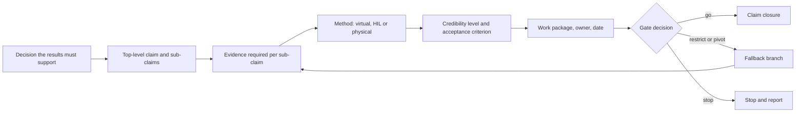

#### 5. What convinces expert reviewers and executives

**Question sets used by funding agencies.** DARPA's Heilmeier Catechism is the most compact reviewer test; DARPA states that it uses the questions to assess and think through proposed research programmes [39]. In substance: What are you trying to do, with no jargon? How is it done today and what are the limits of current practice? What is new in your approach and why do you think it will succeed? Who cares, and what difference will it make? What are the risks? How much will it cost? How long will it take? What are the mid-term and final "exams" to check for success? ARPA-E and ARPA-H use variants [124]. The NIH Simplified Review Framework (NOT-OD-24-010, released 19 October 2023, applying to due dates on or after 25 January 2025) organizes review around three factors: Importance of the Research (significance and innovation) and Rigor and Feasibility (approach) are each scored 1 to 9, while Expertise and Resources is rated appropriate or flagged for gaps. In NIH's own words the three questions are: should it be done, can it be done well, and are the expertise and resources in place [40, 178, 179]. NIH guidance asks whether risky early-stage work "will establish feasibility", and its reviewer materials updated through September 2026 reinforce structured evaluation rather than enthusiasm [180, 181]. NSF reviewers judge Intellectual Merit and Broader Impacts and explicitly consider whether the activities are creative, whether the plan is well reasoned and organized, whether there is a mechanism to assess success and whether the team is qualified; NSF returns proposals without review when submission requirements are not met [182]. Horizon Europe scores Excellence, Impact, and Quality and Efficiency of the Implementation, and its application form includes a critical-risks table [183]. **Independent** (documented practice of named agencies).

**Why proposals are rejected.** NIH's Center for Scientific Review lists common weaknesses, and Bordage (2001) analysed reviewers' reasons for rejecting manuscripts; the recurrent themes are unclear aims, an approach that does not match the aims, no alternative strategies, overambition and missing preliminary data [184, 185]. An often-cited 1987 study by Cuca and McLoughlin on NIH rejection reasons could not be verified. Across the agency sources the most defensible common rejection mechanisms are: failure to conform to required criteria; an unclear or insufficiently important problem; weak rationale; insufficient feasibility or rigor; an unconvincing team or resources; lack of measurable success tests; and visible unmitigated weaknesses. A universal statistically ranked list across engineering organizations was not found. **Independent** for the sources, **Expert opinion** for the synthesis.

**How reviewers behave.** Three research findings matter for the author. Hren and colleagues (2022) analysed evaluation reports for 3,667 Marie Curie applications and found that reviewer comments tracked the pre-specified criteria and that outcomes were influenced more by weaknesses than by strengths [36]. Pier and colleagues (2018) had 43 reviewers rate the same 25 NIH applications and found "no agreement among reviewers regarding the quality of the applications", with Krippendorff's alpha values "all near zero" [37]. Boudreau and colleagues (2016) found in a field experiment that evaluators scored highly novel proposals lower [38]. The consequences: run a deliberate skeptic pass ("what single weakness would allow a competent reviewer to reject this plan?") rather than adding more upside; expect reviewers to disagree and pre-brief the key ones; and frame novelty as managed risk with a fallback rather than as a virtue. **Independent** for the studies, **Expert opinion** for the consequences.

**Executive communication.** The practitioner formats are Minto's Pyramid Principle and its situation-complication-question-answer opening, the military "bottom line up front" (Army Regulation 25-50), Amazon's six-page narrative and PR/FAQ, the UK Treasury Five Case Model for business cases, and Decision Quality from Strategic Decisions Group [186, 187, 188, 189, 190]. A McKinsey survey of 1,048 business decisions found that decision process explained more of the variance in outcomes than the quality of analysis [191]. Direct controlled evidence that a six-pager, BLUF or pyramid structure makes technical programmes more likely to be approved or to succeed was not found; these are practitioner practices. The first two pages of the plan should answer, in order: the decision requested; why now; what will exist by the deadline; what will not exist; probability or confidence; principal risks; fallback; and the resources and decisions needed from leadership. Engineers and safety specialists need a different view of the same truth: the chain of reasoning, model credibility, safety assumptions, interfaces, coverage, test methods, acceptance thresholds, data lineage, schedule basis and open technical disputes. **Expert opinion**, **Vendor** for the consultancy sources.

**Slides versus narrative.** The Columbia Accident Investigation Board (2003) and Tufte criticize dense slide decks as a medium for engineering reasoning [192, 193]; a quasi-experiment found that assertion-evidence slides (a full-sentence headline supported by visual evidence) improved audience comprehension over conventional bullet slides [194]. Verdict: narrative documents are documented practice; assertion-evidence slides are supported by limited evidence. **Expert opinion** and **Independent** as marked.

**Communicating uncertainty.** Online experiments by van der Bles and colleagues (2019; 2020) found that numeric ranges barely reduced trust in the communicator, while verbal hedges reduced it more; Gaertig and Simmons (2018) found people do not inherently dislike uncertain advice, and Jensen (2008) found hedging can increase perceived credibility of scientists [41, 42, 195, 196]. State numeric ranges plainly (P50, P80, probability of meeting the deadline) rather than softening them with words. **Independent**.

#### 6. Visuals that work

There is no credible research basis for claiming that one visual format universally produces the greatest trust among engineering reviewers; that evidence was not found. What can be supported is a division of labour among visual types, each of which exposes a different kind of dependency or gap. **Expert opinion**.

- **Layered roadmap.** Technology-roadmapping literature (Phaal and colleagues, 2004; Kostoff and Schaller, 2001) describes layered roadmaps as the standard orientation graphic [43, 78]. Put time horizontally and work or evidence streams vertically, with dependencies and gate diamonds rather than isolated boxes. Comprehension studies of roadmaps were not found. The example below is a recommendation, not a tested design. **Independent** for the literature, **Expert opinion** for the example.

| Evidence stream | October to November | December to January | February to March | April gate | May to August |
|---|---|---|---|---|---|
| Safety argument | Bound claims | Refine argument | Close pilot gaps | Scope accepted? | Close evidence |
| Model credibility | Context of use | Verify | Validate; quantify uncertainty | Credible enough? | Monitor validity |
| Physical correlation | Data plan | First checks | Campaign | Threshold met? | Exceptions |
| Scenario coverage | Hazards | Prototype set | Coverage model | Adequate? | Execute set |
| Toolchain | Architecture | Thin slice | Automate and harden | Stable? | Production |
| Governance | Scope gate | Feasibility gate | Credibility gate | Readiness gate | Evidence release |

- **Claim-to-evidence map.** Sits beside the roadmap and tells the safety reviewer why each work package exists; it follows assurance-case practice, and a claims-by-evidence gap map in the style of evidence gap maps answers "what have you not tested?" [26, 177]. Experimental comparison with prose was not found.
- **Coverage map.** Scenario or hazard dimensions on one axis, evidence source or tested region on the other, each cell coloured virtual-only, virtual plus physical correlation, physical-only or uncovered. Uncovered cells must stay visibly blank rather than disappear into an overall "85% coverage" score. No heavy-machinery equivalent of the ISO 34502:2022 scenario framework **(on-road evidence)** was found, so the taxonomy must be defined by the programme [197]. Direct evidence for this presentation in machine-safety reviews was not found. **Expert opinion**.
- **Architecture view.** Show machine, sensors, controller, environment model, simulation engine, fault and scenario injector, automation and orchestration, data stores, test oracle, reporting, and physical or HIL comparators with their interfaces, and mark which elements are real, modelled, emulated or substituted. ISO/IEC/IEEE 42010:2022, the 4+1 view model, the C4 model and SysML support matching detail to the viewer's role rather than one universal diagram; Moody's "physics of notations" (2009) gives design principles for notations [198, 199, 200, 201, 202]. Controlled studies of how well readers understand GSN or other assurance diagrams were not found. **Independent** for the standards, **Expert opinion** for the recommendation.
- **Probabilistic schedule view.** Show milestone distributions or confidence windows, not exact bars: a Monte Carlo S-curve with P50 and P80 marked, or a fan chart. Fernandes and colleagues (CHI 2018) found quantile dotplots and cumulative distribution displays improved decisions; the reviews by Hullman and colleagues (2019), Padilla, Kay and Hullman (2021) and Spiegelhalter, Pearson and Short (2011) show that displaying uncertainty changes decision behaviour but that effects on comprehension and trust are context-dependent, so there is no basis for saying "uncertainty graphics always increase trust" [44, 203, 204, 205]. **Independent**.
- **Risk views.** Combine a ranked top-risks table with ranges, a schedule-sensitivity tornado diagram and a risk burn-down by gate. A 5 by 5 heat map may be included for familiarity but must not drive prioritization, because of the ranking defects documented by Cox (2008) [17]. **Independent** for the defect, **Expert opinion** for the alternatives.
- **Decoration and trust.** The finding that trivial graphs and formulas increase persuasion (Tal and Wansink, 2016) failed to replicate (Dragicevic and Jansen, 2018): popular but unreplicated [206, 45]. Bateman and colleagues (2010) found visual embellishment aided memory without loss of accuracy [207]. Do not decorate to persuade; decorate, if at all, to aid recall. **Independent**.

#### 7. Scoping and presenting a pilot or proof of concept

**What the methodology literature says.** Pilot studies test feasibility, not effectiveness (Thabane and colleagues, 2010), and should not be used to estimate effect sizes (Leon, Davis and Kraemer, 2011) [46, 208]. The CONSORT extension for pilot and feasibility trials (Eldridge and colleagues, 2016) and the work on progression criteria (Avery and colleagues, 2017, traffic-light criteria; Mellor and colleagues, 2023) support stating progression criteria before results are known [47, 48, 49]. Pre-registration (Nosek and colleagues, 2018) and Registered Reports, which were rated higher on rigour than conventional papers (Soderberg and colleagues, 2021), support locking metrics in advance [209, 210]. All of this comes from health and social research, so the transfer to engineering is a supporting analogy rather than direct proof; direct evidence for heavy-machine virtual testing was not found. **Independent (adjacent domain)**.

**Engineering analogues.** Building-block validation (AIAA, 1998; Oberkampf and Roy, 2010), blind prediction as in the Sandia Fracture Challenges, a "walking skeleton" that exercises the whole toolchain end to end at low fidelity, DARPA and ARPA-E phase metrics, and the validation envelope versus intended-use domain of NATM and NASA-STD-7009B [149, 148, 150, 124, 28, 9]. The FDA's Software Precertification pilot (2017 to September 2022) is an institutional example of a pilot that did not validate its original concept and still produced findings about what could and could not be done under the existing framework; a pilot does not have to "succeed" to be useful [211]. **Independent**.

**Recommended scope.** The pilot should be a deliberately difficult thin vertical slice, not an attractive demonstration: one safety function, one or two machine variants, representative normal cases plus boundary, degraded and known-difficult cases (for example low visibility or an occluded person), an end-to-end model and toolchain, physical or bench comparators, and pre-declared go, restricted-go, pivot and stop criteria. A concrete version: run it in months 3 to 5; choose 3 to 5 scenario classes including at least one edge case; pre-specify 10 to 30 physical test points; simulate blind before the physical results are seen; compare against pre-registered metrics such as detection-range error, stopping-distance error and false-negative agreement; and report as a traffic light that shows the trusted envelope and the failures. A polished animation of one nominal cycle has almost no evidentiary value. **Expert opinion** informed by the literature above.

**A pilot charter.** The fields below make the pilot auditable before it starts. **Expert opinion**.

| Field | Required content |
|---|---|
| Decision | What larger decision will the pilot evidence inform? |
| Uncertainty | What do we genuinely not know? |
| Scope | One function, configuration and envelope, with explicit exclusions |
| End-to-end chain | Stimulus, model or system, safety response, measurement, verdict |
| Comparator | Bench, physical machine, field record, independent model or analytical truth |
| Challenge cases | Normal, boundary, degraded and known difficult or failure cases |
| Metrics | Accuracy, timing, reproducibility, coverage, failure detection, effort |
| Progression criteria | Go, restricted go, pivot, stop |
| Credibility criteria | What discrepancy is acceptable, and why? |
| Residual uncertainty | What remains unknown even after success? |
| Deliverables | Raw data, results, discrepancy log, credibility report, repeatable scripts |
| Claim limit | Exactly what the pilot does not establish |

**Presenting the result.** A credible pilot conclusion reads: "Within these three operating regimes, on configuration A, model-to-test discrepancy remained within the pre-agreed tolerance for metrics X and Y; the simulation failed criterion Z in condition Q. The delivery programme will therefore claim virtual evidence for X and Y only, while Q retains physical confirmation." That is far stronger than "the proof of concept was successful". **Expert opinion**.

#### 8. Using experts, reviews and red teams as a non-specialist

**Start with independent interviews, not a workshop.** Group discussion creates premature convergence, status effects and hidden disagreement. Begin with independent structured interviews and make the unit of analysis the claim, not the expert's authority. For every important assertion ask: What exactly do you believe? What evidence supports it? What is your confidence or range? What assumptions make it true? What evidence would change your mind? What would an expert who disagrees say? Who else should validate this claim? **Expert opinion** informed by the structured-expert-judgment research below.

**Interview technique.** The Critical Decision Method (Klein, Calderwood and MacGregor, 1989; Crandall, Klein and Hoffman, 2006) elicits judgment from specific past cases rather than general opinions: ask "the last time a sensor model failed to match field data, what happened?" rather than "how reliable are sensor models?" [212, 213]. Bogner, Littig and Menz (2009) cover expert interviewing as a research method [214]. **Independent** and **Expert opinion** as marked.

**Structured elicitation of quantities.** Cooke's Classical Model (1991) weights experts by their performance on calibration questions [215]. Colson and Cooke (2018) reviewed 33 applications and found substantial variation in expert calibration; fewer than one third of individual experts met the study's statistical-accuracy criterion, so expertise alone does not guarantee accurate uncertainty estimates [50]. Their cross-validation study (2017) found performance weighting strong in-sample but documented an out-of-sample penalty [216]. The IDEA protocol (Hemming and colleagues, 2018), the SHELF framework (O'Hagan and colleagues, 2006) and EFSA's 2014 guidance are the practical procedures [217, 218, 219]. Delphi generally beats unstructured groups (Rowe and Wright, 1999), but consensus is not correctness, and methodological reviews published between 2021 and 2024 note wide variation in how Delphi studies are designed and reported (no single review was identified) [220]. Training and teaming improved forecasting accuracy in the geopolitical forecasting tournaments (Mellers and colleagues, 2014) [221]. Verdict: structured elicitation is supported. For durations, model errors and likelihoods, calibrate expert judgment against historical or known-answer questions where practical; where calibration is impossible, record ranges and disagreement rather than averaging opinions into an apparently precise number. **Independent**.

**Reviews and red teams.** Documented practice includes the UK Ministry of Defence Red Teaming Handbook (3rd edition, 2021), the U.S. Army Red Team Handbook, Zenko's survey of red-teaming practice, Shipley colour-team proposal reviews, NASA Standing Review Boards, UK Gateway Reviews and Fagan inspections [222, 223, 224, 225, 103, 80, 226]. The red team should not edit grammar; give it an adversarial charter: "Demonstrate that this plan cannot support its stated safety claim by the deadline." Ask it to attack scope, hidden assumptions, architecture, reference data, acceptance thresholds, schedule logic, resource availability, integration dependencies, standards interpretation, evidence independence, scenario coverage, model extrapolation, fallback feasibility and the executive claims. Red teams are established practice in security, defence and proposal review, but direct controlled evidence that a red-team review improves schedule or safety performance in an engineering capability programme was not found. **Independent** for the handbooks, **Vendor** for Shipley, **Expert opinion** for the charter.

**Evidence on structured challenge.** Dialectical inquiry and devil's advocacy produced better decisions than consensus approaches in laboratory studies (Schweiger, Sandberg and Ragan, 1986; Schwenk's 1990 meta-analysis), and authentic dissent beats an assigned devil's advocate (Nemeth, Brown and Rogers, 2001) [227, 228, 51]. Recruit real skeptics rather than appointing one. **Independent**.

**Record-keeping for a non-specialist author.** Keep a dissent log with columns for claim, expert positions, evidence cited, consequence if unresolved, proposed test and accountable decision owner. Maintain three categories throughout the document and never mix them: verified fact, expert judgment, management assumption. **Expert opinion**.

**A sequence for the preparation months.** Months 1 to 2: 8 to 12 Critical Decision Method interviews (safety, simulation, test, assessor, operations). Month 2: IDEA-style elicitation of durations and probabilities. Month 3: pre-mortem with the skeptics present. Month 4: independent red team. Months 5 to 6: gate review with recorded dissent. **Expert opinion**.

#### 9. Structure, length and templates for the final plan

**Where to borrow structure.** Documented templates that fit this plan are the DoD TEMP [68, 69]; NASA's technology development plan under NPR 7120.8 and the entrance and success criteria of NPR 7123.1 [90, 229]; the Horizon Europe Part B work packages and critical-risks table [183]; the NIH Approach section, which asks for "potential problems, alternative strategies, and benchmarks for success" [40]; the Amazon six-pager [188]; the Five Case Model [189]; the PRINCE2 7 project initiation documentation and PMBOK 7 [230, 89]; UK Gateway Review workbooks and GAO's schedule and cost checklists [80, 15, 102]; the UL 4600 question lists [133]; Kelly's step-by-step argument review (2007) [231]; and the validation plan of ISO 13849-2 [31]. **Independent** and **Expert opinion** as marked in the source list.

**Length.** Documented page limits: the NIH R01 Research Strategy is 12 pages, the NSF Project Description 15 pages, Amazon narratives 6 pages, Horizon Europe Part B set per call [40, 182, 188, 183]. Evidence on the optimal length of a technical plan was not found. Two recommendations are defensible and both are opinion: a main body of 12 to 15 pages following funding-agency convention, with indexed appendices; or a two-page decision brief plus roughly 25 to 35 core pages, with technical evidence in appendices. The design principle behind both is progressive disclosure: an executive should grasp the decision, confidence and risks in two pages; a chief engineer should be able to audit the logic in the body; a specialist should be able to reproduce or challenge the work from the appendices. The outline below gives a range for each section so the author can land anywhere between the two positions depending on how much of the evidence strategy and architecture the reviewing population wants in the body. **Expert opinion**.

### Comparison tables

#### Planning methods compared

The verdict column distinguishes four levels: "proven" means direct empirical or mathematical evidence, "supported" means correlational or adjacent-domain evidence, "documented practice" means an institutional method without outcome studies, and "popular" means widely used without supporting evidence or with evidence against. **Independent** for the cited evidence, **Expert opinion** for the verdicts and roles.

| Method | Origin and date | Question it answers | Fit for high uncertainty plus fixed deadline | Evidence for | Evidence against or limits | Verdict | Recommended role here |
|---|---|---|---|---|---|---|---|
| Stage-Gate / phase-gate | Cooper 1990, 2008 [52, 53] | Governance | Medium | Benchmark surveys (originator) | Learning failure in novel products [55]; ceremonial gates | Supported (mixed) | 4 to 5 evidence gates, not administrative phases |
| GAO knowledge points | GAO, late 1990s onward [3, 2] | Governance | High | Correlation with lower cost and schedule growth; multi-programme audits | Small n; correlational | Supported (correlational) | Gate criteria defined as demonstrated knowledge |
| TRL / TRA | NASA; Mankins 1995; GAO-20-48G [56, 8] | Maturity | Medium | GAO audits link immaturity to overruns | 15 practitioner challenges [7]; not a system measure | Principle supported; scale documented only | Critical technologies only |
| M&S credibility frameworks (7009B, V&V 40, PCMM, NATM) | NASA 2024; ASME 2018; Sandia 2007; UNECE 2022 to 2024 [9, 145, 61, 28] | Maturity of the simulation | High | Blind-prediction gaps show need | "Largely declarative" [29] | Documented practice | Replace TRL for the toolchain |
| SE V&V planning | INCOSE 2023; ISO 15288; NASA [62, 64, 63] | Evidence | High | SE capability correlates with performance [66, 67] | Self-report; overhead | Supported (some) | Primary technical backbone (stringent subset) |
| TEMP / IDSK | DoDI 5000.89; Guidebook 3.1 [68, 69] | Evidence linked to decisions | High | Institutional requirement | Outcome studies not found; defence scale | Documented practice | Integrated virtual and physical test strategy |
| Assumption-based planning | RAND 1993, 2002 [71, 72] | Uncertainty | High | Army applications | Outcome evidence not found; list bloat | Documented practice | Short critical-assumptions and signposts register |
| Discovery-driven planning | McGrath and MacMillan 1995 [75] | Uncertainty | High | Related RCTs [21, 22] | Venture domain; no acceptance evidence | Documented practice; adjacent RCT support | Learning milestones in preparation |
| Reference class forecasting plus schedule-risk analysis | Flyvbjerg 2006; GAO-16-89G [95, 15] | Schedule | High if class is similar | Beat alternatives when similar [11]; planning-fallacy experiments [10] | Mechanism contested [13]; class choice hard | Supported (contested) | Primary schedule approach; P50/P80 |
| Front-End Loading | Merrow 2011 [79] | Governance | Medium | Proprietary database | Vendor conflict of interest | Supported (mixed) | Definition before authorization at G0 |
| Spiral / ICSM | Boehm 1988, 2014 [82, 83] | Uncertainty | High | Case studies | Few studies | Documented practice | Risk-driven iteration in preparation |
| Set-based design / parallel paths | Nelson 1961; Sobek 1999 [85, 84, 86] | Uncertainty | High | Toyota cases; modelling | Cost of parallel work | Supported (some) | Two options where uncertainty is highest |
| Critical Chain | Goldratt 1997 [87] | Schedule | Low to medium | Practitioner reports | Critique [88] | Popular but unproven | Not recommended as the basis |
| Rolling-wave planning | PMI [89] | Schedule | High | None found | Not found | Documented practice | Detail near-term, outline later |
| Technology roadmapping | Phaal 2004 [43] | Communication | Medium | Case use | Comprehension evidence not found | Documented practice | Visualization on top of the plan |
| Safety-case-driven planning | Kelly 1998; UL 4600 [127, 133] | Evidence | High | Practice | Case-study evidence only [24] | Documented practice | Define what evidence must show |

#### Proven, supported, documented or merely popular

| Claim or method | Type of evidence | Status |
|---|---|---|
| People underestimate their own completion times (planning fallacy) | Experiments [10] | Proven |
| Colour risk matrices mis-rank and compress risks | Mathematical analysis [17, 120] | Proven |
| Experts vary widely in calibration; fewer than one third met the accuracy criterion | Review of 33 applications [50] | Proven |
| Decision makers escalate commitment to failing courses | Meta-analysis [20] | Proven |
| Weaknesses weigh more than strengths with reviewers; reviewers disagree | Mixed-methods study of 3,667 applications [36]; 43-reviewer study [37] | Proven (grant review) |
| Numeric ranges preserve trust better than verbal hedges | Online experiments [41, 42] | Proven (public audiences) |
| Knowledge before commitment improves cost and schedule outcomes | Multi-programme audits, correlational [3, 2, 4] | Supported |
| Reference class forecasting beats inside-view estimates | Archival comparison, conditional on similarity [11, 12] | Supported (contested mechanism) |
| Hypothesis-driven management raises rational termination | RCTs in start-ups [21, 22] | Supported (adjacent domain) |
| Pre-mortems reduce overconfidence | One laboratory experiment [19] | Supported (overconfidence only) |
| Quantile dotplots and CDFs improve decisions | One experiment [44] | Supported (limited) |
| Assertion-evidence slides improve comprehension | Quasi-experiment [194] | Supported (limited) |
| Dialectical inquiry and authentic dissent improve decisions | Laboratory studies and meta-analysis [227, 228, 51] | Supported |
| Structured elicitation and Delphi beat unstructured groups | Reviews and tournaments [220, 221] | Supported |
| Stage-Gate improves product outcomes | Originator surveys; one contrary survey [55] | Supported (mixed) |
| Systems-engineering capability improves project performance | Self-report surveys [66] | Supported (some) |
| NASA-STD-7009B, NATM, TEMP, V&V planning | Institutional standards and guidance [9, 28, 68] | Documented practice |
| Safety cases make systems safer | Case studies only [24] | Documented practice; critics [25] |
| Assumption-based and discovery-driven planning, roadmapping | Method documentation [72, 75, 43] | Documented practice; popular |
| Risk registers improve delivery | Meta-analysis found 2 of 29 papers positive [16] | Documented practice; thin evidence |
| Six-pagers, BLUF, Pyramid Principle improve approval or success | None found [188, 186] | Popular, unproven |
| Red teams improve engineering-programme outcomes | None found [222] | Popular, unproven |
| Critical Chain | Practitioner reports; critique [88] | Popular, unproven |
| Cone of uncertainty as a precise model | Contradicted by project data [110] | Popular, contradicted |
| Standish CHAOS failure rates | Methodologically criticized [113] | Popular, contradicted |
| Trivial graphs increase persuasion | Failed replication [45] | Popular, unreplicated |

### Recommended outline for the final plan

Every section should answer a reviewer question rather than describe activity. The outline combines funding-agency convention (a compact main body) with the executive-brief-plus-core-plan structure; the page ranges span both positions, and neither is backed by evidence on optimal length. Templates are named in the last column with their sources. **Expert opinion** throughout, grounded in the documented practices cited.

| # | Section | Purpose (the reviewer question it answers) | Essential contents | Pages | Templates and sources |
|---|---|---|---|---|---|
| 0 | Executive decision brief | What are you asking us to decide, and how sure are you? | Decision requested; what will exist by August or September 2027 and what will not; P50 and P80 dates and probability of meeting the deadline; top three risks; what "stop" looks like; fallback; resources and executive actions | 1 to 2 | BLUF [187]; six-pager [188]; Heilmeier [39] |
| 1 | Problem and decision context | Why does this capability exist and why now? | Current physical test process and its limits; the safety function; the engineering decisions the results will support; deadline and consequence | 1 to 2 | Heilmeier [39]; Five Case Model [189] |
| 2 | Safety scope and top-level claim | What exactly will you show, for which machine, function and envelope, and what are you not claiming? | Variants; operating envelope; scenario classes; hazards; exclusions; GSN or CAE sketch of the claim; candidate standards | 1.5 to 3 | GSN v3 [26]; UL 4600 [133] |
| 3 | Current state and gap assessment | Where are you starting from? | Existing models, tools, data, people, test assets; known deficiencies | 1 to 2 | Technology readiness assessment [8] |
| 4 | Target capability and architecture | What is real, what is modelled, and where are the trust boundaries? | Simulation, control, data and tool architecture; real versus simulated components; configuration and data flows | 2 to 3 | ISO/IEC/IEEE 42010 [198] |
| 5 | Evidence, V&V and test strategy | Why will the results be credible? | Claim-to-evidence map; verification; validation and correlation; uncertainty quantification; scenario method; physical-virtual relationship and substitution policy; acceptance thresholds; physical-correlation rationale | 2 to 6 | IDSK and TEMP [69]; NASA-STD-7009B [9]; NATM [28] |
| 6 | Credibility and tool qualification | How is the toolchain itself trusted? | Validation ladder; blind pilot; envelope; uncertainty; configuration control; tool qualification regime | 1 to 1.5 | 7009B [9]; V&V 40 [145]; ISO 26262-8 [153] |
| 7 | Standards and regulation | Which rules govern, and do they accept simulation? | Applicable standards and applicability sign-off; Machinery Regulation, PLD and AI Act dates; assessor engagement plan | 1 | Standards table in section 4 |
| 8 | Pilot and learning plan | Which uncertainties are retired before full commitment? | Thin vertical slice; difficult cases; metrics; comparator; progression criteria; expected decisions | 1.5 to 3 | Pilot charter above; pilot literature [47, 48] |
| 9 | Roadmap and gates | How does evidence accumulate, and when can we stop? | Layered roadmap; gates with signed criteria; dependencies; evidence maturity; fallback branches | 1.5 to 3 | GAO knowledge points [2]; NPR 7123.1 [229] |
| 10 | Schedule and basis of estimate | Is the deadline claim auditable? | Integrated schedule; reference classes; range assumptions; S-curve; critical path; buffers; long-lead items | 1 to 3 | GAO-16-89G [15] |
| 11 | Risks, assumptions and fallbacks | What breaks the plan, how will you notice, and what then? | Top ten quantified risks; assumptions with signposts; pre-mortem results; stop and descope criteria; descoping ladder; minimum viable deliverable | 1.5 to 3 | ABP [72]; Horizon Europe risk table [183] |
| 12 | Organization, governance and independence | Can the people system execute, and who is allowed to disagree? | Named owners; key-person cover; independent assessor; red team; decision cadence; suppliers; skill gaps | 1 to 2 | NIH Factor 3 [40] |
| 13 | Results and review protocol | What does "done" mean before results exist? | Final evidence package; reviewers; discrepancy handling; claim closure; record retention; reproducibility | 1 to 2 | NASA-STD-7009B reporting requirements [9] |
| 14 | Sustainment and change policy | What happens after September 2027? | Ownership, budget, licences; what design changes trigger partial or full revalidation | 0.5 to 1 | Five Case Model [189] |

**Appendices** should carry depth rather than hide uncertainty from the main body: A, preliminary GSN or CAE argument; B, evidence plan and verification cross-reference matrix (requirements, hazards, scenarios, evidence); C, operating-envelope and scenario coverage map; D, model credibility plan and assessment (NASA-STD-7009B factors); E, pilot protocol with pre-registered progression criteria; F, detailed schedule, basis of estimate, reference-class data and elicitation records; G, risk and assumption register with quantitative schedule effects; H, expert consultation log, dissent log and red-team findings with dispositions; I, standards and compliance matrix; J, long-lead item tracker; K, data and configuration baseline; L, glossary.

**Gates.** The table below combines the two gate schemes found in practice: a dated G0 to G4 sequence and a feasibility-credibility-readiness-release sequence. **Expert opinion**.

| Gate | Timing | Pass criterion (to be signed in advance) | Outcomes allowed |
|---|---|---|---|
| G0 scope and evidence plan | End of November 2026 | Claims and evidence plan agreed; long-lead orders placed; gate criteria signed by the sponsor; decider named | Go, restrict, stop |
| G1 feasibility | End of January 2027 | One scenario runs end to end, reproducibly, under configuration control; unresolved-assumption report issued | Go, restrict, pivot, stop |
| G2 credibility and delivery readiness | March to April 2027 | Blind pilot meets pre-set metrics inside its envelope; assessor feedback received; P80 date inside the deadline; independent review says ready, restricted scope or fallback | Go, restrict, pivot, stop |
| G3 coverage | End of June 2027 | Planned coverage reached with no open credibility defeaters on high-integrity claims | Go, restrict, stop |
| G4 evidence release | August to September 2027 | Evidence package states envelope, limitations and residual uncertainty; results support only the claims made | Release, release with restrictions, withhold |

**A reusable gate card.** One page, used at every gate: Decision (exactly what is management deciding?); Required knowledge (what must be known first?); Evidence (which artifacts demonstrate it?); Threshold (what objective criterion is adequate?); Open uncertainty; Assumptions still relied on; Deadline probability (current chance of the next committed milestone); Options (go, restricted go, pivot, stop); Fallback; Dissent (which qualified reviewers disagree and why?); Authority (who owns the decision and who reviews it independently?). **Expert opinion** derived from GAO criterion-based decisions and DoD entrance and exit criteria [3, 68].

**The evidence ledger.** The most important working template is a one-page ledger with the columns Claim ID, Claim, Evidence required, Method, Acceptance criterion, Owner, Due, Status, Limitation. Example rows: C-1, "model timing is adequate within envelope E", physical or bench correlation, defined experiment, pre-declared bound; C-2, "safety scenarios cover identified control-system hazards", hazard-to-scenario trace, analysis plus review, no unexplained gaps; C-3, "results are reproducible", independent re-run, configuration-controlled replay, pre-specified repeatability criterion. **Expert opinion** grounded in assurance-case, NASA model-credibility and integrated test-and-evaluation principles [26, 9, 69].

### Checklist of questions skeptical reviewers ask

A frequency study of the questions reviewers ask most often was not found. The checklist below synthesizes the recurring questions in DARPA, NSF, NIH, GAO, systems-engineering, safety-assurance, simulation-credibility and test-planning sources and should be treated as a practice-derived review checklist, not a ranking [39, 182, 40, 15, 9, 26, 68]. **Expert opinion** grounded in documented practice.

**Purpose and claims**

- What exact engineering or safety decision will this capability make possible, and why is it needed by this specific date?
- What can current physical testing or simulation already do, and what precisely is inadequate?
- What will be genuinely new at the end of the programme, and why is virtual testing better than physical testing for this particular claim?
- What claims are you explicitly not making?
- Who is the consumer of each result, and what will that person do differently because of it?
- What would show that you are wrong?

**Safety argument and evidence**

- What is the top safety or evidence claim, and what are its defeaters?
- Which hazards and failure modes are inside and outside scope?
- What evidence supports every leaf claim in the argument, and which claims rest on virtual evidence alone?
- What acceptance criteria were chosen before seeing results?
- What physical, bench, field or independent evidence anchors the simulation, and were the predictions blind?
- Where is simulation being extrapolated outside validated conditions?
- Does the approach supplement physical testing or replace part of it, and what evidence justifies the substitution?
- What evidence would cause you to reject the virtual result?
- Who assesses the argument independently, and is the safety case real or paperwork?

**Simulation credibility**

- Against which physical data was each sensor, environment, human, plant and supplier model validated?
- What is the validated envelope, and is anything claimed outside it?
- How are model-form, parameter, measurement and scenario uncertainties represented, and what is the output uncertainty?
- Is the toolchain configuration-controlled, reproducible and qualified, and can another qualified engineer reproduce a result from the retained artifacts?
- Are the test oracle and the simulation independent enough to avoid validating the system with its own assumptions?
- What dissenting technical opinions exist, and where are they recorded?

**Standards and regulation**

- Which standard governs this machine, function and jurisdiction, who confirmed applicability, and does it accept simulation for this step?
- How does the plan fit the Machinery Regulation from 20 January 2027, including possible notified-body assessment for machine-learning safety components?
- What records are kept for disclosure under the Product Liability Directive?

**Technical feasibility**

- Which parts of the capability are genuinely novel, what are their maturity levels, and what demonstration supports those ratings?
- What is the hardest technical uncertainty?
- Has the entire chain been exercised end to end, and what are the largest model-to-test discrepancies so far?

**Schedule and resources**

- What historical projects or tasks form the reference class, and where did the duration ranges come from?
- What are the P50 and P80 dates, and what is the current probability of making the fixed deadline rather than the planned date?
- What is the critical or near-critical path, and where is the integration buffer?
- Which long-lead items are critical, and which external dependency is least controllable? What if test slots slip four weeks?
- Which resource is oversubscribed, and how much rework is represented in the schedule?
- Which integration event is intentionally early enough to reveal interface problems?
- At what date must scope be reduced to preserve delivery confidence?

**Risk, unknowns and fallback**

- Which assumption would invalidate the plan if it failed tomorrow, and what sign would tell you it is beginning to fail?
- Which risk has no credible mitigation, and which has a mitigation but no funded contingency?
- What did the pre-mortem find that the ordinary risk workshop missed?
- What do you know that you do not know, and which unknown must become known before the next irreversible commitment?
- What are the objective go, restrict, pivot and stop criteria, and who decides?
- What is the minimum viable deliverable?

**Pilot**

- Which uncertainty is the pilot explicitly designed to remove, and why is it representative rather than cherry-picked?
- Does it include boundary or failure cases, and what is the independent comparator?
- What result would constitute pilot failure, and will a failed pilot still produce a useful decision?
- How does pilot evidence change the full-programme schedule, scope or safety argument?

**Organization and independence**

- Who is the single accountable technical owner, and who is allowed to disagree with that person?
- Is safety assurance sufficiently independent of the team whose work it judges?
- Which expertise is currently missing, and what happens if a key person leaves?
- Are skills, licences, rigs and data rights secured, and which claims depend on supplier knowledge or proprietary data?
- Where have experts materially disagreed, how was the disagreement resolved, and are duration and probability judgments calibrated against any observed history?

**Value and executive challenge**

- How much money and scarce engineering capacity are being committed, and what is the cost versus physical-only testing?
- What is the minimum useful result if the full ambition cannot be delivered?
- What is the cost of not doing it, and what is the cost of believing an incorrect virtual result? What is the liability downside if virtual evidence is challenged?
- What decision is required from leadership now, and which decision can safely be deferred?
- What is the mid-programme "exam", and what happens if the programme fails it?
- What happens after September 2027?

### Where the evidence stands

#### Well established

- The planning fallacy: people underestimate their own completion times and discount their own history, in controlled experiments (1994) [10].
- Colour risk matrices have mathematical defects (poor resolution, range compression, ranking errors), shown analytically in 2008 and confirmed since [17, 120, 121].
- Experts vary widely in calibration; in 33 structured-elicitation applications fewer than one third met the statistical-accuracy criterion [50].
- Escalation of commitment is robust across more than 35 years of studies, which justifies pre-committed stop criteria [20].
- Immature technology and optimistic time frames at commitment are associated with cost and schedule failure across two decades of GAO audits (2005 to 2026), and knowledge-based practices with better outcomes, although the design is correlational [5, 3, 2, 4].
- Grant reviewers weigh weaknesses more than strengths, disagree with each other and penalize novelty [36, 37, 38].
- Simulation credibility must be stated relative to intended use, envelope and consequence of error; this is the shared position of NASA-STD-7009B, the UNECE NATM credibility framework **(on-road evidence)**, ASME V&V 40 and the FDA guidance [9, 28, 145, 147].
- Heavy-machinery standards accept simulation only as one verification or validation method among several (ISO 18497-4:2024; ISO 13849-2:2012), and none found sets rules for virtual-only validation [30, 31].
- The Product Liability Directive applies from 9 December 2026 and the Machinery Regulation from 20 January 2027 [32, 33].

#### Uncertain

- Whether any planning method causes better outcomes in programmes like this one: no head-to-head or controlled evidence was found for stage gates, TRLs, V&V planning, TEMPs, assumption-based planning, discovery-driven planning, roadmapping, safety cases, pre-mortems, risk registers or red teams in safety-critical virtual-validation work.
- Whether reference class forecasting works for first-of-a-kind capability work: the evidence is conditional on a similar reference class, which does not exist here, so component-level classes with stated uplifts are a recommendation, not a validated method [11, 12].
- Whether pre-mortems improve outcomes beyond reducing confidence in a laboratory setting [19].
- Whether pre-declared progression criteria transfer from health research to engineering pilots [48, 49].
- Whether NASA's Joint Confidence Level requirement improves outcomes: not found [103].
- Whether any visual format increases reviewer trust or comprehension in engineering plans: not found; roadmap and assurance-diagram comprehension studies were not found, and uncertainty-visualization effects are context-dependent [203].
- Whether notified bodies, regulators and insurers will accept virtual-only evidence for heavy machinery: published criteria were not found.
- The exact Machinery Regulation annex wording on machine-learning safety components and the detailed Digital Omnibus provisions on machinery: both rest on secondary summaries, and the machinery provisions were not read in the Official Journal text. One secondary summary gives 2 December 2027 rather than 2 August 2028 for Annex I systems, which conflicts with the others; the Omnibus dates themselves (adoption 8 July 2026, entry into force 27 July 2026, application 2 December 2027 and 2 August 2028) are stated in the regulation text on EUR-Lex and in the European Commission's announcement [168, 34, 35, 169].
- Optimal plan length: no evidence; the two defensible recommendations (12 to 15 pages versus 25 to 35 core pages plus a 2-page brief) are both opinion.
- The applicability of ISO 19014, ISO 21815 and related standards to the specific machine, function and jurisdiction cannot be determined from the information available.

#### Where experts disagree

- The behavioural explanation of cost overrun (optimism bias and strategic misrepresentation) is disputed by Love and Ahiaga-Dagbui (2018) and defended by Flyvbjerg and colleagues (2018); the practical value of reference class forecasting is less contested than its mechanism [13, 14].
- Safety cases: proponents (Kelly; UL 4600) versus critics (Haddon-Cave on Nimrod; Leveson; Graydon) [127, 133, 25, 140, 141].
- Stage-Gate: originator benchmarking versus the learning-failure finding of Sethi and Iqbal [53, 55].
- The cone of uncertainty and Standish CHAOS figures: popular in practice, contradicted by published analyses [110, 113].
- The "trivial graphs persuade" finding: original versus failed replication [206, 45].
- Credibility frameworks: standards bodies present them as adequate; a 2026 preprint calls them "largely declarative" [9, 29].

### Blind spots

Issues that the nine questions did not ask about but that the plan must address.

**Acceptance and substitution**

- Regulatory and standards acceptance may matter more than technical feasibility: a technically excellent simulation has little safety value if the safety authority, internal independent reviewer, customer or regulator will not accept its evidence for the intended decision. Published heavy-machinery criteria for virtual-only evidence were not found; engage the assessor before G1 and settle standards applicability before optimizing tooling.
- "Virtual testing" needs an explicit substitution policy stating separately what virtual evidence will explore, screen, optimize, verify, validate or replace. "Reduce physical testing" and "take safety credit instead of physical testing" are very different claims [9].
- Physical testing remains necessary for validation and the highest-integrity claims under the multi-pillar logic of NATM **(on-road evidence)**; book test sites and machines now [142].
- The possibility that the correct conclusion is "virtual evidence is not yet adequate for this safety claim" must remain legitimate; a programme whose definition of success requires a positive technical conclusion creates pressure to reinterpret discrepancies and gate criteria.

**Technical gaps**

- Operating-envelope and scenario coverage: no heavy-machinery equivalent of ISO 34502:2022 **(on-road evidence)** was found, so the taxonomy must be defined by the programme, for example along the lines of the EMESRT interaction controls [197].
- Rare events need importance sampling or accelerated evaluation; naive Monte Carlo cannot reach low failure rates in four months [152].
- Perception models for camera, radar and lidar in dust, rain, mud and occlusion are the hardest gap; SOTIF (ISO 21448:2022) and ISO/TS 5083:2025 **(on-road evidence)**, possible third-party assessment under the Machinery Regulation, and the AI guidance in NASA-HDBK-7009B apply [232, 233, 27].
- Model assemblies and supplier data rights: credibility cannot yet be aggregated across assembled or supplier models, and supplier models may arrive as black boxes [29].
- The test oracle can be a hidden single point of failure if the pass/fail criterion encodes the same incorrect assumption as the function under test; identify which parts of the expected result come from independent physics, requirements, physical data, expert judgment or the simulation itself.
- Data pedigree deserves its own workstream: calibration, sampling, synchronization, filtering and environmental uncertainties in the physical measurements used for correlation; input distributions can matter more than solver fidelity [9].
- Operator and environmental variability (operator response, terrain, payload, weather, sensor contamination, wear, maintenance state, machine-to-machine variation) must be assigned to the simulation, to the uncertainty bounds or to the residual physical test programme; ISO 21815-3 leaves responsibility with the operator, so operator and pedestrian models need their own validation [164].
- Tool qualification and configuration management can become a late blocker; decide early how simulator versions, compilers, controller software, libraries, test automation, parameters and generated evidence are baselined and reproduced [153, 154].
- Cybersecurity of the safety function and of the test infrastructure is a separate analysis: ISO 19014-4:2020 excludes it and points to a security standard, and the Machinery Regulation adds cybersecurity requirements [161, 33].

**Governance, people and after the deadline**

- Independence must be designed in, not added at the final review; model developers should not be the only people deciding whether discrepancies are acceptable, and the independence of verification and assessment scales with integrity level, so budget an external assessor early.
- Stakeholder politics: test departments may feel threatened and safety specialists carry personal liability; give them co-ownership of gate criteria.
- Record-keeping and liability under the Product Liability Directive from 9 December 2026 [32].
- Organizational learning is a deliverable: a capability that produces one result but leaves no repeatable process, trained owners, configuration baseline, credibility record or reusable test assets has only partially succeeded; put it in the acceptance criteria.
- A post-deadline change policy is needed: a model credible for software version A, sensor B, machine configuration C and envelope D is not automatically credible after a design update; state what changes trigger partial or full revalidation.
- Sustainment of models, licences and staff after September 2027.
- Standards in flux: ISO 19014, ISO 13849-2 and ISO 3691-4 are being revised in 2025 to 2026; plan for a re-baseline [158, 155, 166].

**Further gaps**

- The research did not cover randomized studies of risk-matrix design. A 2022 Risk Analysis paper reports randomized controlled studies of how people read risk matrices and how design changes improve their use; it is directly relevant to question 6 and should be read before any matrix is used even "for familiarity" [234].
- The nine questions did not ask how to estimate and present the cost of the capability (licences, rigs, staff, external assessor); the GAO cost guide is the natural template and should be used alongside the schedule guide [102].
- The plan depends on prototype hardware arriving in mid-2027. The research did not treat hardware slip as a planned branch; the schedule-risk model should carry it as an explicit assumption with a signpost and a hedge (for example extending the virtual campaign on the previous hardware generation).

### Sources

1. U.S. Government Accountability Office. Weapon Systems Annual Assessment: Challenges to Fielding Capabilities Faster Persist. GAO-22-105230. 2022. https://www.gao.gov/products/gao-22-105230. **Independent**.
2. U.S. Government Accountability Office. Weapon Systems Annual Assessment: Knowledge Gaps Pose Risks to Sustaining Recent Positive Trends (exploratory statistical analysis of 15 programs). GAO-18-360SP. 2018. https://www.gao.gov/products/gao-18-360sp. **Independent**.
3. U.S. Government Accountability Office. Defense Acquisitions: Major Weapon Systems Continue to Experience Cost and Schedule Problems under DOD's Revised Policy (23 programs). GAO-06-368. 13 April 2006. https://www.gao.gov/products/gao-06-368. **Independent**.
4. U.S. Government Accountability Office. Weapon Systems Annual Assessment: Requiring Mature Technologies Could Enable Shift to Rapid Delivery. GAO-26-108457. 2 July 2026. https://www.gao.gov/products/gao-26-108457. **Independent**.
5. U.S. Government Accountability Office. Defense Acquisitions: Assessments of Selected Major Weapon Programs. GAO-05-301. March 2005. https://www.govinfo.gov/content/pkg/GAOREPORTS-GAO-05-301/pdf/GAOREPORTS-GAO-05-301.pdf. **Independent**.
6. Olechowski, A., Eppinger, S. D. and Joglekar, N. Technology readiness levels at 40: A study of state-of-the-art use, challenges, and opportunities. PICMET 2015 (19 interviews in seven organizations). 2015. https://www.semanticscholar.org/paper/1b13e0c2f033c65d13ccd0a00aabbc8fd98a469e. **Independent**.
7. Olechowski, A. L., Eppinger, S. D., Joglekar, N. and Tomaschek, K. Technology readiness levels: Shortcomings and improvement opportunities. Systems Engineering 23(4). 2020. https://incose.onlinelibrary.wiley.com/doi/10.1002/sys.21533. **Independent**.
8. U.S. Government Accountability Office. Technology Readiness Assessment Guide: Best Practices for Evaluating the Readiness of Technology for Use in Acquisition Programs and Projects. GAO-20-48G. 7 January 2020, revised 11 February 2020. https://www.gao.gov/products/gao-20-48g. **Independent**.
9. NASA Office of the Chief Engineer. NASA-STD-7009B, Standard for Models and Simulations. 5 March 2024. https://standards.nasa.gov/standard/NASA/NASA-STD-7009 (PDF: https://standards.nasa.gov/sites/default/files/standards/NASA/B/1/NASA-STD-7009B-Final-3-5-2024.pdf). **Independent**.
10. Buehler, R., Griffin, D. and Ross, M. Exploring the "Planning Fallacy": Why People Underestimate Their Task Completion Times. Journal of Personality and Social Psychology 67(3). September 1994. **Independent**.
11. Batselier, J. and Vanhoucke, M. Practical Application and Empirical Evaluation of Reference Class Forecasting for Project Management. Project Management Journal 47(5), 36-51. 2016. https://www.pmi.org/learning/library/practical-application-empirical-evaluation-rcf-10277. **Independent**.
12. Reference class forecasting: promises, problems, and a research agenda moving forward (review). Production Planning & Control. 2025. https://www.tandfonline.com/doi/full/10.1080/09537287.2025.2578708. **Independent**.
13. Love, P. E. D. and Ahiaga-Dagbui, D. D. Debunking fake news in a post-truth era: The plausible untruths of cost underestimation in transport infrastructure projects. Transportation Research Part A 113. 2018. https://www.sciencedirect.com/science/article/abs/pii/S0965856417306158. **Independent**.
14. Flyvbjerg, B., Ansar, A., Budzier, A. et al. Five things you should know about cost overrun. Transportation Research Part A 118, 174-190. 2018. https://ideas.repec.org/a/eee/transa/v118y2018icp174-190.html. **Independent**.
15. U.S. Government Accountability Office. Schedule Assessment Guide: Best Practices for Project Schedules. GAO-16-89G. 22 December 2015. https://www.gao.gov/products/gao-16-89g. **Independent**.
16. de Bakker, K., Boonstra, A. and Wortmann, H. Does risk management contribute to IT project success? A meta-analysis of empirical evidence (29 publications). International Journal of Project Management 28(5), 493-503. 2010. https://research.rug.nl/files/156479762/Does_risk_management_contribute_to_IT_project_success._A_meta.pdf. **Independent**.
17. Cox, L. A. What's Wrong with Risk Matrices? Risk Analysis 28(2). 2008. https://www.researchgate.net/publication/5432360_What's_Wrong_with_Risk_Matrices. **Independent**.
18. Mitchell, D. J., Russo, J. E. and Pennington, N. Back to the future: Temporal perspective in the explanation of events. Journal of Behavioral Decision Making 2(1). 1989. **Independent**.
19. Veinott, B., Klein, G. and Wiggins, S. Evaluating the Effectiveness of the PreMortem Technique on Plan Confidence. Proceedings of the 7th International ISCRAM Conference (178 participants, five conditions). 2010. https://idl.iscram.org/files/veinott/2010/1049_Veinott_etal2010.pdf. **Independent**.
20. Sleesman, D. J., Conlon, D. E., McNamara, G. and Miles, J. E. Cleaning Up the Big Muddy: A Meta-Analytic Review of the Determinants of Escalation of Commitment. Academy of Management Journal 55(3), 541-562. 2012. https://www.semanticscholar.org/paper/2ee3cdc647d886375c8fb88b63072b396a86a684. **Independent**.
21. Camuffo, A., Cordova, A., Gambardella, A. and Spina, C. A Scientific Approach to Entrepreneurial Decision Making: Evidence from a Randomized Control Trial. Management Science 66(2). 2020. **Independent**.
22. Camuffo, A., Gambardella, A., Messinese, D., Novelli, E., Paolucci, E. and Spina, C. A scientific approach to entrepreneurial decision-making: Large-scale replication and extension (four randomized controlled trials, 759 firms; also CEPR Discussion Paper DP15972). Strategic Management Journal 45(6). 2024. https://sms.onlinelibrary.wiley.com/doi/full/10.1002/smj.3580. **Independent**.
23. Rinehart, D. J., Knight, J. C. and Rowanhill, J. Current Practices in Constructing and Evaluating Assurance Cases with Applications to Aviation. NASA/CR-2015-218678. 2015. https://ntrs.nasa.gov/api/citations/20150002819/downloads/20150002819.pdf?attachment=true. **Independent**.
24. Rinehart, D. J., Knight, J. C. and Rowanhill, J. Understanding What It Means for Assurance Cases to "Work" (review of more than 50 sources and interviews with nearly a dozen practitioners). NASA/CR-2017-219582. April 2017. https://ntrs.nasa.gov/api/citations/20170003806/downloads/20170003806.pdf. **Independent**.
25. Haddon-Cave, C. The Nimrod Review: An independent review into the broader issues surrounding the loss of the RAF Nimrod MR2 aircraft XV230 in Afghanistan in 2006. HC 1025, The Stationery Office. October 2009. **Independent**.
26. SCSC Assurance Case Working Group. Goal Structuring Notation Community Standard, Version 3. SCSC-141C. Safety-Critical Systems Club. May 2021. https://scsc.uk/gsn-standard. **Independent**.
27. NASA. NASA-HDBK-7009B, Handbook for Models and Simulations (adds guidance on AI-based models). February 2026. https://standards.nasa.gov/system/files/tmp/NASA-HDBK-7009B_Final%2002-03-2026.pdf. **Independent**.
28. UNECE WP.29. NATM guidelines for validating automated driving systems, including the credibility assessment framework for virtual testing. ECE/TRANS/WP.29/2023/44. 2023. https://unece.org/sites/default/files/2023-04/ECE-TRANS-WP.29-2023-44e.pdf. **Independent (on-road evidence)**.
29. Why Model Credibility Isn't Enough: Rethinking Trust in Simulation Architectures. arXiv 2606.17593 (preprint, not peer reviewed). 2026. https://arxiv.org/pdf/2606.17593. **Expert opinion**.
30. ISO. ISO 18497-1, ISO 18497-2 and ISO 18497-4:2024, Agricultural machinery and tractors, Safety of partially automated, semi-autonomous and autonomous machinery (Part 4: Verification methods and validation principles), replacing ISO 18497:2018 (https://www.iso.org/standard/62659.html). July 2024. https://www.iso.org/standard/82684.html, https://www.iso.org/standard/82686.html, https://www.iso.org/standard/82688.html; FDIS text of Part 4: https://cdn.standards.iteh.ai/samples/82688/08cc48cb981342dab272db9aa0247a42/ISO-FDIS-18497-4.pdf. **Independent**.
31. ISO. ISO 13849-2:2012, Safety of machinery, Safety-related parts of control systems, Part 2: Validation. 2012. https://standards.iteh.ai/catalog/standards/cen/00a9c817-c51b-4701-841c-2a5c1d2b47b1/en-iso-13849-2-2012. **Independent (under revision)**.
32. European Union. Directive (EU) 2024/2853 on liability for defective products (Product Liability Directive), applicable to products placed on the market after 9 December 2026. 2024. https://eur-lex.europa.eu/eli/dir/2024/2853/oj/eng. **Independent**.
33. European Union. Regulation (EU) 2023/1230 on machinery (Machinery Regulation), applicable from 20 January 2027. 2023. https://eur-lex.europa.eu/eli/reg/2023/1230/oj/eng; EU-OSHA summary page: https://osha.europa.eu/en/legislation/directive/regulation-20231230eu-machinery. **Independent**.
34. Gibson Dunn (law firm). EU AI Act Omnibus Agreement: Postponed High-Risk Deadlines and Other Key Changes. 2026. https://www.gibsondunn.com/eu-ai-act-omnibus-agreement-postponed-high-risk-deadlines-and-other-key-changes/. **Expert opinion**.
35. NicFab. Digital Omnibus on AI: Regulation (EU) 2026/1744 Is Published in the Official Journal. Blog. July 2026. https://www.nicfab.eu/en/posts/digital-omnibus-ai-official-journal/. **Expert opinion**.
36. Hren, D., Pina, D. G., Norman, C. R. and Marušić, A. What makes or breaks competitive research proposals? A mixed-methods analysis of research grant evaluation reports (3,667 Marie Curie applications). Journal of Informetrics 16(2). 2022. https://www.sciencedirect.com/science/article/pii/S1751157722000414. **Independent**.
37. Pier, E. L., Brauer, M., Filut, A. et al. Low agreement among reviewers evaluating the same NIH grant applications (43 reviewers, 25 applications). PNAS 115(12), 2952-2957. 2018. **Independent**.
38. Boudreau, K. J., Guinan, E. C., Lakhani, K. R. and Riedl, C. Looking Across and Looking Beyond the Knowledge Frontier: Intellectual Distance, Novelty, and Resource Allocation in Science. Management Science 62(10). 2016. **Independent**.
39. DARPA. The Heilmeier Catechism. Accessed October 2026. https://www.darpa.mil/about/heilmeier-catechism. **Independent**.
40. National Institutes of Health. NOT-OD-24-010, Simplified Review Framework for NIH Research Project Grant Applications (effective for due dates on or after 25 January 2025). 19 October 2023. https://grants.nih.gov/grants/guide/notice-files/NOT-OD-24-010.html. **Independent**.
41. van der Bles, A. M., van der Linden, S., Freeman, A. L. J. et al. Communicating uncertainty about facts, numbers and science. Royal Society Open Science 6(5). 2019. **Independent**.
42. van der Bles, A. M., van der Linden, S., Freeman, A. L. J. and Spiegelhalter, D. J. The effects of communicating uncertainty on public trust in facts and numbers. PNAS 117(14). 2020. **Independent**.
43. Phaal, R., Farrukh, C. J. P. and Probert, D. R. Technology roadmapping: A planning framework for evolution and revolution. Technological Forecasting and Social Change 71(1-2). 2004. **Independent**.
44. Fernandes, M., Walls, L., Munson, S., Hullman, J. and Kay, M. Uncertainty Displays Using Quantile Dotplots or CDFs Improve Transit Decision-Making. CHI 2018. 2018. **Independent**.
45. Dragicevic, P. and Jansen, Y. Blinded with Science or Informed by Charts? A Replication Study. IEEE Transactions on Visualization and Computer Graphics 24(1). 2018. **Independent**.
46. Thabane, L., Ma, J., Chu, R. et al. A tutorial on pilot studies: the what, why and how. BMC Medical Research Methodology 10:1. 2010. **Independent**.
47. Eldridge, S. M., Chan, C. L., Campbell, M. J. et al. CONSORT 2010 statement: extension to randomised pilot and feasibility trials. BMJ 355:i5239. 2016. **Independent**.
48. Avery, K. N. L., Williamson, P. R., Gamble, C. et al. Informing efficient randomised controlled trials: exploration of challenges in developing progression criteria for internal pilot studies (traffic-light progression criteria). BMJ Open 7:e013537. 2017. **Independent**.
49. Mellor, K., Albury, C., Dutton, S. J., Eldridge, S. and Hopewell, S. Recommendations for progression criteria during external randomised pilot trial design, conduct, analysis and reporting. Pilot and Feasibility Studies 9:59. 2023. **Independent**.
50. Colson, A. R. and Cooke, R. M. Expert Elicitation: Using the Classical Model to Validate Experts' Judgments (review of 33 applications). Review of Environmental Economics and Policy 12(1), 113-132. 2018. https://academic.oup.com/reep/article/12/1/113/4835830. **Independent**.
51. Nemeth, C., Brown, K. and Rogers, J. Devil's advocate versus authentic dissent: stimulating quantity and quality. European Journal of Social Psychology 31(6). 2001. **Independent**.
52. Cooper, R. G. Stage-Gate Systems: A New Tool for Managing New Products. Business Horizons 33(3). 1990. Author is the method's originator. **Independent**.
53. Cooper, R. G. Perspective: The Stage-Gate Idea-to-Launch Process, Update, What's New, and NexGen Systems. Journal of Product Innovation Management 25(3). 2008. Author is the method's originator. **Independent**.
54. Cooper, R. G. and Sommer, A. F. The Agile-Stage-Gate Hybrid Model (hybrid of Stage-Gate and agile methods for manufactured products). Journal of Product Innovation Management 33(5) and Industrial Marketing Management 59. 2016. **Independent**.
55. Sethi, R. and Iqbal, Z. Stage-Gate Controls, Learning Failure, and Adverse Effect on Novel New Products. Journal of Marketing 72(1). 2008. **Independent**.
56. Mankins, J. C. Technology Readiness Levels: A White Paper. NASA Office of Space Access and Technology. 1995. **Independent**.
57. Mankins, J. C. Technology readiness assessments: A retrospective. Acta Astronautica 65(9-10). 2009. **Independent**.
58. ISO. ISO 16290:2013, Space systems, Definition of the Technology Readiness Levels (TRLs) and their criteria of assessment. 2013. **Independent**.
59. U.S. Government Accountability Office. Best Practices: Better Support of Weapon System Program Managers Needed to Improve Outcomes. GAO-06-110. 30 November 2005. https://www.gao.gov/products/gao-06-110. **Independent**.
60. Sauser, B., Verma, D., Ramirez-Marquez, J. and Gove, R. From TRL to SRL: The Concept of Systems Readiness Levels. Conference on Systems Engineering Research. 2006. **Independent**.
61. Oberkampf, W. L., Pilch, M. and Trucano, T. G. Predictive Capability Maturity Model for Computational Modeling and Simulation. Sandia National Laboratories, SAND2007-5948. October 2007. **Independent**.
62. INCOSE. Systems Engineering Handbook: A Guide for System Life Cycle Processes and Activities, 5th edition. Wiley. 2023. **Independent**.
63. NASA. NASA Systems Engineering Handbook, NASA/SP-2016-6105 Rev 2. 2016 (current web edition). https://www.nasa.gov/wp-content/uploads/2018/09/nasa_systems_engineering_handbook_0.pdf. **Independent**.
64. ISO/IEC/IEEE. ISO/IEC/IEEE 15288:2023, Systems and software engineering, System life cycle processes. 2023. **Independent**.
65. IEEE. IEEE 1012-2016, Standard for System, Software, and Hardware Verification and Validation. 2016. **Independent**.
66. Elm, J. P. and Goldenson, D. R. The Business Case for Systems Engineering Study: Results of the Systems Engineering Effectiveness Survey. Software Engineering Institute, CMU/SEI-2012-SR-009. 2012. **Independent**.
67. Honour, E. C. Systems Engineering Return on Investment. PhD thesis, University of South Australia. 2013. **Independent**.
68. U.S. Department of Defense. DoD Instruction 5000.89, Test and Evaluation. 19 November 2020. **Independent**.
69. U.S. Department of Defense, Deputy Assistant Secretary of Defense for Developmental Test and Evaluation. Test and Evaluation Master Plan (TEMP) Guidebook, version 3.1 (introduces the Integrated Decision Support Key). January 2017. **Independent**.
70. Defense Acquisition University. Test and Evaluation Master Plan (TEMP), Adaptive Acquisition Framework reference page. Accessed October 2026. https://aaf.waru.edu/aaf/mca/temp/. **Independent**.
71. Dewar, J. A., Builder, C. H., Hix, W. M. and Levin, M. H. Assumption-Based Planning: A Planning Tool for Very Uncertain Times. RAND Corporation, MR-114-A. 1993. **Independent**.
72. Dewar, J. A. Assumption-Based Planning: A Tool for Reducing Avoidable Surprises. Cambridge University Press (RAND Studies in Policy Analysis). 17 October 2002. **Independent**.
73. Haasnoot, M., Kwakkel, J. H., Walker, W. E. and ter Maat, J. Dynamic adaptive policy pathways: A method for crafting robust decisions for a deeply uncertain world. Global Environmental Change 23(2). 2013. **Independent**.
74. Lempert, R. J., Popper, S. W. and Bankes, S. C. Shaping the Next One Hundred Years: New Methods for Quantitative, Long-Term Policy Analysis (robust decision making). RAND Corporation, MR-1626. 2003. **Independent**.
75. McGrath, R. G. and MacMillan, I. C. Discovery-Driven Planning. Harvard Business Review 73(4). July to August 1995. **Expert opinion**.
76. McGrath, R. G. and MacMillan, I. C. Discovery-Driven Growth: A Breakthrough Process to Reduce Risk and Seize Opportunity. Harvard Business Press. 2009. **Expert opinion**.
77. Kellogg School of Management. Discovery-Driven Planning (teaching technical note). 2008. **Expert opinion**.
78. Kostoff, R. N. and Schaller, R. R. Science and Technology Roadmaps. IEEE Transactions on Engineering Management 48(2). 2001. **Independent**.
79. Merrow, E. W. Industrial Megaprojects: Concepts, Strategies, and Practices for Success (based on the Independent Project Analysis proprietary database). Wiley. 2011. **Vendor**.
80. UK Infrastructure and Projects Authority. Project assurance review (Gateway Review) process and review workbooks. UK Government. Accessed October 2026. **Independent**.
81. U.S. Department of Energy. DOE Order 413.3B, Program and Project Management for the Acquisition of Capital Assets (Critical Decisions CD-0 to CD-4). 2010, with later changes. **Independent**.
82. Boehm, B. W. A Spiral Model of Software Development and Enhancement. IEEE Computer 21(5). 1988. **Independent**.
83. Boehm, B., Lane, J. A., Koolmanojwong, S. and Turner, R. The Incremental Commitment Spiral Model: Principles and Practices for Successful Systems and Software. Addison-Wesley. 2014. **Expert opinion**.
84. Sobek, D. K., Ward, A. C. and Liker, J. K. Toyota's Principles of Set-Based Concurrent Engineering. Sloan Management Review 40(2). 1999. **Independent**.
85. Nelson, R. R. Uncertainty, Learning, and the Economics of Parallel Research and Development Efforts. Review of Economics and Statistics 43(4). 1961. **Independent**.
86. Sommer, S. C. and Loch, C. H. Selectionism and Learning in Projects with Complexity and Unforeseeable Uncertainty. Management Science 50(10). 2004. **Independent**.
87. Goldratt, E. M. Critical Chain. North River Press. 1997. **Expert opinion**.
88. Raz, T., Barnes, R. and Dvir, D. A Critical Look at Critical Chain Project Management. Project Management Journal 34(4). 2003. **Independent**.
89. Project Management Institute. A Guide to the Project Management Body of Knowledge (PMBOK Guide), 7th edition (rolling-wave planning; risk register practice). 2021. **Expert opinion**.
90. NASA. NPR 7120.8A, NASA Research and Technology Program and Project Management Requirements (technology development plan). 2018. **Independent**.
91. Kahneman, D. and Lovallo, D. Timid Choices and Bold Forecasts: A Cognitive Perspective on Risk Taking. Management Science 39(1). 1993. **Independent**.
92. Lovallo, D. and Kahneman, D. Delusions of Success: How Optimism Undermines Executives' Decisions. Harvard Business Review 81(7). July 2003. **Expert opinion**.
93. Kruger, J. and Evans, M. If you don't want to be late, enumerate: Unpacking reduces the planning fallacy. Journal of Experimental Social Psychology 40(5). 2004. **Independent**.
94. Forsyth, D. K. and Burt, C. D. B. Allocating time to future tasks: The effect of task segmentation on planning fallacy bias. Memory & Cognition 36(4). 2008. **Independent**.
95. Flyvbjerg, B. From Nobel Prize to Project Management: Getting Risks Right. Project Management Journal 37(3). 2006. **Independent**.
96. Flyvbjerg, B. Curbing Optimism Bias and Strategic Misrepresentation in Planning: Reference Class Forecasting in Practice. European Planning Studies 16(1), 3-21. 2008. https://vbn.aau.dk/en/publications/curbing-optimism-bias-and-strategic-misrepresentation-in-planning/. **Independent**.
97. Flyvbjerg, B. and Gardner, D. How Big Things Get Done. Currency. 2023. **Expert opinion**.
98. HM Treasury and UK Department for Transport. Green Book supplementary guidance on optimism bias (reference-class-based uplifts to cost and schedule estimates). 2003, updated. **Independent**.
99. Servranckx, T., Vanhoucke, M. and Aouam, T. Practical application of reference class forecasting for cost and time estimations: Identifying the properties of similarity (52 projects). European Journal of Operational Research 295(3). 2021. **Independent**.
100. Reducing risks in megaprojects: The potential of reference class forecasting. Project Leadership and Society. 2023. https://www.sciencedirect.com/science/article/pii/S2666721523000248. **Independent**.
101. PEGASUS, VVM (Verification and Validation Methods) and SET Level research projects. German publicly funded programmes on scenario-based virtual validation of automated driving. 2016 to 2024. **Expert opinion (on-road evidence)**.
102. U.S. Government Accountability Office. Cost Estimating and Assessment Guide: Best Practices for Developing and Managing Program Costs. GAO-20-195G. March 2020. https://www.gao.gov/products/gao-20-195g. **Independent**.
103. NASA. NPR 7120.5F, NASA Space Flight Program and Project Management Requirements (Joint Confidence Level requirement; Standing Review Boards). 2021. **Independent**.
104. AACE International. Recommended Practice 57R-09, Integrated Cost and Schedule Risk Analysis Using Risk Drivers and Monte Carlo Simulation of a CPM Model. 2011, revised. **Expert opinion**.
105. MacCrimmon, K. R. and Ryavec, C. A. An Analytical Study of the PERT Assumptions (merge bias). Operations Research 12(1). 1964. **Independent**.
106. Jørgensen, M., Teigen, K. H. and Moløkken, K. Better sure than safe? Over-confidence in judgement based software development effort prediction intervals. Journal of Systems and Software 70(1-2). 2004. **Independent**.
107. Jørgensen, M. What We Do and Don't Know about Software Development Effort Estimation. IEEE Software 31(2). 2014. **Independent**.
108. Hubbard, D. W. How to Measure Anything: Finding the Value of Intangibles in Business, 3rd edition (calibration training offered commercially by the author). Wiley. 2014. **Vendor**.
109. McConnell, S. Software Estimation: Demystifying the Black Art (cone of uncertainty). Microsoft Press. 2006. **Expert opinion**.
110. Little, T. Schedule Estimation and Uncertainty Surrounding the Cone of Uncertainty. IEEE Software 23(3). 2006. **Independent**.
111. Flyvbjerg, B. What You Should Know about Megaprojects and Why: An Overview. Project Management Journal 45(2). 2014. **Independent**.
112. Standish Group. CHAOS Report series on IT project outcomes. 1994 onward. **Vendor**.
113. Eveleens, J. L. and Verhoef, C. The Rise and Fall of the Chaos Report Figures. IEEE Software 27(1). 2010. **Independent**.
114. Klein, G. Performing a Project Premortem. Harvard Business Review 85(9). September 2007. https://www.researchgate.net/publication/3229642_Performing_a_Project_Premortem. **Expert opinion**.
115. Klein, G. The Pre-Mortem Method. Psychology Today, Seeing What Others Don't blog. January 2021. https://www.psychologytoday.com/us/blog/seeing-what-others-dont/202101/the-pre-mortem-method. **Expert opinion**.
116. Mission Intel Systems. The Premortem and the Reference Class. Blog. Accessed October 2026. https://www.missionintelsystems.com/insights/premortem-and-reference-class. **Expert opinion**.
117. ISO. ISO 31000:2018, Risk management, Guidelines. 2018. **Independent**.
118. IEC. IEC 31010:2019, Risk management, Risk assessment techniques. 2019. **Independent**.
119. Hubbard, D. and Evans, D. Problems with scoring methods and ordinal scales in risk assessment. IBM Journal of Research and Development 54(3). 2010. **Independent**.
120. Thomas, P., Bratvold, R. B. and Bickel, J. E. The Risk of Using Risk Matrices. SPE Economics & Management 6(2). 2014. **Independent**.
121. Duijm, N. J. Recommendations on the use and design of risk matrices. Safety Science 76. 2015. **Independent**.
122. Staw, B. M. Knee-deep in the big muddy: A study of escalating commitment to a chosen course of action. Organizational Behavior and Human Performance 16(1). 1976. **Independent**.
123. Royer, I. Why Bad Projects Are So Hard to Kill. Harvard Business Review 81(2). February 2003. **Expert opinion**.
124. ARPA-E and ARPA-H. Programme-formation and proposal review questions adapted from the Heilmeier Catechism; go/no-go milestones in funding agreements. Accessed October 2026. **Independent**.
125. U.S. Government Accountability Office. Weapon Systems Annual Assessment: DOD Leaders Should Ensure That Newer Programs Are Structured for Speed and Innovation. GAO-25-107569. 2025. https://www.gao.gov/products/gao-25-107569. **Independent**.
126. Loch, C. H., De Meyer, A. and Pich, M. T. Managing the Unknown: A New Approach to Managing High Uncertainty and Risk in Projects. Wiley. 2006. **Expert opinion**.
127. Kelly, T. P. Arguing Safety: A Systematic Approach to Managing Safety Cases. DPhil thesis, University of York. 1998. **Independent**.
128. SEAM (model-based assurance). Goal Structuring Notation documentation (goal, context, strategy and solution elements). Accessed October 2026. **Vendor**.
129. Bloomfield, R. and Netkachova, K. Building Blocks for Assurance Cases (Claims-Arguments-Evidence). IEEE International Symposium on Software Reliability Engineering Workshops. 2014. **Independent**.
130. ISO/IEC/IEEE. ISO/IEC/IEEE 15026-2:2022, Systems and software engineering, Systems and software assurance, Part 2: Assurance case. 2022. **Independent**.
131. Object Management Group. Structured Assurance Case Metamodel (SACM), version 2.x. 2018 onward. **Independent**.
132. UK Ministry of Defence. Defence Standard 00-56 Issue 7, Safety Management Requirements for Defence Systems. 2017. **Independent**.
133. Underwriters Laboratories. UL 4600, Standard for Safety for the Evaluation of Autonomous Products, 3rd edition. 17 March 2023. https://www.shopulstandards.com/ProductDetail.aspx?productId=UL4600_3_S_20230317. **Independent**.
134. ISO. ISO 26262-2:2018, Road vehicles, Functional safety, Part 2: Management of functional safety (safety case requirements). 2018. **Independent (on-road evidence)**.
135. UK Office for Nuclear Regulation. NS-TAST-GD-051, The Purpose, Scope and Content of Safety Cases (staged preliminary, pre-construction and pre-operational safety cases). Technical assessment guide, current revision. **Independent**.
136. Hawkins, R., Kelly, T., Knight, J. and Graydon, P. A New Approach to Creating Clear Safety Arguments (confidence arguments). Advances in Systems Safety, Proceedings of the 19th Safety-Critical Systems Symposium. 2011. **Independent**.
137. Goodenough, J. B., Weinstock, C. B. and Klein, A. Z. Eliminative Argumentation: A Basis for Arguing Confidence in System Properties. Software Engineering Institute, CMU/SEI-2015-TR-005. 2015. **Independent**.
138. Bloomfield, R. and Rushby, J. Assurance 2.0: A Manifesto. arXiv 2004.10474 (preprint). 2020. https://arxiv.org/pdf/2004.10474. **Expert opinion**.
139. Greenwell, W. S., Knight, J. C., Holloway, C. M. and Pease, J. J. A Taxonomy of Fallacies in System Safety Arguments. International System Safety Conference. 2006. **Independent**.
140. Leveson, N. G. The Use of Safety Cases in Certification and Regulation. MIT Engineering Systems Division working paper. 2011. **Expert opinion**.
141. Graydon, P. J. Critique of assurance-case practice, paper at the European Dependable Computing Conference (EDCC). 2020. **Independent**.
142. UNECE World Forum for Harmonization of Vehicle Regulations (WP.29). New Assessment/Test Method for Automated Driving (NATM), master document. ECE/TRANS/WP.29/2022/58. 2022. https://unece.org/sites/default/files/2024-02/ECE_TRANS_WP.29_2022_58e.pdf. **Independent (on-road evidence)**.
143. UNECE Working Party on Automated/Autonomous and Connected Vehicles (GRVA). Virtual testing in UN Regulation No. 152: introduction. GRVA-18-55. January 2024. https://unece.org/sites/default/files/2024-01/GRVA-18-55e.pdf. **Independent (on-road evidence)**.
144. European Commission. Implementing Regulation (EU) 2022/1426 on the type-approval of the automated driving system of fully automated vehicles (annex covering virtual testing and credibility). 2022. **Independent (on-road evidence)**.
145. ASME. V&V 40-2018, Assessing Credibility of Computational Modeling through Verification and Validation: Application to Medical Devices. 2018. **Independent**.
146. ASME. Verification, Validation and Uncertainty Quantification (VVUQ) standards portfolio, including V&V 10, Verification and Validation in Computational Solid Mechanics (2019 edition). Accessed October 2026. **Independent**.
147. U.S. Food and Drug Administration. Assessing the Credibility of Computational Modeling and Simulation in Medical Device Submissions (final guidance). November 2023. **Independent**.
148. Oberkampf, W. L. and Roy, C. J. Verification and Validation in Scientific Computing. Cambridge University Press. 2010. **Independent**.
149. American Institute of Aeronautics and Astronautics. Guide for the Verification and Validation of Computational Fluid Dynamics Simulations (building-block validation hierarchy). AIAA G-077-1998. 1998. **Independent**.
150. Boyce, B. L. et al. The Sandia Fracture Challenge: blind round-robin predictions of ductile tearing (first challenge; later challenges followed). International Journal of Fracture 186. 2014. **Independent**.
151. Riedmaier, S., Danquah, B., Schick, B. and Diermeyer, F. Unified Framework and Survey for Model Verification, Validation and Uncertainty Quantification. Archives of Computational Methods in Engineering 28. 2021. **Independent (on-road evidence)**.
152. Kalra, N. and Paddock, S. M. Driving to Safety: How Many Miles of Driving Would It Take to Demonstrate Autonomous Vehicle Reliability? RAND Corporation, RR-1478. 2016. https://www.rand.org/pubs/research_reports/RR1478.html. **Independent (on-road evidence)**.
153. ISO. ISO 26262-8:2018, Road vehicles, Functional safety, Part 8: Supporting processes (software tool qualification and tool confidence levels). 2018. **Independent (on-road evidence)**.
154. IEC. IEC 61508-3:2010, Functional safety of electrical/electronic/programmable electronic safety-related systems, Part 3: Software requirements (tool classes T1 to T3). 2010. **Independent**.
155. ISO. ISO/DIS 13849-2, Safety of machinery, Safety-related parts of control systems, Part 2: Validation (Edition 3, draft). 2026. https://www.iso.org/standard/87709.html. **Independent (draft)**.
156. ISO. ISO 13849-1:2023, Safety of machinery, Safety-related parts of control systems, Part 1: General principles for design. 2023. **Independent**.
157. IEC. IEC 62061:2021, Safety of machinery, Functional safety of safety-related control systems. 2021. **Independent**.
158. ISO. ISO 19014-1, Earth-moving machinery, Functional safety, Part 1: Methodology to determine safety-related parts of the control system and performance requirements. Edition 2, dated 2026-10, listed as "under publication" (stage 60.00) on 2 October 2026, replacing ISO 19014-1:2018. https://www.iso.org/standard/87988.html. **Independent (under revision)**.
159. ISO. ISO 19014-2:2022, Earth-moving machinery, Functional safety, Part 2: Design and evaluation of hardware and architecture requirements for safety-related parts of the control system; edition 2 under publication (stage 60.00 since 22 August 2026, listed for October 2026). 2022; new edition October 2026. https://www.iso.org/standard/73568.html (2022 edition); https://www.iso.org/standard/87718.html (edition 2). **Independent (under revision)**.
160. ISO. ISO 19014-3:2018, Earth-moving machinery, Functional safety, Part 3: Environmental performance and test requirements of electronic and electrical components used in safety-related parts of the control system; edition 2 under publication (stage 60.00), listed for October 2026 (https://www.iso.org/standard/88622.html). 2018. https://www.iso.org/standard/70717.html. **Independent (under revision)**.
161. ISO. ISO 19014-4:2020, Earth-moving machinery, Functional safety, Part 4: Design and evaluation of software and data transmission for safety-related parts of the control system (cybersecurity excluded from scope); edition 2 under publication (stage 60.00 since 22 August 2026, listed for October 2026). 8 July 2020. https://www.iso.org/standard/70718.html (2020 edition); https://www.iso.org/standard/87720.html (edition 2). **Independent (under revision)**.
162. ISO. ISO 21815-1:2022, Earth-moving machinery, Collision warning and avoidance, Part 1: General requirements. January 2022. https://www.iso.org/standard/77302.html. **Independent**.
163. ISO. ISO/TS 21815-2:2021, Earth-moving machinery, Collision warning and avoidance, Part 2: On-board J1939 communication interface. 2021. https://www.iso.org/standard/77303.html. **Independent**.
164. ISO. ISO 21815-3:2023, Earth-moving machinery, Collision warning and avoidance, Part 3: Risk area and risk level for forward/reverse motion. 2023. https://www.iso.org/standard/77266.html. **Independent**.
165. ISO. ISO 17757:2019, Earth-moving machinery and mining, Autonomous and semi-autonomous machine system safety (reviewed and confirmed 2024). 2019. https://www.iso.org/standard/76126.html. **Independent**.
166. ISO. ISO 3691-4:2023, Industrial trucks, Safety requirements and verification, Part 4: Driverless industrial trucks and their systems; ISO/DIS 3691-4 (Edition 3) in progress. 2023. https://www.iso.org/standard/83545.html; draft: https://www.iso.org/standard/88615.html. **Independent (under revision)**.
167. ISO. ISO 25119 series, Tractors and machinery for agriculture and forestry, Safety-related parts of control systems. 2018 to 2020 editions. **Independent**.
168. Rockwell Automation. A Guide to the Machinery Regulation (EU) 2023/1230: Key changes and challenges. Publication OEM-SP123. Accessed October 2026. https://literature.rockwellautomation.com/idc/groups/literature/documents/sp/oem-sp123_-en-p.pdf. **Vendor**.
169. Usercentrics. EU AI Act Deal: Digital Omnibus Now in Force. Knowledge hub article. 2026. https://usercentrics.com/knowledge-hub/eu-ai-act-high-risk-delay-article-50-transparency-consent/. **Vendor**.
170. HLC (law firm). EU legislators agree to delay for high-risk AI rules. 2026. https://www.hlc.com/en/publications/eu-legislators-agree-to-delay-for-highrisk-ai-rules. **Expert opinion**.
171. Modulos. EU AI Act Delayed: The Omnibus Deal Closed. Blog. 2026. https://www.modulos.ai/blog/eu-ai-act-omnibus-deal/. **Vendor**.
172. CVD Portal. EU Product Liability Directive and Software (2024/2853). Accessed October 2026. https://cvdportal.com/eu-product-liability-directive. **Expert opinion**.
173. Mine Safety and Health Administration. Safety Program for Surface Mobile Equipment, final rule. Federal Register 88 FR 87870. 20 December 2023. https://www.federalregister.gov/documents/2023/12/20/2023-27640/safety-program-for-surface-mobile-equipment. **Independent**.
174. Jackson Kelly. MSHA Final Rule on Safety Program for Surface Mobile Equipment. Law-firm alert. December 2023. https://www.jacksonkelly.com/workplace-safety-and-health-news-alert/msha-final-rule-on-safety-program-for-surface-mobile-equipment/. **Expert opinion**.
175. Virginia Transportation Construction Alliance. MSHA Final Powered Haulage Rule. 2023. https://www.vtca.org/news/msha-final-power-haulage-rule. **Expert opinion**.
176. Safety Law Matters. MSHA Announces Final Rule on Surface Mobile Equipment. December 2023. https://www.safetylawmatters.com/2023/12/msha-announces-final-rule-on-surface-mobile-equipment/. **Expert opinion**.
177. Snilstveit, B., Vojtkova, M., Bhavsar, A., Stevenson, J. and Gaarder, M. Evidence & Gap Maps: A tool for promoting evidence informed policy and strategic research agendas. Journal of Clinical Epidemiology 79. 2016. **Independent**.
178. National Institutes of Health. Simplified Review Framework: chair orientation slides. May 2025. https://www.grants.nih.gov/sites/default/files/chair-orientation-slides-SRF.pdf. **Independent**.
179. Marine Biological Laboratory, Office of Sponsored Programs. NIH Simplified Peer Review Framework (summary). Accessed October 2026. https://www.mbl.edu/research/research-administration/office-sponsored-programs/nih-simplified-peer-review-framework. **Expert opinion**.
180. Bouvier Grant Group. NIH's Simplified Peer Review Framework, Factor 2: Rigor and Feasibility. Accessed October 2026. https://bouviergrant.com/nihs-simplified-peer-review-framework-factor-2-rigor-and-feasibility/. **Expert opinion**.
181. National Institutes of Health. Reviewer Guidance (simplified review framework materials, updated through 10 September 2026). Accessed October 2026. **Independent**.
182. U.S. National Science Foundation. How We Make Funding Decisions (merit review criteria: Intellectual Merit and Broader Impacts). Accessed October 2026. https://www.nsf.gov/funding/merit-review. **Independent**.
183. European Commission. Horizon Europe programme guide and standard application form Part B (evaluation criteria Excellence, Impact, and Quality and Efficiency of the Implementation; work packages; critical-risks table). 2021 to 2025 editions. **Independent**.
184. NIH Center for Scientific Review. Applicant guidance on common weaknesses cited by reviewers. Accessed October 2026. **Independent**.
185. Bordage, G. Reasons Reviewers Reject and Accept Manuscripts: The Strengths and Weaknesses in Medical Education Reports. Academic Medicine 76(9). 2001. **Independent**.
186. Minto, B. The Pyramid Principle: Logic in Writing and Thinking (situation, complication, question, answer). Pearson, 3rd edition. 2009 (first published 1987). **Expert opinion**.
187. U.S. Department of the Army. Army Regulation 25-50, Preparing and Managing Correspondence (bottom line up front). 2020 revision. **Independent**.
188. Bryar, C. and Carr, B. Working Backwards: Insights, Stories, and Secrets from Inside Amazon (six-page narratives and PR/FAQ). St. Martin's Press. 2021. **Expert opinion**.
189. HM Treasury. Guide to Developing the Project Business Case (Five Case Model: strategic, economic, commercial, financial and management cases). 2018. **Independent**.
190. Spetzler, C., Winter, H. and Meyer, J. Decision Quality: Value Creation from Better Business Decisions. Wiley, with Strategic Decisions Group. 2016. **Vendor**.
191. Lovallo, D. and Sibony, O. The case for behavioral strategy (consultancy survey of 1,048 business decisions). McKinsey Quarterly. March 2010. **Expert opinion**.
192. Columbia Accident Investigation Board. Report, Volume I (including the critique of slide-based engineering communication). August 2003. **Independent**.
193. Tufte, E. R. The Cognitive Style of PowerPoint. Graphics Press. 2003 (2nd edition 2006). **Expert opinion**.
194. Garner, J. K. and Alley, M. P. How the Design of Presentation Slides Affects Audience Comprehension: A Case for the Assertion-Evidence Approach. International Journal of Engineering Education 29(6). 2013. **Independent**.
195. Gaertig, C. and Simmons, J. P. Do People Inherently Dislike Uncertain Advice? Psychological Science 29(4). 2018. **Independent**.
196. Jensen, J. D. Scientific Uncertainty in News Coverage of Cancer Research: Effects of Hedging on Scientists' and Journalists' Credibility. Human Communication Research 34(3). 2008. **Independent**.
197. ISO. ISO 34502:2022, Road vehicles, Test scenarios for automated driving systems, Scenario based safety evaluation framework. November 2022. https://www.iso.org/standard/78951.html. **Independent (on-road evidence)**.
198. ISO/IEC/IEEE. ISO/IEC/IEEE 42010:2022, Software, systems and enterprise, Architecture description. 2022. **Independent**.
199. Kruchten, P. The 4+1 View Model of Architecture. IEEE Software 12(6). 1995. **Independent**.
200. Brown, S. The C4 model for visualising software architecture. c4model.com. Accessed October 2026. **Expert opinion**.
201. Object Management Group. Systems Modeling Language (SysML), versions 1.7 and 2.0. 2022 to 2025. **Independent**.
202. Moody, D. L. The "Physics" of Notations: Toward a Scientific Basis for Constructing Visual Notations in Software Engineering. IEEE Transactions on Software Engineering 35(6). 2009. **Independent**.
203. Hullman, J., Qiao, X., Correll, M., Kale, A. and Kay, M. In Pursuit of Error: A Survey of Uncertainty Visualization Evaluation. IEEE Transactions on Visualization and Computer Graphics 25(1). 2019. **Independent**.
204. Padilla, L., Kay, M. and Hullman, J. Uncertainty Visualization (review chapter). Wiley StatsRef / Handbook of Computational Statistics and Data Science. 2021. **Independent**.
205. Spiegelhalter, D., Pearson, M. and Short, I. Visualizing Uncertainty About the Future. Science 333(6048). 2011. **Independent**.
206. Tal, A. and Wansink, B. Blinded with science: Trivial graphs and formulas increase ad persuasiveness and belief in product efficacy. Public Understanding of Science 25(1). 2016. **Independent**.
207. Bateman, S., Mandryk, R. L., Gutwin, C., Genest, A., McDine, D. and Brooks, C. Useful Junk? The Effects of Visual Embellishment on Comprehension and Memorability of Charts. CHI 2010. 2010. **Independent**.
208. Leon, A. C., Davis, L. L. and Kraemer, H. C. The role and interpretation of pilot studies in clinical research. Journal of Psychiatric Research 45(5). 2011. **Independent**.
209. Nosek, B. A., Ebersole, C. R., DeHaven, A. C. and Mellor, D. T. The preregistration revolution. PNAS 115(11). 2018. **Independent**.
210. Soderberg, C. K., Errington, T. M., Schiavone, S. R. et al. Initial evidence of research quality of registered reports compared with the standard publishing model. Nature Human Behaviour 5. 2021. **Independent**.
211. U.S. Food and Drug Administration. Digital Health Software Precertification (Pre-Cert) Pilot Program (pilot 2017 to 2022; final report September 2022). https://www.fda.gov/medical-devices/digital-health-center-excellence/digital-health-software-precertification-pre-cert-pilot-program. **Independent**.
212. Klein, G. A., Calderwood, R. and MacGregor, D. Critical decision method for eliciting knowledge. IEEE Transactions on Systems, Man, and Cybernetics 19(3). 1989. **Independent**.
213. Crandall, B., Klein, G. and Hoffman, R. R. Working Minds: A Practitioner's Guide to Cognitive Task Analysis. MIT Press. 2006. **Expert opinion**.
214. Bogner, A., Littig, B. and Menz, W. (eds). Interviewing Experts. Palgrave Macmillan. 2009. **Independent**.
215. Cooke, R. M. Experts in Uncertainty: Opinion and Subjective Probability in Science (the Classical Model). Oxford University Press. 1991. **Independent**.
216. Colson, A. R. and Cooke, R. M. Cross validation for the classical model of structured expert judgment. Reliability Engineering & System Safety 163, 109-120. 2017. https://ideas.repec.org/a/eee/reensy/v163y2017icp109-120.html. **Independent**.
217. Hemming, V., Burgman, M. A., Hanea, A. M., McBride, M. F. and Wintle, B. C. A practical guide to structured expert elicitation using the IDEA protocol. Methods in Ecology and Evolution 9(1). 2018. **Independent**.
218. O'Hagan, A., Buck, C. E., Daneshkhah, A. et al. Uncertain Judgements: Eliciting Experts' Probabilities (basis of the SHELF framework). Wiley. 2006. **Independent**.
219. European Food Safety Authority. Guidance on Expert Knowledge Elicitation in Food and Feed Safety Risk Assessment. EFSA Journal 12(6):3734. 2014. **Independent**.
220. Rowe, G. and Wright, G. The Delphi technique as a forecasting tool: issues and analysis. International Journal of Forecasting 15(4). 1999. **Independent**.
221. Mellers, B., Ungar, L., Baron, J. et al. Psychological Strategies for Winning a Geopolitical Forecasting Tournament. Psychological Science 25(5). 2014. **Independent**.
222. UK Ministry of Defence, Development, Concepts and Doctrine Centre. Red Teaming Handbook, 3rd edition. 2021. **Independent**.
223. University of Foreign Military and Cultural Studies (U.S. Army). The Red Team Handbook, 9th edition. 2019. **Independent**.
224. Zenko, M. Red Team: How to Succeed by Thinking Like the Enemy. Basic Books. 2015. **Expert opinion**.
225. Shipley Associates. Proposal Guide (colour-team reviews). Current edition. **Vendor**.
226. Fagan, M. E. Design and code inspections to reduce errors in program development. IBM Systems Journal 15(3). 1976. **Independent**.
227. Schweiger, D. M., Sandberg, W. R. and Ragan, J. W. Group Approaches for Improving Strategic Decision Making: A Comparative Analysis of Dialectical Inquiry, Devil's Advocacy, and Consensus. Academy of Management Journal 29(1). 1986. **Independent**.
228. Schwenk, C. R. Effects of devil's advocacy and dialectical inquiry on decision making: A meta-analysis. Organizational Behavior and Human Decision Processes 47(1). 1990. **Independent**.
229. NASA. NPR 7123.1, NASA Systems Engineering Processes and Requirements (life-cycle review entrance and success criteria), current revision D. 2023. **Independent**.
230. PeopleCert/Axelos. Managing Successful Projects with PRINCE2, 7th edition (Project Initiation Documentation). 2023. **Expert opinion**.
231. Kelly, T. Reviewing Assurance Arguments: A Step-by-Step Approach. Workshop on Assurance Cases for Security, Dependable Systems and Networks conference. 2007. **Independent**.
232. ISO. ISO 21448:2022, Road vehicles, Safety of the intended functionality (SOTIF). 2022. **Independent (on-road evidence)**.
233. ISO. ISO/TS 5083:2025, Road vehicles, Safety for automated driving systems, Design, verification and validation. 2025. **Independent (on-road evidence)**.
234. Sutherland, H., Recchia, G., Dryhurst, S. and Freeman, A. L. J. How People Understand Risk Matrices, and How Matrix Design Can Improve Their Use: Findings from Randomized Controlled Studies. Risk Analysis 42(5). 2022. https://pmc.ncbi.nlm.nih.gov/articles/PMC9544625/. **Independent**.

## Chapter 13: The skeptic's review

_What a hostile but fair review panel would say about the plan to replace most physical validation with virtual testing inside a four-month window, and what evidence would answer each objection._

### The research question

A manufacturer of heavy off-road machines (construction, mining, quarrying and similar work) already sells a system that warns the operator when the machine gets too close to an object. It is now developing a system that also applies the brakes automatically if the operator does not react. Prototype hardware and software arrive in mid-2027, and validation must then finish in under four months. Past validation of this kind of function took three to four years, mostly physical testing and tuning per machine model. The new system must work across more than 100 job-site types, more than 10 operating scenarios per machine, many weather and light conditions (rain, snow, fog, dust, dusk, darkness, glare) and many machine models with different sizes and sensor positions. The organization has never used virtual testing for this kind of validation. The research was carried out in October 2026.

The proposal that was examined is this: a team proposes to start now, build a virtual testing capability before the prototype arrives, and then validate the new system within the four months by replacing most of the physical testing with virtual testing.

The goal of the research was to find the weaknesses in this proposal before real reviewers do, and to base every objection on documented cases or published evidence rather than on imagination. It set out to answer seven questions:

1. Taking the view of seven reviewers in turn (a functional safety engineer, a perception engineer, a simulation specialist, a test engineer with decades of field experience on these machines, a product liability lawyer, a site operations manager and a finance executive), what are the strongest objections from each?
2. What are the most likely ways the proposal fails, and what are the early warning signs of each?
3. What do teams usually forget? In particular: supplier data and cooperation, sensor calibration, data rights and security, labeling effort, computing cost, seasonal data, operator acceptance, dealer and service training, and legal sign-off.
4. Which assumptions in the brief itself may be wrong, for example that the past three to four years were caused by the volume of testing, or that matching the old system is the right target?
5. Which evidence would each reviewer need in order to be satisfied?
6. What are the cheapest early experiments that would show whether the approach can work?
7. If the proposal cannot fully succeed in time, what are the responsible fallback options?

The ground rules were to be critical but fair: give the strongest version of each objection and then say what would answer it. Every objection was to rest on a documented case or published evidence, or else be labeled as opinion. Every source was to be dated. Cases from on-road vehicles were to be marked as such, because transfer to off-road machines is an inference. Where nothing was found, the research was to write "not found" rather than guess a number or a timeline.

### About the evidence

This chapter draws on 101 sources, listed at the end of the chapter. Several hundred further documents were read during the research and are not cited. Evidence is labeled in bold after the claim or in the source entry as **Independent** (peer-reviewed study, standard or regulation text, official statistics, third-party test, government or agency report), **Vendor** (a supplier's own claim, product page, press release or white paper) or **Expert opinion** (practitioner, consultant or industry-group view without data). Findings proven only for road vehicles carry the marker **(on-road evidence)**, and standards that had not been issued by October 2026 carry **(draft)**, **(under publication)** or **(under revision)**. Where something was searched for and not found, the chapter says so rather than guessing. Points on which experts and stakeholders disagree are set out in the "Where the evidence stands" section.

### Key findings

- **The core weakness is credibility, not test volume.** The most simulation-friendly regulator found, the EU type-approval regime for automated driving systems, states that simulation "shall not be a substitute for physical tests", requires a documented credibility assessment that defines the envelope in which a virtual toolchain may be used, and requires evidence of the competence of the teams that validate and use it. NASA's modeling and simulation standard and ASME's verification, validation and uncertainty quantification guidance treat validation against reality as a prerequisite to credible model use. The organization has none of this today. **Independent (on-road evidence)** for the regulation; **Independent** for the standards [1, 2, 3, 4, 5].
- **Every documented virtualization of automatic braking kept physical referents.** A published heavy-truck hardware-in-the-loop AEB program ran a battery of physical track tests first and then benchmarked equivalent simulated scenarios against them. **Independent (on-road evidence)** [6].
- **Automatic braking is a different safety function from warning, and "match the old system" is the wrong target.** ISO 19014-2 (second edition, under publication October 2026) applies to safety-control systems that affect machine motion and expressly excludes "awareness systems that do not impact machine motion (e.g. cameras and radar detectors)". Komatsu tells wheel loader customers to switch off its stop control on slopes, on slippery or soft ground, with suspended loads and when loading trailers. NHTSA has investigated false automatic braking in about 416,000 Tesla vehicles (2022) and, in two engineering analyses, 2,997,604 Honda Accord and CR-V vehicles (EA24-002, April 2024) and 295,125 Honda Insight and Passport vehicles (EA25-002, January 2025). **Independent (under publication)**; **Vendor**; **Independent (on-road evidence)** [8, 50, 57, 59, 101].
- **Sensor and environment fidelity is the hardest uncertainty, and it is weakest exactly where the risk is.** A 2022 NIOSH review of collision warning and avoidance testing still lists false-positive methods, simulation procedures, environmental effects including sun glare, and real-world validation as open gaps. Lidar responds to the leading edge of dust clouds rather than as random noise; published de-dusting results come from single datasets; weather degradation is mostly known from simulation and climate chambers; Barrick's 2015 field trial had not tested snow. **Independent** [23, 32, 33, 34, 36, 22].
- **Machine dynamics, brakes and sensing do not port automatically between machine families.** ISO 3450 requires physical brake-performance testing; Barrick found that performance and nuisance behavior varied with equipment type, installation and task; no published validation of off-road terramechanics adequate for braking-distance prediction across 100+ site types was found. **Independent**; **not found** [14, 22].
- **Every documented off-road launch of an intervention function was deliberately narrow.** Volvo CE's Collision Mitigation System (January 2023) works only in reverse at 3 to 15 km/h, brakes for 2 to 3 seconds, needs Radar Detect fitted and was offered on named wheel loader models. Komatsu's KomVision stop function (2019 to 2020) acts only at slow travel speeds or at start of motion. Caterpillar's medium wheel loader system targets the rear and inhibits reverse engagement from standstill. **Vendor** [42, 43, 47, 49, 51, 54].
- **Nuisance interventions lead to disabling and create new hazards.** NIOSH's proximity detection program aimed explicitly to cut "frequent false alarms and full stops"; a patent citing NIOSH research calls false and nuisance alarms "the primary reason for failure of deployed proximity systems"; Barrick documented dozer and blade operators who preferred a non-alarming awareness layer; a Western Australian incident report documents mode misunderstanding and desensitization around autonomous haul trucks. **Independent**; **Vendor** for the patent [26, 27, 22, 30].
- **Supplier data, models and usage rights can block the schedule before any test runs.** Barrick told MSHA in 2015 that automatic slowing and stopping required cooperation and approval from multiple OEMs; NIOSH's 2022 review found manufacturer validation documentation proprietary and mostly undisclosed. **Independent** [22, 23].
- **The legal and regulatory ground moves during the project.** Regulation (EU) 2023/1230 on machinery applies from 20 January 2027; the new Product Liability Directive treats software as a product and allows court-ordered disclosure for products placed on the market after 9 December 2026; the ISO 19014 series is being reissued in October 2026; AI Act obligations for high-risk AI embedded in machinery now apply from 2 August 2028. No notified-body position accepting simulation evidence for machinery was found. **Independent**; **not found** [71, 82, 7, 10, 86].
- **The three-to-four-year history was probably not caused by test volume.** No published account of why off-road collision-system development took that long was found. South Africa's Regulation 8.10 was suspended in 2015 for lack of available technology, and the Minerals Council reports it "simply stated what must be done, but not how"; Barrick's 2011 to 2015 program lists technology immaturity, installation and vibration failures, nuisance alarms and equipment-specific configuration as the time sinks. **Expert opinion** for the industry body; **Independent** for Barrick [93, 22].
- **The calendar misses the northern winter.** A validation window of mid-2027 plus four months contains no northern cold season; the winter of 2026 to 2027 is the last chance to collect snow and cold data before validation. Barrick had not tested snow; NIOSH reports camera degradation from snow and grime. **Expert opinion** for the calendar point; **Independent** for the data gaps [22, 23].
- **Four months is a target, not a forecast, and the responsible reframing is clear.** No reference class was found of a first-time virtual-validation program meeting such a window. The evidence converges on one reframing: build a measured, independently reviewed credibility envelope before the prototype arrives, substitute virtual for physical evidence only inside that envelope, launch a restricted scope as Volvo, Komatsu and Caterpillar did, and keep physical testing where the simulation models are weak. **Expert opinion**; **Vendor** for the precedents [42, 47, 51].

### Top ten objections

The ten objections below are ranked by three criteria, in order: how directly the objection attacks the proposal's central claim (that virtual testing can replace most physical testing within four months), how strong and how directly off-road the documented evidence is (direct off-road evidence ranks above on-road analogues, which rank above opinion), and how hard recovery would be if the objection proved right late. Where a line rests on opinion rather than a documented case, it says so.

1. **The simulator has not earned the right to replace physical evidence.** EU 2022/1426 Annex III, the draft UN GTR credibility framework, NASA-STD-7009B and ASME VVUQ all treat validating the simulator against reality as a project in its own right; the organization has never done it. **Independent (on-road evidence)** for the regulation; **Independent** for the standards [1, 2, 3, 4, 5, 6].
2. **The acceptance target is wrong: braking is a new safety-control function, not a warning with a brake added.** ISO 19014-2 draws exactly this boundary; Komatsu's own cautions and NHTSA's phantom-braking probes show false braking is a hazard in itself. **Independent (under publication)**; **Vendor**; **Independent (on-road evidence)** [8, 50, 57, 59].
3. **Sensor models are least credible exactly where the risk is.** Dust, fog, snow, rain, glare and darkness are the weak spots; NIOSH's 2022 review and peer-reviewed dust studies show the gaps, and the reference data needed to validate a weather simulator is itself thin. **Independent** [23, 32, 33, 34, 36, 37].
4. **Machine dynamics, brakes and sensing do not port across machine families.** ISO 3450 brake testing is physical; Barrick found machine-specific behavior; off-road terramechanics validation adequate for braking prediction was not found. **Independent**; **not found** [14, 22].
5. **Supplier data and rights can block the schedule before any test, and the real prototype may invalidate a simulator built on assumptions.** Barrick needed multiple-OEM approval for automatic stopping; NIOSH found manufacturer documentation proprietary; a model is credible only for its validated configuration. **Independent** for the cases; the prototype-drift point is an inference from V&V practice [22, 23, 4].
6. **The calendar is a target, not a forecast, and it misses the winter.** No reference class exists for a first-time program hitting this window; the toolchain is built against assumed hardware until mid-2027; the northern winter of 2026 to 2027 is the last cold-season data opportunity. **Expert opinion**, supported by Barrick's untested snow and NIOSH's winter degradation findings [22, 23].
7. **Nuisance stops lead to disabling and to new hazards.** NIOSH, a NIOSH-citing patent, Barrick and WorkSafe WA all document false alarms, operator rejection, overrides and desensitization; a brake that "cries wolf" will be switched off. **Independent**; **Vendor** for the patent [26, 27, 22, 30].
8. **The regulatory route is unconfirmed and liability exposure rises sharply.** The Machinery Regulation applies from 20 January 2027 with no harmonised standards yet cited and possible notified-body involvement for ML-based safety components; the PLD makes software a product with court-ordered disclosure and a presumption of defect on non-disclosure; a US jury punished operational-design-domain and driver-monitoring choices in Benavides v. Tesla (2025). **Independent**; **Expert opinion** for the commentary; **Independent (on-road evidence)** for the verdict [71, 73, 77, 82, 85, 68, 69].
9. **The brief confuses scenario count with coverage, and compute and triage are unbudgeted.** NIOSH's 2022 review identifies design-of-experiments and standard simulation-method gaps that more synthetic runs do not close; published compute costs and return on investment for off-road virtual validation were not found. **Independent**; **not found** [23].
10. **The business case counts substitution savings before the substitution is earned.** Until the simulator is trusted the company pays for the simulator and for the physical tests that validate it; Barrick documented systems abandoned after escalating cost when supplier claims did not survive field use. **Independent** for the case; the dual-cost point is an inference [22, 6].

Just outside the ten, and treated in the body: interoperability with collision systems that customer sites already run, some under legal mandate (South Africa Regulation 8.10, ISO/TS 21815-2), and radio-frequency coexistence of radars from different makers [90, 16, 62].

### Detailed findings

#### 1. Strongest objections from each reviewer

Each reviewer below is given the strongest version of their objections, the documented case or published evidence behind each, and what would answer it.

##### Functional safety engineer

- **Objection: the program treats a new safety-control function as an incremental feature.** ISO 19014-1 (second edition, under publication October 2026) requires a machine control system safety analysis to determine the risk reduction required and the corresponding machine performance level [7]. ISO 19014-2 (second edition, under publication October 2026) applies architecture and hardware principles to control systems that control machine motion or mitigate a hazard, and explicitly excludes "awareness systems that do not impact machine motion (e.g. cameras and radar detectors)" [8]. The existing warning system sits on one side of that boundary; the new braking function sits on the other. ISO 19014-5 (first edition, under publication October 2026, replacing ISO/TS 19014-5:2021) adds normative tables of required machine performance levels for common machine functions [12, 13]; its European adoption, prEN ISO 19014-5, is at draft stage [80]. ISO 19014-3 (second edition, under publication) specifies environmental testing for safety-related electronic components, and ISO 19014-4 (second edition, under publication) covers safety-related software and signal transmission [9, 10]. **Independent (under publication)**. A missed warning and an unjustified brake application have different consequences; the architecture must handle sensor, computation, communication and actuator faults; and the assurance target must come from the new hazard analysis, not from "equal to or better than the old warning system".
  - *What would answer it:* an approved machine control system safety analysis before prototype arrival, with explicitly derived requirements for both failure to intervene and incorrect intervention, allocated machine performance levels, and requirements-to-test traceability.
- **Objection: the evidence argument is not defined, and the standard it rests on changes mid-program.** The 2020 edition of ISO 19014-4 contains a normative Annex B, "Software validation test environments" [11]. The second edition carries a publication date of October 2026 and its abstract puts cybersecurity out of scope [10]. ISO/FDIS 19014-1 was registered on 5 February 2026, reached stage 60.00 ("International Standard under publication") on 22 August 2026 and is due in October 2026 [7]. The European adoption FprEN ISO 19014-1 is linked to Regulation 2023/1230 under standardisation request M/605 with planned publication on 22 November 2026 [79, 78]. **Independent** for the ISO pages; **Independent** for the catalogue listing. A program that waits for prototype delivery to settle its safety requirements, performance-level allocation, fault responses and standards baseline will spend the four-month window arguing about what counts as adequate evidence rather than gathering it.
  - *What would answer it:* a gap analysis now against the second editions of ISO 19014-1 and 19014-4, and a map showing which test environment in Annex B (simulation, hardware-in-the-loop, machine) is used for which requirement.
- **Objection: tool confidence.** If simulation results become safety evidence, the simulator is a tool whose errors can mask defects. IEC 61508's off-line tool classes (T1 to T3) and ISO 26262-8 tool qualification address this in other domains, but neither was verified in this research, and whether ISO 19014-4 itself requires tool qualification was **not found**.
  - *What would answer it:* classify every simulation tool by its impact on safety evidence, qualify the ones that carry evidence, and budget that qualification as work.
- **Objection: a braking intervention creates hazards the warning system never had.** These include braking on a grade, braking with a raised or suspended load, rear-end impacts from following machines and operator jolts. Komatsu's wheel loader documentation (undated page, accessed 2026) warns the machine "may stop abruptly and become unstable" and tells users to turn off stop control during trailer loading, on steep slopes, on slippery or soft ground and with suspended loads. **Vendor** [50].
  - *What would answer it:* a new hazard and risk analysis for the intervention, with false-activation hazards rated separately from missed-detection hazards, and physical confirmation of the highest-consequence or weakest-model claims. The safety engineer should approve the evidence strategy before the project accumulates millions of virtual results.

##### Perception engineer

- **Objection: realistic-looking synthetic scenes are being confused with validated sensor behavior.** NIOSH's 2022 review of collision warning and avoidance testing in mining, construction, automotive and agriculture identified outstanding gaps in environmental effects including sun glare, false-positive test methods, simulation procedures, target-recognition testing and real-world validation of collision systems. The same review reports construction and off-road work in which rain, snow, mud, mounting position, field of view and nuisance alarms mattered, and in which snow and grime degraded camera-based systems in winter. **Independent** [23].
  - *What would answer it:* a sensor-model validation report for each sensor technology and mounting family, based on withheld real raw sensor data, with evidence that synthetic changes reproduce sensor-output distributions and downstream perception behavior, not merely visual appearance.
- **Objection: dust behaves in ways simple models miss.** In a peer-reviewed field study, lidar responded to the leading edge of dust clouds rather than as random noise; dust began to affect measurements at about 71 to 74 percent atmospheric transmittance, but the effect was "quite variable with conditions" (Phillips, Guenther and McAree, Journal of Field Robotics, 2017). **Independent** [32]. Modeling work on lidar disturbance by airborne particles exists (2021 preprint), but it has not been validated against this organization's sites or sensors [35].
  - *What would answer it:* a sensor-model correlation campaign that measures real dust events with transmittance instrumentation and compares real and simulated point clouds and detection outcomes.
- **Objection: published mitigations are dataset-limited.** An off-road lidar de-dusting filter reported an F1 score of 97.55 percent on its own collected dataset (Sensors, 2022) [33]. An RGB and lidar fusion de-dusting model for excavation (Parsons, Hanafi Sheikhha, Seo and Lee, Automation in Construction, volume 168, December 2024) scored 65.58 percent in one "far dense dust" case against 94.85 to 96.73 percent in the other cases of the same scenario [34]. **Independent**. Results do not transfer automatically between datasets, sites or sensors.
  - *What would answer it:* detection performance reported per condition bin, with confidence intervals, on real data.
- **Objection: weather degradation is still mostly known from simulation and chambers.** An on-road study of lidar in rain and fog noted that degradation had so far been shown "through simulation or in a limited test site, such as a climate chamber" (Sensors, 2023) [36]. Controlled on-road experiments by Sezgin and others (2 May 2023) tested radar, lidar and camera under rain, fog, day and night: camera performance was strongly lighting-dependent, lidar lost information in fog, and radar behavior changed in heavy rain [37]. **Independent (on-road evidence)**. The reference data needed to validate a weather simulator is therefore thin, and the on-road results are physics evidence, not proof of off-road performance.
  - *What would answer it:* chamber time (fog and rain facilities) and field time, with chamber data used to calibrate the simulator and field data used to validate it.
- **Objection: field gaps stay invisible until the condition is sampled.** Barrick's 2015 field trial reported that the tested system survived the weather encountered and that radar remained effective in heavy rain, but the system "had not yet been tested in snow"; it also found significantly high nuisance alarms on auxiliary machines such as blades and dozers working close to other equipment. **Independent** [22]. The lesson is not that modern systems share those weaknesses; it is that environmental and equipment-specific gaps remain invisible until the corresponding field conditions are actually sampled.
- **Objection: synthetic images do not replace real images for construction-site detection.** A 2025 Winter Simulation Conference paper found that synthetic-only training "exhibited a performance gap" attributed to domain discrepancies [38]. A 2025 review notes a "significant reality gap" in rendered excavator images and cites one study in which synthetic data cut real-image needs by 50 percent [39]. A 2026 study found Unity-rendered construction scenes diverge from real photometric distributions "despite extensive domain randomization" [40]. **Independent** (the latter two are preprints). This supports augmentation, not replacement.
  - *What would answer it:* synthetic data used to augment training and probe weaknesses, with validation sets kept real.
- **Objection: calibration is treated as a graphics parameter.** The NIOSH 2022 review identifies sensor mounting requirements and configuration and calibration testing as validation parameters [23]. In a fleet of 100+ models, sensor height, angle, structural vibration, occlusion and post-service alignment cannot be treated as rendering settings unless their effect on the real sensor chain has been quantified.
  - *What would answer it:* explicit error envelopes by range, angle, target class, weather and light, and contamination state; calibration-tolerance testing; and synchronization and ground-truth uncertainty budgets.

##### Simulation specialist

- **Objection: the simulator is a measurement instrument that has not been calibrated or validated, and it needs a defined envelope.** EU Implementing Regulation 2022/1426 (5 August 2022, consolidated 24 March 2026) says the credibility assessment "shall define the envelope in which the virtual tool can be used", requires documented validation of each model and evidence of the competence and experience of both the team that validates the toolchain and the team that uses it, and states that simulation "shall not be a substitute for physical tests in Part 3" [1]. The draft UN Global Technical Regulation on automated driving systems (UNECE GRVA workshops, March and June 2025) builds a harmonised credibility framework covering toolchain management, requirements, verification and validation [2, 3]. **Independent (on-road evidence)**. NASA-STD-7009B (5 March 2024) establishes modeling and simulation practice around credibility, verification, validation, sensitivity and uncertainty, and states that acceptance criteria are to be defined by the program and approved by technical authority [4]. ASME's VVUQ guidance distinguishes verification (does the implementation match the mathematics), validation (does it represent the real application) and uncertainty quantification [5]. **Independent**.
  - *What would answer it:* adopt one of these frameworks voluntarily and run a credibility pilot before committing to the plan.
- **Objection: documented virtualization of heavy-vehicle AEB kept physical referents.** In an SAE paper of 27 September 2016, Salaani and colleagues built hardware-in-the-loop AEB simulation around an instrumented Volvo tractor-trailer with a Bendix radar and AEB system, but first ran a battery of physical track tests to benchmark performance and then compared equivalent simulated scenarios against those results. **Independent (on-road evidence)** [6]. Virtualization did not eliminate physical referents; it made later testing more efficient after a credible comparison existed.
- **Objection: common-mode error.** If the virtual sensor, the collision logic and the test oracle embed the same simplifying assumptions as the system under test, a large virtual campaign can produce very consistent but misleading results. A documented off-road collision-system case of this failure was **not found**; it is an inference from standard verification and validation practice, which requires comparison against real-world referents rather than internal consistency alone.
- **Objection: portability.** One validated simulator is not automatically valid across all machine dimensions, sensor positions, brake systems, loads, terrains and operating modes; credibility is stated against an intended-use envelope [1, 4]. The program must prove that machine variants can be handled by validated parameters rather than quietly becoming separate simulation-development projects.
- **Objection: terramechanics and machine-ground interaction.** No published validation of off-road terramechanics models adequate for braking-distance prediction across 100+ site types was found (**not found**; Project Chrono validation literature was not reviewed).
  - *What would answer it:* bound vehicle-dynamics models with physical stopping tests per machine family and surface class, and keep physical brake testing.
- **Objection: compute and scenario explosion.** 100+ site types, 10+ scenarios, weather and light bins and many machine models form a combinatorial space. Published compute costs and return on investment for virtual validation of off-road safety functions: **not found** in independent sources.
  - *What would answer it:* a formal credibility plan with named validation referents; separate verification, validation and uncertainty results for sensor, machine dynamics, brake actuation, environment and system timing; configuration-controlled models; reproducible runs; quantified residuals; a documented domain of applicability; scenario prioritisation from accident data with coverage metrics for the rest; and clear rules stating which claims cannot be supported virtually.

##### Veteran field test engineer

- **Objection: every previous off-road launch was narrow, for reasons found in the field.**
  - Volvo CE's Collision Mitigation System (press release 11 January 2023) works only in reverse at 3 to 15 km/h, brakes for 2 to 3 seconds to alert the operator, needs the Radar Detect system fitted, and was offered as a factory-fit option on L110H and L120H loaders equipped with OptiShift and on L150H, L180H, L220H, L260H and L200H High Lift wheel loaders, machines Volvo says spend 40 to 50 percent of their time in reverse. It "remembers the last slope the machine climbed" so operators can reverse down stockpiles without triggering it, and can be temporarily deactivated for specific site conditions. **Vendor** [42, 43, 44, 45, 46].
  - Komatsu's KomVision Human Detection and Collision Mitigation system started on the PC200-11 excavator in Japan (on sale December 2019, announced 30 March 2020) and stops the machine only at slow travel speeds or at start of motion. **Vendor** [47, 48, 49].
  - Caterpillar's medium wheel loader system targets the rear only; warning levels "change with the ground speed of the loader, reducing nuisance alarms", and the loader inhibits reverse engagement when it has been stationary at least 15 seconds with an object in the critical zone. **Vendor** [51, 52, 53, 54, 55].
  - Hitachi Construction Machinery announced Object Detect Assist for mining dump trucks on 26 September 2016; its scope should be checked as a further precedent. **Vendor** [56].
  - These are the industry's own scope limits, reflecting hazards (stockpiles, grades, trailers) that field experience found.
  - *What would answer it:* treat these scope limits as requirements inputs and plan the first release with a comparable envelope.
- **Objection: the three to four years were not spent running test cases; they were spent discovering what a site does to a system.** Barrick Gold's submission to MSHA (22 November 2015) records that from 2011 it assessed 26 proximity systems, found little mine-site validation data, saw systems installed on supplier claims fail to perform as advertised, and reported escalating costs, installation problems, mechanical failures, vibration issues, nuisance alarms and detection failures; its later field program still required configuration by machine and operating environment. **Independent** [22]. NIOSH's instrumented tests of collision warning systems on a surface mining dump truck (May 2000) are an early example of the physical evaluation this history rests on [24]. The view that field tuning finds unknown unknowns a simulator cannot contain is **Expert opinion**.
  - *What would answer it:* shadow-mode fleet data from current machines from now until mid-2027.
- **Objection: does the brake model capture the actual machine?** ISO 3450:2011 (reconfirmed September 2022) specifies brake-system performance requirements and test procedures for earth-moving machinery [14]. Barrick's automatic-stop discussion said stopping-zone design depended on machine speed, equipment size, reaction and braking distance, and that results varied by equipment type [22]. **Independent**. The particular speed limitations Barrick reported were specific to its 2015 technology and must not be generalized to a modern system; the transferable lesson is machine-specific physical dependency.
- **Objection: speed changes detection performance in ways a static test misses.** In NIOSH's HASARD tests, detection distance at the "risk" threshold for the operator's cab fell from about 18 inches to 5 inches as speed rose from 3 to 30 inches per second (NIOSH, CDC page, undated). **Independent** [25].
  - *What would answer it:* dynamic physical tests at representative approach speeds as part of the correlation set.
- **Objection: tidy scripted scenarios omit the site itself.** WorkSafe Western Australia's Significant Incident Report 226 describes an autonomous haul truck colliding with a manned water cart at night: the turnaround loop was released for use in the control system but the corresponding intersection was not delineated on the ground, and the route was not communicated to other operators. The truck detected the water cart, but its speed and response time were insufficient to prevent the collision; the regulator named inadequate change management as a contributory cause. The research dated the incident to August 2015; the WorkSafe page carries the date 11 March 2025. **Independent** [29].
  - *What would answer it:* physical anchor tests chosen jointly with field engineers covering the extremes of machine, brake and sensor families; measured simulator-to-machine residuals; field-derived parameter distributions instead of catalogue values; explicit representation of site traffic rules and geometry; and a written list of physical phenomena that remain outside the simulator.

##### Product liability lawyer

- **Objection: there is no legal safe harbour for simulation, and the record will show why physical testing was cut.** No universal legal rule stating that virtual testing is sufficient or insufficient for this type of off-road product was found (**not found**); jurisdiction, market, machine category, customer claims and applicable standards all matter. The serious concern is documentary: will the contemporaneous record show that physical testing was reduced because virtual evidence had been demonstrated credible, or because the schedule required it? Case law on the admissibility of simulation-based expert evidence for machinery (for example under Daubert): **not found**.
  - *What would answer it:* treat validated, documented, reproducible simulation as the minimum and obtain counsel's opinion.
- **Objection: the EU regime changes before launch, and a simulation-heavy safety case will be disclosed.** Directive (EU) 2024/2853 applies to products placed on the market or put into service after 9 December 2026 (a corrigendum of 7 May 2026 confirmed the wording, per Dreyfus, 25 September 2026). Software, including updates, is a product. Courts may order disclosure of evidence, and defectiveness is presumed if the defendant fails to disclose or where technical complexity makes proof "excessively difficult" (text published 18 November 2024). **Independent** for the directive; **Expert opinion** for the commentary [82, 83, 84]. Freshfields (January 2026) notes that Germany's draft implementing law presumes defect on non-disclosure regardless of fault [85]. The assumptions and gaps of a disclosed simulation safety case become the claimant's exhibit.
  - *What would answer it:* write the safety case as if an opposing expert will read it; include the validity limits of the simulation; preserve all raw data and model versions.
- **Objection: US juries punish operational-design-domain and driver-monitoring choices.** In Benavides v. Tesla (Southern District of Florida), the jury on 1 August 2025 found Tesla 33 percent responsible and awarded about $243 million, including $200 million in punitive damages; post-trial motions were denied in February 2026 (Claims Journal, 20 February 2026) [69, 70]. Commentary identifies the design-defect theories as failure to restrict the system to its operational design domain and inadequate driver-attention systems, and notes allegations about missing crash data (Marquette Law School faculty blog, August 2025) [68]. **Independent (on-road evidence)** for the verdict; **Expert opinion (on-road evidence)** for the commentary.
  - *What would answer it:* technically enforce the operational design domain (speed, direction, gear, site mode), log it, and retain event data.
- **Objection: integration without OEM approval creates liability.** Barrick warned MSHA in 2015 that automatic slowing and stopping would require cooperation and approval from multiple OEMs, and that interfacing proximity technology with machine functions without OEM approval could create unintended consequences and potential liability. This is an industry participant's statement, not a court holding, but it is directly on point for off-road integration governance. **Independent** [22].
- **Objection: safety decisions about intervention timing become central post-incident evidence.** In its 2019 report on the 18 March 2018 Uber crash in Tempe, the NTSB found that the system detected the pedestrian before impact but did not correctly classify or predict her path in time; the design precluded emergency braking in the relevant condition and relied on operator intervention; and inadequate safety risk assessment, oversight and safety culture contributed [61, 63]. Secondary accounts of the report explain that a one-second "action suppression" held back planned braking to avoid false braking: the system recognised the emergency 1.2 seconds before impact and braking began only 0.2 seconds before impact [62, 64]. **Independent (on-road evidence)**. This was an automated-vehicle investigation, not a product-liability judgment; its relevance is that perception, braking, fallback and organizational choices become evidence.
- **Objection: EU conformity cannot wait.** If machines are placed on the EU market, Regulation (EU) 2023/1230 applies from 20 January 2027, before the mid-2027 validation campaign [71, 72]. **Independent**; **Expert opinion** for the summary. Whether the EU applies to this product cannot be determined from the brief, because target markets are not specified.
  - *What would answer it:* jurisdiction-specific legal and conformity plans now; written identification of applicable standards and editions; supplier and OEM interface approvals; a documented rationale for every class of physical test displaced by simulation; traceable retention of model versions, calibration data, raw evidence and sign-offs; independent safety review; and a launch decision tied to unresolved safety evidence rather than calendar pressure.

##### Site operations manager

- **Objection: a machine that stops unnecessarily in the wrong place is not automatically a safer machine, and operators will disable it.** NIOSH's Intelligent Proximity Detection program aimed explicitly to improve "operator acceptance by limiting the frustration associated with frequent false alarms and full stops" (archived CDC page, undated) [26]. A patent family citing NIOSH Report of Investigations 9672 states that false and nuisance alarms "have traditionally been the primary reason for failure of deployed proximity systems" [27]. **Independent**; **Vendor** for the patent. Barrick's 2015 trial reported significantly high nuisance alarms on blades and dozers working close to other equipment; those operators preferred the less intrusive traffic-awareness layer, and Barrick had already seen operator resistance where nuisance or erroneous alarms undermined confidence [22]. NIOSH's 2018 survey of mineworkers' perceptions of mobile proximity systems is the government record of the same acceptance problem [28]. **Independent**.
  - *What would answer it:* field-measured nuisance-activation rates per operating hour, by scenario, against a site-agreed acceptance threshold.
- **Objection: automatic braking turns an annoyance into an intervention, and recovery from interventions is itself hazardous.** WorkSafe WA Significant Incident Report 286 (page dated 7 March 2025) records operators who approached autonomous haul trucks during recovery without recognizing that the trucks were in exception mode and not suspended; when communications were restored the trucks resumed movement. Contributory factors included lack of understanding of system modes, limited communications redundancy, the ability to override safety controls, failure to observe status indicator lights and desensitization after prior communication problems [30]. WorkSafe's 2025 code of practice for mobile autonomous mining stresses that integration with manned operations introduces additional risks and calls for continuing consultation between suppliers and the operating mine [31]. **Independent**.
- **Objection: the site already runs a collision system, and some sites are legally required to.** South Africa's Mine Health and Safety Regulations 8.10.1.2(b) and 8.10.2.1(b) require systems that slow and then automatically brake trackless mobile machines and "must fail to safe" without human intervention; they were suspended in 2015 because the technology was not available and commenced on 21 December 2022 [90, 91, 92]. The on-board J1939 interface ISO/TS 21815-2:2021 (published July 2021, confirmed 2024) already exists [16]. **Independent** for the regulation and the standard; **Expert opinion** for the legal commentary and the industry report.
  - *What would answer it:* an interoperability demonstration through the ISO/TS 21815-2 interface and with common site collision-avoidance products.
- **Objection: ordinary work practices will trigger false stops.** Stockpiling, close loading with trucks and trailer loading are the obvious cases. This is **Expert opinion**, but Volvo's slope memory and Komatsu's trailer-loading caution show the problems are real [43, 50].
  - *What would answer it:* shadow-mode trials before brake actuation; site-specific review of hypothetical interventions; acceptance criteria for nuisance and incorrect interventions as well as misses; clearly defined operating, degraded and recovery modes; documented deactivation rules; operator and supervisor training; controlled pilots in mixed traffic; and evidence that the function improves the operation as a whole, not only a laboratory metric.

##### Finance executive

- **Objection: the proposal counts savings before the substitution has been earned.** Until the virtual environment is validated, the company carries a dual cost: building models, scenario infrastructure, compute pipelines, data and labeling systems and tool qualification while still running the physical tests that establish simulator credibility. This is an inference from verification and validation practice and from the 2016 heavy-truck program, not a published cost ratio [6]. There is direct off-road evidence of the risk: Barrick reported that sites installed systems on supplier performance claims, found they did not perform as advertised, and abandoned them after escalating costs and resource demands [22]. **Independent**.
- **Objection: no business-case evidence exists.** Independent published return on investment for virtual validation of off-road safety functions: **not found**. Vendor claims should be discounted. The actual compute expense, cloud or cluster capacity, commercial simulation-license cost, annotation cost, supplier-model licensing cost and analyst triage labor are not in the brief and were **not found** publicly; any business case containing such numbers before a benchmark is assumption-driven.
- **Objection: the business case depends on reuse.** If every machine family needs bespoke sensor tuning, brake models, environment validation and scenario remediation, the virtual system may still be valuable, but the economics differ from "build once, test every machine cheaply".
- **Objection: the schedule is optimistic.** The company has no reference class. Planning-fallacy and reference-class-forecasting literature (Flyvbjerg) and NASA's work on defect-cost escalation were not verified in this research. **Expert opinion**.
- **Objection: hidden recurring costs.** Compute, labeling, chamber hire, data storage, notified-body fees and dealer training. Figures: **not found**.
  - *What would answer it:* stage-gated funding tied to the early experiments in question 6; a costed fallback (restricted-scope launch) funded in parallel so slippage does not become a launch stop; measured cost per credible test campaign rather than raw simulated runs; wall-clock throughput and analyst hours; model-building effort per new machine variant; supplier and data-license costs; bottom-up estimates after the pilots; and physical-test savings counted only after the safety team agrees that a specific physical test category can be displaced.

#### 2. Most likely failure modes and early warning signs

The full failure-mode table appears in its own section below. This subsection names the failure families that the evidence supports most strongly and the signs that appear first.

- **The toolchain is not credible in time.** NASA-STD-7009B and ASME VVUQ require validation against the real application, not internal consistency [4, 5]. *Early signs:* no agreed correlation metrics by the first quarter of 2027; the sensor model is still tuned per scene; teams report huge virtual test counts but cannot show simulator-to-real residuals, uncertainty or an approved validity envelope; simulated and real detection rates diverge on a held-out real set.
- **Synthetic sensors reproduce appearance but not physics.** NIOSH's 2022 review and the controlled on-road weather tests are the evidence [23, 37]. *Early signs:* good virtual perception metrics but field failures clustered by rain, dust, night, glare, contamination, range or incidence angle; no chamber data; no snow or cold data captured by March 2027.
- **The prototype differs from the assumed hardware.** A model is credible only for its validated configuration [4]. *Early signs:* sensor type, mounting, field of view, controller timing, CAN or J1939 interface, brake controller or algorithm interfaces still changing in the second quarter of 2027 without impact analysis; the supplier will not release sensor model parameters.
- **Braking and vehicle dynamics do not generalize across machine families.** ISO 3450 and Barrick show the dependencies [14, 22]. *Early signs:* repeated model retuning after every physical test; errors that correlate with machine, load, grade or configuration.
- **The four months are consumed by requirements debate.** The ISO 19014 series changes in October 2026 [7, 8, 10, 12]. *Early signs:* hazard analysis, performance-level allocation, pass or fail metrics or the applicable standard edition still "to be decided" in 2027.
- **Supplier data arrives late or cannot legally be used.** Barrick required OEM cooperation; NIOSH found manufacturer documentation proprietary [22, 23]. *Early signs:* interface timing, brake maps, sensor models, fault modes or licensing rights still under NDA or contract negotiation close to prototype delivery.
- **The false-activation rate is unacceptable in field pilots.** *Early signs:* nuisance activations in shadow mode on current machines; operators asking for an off-switch or repeatedly overriding; work practices changed to avoid triggers; dealers unable to reproduce complaints. In NHTSA's Engineering Analysis EA25002 into Honda's AEB (opened January 2025), Honda cited about 412 reports, dealer technicians who could not replicate the fault told customers it was "normal AEB operation", and the agency reviewed 475 reports in total. **Independent (on-road evidence)** [59].
- **Recovery and degraded modes are unsafe even when nominal avoidance works.** WorkSafe SIR 286 is the documented case [30]. *Early signs:* test plans that emphasize normal driving but lack communications-loss, sensor-blocked, restart, service and recovery cases.
- **Scenario coverage becomes an unmanageable list.** NIOSH names design-of-experiments and standard simulation-method gaps [23]. *Early signs:* coverage reported as "number of scenarios run" with no risk taxonomy, parameter boundaries or argument for why the cases represent the operating domain.
- **The function is overfitted to the simulator.** An inference from verification and validation principles; an off-road case was **not found**. *Early signs:* virtual metrics keep improving while performance on held-out real data stalls or worsens.
- **The regulatory route is blocked.** *Early signs:* no notified-body pre-consultation by early 2027; the design uses an ML perception component with no position on Annex I Part A of the Machinery Regulation [73, 75].
- **The liability review rejects the safety case.** *Early signs:* counsel unwilling to sign off; no data-retention or version-control policy [82, 85].
- **Compute and defect triage, not execution, become the bottleneck.** Program-specific evidence: **not found**. *Early signs:* simulations queue faster than humans can diagnose failures; reruns and data retention dominate cost; dashboards accumulate unexplained failures.
- **Schedule and cost collapse.** *Early signs:* milestone slips during the toolchain build in 2026 to 2027; scope creep to all models; unbudgeted cloud and labeling invoices.

A program-level early warning is not "the simulator is late". It is that by the first half of 2027 the team still cannot produce one short, auditable chain of evidence for a single representative requirement:

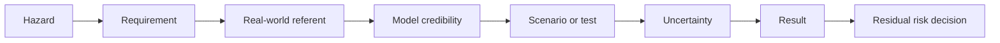

If that chain cannot be shown on one slice before the prototype arrives, scaling the number of simulated scenarios will scale the amount of questionable evidence rather than the amount of assurance. This is an inference from the NASA and ASME principles [4, 5].

#### 3. What teams usually forget

- **Supplier data and cooperation.** This is one of the highest-risk omissions. The virtual environment may need sensor timing and detection behavior, mounting tolerances, controller latency, vehicle-state signals, brake-command interfaces, brake dynamics and fault responses, firmware versions and possibly proprietary models. Barrick said automatic slowing and stopping required OEM cooperation and approval; NIOSH's 2022 review noted that manufacturers' research and documentation were proprietary and mostly undisclosed [22, 23]. **Independent**. Status for this project: unknown. Before the simulator architecture is frozen, each dependency should have an owner and one of three statuses: received and usable; contractually committed by a date; or unavailable, requiring an independently validated substitute. Securing these contractually now is **Expert opinion**.
- **Sensor calibration.** Mounting differs across 100+ machine models, and a virtual campaign using one nominal sensor position tests an ideal machine that does not exist in the field. The NIOSH review lists machine size, sensor mounting, detection zone, detection time and configuration and calibration as testing variables [23]. Volvo's system requires a separately fitted Radar Detect system, which implies a commissioning dependency [45]. The forgotten questions are operational: who calibrates at the factory; what happens after a sensor, cab, bumper, bracket or controller is changed; how an out-of-tolerance installation is detected; whether the function is then inhibited, degraded or merely less accurate; and what field diagnostic proves a repaired machine is back in its validated state. Dealer commissioning and calibration procedures, and quantitative dealer evidence for off-road braking systems: **not found** (AAA ADAS repair studies were not verified).
- **Data rights and security.** Rights are distinct from technical access: a supplier may provide a model or calibration dataset without granting the right to put it in a cloud simulation environment, share it with a tool vendor, retain it after the program or build derivative models. NIOSH's experience with inaccessible proprietary documentation shows this is not hypothetical [23]. The EU Data Act gives users rights to data from connected products and the Cyber Resilience Act imposes cybersecurity duties (application dates not verified; check before relying on them). The Machinery Regulation includes protection-against-corruption and safety-decision logging requirements; a consultancy summary states that self-evolving control systems must record safety-related decision data for one year [73]. **Expert opinion**. ISO 19014-4 (second edition) puts cybersecurity out of scope and points to a security standard, so it must be covered elsewhere [10]. Recording workers on sites raises GDPR and works-council issues; the EDPB video-device guidelines were not verified. The exact security and privacy obligations for site video, worker imagery, maps and customer operational data depend on jurisdiction and contract and were **not found** for this program.
- **Labeling and ground truth.** The proposal may need more ground truth than management expects: object identity and geometry, trajectories, ego pose, machine state, sensor calibration, environmental metadata, intervention timing and outcome. Real construction datasets are large: SODA has 19,846 images and MOCS 41,668 (preprint, September 2026) [41]. NIOSH says test methods for target-recognition systems remain a validation gap [23]. Labeling cost figures for this project: **not found**; a small representative annotation trial is the right way to estimate them.
- **Computing cost.** A virtual test is not a free test. The cost unit should include scene generation, sensor simulation, algorithm execution, storage, reruns, result reduction and human defect triage. Figures: **not found**. Run a benchmark before committing infrastructure.
- **Seasonal data.** A genuine calendar risk. Barrick's otherwise positive 2015 trial explicitly said snow had not been tested; NIOSH's review found winter degradation from snow and grime in camera systems [22, 23]. A team starting in October 2026 should use the coming winter deliberately; discovering in summer 2027 that a snow reference set is required would make the schedule hostage to season or to artificial facilities. The calendar argument itself is **Expert opinion**.
- **Operator acceptance.** Barrick's nuisance alarms were severe for machines routinely working in close proximity, and acceptance differed by machine and task; WorkSafe SIR 286 shows that repeated faults or ambiguous modes desensitize people and change behavior [22, 30]. NIOSH's program and survey record the same [26, 28]. For automatic braking, acceptance must be measured in shadow mode before nuisance behavior is converted into real brake interventions.
- **Dealer and service training.** Field maintenance can change the validated configuration. Barrick documented installation and hardware-location problems; WorkSafe's incident report shows the importance of mode understanding during recovery [22, 30]. The on-road phantom-braking experience shows dealers failing to reproduce complaints (Honda, 2025) [59]. **Independent (on-road evidence)**. Evidence quantifying dealer-training needs for automatic collision braking on construction or mining machines: **not found**. That absence calls for a service-readiness workstream, not an assumption that existing training is adequate.
- **Legal sign-off.** Review at the end is too late because the evidence architecture itself has legal implications: supplier rights, OEM authorization, warnings and instructions, product claims, conformity strategy and evidence retention. PLD disclosure, Machinery Regulation conformity from 20 January 2027 and the AI Act if applicable are the headline items [82, 71, 86]. A universal rule defining how much simulation a manufacturer may use in place of physical testing for this function: **not found**.

#### 4. Assumptions in the brief that may be wrong

- **"The three to four years were caused by test volume."** Unproven. No published account of why off-road collision-system development took that long was found (**not found**), and the brief offers no root-cause decomposition of where the calendar time went. The South African program shows other causes: Regulation 8.10 was suspended in 2015 for non-availability of technology, and the Minerals Council's Northern Cape case study says the regulation "simply stated what must be done, but not how"; the Council funded a multi-million-rand project to produce a single set of requirements, published January 2022 [93, 94]. **Expert opinion** (industry body). Barrick's multi-year program lists technology immaturity, detection failures, installation and vibration problems, nuisance alarms, supplier development, operator acceptance, equipment-specific configuration, seasonal gaps and uncertainty about large-scale deployment [22]. **Independent**. Requirements definition and field tuning, not test count, may be the real bottleneck. Before claiming a tenfold schedule reduction, reconstruct where the prior time actually went.
- **"Matching the old warning system is the right target."** Probably not. A warning-only awareness system and a motion-affecting safety-control system sit on opposite sides of the ISO 19014-2 scope boundary [8]. The FMVSS 127 dispute shows how hard braking-performance and false-activation requirements are even on-road: in June 2024 the Alliance for Automotive Innovation called the rule "practically impossible with available technology"; NHTSA answered petitions for reconsideration on 26 November 2024 and delayed the effective date in January 2025; on 23 March 2026 the Department of Transportation said it was preparing a rulemaking to amend the rule, reportedly including a two-year compliance extension [65, 66, 67]. **Independent (on-road evidence)**; **Expert opinion (on-road evidence)** for the law-firm summary. The new target should come from hazard analysis of the braking function, including hazards of incorrect intervention.
- **"The operator does not react, so braking is the obvious next layer."** Design choices about when to intervene are safety-critical, and the premise underweights human-automation interaction. The NTSB found that Uber's one-second action suppression held back planned braking: the system recognised the emergency 1.2 seconds before impact and braking began 0.2 seconds before impact [61, 62, 64]. **Independent (on-road evidence)**. ISO 21815-3:2023 still characterizes the collision system as operator assistance and states that responsibility for safe operation remains with the operator [17]. Off-road incidents show mode knowledge, desensitization and site procedures as causal factors [30]. The Boeing 737 MAX findings on response-time assumptions were not verified. The human-machine strategy needs validation alongside stopping performance.
- **"Most physical tests are replaceable."** Not established. The heavy-truck AEB program used physical track testing to validate the virtual system; NASA and ASME require real-world validation [6, 4, 5]. The replaceable fraction must be an output of the credibility work, not an input assumption.
- **"A larger virtual test count means stronger safety evidence."** Not by itself. NIOSH still identifies gaps in false-positive methodology, simulation procedures and environmental validation; NASA and ASME focus on model credibility and uncertainty rather than run count [23, 4, 5]. Ten million executions of the wrong model are not stronger evidence than a small number of well-correlated tests.
- **"Machine models differ primarily by geometry and sensor position."** The evidence suggests more parameters matter: braking performance, installation, sensor mounting, vibration, equipment type and task [14, 22]. Whether the product range reduces to a small number of validated parameterized families is a key experiment, not a fact.
- **"Weather can simply be generated virtually."** Synthetic weather is useful, but the sensor model must be anchored to measured weather-affected sensor behavior; the on-road controlled studies show different modalities react differently, and off-road experience documents winter and nuisance effects [36, 37, 22, 23].
- **"Prototype sensors equal current warning sensors."** Unknown. If they differ, existing field data cannot be reused directly. **Expert opinion**.
- **"A virtual toolchain can be built before the hardware exists" and "prototype arrival begins validation".** The toolchain can only be built generically; correlation needs the real sensor and machine (**Expert opinion**). Integrated product validation begins at prototype arrival; the validation program cannot. Standards selection, hazards, scenario taxonomy, simulation credibility, supplier contracts, real-world reference collection, seasonal data, test infrastructure and reviewer agreement must precede the prototype if four months is to have any chance. This is an inference from the verification and validation lifecycle and the standards transition [4, 7].
- **"100+ site types must all be covered at launch."** The precedents (Volvo, Komatsu, Caterpillar) all launched narrower [42, 47, 51]. "Validated across 100+ site types" is not meaningful until the organization defines whether these are individually validated sites, parameterized environment classes or customer configurations inside a validated envelope.
- **"All collision motions can be treated as one function."** Questionable for machines that swing or rotate. ISO 21815-3:2023 covers avoidance through speed reduction, stopping or motion inhibition for forward and reverse motion [17]. ISO 21815-4 (first edition, under publication October 2026) covers swing and rotation but expressly does not cover avoidance through automatic braking during rotation; it addresses motion inhibition before rotational motion in defined cases [18]. ISO/PRF 21815-5 (other forms of motion) is at proof stage (50.20 since 9 September 2026), with publication expected in November 2026 [19]. **Independent**. The product's motion scope must be defined machine by machine.

#### 5. Evidence each reviewer needs

The full evidence list is given in its own section, "Evidence that would satisfy each reviewer", below. Two cross-cutting rules apply to all seven. First, every reviewer should see a one-page credibility map showing every safety claim, whether its evidence is virtual, physical or mixed, what real-world data validated the simulation model behind it, the uncertainty remaining and who has authority to accept that residual uncertainty; this applies the NASA and ASME credibility principles to the program [4, 5]. Second, no reviewer should be asked to approve "virtual testing" as a category. They should approve specific substitutions, of the form "within this machine, sensor, configuration and environment envelope, this validated model may replace this defined repetitive physical test, while these boundary tests remain physical". That prevents a broad management commitment from outrunning the evidence.

#### 6. Cheapest early experiments

The cheapest useful experiments try to falsify the proposal before major infrastructure is built. None needs the full new system; several can start in October 2026 using existing warning-system data, historical tests, supplier discussions and one representative machine.

| Early experiment | What it tests | Useful artifact | Stop or escalation signal |
|---|---|---|---|
| Supplier data-room drill | Whether the simulation can obtain sensor interfaces and models, timings, brake and controller data, fault behavior, calibration tolerances and legal usage rights; Barrick and NIOSH show the dependency is real [22, 23] | Red, amber, green matrix of every required supplier artifact with owner, contractual right and delivery date | Critical fields are undecided, unavailable, unusable in the chosen environment or need unresolved OEM approval |
| Single "golden thread" credibility slice | Whether one safety requirement can be carried from real test to model to virtual result to residual-risk decision | One fully traceable requirement, referent, model, test, result package | The team cannot agree on the referent, pass criterion, uncertainty or owner of sign-off |
| Credibility-framework dry run | What a two-page credibility plan written to EU 2022/1426 Annex III Part 4 reveals as missing [1] | Gap list against the framework | Large categories of evidence have no plan or owner |
| Open-loop replay of existing warning-system logs | How often a candidate braking logic would have braked, and in what context; a cheap estimate of the false-activation rate and of whether current logs can be reproduced in software-in-the-loop before new hardware exists | Real versus replayed timing, detections, time-to-collision metrics and discrepancies; event counts by context | Large unexplained discrepancies, or insufficient log fidelity or metadata (a published off-road shadow-mode protocol was **not found**) |
| One machine, one scenario, physical versus virtual correlation | Whether the basic machine, brake and sensor chain is credible; the 2016 heavy-truck program used this style of benchmarking **(on-road evidence)** [6] | Residual plots and an uncertainty budget rather than a "looks close" judgment | Errors are systematic, sensitive to hidden tuning, or larger than the margin the safety conclusion needs |
| Sensor-model correlation pilot | One sensor, one machine, one dust or fog condition, recorded for real and reproduced in simulation; compare detection outcomes, not just images, against pre-registered metrics [32] | Pass or fail record against the pre-registered metrics | The simulator shows clean detections where the real sensor degrades, or vice versa |
| Weather falsification test | Whether rain, fog, dust, night and glare simulation reproduces measured sensor degradation rather than scene appearance [36, 37] | Side-by-side distributions from real and simulated sensor outputs | Divergent degradation behavior between real and simulated sensors |
| Physical stopping-distance matrix | Two machine families across three surfaces and grades, to bound the vehicle-dynamics model [14] | Measured stopping distances and residuals against the dynamics model | Residuals exceed the margin needed for the braking requirement |
| Calibration perturbation test | Whether modest mounting or calibration changes materially move perception or brake-trigger behavior [23] | Sensitivity map linking calibration variables to safety metrics | Required tolerances are tighter than production and service processes can hold |
| Machine-variant portability test | Whether moving to a second, substantially different model is parameterization or redevelopment | Time, effort and physical residuals for the second configuration | Extensive bespoke tuning is required and reuse is low |
| Shadow-mode intervention study | Whether the braking logic would have generated nuisance interventions during real work, without applying brakes; Barrick's nuisance history makes this high value [22] | Event clips and logs classified by operators and safety engineers as correct, unnecessary, ambiguous or unsafe | Frequent events that experienced operators consider operationally unacceptable |
| Winter 2026 to 2027 data capture and seasonal inventory | Whether the needed real reference data exists before the season passes; capture with a sensor kit representative of the prototype (**Expert opinion** on the calendar) | Coverage matrix by weather, light, site, machine and sensor configuration | Snow, dense dust, fog, darkness or glare have no credible referent data |
| End-to-end throughput benchmark | Whether compute, storage and human triage, not simulator execution, will be the bottleneck | Cost, wall time, storage and analyst hours for a representative batch | Triage backlog grows faster than useful evidence can be reviewed |
| Notified-body and counsel pre-consultation | Applicability of Annex I Part A of the Machinery Regulation and acceptability of simulation evidence [71, 73] | Written positions on classification and evidence | The body or counsel indicates physical confirmation the schedule has not reserved |
| Safety and legal dry run | Whether reviewers will accept virtual evidence of the proposed type | Written review comments on one representative evidence package months before launch | Reviewers say the intended virtual evidence would still require physical confirmation |
| Operator clinic | Simulated or real nuisance-stop exposure with operators, to measure acceptance thresholds [26, 28] | Measured acceptance thresholds by scenario | Thresholds are below the rate the design can deliver |

A sensible sequence requires increasingly expensive investment only after four questions are answered in order: Can we obtain the required data? Can we correlate one representative system to reality? Can we transfer that credibility to a second, materially different configuration? Will the safety and legal reviewers accept the resulting evidence? Failure at any gate is more informative now than after a full simulation platform has been built.

#### 7. Responsible fallback options

If the full proposal cannot be delivered responsibly, the fallbacks should preserve safety rather than the headline schedule.

- **Restricted operating envelope for the first release.** Release automatic braking only for machine families, motions, conditions and sites where the safety case is closed, for example reverse only, a speed band, named models. This is the pattern of Volvo CE (reverse, 3 to 15 km/h, selected models) and Komatsu (PC200-11 first, low speed) [42, 46, 47]. Outside the envelope, retain the warning-only behavior. ISO 21815 itself distinguishes forward and reverse from swing and rotation scopes, which supports explicit functional boundaries [17, 18]. **Vendor** for the precedents; **Independent** for the standards.
- **Motion inhibit at start-up before full dynamic braking.** Caterpillar inhibits reverse engagement when the machine has been stationary at least 15 seconds and an object is in the critical zone; this is a lower-hazard intervention [54, 55]. **Vendor**.
- **Warning plus a brief brake pulse as an alert.** Volvo's 2 to 3 second braking explicitly "alerts the operator to intervene" [42]. **Vendor**.
- **Ship with shadow-mode logging enabled and expand the envelope by update as evidence accrues.** Record when the algorithm would have braked without actuating. Komatsu offered a software update to retrofit existing KomVision machines [47]. Barrick's phased approach similarly observed events and operator feedback before stronger intervention [22]. Under the PLD, updates within the manufacturer's control remain within liability [82].
- **Use virtual testing primarily for regression and prioritization.** Even if it cannot replace most final physical evidence by mid-2027, it can improve defect discovery, scenario exploration and selection of the most informative physical tests; the NASA and ASME practice and the heavy-truck program support this hybrid role [4, 5, 6].
- **Pilot selected sites under explicit operational controls.** Choose sites with strong data, trained staff, controlled change management and rapid engineering support rather than claiming immediate coverage of every site type; the WorkSafe incidents show why site configuration and mode and recovery processes deserve this treatment [29, 30].
- **Retain physical testing for the weak-model regions.** Likely candidates are poor sensor-environment correlation, highly variable machine dynamics, significant configuration changes and high consequences of an incorrect brake. Which regions these are must be determined empirically; the brief does not support naming a fraction.
- **Split the release by machine family.** A family with demonstrated sensor and dynamics portability need not wait for a family whose models failed correlation; conversely, one family's success must not imply coverage of the rest.
- **Do not integrate an inadequately defined third-party braking interface to hold the date.** Barrick's program warned about OEM cooperation and unintended consequences at exactly this interface [22].
- **Use the southern-hemisphere winter in mid-2027 for cold-weather testing.** **Expert opinion**.
- **Delay the full scope rather than claim a virtual equivalence that cannot be defended.** If the safety case is incomplete, delaying the brake-control feature while retaining the validated warning function is more responsible than converting unresolved uncertainty into operator exposure. The four-month target should be a business objective, not a pass criterion.

### Failure-mode table

Seriousness is the research's qualitative rating, not a published figure. "Critical" means the failure would by itself defeat the proposal's central claim or create a new hazard; "High" means it would force a major scope or schedule change; "Medium" means it is recoverable with cost.

| What fails | Early warning sign | How to reduce the risk | How serious |
|---|---|---|---|
| Simulation toolchain never becomes credible enough to support release claims; NASA and ASME require validation against the real application [4, 5] | Huge virtual test counts without simulator-to-real residuals, uncertainty or an approved validity envelope; no correlation metrics by the first quarter of 2027; per-scene tuning | Credibility plan in the style of EU 2022/1426 Annex III [1]; named referent tests and acceptance criteria defined now; independent review; expansion gated on measured agreement | Critical |
| Synthetic sensors reproduce appearance but not sensor physics in dust, fog, snow, rain, glare and darkness [23, 32, 36, 37] | Good virtual metrics but field failures clustered by condition, range or incidence angle; no chamber data | Validate raw and low-level simulated sensor outputs against real data before using them for safety claims; chamber plus field correlation; condition-binned metrics | Critical |
| False braking on grades, with loads, at trailers and stockpiles; new hazards from the intervention itself [50] | Shadow-mode nuisance events; operator complaints and off-switch requests | Intervention hazard analysis with false-activation hazards rated separately; site modes; restricted envelope | Critical |
| Missed detection in real conditions | Real-set recall below target in specific condition bins | Real validation sets; envelope exclusions for unproven conditions | Critical |
| Braking and vehicle dynamics do not generalize across machine families [14, 22] | Repeated model retuning after every physical test; errors correlate with machine, load, grade or configuration | Parameterized machine families with physical anchor points for each materially different dynamics architecture; keep physical brake testing | Critical |
| The four-month window is consumed by requirements debate; ISO 19014 changes in October 2026 [7, 8, 10, 12] | Hazard analysis, performance-level allocation, pass or fail metrics or standard edition still undecided in 2027 | Freeze the safety and conformity evidence plan before prototype arrival, with controlled requirement change | Critical |
| Supplier data arrives late or cannot legally be used [22, 23] | Interface timing, brake maps, sensor models, fault modes or licensing rights still under negotiation near prototype delivery; supplier will not release sensor model parameters | Supplier data and rights audit now; missing artifacts made contractual milestones | Critical |
| Prototype changes invalidate the pre-built simulator (inference from V&V practice) [4] | Sensor type, mounting, controller timing, CAN or J1939 interface, brake controller or algorithm interfaces change in 2027 without impact analysis | Freeze sensors early; configuration traceability; automated model-impact and regression analysis; reserved physical re-correlation tests after changes | Critical |
| The function is overfitted to the simulator (inference; off-road case **not found**) | Virtual metrics improve while held-out real performance stalls or worsens | Independent withheld physical datasets; blind correlation tests; no tuning on final validation sets | Critical |
| Recovery and degraded modes are unsafe even when nominal avoidance works [30] | Test plans lack communications-loss, sensor-blocked, restart, service and recovery cases | Validate degraded modes, annunciation, recovery procedures and human understanding explicitly | Critical |
| Virtual evidence is rejected late by safety, legal, customers or conformity reviewers; no universal legal acceptance rule found | Reviewers first see the credibility argument near launch and ask for physical evidence the schedule cannot provide | Have safety, legal and conformity reviewers approve the evidence taxonomy and substitution rules before the main campaign | Critical |
| Scenario coverage becomes an unmanageable combinatorial list [23] | Coverage reported as "scenarios run" with no risk taxonomy or parameter boundaries | Hazard-driven scenario classes, equivalence classes, boundary analysis and uncertainty sampling; accident data for prioritization | High |
| Nuisance interventions destroy operator trust or create workarounds [22, 26, 27] | Operators ask to disable the feature, override it repeatedly, change work practices to avoid triggers, or report unpredictable stops | Shadow-mode studies; classify false interventions by operational consequence; make operator and site acceptance a release criterion; acceptance clinics; training | High |
| Seasonal evidence cannot be obtained when needed [22, 23] | Little or no representative snow, fog, extreme dust, glare or darkness data by early 2027; chamber slots not booked | Inventory data now; capture winter 2026 to 2027; southern-hemisphere tests (**Expert opinion**); chambers and synthetic variation as supplement, not replacement | High |
| Calibration and configuration variance is ignored [23] | Tests use nominal extrinsics only; field machines have undocumented alignments, repair histories or sensor replacements | Define allowable calibration tolerances and deliberately perturb them in virtual and physical validation | High |
| Notified body or regulatory rejection; ML component unaddressed [71, 73, 75] | No pre-consultation by early 2027; no position on Annex I Part A | Early notified-body engagement; option of a non-ML safety channel | High |
| Liability exposure on disclosure [82, 85] | Gaps in data retention and version control; counsel unwilling to sign off | Litigation-ready safety case; retention policy; enforced and logged operating envelope | High |
| Compute and defect triage become the bottleneck (**not found** for this program) | Simulations queue faster than humans can diagnose failures; reruns and retention dominate cost | Benchmark end-to-end throughput including triage before scaling infrastructure | High |
| Tool and version drift make evidence irreproducible (off-road case **not found**) [4] | A test cannot be recreated because simulator, map, sensor model, scenario generator or algorithm versions are unknown | Immutable run manifests; versioned assets; checksums and provenance; controlled releases; archival of critical evidence | High |
| The site changes faster than the validation assumptions [29] | Site maps, routes, exclusion zones or traffic rules change without triggering revalidation | Treat site configuration as safety-relevant configuration with change control and regression requirements | High |
| Schedule overrun | Milestone slips during the toolchain build; scope creep to all models | Parallel restricted-scope plan; stage gates | High |
| Interoperability with site collision systems and radar interference [16, 90, 62] | Unknown site systems; radio-frequency conflicts between radars from different makers | ISO/TS 21815-2 interface tests; radio-frequency coexistence tests | Medium to High |
| Dealer calibration and service errors [59] | Unreproducible complaints; "normal operation" answers to customers | Commissioning procedure; dealer training; diagnostics that prove return to validated state | Medium |
| Cost overrun (compute, labeling, licenses) | Unbudgeted cloud, labeling or license invoices | Bottom-up estimates after the pilots | Medium |

### Evidence that would satisfy each reviewer

The pass or fail criteria must be derived from the safety requirements and agreed before the main campaign; the items below are the minimum evidence package each reviewer would expect, not numerical thresholds.

- **Functional safety engineer:** an approved hazard and risk analysis and machine control system safety analysis; allocated required and achieved machine performance levels; treatment of both missed and unintended braking; safety architecture; diagnostic and degraded-state requirements; software and communication safety evidence; environmental qualification; a tool classification and qualification for evidence-carrying simulators; complete traceability from each safety requirement to the test environment used (simulation, hardware-in-the-loop, machine); fault-injection results; identified residual risks; independent safety approval. All mapped to the October 2026 editions of ISO 19014 [7, 8, 9, 10, 12].
- **Perception engineer:** raw real sensor datasets representative of each material sensor and mounting family; ground-truth uncertainty and synchronization characterization; detection and false-positive rates on real data per condition bin (dust levels, fog, rain, snow, dusk, darkness, glare, contamination) with confidence intervals; calibration-tolerance analysis across mounting positions; withheld validation data; simulator-versus-real comparisons at sensor and perception-output level for each sensor model; documented false-positive, false-negative and boundary behavior [23].
- **Simulation specialist:** a verification report; a documented credibility assessment that defines the validity envelope; validation against independent, held-out physical referents; uncertainty and sensitivity analysis; configuration and provenance control; repeatability and reproducibility evidence; model-change revalidation rules; proof that results are not dominated by model uncertainty; an explicit list of unsupported claims [1, 4, 5].
- **Veteran field test engineer:** instrumented correlation runs on representative machine families; physical stopping-distance tests on representative surfaces and grades; dynamic approach tests; stockpile, trailer and close-loading scenarios; measured brake and sensor behavior rather than nominal inputs; evidence for payload, grade, surface and configuration effects; field-expert scenario review; a list of phenomena excluded from the simulation; physical confirmation of the highest-risk cases; a shadow-mode record from real sites [14, 22, 25].
- **Product liability lawyer:** jurisdiction-specific compliance analysis; documented applicable standards and editions; supplier and OEM authorizations; a litigation-ready safety case with a defensible rationale for every virtual substitution; auditable evidence provenance and a data-retention policy; technically enforced and logged operating envelope with retained event data; review of product claims, instructions, warnings and the operator manual; a state-of-the-art comparison against competitors' systems (Volvo, Caterpillar, Komatsu); notified-body or legal opinion on Machinery Regulation and AI Act applicability; independent safety sign-off; a documented launch decision and unresolved-risk disposition [82, 71, 86, 68].
- **Site operations manager:** shadow-mode field results with false and correct intervention cases reviewed with operators; a measured nuisance-stop rate per operating hour from pilots; effects on traffic flow and work tasks; clear operating, degraded and recovery modes; site-mode and deactivation rules; a controlled mixed-traffic pilot; an interoperability demonstration with existing site collision systems; a site change-management process; training and competence evidence; site-specific boundaries and override policy [16, 22, 26, 30].
- **Finance executive:** stage-gate results from the early experiments; demonstrated model reuse across machine families; measured build and maintenance cost; end-to-end virtual-test throughput and triage labor; supplier, data and license costs; compute and storage cost; bottom-up costs for labeling, chambers and notified-body fees; physical-test categories actually approved for retirement; cost and schedule impact under pessimistic correlation results; a costed fallback; staged investment gates [22].
- **All seven reviewers:** the one-page credibility map described in question 5, and approval of specific substitutions rather than of "virtual testing" as a category [4, 5].

### Where the evidence stands

#### Well established

- Regulators and standards bodies that accept simulation treat validating the toolchain as a prerequisite with a defined envelope, and the EU automated-driving regime states that simulation is not a substitute for its physical tests. **Independent (on-road evidence)** for the regulation; **Independent** for NASA and ASME [1, 2, 3, 4, 5].
- ISO 19014-2 excludes awareness systems that do not affect motion; the braking function therefore falls under a different part of the standard than the warning system. **Independent (under publication)** [8].
- The ISO 19014 series (Parts 1 to 5) and ISO 21815-4 are being issued in new editions in October 2026, according to the ISO catalogue (October 2026). **Independent (under publication)** [7, 8, 9, 10, 12, 18].
- Every documented off-road intervention launch (Volvo CE, Komatsu, Caterpillar) was narrow in direction, speed, model or trigger, and the vendors themselves document conditions under which the function should be switched off. **Vendor** [42, 47, 50, 51].
- False automatic braking is a documented hazard on-road, investigated by NHTSA for Tesla (Preliminary Evaluation PE22-002, opened 16 February 2022 over about 416,000 vehicles and 354 complaints; closed 29 June 2026 with a population of 695,000 vehicles, about 25,900 incident reports and no crashes, injuries or defect finding; see Chapter 2), Honda (engineering analyses 2024 and 2025) and Nissan (2019). **Independent (on-road evidence)** [57, 58, 59, 60].
- Nuisance alarms are the documented primary reason proximity systems fail in the field, and operators disable or circumvent them. **Independent** [26, 28, 22]; **Vendor** for the patent [27].
- Supplier cooperation and proprietary documentation are documented obstacles for off-road collision systems. **Independent** [22, 23].
- Regulation (EU) 2023/1230 applies from 20 January 2027; Directive (EU) 2024/2853 applies to products placed on the market after 9 December 2026; the AI Omnibus entered into force on 27 July 2026 and moved Annex I high-risk obligations to 2 August 2028 and Annex III obligations to 2 December 2027. **Independent** [71, 82, 86].
- South Africa's Regulation 8.10 mandates automatic slowing and braking on trackless mobile machines, was suspended in 2015 for lack of technology and commenced on 21 December 2022. **Independent** for the regulation; **Expert opinion** for the commentary [90, 91].

#### Uncertain

- Why the past three to four years were needed. No published account exists; the hypotheses (requirements definition, field tuning, technology immaturity, supplier development) rest on analogous programs, not on this organization's history [22, 93].
- Whether the Machinery Regulation's notified-body route (Annex I Part A) applies to a frozen, non-learning ML perception component. Vendor and consultant summaries argue it does; notified-body positions were **not found** [73, 75, 76].
- Whether any notified body or regulator will accept simulation evidence for machinery conformity: **not found**.
- Terramechanics and vehicle-ground interaction fidelity for braking prediction: **not found**.
- Compute, labeling, licensing, chamber and notified-body costs: **not found**.
- Whether ISO 19014-4 requires tool qualification, and whether ISO 16001, ISO 21815-1 or ISO 21815-3 test procedures accept simulation evidence: **not found** [10, 20, 15, 17].
- Admissibility of simulation-based expert evidence for machinery (Daubert and equivalents): **not found**.
- Application dates of the EU Data Act and Cyber Resilience Act, EDPB video guidance, IEC 61508 tool classes, ISO 26262-8, ISO 3450 details beyond its scope, ISO 10265, ISO 13849, ISO 25119, ISO 18497, ISO/IEC TR 5469, Flyvbjerg's reference-class forecasting, NASA defect-cost escalation, Boeing 737 MAX and JATR findings, Cruise 2023, RAND 2016, PEGASUS and VVM, Fortescue, Rio Tinto and BHP autonomous haulage incidents, EMESRT, ICMM, DARPA RACER and Project Chrono: all named as relevant leads but not verified in this research.
- The original issue dates of WorkSafe WA Significant Incident Reports 226 and 286. The web pages carry March 2025 dates; the research dated the SIR 226 incident to August 2015, and the page text does not state an incident date [29, 30].

#### Where experts disagree

- **Benavides v. Tesla award.** One source title gives $242 million and another $243 million. The award combined $200 million in punitive damages with Tesla's one-third share of the compensatory damages, so both figures are roundings of the same total [68, 69].

### Blind spots

Important issues that the seven questions did not ask about, grouped by theme.

**Regulatory classification and standards**

- **ML perception and the notified-body route.** Annex I Part A items 5 and 6 of Regulation 2023/1230 require notified-body involvement for safety components and machinery with "fully or partially self-evolving behaviour using machine learning"; whether a frozen, non-learning model counts is contested. One vendor blog argues it does; notified-body positions were **not found**. TÜV SÜD announced in September 2024 that it had become the first notified body under the regulation, so the route exists but is untested for this case. A non-ML safety channel (for example radar-only braking with ML used for warnings only) could change the route [74, 75, 76].
- **Harmonised standards gap.** No standards had been cited under 2023/1230 according to secondary sources; the standardisation request M/605 was adopted on 20 January 2025; FprEN ISO 19014-1 is linked to the regulation with planned publication on 22 November 2026. Without cited standards the presumption of conformity is weaker [77, 78, 79, 81]. **Expert opinion**; **Independent** for the catalogue listing.
- **Standards-transition management.** As of October 2026, ISO 19014 Parts 1 to 5 and ISO 21815-4 are at or near publication in new editions. The program needs a formally agreed standards baseline and a process for evaluating changes rather than discovering them at sign-off [7, 8, 9, 10, 12, 18].
- **AI Act timing.** The deferral to 2 August 2028 for high-risk AI embedded in machinery is a deferral, not an exemption; products sold from 2028 will need AI Act conformity if the component qualifies [86, 87, 88, 89].
- **US mining regulation is not a guide to feasibility.** MSHA required proximity detection on continuous mining machines (final rule 15 January 2015; all place-change machines by 16 March 2018); its 2015 proposal for mobile haulage machines saw no further action after the comment period reopened in January 2017, and industry commenters said the technology was unproven on mobile equipment [95, 96, 97]. MSHA's Safety Program for Surface Mobile Equipment rule (final rule 20 December 2023; effective 19 January 2024; compliance 17 July 2024) requires operators to evaluate emerging technologies; its status after 2024 was not verified [98, 99, 100]. **Independent**; **Expert opinion** for the law-firm and industry comments.
- **Physical test standards for object detection.** ISO 16001:2017 specifies test procedures with a physical "test body"; ISO 21815-1:2022 includes test procedures; ISO 21815-3:2023 defines risk areas for forward and reverse motion; Parts 4 and 5 cover swing and other motions; ISO 17757:2019 (confirmed 2024) covers autonomous machine system safety. Whether any accept simulation evidence: **not found** [20, 15, 17, 18, 19, 21].
- **Attachments, working tools and motion scope.** ISO 21815-3 does not consider machine height beyond its travel configuration, and ISO 21815-4 has explicit limitations on object height and working tools and does not cover automatic braking during swing or rotation. Any product claim broader than these assumptions needs its own safety argument [17, 18].

**Technical validation**

- **Ground-truth system validation.** The reference instruments used to declare the simulator correct need their own calibration, timing and uncertainty treatment; a timing offset between sensors, ground truth and brake signals can masquerade as a perception or simulation error. Controlled perception research synchronizes and calibrates reference systems for this reason. **Independent (on-road evidence)** [37].
- **Common-cause errors between product and test environment.** If both use the same map assumptions, geometry source, target model or physics simplification, a virtual test reproduces the same error twice. An off-road accident attributed to such a common-mode error was **not found**; independent real referents are the defense.
- **The test oracle.** The program must define not only "collision or no collision" but what counts as a correct intervention, too-early intervention, insufficient intervention, unnecessary intervention and safe operator override. NIOSH's call for standardized false-positive and false-negative tests shows this is still an open validation problem [23].
- **Degraded and recovery states.** Dirty, blocked or misaligned sensors, lost communications, stale vehicle-state data, controller resets, service modes and restart behavior may be more dangerous than nominal operation; WorkSafe SIR 286 is the direct warning [30].
- **Post-release software and model updates.** If perception or brake logic changes after launch, a defined regression and revalidation rule is needed, or the 2027 evidence certifies a configuration that no longer exists. NASA's lifecycle treatment of model credibility supports configuration governance; an off-road update case was **not found** [4].
- **Radio-frequency coexistence.** Uber's experimental radar shared frequencies with Volvo's factory radar, one reason the factory AEB was disabled (NTSB, via a secondary summary, 2019). Multi-OEM sites face similar questions. **Independent (on-road evidence)** [62].

**Operations and people**

- **Site configuration as software-like configuration.** Roads, intersections, traffic rules, exclusion zones and work areas change; WorkSafe SIR 226 shows that a correct digital route with incorrect physical implementation or communication can still produce a collision. Site changes need configuration control and regression triggers [29].
- **Mixed fleets and following machines.** A machine braking automatically in a haul-road traffic stream creates rear-end risk. **Expert opinion**.
- **Post-service requalification.** A machine may leave the factory valid and become invalid after collision repair, sensor replacement, bracket movement or software update; a dealer-executable "return to validated configuration" procedure is needed. Published evidence for this exact system: **not found**.
- **Forensic logging.** After an unexpected intervention or collision, engineering and legal teams need synchronized information to reconstruct what the sensors saw, how the risk logic behaved, which brake command was issued and what machine state followed. A universal legal logging requirement was **not found**; the Machinery Regulation's logging provisions and the PLD's disclosure regime make it prudent regardless [73, 82].
- **Cybersecurity ownership.** ISO 19014-4 excludes cybersecurity from scope; functional safety cannot be treated as covering it implicitly [10].

**Organization and claims**

- **Independent challenge authority.** The team responsible for the four-month target should not be the sole authority deciding whether simulator uncertainty is acceptable. The NTSB's Uber investigation identified deficiencies in safety risk management, oversight and safety culture, not merely an algorithm error. **Independent (on-road evidence)** [61].
- **The release claim itself.** "Validated across 100+ site types" has no meaning until the organization defines what a site type is in evidence terms; the commercial and safety claim should follow the demonstrated evidence, not precede it.
- **Unverified leads worth checking before the real review.** Autonomous haulage incidents at Fortescue, Rio Tinto and BHP; EMESRT Level 9 controls; ICMM ICSV; DARPA RACER; Cruise 2023; Boeing JATR; RAND 2016; PEGASUS and VVM. None was verified in this research.

**Scope and limits of the review**

- The seven reviewers considered here do not include a cybersecurity specialist, a human-factors specialist or the customer's safety regulator (a mine inspectorate or labor authority). Each would raise objections the chapter only touches indirectly: ISO 19014-4's cybersecurity exclusion, the mode-confusion findings of WorkSafe SIR 286, and South Africa's "fail to safe" requirement.
- The research found no published false-activation rate for an off-road automatic braking system. The acceptance threshold that the site manager and the safety engineer both need therefore has no published anchor; it will have to come from the organization's own shadow-mode data and from the vendors' documented switch-off conditions.
- The research treated the EU as the reference legal regime because its dates are published. The brief does not state target markets; if the main markets are outside the EU (for example North America, Australia or South Africa), the Machinery Regulation and PLD analysis is background and the MSHA, WorkSafe WA and South African Regulation 8.10 material becomes the primary legal context.
- The only documented account of how long off-road collision programs take and why (Barrick, 2011 to 2015) concerns a mine operator retrofitting third-party systems, not a manufacturer validating a factory function. The brief's own three-to-four-year history is internal to the organization and was not available to the research; reconstructing it from internal records is the single cheapest check on the schedule argument.

### Sources

1. European Commission. Commission Implementing Regulation (EU) 2022/1426 laying down rules for the application of Regulation (EU) 2019/2144 as regards uniform procedures and technical specifications for the type-approval of the automated driving system of fully automated vehicles (Annex III, Part 4, credibility assessment of virtual toolchains). EUR-Lex. 5 August 2022, consolidated 24 March 2026. https://eur-lex.europa.eu/eli/reg_impl/2022/1426/oj/eng. **Independent (on-road evidence)**.
2. UNECE GRVA, submitted by the expert from OPIs. GRVA-WS06-03, 6th GRVA workshop on automated driving systems (credibility framework for the draft UN GTR). UNECE. 25 to 26 March 2025. https://unece.org/sites/default/files/2025-03/GRVA-WS06-03e_0.pdf. **Independent (on-road evidence)**.
3. UNECE GRVA, submitted by the expert from OPIs. GRVA-WS08-03, 8th GRVA workshop on automated driving systems. UNECE. June 2025. https://unece.org/sites/default/files/2025-06/GRVA-WS08-03e.pdf. **Independent (on-road evidence)**.
4. NASA. NASA-STD-7009B, Standard for Models and Simulations. NASA Technical Standards. 5 March 2024. https://standards.nasa.gov/standard/NASA/NASA-STD-7009. **Independent**.
5. ASME. Verification, Validation and Uncertainty Quantification (VVUQ) standards resources. ASME Codes and Standards. Undated, accessed October 2026. https://www.asme.org/codes-standards/publications-information/verification-validation-uncertainty. **Independent**.
6. Salaani, M. K., et al. Heavy Vehicle Hardware-in-the-Loop Automatic Emergency Braking Simulation with Experimental Validation. SAE Technical Paper 2016-01-8010. 27 September 2016. https://saemobilus.sae.org/articles/heavy-vehicle-hardware-loop-automatic-emergency-braking-simulation-experimental-validation-2016-01-8010. **Independent (on-road evidence)**.
7. ISO. ISO 19014-1, Earth-moving machinery, Functional safety, Part 1: Methodology to determine safety-related parts of the control system and performance requirements. Edition 2 (FDIS registered 5 February 2026; stage 60.00 reached 22 August 2026). ISO. Publication October 2026. https://www.iso.org/standard/87988.html. **Independent (under publication)**.
8. ISO. ISO 19014-2, Earth-moving machinery, Functional safety, Part 2: Design and evaluation of hardware and architecture requirements for safety-related parts of the control system. Edition 2. ISO. Publication October 2026. https://www.iso.org/standard/87718.html. **Independent (under publication)**.
9. ISO. ISO 19014-3, Earth-moving machinery, Functional safety, Part 3: Environmental performance and test requirements of electronic and electrical components used in safety-related parts of the control system. Edition 2. ISO. Publication October 2026. https://www.iso.org/standard/88622.html. **Independent (under publication)**.
10. ISO. ISO 19014-4, Earth-moving machinery, Functional safety, Part 4: Design and evaluation of software and data transmission for safety-related parts of the control system. Edition 2 (cybersecurity out of scope). ISO. Publication October 2026. https://www.iso.org/standard/87720.html. **Independent (under publication)**.
11. ISO. ISO 19014-4:2020, Earth-moving machinery, Functional safety, Part 4 (first edition, with normative Annex B, Software validation test environments). ISO. 2020. https://www.iso.org/standard/70718.html. **Independent**.
12. ISO. ISO 19014-5, Earth-moving machinery, Functional safety, Part 5: Tables of performance levels. Edition 1, replacing ISO/TS 19014-5:2021. ISO. Publication October 2026. https://www.iso.org/standard/87719.html. **Independent (under publication)**.
13. ISO. ISO/TS 19014-5:2021, Earth-moving machinery, Functional safety, Part 5: Tables of performance levels. ISO. 2021. https://www.iso.org/standard/80996.html. **Independent**.
14. ISO. ISO 3450:2011, Earth-moving machinery, Wheeled or high-speed rubber-tracked machines, Performance requirements and test procedures for brake systems. ISO. November 2011, reconfirmed September 2022. https://www.iso.org/standard/42076.html. **Independent**.
15. ISO. ISO 21815-1:2022, Earth-moving machinery, Collision warning and avoidance, Part 1: General requirements. ISO. 2022. https://www.iso.org/standard/77302.html. **Independent**.
16. ISO. ISO/TS 21815-2:2021, Earth-moving machinery, Collision warning and avoidance, Part 2: On-board J1939 communication interface. ISO. July 2021, confirmed 2024. https://www.iso.org/standard/77303.html. **Independent**.
17. ISO. ISO 21815-3:2023, Earth-moving machinery, Collision warning and avoidance, Part 3: Risk area and risk level for forward/reverse motion. ISO. August 2023. https://www.iso.org/standard/77266.html. **Independent**.
18. ISO. ISO 21815-4, Earth-moving machinery, Collision warning and avoidance, Part 4: Risk area and risk level for swing and rotation motion. Edition 1. ISO. Publication October 2026. https://www.iso.org/standard/81597.html. **Independent (under publication)**.
19. ISO. ISO/PRF 21815-5, Earth-moving machinery, Collision warning and avoidance, Part 5: Risk area and risk level for other forms of motion. ISO. Proof stage (50.20) since 9 September 2026; publication expected November 2026; accessed October 2026. https://www.iso.org/standard/89934.html. **Independent (draft)**.
20. ISO. ISO 16001:2017, Earth-moving machinery, Object detection systems and visibility aids, Performance requirements and tests. ISO Online Browsing Platform. 2017. https://www.iso.org/obp/ui/en/#!iso:std:63688:en. **Independent**.
21. ISO. ISO 17757:2019, Earth-moving machinery and mining, Autonomous and semi-autonomous machine system safety. ISO. 2019, confirmed 2024. https://www.iso.org/standard/76126.html. **Independent**.
22. Barrick Gold Corporation. Comments on MSHA proposed rule, Proximity Detection Systems for Mobile Machines in Underground Mines (field program 2011 to 2015: 26 systems evaluated, nuisance alarms, OEM cooperation for automatic stopping). MSHA docket AB78, comment 5. 22 November 2015 (received 23 November 2015). https://arlweb.msha.gov/REGS/Comments/2015-21573/AB78-Comm-5.pdf. **Independent**.
23. NIOSH authors. Review of collision warning and avoidance system testing and validation methods (mining, construction, automotive and agriculture). SME Annual Conference, CDC Stacks. 27 February to 2 March 2022. https://stacks.cdc.gov/view/cdc/215488/cdc_215488_DS1.pdf. **Independent**.
24. NIOSH. Test Results of Collision Warning Systems for Surface Mining Dump Trucks. DHHS (NIOSH) Publication 2000-120. May 2000. https://www.cdc.gov/niosh/publications/numbered/2000-120.html. **Independent**.
25. NIOSH. HASARD (Hazardous Area Signalling and Ranging Device) proximity detection test results. CDC Mining. Undated, accessed October 2026. https://www.cdc.gov/niosh/mining/content/electricalandmachinesafety/proximity/hasard.html. **Independent**.
26. NIOSH. Mining Feature: Intelligent Proximity Detection. CDC (archived). Undated, accessed October 2026. https://archive.cdc.gov/www_cdc_gov/niosh/mining/Features/proximity.html. **Independent**.
27. US Patent 9,466,216. Proximity detection system and method and collision avoidance system and method using proximity detection (cites NIOSH RI 9672 on nuisance alarms). USPTO. Undated in retrieval, accessed October 2026. https://image-ppubs.uspto.gov/dirsearch-public/print/downloadPdf/9466216. **Vendor**.
28. NIOSH. Mineworkers' Perceptions of Mobile Proximity Detection Systems. MSHA docket AB91, comment 10, attachment 1. 2018. https://arlweb.msha.gov/REGS/Comments/2018-13603/AB91-COMM-10-1.pdf. **Independent**.
29. WorkSafe Western Australia. Mines Safety Significant Incident Report No. 226: Collision between an autonomous haul truck and manned water cart. WorkSafe WA. Page dated 11 March 2025 (incident dated by the research to August 2015). https://www.worksafe.wa.gov.au/publications/mines-safety-significant-incident-report-no-226-collision-between-autonomous-haul. **Independent**.
30. WorkSafe Western Australia. Mines Safety Significant Incident Report No. 286: Near miss following unplanned movement of autonomous haul trucks during recovery operations. WorkSafe WA. Page dated 7 March 2025. https://www.worksafe.wa.gov.au/publications/mines-safety-significant-incident-report-no-286-near-miss-following-unplanned-movement. **Independent**.
31. WorkSafe Western Australia. Safe mobile autonomous mining in Western Australia: Code of Practice. WorkSafe WA. 15 February 2025. https://www.worksafe.wa.gov.au/publications/safe-mobile-autonomous-mining-western-australia-code-practice. **Independent**.
32. Phillips, T. G., Guenther, N., and McAree, P. R. When the Dust Settles: The Four Behaviors of LiDAR in the Presence of Fine Airborne Particulates. Journal of Field Robotics. 2017. https://www.researchgate.net/publication/313582355_When_the_Dust_Settles_The_Four_Behaviors_of_LiDAR_in_the_Presence_of_Fine_Airborne_Particulates. **Independent**.
33. Design of Dust-Filtering Algorithms for LiDAR Sensors Using Intensity and Range Information in Off-Road Vehicles. Sensors (PMC). 2022. https://pmc.ncbi.nlm.nih.gov/articles/PMC9185448/. **Independent**.
34. Parsons, M., Hanafi Sheikhha, F., Seo, J., and Lee, S. RGB-LiDAR fusion for dust filtering in autonomous excavation. Automation in Construction, volume 168. December 2024. https://www.sciencedirect.com/science/article/pii/S0926580524005867. **Independent**.
35. Modelling of lidar disturbances by airborne particles. arXiv preprint 2105.04193. 2021. https://arxiv.org/pdf/2105.04193. **Independent**.
36. Empirical Analysis of Autonomous Vehicle's LiDAR Detection Performance Degradation for Actual Road Driving in Rain and Fog. Sensors (PMC). 2023. https://www.ncbi.nlm.nih.gov/pmc/articles/PMC10051412/. **Independent (on-road evidence)**.
37. Sezgin, F., et al. Safe Autonomous Driving in Adverse Weather: Sensor Evaluation and Performance Monitoring. arXiv preprint 2305.01336. 2 May 2023. https://arxiv.org/html/2305.01336v1. **Independent (on-road evidence)**.
38. Synthetic data for construction-object detection. Proceedings of the 2025 Winter Simulation Conference, paper con152. 2025. https://www.informs-sim.org/wsc25papers/con152.pdf. **Independent**.
39. Synthesizing Reality: Leveraging the Generative AI-Powered Platform Midjourney for Construction Worker Detection. arXiv preprint 2507.13221. July 2025. https://arxiv.org/pdf/2507.13221. **Independent**.
40. From Unity Simulation to Diffusion-Based Augmentation: Quantifying Dataset Balance for Robust Object Detection. arXiv preprint 2609.38010. 2026. https://arxiv.org/html/2609.38010. **Independent**.
41. ConSynth-X: A paired synthetic construction-site image dataset for robust computer vision under adverse conditions. arXiv preprint 2609.24075. September 2026. https://arxiv.org/html/2609.24075. **Independent**.
42. Volvo Construction Equipment. Volvo CE introduces Collision Mitigation System for jobsite safety. Press release. 11 January 2023. https://www.volvoce.com/global/en/news-and-events/news-and-stories/2023/volvo-ce-introduces-collision-mitigation-system-for-jobsite-safety/. **Vendor**.
43. AsphaltPro. Volvo CE introduces Collision Mitigation System for jobsite safety (slope memory, deactivation). AsphaltPro Magazine. 2023. https://theasphaltpro.com/volvo-ce-introduces-collision-mitigation-system-for-jobsite-safety/. **Vendor**.
44. International Mining. Volvo CE to improve wheel loader operator safety with Collision Mitigation System. International Mining. 11 January 2023. https://im-mining.com/2023/01/11/volvo-ce-to-improve-wheel-loader-operator-safety-with-collision-mitigation-system/. **Vendor**.
45. Mobility Engineering Technology. Volvo CE Targets Jobsite Safety with Collision Mitigation for Wheel Loaders. SAE Mobility Engineering Technology. 2023. https://www.mobilityengineeringtech.com/component/content/article/47718-sae-ma-07090. **Vendor**.
46. Underground Infrastructure. Volvo Construction Equipment introduces collision mitigation system for jobsite safety. Underground Infrastructure. January 2023. https://undergroundinfrastructure.com/news/2023/january/volvo-construction-equipment-introduces-collision-mitigation-system-for-jobsite-safety. **Vendor**.
47. Komatsu Ltd. Leading the Industry by Making the System Standard on Hydraulic Excavators: Introducing "KomVision Human Detection & Collision Mitigation System" to the Japanese Market. Press release. 30 March 2020. https://www.komatsu.jp/en/newsroom/2020/20200330. **Vendor**.
48. Komatsu Ltd. KomVision Human Detection & Collision Mitigation System on the PC200-11. Komatsu Technical Report. 2021. https://www.komatsu.jp/en/-/media/home/aboutus/innovation/technology/techreport/2021/en/174e10.pdf. **Vendor**.
49. Robotics and Automation News. Komatsu integrates automated collision avoidance system as standard in its excavators. 8 June 2020. https://roboticsandautomationnews.com/2020/06/08/komatsu-integrates-automated-collision-avoidance-system-as-standard-in-its-excavators/32880/. **Vendor**.
50. Komatsu Ltd. Enhancing safety through products and solutions (wheel loader stop-control cautions). Komatsu disclosure site. Undated, accessed October 2026. https://komatsu.disclosure.site/en/themes/171. **Vendor**.
51. Caterpillar. Collision Mitigation System for Medium Wheel Loaders. Cat Detect product page. Undated, accessed October 2026. https://www.cat.com/en_US/products/new/technology/detect/detect/128121.html. **Vendor**.
52. Caterpillar. Detect Rear Object Detection for Wheel Loaders. Cat product page. Undated, accessed October 2026. https://www.cat.com/en_GB/products/new/technology/detect/detect/104340.html. **Vendor**.
53. Pit & Quarry. Cat adds collision warning system as loader option (motion inhibit). Pit & Quarry. Undated, accessed October 2026. https://www.pitandquarry.com/cat-adds-collision-warning-system-as-loader-option/. **Vendor**.
54. Equipment World. Cat's new tech options for next-gen medium wheel loaders. Equipment World. Accessed October 2026. https://www.equipmentworld.com/home/article/15745989/cats-new-tech-options-for-nextgen-medium-wheel-loaders. **Vendor**.
55. Recycling Product News. Cat adds Collision Warning System on medium wheel loaders. Recycling Product News. Accessed October 2026. https://www.recyclingproductnews.com/article/43247/cat-boosts-safety-on-medium-wheel-loaders-with-warning-systems-and-motion-sensors. **Vendor**.
56. Hitachi Construction Machinery. Object Detect Assist for mining dump trucks. Press release. 26 September 2016. https://www.hitachicm.com/global/en/news/press-releases/2016/16-09-26/. **Vendor**.
57. NHTSA Office of Defects Investigation. ODI Resume, Preliminary Evaluation PE22-002: Tesla Model 3 and Model Y (2021 to 2022) unexpected brake activation, about 416,000 vehicles, 354 complaints. NHTSA. Opened 16 February 2022. https://static.nhtsa.gov/odi/inv/2022/INOA-PE22002-4385.PDF. **Independent (on-road evidence)**.
58. The BRAKE Report. NHTSA again queries Tesla about phantom braking. The BRAKE Report. 2022. https://thebrakereport.com/nhtsa-again-queries-tesla-about-phantom-braking/. **Independent (on-road evidence)**.
59. Carscoops. Feds escalate probe into Honda AEB system getting improperly triggered, causing crashes (Engineering Analysis EA25002, 295,125 vehicles). Carscoops. 21 January 2025. https://www.carscoops.com/2025/01/feds-escalate-probe-into-honda-aeb-system-getting-improperly-triggered-causing-crashes/. **Independent (on-road evidence)**.
60. CBS News. Automatic emergency braking in cars will be standard by 2022, but false activations still a concern (Nissan Rogue). CBS News. Undated, about 2019. https://cbsnews.com/news/automatic-emergency-braking-in-cars-will-be-standard-by-2022-but-false-activations-still-a-concern. **Independent (on-road evidence)**.
61. National Transportation Safety Board. Collision Between Vehicle Controlled by Developmental Automated Driving System and Pedestrian, Tempe, Arizona, March 18, 2018. Highway Accident Report NTSB/HAR-19/03 (HWY18MH010). 2019. https://www.ntsb.gov/investigations/accidentreports/reports/har1903.pdf. **Independent (on-road evidence)**.
62. The Low-Down (summarizing Ars Technica). The Reason Software Design Decisions Led To Uber's Fatal Driverless Car Crash (action suppression, radar frequency sharing). November 2019. https://www.thelowdownblog.com/2019/11/the-reason-software-design-decisions.html?m=1. **Independent (on-road evidence)**.
63. NPR. NTSB: Uber Self-Driving Car Had Disabled Emergency Brake System Before Fatal Crash. NPR. 24 May 2018. https://www.npr.org/sections/thetwo-way/2018/05/24/614200117/ntsb-uber-self-driving-car-had-disabled-emergency-brake-system-before-fatal-cras. **Independent (on-road evidence)**.
64. IEEE Spectrum. NTSB Investigation Into Deadly Uber Self-Driving Car Crash Reveals Lax Attitude Toward Safety. IEEE Spectrum. November 2019. https://spectrum.ieee.org/ntsb-investigation-into-deadly-uber-selfdriving-car-crash-reveals-lax-attitude-toward-safety. **Independent (on-road evidence)**.
65. NHTSA. Federal Motor Vehicle Safety Standards; Automatic Emergency Braking Systems for Light Vehicles (FMVSS 127), response to petitions for reconsideration. Federal Register. 26 November 2024. https://www.federalregister.gov/documents/2024/11/26/2024-27349/federal-motor-vehicle-safety-standards-automatic-emergency-braking-systems-for-light-vehicles. **Independent (on-road evidence)**.
66. Repairer Driven News. NHTSA delays AEB rule effective date, grants petitions for reconsideration (Auto Innovators' "practically impossible" statement, June 2024). Repairer Driven News. 27 January 2025. https://www.repairerdrivennews.com/2025/01/27/nhtsa-delays-aeb-rule-effective-date-granting-petitions-for-reconsideration/. **Independent (on-road evidence)**.
67. National Law Review. The Road Ahead for FMVSS 127: Whither the Automatic Emergency Braking Mandate? National Law Review. 4 June 2026. https://natlawreview.com/article/road-ahead-fmvss-127-whither-automatic-emergency-braking-mandate. **Expert opinion (on-road evidence)**.
68. Marquette University Law School Faculty Blog. Jury Awards $242 Million in First Verdict Against Tesla (Benavides v. Tesla). August 2025. https://law.marquette.edu/facultyblog/2025/08/jury-awards-242-million-in-first-verdict-against-tesla. **Expert opinion (on-road evidence)**.
69. Claims Journal. Judge Upholds $243M Verdict Against Tesla Over Fatal Autopilot Crash. Claims Journal. 20 February 2026. https://www.claimsjournal.com/news/national/2026/02/20/335814.htm. **Independent (on-road evidence)**.
70. Nelson Legal. Benavides v. Tesla Inc. Trial Record and Summary. Law-firm page. 2025, accessed October 2026. https://nelson.legal/benavides-v-tesla-inc-trial-record-and-summary/. **Expert opinion (on-road evidence)**.
71. European Parliament and Council. Regulation (EU) 2023/1230 on machinery (applies from 20 January 2027). EUR-Lex. 14 June 2023, Official Journal 29 June 2023. https://eur-lex.europa.eu/eli/reg/2023/1230/oj/eng. **Independent**.
72. TÜV Rheinland. New Machinery Regulation EU 2023/1230. TÜV Rheinland. Undated, accessed October 2026. https://www.tuv.com/world/en/new-machinery-regulation-eu-2023-1230.html. **Expert opinion**.
73. Vamisec. Machinery Regulation (EU) 2023/1230: summary (logging of safety decisions, notified body for ML components). Vamisec. Undated, accessed October 2026. https://vamisec.com/en/maschinenverordnung. **Expert opinion**.
74. Eurotech World. Machinery Regulation 2023/1230: What Manufacturers Must Know (Annex I Part A). Eurotech World. Undated, accessed October 2026. https://www.eurotechworld.net/resources/ce-marking-product-compliance/machinery-regulation-2023-1230-changes/. **Expert opinion**.
75. Inkog. EU Machinery Regulation 2023/1230: AI Compliance Before January 2027. Inkog Labs. Undated, accessed October 2026. https://inkog.io/labs/eu-machinery-regulation-ai-agents. **Vendor**.
76. TÜV SÜD. TÜV SÜD becomes the world's first notified body for the new Machinery Regulation. Press release. September 2024. https://www.tuvsud.com/en/newsroom/press-releases/2024/september/tuev-sued-becomes-the-worlds-first-notified-body-for-the-new-machinery-regulation. **Vendor**.
77. GlobalNorm. Harmonized standards for the Machinery Regulation (EU) 2023/1230. GlobalNorm compliance news. Accessed October 2026. https://compliance.globalnorm.de/en/product-compliance-news/detail/harmonized-standards-for-the-machinery-regulation-eu-2023-1230/. **Expert opinion**.
78. IBF Solutions. New Machinery Regulation: Status of harmonised standards (standardisation request M/605, 20 January 2025). IBF Solutions. Accessed October 2026. https://www.ibf-solutions.com/en/seminars-and-news/news/new-machinery-regulation-status-of-harmonised-standards. **Expert opinion**.
79. iTeh Standards. FprEN ISO 19014-1, Earth-moving machinery, Functional safety, Part 1 (linked to Regulation 2023/1230; planned publication 22 November 2026). iTeh catalogue. Accessed October 2026. https://standards.iteh.ai/catalog/standards/cen/b6a52497-e060-47c7-b4de-4197b2a644cd/fpren-iso-19014-1. **Independent**.
80. iTeh Standards. prEN ISO 19014-5, Earth-moving machinery, Functional safety, Part 5: Tables of performance levels. iTeh catalogue. Accessed October 2026. https://standards.iteh.ai/catalog/standards/cen/35d59ca7-833a-4a68-862a-606d531db3a5/pren-iso-19014-5. **Independent (draft)**.
81. Accessafe. Machinery safety standards: how the system works and what changes with Regulation 2023/1230. Accessafe. Accessed October 2026. https://www.accessafe.eu/en/machinery-safety-standards/. **Expert opinion**.
82. European Parliament and Council. Directive (EU) 2024/2853 on liability for defective products (applies to products placed on the market after 9 December 2026). EUR-Lex. 18 November 2024. https://eur-lex.europa.eu/eli/dir/2024/2853/oj/eng. **Independent**.
83. Gibson Dunn. EU Product Liability Directive: Responding to Software, AI and Complex Supply Chains. Gibson Dunn client alert. Accessed October 2026. https://www.gibsondunn.com/eu-product-liability-directive-responding-to-software-ai-and-complex-supply-chains/. **Expert opinion**.
84. Dreyfus. Defective software: how does Directive (EU) 2024/2853 reshape manufacturers' product liability? Dreyfus. 25 September 2026. https://www.dreyfus.fr/en/2026/09/25/defective-software-how-does-directive-eu-2024-2853-reshape-manufacturers-product-liability/. **Expert opinion**.
85. Freshfields. The disclosure obligation under the new Product Liability Directive: balancing evidentiary hardship and the protection of corporate information. Freshfields briefing. January 2026. https://www.freshfields.com/en/our-thinking/briefings/2026/01/the-disclosure-obligation-under-the-new-product-liability-directive-balancing-evidentiary-hardship-and-the-protection-of-corporate-information. **Expert opinion**.
86. European Commission. AI Omnibus enters into force (27 July 2026; Annex III high-risk rules from 2 December 2027; Annex I embedded high-risk rules from 2 August 2028). Shaping Europe's digital future. July 2026. https://digital-strategy.ec.europa.eu/en/news/ai-omnibus-enters-force. **Independent**.
87. Usercentrics. EU AI Act Deal: Digital Omnibus Now in Force. Usercentrics knowledge hub. 2026. https://usercentrics.com/knowledge-hub/eu-ai-act-high-risk-delay-article-50-transparency-consent/. **Vendor**.
88. Gibson Dunn. EU AI Act Omnibus Agreement: Postponed High-Risk Deadlines and Other Key Changes. Gibson Dunn client alert. May 2026. https://www.gibsondunn.com/eu-ai-act-omnibus-agreement-postponed-high-risk-deadlines-and-other-key-changes/. **Expert opinion**.
89. Jones Walker. Yes, August 2 Still Matters: The EU Approved a High-Risk AI Delay, but Most Transparency Obligations Remain. Jones Walker AI Law Blog. 2026. https://www.joneswalker.com/en/insights/blogs/ai-law-blog/yes-august-2-still-matters-the-eu-approved-a-high-risk-ai-delay-but-most-trans.html?id=102nbon. **Expert opinion**.
90. Republic of South Africa. Mine Health and Safety Regulations (consolidated), Regulation 8.10 on trackless mobile machines. SAFLII. Accessed October 2026. https://www.saflii.org/za/legis/consol_reg/mhasr301/. **Independent**.
91. Implex Legal. Mine Health and Safety Legal Updates (commencement of Regulations 8.10.1.2(b) and 8.10.2.1(b) on 21 December 2022). Implex. Accessed October 2026. https://implex.co.za/mine-health-and-safety-legal-updates/. **Expert opinion**.
92. Minerals Council South Africa (MOSH). Collision Prevention Systems: Report on Legacy Equipment. MOSH Learning Hub. Undated, accessed October 2026. https://www.mosh.co.za/all-categories?task=download.send&id=2161%3Acps-report-on-legacy-equipment&catid=477. **Expert opinion**.
93. Minerals Council South Africa (MOSH). Collision Prevention Systems Guideline Application Case Study: Northern Cape Mine Managers Association. MOSH Learning Hub. Undated (after 2023), accessed October 2026. https://www.mosh.co.za/all-categories/send/628-case-studies/2158-mosh-collision-prevention-systems-guideline-application-case-study-northern-cape-mine-managers-association-ncmma. **Expert opinion**.
94. SECDI. Collision prevention systems in SA: comments and a perspective on IM's article "Now You See Me" by Kobus Blomerus. SECDI. Undated, accessed October 2026. https://secdi.co.za/collision-prevention-systems-in-sa-comments-a-perspective-on-ims-article-on-collision-avoidance-systems-now-you-see-me-by-kobus-blomerus/. **Expert opinion**.
95. Lexology. MSHA's new proximity detection rule for underground coal mines to phase in additional equipment, training and recordkeeping obligations. Lexology. 2015, accessed October 2026. https://www.lexology.com/library/detail.aspx?g=d14618f2-e253-4e81-85cd-9266a2948fe2. **Expert opinion**.
96. MSHA. Proximity Detection Systems for Mobile Machines in Underground Mines; reopening of comment period. Federal Register. 9 January 2017. https://www.federalregister.gov/documents/2017/01/09/2017-00105/proximity-detection-systems-for-mobile-machines-in-underground-mines. **Independent**.
97. Peabody Energy (industry comment). Proximity Notes, exhibit 2 to MSHA public hearing transcript, docket 2015-21573. MSHA. 2015. https://arlweb.msha.gov/REGS/Comments/2015-21573/Transcripts/Exhibit-2.pdf. **Expert opinion**.
98. MSHA. Safety Program for Surface Mobile Equipment; final rule. Federal Register. 20 December 2023. https://www.federalregister.gov/documents/2023/12/20/2023-27640/safety-program-for-surface-mobile-equipment. **Independent**.
99. MSHA. Surface Mobile Equipment Safety Program (summary of the final rule; effective 19 January 2024, compliance 17 July 2024). MSHA. 2024. https://www.msha.gov/sites/default/files/Regulations/Surface%20Mobile%20Equipment%20Safety%20Program.pdf. **Independent**.
100. Portable Plants. MSHA releases surface mobile equipment regulation. Portable Plants. December 2023, accessed October 2026. https://portableplants.com/msha-releases-surface-mobile-equipment-regulation/. **Independent**.
101. S&P Global Mobility AutoTechInsight. NHTSA expands investigation into Honda vehicles over inadvertent automatic emergency braking systems (Engineering Analysis EA24-002, 2,997,604 Accord and CR-V vehicles). 2025. https://autotechinsight.spglobal.com/news/5280053/nhtsa-expands-investigation-into-honda-vehicles-over-inadvertent-automatic-emergency-braking-systems. **Independent (on-road evidence)**.

---

## Image credits

All photographs are reproduced under Creative Commons licenses from Wikimedia Commons and have been cropped to fit the page. Attribution and license for each:

- Cover: Truck hauling ore from Karta Pit, SMD Crew Gold. Photograph by darrylkeith (Panoramio), CC BY-SA 3.0.
- Figure I: Mina de Chuquicamata, Calama, Chile (2016). Photograph by Diego Delso, delso.photo, CC BY-SA 4.0.
- Figure II: Ouster OS1-64 lidar point cloud of the intersection of Folsom and Dore Streets, San Francisco. Image by Daniel L. Lu, CC BY 4.0.
- Figure III: Excavator working in fog, Aleja Nadmorska, Kolobrzeg, Poland. Photograph by ERRJAN (Panoramio), CC BY 3.0.
- Figure 4.1: Caterpillar 795F size comparison. Photograph by TZorn, CC BY-SA 3.0.
- Figure 5.1: Sunrise Dam Gold Mine open pit, Western Australia. Photograph by Calistemon, CC BY-SA 4.0.
- Figure 6.1: Wheel loader removing snow at the Fairfax County Parkway during the blizzard of 23 January 2016, Virginia. Photograph by Famartin, CC BY-SA 4.0.
- Figure 6.2: Night-time excavation and road preparation works at Chatham Waterfront Bus Station, Chatham, Kent, England. Photograph by OathOn, CC BY-SA 4.0.
- Figure 8.1: Articulated dump truck at Blanzac, Charente, France (2013). Photograph by JLPC, CC BY-SA 3.0.

License texts: creativecommons.org/licenses/by-sa/4.0, creativecommons.org/licenses/by-sa/3.0, creativecommons.org/licenses/by/4.0 and creativecommons.org/licenses/by/3.0.
